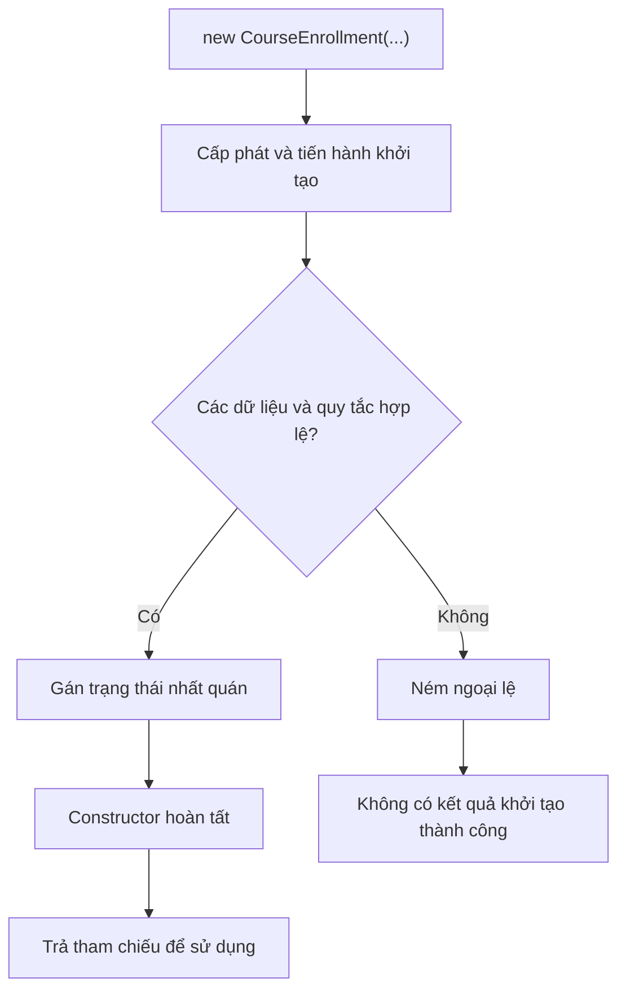

# Hàm khởi tạo và thiết lập trạng thái hợp lệ trong Java

Một đối tượng không chỉ cần **được tạo ra**; nó cần ở trong **trạng thái hợp lệ** trước khi mã bên ngoài bắt đầu sử dụng. Trong Java, **constructor (hàm khởi tạo)** là nơi quan trọng để kiểm tra dữ liệu đầu vào, gán các trường và bảo đảm những quy tắc mà đối tượng luôn phải tuân theo.

Ví dụ, một lớp đăng ký khóa học chỉ hợp lệ khi mã khóa học có nội dung, sức chứa lớn hơn 0, số người đăng ký không vượt quá sức chứa và danh sách đăng ký không có phần tử trùng nhau. Nếu một trong những điều kiện này sai, constructor nên **từ chối tạo đối tượng dùng được** bằng ngoại lệ thích hợp.

## 1. Constructor nằm ở đâu trong vòng đời đối tượng?

Xét lời gọi:

```java
CourseEnrollment course = new CourseEnrollment("JAVA-01", 20);
```

Ở mức khái niệm, quá trình là:

1. Biểu thức `new` yêu cầu tạo một đối tượng thuộc lớp `CourseEnrollment`.
2. Java cấp phát bộ nhớ, gán giá trị mặc định cho các trường rồi thực hiện quá trình khởi tạo theo thứ tự của ngôn ngữ (gồm constructor của lớp cha, các bước khởi tạo trường/khối khởi tạo và thân constructor).
3. Constructor nhận tham số, xác thực các điều kiện và thiết lập trạng thái ban đầu.
4. Nếu khởi tạo hoàn tất bình thường, biểu thức `new` trả về tham chiếu đến đối tượng cho bên gọi.
5. Nếu constructor ném ngoại lệ, biểu thức tạo đối tượng **không hoàn thành bình thường**; bên gọi không nhận được tham chiếu kết quả từ biểu thức đó.



Sơ đồ diễn tả luồng kiểm tra của ví dụ; thứ tự chi tiết của những bước khởi tạo trường và lớp cha vẫn do Java quy định.

**Constructor không phải phương thức thông thường.** Tên constructor phải trùng tên lớp, không có kiểu trả về (kể cả `void`) và được gọi trong quá trình tạo đối tượng. Nó có thể nhận tham số, kiểm tra điều kiện, gán trường và ném ngoại lệ.

## 2. Trạng thái hợp lệ và bất biến của lớp (class invariant)

**Invariant** là một tập điều kiện phải đúng ở các thời điểm đối tượng được công bố và sử dụng hợp lệ.

Ví dụ một lớp `BankAccount` có quy tắc số dư không âm:

```java
class BankAccount {
    private long balance;

    BankAccount(long openingBalance) {
        if (openingBalance < 0) {
            throw new IllegalArgumentException("Số dư ban đầu không được âm");
        }
        this.balance = openingBalance;
    }

    void withdraw(long amount) {
        if (amount <= 0 || amount > balance) {
            throw new IllegalArgumentException("Số tiền rút không hợp lệ");
        }
        balance -= amount;
    }

    long getBalance() {
        return balance;
    }
}
```

Ở đây invariant là `balance >= 0`. Constructor bảo đảm nó đúng **sau khi tạo**, còn `withdraw()` phải tiếp tục duy trì nó **trong suốt quá trình sử dụng**.

Nếu chỉ kiểm tra trong constructor nhưng lại có setter `setBalance(-100)` không kiểm tra, invariant vẫn có thể bị phá vỡ. Vì vậy:

- Constructor phải đưa đối tượng vào trạng thái hợp lệ ban đầu.
- Các phương thức có thể thay đổi trạng thái phải duy trì tính hợp lệ đó.
- Trường nên được đóng gói bằng `private`; không mở khả năng gán tùy ý từ bên ngoài.
- Không cần setter cho mọi trường. Chỉ cung cấp thao tác nghiệp vụ mà đối tượng thực sự cho phép.

Một kiểm tra tốt thường gắn với **quy tắc miền nghiệp vụ**: số tiền không âm, khoảng thời gian bắt đầu trước kết thúc, mã định danh không trống, số lượng đặt hàng dương, hoặc danh sách thành viên không vượt sức chứa.

## 3. Ví dụ hoàn chỉnh: khởi tạo đăng ký khóa học hợp lệ

Ví dụ dưới đây tạo một lớp **bất biến**: mọi trạng thái được kiểm tra trong constructor, các trường không gán lại và thao tác thêm người học tạo ra đối tượng mới thông qua constructor. Cách làm này giúp nhìn rõ việc **kiểm tra lại invariant** mỗi lần cần trạng thái mới.

Đặt toàn bộ mã sau vào file `Main.java`. Chạy bằng **Java 17 hoặc Java 21**.

```java
import java.util.ArrayList;
import java.util.HashSet;
import java.util.List;
import java.util.Objects;
import java.util.Set;

final class CourseEnrollment {
    private final String courseCode;
    private final int capacity;
    private final List<String> studentEmails;

    // Constructor tiện lợi cho khóa học chưa có người đăng ký.
    CourseEnrollment(String courseCode, int capacity) {
        this(courseCode, capacity, List.of());
    }

    // Constructor thực hiện kiểm tra trạng thái đầy đủ.
    CourseEnrollment(String courseCode, int capacity, List<String> studentEmails) {
        if (courseCode == null || courseCode.isBlank()) {
            throw new IllegalArgumentException("Mã khóa học không được trống");
        }
        if (capacity <= 0) {
            throw new IllegalArgumentException("Sức chứa phải lớn hơn 0");
        }

        Objects.requireNonNull(studentEmails, "studentEmails");

        // Chụp dữ liệu đầu vào để caller không sửa được trạng thái bên trong.
        // List.copyOf cũng từ chối các phần tử null.
        List<String> copy = List.copyOf(studentEmails);

        if (copy.size() > capacity) {
            throw new IllegalArgumentException("Số học viên vượt sức chứa");
        }

        Set<String> unique = new HashSet<>();
        for (String email : copy) {
            if (email.isBlank()) {
                throw new IllegalArgumentException("Email không được trống");
            }
            if (!unique.add(email)) {
                throw new IllegalArgumentException("Email đã đăng ký trùng");
            }
        }

        // Sau khi đã kiểm tra xong, thiết lập trạng thái.
        this.courseCode = courseCode;
        this.capacity = capacity;
        this.studentEmails = copy;
    }

    CourseEnrollment withStudent(String email) {
        Objects.requireNonNull(email, "email");

        List<String> updated = new ArrayList<>(studentEmails);
        updated.add(email);

        // Constructor tiếp tục bảo vệ các invariant.
        return new CourseEnrollment(courseCode, capacity, updated);
    }

    String getCourseCode() {
        return courseCode;
    }

    int getCapacity() {
        return capacity;
    }

    int getRegisteredCount() {
        return studentEmails.size();
    }

    List<String> getStudentEmails() {
        return studentEmails;
    }
}

public class Main {
    public static void main(String[] args) {
        List<String> source = new ArrayList<>(List.of("lan@example.com"));
        CourseEnrollment first = new CourseEnrollment("JAVA-01", 2, source);

        source.add("minh@example.com"); // Sửa danh sách ngoài đối tượng
        System.out.println(first.getStudentEmails());

        CourseEnrollment second = first.withStudent("minh@example.com");
        System.out.println(first.getRegisteredCount());
        System.out.println(second.getRegisteredCount());
        System.out.println(first == second);

        try {
            new CourseEnrollment("JAVA-01", 1,
                    List.of("lan@example.com", "minh@example.com"));
        } catch (IllegalArgumentException ex) {
            System.out.println(ex.getMessage());
        }

        try {
            first.withStudent("lan@example.com");
        } catch (IllegalArgumentException ex) {
            System.out.println(ex.getMessage());
        }

        try {
            new CourseEnrollment(" ", 2);
        } catch (IllegalArgumentException ex) {
            System.out.println(ex.getMessage());
        }

        try {
            first.getStudentEmails().add("other@example.com");
        } catch (UnsupportedOperationException ex) {
            System.out.println("Không thể sửa danh sách đã trả về");
        }
    }
}
```

Biên dịch và chạy:

```bash
javac Main.java
java Main
```

Kết quả:

```text
[lan@example.com]
1
2
false
Số học viên vượt sức chứa
Email đã đăng ký trùng
Mã khóa học không được trống
Không thể sửa danh sách đã trả về
```

**Đọc kết quả:**

- Constructor đã chụp `List.copyOf(source)`, nên việc thêm phần tử vào `source` không làm thay đổi `first`.
- `first.withStudent(...)` gọi lại constructor để tạo `second`. `first` vẫn có 1 người đăng ký, `second` có 2; chúng là hai đối tượng khác nhau.
- Khi số người học lớn hơn sức chứa, trùng email hoặc mã khóa học rỗng, constructor ném `IllegalArgumentException`.
- Danh sách do `getStudentEmails()` trả về không cho thêm/xóa, tránh phá vỡ trạng thái đã kiểm tra.

Ví dụ kiểm tra email theo chuỗi chính xác và phân biệt chữ hoa/chữ thường; đây là quy tắc minh họa. Ứng dụng thực tế phải xác định chính sách chuẩn hóa và đối chiếu email riêng, đồng thời kiểm tra những ràng buộc nghiệp vụ khác khi cần.

## 4. Chọn thứ tự kiểm tra và gán trường

Một constructor dễ kiểm tra thường đi theo thứ tự:

1. Kiểm tra tham số `null` và giá trị đơn lẻ: `courseCode`, `capacity`.
2. Chuẩn hóa hoặc tạo bản sao dữ liệu ngoài nếu cần.
3. Kiểm tra ràng buộc giữa nhiều trường: số học viên không được vượt `capacity`.
4. Gán các trường một lần, theo trạng thái đã được kiểm tra.
5. Cho phép constructor hoàn tất khi mọi invariant đều đúng.

Cách này hạn chế việc đặt đối tượng vào trạng thái sai rồi mới phát hiện lỗi. Dù constructor ném ngoại lệ thì đối tượng chưa được công bố qua kết quả `new`; tuy nhiên, những **tác động bên ngoài** diễn ra trước khi ném lỗi (ghi file, gửi sự kiện, chuyển tiền, đăng ký listener...) **không được Java tự hoàn tác**. Vì vậy nên kiểm tra trước, tránh side effect không cần thiết trong constructor và tách các thao tác nghiệp vụ dài ra khỏi việc khởi tạo.

| Loại kiểm tra | Ví dụ | Vị trí thích hợp |
| --- | --- | --- |
| Không được `null` | Danh sách đầu vào bắt buộc | Constructor, bằng `Objects.requireNonNull` |
| Không rỗng | Mã khóa học, tên người học | Constructor, sau kiểm tra `null` |
| Khoảng giá trị | `capacity > 0` | Constructor |
| Ràng buộc giữa các trường | `students.size() <= capacity` | Constructor, sau khi có danh sách an toàn |
| Tính duy nhất | Không trùng email | Constructor hoặc lớp giá trị chuyên trách |
| Quy tắc khi cập nhật | Không rút vượt số dư | Phương thức thay đổi trạng thái |
| Quy tắc có dữ liệu ngoài | Khóa học còn mở trong hệ thống | Thường ở dịch vụ/luồng nghiệp vụ, trước khi tạo đối tượng phù hợp |

Không phải mọi phép xác thực đều nên nằm trong constructor. Ví dụ, kiểm tra một mã coupon còn hiệu lực trong cơ sở dữ liệu phụ thuộc vào thời điểm, kết nối và giao dịch. Đó thường là trách nhiệm của một service hoặc factory phối hợp hạ tầng; constructor vẫn nên tự bảo vệ những bất biến **nội tại** của đối tượng.

## 5. Mọi lối gọi constructor phải bảo vệ cùng invariant

Khi cần hỗ trợ nhiều tập dữ liệu đầu vào, các overload nên **ủy quyền** về cùng một điểm xác thực. Trong Java 17/21, lời gọi `this(...)` được đặt đầu constructor:

~~~java
class RetryPolicy {
    private final int attempts;

    RetryPolicy() {
        this(3);
    }

    RetryPolicy(int attempts) {
        if (attempts <= 0) throw new IllegalArgumentException();
        this.attempts = attempts;
    }
}
~~~

Hai lối gọi đều không thể tạo `RetryPolicy` có `attempts <= 0`. Đây là một ứng dụng của invariant trong constructor; bài *Khởi tạo mặc định, tham số và nhiều cách khởi tạo* sẽ phân biệt default/no-arg/parameterized constructors, lựa chọn overload và `this(...)`/`super(...)` kỹ hơn.

## 6. `final`, đóng gói và defensive copy

Một lớp có trường `private final` giúp hạn chế việc thay đổi tham chiếu hoặc giá trị trường sau khi gán:

```java
final class Schedule {
    private final List<String> lessons;

    Schedule(List<String> lessons) {
        this.lessons = List.copyOf(lessons);
    }

    List<String> getLessons() {
        return lessons;
    }
}
```

Dùng `final` trên trường **không tự làm cho đối tượng được tham chiếu bất biến**:

```java
class UnsafeSchedule {
    private final List<String> lessons;

    UnsafeSchedule(List<String> lessons) {
        this.lessons = lessons; // Vẫn chia sẻ list mutable với caller
    }
}
```

Với `UnsafeSchedule`, caller có thể sửa danh sách gốc và làm thay đổi trạng thái quan sát được của đối tượng. `Schedule` dùng `List.copyOf()` để giữ một danh sách không sửa được về cấu trúc và không bị ảnh hưởng bởi thao tác thêm/xóa trong danh sách đầu vào sau đó.

**Giới hạn quan trọng:** `List.copyOf()` sao chép cấu trúc danh sách, **không sao chép sâu** mọi phần tử. Nếu danh sách chứa phần tử mutable như `StringBuilder`, `Date` hoặc đối tượng nghiệp vụ có setter, cần thêm biện pháp để bảo đảm bất biến sâu. Trong ví dụ `Schedule`, các phần tử `String` vốn bất biến, nên phù hợp.

Nguyên tắc thực hành:

- Khai báo trường `private` để kiểm soát các đường cập nhật trạng thái.
- Dùng `final` cho dữ liệu phải được gán một lần.
- Sao chép dữ liệu mutable đầu vào nếu không muốn phụ thuộc vào thay đổi của caller.
- Không trả tham chiếu có thể sửa trực tiếp vào cấu trúc nội bộ cần bảo vệ.
- Chỉ cung cấp phương thức thay đổi trạng thái nếu đó là hành vi có ý nghĩa nghiệp vụ.

## 7. Khởi tạo hợp lệ khác với “tạm thời rồi sửa sau”

Hai phương án dưới đây khác nhau về cam kết của lớp:

```java
// Phương án dễ tạo trạng thái chưa hợp lệ:
class UnsafeUser {
    String email;

    UnsafeUser() {
    }
}

// Có thể tạo UnsafeUser mà email == null.
```

So với:

```java
final class User {
    private final String email;

    User(String email) {
        if (email == null || email.isBlank()) {
            throw new IllegalArgumentException("Email bắt buộc");
        }
        this.email = email;
    }

    String getEmail() {
        return email;
    }
}
```

Ở cách thứ hai, một đối tượng `User` được khởi tạo thành công **không ở trạng thái thiếu email**. Khi thiết kế API, điều này giúp bỏ nhiều câu `if (user.getEmail() == null)` rải rác ở nơi sử dụng.

Tuy nhiên, một hệ thống vẫn có thể cần các trạng thái nghiệp vụ khác nhau, ví dụ `DRAFT`, `PENDING`, `ACTIVE`. Các trạng thái này **không nhất thiết là trạng thái không hợp lệ**. Điều quan trọng là mô hình hóa rõ những trạng thái hợp lệ theo từng giai đoạn, và ngăn tổ hợp dữ liệu mâu thuẫn, ví dụ `ACTIVE` nhưng không có ngày kích hoạt khi chính sách yêu cầu phải có.

Một số mô hình có thể dùng factory tĩnh như `User.registered(email)`, `Order.draft(...)` hoặc các loại dữ liệu riêng để diễn đạt trạng thái khởi tạo. Factory là công cụ thiết kế bổ sung; các constructor được gọi phía sau vẫn cần bảo đảm invariant theo quyền truy cập và hợp đồng lớp.

## 8. Constructor ném ngoại lệ thì sao?

Ví dụ:

```java
class Seat {
    private final int number;

    Seat(int number) {
        if (number <= 0) {
            throw new IllegalArgumentException("Số ghế phải dương");
        }
        this.number = number;
    }
}
```

```java
Seat good = new Seat(5);   // Tạo thành công
Seat bad = new Seat(-1);  // Ném IllegalArgumentException
```

Ở dòng thứ hai, phép gán cho `bad` không hoàn tất. Nếu code bắt ngoại lệ thì có thể xử lý lỗi và tiếp tục luồng chương trình. Ngoại lệ không biến một đối tượng không hợp lệ thành giá trị `null`.

Thường dùng:

| Ngoại lệ | Tình huống phổ biến |
| --- | --- |
| `IllegalArgumentException` | Tham số không thỏa hợp đồng constructor (âm, trống, vượt ngưỡng) |
| `NullPointerException` | Tham số bắt buộc khác `null`, thường dùng `Objects.requireNonNull` |
| Ngoại lệ miền nghiệp vụ tùy chỉnh | Cần biểu diễn lỗi nghiệp vụ đặc thù, nhất quán trong API |

Không nên dùng `assert` để thay cho kiểm tra dữ liệu constructor. Assertion có thể không được bật khi chạy ứng dụng; validation của hợp đồng lớp phải hoạt động độc lập với cấu hình `-ea`.

Một constructor nên để lỗi **lộ rõ theo hợp đồng**, không nuốt ngoại lệ rồi khởi tạo đối tượng với giá trị mặc định tùy tiện, trừ khi giá trị mặc định đó đã được xác định là trạng thái hợp lệ.

## 9. Không làm lộ một đối tượng chưa hoàn tất constructor

Kiểm tra invariant đúng vẫn có thể thất bại nếu mã bên ngoài sử dụng `this` quá sớm. Hai đường thường gặp:

- **Constructor cha gọi phương thức được override:** Java có thể dispatch vào override của lớp con khi các field initializer của lớp con chưa chạy; kết quả là field còn mang giá trị mặc định `null`/`0`.
- **Đăng ký listener hoặc start task trong constructor:** callback hoặc thread khác có thể đọc field trước khi chúng được thiết lập; nếu constructor ném lỗi sau khi đăng ký, tham chiếu tới đối tượng dở dang còn có thể bị giữ.

Vì vậy, dùng các helper khởi tạo không thể override, validate trước side effect, và đăng ký/công bố object **sau khi constructor hoàn tất** theo cơ chế đồng bộ phù hợp. Trình tự chính xác của lớp cha và lớp con nằm ở bài *Thứ tự khởi tạo trong quan hệ kế thừa*; nguyên nhân, ví dụ callback và safe publication ở bài *Tránh để đối tượng chưa khởi tạo xong bị sử dụng*.

## 10. Constructor của `record` cũng có thể bảo vệ invariant

Từ Java 16, `record` cho phép biểu diễn các đối tượng dữ liệu gọn hơn. Với **compact constructor**, có thể xác thực và chuẩn hóa tham số trước khi Java tự gán vào các trường thành phần:

```java
import java.util.List;

record LessonBundle(String name, List<String> lessons) {
    LessonBundle {
        if (name == null || name.isBlank()) {
            throw new IllegalArgumentException("Tên bộ bài học không hợp lệ");
        }
        lessons = List.copyOf(lessons);
        if (lessons.isEmpty()) {
            throw new IllegalArgumentException("Cần ít nhất một bài học");
        }
    }
}
```

`name` và `lessons` được dùng làm tham số của constructor; trong compact constructor, việc gán `lessons = List.copyOf(lessons)` thay thế giá trị tham số bằng một danh sách đã bảo vệ. Sau thân constructor, Java tự gán các tham số đã xử lý vào trường tương ứng.

**Chú ý:** Trường của record là `final`, nhưng record không tự bất biến sâu. Nếu thành phần là đối tượng mutable, constructor vẫn cần kiểm soát việc chia sẻ tham chiếu và phần tử bên trong.

## 11. Checklist thiết kế constructor tốt

| Câu hỏi đánh giá | Mong đợi |
| --- | --- |
| Điều kiện nào khiến đối tượng hợp lệ? | Có danh sách invariant rõ ràng |
| Dữ liệu bắt buộc có được cung cấp khi tạo? | Không tạo đối tượng thiếu trường cần thiết |
| Mọi đường constructor có cùng quy tắc? | Ưu tiên ủy quyền về điểm kiểm tra chung |
| Tham số `null` hoặc sai khoảng có bị từ chối? | Lỗi rõ, nhất quán với hợp đồng |
| Có chia sẻ collection/mảng mutable của caller không? | Defensive copy nếu muốn bảo vệ |
| Getter có làm lộ trạng thái có thể sửa không? | Trả dữ liệu an toàn hoặc API được kiểm soát |
| Có gọi override, xuất bản `this`, thực hiện I/O quá sớm không? | Tránh sử dụng đối tượng chưa sẵn sàng và side effect khó hoàn tác |
| Phương thức thay đổi trạng thái có giữ invariant không? | Trạng thái hợp lệ từ đầu đến cuối |

## 12. Bài tập tự kiểm tra

**Bài 1:** Chuyện gì xảy ra?

```java
class Product {
    private final int quantity;

    Product(int quantity) {
        if (quantity <= 0) {
            throw new IllegalArgumentException("quantity phải dương");
        }
        this.quantity = quantity;
    }
}
// new Product(0);
```

**Đáp án:** Khi bỏ dấu chú thích và gọi `new Product(0)`, constructor ném `IllegalArgumentException`, không trả về một đối tượng `Product` được khởi tạo thành công.

**Bài 2:** Trong `CourseEnrollment`, tại sao phải kiểm tra `copy.size() > capacity` trong constructor ba tham số ngay cả khi constructor hai tham số luôn truyền `List.of()`?

**Đáp án:** Vì bên gọi có thể dùng trực tiếp constructor ba tham số, và `withStudent()` cũng đi qua nó. Mọi đường tạo đối tượng cần bảo vệ cùng invariant.

**Bài 3:** Nếu thay `this.studentEmails = copy;` thành `this.studentEmails = studentEmails;`, rủi ro gì?

**Đáp án:** Danh sách mutable do caller truyền vào vẫn có thể được sửa sau khi khởi tạo; số học viên có thể vượt sức chứa hoặc bị trùng dù constructor đã kiểm tra trước đó.

**Bài 4:** Vì sao `private final List<String> items` không tự bảo đảm invariant “danh sách không thay đổi”?

**Đáp án:** `final` chỉ chặn việc gán lại trường, không chặn `items.add(...)`. Cần kiểm soát đối tượng danh sách và các phần tử bên trong nếu chúng mutable.

**Bài 5:** Constructor của lớp cha gọi phương thức có thể override thì rủi ro gì?

**Đáp án:** Phần override ở lớp con có thể chạy trước khi phần khởi tạo lớp con hoàn tất, đọc phải các giá trị mặc định như `null` hoặc `0`.

**Điểm cần nhớ:** Một constructor tốt xác lập **hợp đồng trạng thái của đối tượng tại thời điểm khởi tạo thành công**. Hãy định nghĩa invariant, kiểm tra đầu vào và quan hệ giữa các trường, bảo vệ dữ liệu mutable được truyền vào, rồi chỉ công bố đối tượng sau khi mọi bước khởi tạo hoàn tất. Những phương thức thay đổi trạng thái về sau phải tiếp tục duy trì hợp đồng đó.