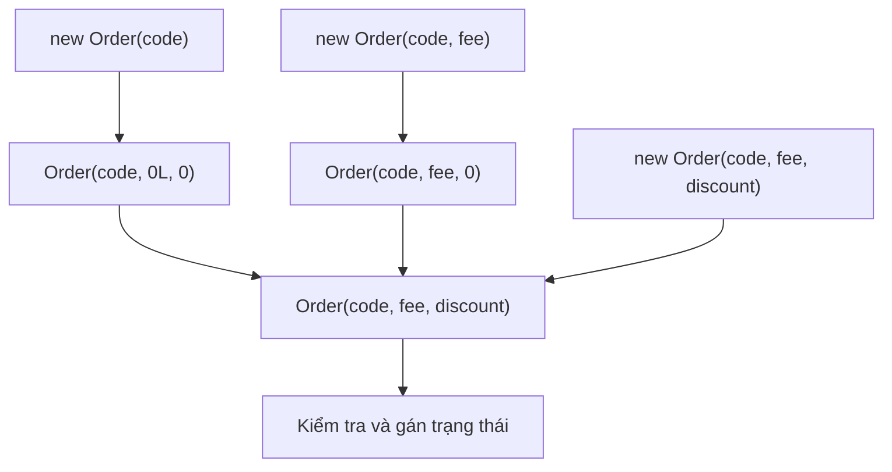

# Khởi tạo mặc định, tham số và nhiều cách khởi tạo đối tượng trong Java

Một đối tượng chỉ thực sự có ý nghĩa khi trạng thái ban đầu của nó hợp lệ. Khi viết lớp `Student`, `BankAccount` hay `Order`, ta cần xác định dữ liệu nào bắt buộc phải có ngay lúc tạo, dữ liệu nào có giá trị mặc định và khi nào nên cung cấp nhiều cách tạo đối tượng.

Trong Java, công cụ trung tâm của bước này là **constructor (hàm tạo)**. Bên cạnh constructor, Java còn hỗ trợ khởi tạo trường, khối khởi tạo, static factory method và mô hình Builder. Mỗi lựa chọn giải quyết một nhu cầu khác nhau, không nên xem chúng như những cách viết thay thế hoàn toàn tương đương.

## 1. Constructor là gì?

Constructor được gọi khi khởi tạo một thể hiện lớp, thường thông qua biểu thức `new`:

```java
public class Student {
    private final String id;
    private final String name;

    public Student(String id, String name) {
        this.id = id;
        this.name = name;
    }

    public String getName() {
        return name;
    }

    public static void main(String[] args) {
        Student student = new Student("SV01", "An");
        System.out.println(student.getName()); // An
    }
}
```

Trong ví dụ:

1. `new Student("SV01", "An")` yêu cầu tạo một đối tượng `Student`.
2. Constructor `Student(String id, String name)` nhận dữ liệu đầu vào.
3. Các trường `id`, `name` được gán giá trị để đối tượng sẵn sàng sử dụng.
4. Biểu thức `new` có kết quả là tham chiếu đến đối tượng; biến `student` nhận giá trị tham chiếu đó.

**Đặc điểm của constructor:**

- Tên constructor trùng với **tên lớp**.
- Constructor **không khai báo kiểu trả về**, kể cả `void`.
- Có thể nhận tham số, overload và mang modifier truy cập (`public`, `protected`, package-private hoặc `private`).
- Không được khai báo `static`, `abstract`, `final`; constructor không được kế thừa hay ghi đè như phương thức.
- Nếu một phương thức có tên giống tên lớp nhưng khai báo kiểu trả về, nó vẫn là **phương thức**, không phải constructor.

Ví dụ cách viết **sai**:

```java
class Product {
    // public void Product(String name) { } // Đây là method tên Product
    // public static Product() { }           // Không thể dùng static cho constructor
}
```

Constructor là nơi phù hợp để bảo đảm **bất biến của đối tượng (object invariants)**, chẳng hạn giá không âm, tên không rỗng và mã định danh hợp lệ.

## 2. Constructor mặc định khác constructor không tham số

Hai khái niệm này thường bị gọi chung là “constructor mặc định”, nhưng khi học Java nên phân biệt rõ:

| Khái niệm | Nguồn gốc | Khi nào tồn tại? | Có thực hiện logic do ta viết? |
|---|---|---|---|
| **Default constructor** (constructor mặc định ngầm định) | Java compiler tự sinh | Chỉ khi lớp **không khai báo bất kỳ constructor nào** | Không có logic do lập trình viên tự viết; gọi `super()` |
| **No-argument constructor** (constructor không tham số) | Do lập trình viên khai báo | Khi viết `ClassName() { ... }` | Có thể chứa logic khởi tạo, kiểm tra, gán giá trị |
| **Parameterized constructor** (constructor có tham số) | Do lập trình viên khai báo | Khi viết constructor có ít nhất một tham số | Dùng dữ liệu đầu vào để tạo trạng thái theo yêu cầu |

### 2.1. Default constructor do trình biên dịch sinh

```java
public class Book {
    String title;
    int pages;

    // Không khai báo constructor nào

    public static void main(String[] args) {
        Book book = new Book();

        System.out.println(book.title); // null
        System.out.println(book.pages); // 0
    }
}
```

Vì `Book` không có constructor nào được khai báo, Java compiler cung cấp một constructor không tham số ngầm định. Trong lớp thông thường như trên, có thể hình dung gần tương đương:

```java
public Book() {
    super();
}
```

Điều này **không có nghĩa** mọi lớp đều mặc nhiên có `new ClassName()`; khi ta khai báo một constructor bất kỳ, compiler sẽ không tự bổ sung constructor không tham số nữa.

Các trường có giá trị mặc định theo kiểu khi một đối tượng được tạo (nếu không được gán bởi field initializer/constructor):

| Kiểu trường | Giá trị mặc định |
|---|---|
| `byte`, `short`, `int`, `long` | `0` (đúng kiểu) |
| `float`, `double` | `0.0` (đúng kiểu) |
| `boolean` | `false` |
| `char` | `'\u0000'` |
| Kiểu tham chiếu như `String`, `List` | `null` |

Các **biến cục bộ** trong phương thức/constructor không có cơ chế “đọc giá trị mặc định” như trường: chúng phải được gán trước khi đọc.

### 2.2. Constructor không tham số tự viết

```java
public class Counter {
    private int value;

    public Counter() {
        this.value = 100;
    }

    public int getValue() {
        return value;
    }

    public static void main(String[] args) {
        Counter counter = new Counter();
        System.out.println(counter.getValue()); // 100
    }
}
```

Ở đây `Counter()` **được viết tường minh** nên không phải constructor mặc định do compiler sinh. Constructor tự viết có thể đặt giá trị khác giá trị mặc định, gọi các phương thức hỗ trợ hoặc ủy quyền đến constructor khác.

### 2.3. Có constructor có tham số thì không tự có no-arg

```java
public class Device {
    private final String serial;

    public Device(String serial) {
        this.serial = serial;
    }
}

Device a = new Device("SN-001"); // Hợp lệ
// Device b = new Device();        // LỖI BIÊN DỊCH
```

Lý do: lớp đã khai báo `Device(String serial)`. Compiler sẽ **không** tự sinh `Device()`.

Nếu thực sự cần hai cách tạo, phải khai báo cả hai constructor:

```java
public class Device {
    private final String serial;

    public Device() {
        this("UNASSIGNED");
    }

    public Device(String serial) {
        this.serial = serial;
    }
}
```

Trong ví dụ này, `Device()` là constructor không tham số do lập trình viên khai báo; nó ủy quyền tới constructor nhận `String`.

**Lưu ý:** Một lớp cha không có constructor không tham số truy cập được cũng có thể khiến constructor ngầm định của lớp con gây lỗi biên dịch, vì việc khởi tạo lớp con phải gọi được constructor thích hợp của lớp cha.

## 3. Constructor có tham số: bảo đảm dữ liệu bắt buộc

Constructor có tham số phù hợp khi đối tượng **không nên tồn tại ở trạng thái thiếu thông tin**.

Ví dụ tài khoản ngân hàng có mã tài khoản bắt buộc và số dư ban đầu không được âm:

```java
import java.math.BigDecimal;
import java.util.Objects;

public class BankAccount {
    private final String accountNumber;
    private BigDecimal balance;

    public BankAccount(String accountNumber, BigDecimal openingBalance) {
        Objects.requireNonNull(accountNumber, "accountNumber");
        if (accountNumber.isBlank()) {
            throw new IllegalArgumentException("Mã tài khoản không được rỗng");
        }
        Objects.requireNonNull(openingBalance, "openingBalance");
        if (openingBalance.signum() < 0) {
            throw new IllegalArgumentException("Số dư mở tài khoản không được âm");
        }

        this.accountNumber = accountNumber;
        this.balance = openingBalance;
    }

    public BigDecimal getBalance() {
        return balance;
    }

    public static void main(String[] args) {
        BankAccount account =
                new BankAccount("ACC-01", new BigDecimal("100000"));

        System.out.println(account.getBalance()); // 100000
    }
}
```

Constructor xác nhận đầu vào hợp lệ **trước khi đối tượng được sử dụng bình thường**. Sử dụng `BigDecimal` thay vì `double` cho số tiền giúp tránh những lỗi thường gặp từ biểu diễn dấu phẩy động nhị phân; đây là lựa chọn thiết kế ví dụ, không phải quy tắc bắt buộc cho mọi loại dữ liệu.

Với thuộc tính bắt buộc, constructor có tham số thường rõ ràng hơn thiết kế tạo đối tượng trống rồi chờ chuỗi lời gọi setter:

```java
// Dễ gây trạng thái tạm thời chưa hợp lệ nếu thiếu thao tác:
Profile profile = new Profile();
profile.setEmail("an@example.com");
// Nếu quên setUserId(), đối tượng có thể vẫn thiếu dữ liệu bắt buộc.
```

Khi không thực sự cần tạo thể hiện “chưa hoàn tất”, nên thiết kế constructor để nhận đủ dữ liệu bắt buộc.

## 4. Constructor overloading: nhiều cách khởi tạo một lớp

**Overloading** là khai báo nhiều constructor cùng tên lớp nhưng khác **danh sách tham số** (khác số lượng, kiểu hoặc thứ tự kiểu). Phạm vi truy cập có thể khác nhau, nhưng chỉ thay access modifier không làm thành hai overload.

Ví dụ một đơn hàng có mã bắt buộc, phí vận chuyển và mức ưu đãi tùy chọn:

```java
public class Order {
    private final String code;
    private final long shippingFee;
    private final int discountPercent;

    public Order(String code) {
        this(code, 0L, 0);
    }

    public Order(String code, long shippingFee) {
        this(code, shippingFee, 0);
    }

    public Order(String code, long shippingFee, int discountPercent) {
        if (code == null || code.isBlank()) {
            throw new IllegalArgumentException("Mã đơn hàng bắt buộc");
        }
        if (shippingFee < 0) {
            throw new IllegalArgumentException("Phí vận chuyển không được âm");
        }
        if (discountPercent < 0 || discountPercent > 100) {
            throw new IllegalArgumentException("Ưu đãi phải từ 0 đến 100%");
        }
        this.code = code;
        this.shippingFee = shippingFee;
        this.discountPercent = discountPercent;
    }

    public String describe() {
        return code + " | shipping=" + shippingFee
                + " | discount=" + discountPercent + "%";
    }

    public static void main(String[] args) {
        System.out.println(new Order("ORD-01").describe());
        System.out.println(new Order("ORD-02", 25000L).describe());
        System.out.println(new Order("ORD-03", 25000L, 10).describe());
    }
}
```

Kết quả:

```text
ORD-01 | shipping=0 | discount=0%
ORD-02 | shipping=25000 | discount=0%
ORD-03 | shipping=25000 | discount=10%
```

Thay vì lặp lại toàn bộ code kiểm tra ở ba constructor, các overload ngắn **ủy quyền** về constructor đầy đủ. Điều này giữ quy tắc hợp lệ ở một nơi.

### Cách Java chọn overload

Trình biên dịch chọn constructor phù hợp tại **thời điểm biên dịch**, dựa trên số lượng và kiểu đối số cũng như những chuyển đổi hợp lệ. Nếu có nhiều overload không phân định được, lời gọi sẽ **mơ hồ (ambiguous)**.

```java
class Message {
    Message(String text) {}
    Message(Integer code) {}
}

// new Message(null); // LỖI: null phù hợp cả String lẫn Integer
new Message((String) null); // Chọn constructor String
```

Vì vậy không nên tạo quá nhiều overload dễ nhầm lẫn, đặc biệt khi có các tham số cùng kiểu hoặc có thể nhận `null`.

## 5. Constructor chaining với this() và super()

Khi một constructor gọi một constructor khác, đó là **constructor chaining**.

- `this(...)`: gọi một constructor **khác trong cùng lớp**.
- `super(...)`: gọi constructor của **lớp cha**.
- Trong mẫu tương thích rộng rãi, lệnh gọi constructor tường minh được đặt đầu thân constructor.
- Không thể gọi cả `this(...)` và `super(...)` như hai lời gọi constructor trực tiếp trong cùng một constructor; constructor được `this(...)` gọi sẽ tiếp tục chuỗi đến lớp cha.
- Không thể tạo vòng gọi `this(...)` (chẳng hạn A gọi B và B lại gọi A): compiler báo lỗi.

Sơ đồ luồng khởi tạo của `Order` ở phần trên:



### Ví dụ lớp cha và lớp con

File `InheritanceInitDemo.java`:

```java
public class InheritanceInitDemo {
    static class Person {
        private final String name;

        Person(String name) {
            this.name = name;
            System.out.println("Person constructor: " + name);
        }

        String getName() {
            return name;
        }
    }

    static class Employee extends Person {
        private final String department;

        Employee(String name, String department) {
            super(name);
            this.department = department;
            System.out.println("Employee constructor: " + department);
        }

        String getDepartment() {
            return department;
        }
    }

    public static void main(String[] args) {
        Employee employee = new Employee("An", "Backend");
        System.out.println(employee.getName() + " - "
                + employee.getDepartment());
    }
}
```

Kết quả:

```text
Person constructor: An
Employee constructor: Backend
An - Backend
```

Constructor lớp cha được thực hiện trước phần thân constructor lớp con. Nếu constructor của `Employee` bỏ `super(name)`, trình biên dịch sẽ cố gọi `super()` ngầm định (trong ví dụ này, không tồn tại), và mã sẽ lỗi biên dịch.

**Không gọi trực tiếp constructor như phương thức bình thường**, ví dụ `employee.Person("An")`. Các lời gọi `this(...)` / `super(...)` thuộc cú pháp constructor invocation, có quy tắc riêng.

## 6. Constructor chaining trong kế thừa: điểm cần nhớ

Nếu `Child extends Parent`, constructor của `Child` cuối cùng phải đi qua một constructor hợp lệ của `Parent` (tường minh `super(...)` hoặc mặc định `super()` khi hợp lệ). Đây vẫn là **một đối tượng Child** có phần trạng thái do lớp cha khai báo; không tự tạo một instance `Parent` thứ hai.

~~~java
class Parent {
    Parent() { System.out.println("Parent"); }
}
class Child extends Parent {
    Child() {
        super();
        System.out.println("Child");
    }
}
// new Child() in "Parent", rồi "Child".
~~~

Thứ tự khởi tạo chi tiết hơn còn liên quan **static initializer**, field initializer và instance block của từng lớp. Các bước chạy theo chiều cha → con; code gọi override trong constructor cha có thể quan sát field của lớp con đang mang giá trị mặc định. Bài *Thứ tự khởi tạo trong quan hệ kế thừa* có một chương trình trace hoàn chỉnh và phân biệt thời điểm khởi tạo class với instance.

## 7. Khi overloaded constructor không còn dễ đọc

Overload phù hợp khi chỉ có vài tập tham số dễ phân biệt. Nhưng các yêu cầu khác có thể cần **phương thức tạo có tên** hoặc **Builder**:

~~~java
record Subscription(String plan, int months) {
    static Subscription trial() {
        return new Subscription("TRIAL", 1);
    }
    static Subscription paid(int months) {
        if (months <= 0) throw new IllegalArgumentException();
        return new Subscription("PAID", months);
    }
}

Subscription a = Subscription.trial();
Subscription b = Subscription.paid(12);
~~~

Đây là **static factory**: thay vì đưa boolean `isTrial` vào overload khiến lời gọi khó hiểu, tên `trial()` và `paid(...)` thể hiện mục đích. Static factory có thể trả đối tượng có sẵn; cách `trial()` ở ví dụ này tạo instance mới theo code của nó.

Nếu cấu hình cần nhiều trường tùy chọn, Builder thu thập tham số có tên rồi mới hoàn tất đối tượng bằng `build()`, giúp tránh quá nhiều overload cùng kiểu. Ví dụ một API được thiết kế theo Builder có thể dùng `MailOptions.builder(sender, recipient).subject("Báo cáo").retryCount(2).build()`; cách triển khai Builder, factory chọn implementation và giới hạn của hai mô hình được trình bày đầy đủ ở bài *Hàm tạo tĩnh, Factory và Builder*.

Điểm chung của mọi lối tạo là phải **bảo vệ invariant** trước khi trả đối tượng sẵn sàng được sử dụng.

## 8. So sánh các cách khởi tạo

| Cách tạo | Phù hợp khi | Điểm cần lưu ý |
|---|---|---|
| Constructor mặc định do compiler sinh | Lớp đơn giản không có constructor tự viết | Không tự kiểm tra dữ liệu; không còn được sinh khi khai báo constructor |
| Constructor không tham số tự viết | Muốn trạng thái khởi tạo chuẩn mà không cần đối số | Phải bảo đảm trạng thái không thiếu dữ liệu bắt buộc |
| Constructor có tham số | Cần dữ liệu bắt buộc và kiểm tra sớm | Nhiều tham số dễ gây gọi nhầm |
| Overloaded constructors | Có vài tập tham số hợp lý | Nên dùng `this(...)` để tập trung kiểm tra và tránh lặp |
| Static factory method | Muốn tên khởi tạo giàu ý nghĩa hoặc chính sách tạo linh hoạt | Không phải constructor và có thể trả về đối tượng khác/đã tồn tại |
| Builder | Nhiều tham số tùy chọn, cần lời gọi dễ đọc | Tăng số dòng mã và thường tạo đối tượng Builder trung gian |

**Nguyên tắc:** Hãy chọn cách đơn giản nhất giúp người dùng lớp tạo được một đối tượng hợp lệ. Tránh để đối tượng vừa tạo ở trạng thái thiếu thông tin nghiệp vụ quan trọng.

## 9. Các lỗi thường gặp

### 9.1. Tưởng constructor có tham số sẽ giữ no-arg ngầm định

```java
class Account {
    Account(String id) {}
}

// new Account(); // Lỗi: constructor Account() không tồn tại
```

Cách xử lý: khai báo `Account()` tường minh **nếu** không tham số là một trạng thái khởi tạo hợp lệ; không nhất thiết phải thêm no-arg chỉ để tránh lỗi.

### 9.2. Vô tình gán tham số cho chính nó

```java
class User {
    private String name;

    User(String name) {
        name = name;       // Sai logic: chỉ gán tham số cho chính nó
    }
}
```

Sửa bằng `this.name = name;` để phân biệt field với tham số.

### 9.3. Không gán đủ field final

```java
class Receipt {
    private final String number;

    // Receipt() {} // Lỗi: field number chưa được gán
    Receipt(String number) {
        this.number = number;
    }
}
```

Field `final` kiểu instance không có giá trị khởi tạo tại khai báo phải được **gán đúng một lần** trên mọi đường khởi tạo hợp lệ trước khi constructor hoàn thành. Có thể dùng constructor chaining để tránh lặp.

### 9.4. Hai overload gây mơ hồ

```java
class Job {
    Job(String id) {}
    Job(Integer priority) {}
}

// new Job(null); // Mơ hồ, compiler không chọn được overload
```

Nên tránh thiết kế nhiều overload kiểu tham chiếu không liên quan cùng số tham số nếu người dùng có thể truyền `null`; có thể dùng factory có tên hoặc ép kiểu rõ ràng khi phù hợp.

### 9.5. Constructor bị làm quá nhiều việc

Constructor mở kết nối mạng, ghi cơ sở dữ liệu hoặc thực hiện tác vụ chậm thường khó kiểm soát lỗi và làm đối tượng khó kiểm thử. Với công việc khởi tạo tài nguyên phức tạp, cân nhắc factory/service chuyên trách, trả lỗi rõ ràng và quản lý vòng đời đóng tài nguyên. Constructor vẫn có thể ném exception; nhưng đối tượng không nên bị xuất ra ngoài khi chưa hoàn tất khởi tạo.

### 9.6. Nhầm constructor với setter hoặc phương thức reset

Constructor thiết lập trạng thái lúc tạo; setter cập nhật trạng thái **sau khi đối tượng đã tồn tại**. Gọi setter không thể “chạy lại constructor” của một đối tượng. Nếu cần tạo lại với trạng thái mới, hãy tạo đối tượng mới hoặc định nghĩa hành vi cập nhật riêng có kiểm tra.

## 10. Tự kiểm tra

### Câu 1: Mã nào biên dịch được?

```java
class Ticket {
    Ticket(int price) {}
}

// Ticket t1 = new Ticket();   // A
Ticket t2 = new Ticket(100);  // B
```

**Đáp án:** Chỉ B. Việc khai báo `Ticket(int)` làm compiler không sinh `Ticket()` ngầm định.

### Câu 2: Kết quả constructor chaining?

```java
public class ChainQuiz {
    ChainQuiz() {
        this(5);
        System.out.println("A");
    }

    ChainQuiz(int number) {
        System.out.println("B" + number);
    }

    public static void main(String[] args) {
        new ChainQuiz();
    }
}
```

**Đáp án:**

```text
B5
A
```

Constructor `ChainQuiz()` ủy quyền đến `ChainQuiz(int)`, thực hiện xong constructor nhận `int` mới chạy phần còn lại của constructor không tham số.

### Câu 3: Thứ tự gọi cha - con?

```java
class Animal {
    Animal() {
        System.out.println("Animal");
    }
}
class Cat extends Animal {
    Cat() {
        System.out.println("Cat");
    }
}
```

Với `new Cat()`, kết quả là:

```text
Animal
Cat
```

`Cat()` không ghi `super()` nên trình biên dịch chèn lời gọi `super()` ngầm định; việc khởi tạo cha được thực hiện trước phần thân constructor con.

### Bài tập thiết kế

Hãy tự xây dựng lớp `CourseEnrollment` có:

- `studentId` và `courseId` là hai giá trị bắt buộc, không được `null` hoặc rỗng.
- `semester` là tùy chọn với giá trị mặc định `"2026-FALL"`.
- Một constructor nhận đủ ba tham số và một overload chỉ nhận hai tham số.
- Logic kiểm tra tập trung vào **một** constructor; những trường bắt buộc khai báo `private final`.
- Viết `main` minh họa hai cách tạo và kiểm tra dữ liệu không hợp lệ.

Gợi ý chữ ký:

```java
CourseEnrollment(String studentId, String courseId) {
    this(studentId, courseId, "2026-FALL");
}

CourseEnrollment(String studentId, String courseId, String semester) {
    // validate rồi gán các field
}
```

Một bước mở rộng: nếu về sau có thêm sáu tùy chọn đăng ký, hãy cân nhắc Builder thay vì tạo nhiều overload có tham số kiểu `String` dễ nhầm thứ tự.

---

**Ghi nhớ:** Java chỉ tự sinh **default constructor không tham số** khi lớp không khai báo constructor nào. Constructor có tham số giúp bảo đảm dữ liệu bắt buộc; overload tạo nhiều cách khởi tạo; `this(...)` tái sử dụng logic giữa các constructor và `super(...)` khởi tạo phần lớp cha. Khi số lượng lựa chọn tăng hoặc cách tạo mang ý nghĩa nghiệp vụ riêng, static factory và Builder có thể làm API dễ hiểu và an toàn hơn.