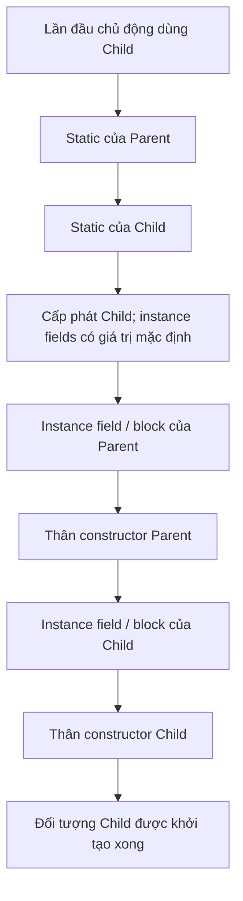
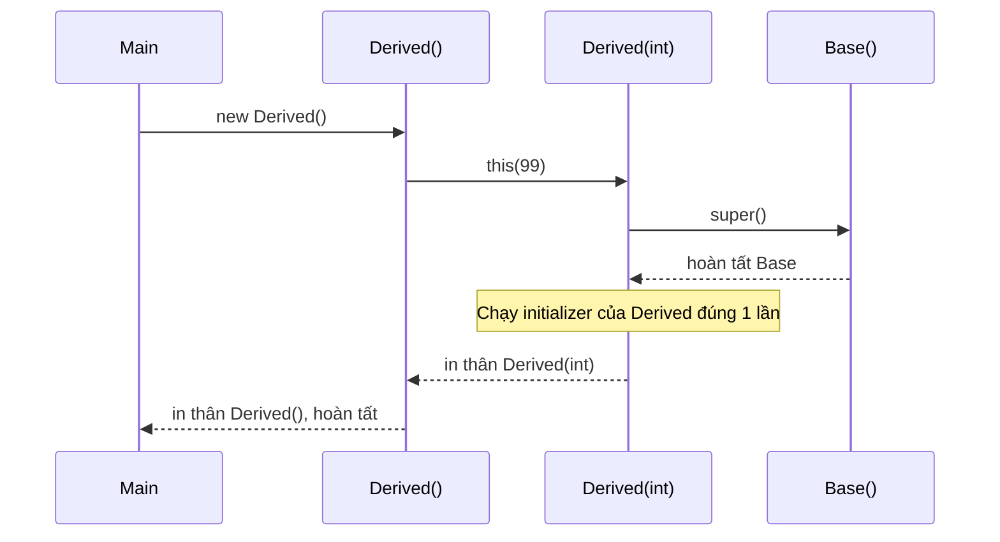

# Thứ tự khởi tạo trong quan hệ kế thừa (Java OOP)

Khi tạo đối tượng từ một lớp **kế thừa** lớp khác, Java không chạy tất cả phần khởi tạo của lớp con trước rồi mới đến lớp cha. JVM phải chuẩn bị lớp, tạo đối tượng và xây dựng phần trạng thái của **lớp cha trước lớp con** theo những quy tắc xác định.

Hiểu đúng trình tự này giúp dự đoán kết quả khi có `static`, field initializer, initializer block, constructor, `super(...)`, `this(...)`, cũng như tránh lỗi khi một constructor gọi phương thức có thể bị ghi đè.

> Phạm vi: các ví dụ tương thích Java 11+. “Khởi tạo lớp” (`static`) và “khởi tạo đối tượng” (instance) là hai việc khác nhau; phần giải thích dưới đây phân biệt rõ chúng.

## 1. Thứ tự tổng quát khi chạy `new Child()`

Giả sử `Child extends Parent` và đây là lần đầu chương trình chủ động sử dụng `Child` theo cách đòi hỏi JVM khởi tạo lớp:

1. **Khởi tạo lớp `Parent`**, bao gồm static field initializer và static initialization block, theo thứ tự xuất hiện trong mã nguồn.
2. **Khởi tạo lớp `Child`**, chạy các phần `static` của lớp con theo thứ tự mã nguồn.
3. Cấp phát đối tượng `Child` và thiết lập giá trị **mặc định** cho tất cả instance field (ví dụ `0`, `false`, `null`). Các field khai báo ở phần lớp cha cũng nằm trong đối tượng này.
4. Thực hiện chuỗi constructor về phía lớp cha. Khi đến phần khởi tạo instance của `Parent`, Java chạy các instance field initializer và instance initialization block của `Parent` **theo thứ tự văn bản**, rồi thực thi thân constructor `Parent`.
5. Quay về `Child`, chạy instance field initializer và instance initialization block của `Child` **theo thứ tự văn bản**, rồi thực thi thân constructor `Child`.

Nếu có nhiều lớp kế thừa, quá trình bắt đầu từ lớp tổ tiên phía trên và tiến dần tới lớp cụ thể được `new`. Mỗi cấp lớp đóng góp phần khởi tạo instance của mình.

**Hai điểm dễ nhầm:**

- Khởi tạo `static` của một lớp thường diễn ra **một lần trong phạm vi class loader khởi tạo lớp đó**, chứ không lặp lại mỗi khi `new`. Việc nạp lớp (`loading`) và khởi tạo lớp (`initialization`) cũng không phải lúc nào xảy ra cùng thời điểm.
- Constructor của cha được **gọi trước phần khởi tạo instance của con**. Các field của con đã có giá trị **mặc định** do cấp phát đối tượng, nhưng các biểu thức khởi tạo cụ thể của chúng vẫn chưa chạy.

Sơ đồ thứ tự điển hình:



*Các biểu thức đối số của lời gọi constructor và chuỗi `this(...)`/`super(...)` được đánh giá khi xử lý lời gọi tương ứng; sơ đồ tập trung vào thứ tự chạy các phần khởi tạo và thân constructor trong các ví dụ thông thường.*

## 2. Ví dụ đầy đủ: quan sát tất cả các bước

Tạo file **`InitializationTrace.java`**:

```java
public class InitializationTrace {

    static int mark(String step) {
        System.out.println(step);
        return 1;
    }

    static class Parent {
        static int parentStatic = mark("1. Parent: static field");

        static {
            System.out.println("2. Parent: static block");
        }

        int parentValue = mark("5. Parent: instance field");

        {
            System.out.println("6. Parent: instance block");
        }

        Parent() {
            System.out.println("7. Parent: constructor");
        }
    }

    static class Child extends Parent {
        static int childStatic = mark("3. Child: static field");

        static {
            System.out.println("4. Child: static block");
        }

        int childValue = mark("8. Child: instance field");

        {
            System.out.println("9. Child: instance block");
        }

        Child() {
            super();
            System.out.println("10. Child: constructor");
        }
    }

    public static void main(String[] args) {
        System.out.println("=== ĐỐI TƯỢNG THỨ NHẤT ===");
        new Child();

        System.out.println("=== ĐỐI TƯỢNG THỨ HAI ===");
        new Child();
    }
}
```

Chạy:

```bash
javac InitializationTrace.java
java InitializationTrace
```

**Kết quả:**

```text
=== ĐỐI TƯỢNG THỨ NHẤT ===
1. Parent: static field
2. Parent: static block
3. Child: static field
4. Child: static block
5. Parent: instance field
6. Parent: instance block
7. Parent: constructor
8. Child: instance field
9. Child: instance block
10. Child: constructor
=== ĐỐI TƯỢNG THỨ HAI ===
5. Parent: instance field
6. Parent: instance block
7. Parent: constructor
8. Child: instance field
9. Child: instance block
10. Child: constructor
```

Phân tích:

- Trong lần tạo thứ nhất, `new Child()` yêu cầu khởi tạo `Child`. Vì `Child extends Parent`, các phần `static` của `Parent` được khởi tạo trước `Child`. **Trong từng lớp**, field và block `static` chạy theo thứ tự xuất hiện.
- Phần instance của `Parent` (dòng 5–7) chạy trước phần instance của `Child` (dòng 8–10).
- Lần `new Child()` thứ hai **không in lại dòng 1–4**, vì các lớp này đã được khởi tạo. Nhưng nó tạo instance mới, nên dòng 5–10 vẫn xuất hiện.
- Hai biến `parentValue` và `childValue` có giá trị `1` do `mark` trả về; mục đích của hàm là in dấu vết để dễ kiểm tra thứ tự.

**Một thay đổi để tự thử:** đổi vị trí static block và static field của cùng một lớp, rồi đổi vị trí instance block và instance field của lớp ấy. Thứ tự in tương ứng cũng sẽ đổi. Quy tắc “cha trước con” không có nghĩa field initializer luôn trước block initializer trong cùng lớp: **phụ thuộc thứ tự trong mã nguồn**.

## 3. Phân biệt khởi tạo lớp và khởi tạo đối tượng

| Thành phần | Khi nào chạy? | Liên quan đến lớp hay từng instance? |
| --- | --- | --- |
| `static int value = ...;` | Khi lớp được khởi tạo | Thuộc lớp |
| `static { ... }` | Khi lớp được khởi tạo | Thuộc lớp |
| `int value = ...;` | Khi tạo từng đối tượng, tới lượt lớp khai báo field | Thuộc đối tượng |
| `{ ... }` (instance initializer block) | Khi tạo từng đối tượng, tới lượt lớp khai báo block | Thuộc đối tượng |
| Constructor | Khi tạo đối tượng qua chuỗi constructor | Thuộc quá trình tạo đối tượng |
| Instance field có giá trị mặc định | Ngay sau cấp phát đối tượng, trước các initializer cụ thể | Thuộc đối tượng |

Trong Java, giá trị mặc định của instance field được thiết lập trước khi chạy các constructor:

| Kiểu field | Giá trị mặc định |
| --- | --- |
| `byte`, `short`, `int`, `long` | `0` |
| `float`, `double` | `0.0` |
| `boolean` | `false` |
| `char` | `'\u0000'` (ký tự NUL) |
| Kiểu tham chiếu như `String` hoặc `List` | `null` |

Điều này **khác biến cục bộ**: biến cục bộ không được tự động cấp giá trị mặc định để sử dụng; trình biên dịch yêu cầu gán giá trị trước khi đọc.

Một lớp có thể đã được JVM nạp hoặc liên kết mà **chưa** chạy initializer `static`. Việc truy cập một hằng số `static final` thuộc loại *compile-time constant* có thể không kích hoạt khởi tạo lớp định nghĩa hằng số, vì giá trị có thể được nội tuyến tại nơi sử dụng. Do đó đừng xem “có nhắc tới tên lớp” là điều kiện đủ để mọi static block chạy.

### Một lần `new` vẫn tạo một đối tượng có phần trạng thái của cha

```java
class Vehicle {
    String brand = "Generic";
}

class Car extends Vehicle {
    int doors = 4;
}

Car car = new Car();
System.out.println(car.brand); // Generic
System.out.println(car.doors); // 4
```

`Car` không “chứa một đối tượng `Vehicle` riêng biệt do tự động `new Vehicle()`”. Đối tượng `Car` có các thành phần instance kế thừa từ `Vehicle` và thành phần do `Car` khai báo. Chuỗi constructor đảm bảo việc khởi tạo chúng có thứ tự.

## 4. `super(...)` và constructor của lớp cha

Khi tạo `Child`, Java cần thực hiện một constructor thích hợp của `Parent`. Constructor của lớp cha **không được kế thừa** như một phương thức bình thường; lớp con chỉ gọi constructor cha thông qua `super(...)` trong chuỗi khởi tạo.

### Lớp cha có constructor không tham số

```java
class Device {
    Device() {
        System.out.println("Device()");
    }
}

class Phone extends Device {
    Phone() {
        super(); // Gọi constructor Device()
        System.out.println("Phone()");
    }
}
```

`new Phone()` in:

```text
Device()
Phone()
```

Nếu bỏ dòng `super();` trong ví dụ này, trình biên dịch Java 11 sẽ tự chèn lời gọi `super();` ngầm ở đầu constructor. Điều đó **không** có nghĩa JVM tự tìm một constructor cha bất kỳ phù hợp: trường hợp mặc định hướng đến **constructor không tham số**.

### Lớp cha chỉ có constructor có tham số

```java
class Account {
    private final String id;

    Account(String id) {
        if (id == null || id.isBlank()) {
            throw new IllegalArgumentException("ID không hợp lệ");
        }
        this.id = id;
        System.out.println("Account: " + id);
    }

    String getId() {
        return id;
    }
}

class SavingsAccount extends Account {
    private final int interestRatePercent;

    SavingsAccount(String id, int interestRatePercent) {
        super(id); // BẮT BUỘC chỉ rõ lời gọi này trong thiết kế này
        this.interestRatePercent = interestRatePercent;
        System.out.println("SavingsAccount: " + interestRatePercent);
    }
}
```

`new SavingsAccount("SV001", 5)` in:

```text
Account: SV001
SavingsAccount: 5
```

Nếu xóa `super(id)`, trình biên dịch Java 11 sẽ cố gọi `super()`, nhưng `Account` **không có** constructor không tham số, dẫn đến lỗi biên dịch. Java không tự tạo constructor không tham số cho một lớp đã khai báo constructor có tham số.

Trong các ví dụ Java 11, lời gọi constructor `super(...)` hoặc `this(...)` phải là câu lệnh đầu tiên của constructor khi được viết tường minh. Một số phiên bản Java mới hỗ trợ cú pháp constructor linh hoạt hơn, nhưng chuỗi khởi tạo và nhu cầu gọi constructor cha vẫn là cốt lõi để hiểu thứ tự.

### Các tham số của `super(...)`

Phần đối số `super(expression)` được đánh giá để lựa chọn và truyền giá trị cho constructor cha. Cần phân biệt **đánh giá biểu thức đối số** với **thực thi thân constructor cha**. Với bài tập dự đoán log, khi các biểu thức đối số có side effect, hãy xem xét chúng riêng thay vì áp dụng máy móc một danh sách log đơn giản.

Ví dụ dễ hiểu:

```java
class Parent {
    Parent(String value) {
        System.out.println("Parent: " + value);
    }
}

class Child extends Parent {
    Child(String input) {
        super(input.trim());
        System.out.println("Child");
    }
}
```

`new Child("  hello  ")` in `Parent: hello` rồi `Child`.

## 5. `this(...)`: nhiều constructor trong cùng một lớp

`this(...)` **gọi constructor khác của chính lớp hiện tại**. Nó giúp tái sử dụng logic khởi tạo và tránh lặp mã.

```java
public class ConstructorChainDemo {
    static class Base {
        Base() {
            System.out.println("Base constructor");
        }
    }

    static class Derived extends Base {
        int value = initialize();

        static int initialize() {
            System.out.println("Derived field initializer");
            return 10;
        }

        Derived() {
            this(99);
            System.out.println("Derived() constructor body");
        }

        Derived(int number) {
            super();
            System.out.println("Derived(int) constructor body: " + number);
        }
    }

    public static void main(String[] args) {
        new Derived();
    }
}
```

Kết quả:

```text
Base constructor
Derived field initializer
Derived(int) constructor body: 99
Derived() constructor body
```

Diễn giải:

1. `Derived()` chuyển việc khởi tạo đến `Derived(int)` bằng `this(99)`.
2. `Derived(int)` gọi `Base()` thông qua `super()`.
3. Sau khi constructor cha hoàn thành, các instance field initializer và instance block của `Derived` chạy **một lần**.
4. Thân `Derived(int)` chạy, sau đó chương trình quay lại thân `Derived()`.

**Không** xảy ra chuyện field `value` được khởi tạo hai lần chỉ vì có hai constructor trong cùng chuỗi `this(...)`. Mỗi lần tạo instance, chuỗi constructor rốt cuộc gọi constructor cha đúng một lần theo đường đi tương ứng.

Một constructor không được đồng thời viết hai lời gọi constructor `this(...)` và `super(...)` trong cùng nhánh khởi tạo; chuỗi `this(...)` sẽ kết thúc tại một constructor thực hiện lời gọi `super(...)` trực tiếp hoặc ngầm. Vòng lặp gọi constructor (ví dụ A gọi B, B gọi A qua `this(...)`) là lỗi biên dịch.



## 6. Bẫy quan trọng: gọi phương thức override trong constructor cha

Phương thức instance có thể dùng **dynamic dispatch**: dù được gọi từ code của lớp cha, lời gọi có thể chạy bản override của lớp con. Nhưng vào thời điểm constructor cha đang chạy, field initializer của lớp con **chưa chạy**.

Xem chương trình **`OverrideDuringConstruction.java`**:

```java
public class OverrideDuringConstruction {

    static class Base {
        Base() {
            System.out.println("Base bắt đầu");
            show(); // Phương thức có thể bị override
            System.out.println("Base kết thúc");
        }

        void show() {
            System.out.println("Base.show()");
        }
    }

    static class Derived extends Base {
        private String message = "Đã sẵn sàng";

        Derived() {
            System.out.println("Derived constructor: " + message);
        }

        @Override
        void show() {
            System.out.println("Derived.show(): " + message);
        }
    }

    public static void main(String[] args) {
        new Derived();
    }
}
```

Kết quả:

```text
Base bắt đầu
Derived.show(): null
Base kết thúc
Derived constructor: Đã sẵn sàng
```

**Tại sao in `null` chứ không phải “Đã sẵn sàng”?**

- Đối tượng được tạo là `Derived`, nên phương thức override `Derived.show()` được chọn khi `Base` gọi `show()`.
- Tại thời điểm gọi, toàn bộ instance field đã có giá trị mặc định, vì thế `message` là `null`.
- Biểu thức gán `message = "Đã sẵn sàng"` thuộc initializer của `Derived`, chỉ thực thi **sau khi constructor `Base` hoàn thành**.
- Sau đó thân constructor `Derived` mới thấy giá trị đã khởi tạo.

Nếu `show()` gọi `message.length()`, chương trình có thể ném `NullPointerException` trước khi constructor con hoàn tất.

### Thiết kế an toàn hơn

Không gọi phương thức có thể bị override từ constructor lớp cha khi phương thức đó phụ thuộc trạng thái của lớp con. Thay vào đó, constructor cha nên sử dụng dữ liệu của chính lớp mình và logic `private`, `final` hoặc `static` thích hợp; hoặc để bước khởi chạy cần đối tượng hoàn chỉnh diễn ra **sau khi** constructor trả về.

Ví dụ lớp cha giữ trách nhiệm riêng:

```java
class SafeBase {
    private final String id;

    SafeBase(String id) {
        if (id == null || id.isBlank()) {
            throw new IllegalArgumentException("ID trống");
        }
        this.id = id;
        System.out.println("Base đã nhận ID: " + id);
    }

    public final String getId() {
        return id;
    }
}

class SafeDerived extends SafeBase {
    private final String message = "Đã sẵn sàng";

    SafeDerived(String id) {
        super(id);
        System.out.println("Derived: " + message);
    }
}
```

Ngoài việc tránh gọi phương thức override, nên tránh **đưa `this` ra ngoài** trước khi constructor hoàn tất (ví dụ đăng ký callback để đối tượng khác có thể gọi lại ngay). Điều đó cũng có thể làm lộ đối tượng chưa được khởi tạo đầy đủ.

## 7. Trường hợp có nhiều cấp kế thừa

Giả sử `C extends B` và `B extends A`:

```java
public class ThreeLevels {
    static class A {
        static { System.out.println("A static"); }
        { System.out.println("A instance"); }
        A() { System.out.println("A constructor"); }
    }

    static class B extends A {
        static { System.out.println("B static"); }
        { System.out.println("B instance"); }
        B() { System.out.println("B constructor"); }
    }

    static class C extends B {
        static { System.out.println("C static"); }
        { System.out.println("C instance"); }
        C() { System.out.println("C constructor"); }
    }

    public static void main(String[] args) {
        new C();
    }
}
```

Kết quả:

```text
A static
B static
C static
A instance
A constructor
B instance
B constructor
C instance
C constructor
```

Trong lần tạo thứ hai của `C`, ba dòng `static` không chạy lại. Phần instance/constructor vẫn đi từ `A` sang `B` rồi `C`.

**Lưu ý:** khối `static` và khối instance trong mã ví dụ đều được viết ở dạng cú pháp hợp lệ:

- `static { ... }`: static initialization block, không có đối tượng làm receiver.
- `{ ... }`: instance initialization block, chạy khi tạo đối tượng tại vị trí tương ứng trong phần khởi tạo instance của lớp.

Không nên nhầm “constructor chạy từ cha đến con” với “tất cả câu lệnh trong constructor con được chạy trước vì ta gọi `new C()`”. `new C()` chọn kiểu đối tượng cần tạo, nhưng nội dung constructor cha sẽ được hoàn thành trước phần nội dung của constructor con.

## 8. Các lỗi thường gặp khi học thứ tự khởi tạo

| Nhận định hoặc cách viết | Kết luận đúng |
| --- | --- |
| “`new Child()` phải chạy constructor Child trước vì gọi Child” | Sai: thân constructor cha chạy trước thân constructor con |
| “Mọi `static` luôn chạy khi program khởi động” | Sai: lớp thường được khởi tạo khi có hành vi sử dụng chủ động yêu cầu điều đó |
| “Mỗi lần tạo instance đều chạy lại static block” | Sai: static initializer không lặp theo instance |
| “Instance field của Child đã có giá trị khởi tạo cụ thể khi Parent constructor chạy” | Sai trong trường hợp thông thường: lúc ấy field Child mới có giá trị mặc định |
| “`super()` tạo thêm một đối tượng Parent khác” | Sai: đó là một bước khởi tạo phần lớp cha trong cùng đối tượng Child |
| “Constructor của Parent được Child kế thừa như method” | Sai: constructor không được kế thừa |
| “Parent chỉ có constructor có tham số nhưng Child bỏ `super(args)` vẫn tự tìm được” | Sai: `super()` ngầm không khớp sẽ gây lỗi biên dịch |
| “`this(...)` làm field initializer của cùng lớp chạy nhiều lần” | Sai: chuỗi constructor khởi tạo instance phần lớp đó một lần |
| “Gọi phương thức override trong constructor cha chắc chắn dùng trạng thái Child đã khởi tạo” | Sai: override có thể chạy trước initializer của Child |
| “Trong một lớp, mọi field initializer luôn chạy trước mọi initializer block” | Sai: chúng thực thi theo thứ tự xuất hiện trong mã nguồn |
| “Truy cập một hằng `static final` kiểu nguyên thủy luôn kích hoạt static block” | Không luôn đúng đối với *compile-time constant* |

### Trường hợp việc khởi tạo thất bại

Nếu một static initializer ném ngoại lệ không được xử lý, quá trình khởi tạo lớp thất bại. Khi lỗi không phải `Error`, lần thất bại thường được biểu hiện bằng `ExceptionInInitializerError`; những lần cố sử dụng lớp sau đó có thể gặp `NoClassDefFoundError` vì lớp ở trạng thái khởi tạo lỗi. Điều này khác với ngoại lệ ném từ một constructor instance: đối tượng đang được tạo không hoàn tất, nhưng bản thân lớp không nhất thiết bị đánh dấu khởi tạo lỗi.

Một lưu ý khi kiểm tra thứ tự bằng `System.out.println`: bản thân logging cũng là hành động có side effect. Trong chương trình thực tế, tránh logic nghiệp vụ phức tạp, đọc dữ liệu môi trường dễ lỗi hay tự tạo luồng trong static initializer; nên kiểm soát lỗi tại các bước khởi tạo rõ ràng của ứng dụng.

## 9. Bài tập thực hành và đáp án giải thích

### Bài tập 1: đoán thứ tự

```java
class P {
    static { System.out.print("A "); }
    { System.out.print("B "); }
    P() { System.out.print("C "); }
}
class Q extends P {
    static { System.out.print("D "); }
    { System.out.print("E "); }
    Q() { System.out.print("F "); }
}

new Q();
new Q();
```

**Đáp án:** `A D B C E F B C E F`. `A` và `D` chỉ in trong lần khởi tạo lớp đầu tiên; mỗi lần tạo instance luôn khởi tạo phần của `P` rồi `Q`.

### Bài tập 2: constructor lớp cha không có mặc định

```java
class Animal {
    Animal(String name) { }
}

class Cat extends Animal {
    Cat() {
        // Thiếu lời gọi constructor của Animal
    }
}
```

**Câu hỏi:** Vì sao không biên dịch? Sửa thế nào?

**Đáp án:** Java 11 mặc định chèn `super()` vào `Cat()`, nhưng `Animal` chỉ khai báo `Animal(String)`. Sửa bằng cách gọi `super("Mèo");` trong `Cat()`; hoặc thiết kế thêm một constructor không tham số ở `Animal` nếu điều đó có ý nghĩa nghiệp vụ.

### Bài tập 3: giá trị field khi constructor cha gọi override

```java
class A {
    A() { print(); }
    void print() { System.out.println("A"); }
}
class B extends A {
    int number = 7;
    @Override
    void print() { System.out.println(number); }
}

new B();
```

**Đáp án:** `0`. Lời gọi động chọn `B.print()` trong lúc `A()` đang chạy, trước khi initializer `number = 7` được thực thi. Nếu chuyển lời gọi `print()` tới thời điểm sau `new B()` hoàn tất, kết quả sẽ là `7`.

### Bài tập 4: tự mở rộng

Hãy tạo ba lớp `Person`, `Employee`, `Manager` theo quan hệ `Manager extends Employee extends Person`; mỗi lớp có một static block, một instance field initializer và constructor in tên lớp. Sau đó:

1. Tạo lần lượt hai đối tượng `Manager`.
2. Dự đoán chính xác những dòng nào in một lần và những dòng nào in hai lần.
3. Thêm constructor `Manager()` dùng `this(String department)`; kiểm tra initializer của `Manager` có chạy lặp hay không.
4. Cho `Person` chỉ có constructor nhận `String name`; sửa các lớp con để truyền đủ thông tin bằng `super(...)`.
5. Thử đưa một phương thức `describe()` có thể override vào constructor `Person` và giải thích vì sao kết quả có thể chưa phản ánh trạng thái của `Manager`.

## Ghi nhớ để đọc một constructor trong hệ kế thừa

Khi nhìn thấy `new Subclass(...)`, hãy lần theo chuỗi `this(...)` và `super(...)` để xác định **constructor nào được gọi**. Sau đó tách biệt hai pha: **khởi tạo lớp (`static`, khi cần)** và **khởi tạo mỗi instance (giá trị mặc định, phần khởi tạo của cha, thân constructor cha, phần khởi tạo của con, thân constructor con)**. Cần đặc biệt thận trọng với những lời gọi phương thức bị override trong constructor vì tại thời điểm ấy đối tượng chưa được khởi tạo đầy đủ.