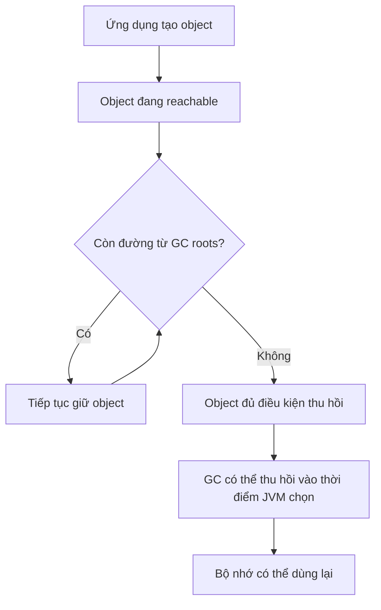
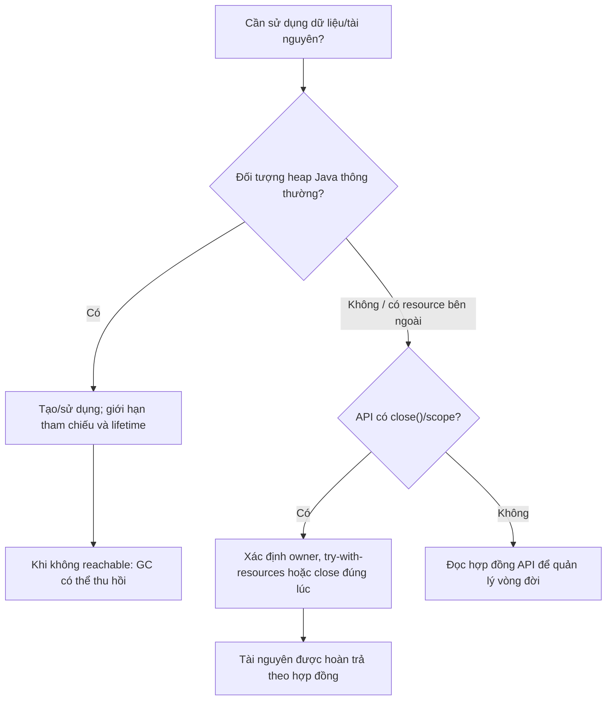

# Thu gom rác và quản lý bộ nhớ thủ công trong Java

> **OOP → Vòng đời.** Trong Java, lập trình viên tạo đối tượng và sử dụng chúng, còn **Garbage Collector (GC)** giúp thu hồi bộ nhớ của các đối tượng không còn có thể được chương trình truy cập. Tuy nhiên, GC **không đồng nghĩa mọi tài nguyên đều tự được giải phóng đúng lúc**: file, socket, kết nối cơ sở dữ liệu hay vùng nhớ native vẫn cần cách quản lý vòng đời phù hợp.

## 1. Java tự động quản lý phần nào?

Xét đoạn mã:

```java
final class User {
    private final String name;

    User(String name) {
        this.name = name;
    }

    String name() {
        return name;
    }
}

static String loadName() {
    User user = new User("An");
    return user.name();
}
```

`new User("An")` tạo một instance. Trong suốt lúc `loadName()` thực thi, tham chiếu `user` cho phép sử dụng đối tượng. Khi phương thức trả về và không còn tham chiếu nào khác tới instance này, đối tượng có thể trở thành **đủ điều kiện để GC thu hồi**. JVM quyết định **khi nào** và **bằng cách nào** thu hồi; không có cam kết đối tượng được xóa ngay lúc phương thức kết thúc.

Nên phân biệt những thành phần sau:

| Thành phần | Chứa gì? | Cách quản lý |
|---|---|---|
| Java heap | Nhiều đối tượng và mảng Java | GC quản lý vùng nhớ của các đối tượng không còn reachable |
| Stack của luồng | Các frame thực thi, thông tin lời gọi, biến cục bộ theo mô hình JVM | Gắn với lời gọi/luồng; không phải khu vực mà ta `free()` từng biến |
| Metaspace (trên HotSpot hiện đại) | Metadata của các lớp | JVM quản lý; có thể tăng nếu nạp quá nhiều lớp/class loader |
| Native/off-heap memory | Bộ nhớ do API/native code sử dụng ngoài Java heap | Phụ thuộc API: GC, cơ chế scope/arena hoặc `close()` |
| File descriptor, socket, DB connection | Tài nguyên hệ điều hành/hệ thống ngoài | Phải hoàn trả theo hợp đồng của API, thường qua `close()` |

Mô hình “object ở heap, tham chiếu cục bộ ở stack” hữu ích để bắt đầu, nhưng **không phải cam kết vị trí vật lý tuyệt đối**. JVM có thể tối ưu hóa cấp phát hoặc thay object bằng các giá trị riêng khi hành vi quan sát được vẫn tương đương.

### GC khác với quản lý bộ nhớ thủ công như thế nào?

Trong những ngôn ngữ cho phép quản lý bộ nhớ thủ công, mã chương trình có thể xin bộ nhớ và chủ động trả lại, ví dụ cặp `malloc/free` trong C. Nếu dùng sai dễ dẫn đến **memory leak**, **double free** hoặc **use-after-free**.

Với **đối tượng heap Java thông thường**, ta không gọi `free(object)` hay `delete object`. Không có thao tác Java chuẩn cho phép lập trình viên quyết định thu hồi ngay bộ nhớ của một object cụ thể.

Tuy vậy, lập trình viên Java vẫn chịu trách nhiệm **kiểm soát số đối tượng còn được giữ lại**, giới hạn cache, giải phóng resource, tránh cấp phát quá mức và theo dõi mức sử dụng bộ nhớ.

## 2. GC xác định object còn cần giữ dựa vào reachability

GC bắt đầu từ các **GC roots** (tham chiếu đang cần bởi luồng thực thi, một số tham chiếu static/JNI/runtime...) rồi đi qua các field và phần tử mảng để tìm object còn reachable. Việc gán `x = null` chỉ bỏ **một** đường tham chiếu. Một object vẫn có thể được giữ bởi cache hoặc callback khác.

~~~mermaid
flowchart LR
    Root["GC root"] --> Cache["Cache"]
    Cache --> Data["RequestData"]
    A["Node A"] --> B["Node B"]
    B --> A
~~~

`RequestData` reachable qua `Cache`. Cặp `Node A ↔ Node B` không có đường từ root trong hình có thể được GC thu hồi dù tồn tại vòng tham chiếu: Java không cần chủ động `free` hay cắt mọi chu trình bằng tay. GC cũng không bảo đảm **khi nào** object mất đường tham chiếu sẽ thực sự được thu hồi.

Tham chiếu thông thường là **strong reference**; Java còn có `WeakReference`, `SoftReference` và `PhantomReference` cho mục đích chuyên biệt. Không suy ra chúng tạo thời điểm cleanup xác định. Phần mô hình GC roots và các mức reachability được trình bày sâu trong bài *Thời gian tồn tại, khả năng truy cập và giải phóng bộ nhớ*.

## 3. GC hoạt động như thế nào ở mức khái niệm?

Một mô hình dễ hiểu gồm ba công việc:

1. **Xác định object còn sống:** truy tìm từ GC roots để nhận biết các đối tượng vẫn reachable.
2. **Thu hồi vùng nhớ không còn được sử dụng:** lấy lại bộ nhớ gắn với object không còn reachable.
3. **Quản lý bố cục vùng nhớ:** một số collector có thể di chuyển/gom object để giảm phân mảnh hoặc tăng hiệu quả cấp phát.



Nhiều bộ thu gom được thiết kế dựa trên quan sát rằng nhiều object sống rất ngắn. Chúng có thể sử dụng cơ chế **generational** (các thế hệ), kết hợp nhiều đợt thu gom. Những thuật ngữ như *minor GC*, *major GC*, *full GC*, *stop-the-world*, *concurrent marking* xuất hiện trong log và tài liệu, nhưng **ý nghĩa chính xác phụ thuộc collector/JDK đang sử dụng**.

| Khái niệm | Cách hiểu thực dụng |
|---|---|
| Young generation | Nơi nhiều object mới được phân bổ trong các collector phân thế hệ |
| Old generation | Thường chứa object tồn tại lâu hơn |
| Stop-the-world (STW) | Một giai đoạn tạm dừng thực thi ứng dụng để GC thực hiện công việc cần thiết |
| Concurrent GC | Một phần việc GC chạy đồng thời với thread ứng dụng |
| Compaction | Gom/di chuyển dữ liệu đang sống để giảm phân mảnh |

Không có một “thuật toán GC của Java” duy nhất. Ví dụ, HotSpot có những collector như G1, ZGC, Parallel GC; lựa chọn và hành vi phụ thuộc phiên bản JDK, mục tiêu độ trễ, dung lượng và cấu hình. Với bài OOP, điều quan trọng nhất là hiểu **reachability**, **không quyết định được thời điểm thu hồi**, và **GC không tự sửa thiết kế giữ tham chiếu sai**.

## 4. GC không biết khi nào dữ liệu đã hết giá trị nghiệp vụ

Một cache không giới hạn có thể giữ mọi payload dù chúng không còn hữu ích. Các object đó vẫn reachable từ map, nên GC **không coi chúng là rác**. Đây là một dạng *logical memory leak* của ứng dụng Java:

~~~java
static final Map<String, byte[]> payloads = new HashMap<>();

static void remember(String id, byte[] data) {
    payloads.put(id, data);
}
~~~

Đoạn minh họa đặt trong lớp có import `java.util.Map` và `java.util.HashMap`. Nếu tiếp tục thêm ID mới mà không đặt giới hạn, dung lượng có thể tăng theo tải. Cách chữa là xác định retention policy: TTL, số phần tử, ngân sách byte, xóa các entry không còn cần hoặc chọn cache library phù hợp.

GC có thể chạy rất thường xuyên mà không giảm được retained heap nếu mọi object cũ vẫn có đường strong reference từ root. Khi phân tích nguyên nhân, hãy dùng **heap dump và đường giữ tham chiếu** thay vì chỉ nhìn số lần GC. Bài *Thời gian tồn tại, khả năng truy cập và giải phóng bộ nhớ* có ví dụ registry/cache, listener, `ThreadLocal` và cách truy lần theo GC roots; bài này sẽ tập trung vào cơ chế GC và các loại bộ nhớ cần đo.

## 5. `null`, `System.gc()` và `finalize()`: những kỳ vọng sai

```java
User a = new User("An");
User b = a;

a = null;    // Không xóa object: b vẫn tham chiếu tới nó
// System.gc(); // Không phải cách đảm bảo xóa User
```

- **`a = null`** chỉ thay đổi biến `a`. Nếu còn `b` hoặc tham chiếu khác, đối tượng vẫn reachable.
- **`System.gc()`** là lời yêu cầu JVM cố gắng thực hiện GC; không phải mệnh lệnh đảm bảo GC diễn ra, cũng không trả bộ nhớ của từng object ngay lập tức.
- **`finalize()`** không phù hợp để dọn dẹp tài nguyên. Finalization đã bị deprecated for removal và có nhiều vấn đề về độ tin cậy, bảo mật, hiệu năng. Không dùng nó cho code mới.

Không cần gán `null` cho mọi biến cục bộ trước khi thoát phương thức. Thông thường, việc để biến hết phạm vi và tổ chức vòng đời đối tượng rõ ràng đã đủ. Việc chủ động xóa phần tử khỏi cache, unregister listener hoặc kết thúc một tác vụ sống lâu thường quan trọng hơn.

## 6. GC chỉ quyết định thu hồi heap object; resource có hợp đồng khác

Một `FileInputStream` có thể giữ file descriptor do hệ điều hành cấp, trong khi `Connection` có thể được quản lý bởi connection pool. Object Java wrapper bị GC thu hồi **không bảo đảm** những tài nguyên ấy đã được trả về đúng thời điểm.

| Thứ cần hoàn trả | Cơ chế nên dựa vào | Điểm cần nhớ |
|---|---|---|
| Bộ nhớ của object unreachable trên heap | GC của JVM | Không thể `free(obj)` bằng cú pháp Java chuẩn |
| File/socket/connection | `close()` theo ownership, thường dùng `try-with-resources` | Đóng resource không đồng nghĩa xóa Java object |
| Bộ nhớ native/off-heap có scope | Hợp đồng API, chẳng hạn `Arena.close()` | Cần đúng phiên bản JDK và quy tắc sở hữu |

~~~java
try (BufferedReader reader = Files.newBufferedReader(path)) {
    System.out.println(reader.readLine());
}
~~~

Ví dụ trên giả sử `path` là `java.nio.file.Path` hợp lệ và đã import `java.io.BufferedReader`, `java.nio.file.Files`. Java gọi `reader.close()` khi rời khối `try` theo semantics ngôn ngữ, kể cả khi đọc ném exception. Về đóng nhiều resource, suppressed exceptions, `AutoCloseable`, `Cleaner` và `finalize()`, bài *Đóng tài nguyên và giới hạn của hàm hủy* giữ nơi giảng giải và ví dụ chạy đầy đủ.

## 7. Khi nào Java thực sự cho phép quản lý native memory thủ công?

Với Java heap object thông thường, không có `free(object)`. Nhưng các API cấp phát bộ nhớ ngoài heap có thể yêu cầu quản lý **ownership** và **lifetime** rõ ràng.

Ví dụ tiêu biểu ở **Java 22+** là Foreign Function & Memory API (FFM) với `Arena` và `MemorySegment`:

```java
import java.lang.foreign.Arena;
import java.lang.foreign.MemorySegment;
import java.lang.foreign.ValueLayout;

public class NativeMemoryDemo {
    public static void main(String[] args) {
        try (Arena arena = Arena.ofConfined()) {
            MemorySegment segment = arena.allocate(16);
            segment.set(ValueLayout.JAVA_INT, 0, 42);

            int number = segment.get(ValueLayout.JAVA_INT, 0);
            System.out.println(number); // 42
        } // close() trên arena giải phóng allocations thuộc arena
    }
}
```

Lưu thành `NativeMemoryDemo.java` và biên dịch/chạy với **JDK 22 trở lên**:

```bash
javac NativeMemoryDemo.java
java NativeMemoryDemo
```

Ở đây:

- `arena.allocate(16)` xin 16 byte bộ nhớ native gắn với arena.
- `MemorySegment` biểu diễn vùng nhớ có kích thước và giới hạn truy cập; không phải một `byte[]` thông thường trong Java heap.
- `Arena.ofConfined()` tạo arena có **quyền truy cập giới hạn ở luồng sở hữu**.
- Khi khối `try` kết thúc, `arena.close()` giải phóng allocations gắn với arena. Sau đó, cố truy cập segment đã bị vô hiệu hóa sẽ phát sinh lỗi theo hợp đồng API.

Lưu ý phiên bản: FFM API được chuẩn hóa ở Java 22; các phiên bản JDK trước có dạng incubator/preview với API và cách bật khác nhau, nên không sao chép máy móc ví dụ Java 22 sang Java 17.

`ByteBuffer.allocateDirect(...)` cũng cho phép làm việc với buffer trực tiếp ngoài heap, nhưng **không cung cấp một `free()` chuẩn trên chính ByteBuffer** để lập trình viên quyết định thu hồi ngay. Đừng dùng reflection hoặc các API nội bộ để ép giải phóng buffer; khi cần vòng đời native memory xác định, chọn API có contract quản lý vòng đời rõ ràng như FFM `Arena`, hoặc dùng thư viện được thiết kế cho việc đó.

## 8. Lỗi thiếu bộ nhớ không phải lúc nào cũng là heap leak

Ví dụ những nguyên nhân cần phân biệt:

| Triệu chứng hoặc lỗi | Khả năng liên quan | Hướng xem xét |
|---|---|---|
| `OutOfMemoryError: Java heap space` | Heap không đáp ứng thêm cấp phát | Object nào còn sống, cache/list, heap limit |
| `OutOfMemoryError: Metaspace` | Metadata lớp chiếm nhiều native memory | Dynamic class loading, class loader leak |
| `OutOfMemoryError: Direct buffer memory` | Giới hạn bộ nhớ direct buffer bị chạm | Số lượng/vòng đời direct buffers |
| Không thể tạo native thread mới | Thiếu thread/native resources hoặc giới hạn hệ điều hành | Thread count, thread pool, stack size |
| Process RSS tăng nhưng heap ổn định | Native memory, stacks, mmap, các vùng khác | Native memory metrics/profiler |

Thông báo lỗi cụ thể phụ thuộc JVM, phiên bản và cách lỗi phát sinh; bảng trên là **định hướng điều tra**, không phải chẩn đoán chắc chắn.

Vấn đề có thể là:

- **Memory leak:** dữ liệu bị giữ lại vô hạn, tăng theo thời gian.
- **Memory pressure bình thường:** ứng dụng xử lý lô dữ liệu lớn, heap nhỏ so với tải; GC vẫn thu hồi được.
- **Excess allocation:** tạo quá nhiều object ngắn hạn làm tăng tần suất GC và CPU.
- **Native resource leak:** file descriptor, socket, direct/native memory hoặc thread bị giữ quá lâu.

Không nên kết luận “GC lỗi” chỉ vì RAM process tăng. JVM có thể **giữ lại bộ nhớ đã dành cho heap** để tái sử dụng; heap đã commit không bắt buộc được trả ngay cho hệ điều hành sau GC.

## 9. Kiểm tra bộ nhớ và GC ở môi trường thực tế

Ví dụ với HotSpot/JDK hiện đại:

```bash
# Chạy chương trình với giới hạn heap rõ ràng (ví dụ 256 MiB).
java -Xms64m -Xmx256m -Xlog:gc* -cp . MyApp

# Xem danh sách tiến trình Java.
jcmd -l

# Kiểm tra thông tin heap của process đang chạy.
jcmd <pid> GC.heap_info

# Thống kê loại đối tượng đang tồn tại.
jcmd <pid> GC.class_histogram

# Kiểm tra Native Memory Tracking nếu đã bật lúc khởi động.
jcmd <pid> VM.native_memory summary
```

`<pid>` là số PID thực, cần thay bằng giá trị tương ứng trong lệnh thực thi. `-Xmx` quy định giới hạn **Java heap**; nó không phải giới hạn toàn bộ RAM của tiến trình vì còn native memory, thread stacks, metaspace, code cache, v.v.

Để thu thập số liệu native memory bằng Native Memory Tracking (NMT) trên HotSpot, có thể bật từ lúc khởi động:

```bash
java -XX:NativeMemoryTracking=summary -Xmx256m -cp . MyApp
```

Sau đó chạy `jcmd <pid> VM.native_memory summary`. NMT không nhất thiết phản ánh mọi phần bộ nhớ do thư viện native cấp phát ngoài khả năng theo dõi của JVM.

Các công cụ hữu ích khác gồm **Java Flight Recorder (JFR)** để xem cấp phát và GC, **VisualVM** để quan sát heap và tham chiếu, cùng **heap dump** để xác định retention paths và dominators. Tạo heap dump hoặc thống kê class histogram trên hệ thống lớn có thể gây chi phí và tạm dừng, nên đo có chủ đích ở môi trường phù hợp.

### Thứ tự xử lý một nghi vấn leak

1. Đo heap sử dụng **sau GC** theo thời gian, cùng mức traffic/tải và số lượng object.
2. Nếu lượng object sống tăng đều, thu thập heap dump hoặc allocation profile ở thời điểm thích hợp.
3. Xem **retained size** và đường tham chiếu tới GC root của các object chiếm nhiều bộ nhớ.
4. Tìm cấu trúc nào giữ chúng: collection, singleton, cache, `ThreadLocal`, listener, hàng đợi...
5. Sửa thiết kế vòng đời/giới hạn dữ liệu; kiểm tra lại dưới tải tương đương.

Việc tăng `-Xmx` đôi khi cần thiết cho tải hợp lệ, nhưng **không giải quyết nguyên nhân leak** nếu chương trình cứ giữ thêm dữ liệu mãi mãi.

## 10. Nguyên tắc thiết kế OOP giúp quản lý bộ nhớ

- **Quy định owner của resource:** lớp nào mở file hoặc sở hữu socket/connection phải có quy tắc chuyển giao hoặc đóng rõ ràng.
- **Dùng `try-with-resources` cho resource `AutoCloseable`:** đóng theo phạm vi là lựa chọn mặc định khi phù hợp.
- **Giới hạn lifetime của dữ liệu:** cache, listener, queue và session phải có chính sách hết hạn/dỡ bỏ.
- **Không đưa object sống ngắn vào phạm vi sống quá lâu:** một trường `static` dễ giữ cả đồ thị tham chiếu lớn.
- **Tránh giữ graph quá lớn không cần thiết:** khi bỏ một entry khỏi collection, object chỉ trở thành eligible cho GC nếu không còn reachable qua đường khác.
- **Hiểu mục tiêu tối ưu:** nhiều object nhỏ sống ngắn không nhất thiết là vấn đề; tránh tối ưu quá sớm nếu chưa đo.
- **Xem xét cả heap và native memory:** GC chỉ giải một phần của bài toán tài nguyên.



## 11. Bài tập và câu hỏi tự kiểm tra

**Bài 1 — reachability.** Hãy vẽ đường tham chiếu từ một `static Map<String, User>` tới các đối tượng `User`. Nếu một biến cục bộ trở thành `null` nhưng `Map` vẫn chứa `User`, GC có thu hồi được object đó không? Giải thích bằng GC roots.

**Bài 2 — vòng tham chiếu.** Tạo hai `Node` trỏ qua lại. Khi không còn đường từ GC root tới chúng, liệu vòng tham chiếu này có tự giữ chúng sống mãi không?

**Bài 3 — phát hiện leak.** Chuyển `RequestHistory` không giới hạn thành cache chỉ giữ 50 mục gần nhất. Kiểm tra `size()` không vượt quá 50 sau 10.000 lần gọi `record`.

**Bài 4 — quản lý thủ công.** Viết lớp `ReportWriter` sở hữu một `BufferedWriter`, implement `AutoCloseable`, rồi dùng trong `try-with-resources`. Khi constructor hoặc ghi dữ liệu ném exception, những tài nguyên nào cần được đóng? Ai sở hữu chúng?

**Bài 5 — chẩn đoán.** Một service có heap ổn định nhưng RSS process tăng. Hãy liệt kê ít nhất ba khu vực cần kiểm tra ngoài heap. Vì sao chỉ xem `-Xmx` là chưa đủ?

### Tự kiểm tra nhanh

| Nhận định | Đúng/Sai | Giải thích |
|---|---|---|
| Đối tượng Java tự bị hủy ngay khi biến cục bộ hết scope | **Sai** | Thời điểm GC không xác định, có thể còn tham chiếu khác |
| Object trỏ qua lại luôn không bao giờ được GC | **Sai** | Reachability từ GC roots mới là trọng tâm |
| `System.gc()` bảo đảm giải phóng ngay một object | **Sai** | Chỉ là yêu cầu tới JVM |
| GC tự đóng file, socket đúng thời điểm mong muốn | **Sai** | Cần hợp đồng đóng/quyền sở hữu |
| Một `static List` tăng mãi có thể gây memory leak | **Đúng** | Các phần tử còn reachable |
| `try-with-resources` gọi `close()` kể cả khi có lỗi trong thân `try` | **Đúng** | Đây là hành vi của cú pháp Java |

**Ghi nhớ:** Với bộ nhớ heap Java, hãy quản lý **tham chiếu và vòng đời sử dụng**, để GC quyết định thu hồi object không còn reachable. Với file, socket, database connection và vùng nhớ native có phạm vi sở hữu rõ ràng, hãy **đóng hoặc giải phóng đúng hợp đồng API**. Biết phân biệt hai trách nhiệm này là nền tảng để ứng dụng Java chạy ổn định trong thời gian dài.