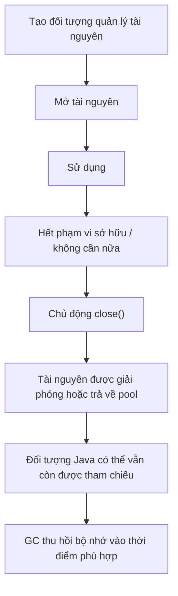

# Đóng tài nguyên và giới hạn của hàm hủy trong Java

Trong Java, **đối tượng** được cấp phát và quản lý bộ nhớ bởi JVM, nhưng nhiều đối tượng còn đại diện cho **tài nguyên cần được giải phóng đúng lúc**: tệp đang mở, kết nối cơ sở dữ liệu, socket, luồng đọc/ghi, bộ nhớ ngoài heap hoặc một đối tượng giữ khóa. Vì vậy, cần phân biệt hai việc:

- **Thu hồi bộ nhớ của đối tượng:** Garbage Collector (GC) xử lý khi đối tượng không còn được truy cập theo các quy tắc của JVM.
- **Đóng tài nguyên mà đối tượng đang sở hữu:** ứng dụng phải chủ động thực hiện vào thời điểm không còn sử dụng, thường bằng `close()` và `try-with-resources`.

**Thông điệp quan trọng:** Trong Java, không có “hàm hủy” (*destructor*) chạy tự động, có thời điểm xác định giống destructor của C++. Cơ chế `finalize()` cũ không đáng tin để đóng tài nguyên và đã bị đánh dấu **deprecated for removal**; mã Java mới không nên dùng nó.

## 1. Vì sao thu gom rác không thay thế việc đóng tài nguyên?

Xét mã đọc một tệp:

```java
BufferedReader reader = Files.newBufferedReader(path);
String line = reader.readLine();
// Không đóng reader
```

Biến `reader` giữ tham chiếu đến một đối tượng Java, còn `BufferedReader` gián tiếp sử dụng tài nguyên hệ điều hành liên quan đến tệp. Khi biến không còn được dùng, JVM **không bảo đảm** tài nguyên sẽ được đóng ngay. Nếu lặp lại thao tác mở tệp mà bỏ qua `close()`, ứng dụng có thể cạn file descriptor hoặc gặp lỗi mở tệp mới.

| Thứ được quản lý | Ví dụ | Ai chịu trách nhiệm chính? | Khi nào giải phóng? |
| --- | --- | --- | --- |
| Bộ nhớ heap Java | Đối tượng `Customer`, `StringBuilder` | JVM/GC | Khi JVM quyết định thu gom đối tượng không còn được truy cập |
| Tài nguyên tệp | `BufferedReader`, `FileInputStream` | Mã sử dụng và lớp API sở hữu tài nguyên | Chủ động `close()`, lý tưởng ngay khi xong việc |
| Kết nối cơ sở dữ liệu | JDBC `Connection`, `PreparedStatement`, `ResultSet` | Mã ứng dụng phối hợp với driver/pool | Đóng theo phạm vi sử dụng; `Connection.close()` có thể trả kết nối về pool |
| Socket mạng | `Socket`, các stream liên quan | Mã sở hữu kết nối | Đóng khi trao đổi xong hoặc khi hủy yêu cầu |
| Executor/luồng chạy | Executor và tác vụ | Thành phần quản lý vòng đời | Tắt bằng API phù hợp, chờ hoàn tất khi cần; chi tiết khác theo phiên bản Java |

Một đối tượng có thể đã không còn tham chiếu từ mã nghiệp vụ nhưng tài nguyên hệ điều hành chưa được đóng đúng lúc. Ngược lại, một đối tượng Java **vẫn đang tồn tại** hoàn toàn có thể đã đóng tài nguyên và tiếp tục được truy cập để kiểm tra trạng thái.



Sơ đồ mô tả vòng đời mong muốn. Lệnh `close()` có thể phát sinh lỗi và một số tài nguyên có semantics riêng; việc “đóng thành công” phải tuân theo hợp đồng của API cụ thể.

## 2. Cách chuẩn: `try-with-resources`

Từ Java 7, `try-with-resources` tự động gọi `close()` đối với các tài nguyên khai báo trong phần `try (...)` khi rời khỏi khối, kể cả khi thân `try` ném ngoại lệ.

```java
import java.io.BufferedReader;
import java.io.IOException;
import java.nio.charset.StandardCharsets;
import java.nio.file.Files;
import java.nio.file.Path;

class ReaderExample {
    static String readFirstLine(Path path) throws IOException {
        try (BufferedReader reader =
                 Files.newBufferedReader(path, StandardCharsets.UTF_8)) {
            return reader.readLine();
        } // reader.close() được gọi khi rời khối try
    }
}
```

`BufferedReader` là tài nguyên có thể đóng. Khi `readLine()` hoàn tất, `return` không làm mất bước đóng; Java vẫn gọi `close()` trước khi phương thức thực sự trả kết quả cho caller.

Nếu `Files.newBufferedReader(...)` không mở được tệp, lời gọi tạo tài nguyên ném ngoại lệ và không có `reader` được khởi tạo thành công để đóng. Nếu tài nguyên đã mở thành công nhưng đọc thất bại, cơ chế của `try-with-resources` vẫn thực hiện đóng.

**Quy tắc:** Đối tượng trong danh sách `try (...)` phải là kiểu triển khai `AutoCloseable` (hoặc `Closeable`, vốn kế thừa `AutoCloseable`).

## 3. Ví dụ hoàn chỉnh: quản lý vòng đời tài nguyên

Ví dụ sau cho thấy hai hành vi: tài nguyên tự định nghĩa được đóng **theo thứ tự ngược với thứ tự khởi tạo** và việc đọc/ghi tệp đóng stream ngay sau khi dùng.

Lưu toàn bộ mã vào file **`Main.java`**, dùng Java 17 hoặc Java 21:

```java
import java.io.BufferedReader;
import java.io.BufferedWriter;
import java.io.IOException;
import java.nio.charset.StandardCharsets;
import java.nio.file.Files;
import java.nio.file.Path;
import java.util.Objects;

public class Main {
    static final class Session implements AutoCloseable {
        private final String name;
        private boolean closed;

        Session(String name) {
            this.name = Objects.requireNonNull(name, "name");
            System.out.println("Mở " + name);
        }

        void use() {
            if (closed) {
                throw new IllegalStateException("Session đã đóng");
            }
            System.out.println("Dùng " + name);
        }

        @Override
        public void close() {
            // Đây là lựa chọn thiết kế của Session, không phải
            // lời bảo đảm áp dụng cho mọi AutoCloseable.
            if (closed) {
                return;
            }
            closed = true;
            System.out.println("Đóng " + name);
        }
    }

    public static void main(String[] args) throws IOException {
        try (Session first = new Session("A");
             Session second = new Session("B")) {
            first.use();
            second.use();
        }

        Path file = Files.createTempFile("oop-resource-", ".txt");
        try {
            try (BufferedWriter writer = Files.newBufferedWriter(
                    file, StandardCharsets.UTF_8)) {
                writer.write("Xin chào Java");
            }

            try (BufferedReader reader = Files.newBufferedReader(
                    file, StandardCharsets.UTF_8)) {
                System.out.println(reader.readLine());
            }
        } finally {
            // File tạm cũng là một tài nguyên tồn tại trên đĩa:
            // xóa khi không cần nữa, dù có lỗi đọc/ghi.
            Files.deleteIfExists(file);
        }
    }
}
```

Chạy:

```bash
javac Main.java
java Main
```

Đầu ra:

```text
Mở A
Mở B
Dùng A
Dùng B
Đóng B
Đóng A
Xin chào Java
```

**Điều gì xảy ra?**

1. `Session("A")` được tạo trước, rồi `Session("B")`.
2. Trong thân `try`, chương trình dùng cả hai tài nguyên.
3. Khi hết khối, Java tự gọi `second.close()` trước, sau đó `first.close()`.
4. Ở phần tệp, writer đóng trước khi reader bắt đầu đọc. Khi đọc xong, reader đóng; `finally` xóa tệp tạm.
5. Phương thức `Session.use()` chặn việc thao tác sau khi tài nguyên đã đóng.

Lệnh `Files.deleteIfExists(file)` có thể tự ném `IOException`; trong ứng dụng thật, cần quyết định cách báo cáo lỗi xóa tệp, đặc biệt nếu trước đó đã có lỗi đọc/ghi. Ví dụ này phù hợp để thấy các phạm vi sở hữu riêng: **đóng luồng I/O** và **xóa đường dẫn tệp tạm** là hai việc khác nhau.

## 4. `AutoCloseable` và `Closeable`

Hai giao diện cơ bản thường gặp:

```java
public interface AutoCloseable {
    void close() throws Exception;
}
```

```java
public interface Closeable extends AutoCloseable {
    void close() throws java.io.IOException;
}
```

| Tiêu chí | `AutoCloseable` | `Closeable` |
| --- | --- | --- |
| Mục đích | Hợp đồng tổng quát cho tài nguyên cần đóng | Hợp đồng đóng tài nguyên I/O |
| Ngoại lệ được khai báo trong `close()` | `Exception` | `IOException` |
| Có dùng trong `try-with-resources`? | Có | Có |
| Đóng nhiều lần | Không được bảo đảm an toàn chung cho mọi triển khai | Hợp đồng `Closeable` quy định việc đóng một tài nguyên đã đóng không gây tác dụng |
| Ví dụ | `java.sql.Connection`, đối tượng khóa hoặc transaction scope do ứng dụng viết | `BufferedReader`, `InputStream`, `OutputStream` |

Khi tự triển khai, có thể khai báo `close()` không `throws` hoặc khai báo ngoại lệ cụ thể hẹp hơn. Ví dụ `Session.close()` ở trên không ném checked exception.

**Lưu ý về idempotence:** Tự tạo lớp có `close()` an toàn khi được gọi lặp lại thường rất có ích, nhưng `AutoCloseable` **không bắt buộc** mọi lớp triển khai đều phải idempotent. Không nên giả định có thể đóng hai lần hoặc dùng lại mọi tài nguyên sau khi đóng.

## 5. `try-with-resources` bảo đảm những gì?

Có hai điều đặc biệt quan trọng:

### 5.1. Đóng theo thứ tự ngược

```java
try (Resource a = openA();
     Resource b = openB();
     Resource c = openC()) {
    process(a, b, c);
}
```

Java đóng theo thứ tự `c`, `b`, `a`. Nếu khởi tạo `b` thất bại thì `a` (đã tạo thành công) vẫn được đóng; `c` chưa được tạo.

Điều này rất phù hợp với các tài nguyên phụ thuộc nhau, ví dụ một `ResultSet` sử dụng `PreparedStatement`, còn statement được tạo từ `Connection`.

### 5.2. Ngoại lệ khi đóng có thể bị *suppressed*

Giả sử cả phần xử lý và bước đóng đều ném lỗi. Java cần giữ được nguyên nhân quan trọng nhất thay vì để lỗi đóng che mất lỗi xử lý.

Lưu ví dụ độc lập thành **`SuppressedDemo.java`**:

```java
import java.io.IOException;

public class SuppressedDemo {
    static final class FailingResource implements AutoCloseable {
        @Override
        public void close() throws IOException {
            throw new IOException("Lỗi khi đóng");
        }
    }

    public static void main(String[] args) {
        try (FailingResource resource = new FailingResource()) {
            throw new IllegalStateException("Lỗi xử lý");
        } catch (Exception ex) {
            System.out.println("Chính: " + ex.getMessage());
            for (Throwable suppressed : ex.getSuppressed()) {
                System.out.println("Kèm theo: " + suppressed.getMessage());
            }
        }
    }
}
```

Kết quả:

```text
Chính: Lỗi xử lý
Kèm theo: Lỗi khi đóng
```

Trong `try-with-resources`, ngoại lệ từ thân `try` là ngoại lệ chính; lỗi `close()` được đính kèm vào `getSuppressed()`. Nếu thân `try` không lỗi mà `close()` lỗi, ngoại lệ đóng có thể được ném ra trực tiếp.

Không nên tự ý bỏ qua lỗi đóng vì một số API có thể chỉ phát hiện lỗi ghi/flush khi đóng. Khi ghi log, cân nhắc cả nguyên nhân chính lẫn các ngoại lệ suppressed để không mất thông tin điều tra.

## 6. Vì sao không dùng `finalize()` như một hàm hủy?

Một số tài liệu cũ có thể cho thấy lớp override phương thức `protected void finalize() throws Throwable` của `Object`. Đây là cơ chế **finalization**, từng được xem như một cách xử lý trước khi bộ nhớ đối tượng bị thu hồi.

Không nên dùng cách này trong Java hiện đại:

- Không thể biết chính xác **khi nào** JVM có thể chạy finalizer.
- Không có cam kết finalizer sẽ chạy trước khi chương trình kết thúc; một đối tượng có thể không được finalize.
- Finalizer có thể chạy trên luồng không do mã nghiệp vụ kiểm soát, gây khó khăn về đồng bộ và xử lý lỗi.
- Việc giữ hoặc “hồi sinh” tham chiếu từ finalizer làm vòng đời phức tạp, gây rủi ro hiệu năng, bảo mật và tính đúng đắn.
- `Object.finalize()` và finalization đã được **deprecated for removal** trong những phiên bản Java hiện đại (JEP 421). Tính năng này có thể bị vô hiệu hóa hoặc bị loại bỏ trong tương lai.

Đặc biệt, **`System.gc()` chỉ là một yêu cầu/gợi ý cho JVM**, không phải cam kết sẽ thu gom ngay, càng không phải một phương thức đóng file/socket/connection. Không bao giờ dùng `System.gc()` để cố ép một finalizer chạy.

| Cơ chế | Mục đích | Thời điểm dự đoán được? | Có phù hợp để đóng tài nguyên chính? |
| --- | --- | --- | --- |
| `try-with-resources` | Đóng `AutoCloseable` khi rời phạm vi | Có, theo luồng thực thi bình thường hoặc ném ngoại lệ | **Có: ưu tiên** |
| `close()` gọi tường minh | Đóng theo quyết định nghiệp vụ | Có, tại lời gọi | Có, nếu quản lý ngoại lệ và phạm vi sở hữu |
| `finally` | Luôn cố thực thi mã dọn dẹp khi rời khối | Theo luồng Java, trừ các tình huống kết thúc bất thường của tiến trình/JVM | Có khi cần quản lý thủ công |
| `Cleaner` | Dọn dẹp dự phòng phụ thuộc vào GC | Không | Chỉ là phương án dự phòng phù hợp, không thay thế đóng tường minh |
| `finalize()` | Cơ chế finalization cũ | Không | **Không dùng cho mã mới** |
| GC | Quản lý bộ nhớ heap | Không | Không phải công cụ đóng tài nguyên nghiệp vụ |

**Không có cơ chế nào bảo đảm mã Java tùy ý sẽ chạy khi tiến trình bị kill đột ngột, máy mất điện hoặc JVM crash.** Vì vậy, phần lớn tài nguyên cần thiết phải được đóng sớm ở những ranh giới nghiệp vụ có kiểm soát.

## 7. `Cleaner` có phải là destructor mới?

`java.lang.ref.Cleaner` cho phép đăng ký một hành động dọn dẹp khi đối tượng được đánh giá là có thể thu gom. Nó hữu ích trong **một số thiết kế chuyên sâu**, thường để có cơ chế dự phòng cho tài nguyên native mà ứng dụng quên đóng.

Nhưng `Cleaner` **không biến việc dọn dẹp thành tất định**:

1. Không biết chính xác khi nào GC sẽ làm đối tượng đủ điều kiện để cleanup.
2. Không nên mong đợi cleanup chạy đúng lúc hoặc chắc chắn trước khi tiến trình kết thúc.
3. Nếu hành động cleanup vô tình giữ tham chiếu mạnh đến chính đối tượng cần dọn, nó có thể ngăn đối tượng trở thành ứng viên được thu gom.
4. Mã cleanup chạy trong bối cảnh khác với code nghiệp vụ, nên phải thiết kế cho thread-safety và ngoại lệ.

Cách tư duy đúng: API công khai vẫn có `close()` để caller chủ động đóng; `Cleaner` chỉ là **lưới an toàn dự phòng**, và chỉ nên thêm khi thật sự cần. Đối với kết nối JDBC, tệp và socket thông thường, `try-with-resources` là giải pháp cơ bản, rõ ràng hơn.

## 8. Ai sở hữu tài nguyên và ai phải đóng?

Một bug phổ biến là “thấy đối tượng triển khai `AutoCloseable` thì tự đóng” mà không xét ai sở hữu nó.

**Nguyên tắc ownership:** Thành phần **tạo ra hoặc nhận quyền sở hữu** tài nguyên có trách nhiệm đóng ở cuối phạm vi sử dụng đã thỏa thuận. Thành phần chỉ **mượn** tài nguyên thường không đóng nó, trừ khi hợp đồng API nói rõ.

Ví dụ:

```java
class TextService {
    // Chỉ mượn reader từ caller, không nhận ownership.
    static String readOneLine(java.io.BufferedReader reader)
            throws java.io.IOException {
        return reader.readLine();
    }
}
```

Caller sẽ quyết định phạm vi:

```java
try (BufferedReader reader = Files.newBufferedReader(path)) {
    String line = TextService.readOneLine(reader);
    // Có thể tiếp tục sử dụng reader nếu cần.
}
```

Nếu `readOneLine()` tự đóng reader, caller sẽ bị bất ngờ khi không thể đọc thêm.

Trong các framework, vòng đời còn được điều phối bởi container: ví dụ tài nguyên của một request, transaction hay bean do framework quản lý có thể cần để container tự đóng tại thời điểm quy định. Nếu code tự gọi `close()` lên đối tượng do container quản lý, có thể khiến thành phần khác dùng lỗi. Cần đọc hợp đồng của loại tài nguyên cụ thể.

## 9. Đóng kết nối JDBC và tài nguyên lồng nhau

Mẫu dưới đây minh họa JDBC: chỉ để học cấu trúc, cần `DataSource`, bảng `students` và dữ liệu thật của ứng dụng để chạy.

```java
import java.sql.Connection;
import java.sql.PreparedStatement;
import java.sql.ResultSet;
import java.sql.SQLException;
import javax.sql.DataSource;

class StudentRepository {
    private final DataSource dataSource;

    StudentRepository(DataSource dataSource) {
        this.dataSource = dataSource;
    }

    String findName(long id) throws SQLException {
        String sql = "SELECT name FROM students WHERE id = ?";

        try (Connection connection = dataSource.getConnection();
             PreparedStatement statement =
                 connection.prepareStatement(sql)) {
            statement.setLong(1, id);

            try (ResultSet rs = statement.executeQuery()) {
                return rs.next() ? rs.getString("name") : null;
            }
        }
    }
}
```

Phạm vi kết nối nằm ở `try` ngoài. `ResultSet` đóng khi khối trong kết thúc; sau đó statement và connection được đóng khi rời khối ngoài.

Với connection pool, `Connection.close()` thường **trả kết nối về pool** thay vì đóng vật lý kết nối TCP tới máy chủ ngay. Do đó, bỏ qua `close()` có thể làm hết kết nối trong pool dù GC vẫn còn hoạt động bình thường.

Khi giao dịch cần `commit()` hoặc `rollback()`, **việc đóng connection không thể thay thế quản lý transaction đúng cách**. Cần tuân thủ hợp đồng của driver, pool hoặc transaction manager.

## 10. Tự triển khai `AutoCloseable` sao cho có ích

Một lớp sở hữu tài nguyên nên định nghĩa rõ trạng thái sống/đã đóng. Ví dụ lớp bọc một `BufferedReader`:

```java
import java.io.BufferedReader;
import java.io.IOException;
import java.nio.charset.StandardCharsets;
import java.nio.file.Files;
import java.nio.file.Path;

final class LineSource implements AutoCloseable {
    private final BufferedReader reader;
    private boolean closed;

    LineSource(Path path) throws IOException {
        this.reader = Files.newBufferedReader(
            path, StandardCharsets.UTF_8);
    }

    String nextLine() throws IOException {
        if (closed) {
            throw new IllegalStateException("LineSource đã đóng");
        }
        return reader.readLine();
    }

    @Override
    public void close() throws IOException {
        if (!closed) {
            // Đặt closed trước khi gọi xuống tài nguyên
            // để chặn thao tác qua wrapper sau yêu cầu đóng.
            closed = true;
            reader.close();
        }
    }
}
```

Caller dùng:

```java
try (LineSource source = new LineSource(path)) {
    String line;
    while ((line = source.nextLine()) != null) {
        System.out.println(line);
    }
}
```

Mẫu này phù hợp cho đối tượng được sử dụng **tuần tự**. Trường `closed` không tự làm API thread-safe; nếu nhiều luồng đồng thời gọi `nextLine()` và `close()`, cần một chiến lược đồng bộ hoặc tài liệu hóa rõ rằng không hỗ trợ gọi đồng thời.

Khi `close()` có thể lỗi, cần quyết định hợp đồng về thử đóng lại và trạng thái sau lỗi. Trong ví dụ, wrapper được coi là **không thể dùng tiếp** ngay khi quá trình đóng bắt đầu; đây là lựa chọn thiết kế có chủ đích, không phải quy tắc bắt buộc cho mọi tài nguyên.

Một lời gọi `close()` không có nghĩa có thể sử dụng lại tài nguyên sau đó. Nhiều stream/socket không cho phép mở lại cùng một thể hiện; muốn dùng lần nữa thường phải **tạo đối tượng tài nguyên mới**.

## 11. `finally` so với `try-with-resources`

Trước Java 7, mã đóng tài nguyên thường đặt trong `finally`:

```java
BufferedReader reader = null;
try {
    reader = Files.newBufferedReader(path);
    System.out.println(reader.readLine());
} finally {
    if (reader != null) {
        reader.close();
    }
}
```

Phần trên minh họa cú pháp dọn dẹp thủ công, cần đặt trong phương thức khai báo hoặc xử lý `IOException`. Nó ngắn nhưng dễ phát sinh lỗi khi có nhiều tài nguyên: quên kiểm tra `null`, quên đóng một tài nguyên hoặc vô tình để lỗi đóng che mất lỗi xử lý.

Với đối tượng triển khai `AutoCloseable`, ưu tiên:

```java
try (BufferedReader reader = Files.newBufferedReader(path)) {
    System.out.println(reader.readLine());
}
```

Tuy nhiên, `finally` **vẫn hữu ích** cho những hành động dọn dẹp không nằm trong hợp đồng `AutoCloseable`, chẳng hạn xóa tệp tạm, trả lại trạng thái hay giải phóng một khóa theo API riêng. Trong mọi trường hợp, `finally` không nên được hiểu là chạy bất chấp mọi sự cố bên ngoài JVM.

## 12. Những lỗi thường gặp

| Lỗi | Hậu quả có thể xảy ra | Cách làm phù hợp |
| --- | --- | --- |
| Không gọi `close()`, trông chờ GC | Tài nguyên mở lâu, cạn handle/pool | `try-with-resources` |
| Override `finalize()` để đóng socket/file | Thời điểm dọn dẹp không bảo đảm | Bỏ finalization; dùng `close()` |
| Gọi `System.gc()` sau mỗi request | Không bảo đảm đóng tài nguyên, ảnh hưởng hiệu năng | Quản lý vòng đời rõ ràng |
| Tự đóng tài nguyên chỉ đang mượn | Caller không thể tiếp tục sử dụng | Thống nhất hợp đồng ownership |
| Chỉ đóng khi chạy thành công | Ngoại lệ khiến tài nguyên bị bỏ mở | `try-with-resources` hoặc `finally` phù hợp |
| Quên lỗi khi `close()` thất bại | Không thấy lỗi flush/ghi/chuyển trạng thái | Ghi log, xem `getSuppressed()` khi cần |
| Cho rằng `close()` luôn có thể gọi nhiều lần | Một số API không hỗ trợ | Đọc hợp đồng tài nguyên; thiết kế wrapper rõ ràng |
| Gọi tài nguyên sau khi đóng | `IOException` hoặc `IllegalStateException` tùy API | Kiểm soát trạng thái và phạm vi sử dụng |
| Tự đóng connection do transaction manager kiểm soát | Phá hỏng vòng đời transaction | Để container quản lý đúng hợp đồng |
| Tin `Cleaner` sẽ chạy trước shutdown | Dọn dẹp bị trễ hoặc không thực hiện | Chỉ dùng Cleaner làm fallback |

## 13. Bài tập tự kiểm tra

**Câu 1.** Đoạn nào đúng hơn cho một tệp được mở trong một phương thức ngắn?

```java
// A
BufferedReader reader = Files.newBufferedReader(path);
return reader.readLine();

// B
try (BufferedReader reader = Files.newBufferedReader(path)) {
    return reader.readLine();
}
```

**Đáp án:** **B**. Java vẫn gọi `close()` khi thoát bằng `return` hoặc khi gặp ngoại lệ sau khi mở thành công.

**Câu 2.** Hai tài nguyên mở theo thứ tự `A`, `B` trong cùng danh sách `try (...)`. Chúng đóng theo thứ tự nào?

**Đáp án:** **B rồi A**, vì `try-with-resources` đóng theo thứ tự ngược.

**Câu 3.** Thân `try` ném `IllegalStateException`, còn `close()` ném `IOException`. Ngoại lệ nào thường là ngoại lệ chính?

**Đáp án:** Lỗi của thân `try` là ngoại lệ chính; lỗi `close()` được lưu trong `getSuppressed()`.

**Câu 4.** Một `Connection` lấy từ connection pool được `close()`. Có chắc kết nối TCP vật lý tới database bị đóng ngay không?

**Đáp án:** **Không.** Với pool, `close()` thường trả kết nối về pool cho request khác dùng; đó vẫn là hành động bắt buộc để trả quyền sử dụng.

**Câu 5.** Khi GC thu hồi một đối tượng Java, có thể kết luận file descriptor mà nó từng giữ đã được đóng đúng lúc không?

**Đáp án:** **Không.** Tài nguyên ngoài bộ nhớ heap cần được đóng chủ động; không thể dựa vào thời điểm GC.

**Câu 6.** Có nên dùng `finalize()` hoặc `Cleaner` làm bước dọn dẹp chính cho kết nối mạng không?

**Đáp án:** **Không.** Ưu tiên hợp đồng sở hữu rõ ràng, `AutoCloseable.close()` và `try-with-resources`. `Cleaner` chỉ có thể là giải pháp dự phòng trong các trường hợp phù hợp, còn `finalize()` không dùng cho mã mới.

**Ghi nhớ:** GC quản lý **bộ nhớ đối tượng**, còn `close()` quản lý **tài nguyên có vòng đời nghiệp vụ**. Một lớp quản lý tài nguyên tốt định nghĩa rõ quyền sở hữu, thời điểm đóng, cách xử lý lỗi và hành vi sau khi đóng. Trong Java hiện đại, hãy dùng `try-with-resources` bất cứ khi nào API hỗ trợ `AutoCloseable`, thay vì trông đợi “hàm hủy” hoặc GC xử lý hộ.