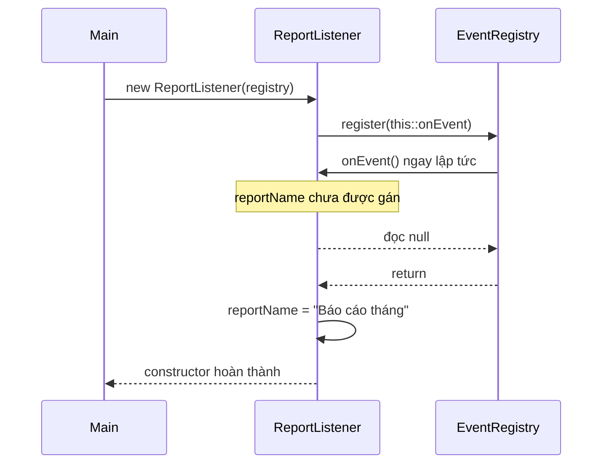
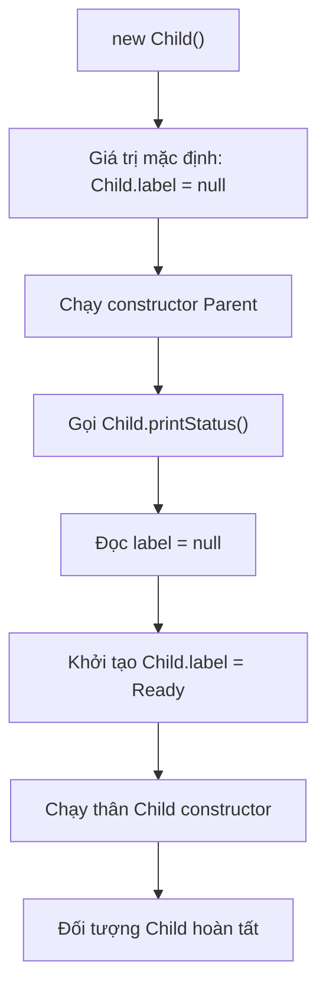
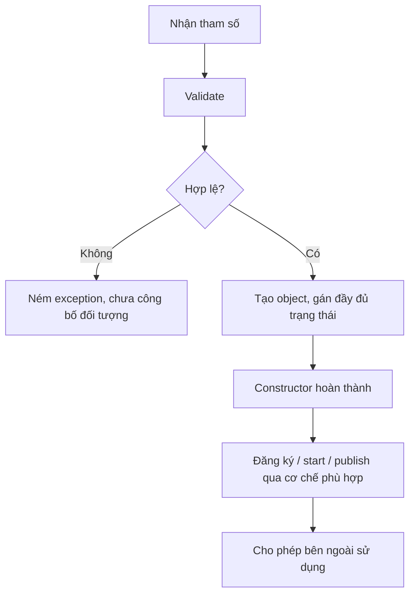

# Tránh để đối tượng chưa khởi tạo xong bị sử dụng trong Java

Trong Java, **constructor** chịu trách nhiệm thiết lập trạng thái ban đầu của đối tượng. Nếu tham chiếu đến đối tượng bị đưa ra bên ngoài **trước khi constructor và chuỗi khởi tạo liên quan hoàn tất**, mã khác có thể gọi phương thức hoặc đọc field khi đối tượng mới ở trạng thái dở dang. Hiện tượng này thường gọi là **this escape** (*tham chiếu `this` thoát khỏi quá trình khởi tạo*).

Vấn đề không chỉ xảy ra trong chương trình đa luồng. Một callback được gọi ngay trong lúc đăng ký listener cũng có thể dùng đối tượng quá sớm, ngay trên cùng thread. Trong chương trình đa luồng, sự cố còn khó tái hiện hơn do thời điểm thực thi và khả năng nhìn thấy dữ liệu giữa các thread.

Bài này giải thích tình huống gây lỗi, lý do gây lỗi và cách thiết kế để một đối tượng chỉ được sử dụng khi nó đã sẵn sàng.

## 1. Một đối tượng đi qua những giai đoạn nào?

Khi thực hiện `new SomeClass(...)`, JVM và ngôn ngữ Java thực hiện quá trình khởi tạo đối tượng theo quy tắc của Java, bao gồm thiết lập giá trị mặc định cho các field, chạy chuỗi constructor lớp cha, thực hiện field initializer/instance initializer của các lớp theo thứ tự phù hợp rồi chạy phần thân constructor.

Một đặc điểm cần nhớ: **đối tượng có thể đã tồn tại trong khi constructor chưa hoàn thành**. Một tham chiếu đến đối tượng đó có thể bị lộ trong giai đoạn này, ví dụ qua `this`.

Giả sử có lớp:

```java
public final class Session {
    private final String sessionId;
    private final String owner;

    public Session(String sessionId, String owner) {
        this.sessionId = sessionId;
        this.owner = owner;
    }

    public String displayName() {
        return sessionId + " - " + owner;
    }
}
```

Trong đường sử dụng bình thường, caller chỉ nhận tham chiếu từ biểu thức `new Session(...)` **sau khi constructor hoàn thành thành công**. Nhưng constructor có thể làm rò rỉ `this` bằng cách lưu nó vào nơi khác hoặc chuyển nó cho một callback.

### Phân biệt hai rủi ro

| Rủi ro | Điều gì xảy ra? | Ví dụ |
|---|---|---|
| **Dùng sớm (premature use)** | Mã khác truy cập đối tượng khi quá trình khởi tạo chưa xong | Listener được gọi ngay khi đăng ký từ constructor |
| **Công bố không an toàn (unsafe publication)** | Một thread khác nhận tham chiếu mà không có quan hệ đồng bộ phù hợp, nên khả năng nhìn thấy trạng thái có thể không được bảo đảm | Gán đối tượng vào field dùng chung thông thường rồi để thread khác đọc không đồng bộ |

Hai vấn đề có liên quan nhưng không đồng nhất. Ngay cả khi việc công bố tham chiếu có cơ chế đồng bộ, **công bố trước khi khởi tạo xong vẫn cho phép mã khác sử dụng một đối tượng chưa hoàn chỉnh**.

## 2. this escape là gì?

Trong phương thức instance và constructor, `this` tham chiếu tới chính đối tượng hiện tại. **This escape** xảy ra khi trong lúc xây dựng, tham chiếu tới đối tượng này trở nên truy cập được từ một nơi có thể sử dụng nó trước khi quá trình khởi tạo kết thúc.

Những đường làm rò rỉ `this` thường gặp:

- Đăng ký listener hoặc callback vào một event bus, registry hay service dùng chung ngay trong constructor.
- Lưu `this` vào field `static` hoặc một collection do thành phần khác có quyền truy cập nắm giữ.
- Truyền `this` cho mã không kiểm soát được, đặc biệt nếu mã đó gọi ngược hoặc giữ lại tham chiếu.
- Khởi chạy thread hoặc asynchronous task dùng `this` trong constructor.
- Đưa ra bên ngoài lambda/method reference/đối tượng inner class có giữ tham chiếu tới `this`.

Việc truyền `this` cho một phương thức hỗ trợ nội bộ mà bạn kiểm soát và không giữ hoặc đưa tham chiếu ra ngoài **không nhất thiết** gây this escape. Yếu tố quan trọng là liệu tham chiếu có thể được dùng từ bên ngoài ranh giới khởi tạo sớm hay không.

## 3. Ví dụ lỗi xác định: đăng ký callback quá sớm

Ví dụ dưới đây cố tình mô phỏng registry gọi callback **ngay trong lúc đăng ký**. Không cần thread phụ nên lỗi có thể dự đoán được.

File `UnsafeListenerDemo.java`:

```java
public class UnsafeListenerDemo {
    interface Listener {
        void onEvent();
    }

    static class EventRegistry {
        void register(Listener listener) {
            listener.onEvent(); // Callback chạy đồng bộ ngay lúc đăng ký
        }
    }

    static class ReportListener {
        private final String reportName;

        ReportListener(EventRegistry registry) {
            registry.register(this::onEvent);
            this.reportName = "Báo cáo tháng";
        }

        private void onEvent() {
            System.out.println("Tên báo cáo: " + reportName);
        }
    }

    public static void main(String[] args) {
        new ReportListener(new EventRegistry());
    }
}
```

Kết quả:

```text
Tên báo cáo: null
```

Mặc dù `reportName` được khai báo `final` và được gán trong constructor, callback chạy **trước câu lệnh gán**. Lúc đó field tham chiếu vẫn mang giá trị mặc định `null`. Nếu `onEvent()` gọi `reportName.length()`, chương trình sẽ ném `NullPointerException`.

Đây không phải lỗi của từ khóa `final`; lỗi là do việc gọi mã có thể quan sát đối tượng trước khi trạng thái hợp lệ được thiết lập.

### Luồng gây lỗi



Một số thư viện chỉ lưu listener và không gọi callback ngay, nhưng vẫn có nguy cơ nếu thread khác phát sự kiện trước khi constructor kết thúc. Không nên phụ thuộc vào giả định “listener sẽ chưa được gọi đâu” khi API không bảo đảm điều đó.

## 4. Cách sửa: xây dựng xong rồi mới đăng ký

Cách thiết kế rõ ràng là **tách việc khởi tạo trạng thái khỏi việc đưa đối tượng vào hệ thống bên ngoài**.

Ví dụ dùng static factory để caller chỉ nhận đối tượng sau khi các bước tạo và đăng ký đã hoàn tất:

```java
import java.util.Objects;

public final class SafeListenerDemo {
    interface Listener {
        void onEvent();
    }

    static class EventRegistry {
        void register(Listener listener) {
            listener.onEvent(); // Cố ý gọi ngay để kiểm chứng
        }
    }

    static final class ReportListener {
        private final String reportName;

        private ReportListener(String reportName) {
            this.reportName = Objects.requireNonNull(reportName);
            if (reportName.isBlank()) {
                throw new IllegalArgumentException("Tên báo cáo không được rỗng");
            }
        }

        static ReportListener createAndRegister(
                EventRegistry registry, String reportName) {
            Objects.requireNonNull(registry);

            ReportListener listener = new ReportListener(reportName);
            registry.register(listener::onEvent);
            return listener;
        }

        private void onEvent() {
            System.out.println("Tên báo cáo: " + reportName);
        }
    }

    public static void main(String[] args) {
        ReportListener listener = ReportListener.createAndRegister(
            new EventRegistry(), "Báo cáo tháng"
        );
        // Callback in: Tên báo cáo: Báo cáo tháng
    }
}
```

Tại thời điểm `registry.register(...)` chạy, constructor `ReportListener(String)` đã **trả về thành công** và đối tượng có trạng thái hợp lệ. Ngay cả callback đồng bộ trong `register` cũng thấy tên báo cáo đúng.

Mô hình này áp dụng tốt khi phải gắn một đối tượng vào event bus, message handler, cache, scheduler hay hệ thống plugin.

**Lưu ý về lỗi đăng ký:** Nếu `register` ném exception, factory ở trên cũng không trả thành công. Tuy nhiên registry có thể đã lưu listener trước khi ném lỗi. Với hệ thống thực, cần định nghĩa rõ việc đăng ký có nguyên tử hay không, có cách hủy đăng ký không, và cách xử lý rollback/cleanup.

### Nếu bắt buộc có bước activate riêng?

Có thể thiết kế hai giai đoạn:

```java
final class Consumer {
    private final String id;
    private boolean activated;

    Consumer(String id) {
        if (id == null || id.isBlank()) {
            throw new IllegalArgumentException("id không hợp lệ");
        }
        this.id = id;
    }

    void activate(EventRegistry registry) {
        if (activated) {
            throw new IllegalStateException("Đã activate");
        }
        // Chỉ đăng ký sau khi constructor hoàn thành.
        registry.register(() -> System.out.println(id));
        activated = true;
    }
}
```

Ví dụ trên minh họa ý tưởng tách hai giai đoạn trong **môi trường gọi tuần tự**. Nó chưa phải API thread-safe: nếu `activate` có thể bị gọi đồng thời hoặc `register` gọi callback tái nhập, cần thiết kế lại trạng thái/khoá và xử lý lỗi một cách rõ ràng. Factory thường giảm khả năng caller quên gọi `activate`.

## 5. Không gọi phương thức có thể bị override trong constructor

Một nguyên nhân khác của việc dùng đối tượng quá sớm là **dynamic dispatch** trong lúc constructor lớp cha còn chạy. Java có thể gọi phương thức override của lớp con **trước khi các field initializer và constructor của lớp con hoàn tất**.

Ví dụ chạy độc lập:

```java
public class OverrideDuringConstruction {
    static class Parent {
        Parent() {
            printStatus(); // Nguy hiểm: phương thức có thể override
        }

        void printStatus() {
            System.out.println("Parent initialized");
        }
    }

    static class Child extends Parent {
        private String label = "Ready";

        Child() {
            System.out.println("Child constructor");
        }

        @Override
        void printStatus() {
            System.out.println("Child label = " + label);
        }
    }

    public static void main(String[] args) {
        new Child();
    }
}
```

Kết quả:

```text
Child label = null
Child constructor
```

Tại sao? Khi `new Child()`:

1. Các field instance nhận giá trị mặc định (với `label` là `null`).
2. Constructor lớp cha `Parent()` chạy.
3. Lệnh `printStatus()` được dispatch động đến `Child.printStatus()`.
4. Field initializer `label = "Ready"` của `Child` **chưa chạy**.
5. Sau khi constructor cha xong, phần khởi tạo riêng của `Child` mới diễn ra.

Thứ tự quan trọng có thể hình dung:



### Thiết kế an toàn hơn

- Trong constructor, chỉ gọi các phương thức **`private`, `final` hoặc `static`** phù hợp, khi cần tránh việc subclass ghi đè làm thay đổi luồng khởi tạo. Phương thức `private` không override được; `final` khóa việc override.
- Tốt hơn nữa, kiểm tra đầu vào và thiết lập dữ liệu cần thiết trực tiếp qua các helper không thể override.
- Nếu logic cần dữ liệu của lớp con, thực hiện **sau khi toàn bộ constructor kết thúc**, thông qua phương thức được caller gọi hoặc qua factory kiểm soát vòng đời.

Ví dụ:

```java
class Parent {
    private final String id;

    Parent(String id) {
        this.id = validate(id);
    }

    private static String validate(String id) {
        if (id == null || id.isBlank()) {
            throw new IllegalArgumentException("id không hợp lệ");
        }
        return id;
    }

    public final String getId() {
        return id;
    }
}

final class Child extends Parent {
    private final String label;

    Child(String id, String label) {
        super(id);
        this.label = java.util.Objects.requireNonNull(label);
    }

    void printStatus() {
        System.out.println(getId() + ": " + label);
    }
}

// Dùng sau khi khởi tạo hoàn tất:
Child child = new Child("C01", "Ready");
child.printStatus(); // C01: Ready
```

Ở ví dụ này, constructor cha không gọi phương thức mà lớp con có thể override; `printStatus()` chỉ chạy sau khi `new Child(...)` hoàn thành.

## 6. Không khởi chạy thread dùng this ngay trong constructor

Một lỗi đặc biệt nguy hiểm:

```java
class UnsafeWorker {
    private int threshold;

    UnsafeWorker() {
        new Thread(() -> System.out.println(threshold)).start();
        threshold = 10;
    }
}
```

Lambda ở đây tham chiếu field instance, tức giữ tham chiếu tới `this`. Sau `Thread.start()`, thread mới **có thể** chạy trước câu lệnh `threshold = 10`, nên có thể in `0`; kết quả phụ thuộc lịch chạy. Việc thử nhiều lần mà luôn thấy `10` **không chứng minh chương trình đúng**.

Quan hệ *happens-before* giữa các hành động ở thread gọi **trước** `Thread.start()` và hành động ở thread mới không bảo đảm một phép gán được thực hiện **sau** `start()` sẽ xuất hiện trước lần đọc trên worker.

### Tạo xong rồi mới start

Một thiết kế phù hợp với công việc chạy nền:

```java
public final class SafeWorker {
    private final int threshold;
    private final Thread thread;

    private SafeWorker(int threshold) {
        if (threshold <= 0) {
            throw new IllegalArgumentException("threshold phải dương");
        }
        this.threshold = threshold;
        this.thread = new Thread(this::runTask, "safe-worker");
    }

    public static SafeWorker createAndStart(int threshold) {
        SafeWorker worker = new SafeWorker(threshold);
        worker.thread.start();
        return worker;
    }

    private void runTask() {
        System.out.println("Threshold = " + threshold);
    }

    public static void main(String[] args) {
        SafeWorker.createAndStart(10);
    }
}
```

Tại thời điểm `start()` được gọi, constructor `SafeWorker` đã trả về, toàn bộ field đã được thiết lập. Các hành động được thực hiện trước `Thread.start()` *happen-before* hành động của thread mới; trường hợp này không để thread chạy trước khi khởi tạo xong.

Điều đó không tự biến mọi truy cập về sau thành thread-safe. Nếu thread đọc/ghi **trạng thái mutable** được chia sẻ với thread khác, vẫn cần cơ chế đồng bộ tương ứng.

Trong ứng dụng thực, nên cân nhắc **`ExecutorService`** để quản lý công việc, đồng thời có bước dừng/hủy theo vòng đời. Nguyên tắc vẫn là: **submit task tham chiếu tới đối tượng sau khi constructor trả về**, và quản lý đóng tài nguyên rõ ràng.

## 7. Constructor exception và đối tượng dở dang

Một constructor có thể ném exception khi kiểm tra dữ liệu:

```java
public final class EmailAddress {
    private final String value;

    public EmailAddress(String value) {
        if (value == null || !value.contains("@")) {
            throw new IllegalArgumentException("Email không hợp lệ");
        }
        this.value = value;
    }

    public String value() {
        return value;
    }
}
```

Nếu `new EmailAddress("invalid")` ném exception, biểu thức tạo đối tượng không trả một tham chiếu hợp lệ cho caller theo đường thực thi bình thường.

Tuy nhiên, nếu constructor **đã lưu `this` vào một biến dùng chung trước khi ném lỗi**, tham chiếu đến đối tượng dở dang vẫn có thể tồn tại ngoài constructor:

```java
import java.util.ArrayList;
import java.util.List;

class UnsafeRegistration {
    static final List<UnsafeRegistration> REGISTRY = new ArrayList<>();
    private final String value;

    UnsafeRegistration(String input) {
        REGISTRY.add(this); // Rò rỉ this
        if (input == null) {
            throw new IllegalArgumentException("input null");
        }
        this.value = input;
    }

    String value() {
        return value;
    }
}
```

`REGISTRY` trong ví dụ chỉ minh họa vấn đề dùng sớm, **không thread-safe**. Nếu gọi `new UnsafeRegistration(null)` rồi bắt exception, registry vẫn giữ tham chiếu đến đối tượng mà field `value` chưa được gán.

Sửa bằng cách chỉ đăng ký **sau khi tạo thành công**:

```java
static UnsafeRegistration createAndRegister(String input) {
    UnsafeRegistration result = new UnsafeRegistration(input);
    REGISTRY.add(result);
    return result;
}
```

Khi áp dụng cách này, cần **bỏ `REGISTRY.add(this)` khỏi constructor**. Trong hệ thống nhiều thread, registry cũng phải có chiến lược đồng bộ phù hợp. Nếu đăng ký có thể lỗi sau khi tạo, cần quy định hành vi xử lý lỗi hoặc hủy đăng ký.

## 8. Safe publication không đồng nghĩa chỉ dùng volatile

Với ứng dụng đa luồng, sau khi đối tượng hoàn thành khởi tạo, còn phải **công bố tham chiếu** theo cách để thread khác quan sát được trạng thái theo Java Memory Model.

### Một ví dụ công bố không an toàn

```java
class Config {
    final int port;
    int timeoutMs;

    Config(int port, int timeoutMs) {
        this.port = port;
        this.timeoutMs = timeoutMs;
    }
}

class Holder {
    Config current; // Field dùng chung, không volatile, không đồng bộ
}

// Thread A:
// holder.current = new Config(8080, 5000);

// Thread B:
// Config config = holder.current;
// if (config != null) { use(config); }
```

Nếu hai thread truy cập `current` mà không có *happens-before* thích hợp, chúng có **data race**. Thread B không được bảo đảm khi nào sẽ thấy tham chiếu mới; các giá trị trường cũng phải xét quy tắc Java Memory Model. Trường `final` như `port` có những bảo đảm đặc biệt khi đối tượng được xây dựng đúng (không để `this` escape), nhưng không thay thế yêu cầu công bố và đồng bộ toàn bộ trạng thái mutable.

### Công bố sau khi khởi tạo qua volatile

```java
class Holder {
    private volatile Config current;

    void update(int port, int timeoutMs) {
        Config newConfig = new Config(port, timeoutMs);
        current = newConfig; // Volatile write sau khi constructor xong
    }

    Config current() {
        return current; // Volatile read
    }
}
```

Một phép ghi `volatile` *happens-before* những lần đọc `volatile` về sau nhìn thấy giá trị được ghi theo thứ tự đồng bộ. Các ghi trạng thái trước khi công bố có thể được quan sát đúng qua đường đồng bộ này.

**Quan trọng:** `volatile` trên biến giữ tham chiếu không làm các thay đổi tùy ý **sau khi công bố** trên các trường mutable của đối tượng tự trở nên an toàn. Cũng không khắc phục được việc truyền `this` ra ngoài khi constructor vẫn đang chạy.

Ngoài `volatile`, có thể công bố bằng khóa `synchronized` phù hợp, concurrent collection có hợp đồng đồng bộ thích hợp, hoặc thông qua quá trình khởi tạo lớp (ví dụ field `static final`) và các cơ chế đồng bộ hợp lệ khác. Cần đọc và ghi qua **cùng hợp đồng đồng bộ**, tránh chỉ đồng bộ một phía.

### Bảng phân biệt

| Tình huống | Khởi tạo hoàn tất trước khi đối tượng được dùng? | Công bố an toàn giữa thread? |
|---|---|---|
| Gọi callback đồng bộ trong constructor trước khi gán field | Không | Không liên quan; đã lỗi ngay cùng thread |
| `new Thread(this::task).start()` trước khi constructor xong | Không được bảo đảm | `start()` không bảo vệ các thao tác xảy ra sau nó |
| Factory tạo xong rồi đăng ký callback, chạy tuần tự | Có | Không cần đồng bộ nếu chỉ cùng thread; nhiều thread phải xét registry |
| Factory tạo xong rồi start thread đọc trạng thái đã gán | Có | Có quan hệ happens-before từ hành động trước `start()` tới worker |
| Tạo xong rồi gán field dùng chung thông thường giữa thread | Có | Không mặc nhiên |
| Tạo xong rồi công bố qua `volatile` đúng cách | Có | Có bảo đảm visibility cho trạng thái trước publication qua giao thức này |

## 9. final field giúp gì và không giúp gì?

Field `final` chỉ được gán trong quá trình khởi tạo theo các quy tắc của Java và giúp thể hiện các thành phần không được gán lại. Java Memory Model có **final field semantics**, đem lại bảo đảm đặc biệt về giá trị field `final` khi đối tượng đã được xây dựng đúng và **tham chiếu `this` không thoát ra trong quá trình xây dựng**.

Ví dụ thiết kế đơn giản:

```java
public final class PaymentRequest {
    private final String orderId;
    private final long amount;

    public PaymentRequest(String orderId, long amount) {
        if (orderId == null || orderId.isBlank()) {
            throw new IllegalArgumentException("orderId rỗng");
        }
        if (amount <= 0) {
            throw new IllegalArgumentException("amount phải dương");
        }
        this.orderId = orderId;
        this.amount = amount;
    }

    public String orderId() {
        return orderId;
    }

    public long amount() {
        return amount;
    }
}
```

Ở đây đối tượng không lộ `this` trong constructor, hai field được thiết lập và không đổi sau đó. Thiết kế như vậy dễ kiểm tra và giảm nhu cầu đồng bộ trạng thái bên trong.

Nhưng cần nhớ:

- `final` trên field tham chiếu chỉ ngăn **gán lại field**, không khiến đối tượng được tham chiếu bất biến.
- `final List<Item> items` vẫn có thể chứa `List` hoặc `Item` mutable. Nếu cần tính bất biến sâu hơn, phải kiểm soát aliasing/defensive copy.
- `final` không có tác dụng chữa tình trạng gọi callback sớm khi field khác vẫn chưa được gán.
- Với trạng thái được cập nhật sau khi tạo, vẫn cần thiết kế đồng bộ cho các thread liên quan.

## 10. Factory và đối tượng immutable: cách giảm rủi ro

Một mẫu API hiệu quả là **validate → tạo đủ dữ liệu → trả đối tượng hoàn chỉnh**. Với dữ liệu có tham chiếu tới collection, còn phải xử lý sao chép và chia sẻ.

Ví dụ cấu hình immutable, Java 11+:

```java
import java.util.List;
import java.util.Objects;

public final class JobConfig {
    private final String jobName;
    private final List<String> recipients;

    private JobConfig(String jobName, List<String> recipients) {
        if (jobName == null || jobName.isBlank()) {
            throw new IllegalArgumentException("jobName rỗng");
        }
        this.jobName = jobName;
        this.recipients = List.copyOf(
            Objects.requireNonNull(recipients, "recipients")
        );
    }

    public static JobConfig of(String jobName, List<String> recipients) {
        return new JobConfig(jobName, recipients);
    }

    public String jobName() {
        return jobName;
    }

    public List<String> recipients() {
        return recipients;
    }
}
```

`List.copyOf` tạo hoặc trả về một danh sách không thể thay đổi qua giao diện `List`, đồng thời từ chối phần tử `null`. Ở ví dụ này các phần tử là `String` immutable, nên thiết kế tránh được đường sửa trạng thái thông qua danh sách. Với kiểu phần tử mutable, `List.copyOf` **không deep copy** các phần tử.

Không có lệnh đăng ký sự kiện, đưa `this` vào vùng dùng chung hay khởi động tác vụ trong constructor. Sau khi `JobConfig.of(...)` trả về, người gọi mới sở hữu tham chiếu đến đối tượng hoàn chỉnh. Nếu đưa cấu hình cho thread khác, vẫn cần cơ chế công bố phù hợp.

## 11. Checklist kiểm tra constructor và vòng đời

Khi review một lớp có hành vi khởi tạo phức tạp, hãy kiểm tra:

1. **Constructor đã thiết lập đủ trạng thái bắt buộc chưa?** Có kiểm tra tham số và bất biến trước khi công khai đối tượng không?
2. **Có lộ `this` trước khi kết thúc constructor không?** Tìm việc đăng ký listener, gọi callback, thêm vào global registry, submit task, tạo thread hoặc chuyển `this` cho mã ngoài.
3. **Constructor cha có gọi phương thức có thể override không?** Subclass có thể bị gọi trước khi field initializer của nó chạy.
4. **Có thể khởi tạo thất bại giữa chừng không?** Nếu có, registry/callback/tài nguyên đã giữ tham chiếu tới đối tượng lỗi chưa?
5. **Sau constructor, đối tượng được công bố sang thread khác thế nào?** Cần quan hệ happens-before đúng cho trường hợp sử dụng.
6. **Có trạng thái mutable chia sẻ không?** Tách vấn đề khởi tạo an toàn và truy cập đồng thời trong suốt vòng đời.

Có thể tổ chức các bước:



**Không nên hiểu sơ đồ như yêu cầu mọi lớp đều phải có factory hoặc đăng ký sự kiện.** Đối với lớp dữ liệu đơn giản, chỉ cần constructor thiết lập đầy đủ trạng thái là đủ; bước publish chỉ xuất hiện khi thực sự có tương tác bên ngoài hoặc nhiều thread.

## 12. Bài tập tự kiểm tra

### Bài 1 — Dự đoán đầu ra

```java
class Base {
    Base() {
        describe();
    }

    void describe() {
        System.out.println("Base");
    }
}

class Child extends Base {
    private int count = 7;

    @Override
    void describe() {
        System.out.println(count);
    }
}

// new Child();
```

**Đáp án: `0`.** `describe()` dispatch tới override của `Child` trong constructor `Base`, khi `count` mới nhận giá trị mặc định `0`; field initializer `count = 7` sẽ chạy sau đó.

### Bài 2 — Vì sao final vẫn chưa đủ?

```java
class Store {
    static Store published;
    final String code;

    Store() {
        published = this;  // This escape
        code = "READY";
    }
}
```

**Câu hỏi:** Có thể dựa vào `final` để khẳng định mọi mã thấy `published` sẽ luôn quan sát trạng thái hoàn tất không?

**Đáp án: Không.** `this` đã bị công bố trong khi constructor chưa hoàn tất. Nếu có mã khác đọc và sử dụng sớm, nó có thể quan sát trạng thái chưa gán. Ngoài ra field `published` cũng không có đồng bộ phù hợp cho chia sẻ giữa thread. Cách làm đúng là tạo xong, rồi công bố qua cơ chế thích hợp.

### Bài 3 — Refactor thành factory

Cho lớp:

```java
class ChatConsumer {
    private final String channel;

    ChatConsumer(EventBus bus, String channel) {
        bus.subscribe(this::onMessage); // Rủi ro this escape
        this.channel = channel;
    }

    void onMessage(String message) {
        System.out.println(channel + ": " + message);
    }
}
```

Hãy sửa thành:

- Constructor `private` nhận `channel`, kiểm tra và gán field.
- Phương thức `public static ChatConsumer createAndSubscribe(EventBus bus, String channel)` tạo xong đối tượng rồi gọi `bus.subscribe(consumer::onMessage)`.
- Nếu `subscribe` có thể lỗi hoặc registry yêu cầu hủy đăng ký, bổ sung cơ chế cleanup phù hợp; khi nhiều thread phát sự kiện, `EventBus` cần quy tắc đồng bộ rõ ràng.

### Bài 4 — Nhận diện hành vi nguy hiểm

Đánh dấu những hành động cần xem xét khi xuất hiện **trong constructor**:

| Hành động | Đánh giá |
|---|---|
| Gán `this.id = validatedId` | Thông thường an toàn |
| Gọi `private static String normalize(String)` | Thông thường an toàn nếu không lộ `this` |
| `eventBus.register(this)` | Rủi ro this escape |
| `executor.submit(this::process)` | Rủi ro this escape |
| Gọi `public void initialize()` có thể bị subclass override | Rủi ro dùng dữ liệu subclass chưa khởi tạo |
| Sau khi factory tạo xong, gọi `register(instance)` | An toàn hơn về thời điểm; vẫn xét đồng bộ/lỗi đăng ký |

---

## Ghi nhớ

Một đối tượng có thể đã được cấp phát nhưng **chưa được khởi tạo xong**. Tránh để `this` thoát khỏi constructor qua listener, registry, callback, thread hay tác vụ bất đồng bộ; tránh gọi phương thức có thể override trong constructor vì lớp con có thể chưa sẵn sàng. Khi cần đăng ký hoặc khởi chạy, hãy **khởi tạo hoàn chỉnh trước**, sau đó mới kích hoạt hoặc công bố đối tượng qua cơ chế phù hợp. Đối với nhiều thread, phân biệt rõ *tránh dùng sớm* với *safe publication*: xử lý tốt cả hai mới giảm được lỗi vòng đời khó tái hiện.