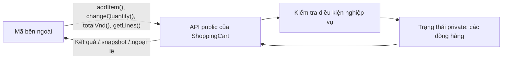
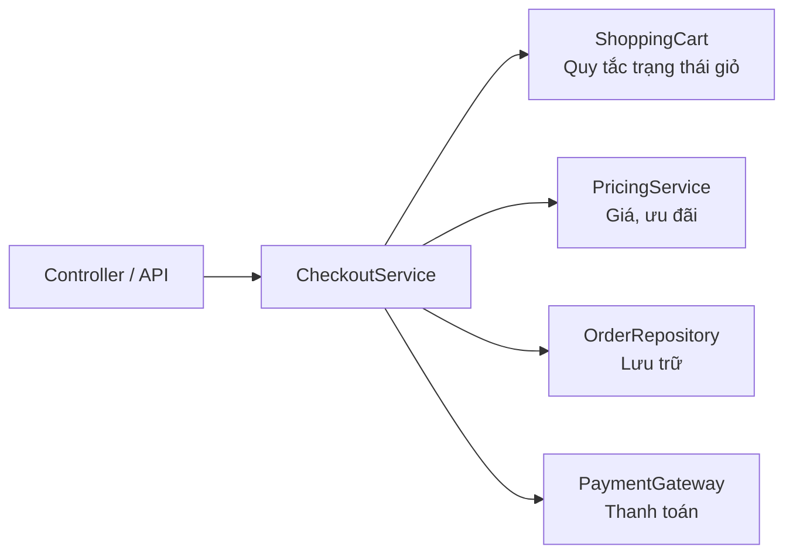

# Ẩn thông tin và ranh giới của đối tượng trong Java OOP

## 1. Tại sao đối tượng cần có ranh giới?

Khi thiết kế một đối tượng, ta không chỉ quyết định **nó lưu những dữ liệu gì** mà còn phải quyết định **mã bên ngoài được phép biết và làm những gì** với dữ liệu đó.

Ví dụ, một giỏ hàng có các dòng sản phẩm, đơn giá và số lượng. Nếu mã bên ngoài có thể sửa trực tiếp danh sách, đặt số lượng âm hay thay đơn giá không qua kiểm tra, đối tượng giỏ hàng sẽ không còn tự bảo vệ được quy tắc của mình. Lỗi có thể xuất hiện ở bất kỳ nơi nào sử dụng giỏ hàng.

**Ẩn thông tin (information hiding)** là nguyên tắc chỉ công khai những gì người sử dụng lớp cần biết, đồng thời giấu các quyết định triển khai mà họ không cần phụ thuộc vào. **Ranh giới đối tượng (object boundary)** là tập những thao tác và dữ liệu được phép đi qua giao diện của đối tượng, cùng các quy tắc kiểm soát sự tương tác ấy.

Hãy hình dung:



Mã bên ngoài yêu cầu **thêm hàng** hoặc **đổi số lượng**; nó không cần biết lớp sử dụng `ArrayList`, `LinkedHashMap` hay một cơ chế lưu trữ khác. Đối tượng giữ quyền quyết định khi nào trạng thái hợp lệ để thay đổi.

Đây là trọng tâm của **encapsulation (đóng gói)** trong OOP: đưa trạng thái và hành vi liên quan vào cùng lớp, kiểm soát truy cập và bảo vệ các điều kiện luôn đúng của đối tượng.

## 2. Phân biệt ẩn thông tin, đóng gói và phạm vi truy cập

Ba khái niệm này liên quan nhưng không đồng nghĩa hoàn toàn:

| Khái niệm | Câu hỏi nó giải quyết | Ví dụ |
| --- | --- | --- |
| **Đóng gói (encapsulation)** | Trạng thái và hành vi nào thuộc về cùng một đối tượng? | Giỏ hàng tự chứa danh sách mặt hàng và phương thức thêm/đổi số lượng |
| **Ẩn thông tin (information hiding)** | Chi tiết nào người sử dụng lớp không cần biết? | Không lộ loại collection, cách tra cứu và cách tính trung gian |
| **Kiểm soát truy cập (access control)** | Mã ở đâu được phép truy cập thành phần nào? | `private` cho field, `public` cho API, package-private cho thành phần nội bộ package |

`private` là công cụ quan trọng, nhưng **chỉ đặt field thành `private` chưa đủ để ẩn thông tin tốt**. Nếu getter trả thẳng một danh sách có thể sửa và caller thay đổi danh sách đó, trạng thái vẫn bị lộ qua tham chiếu.

### Các mức truy cập trong Java

| Modifier | Lớp khai báo | Cùng package | Lớp con ở package khác | Mã bất kỳ ở package khác |
| --- | --- | --- | --- | --- |
| `private` | Có | Không | Không | Không |
| Không ghi (package-private) | Có | Có | Không | Không |
| `protected` | Có | Có | Có, theo quy tắc truy cập của Java dành cho kế thừa | Không |
| `public` | Có | Có | Có | Có |

Bảng mô tả quyền truy cập tới **thành phần của lớp**, giả sử bản thân lớp bao ngoài có thể được truy cập. Với `protected`, lớp con ở package khác không được truy cập tùy ý thông qua một tham chiếu bất kỳ của lớp cha; Java có quy tắc chặt chẽ hơn ở trường hợp đó.

Thông thường:
- Field chứa trạng thái nội bộ được để `private`.
- Những thao tác dành cho người dùng lớp được mở `public`.
- Logic trợ giúp không cần công khai thì để `private`.
- `protected` và package-private chỉ dùng khi có nhu cầu mở rộng hoặc cộng tác trong package rõ ràng.

Ẩn thông tin **không phải** cơ chế bảo mật để ngăn người có quyền chạy mã tùy ý hoặc sử dụng reflection. Nó là công cụ thiết kế API và giới hạn sự phụ thuộc giữa các phần mềm. Xác thực, phân quyền, bảo vệ dữ liệu nhạy cảm vẫn cần cơ chế riêng.

## 3. Thiết kế sai: đối tượng để bên ngoài tùy ý sửa

Ví dụ sau minh họa một mô hình dễ hỏng:

```java
import java.util.ArrayList;
import java.util.List;

class BadCart {
    public List<String> productCodes = new ArrayList<>();
    public int itemCount;
}

BadCart cart = new BadCart();
cart.productCodes.add("KB01");
cart.itemCount = -100;                 // Dữ liệu không hợp lệ
cart.productCodes.clear();            // Xóa hàng mà không qua quy tắc
```

Vấn đề không chỉ là `public`. Nếu đổi sang field `private` nhưng vẫn cung cấp getter trả trực tiếp `List` mutable, caller vẫn có thể thay đổi:

```java
class LeakyCart {
    private final List<String> productCodes = new ArrayList<>();

    public List<String> getProductCodes() {
        return productCodes; // Làm lộ tham chiếu tới danh sách nội bộ
    }
}

// Mã bên ngoài:
LeakyCart cart = new LeakyCart();
cart.getProductCodes().add("KB01"); // Bỏ qua nghiệp vụ thêm sản phẩm
```

Ranh giới bị phá vỡ vì caller có quyền ghi vào đối tượng mà lớp đang sở hữu, dù field đã được khai báo `private`.

Một cách thiết kế tốt hơn là hỏi: *“Người dùng lớp thực sự muốn thực hiện thao tác gì?”* Với giỏ hàng, câu trả lời là **thêm một mặt hàng hợp lệ**, **đổi số lượng hợp lệ**, **xem danh sách hàng** và **xem tổng tiền**, chứ không phải “lấy collection nội bộ để tùy ý sửa”.

## 4. Ví dụ hoàn chỉnh: đối tượng ShoppingCart tự bảo vệ trạng thái

Các quy tắc thiết kế:

1. Mỗi mã sản phẩm `sku` chỉ xuất hiện một lần trong giỏ.
2. `sku` không rỗng; đơn giá tính bằng VND không âm; số lượng là số nguyên dương.
3. Tổng giá trị giỏ luôn nằm trong giới hạn biểu diễn của `long`.
4. Mã bên ngoài chỉ thay đổi giỏ qua phương thức công khai có kiểm tra.
5. Khi một thao tác bị từ chối, dữ liệu hiện có phải giữ nguyên.
6. Getter trả dữ liệu chỉ đọc ở dạng snapshot, không làm lộ collection có thể sửa.

Tạo file **`ShoppingCart.java`** (Java 11 trở lên):

```java
import java.util.ArrayList;
import java.util.LinkedHashMap;
import java.util.List;
import java.util.Map;
import java.util.Objects;

public final class ShoppingCart {
    // Quyết định lưu trữ là chi tiết nội bộ.
    private final Map<String, CartLine> lines = new LinkedHashMap<>();

    public void addItem(String sku, long unitPriceVnd, int quantity) {
        String normalizedSku = normalizeSku(sku);

        if (lines.containsKey(normalizedSku)) {
            throw new IllegalArgumentException("Sản phẩm đã có trong giỏ");
        }

        // Constructor của CartLine tự kiểm tra giá và số lượng.
        CartLine candidate = new CartLine(
                normalizedSku, unitPriceVnd, quantity);

        // Kiểm tra tràn trước khi thay đổi giỏ hàng.
        Math.addExact(totalVnd(), candidate.subtotalVnd());
        lines.put(normalizedSku, candidate);
    }

    public void changeQuantity(String sku, int newQuantity) {
        String normalizedSku = normalizeSku(sku);
        CartLine current = lines.get(normalizedSku);

        if (current == null) {
            throw new IllegalArgumentException("Không tìm thấy sản phẩm");
        }

        CartLine replacement = new CartLine(
                current.sku, current.unitPriceVnd, newQuantity);

        // Mọi phép tính/kiểm tra diễn ra trước khi thay đổi trạng thái.
        long withoutCurrent = Math.subtractExact(
                totalVnd(), current.subtotalVnd());
        Math.addExact(withoutCurrent, replacement.subtotalVnd());

        lines.put(normalizedSku, replacement);
    }

    public long totalVnd() {
        long total = 0L;
        for (CartLine line : lines.values()) {
            total = Math.addExact(total, line.subtotalVnd());
        }
        return total;
    }

    public List<CartLine> getLines() {
        // Snapshot cấu trúc; CartLine cũng bất biến.
        return List.copyOf(lines.values());
    }

    private static String normalizeSku(String sku) {
        Objects.requireNonNull(sku, "sku");
        String result = sku.strip();
        if (result.isBlank()) {
            throw new IllegalArgumentException("Mã sản phẩm không được rỗng");
        }
        return result;
    }

    // Kiểu công khai dùng để đọc một dòng hàng; không có setter.
    public static final class CartLine {
        private final String sku;
        private final long unitPriceVnd;
        private final int quantity;

        private CartLine(String sku, long unitPriceVnd, int quantity) {
            if (unitPriceVnd < 0) {
                throw new IllegalArgumentException("Đơn giá không được âm");
            }
            if (quantity <= 0) {
                throw new IllegalArgumentException("Số lượng phải dương");
            }
            this.sku = sku;
            this.unitPriceVnd = unitPriceVnd;
            this.quantity = quantity;

            // Không chấp nhận dòng hàng có thành tiền tràn long.
            Math.multiplyExact(unitPriceVnd, (long) quantity);
        }

        public String getSku() {
            return sku;
        }

        public long getUnitPriceVnd() {
            return unitPriceVnd;
        }

        public int getQuantity() {
            return quantity;
        }

        public long subtotalVnd() {
            return Math.multiplyExact(unitPriceVnd, (long) quantity);
        }
    }
}
```

### Vì sao thiết kế này giữ được ranh giới?

**Field `lines` là `private`:** caller không cần biết giỏ sử dụng `Map`. Lựa chọn `LinkedHashMap` giúp quản lý sản phẩm theo mã và giữ thứ tự thêm vào khi lấy danh sách. Đây là chi tiết triển khai; nếu tài liệu API cam kết thứ tự thì thứ tự cũng trở thành một phần của hợp đồng cần duy trì.

**`addItem()` và `changeQuantity()` thay cho setter tùy ý:** thao tác nào làm biến đổi giỏ đều có ngữ nghĩa rõ ràng. Caller không thể chèn trực tiếp `null` hay số lượng âm vào collection nội bộ.

**Kiểm tra trước, cập nhật sau:** `Math.multiplyExact` và `Math.addExact` phát hiện phép tính tràn số. Trong các thao tác ở trên, tất cả kiểm tra có thể thất bại đều được thực hiện trước lệnh `put`, nên những lỗi kiểm tra thông thường không để lại giỏ ở trạng thái cập nhật dở.

**`CartLine` là kiểu dữ liệu đọc bất biến:** các field của một dòng hàng có `private final`, toàn bộ là `String` bất biến hoặc kiểu nguyên thủy, constructor được kiểm soát, không có setter. Thay vì sửa `quantity` trong một `CartLine` cũ, `changeQuantity()` tạo một dòng mới rồi thay thế sau khi kiểm tra.

**Getter trả snapshot:** `List.copyOf(lines.values())` trả một danh sách không cho thêm/xóa/thay thế phần tử qua tham chiếu trả về, và danh sách đó giữ nội dung ở thời điểm gọi. Các `CartLine` cũng bất biến nên không thể sửa gián tiếp các field của giỏ qua phần tử. Nếu phần tử là đối tượng mutable, riêng `List.copyOf` sẽ không tạo deep copy.

**`private static normalizeSku()`:** đây là bước xử lý nội bộ, không nằm trong API công khai. Phương thức không cần trạng thái của một giỏ cụ thể nên sử dụng `static`.

### Chạy thử hành vi

Tạo file **`Main.java`**:

```java
import java.util.List;

public class Main {
    public static void main(String[] args) {
        ShoppingCart cart = new ShoppingCart();

        cart.addItem("KB-01", 250_000, 2);
        cart.addItem("MS-01", 100_000, 1);
        System.out.println(cart.totalVnd()); // 600000

        List<ShoppingCart.CartLine> before = cart.getLines();
        cart.changeQuantity("KB-01", 3);

        System.out.println(cart.totalVnd()); // 850000
        System.out.println(before.get(0).getQuantity()); // 2
        System.out.println(cart.getLines().get(0).getQuantity()); // 3

        try {
            cart.changeQuantity("KB-01", -5);
        } catch (IllegalArgumentException ex) {
            System.out.println("Từ chối: " + ex.getMessage());
        }
        System.out.println(cart.totalVnd()); // Vẫn 850000

        try {
            before.clear();
        } catch (UnsupportedOperationException ex) {
            System.out.println("Snapshot không cho phép sửa");
        }
    }
}
```

Chạy từ thư mục chứa hai file:

```bash
javac ShoppingCart.java Main.java
java Main
```

Kết quả:

```text
600000
850000
2
3
Từ chối: Số lượng phải dương
850000
Snapshot không cho phép sửa
```

Chú ý hai đối tượng `CartLine` trước và sau khi đổi số lượng là **hai instance khác nhau**. Biến `before` vẫn thấy số lượng `2`, trong khi giỏ hiện tại trả số lượng `3`. Snapshot cũ ổn định, không cho caller tự sửa trạng thái của giỏ.

Lưu ý kỹ thuật: mã minh họa cách bảo vệ bất biến **trong chương trình đơn luồng**. Giỏ hàng này chưa được thiết kế cho nhiều luồng đồng thời sửa; `LinkedHashMap` và chuỗi thao tác kiểm tra/cập nhật không tự an toàn khi có race condition.

## 5. Ranh giới được quyết định bằng hợp đồng public

Một lớp tốt công khai **hành vi hữu ích và ổn định**, không bắt mã bên ngoài phụ thuộc vào chi tiết nội bộ.

Xét sự khác biệt:

| API làm lộ triển khai | API che giấu triển khai |
| --- | --- |
| `getInternalMap().put(sku, line)` | `addItem(sku, price, quantity)` |
| `setTotalVnd(value)` | `totalVnd()` tính kết quả từ các dòng hàng |
| `getMutableLines().clear()` | Cung cấp `removeItem(sku)` nếu nghiệp vụ cần |
| Caller tự kiểm tra giá/số lượng | Lớp tự kiểm tra tại mọi lối vào có thể thay đổi trạng thái |
| Caller biết `LinkedHashMap` hay chỉ số phần tử | Caller biết mã sản phẩm và tác vụ nghiệp vụ |

Việc công khai từng getter/setter cho mọi field thường biến lớp thành “túi dữ liệu” với quy tắc bị phân tán ra ngoài. Không phải mọi setter đều sai: setter hợp lý khi chính nó thể hiện quyền thay đổi hợp lệ, có kiểm tra rõ ràng và không làm rò rỉ trạng thái. Ví dụ `changeDisplayName(String name)` có thể phù hợp hơn setter tổng quát cho cả đối tượng cấu hình.

### Bất biến: điều kiện nào phải luôn đúng?

Trong `ShoppingCart`:

- Không có dòng hàng với `quantity <= 0`.
- Không có dòng hàng với `unitPriceVnd < 0`.
- Các mã hàng trong giỏ không trùng nhau.
- Tổng tiền có thể được biểu diễn bằng kiểu `long`.
- Mã ngoài lớp không thể thêm dòng hàng mà bỏ qua kiểm tra.

Bất biến được thiết lập trong constructor hoặc thao tác tạo dòng hàng, sau đó được giữ trong mọi phương thức thay đổi trạng thái. Một phương thức mới trong tương lai, chẳng hạn `applyDiscount()` hoặc `removeItem()`, cũng phải tuân theo cùng các quy tắc liên quan.

Điều này quan trọng vì **một đối tượng có thể bị gọi từ nhiều nơi**: controller, service, test hoặc thành phần khác. Nếu quy tắc chỉ tồn tại ở controller, caller khác có thể bỏ qua. Lớp nên giữ các quy tắc cốt lõi của chính trạng thái mà nó sở hữu.

## 6. Ba con đường rò rỉ tham chiếu cần nhận diện

Một field `private final` chỉ che tên field và ngăn gán lại tham chiếu, chứ không khóa đối tượng mutable bên dưới. Khi xem API, hãy lần theo **quyền sở hữu tham chiếu** ở cả hai chiều:

| Đường rò rỉ | Hành vi caller có thể thực hiện | Hướng bảo vệ |
| --- | --- | --- |
| Getter trả `List`/mảng nội bộ | `getItems().clear()` đi vòng qua `removeItem()` | Snapshot, bản sao hoặc API truy vấn hẹp |
| Constructor giữ collection do caller đưa | Caller giữ biến `input` rồi sửa sau khi khởi tạo | Sao chép lúc nhận nếu lớp cần quyền sở hữu độc lập |
| List chỉ đọc nhưng chứa phần tử mutable | `getItems().get(0).setPrice(...)` | Bất biến hóa phần tử hoặc tạo snapshot giá trị |

Ví dụ `List.copyOf(items)` không cho sửa cấu trúc list qua kết quả, nhưng **không sao chép sâu** phần tử. Còn `Collections.unmodifiableList(items)` chỉ là view, vẫn phản ánh thay đổi của list gốc. Vì vậy cần quyết định caller được quan sát *ảnh chụp tại thời điểm gọi* hay *dữ liệu đang sống*, và phần tử bên trong có an toàn để chia sẻ không.

Đối với `ShoppingCart`, các dòng hàng là `CartLine` bất biến nên `getLines()` có thể trả snapshot mà không làm lộ đường sửa giỏ. Với mảng, `Date` hoặc đồ thị đối tượng mutable, cần chiến lược sao chép phù hợp tại từng ranh giới.

## 7. Ranh giới đối tượng cũng là ranh giới trách nhiệm

Ẩn thông tin không có nghĩa dồn mọi việc vào một lớp.

Một `ShoppingCart` nên giữ các quy tắc cục bộ như số lượng dương, mã sản phẩm không trùng, và cách tính tổng từ các dòng hàng. Nhưng nó không nhất thiết nên tự thực hiện các công việc:

- Đọc giá mới nhất từ cơ sở dữ liệu hoặc dịch vụ giá.
- Kiểm tra token đăng nhập và quyền của người dùng.
- Gửi email sau khi đặt hàng.
- Gọi cổng thanh toán hoặc kiểm soát giao dịch phân tán.
- Trả JSON hay hiển thị HTML.

Những công việc đó có thể thuộc về service, repository, controller hoặc adapter. Ranh giới tốt là **mỗi thành phần sở hữu đúng dữ liệu và quyết định mà nó có trách nhiệm**, rồi giao tiếp với thành phần khác bằng API rõ ràng.



Trong sơ đồ, giỏ hàng không cần biết HTTP request, database hay hệ thống thanh toán được triển khai thế nào. Tương tự, lớp khác không cần biết giỏ hàng dùng `Map`, cách kiểm tra dữ liệu hay tính tổng ra sao. Đây là lợi ích của việc giữ **ranh giới API** rõ ràng ở nhiều cấp độ.

Một điểm cần phân biệt: field `private` vẫn có thể bị các phương thức trong **cùng lớp** thay đổi, kể cả thông qua tham chiếu tới instance khác của cùng lớp. Truy cập theo mức `private` được áp dụng cho mã của lớp khai báo, không được giới hạn riêng từng instance.

## 8. Ranh giới tốt giúp đổi triển khai mà ít ảnh hưởng nơi gọi

Giả sử lúc đầu giỏ lưu dòng hàng bằng `List<CartLine>`, sau này đổi sang `Map<String, CartLine>` để tra cứu theo mã nhanh hơn.

Nếu API bên ngoài chỉ sử dụng:

```java
cart.addItem("KB-01", 250_000, 2);
cart.changeQuantity("KB-01", 3);
long total = cart.totalVnd();
```

thì nhiều thay đổi bên trong sẽ không buộc caller sửa mã. Tuy nhiên, bất cứ hành vi nào đã được công bố trong hợp đồng, như thứ tự dòng hàng, cách xử lý trùng mã hoặc loại ngoại lệ, đều phải được cân nhắc khi thay đổi triển khai.

Điều này thường gọi là **giảm sự phụ thuộc (coupling)** giữa client và chi tiết bên trong lớp. Lợi ích thực tế gồm:
- Dễ thay cấu trúc dữ liệu hoặc thuật toán.
- Dễ kiểm thử vì hành vi quan sát được có đầu vào, đầu ra và ngoại lệ rõ ràng.
- Dễ tìm nguồn lỗi, vì trạng thái được thay đổi tại một số phương thức xác định.
- Khó vô tình phá hỏng bất biến từ mã bên ngoài.

**Ẩn thông tin không đồng nghĩa giấu hết mọi thứ.** Nếu không công khai hành vi nào có ích, lớp cũng khó sử dụng. Điểm cân bằng là API đủ biểu đạt nhu cầu nghiệp vụ, còn các quyết định triển khai không cần thiết được giữ riêng.

## 9. Các sai lầm khi thiết kế ranh giới

| Sai lầm | Vì sao có vấn đề | Hướng sửa |
| --- | --- | --- |
| Cho field trạng thái thành `public` | Caller thay đổi mà không qua kiểm tra | `private`, cung cấp hành vi có kiểm soát |
| Thêm getter/setter cho toàn bộ field theo thói quen | Caller bị buộc biết cấu trúc nội bộ | Chỉ công khai dữ liệu và thao tác thực sự cần |
| Getter trả danh sách mutable nội bộ | Caller có thể bỏ qua quy tắc cập nhật | Snapshot, immutable view hoặc copy phù hợp |
| Dùng `final List<T>` rồi coi cả list bất biến | `final` chỉ cố định tham chiếu | Xác định tính mutable của collection và phần tử |
| Constructor nhận list rồi giữ nguyên tham chiếu | Caller tiếp tục có thể thay đổi dữ liệu | Copy khi nhận nếu cần sở hữu độc lập |
| Kiểm tra điều kiện sau khi đã ghi field | Ngoại lệ có thể để lại trạng thái không hợp lệ | Validate/compute trước, mutate sau |
| Đưa truy vấn DB và HTTP vào domain object | Trộn nhiều trách nhiệm và tăng coupling | Tách service/repository/adapter |
| Coi `private` là bảo mật dữ liệu | Access modifier không thay xác thực/phân quyền | Áp dụng bảo mật ở biên hệ thống và các lớp phù hợp |
| Cho rằng lớp tốt mặc nhiên thread-safe | Ẩn dữ liệu không tạo sự đồng bộ | Thiết kế concurrency riêng khi có chia sẻ đa luồng |

## 10. Tự luyện và kiểm tra

### Câu 1: vì sao getter sau đây nguy hiểm?

```java
public List<CartLine> getLines() {
    return internalLines;
}
```

**Gợi ý:** Nếu `internalLines` là một `ArrayList` mutable do lớp sở hữu, caller có thể `clear()` hoặc `add()` vào danh sách mà không qua nghiệp vụ. Nếu `CartLine` cũng mutable, chỉ sửa kiểu trả về thành một view không sửa được vẫn chưa đủ để ngăn caller thay đổi phần tử.

### Câu 2: thế nào là ranh giới hợp lý?

Cho một đối tượng tài khoản có field `balance`. Chọn API phù hợp hơn:

```java
// Phương án A
account.setBalance(-500_000);

// Phương án B
account.withdraw(500_000);
```

**Giải thích:** phương án B diễn đạt hành vi rút tiền và là chỗ thích hợp kiểm tra số tiền dương, đủ số dư hoặc các quy tắc khác. Một setter tự do thường không thể hiện mục đích thay đổi trạng thái và có thể phá bất biến.

### Câu 3: phân biệt snapshot và live view

```java
List<String> source = new ArrayList<>();
source.add("A");

List<String> liveView =
        java.util.Collections.unmodifiableList(source);
List<String> snapshot = List.copyOf(source);

source.add("B");

System.out.println(liveView); // ?
System.out.println(snapshot); // ?
```

**Đáp án:** `liveView` in `[A, B]` vì là view phản ánh `source`; `snapshot` in `[A]` vì được tạo tại thời điểm trước khi thêm `"B"`. Cả hai không cho phép thêm phần tử qua chính tham chiếu đó, nhưng **không cùng ngữ nghĩa về khả năng quan sát thay đổi**.

### Câu 4: mở rộng lớp ShoppingCart

Hãy viết `removeItem(String sku)` với các yêu cầu: chuẩn hóa mã theo `normalizeSku`, báo lỗi khi mã không tồn tại và xóa đúng một dòng hàng. Sau đó viết một chương trình kiểm tra:
1. Thêm hai sản phẩm, lưu snapshot từ `getLines()`.
2. Xóa một sản phẩm qua `removeItem`.
3. Kiểm tra số dòng và tổng tiền hiện tại.
4. Kiểm tra snapshot cũ vẫn giữ các dòng hàng tại thời điểm chụp.
5. Thử xóa một mã không tồn tại và kiểm tra giỏ không thay đổi.

Bài tập này buộc bạn suy nghĩ về **đường cập nhật trạng thái hợp lệ**, **API công khai** và **hành vi quan sát được** thay vì sửa trực tiếp collection.

## Các câu hỏi cốt lõi khi thiết kế lớp

Khi đọc một lớp Java, hãy tự hỏi: (1) đối tượng này **sở hữu** trạng thái nào; (2) những điều kiện nào phải luôn đúng; (3) ai có thể thay đổi trạng thái, qua phương thức nào; (4) đầu vào/đầu ra có làm rò rỉ tham chiếu mutable không; và (5) nếu đổi triển khai bên trong, những caller nào buộc phải thay đổi?

Thiết kế ranh giới đúng giúp đối tượng có thể **tự bảo vệ trạng thái**, thể hiện hành vi bằng API rõ ràng và cho phép các thành phần khác cộng tác mà không lệ thuộc vào chi tiết triển khai.