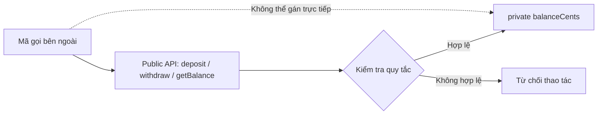
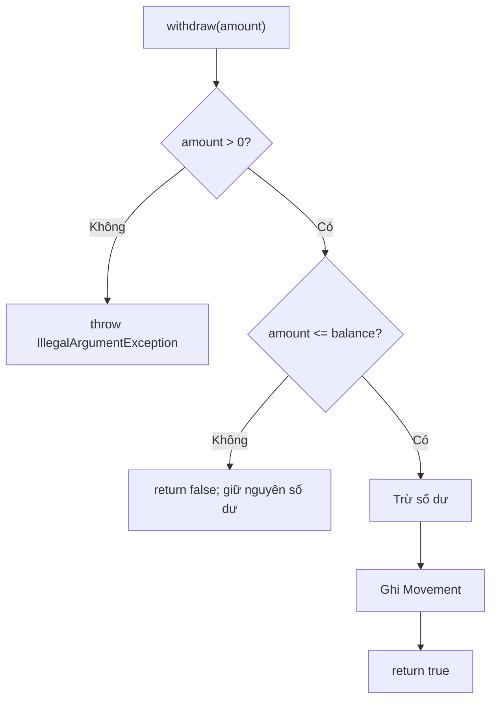
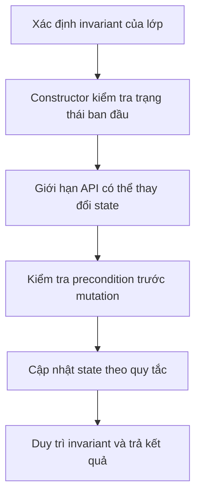

# Kiểm soát truy cập và thay đổi trạng thái trong Java

> **OOP → Đóng gói (Encapsulation).** Một đối tượng không chỉ lưu dữ liệu: nó phải bảo vệ **những quy tắc luôn đúng** về dữ liệu đó. Java cung cấp các phạm vi truy cập (`private`, package-private, `protected`, `public`) để giới hạn mã nào được nhìn thấy hoặc gọi thành phần của lớp. Phần còn lại thuộc về thiết kế: chỉ cho phép thay đổi trạng thái qua những hành vi hợp lệ.

## 1. Vì sao không nên để ai cũng sửa trường dữ liệu?

Xét một tài khoản đơn giản:

```java
class UnsafeAccount {
    public long balanceCents;
}

UnsafeAccount account = new UnsafeAccount();
account.balanceCents = 100_000;
account.balanceCents = -9_999; // Biên dịch hợp lệ nhưng vi phạm quy tắc số dư
```

Người sử dụng lớp có thể gán tùy ý, kể cả âm, dù ứng dụng quy định số dư không được âm. Khi nhiều nơi cùng sửa trực tiếp, lớp không kiểm soát được ai sửa, khi nào sửa và có kiểm tra dữ liệu hay không.

Đóng gói giải quyết bằng cách tách:

- **Trạng thái nội bộ (state)**: các trường mà đối tượng quản lý, ví dụ `balanceCents`.
- **Giao diện công khai (public API)**: những thao tác bên ngoài được phép gọi, ví dụ `deposit(amount)`, `withdraw(amount)`, `getBalance()`.
- **Bất biến (invariant)**: điều kiện phải được giữ sau mỗi thao tác hợp lệ, ví dụ `balanceCents >= 0`.
- **Trách nhiệm kiểm tra**: chính lớp sở hữu dữ liệu kiểm tra trước khi thay đổi dữ liệu.



**Đóng gói không có nghĩa mọi lớp đều phải có getter và setter cho từng trường.** Nếu viết `private long balance` rồi cung cấp `public void setBalance(long value)` không giới hạn, mã bên ngoài vẫn có thể phá quy tắc nghiệp vụ. Điểm quan trọng là **kiểm soát đường đi của thay đổi trạng thái**.

## 2. Các mức truy cập trong Java

Java có bốn mức truy cập thường dùng cho thành phần của lớp:

| Modifier | Trong chính lớp | Lớp khác cùng package | Lớp con khác package | Lớp không liên quan khác package |
|---|---|---|---|---|
| `private` | Có | Không | Không | Không |
| Không ghi modifier (**package-private**) | Có | Có | Không | Không |
| `protected` | Có | Có | Có, với giới hạn truy cập kế thừa | Không |
| `public` | Có | Có | Có | Có |

Ví dụ:

```java
package shop;

public class Product {
    private int stock;            // Chỉ mã có quyền private access của Product
    String internalCode;          // Package-private
    protected void validate() {}  // Cùng package và lớp con theo quy tắc protected
    public int getStock() {       // Phần API công khai
        return stock;
    }
}
```

Một số điểm cần tránh hiểu nhầm:

- **`private`** giới hạn quyền truy cập ở mức khai báo lớp/những phạm vi được Java cho phép, kể cả mối quan hệ giữa lớp ngoài và lớp lồng nhau; không phải “chỉ đúng một phương thức”.
- **Package-private** là trạng thái *không có từ khóa truy cập*, không phải từ khóa `default`. Các lớp trong cùng package có thể sử dụng thành phần đó nếu các điều kiện truy cập khác phù hợp.
- **`protected`** cho phép truy cập từ cùng package; với subclass ở package khác, còn có những quy tắc hạn chế về đối tượng tham chiếu dùng để truy cập thành viên kế thừa.
- **`public`** cho phép mã khác truy cập, miễn là lớp chứa nó cũng truy cập được và các ràng buộc về module (nếu dùng Java Module System) cho phép.
- Lớp **top-level** thông thường chỉ được khai báo `public` hoặc package-private; `private` và `protected` không áp dụng trực tiếp cho top-level class.

Phạm vi càng rộng càng tạo nhiều điểm phụ thuộc. Thực tế thường bắt đầu bằng `private` cho trường dữ liệu, chỉ công khai những hành vi bên ngoài thật sự cần dùng. Không cần mặc định đặt tất cả phương thức là `public`.

## 3. Kiểm soát thay đổi bằng phương thức có ý nghĩa nghiệp vụ

Ví dụ hoàn chỉnh sau đây sử dụng đơn vị **cent** dưới dạng `long` để tránh lỗi nhị phân của `double` khi minh họa tiền tệ. Đây là ví dụ OOP trong bộ nhớ, chưa phải hệ thống giao dịch ngân hàng.

Lưu thành `WalletDemo.java` và chạy bằng **Java 17+**:

```java
import java.util.ArrayList;
import java.util.List;

public class WalletDemo {
    public record Movement(String type, long amountCents, long balanceAfter) {}

    public static final class Wallet {
        private final String owner;
        private long balanceCents;
        private final List<Movement> movements = new ArrayList<>();

        public Wallet(String owner, long openingBalanceCents) {
            if (owner == null || owner.isBlank()) {
                throw new IllegalArgumentException("Chủ ví không hợp lệ");
            }
            if (openingBalanceCents < 0) {
                throw new IllegalArgumentException("Số dư đầu kỳ không thể âm");
            }
            this.owner = owner;
            this.balanceCents = openingBalanceCents;
        }

        public String owner() {
            return owner;
        }

        public long balanceCents() {
            return balanceCents;
        }

        public List<Movement> history() {
            return List.copyOf(movements);
        }

        public void deposit(long amountCents) {
            requirePositive(amountCents);
            long newBalance = Math.addExact(balanceCents, amountCents);
            balanceCents = newBalance;
            movements.add(new Movement("DEPOSIT", amountCents, newBalance));
        }

        public boolean withdraw(long amountCents) {
            requirePositive(amountCents);
            if (amountCents > balanceCents) {
                return false;
            }
            balanceCents -= amountCents;
            movements.add(new Movement("WITHDRAW", amountCents, balanceCents));
            return true;
        }

        private static void requirePositive(long amountCents) {
            if (amountCents <= 0) {
                throw new IllegalArgumentException("Số tiền phải dương");
            }
        }
    }

    public static void main(String[] args) {
        Wallet wallet = new Wallet("An", 100_000);

        wallet.deposit(50_000);
        System.out.println(wallet.withdraw(20_000));  // true
        System.out.println(wallet.balanceCents());     // 130000
        System.out.println(wallet.withdraw(200_000)); // false
        System.out.println(wallet.balanceCents());     // 130000

        List<Movement> snapshot = wallet.history();
        System.out.println(snapshot.size());          // 2

        try {
            snapshot.clear();
        } catch (UnsupportedOperationException ex) {
            System.out.println("Không thể sửa lịch sử từ bên ngoài");
        }

        System.out.println(wallet.history().size());  // 2
    }
}
```

Chạy:

```bash
javac WalletDemo.java
java WalletDemo
```

Kết quả mong đợi:

```text
true
130000
false
130000
2
Không thể sửa lịch sử từ bên ngoài
2
```

### Bất biến được bảo vệ ra sao?

Lớp `Wallet` có bất biến: `balanceCents >= 0`.

| Thao tác | Điều kiện đầu vào | Khi thành công | Khi thất bại |
|---|---|---|---|
| `new Wallet(owner, opening)` | `owner` không rỗng; `opening >= 0` | Khởi tạo trạng thái hợp lệ | Ném `IllegalArgumentException` |
| `deposit(amount)` | `amount > 0`; phép cộng không tràn `long` | Tăng số dư, ghi lịch sử | Đầu vào sai: `IllegalArgumentException`; tràn số: `ArithmeticException` |
| `withdraw(amount)` | `amount > 0` | Đủ tiền: giảm số dư và trả `true` | Không đủ tiền: trả `false` mà không giảm số dư |
| `balanceCents()` | Không có | Trả số dư hiện tại | Không thay đổi trạng thái |
| `history()` | Không có | Trả bản sao danh sách không sửa được | Mã ngoài không thể `clear()` lịch sử nội bộ |

Các phương thức thay đổi trạng thái dựa trên **ý nghĩa hành vi**: nạp và rút tiền. Lớp không cung cấp `setBalanceCents`, vì thao tác “đặt số dư bất kỳ” có thể bỏ qua kiểm tra nghiệp vụ và lịch sử.

`Math.addExact` giúp phát hiện tràn `long`: nếu số dư đang gần `Long.MAX_VALUE`, phép cộng không âm thầm trở thành số âm. Các quy tắc kiểm tra này làm cho API khó bị dùng sai.

### Luồng rút tiền



Sơ đồ giúp thấy rõ **mỗi đường thay đổi trạng thái phải đi qua một quyết định hợp lệ**. Không phải mọi phương thức đều cần ném exception cho tất cả tình huống không thành công: “không đủ tiền” có thể là kết quả nghiệp vụ bình thường, nên ví dụ trả `false`.

**Giới hạn của ví dụ:** các thao tác trên `Wallet` chưa được đồng bộ cho nhiều luồng. Nếu nhiều thread có thể cùng nạp/rút, cần cơ chế bảo đảm tính nguyên tử và hiển thị bộ nhớ (ví dụ khóa phù hợp, hoặc giao dịch ở tầng lưu trữ). `private` **không tự mang lại thread safety**.

## 4. Quyền truy cập tên field khác quyền sửa đối tượng được tham chiếu

Ngay cả khi danh sách là `private final`, getter trả trực tiếp `ArrayList` vẫn trao cho caller quyền thêm/xóa phần tử. Đây là một **đường vòng qua phương thức kiểm tra**:

```java
private final List<String> members = new ArrayList<>();

public List<String> getMembers() {
    return List.copyOf(members); // Snapshot cấu trúc; String bất biến
}
```

Nếu constructor nhận danh sách từ bên ngoài, lớp còn phải quyết định việc sao chép **lúc nhận** để caller không tiếp tục sửa cùng instance. Khi phần tử là object mutable, `List.copyOf` chưa đủ để bảo vệ trạng thái sâu. Những rủi ro đó thuộc trách nhiệm thiết kế API, dù modifier của field đã đúng.

## 5. Accessor không được vô hiệu hóa quy tắc cập nhật

Getter phục vụ nhu cầu **quan sát**; setter chỉ phù hợp nếu thuộc tính thật sự có thể thay đổi độc lập. Ví dụ đổi tên hiển thị có thể dùng `setDisplayName(name)` kèm kiểm tra `null`/chuỗi rỗng. Ngược lại, setter `setStatus("SHIPPED")` cho một đơn chưa thanh toán có thể bỏ qua quy trình nghiệp vụ dù field `status` là `private`.

```java
// Trích các phương thức trong một Order có status kiểu enum.
public void pay() {
    if (status != Status.NEW) {
        throw new IllegalStateException("Chỉ đơn NEW được thanh toán");
    }
    status = Status.PAID;
}

public void ship() {
    if (status != Status.PAID) {
        throw new IllegalStateException("Chỉ đơn PAID được giao");
    }
    status = Status.SHIPPED;
}
```

`pay()` và `ship()` biểu đạt ý định và giữ kiểm tra ở nơi sở hữu dữ liệu. Trong một ứng dụng thực, việc xác nhận thanh toán từ hệ thống ngoài vẫn cần service đáng tin cậy; riêng tên phương thức không xác thực thanh toán. Tên getter/setter là quy ước Java, **không phải bằng chứng cho đóng gói đúng**.

## 6. Bất biến cần đúng từ lúc khởi tạo tới sau mỗi thao tác

Một đối tượng có thể được đặt ở trạng thái sai **ngay trong constructor** nếu constructor bỏ qua kiểm tra. Đóng gói chỉ có tác dụng khi mọi đường tạo và sửa đối tượng đều giữ quy tắc.

Ví dụ `Wallet` kiểm tra opening balance trong constructor, còn `deposit` và `withdraw` kiểm tra trước khi cập nhật số dư. Điều đó tránh trạng thái âm trong các đường thực thi bình thường.

Một quy trình thiết kế đơn giản:



| Quy tắc thiết kế | Lý do |
|---|---|
| Trường dữ liệu nội bộ thường `private` | Ngăn gán trực tiếp tùy tiện |
| Dữ liệu bắt buộc kiểm tra tại constructor | Đối tượng hợp lệ từ khi bắt đầu sử dụng |
| Mỗi phương thức sửa state kiểm tra điều kiện | Không phá invariant |
| Ưu tiên phương thức có tên theo hành vi | Hạn chế thao tác sai trình tự |
| Không để lộ collection/array mutable nội bộ | Bên ngoài không bỏ qua validation |
| Chọn kết quả lỗi nhất quán | Người gọi biết khi nào thao tác bị từ chối |
| Giữ đối tượng bất biến khi phù hợp | Giảm số trạng thái cần quản lý |

### Tránh “thay đổi nửa chừng”

Giả sử một thao tác phải kiểm tra nhiều điều kiện:

```java
void updateLimit(long newLimit) {
    if (newLimit < 0) {
        throw new IllegalArgumentException("Giới hạn không hợp lệ");
    }
    if (newLimit < currentUsage) {
        throw new IllegalStateException(
            "Giới hạn mới thấp hơn mức đang sử dụng"
        );
    }
    limit = newLimit;
}
```

Kiểm tra trước khi gán tránh để `limit` nhận giá trị sai rồi mới ném ngoại lệ. Nếu một nghiệp vụ thay đổi **nhiều đối tượng** hoặc có ghi database/API ngoài, cần cơ chế giao dịch/rollback phù hợp; riêng `private` và một phương thức Java không tự tạo tính nguyên tử giữa nhiều tài nguyên.

## 7. Kiểm soát truy cập khác với bất biến (immutability)

Đóng gói và bất biến có liên quan nhưng không đồng nhất:

| Khái niệm | Ý nghĩa | Ví dụ |
|---|---|---|
| Encapsulation | Mã bên ngoài chỉ tương tác qua API được phép | `Wallet.deposit()`, `Wallet.withdraw()` |
| Mutable object | Trạng thái có thể thay đổi, nhưng qua quy tắc | `Wallet` sau khi nạp/rút |
| Immutable object | Trạng thái quan sát được không đổi sau khi tạo | `String`, một value object thiết kế đúng |
| `final` field | Trường không thể gán lại sau khởi tạo theo quy tắc Java | `private final List<String> names` |
| Unmodifiable collection | Không thể thay đổi collection qua các thao tác sửa của nó | Kết quả `List.copyOf(...)` |

`private` **không có nghĩa immutable**; `final` **không làm bất biến sâu**; và một getter cũng không tự là read-only nếu nó trả tham chiếu tới object mutable.

Ví dụ value object đơn giản:

```java
public record RectangleSize(int width, int height) {
    public RectangleSize {
        if (width <= 0 || height <= 0) {
            throw new IllegalArgumentException("Kích thước phải dương");
        }
    }

    public long area() {
        return (long) width * height;
    }
}
```

`record` (Java 16+) tự tạo các thành phần `private final` và accessor `width()`, `height()`. **Compact constructor** kiểm tra invariant trước khi record được dùng. Với hai thành phần kiểu nguyên thủy, `RectangleSize` có trạng thái giá trị bất biến và rất phù hợp để truyền giữa các đối tượng.

## 8. Đóng gói theo phạm vi trách nhiệm

Không phải cứ khai báo `private` là thiết kế tốt. Một lớp có thể có 20 trường `private` và 20 setter `public` để mã ngoài tự ghép logic nghiệp vụ. Khi đó, quy tắc vẫn bị phân tán.

Ví dụ một API yếu yêu cầu caller tự kiểm tra:

```java
if (account.getBalance() >= amount) {
    account.setBalance(account.getBalance() - amount);
}
```

Có ít nhất ba vấn đề: logic kiểm tra nằm ngoài lớp; mã khác có thể quên kiểm tra; hai bước đọc và ghi không nguyên tử nếu truy cập đồng thời.

API có hành vi `account.withdraw(amount)` giữ logic bên trong, nơi lớp sở hữu dữ liệu và biết invariant. Tuy nhiên, để an toàn khi nhiều thread cùng thao tác, phương thức đó vẫn phải được triển khai với cơ chế đồng bộ/giao dịch thích hợp.

**Cấp quyền nhỏ nhất (least visibility):** chỉ công khai những gì là hợp đồng của lớp. Một helper như `requirePositive` trong `Wallet` được để `private`, vì người gọi không cần biết chi tiết kiểm tra. Khi hai lớp hợp tác chặt trong cùng package, package-private có thể phù hợp hơn `public`. Không tăng phạm vi truy cập chỉ để “dễ gọi” nếu có cách thiết kế API rõ ràng hơn.

### Đặt tên theo ý định

| Tên có thể gây hiểu sai | Tên thể hiện hành vi rõ hơn | Khi nào hữu ích? |
|---|---|---|
| `setBalance(500)` | `deposit(500)` / `withdraw(500)` | Có quy tắc nạp/rút |
| `setStatus(PAID)` | `pay()` | Có chuyển đổi trạng thái hợp lệ |
| `setQuantity(q)` | `increaseStock(q)` / `reserve(q)` | Có điều kiện tồn kho |
| `getInternalList()` | `listItems()` trả snapshot | Muốn đọc mà không sửa nội bộ |

Tên phương thức không tự thi hành quy tắc: **implementation và kiểm thử** phải bảo đảm hành vi đúng.

## 9. Kiểm thử hành vi và ranh giới truy cập

Một bài kiểm thử tốt không chỉ kiểm tra đầu ra bình thường. Nó còn cần kiểm tra **những trạng thái không được phép xuất hiện** và khả năng mã gọi can thiệp trái phép.

Với `Wallet`, có thể xác minh bằng các tình huống sau:

| Tình huống | Kết quả mong đợi |
|---|---|
| Khởi tạo ví với số dư âm | `IllegalArgumentException` |
| `deposit(0)` hoặc `deposit(-1)` | `IllegalArgumentException`; số dư không đổi |
| `deposit(Long.MAX_VALUE)` khi số dư dương | `ArithmeticException`; số dư không đổi |
| `withdraw(amount)` lớn hơn số dư | `false`; không ghi giao dịch rút |
| Rút số tiền hợp lệ, đủ số dư | `true`; số dư giảm đúng |
| `wallet.history().clear()` | `UnsupportedOperationException`; lịch sử nội bộ vẫn nguyên |
| `wallet.balanceCents = -10` từ mã ngoài | Lỗi biên dịch vì trường là `private` |

**Cần phân biệt kiểm tra quyền truy cập tại thời điểm biên dịch với xác thực quyền của người dùng.** `private`/`public` là quy tắc về khả năng mã Java truy cập thành phần lớp; chúng **không thay thế kiểm tra authentication/authorization** khi nhiều tài khoản người dùng truy cập một dịch vụ. Ví dụ, một phương thức `public withdraw(...)` vẫn cần lớp nghiệp vụ hoặc tầng API xác nhận đúng chủ tài khoản nếu chạy trong hệ thống đa người dùng.

## 10. Lỗi phổ biến cần tránh

**Lỗi 1 — Trường public mutable**

```java
public int stock; // Ai cũng có thể gán giá trị âm
```

Sửa bằng trường `private` và hành vi có kiểm tra, như `restock(int quantity)`, `reserve(int quantity)`.

**Lỗi 2 — Trường private nhưng setter không kiểm tra**

```java
private int stock;
public void setStock(int stock) {
    this.stock = stock; // Vẫn có thể âm
}
```

Nếu nghiệp vụ yêu cầu tồn kho không âm, ít nhất phải kiểm tra và nên cân nhắc API hành vi.

**Lỗi 3 — Getter trả collection mutable nội bộ**

```java
public List<String> getNames() {
    return names; // Caller có thể add/remove bất kỳ phần tử
}
```

Sửa bằng snapshot `List.copyOf(names)` khi phần tử thích hợp, hoặc cung cấp giao diện chỉ đọc với hợp đồng rõ ràng; nhớ rằng unmodifiable view và snapshot không hoàn toàn giống nhau.

**Lỗi 4 — Tin rằng `final` khiến toàn bộ object bất biến**

```java
private final List<String> names = new ArrayList<>();
// final ngăn: names = new ArrayList<>(); sau khi khởi tạo
// Nhưng vẫn cho phép: names.add("An");
```

Muốn bất biến sâu, cần xem xét cả những object mà trường tham chiếu tới.

**Lỗi 5 — Trộn đọc/kiểm tra/ghi ở ngoài lớp**

```java
if (wallet.balanceCents() >= amount) {
    // Không thể bảo đảm việc thay đổi an toàn chỉ từ bước đọc này
}
```

Hãy đưa logic thay đổi vào phương thức của đối tượng có trách nhiệm; khi có đồng thời, cần thêm cơ chế nguyên tử phù hợp.

## 11. Bài tập tự luyện

1. Tạo lớp `InventoryItem` với `private int stock` và constructor từ chối tồn kho âm. Viết `restock(int amount)`, `reserve(int amount)`, `getStock()`; không cung cấp setter đặt tồn kho tùy ý.
2. Thêm trạng thái `RETURNED` cho `Order`. Định nghĩa chuyển đổi nào hợp lệ từ `SHIPPED`, kiểm tra điều kiện trong phương thức `returnOrder()` và cập nhật Mermaid.
3. Cho một lớp nhận `List<String>` từ constructor rồi lưu thẳng tham chiếu. Hãy chứng minh bằng code rằng caller có thể sửa danh sách sau khi tạo lớp và viết bản defensive copy để ngăn hành vi đó.
4. Nếu thay `String` trong `Team.members` bằng `Employee` có setter, `List.copyOf` đã đủ đóng gói chưa? Giải thích và đề xuất cách không làm lộ đối tượng mutable.
5. Cho một dịch vụ có hai thread cùng rút từ một ví. Mô tả vì sao `private balanceCents` không ngăn race condition và cơ chế nào phải bổ sung để thao tác an toàn.

**Ghi nhớ:** Đóng gói tốt nghĩa là **che giấu trạng thái cần bảo vệ, công khai hành vi phù hợp, kiểm tra trước khi sửa và không làm lộ đường vòng qua tham chiếu mutable**. Trường `private` là công cụ; invariant và hợp đồng phương thức mới quyết định đối tượng có luôn giữ được trạng thái hợp lệ hay không.