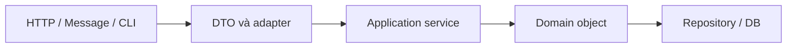

# Kiểm tra đầu vào tại ranh giới đối tượng trong Java

Trong lập trình hướng đối tượng (OOP), **đóng gói (encapsulation)** không dừng ở việc đặt field là `private`. Một lớp còn phải kiểm soát **những giá trị nào được phép đi vào đối tượng**, và **những thay đổi trạng thái nào được phép xảy ra**.

Nếu đối tượng `BankAccount` có số dư không được âm, hoặc `Enrollment` chỉ nhận số tín chỉ từ 1 đến 30, các quy tắc này phải được bảo vệ ngay tại các điểm tạo và sử dụng đối tượng, kể cả khi dữ liệu không đến từ giao diện web.

**Ranh giới đối tượng** là nơi dữ liệu hoặc yêu cầu thay đổi đi từ mã bên ngoài vào trạng thái do đối tượng sở hữu: constructor, static factory, setter, phương thức nghiệp vụ, phương thức nhận collection, v.v.

## 1. Vì sao phải kiểm tra ngay tại ranh giới?

Xét lớp chưa được bảo vệ:

```java
class CourseEnrollment {
    private int credits;

    public CourseEnrollment(int credits) {
        this.credits = credits;
    }

    public void setCredits(int credits) {
        this.credits = credits;
    }

    public int getCredits() {
        return credits;
    }
}
```

Caller có thể tạo hoặc thay đổi đối tượng thành trạng thái vô nghĩa:

```java
CourseEnrollment enrollment = new CourseEnrollment(-5);
enrollment.setCredits(999);
System.out.println(enrollment.getCredits()); // 999
```

Dù `credits` là `private`, lớp vẫn cho phép dữ liệu không hợp lệ đi qua API công khai. Vì vậy **`private` là công cụ giới hạn truy cập, còn kiểm tra đầu vào là công cụ bảo vệ quy tắc trạng thái**.

Một đối tượng được thiết kế tốt cần duy trì các **bất biến (invariants)**: điều kiện phải đúng với trạng thái đối tượng ở những thời điểm có thể quan sát và sử dụng hợp lệ.

Ví dụ quy tắc:

- Mã khóa học không được `null` hoặc rỗng sau khi bỏ khoảng trắng đầu/cuối.
- Số tín chỉ phải nằm trong khoảng `1..30`.
- Một lần cập nhật không được làm đối tượng chuyển sang trạng thái có số tín chỉ ngoài khoảng cho phép.

## 2. Kiểm tra trong constructor và khi cập nhật

Một cách triển khai trực tiếp:

```java
public final class CourseEnrollment {
    private final String courseCode;
    private int credits;

    public CourseEnrollment(String courseCode, int credits) {
        this.courseCode = requireCourseCode(courseCode);
        this.credits = requireCredits(credits);
    }

    public void changeCredits(int newCredits) {
        this.credits = requireCredits(newCredits);
    }

    public String getCourseCode() {
        return courseCode;
    }

    public int getCredits() {
        return credits;
    }

    private static String requireCourseCode(String code) {
        if (code == null || code.isBlank()) {
            throw new IllegalArgumentException("Mã khóa học không được rỗng");
        }
        return code.strip();
    }

    private static int requireCredits(int value) {
        if (value < 1 || value > 30) {
            throw new IllegalArgumentException(
                "Số tín chỉ phải nằm trong khoảng 1..30"
            );
        }
        return value;
    }

    public static void main(String[] args) {
        CourseEnrollment course = new CourseEnrollment(" JAVA101 ", 3);
        System.out.println(course.getCourseCode()); // JAVA101
        System.out.println(course.getCredits());    // 3

        course.changeCredits(5);
        System.out.println(course.getCredits());    // 5

        try {
            course.changeCredits(-1);
        } catch (IllegalArgumentException ex) {
            System.out.println(ex.getMessage());
        }

        System.out.println(course.getCredits());    // 5
    }
}
```

Ở đây, **cả hai đường nhận dữ liệu** đều dùng chung quy tắc:

- Constructor gọi `requireCourseCode` và `requireCredits` để chỉ tạo đối tượng với giá trị hợp lệ.
- Phương thức `changeCredits` kiểm tra giá trị mới trước khi gán; nếu tham số sai, field `credits` **giữ nguyên**.

Có thể dùng phương thức trả về giá trị đã chuẩn hóa như `requireCourseCode` thay vì chỉ kiểm tra rồi trả `void`. Cách này bảo đảm giá trị được lưu chính là giá trị đã kiểm tra.

**Lưu ý:** `String.isBlank()` có từ Java 11; `String.strip()` cũng từ Java 11. Nếu dùng phiên bản Java cũ hơn, cần áp dụng API tương thích.

## 3. Phân loại quy tắc kiểm tra

Không phải mọi phép kiểm tra đều có cùng mục đích.

| Loại kiểm tra | Ví dụ | Vị trí thích hợp |
|---|---|---|
| **Không null** | `customerId` bắt buộc | Constructor, factory, method nhận dữ liệu |
| **Cấu trúc/định dạng** | Mã sản phẩm không rỗng, mã đơn theo mẫu | Value object hoặc lớp sở hữu thuộc tính |
| **Phạm vi giá trị** | `quantity > 0`, `discountPercent` trong `0..100` | Constructor và mutator |
| **Quan hệ giữa các field** | `reservedSeats <= capacity` | Phương thức quản lý cả hai field |
| **Trạng thái hiện tại** | Đơn hàng đã hủy không được thanh toán | Phương thức nghiệp vụ có quyền chuyển trạng thái |
| **Quy tắc ngoài đối tượng** | Mã người dùng phải duy nhất trong DB | Service/repository và ràng buộc dữ liệu có thẩm quyền |

Cần tách:

1. **Đầu vào không hợp lệ:** tham số tự nó sai (ví dụ `quantity = -1`).
2. **Thao tác không hợp lệ ở trạng thái hiện tại:** tham số đúng nhưng không thể áp dụng lên đối tượng hiện tại (ví dụ đặt 5 chỗ khi chỉ còn 3 chỗ).

Sự phân biệt này giúp đặt tên phương thức, chọn exception và viết kiểm thử rõ ràng.

## 4. Kiểm tra toàn bộ điều kiện trước khi thay đổi trạng thái

Khi một thao tác cập nhật **nhiều field**, hãy bảo đảm không làm đối tượng dở dang nếu điều kiện thất bại.

### Thiết kế dễ gây trạng thái không nhất quán

```java
class UnsafeReservation {
    private int capacity = 10;
    private int reserved = 2;

    void reconfigure(int newCapacity, int newReserved) {
        capacity = newCapacity; // Đã thay đổi trạng thái!
        if (newReserved < 0 || newReserved > newCapacity) {
            throw new IllegalArgumentException("Dữ liệu đặt chỗ sai");
        }
        reserved = newReserved;
    }
}
```

Lời gọi `reconfigure(1, 5)` sẽ ném exception **sau khi** gán `capacity = 1`, để lại `reserved = 2` lớn hơn sức chứa mới. Lớp không còn bảo đảm invariant.

### Kiểm tra trước, cập nhật sau

File `Reservation.java` có thể chạy độc lập:

```java
public final class Reservation {
    private int capacity;
    private int reserved;

    public Reservation(int capacity, int reserved) {
        validateState(capacity, reserved);
        this.capacity = capacity;
        this.reserved = reserved;
    }

    public void reconfigure(int newCapacity, int newReserved) {
        validateState(newCapacity, newReserved);

        // Chỉ ghi khi mọi điều kiện đã đạt.
        this.capacity = newCapacity;
        this.reserved = newReserved;
    }

    public void reserve(int amount) {
        if (amount <= 0) {
            throw new IllegalArgumentException("Số chỗ phải dương");
        }
        if (amount > capacity - reserved) {
            throw new IllegalStateException("Không đủ chỗ trống");
        }
        reserved += amount;
    }

    private static void validateState(int capacity, int reserved) {
        if (capacity <= 0) {
            throw new IllegalArgumentException("Sức chứa phải dương");
        }
        if (reserved < 0 || reserved > capacity) {
            throw new IllegalArgumentException(
                "Số chỗ đã đặt phải thuộc 0..capacity"
            );
        }
    }

    public String summary() {
        return "capacity=" + capacity + ", reserved=" + reserved;
    }

    public static void main(String[] args) {
        Reservation r = new Reservation(10, 2);

        try {
            r.reconfigure(1, 5);
        } catch (IllegalArgumentException ex) {
            System.out.println("Từ chối: " + ex.getMessage());
        }

        System.out.println(r.summary()); // capacity=10, reserved=2

        r.reserve(3);
        System.out.println(r.summary()); // capacity=10, reserved=5
    }
}
```

**Quy tắc quan trọng:** Thực hiện các phép kiểm tra có thể thất bại trước khi bắt đầu thay đổi những field liên quan, nếu thiết kế yêu cầu giữ nguyên trạng thái khi lỗi xảy ra (*strong exception safety* ở mức đối tượng).

Đoạn mã này giả định đối tượng được truy cập tuần tự. **Kiểm tra đầu vào không thay thế đồng bộ đa luồng.** Nếu nhiều thread được phép cập nhật cùng `Reservation`, phép kiểm tra và cập nhật phải được phối hợp bằng cơ chế đồng bộ thích hợp, nếu không hai thao tác hợp lệ riêng lẻ vẫn có thể vi phạm sức chứa khi chạy đồng thời.

## 5. Kiểm tra tại mọi đường thay đổi trạng thái, không chỉ setter

Đôi khi một lớp không có setter nhưng vẫn có thể trở nên không hợp lệ qua các phương thức nghiệp vụ.

```java
public final class InventoryItem {
    private final String sku;
    private int stock;

    public InventoryItem(String sku, int initialStock) {
        if (sku == null || sku.isBlank()) {
            throw new IllegalArgumentException("sku rỗng");
        }
        if (initialStock < 0) {
            throw new IllegalArgumentException("Tồn kho âm");
        }
        this.sku = sku.strip();
        this.stock = initialStock;
    }

    public void receive(int amount) {
        if (amount <= 0) {
            throw new IllegalArgumentException("amount phải dương");
        }
        if (stock > Integer.MAX_VALUE - amount) {
            throw new IllegalStateException("Tràn phạm vi tồn kho");
        }
        stock += amount;
    }

    public void dispatch(int amount) {
        if (amount <= 0) {
            throw new IllegalArgumentException("amount phải dương");
        }
        if (stock < amount) {
            throw new IllegalStateException("Không đủ tồn kho");
        }
        stock -= amount;
    }

    public int getStock() {
        return stock;
    }
}
```

Ở đây, không có `setStock(int)`. Caller chỉ được thực hiện hành vi **receive** hoặc **dispatch**, và đối tượng kiểm tra ý nghĩa của từng thao tác. Đây là đóng gói hành vi: API chỉ cho phép những chuyển đổi trạng thái hợp lệ.

Kiểm tra tràn số trong `receive` rất cần thiết vì với `int`, phép cộng vượt giới hạn có thể quay vòng sang số âm mà **không tự ném exception**. Một cách khác là dùng `Math.addExact` và xử lý `ArithmeticException`.

## 6. Không tin dữ liệu mutable chỉ vì đã kiểm tra một lần

Một lỗi kín đáo xảy ra khi constructor **kiểm tra đối tượng đầu vào rồi giữ nguyên tham chiếu tới dữ liệu có thể thay đổi**. Caller có thể sửa dữ liệu đó về sau, đi vòng qua API kiểm tra.

### Ví dụ lỗi với mảng

```java
public class UnsafeScores {
    private final int[] scores;

    public UnsafeScores(int[] scores) {
        for (int score : scores) {
            if (score < 0 || score > 100) {
                throw new IllegalArgumentException("Điểm không hợp lệ");
            }
        }
        this.scores = scores; // Lưu tham chiếu ngoài
    }

    public int[] getScores() {
        return scores; // Trả lại tham chiếu nội bộ
    }
}
```

Vì đối tượng giữ mảng của caller, quy tắc điểm từ 0 đến 100 có thể bị phá vỡ:

```java
int[] input = {80, 90};
UnsafeScores result = new UnsafeScores(input);

input[0] = -10;               // Đi vòng qua constructor
result.getScores()[1] = 500; // Đi vòng qua getter
```

### Defensive copy tại ranh giới vào và ra

```java
import java.util.Objects;

public final class Scores {
    private final int[] scores;

    public Scores(int[] source) {
        Objects.requireNonNull(source, "source");
        int[] candidate = source.clone();

        for (int score : candidate) {
            if (score < 0 || score > 100) {
                throw new IllegalArgumentException(
                    "Điểm phải nằm trong 0..100"
                );
            }
        }
        this.scores = candidate;
    }

    public int[] getScores() {
        return scores.clone();
    }

    public int total() {
        int total = 0;
        for (int score : scores) {
            total += score;
        }
        return total;
    }

    public static void main(String[] args) {
        int[] input = {80, 90};
        Scores result = new Scores(input);

        input[0] = -10;
        result.getScores()[1] = 500;

        System.out.println(result.total()); // 170
    }
}
```

**Thứ tự `clone()` rồi validate trên bản sao** cũng có ý nghĩa: dữ liệu được kiểm tra là đúng dữ liệu lớp sắp lưu. Nếu caller có thể sửa mảng từ thread khác trong lúc thao tác, vẫn cần quy định rõ trách nhiệm đồng bộ khi chuyển giao dữ liệu; sao chép một mảng bị thay đổi đồng thời không mặc nhiên tạo snapshot nhất quán của toàn bộ dữ liệu.

Với `List<String>`, có thể dùng `List.copyOf(input)` để lấy danh sách không sửa được qua API `List` và tách việc sửa cấu trúc qua danh sách đầu vào. Tuy nhiên nếu phần tử là đối tượng mutable (ví dụ `List<Address>`), `List.copyOf` **không sao chép sâu** từng phần tử. Cần tự bảo vệ các thành phần mutable do đối tượng sở hữu.

## 7. Chuẩn hóa dữ liệu và kiểm tra định dạng: làm đúng mức cần thiết

Dữ liệu hợp lệ không nhất thiết phải giống nguyên văn dữ liệu đầu vào. Ví dụ mã khóa học có thể cho phép bỏ khoảng trắng đầu/cuối:

```java
private static String normalizeCode(String input) {
    if (input == null) {
        throw new IllegalArgumentException("code không được null");
    }

    String code = input.strip();
    if (code.isEmpty()) {
        throw new IllegalArgumentException("code không được rỗng");
    }
    return code;
}
```

Một số nguyên tắc:

- **Chuẩn hóa có chủ đích:** bỏ khoảng trắng hoặc chuẩn hóa mã theo hợp đồng nghiệp vụ. Không tự động viết thường toàn bộ thông tin nếu việc phân biệt chữ hoa/chữ thường có ý nghĩa.
- **Validate đúng giá trị được lưu:** nếu chuẩn hóa, kiểm tra kết quả sau chuẩn hóa và chỉ lưu kết quả đó.
- **Không kiểm tra giả tạo:** ví dụ kiểm tra email bằng `contains("@")` không phải giải pháp xác thực địa chỉ email đầy đủ. Nếu nghiệp vụ yêu cầu định dạng chặt chẽ, phải xác định quy tắc rõ và dùng giải pháp phù hợp.
- **Thông báo lỗi cụ thể:** nêu field và quy tắc bị vi phạm để người gọi biết cách khắc phục, nhưng tránh nhúng dữ liệu nhạy cảm vào exception/log.

Đối với Java `String`, `isBlank` xét ký tự khoảng trắng theo quy tắc Java; `strip` hỗ trợ loại bỏ whitespace Unicode tốt hơn `trim` trong nhiều trường hợp. Vẫn phải chọn chính sách chuẩn hóa theo sản phẩm và loại dữ liệu.

## 8. Value object: đặt quy tắc ở nơi có trách nhiệm sở hữu

Nếu mã khóa học xuất hiện ở nhiều nơi và luôn có cùng quy tắc, hãy gói nó trong một **value object** thay vì lặp kiểm tra ở nhiều lớp.

Ví dụ Java 17+ với `record`:

```java
public record CourseCode(String value) {
    public CourseCode {
        if (value == null || value.isBlank()) {
            throw new IllegalArgumentException("Mã khóa học rỗng");
        }
        value = value.strip();
        if (!value.matches("[A-Z]{2,8}[0-9]{3}")) {
            throw new IllegalArgumentException(
                "Mã phải gồm 2-8 chữ in hoa và 3 chữ số"
            );
        }
    }
}
```

Cách dùng:

```java
CourseCode code = new CourseCode(" JAVA101 ");
System.out.println(code.value()); // JAVA101

// new CourseCode("abc"); // Ném IllegalArgumentException
```

Trong **compact constructor** của record, Java tự gán các tham số thành component field sau phần thân constructor nếu hoàn thành bình thường. Vì thế việc gán lại tham số `value = value.strip()` tại đây hợp lệ và dẫn đến field lưu giá trị đã chuẩn hóa.

Có thể dùng record để tránh lặp nhiều điều kiện liên quan đến một giá trị. Nhưng record chỉ phù hợp khi mô hình dữ liệu và ngữ nghĩa value object thích hợp. Record có thể chứa reference tới đối tượng mutable; việc dùng `record` tự nó không tạo tính bất biến sâu.

## 9. Boundary của DTO, controller và domain có giống nhau?

Trong ứng dụng Java/Spring, dữ liệu đi qua nhiều ranh giới:



Mỗi nơi có trách nhiệm riêng:

| Lớp/ranh giới | Kiểm tra điển hình | Mục đích |
|---|---|---|
| **DTO/controller** | Field bắt buộc ở request, kiểu/format dữ liệu, phản hồi lỗi cho client | Phản hồi người dùng sớm, rõ ràng |
| **Application service** | Quyền thao tác, dữ liệu từ repository, điều phối nhiều đối tượng | Điều kiện sử dụng theo ca nghiệp vụ |
| **Domain object** | Quy tắc để chính đối tượng luôn hợp lệ | Chặn mọi đường tạo/cập nhật sai, kể cả gọi trực tiếp |
| **Repository/DB** | Unique constraint, foreign key, check constraint, tính nhất quán giao dịch | Bảo vệ sự thật dữ liệu qua nhiều tiến trình |

Ví dụ với Spring Boot và Bean Validation (giả sử project đã khai báo phụ thuộc Jakarta Validation):

```java
import jakarta.validation.constraints.Max;
import jakarta.validation.constraints.Min;
import jakarta.validation.constraints.NotBlank;

public record EnrollRequest(
    @NotBlank String courseCode,
    @Min(1) @Max(30) int credits
) {}
```

Controller có thể kích hoạt validation:

```java
import jakarta.validation.Valid;
import org.springframework.web.bind.annotation.PostMapping;
import org.springframework.web.bind.annotation.RequestBody;
import org.springframework.web.bind.annotation.RestController;

@RestController
class EnrollmentController {
    @PostMapping("/enrollments")
    public void create(@Valid @RequestBody EnrollRequest request) {
        CourseEnrollment enrollment =
            new CourseEnrollment(request.courseCode(), request.credits());
        // Giao cho service/repository theo kiến trúc ứng dụng
    }
}
```

`@Valid` giúp phản hồi request không hợp lệ tại HTTP boundary khi có integration Bean Validation thích hợp. Nhưng việc gọi trực tiếp:

```java
new CourseEnrollment("JAVA101", -3);
```

vẫn phải bị domain object từ chối, vì đối tượng có thể được khởi tạo từ message consumer, batch job, unit test hoặc một service khác mà **không đi qua HTTP controller**.

**Không nên coi mọi validation đều phải lặp giống hệt ở tất cả các lớp.** Ở DTO có thể kiểm tra yêu cầu dữ liệu đầu vào; ở domain bắt buộc giữ invariant; ở database bảo vệ các ràng buộc cần tính nhất quán toàn cục. Mỗi lớp bảo vệ trách nhiệm của mình.

## 10. Chọn loại exception cho đúng ý nghĩa

Java không bắt buộc một loại exception duy nhất cho mọi kiểm tra, nhưng một số quy ước thường dễ hiểu:

| Tình huống | Exception thường phù hợp | Ví dụ |
|---|---|---|
| Tham số không được `null` | `NullPointerException` qua `Objects.requireNonNull` hoặc `IllegalArgumentException` theo API | `Objects.requireNonNull(name, "name")` |
| Đối số có giá trị không hợp lệ | `IllegalArgumentException` | `credits = -1` |
| Thao tác không hợp lệ với trạng thái hiện tại | `IllegalStateException` hoặc exception nghiệp vụ chuyên biệt | Thanh toán đơn đã hủy |
| Truy cập phần tử ngoài giới hạn | `IndexOutOfBoundsException` | Chỉ số mảng/list sai |
| Vi phạm quy tắc nghiệp vụ cần báo lỗi có cấu trúc | Exception nghiệp vụ riêng | `InsufficientStockException` |

Một ví dụ rõ ràng:

```java
public void withdraw(long amount) {
    if (amount <= 0) {
        throw new IllegalArgumentException("Số tiền phải dương");
    }
    if (amount > balance) {
        throw new IllegalStateException("Số dư không đủ");
    }
    balance -= amount;
}
```

Ở đây giả sử `balance` là `long` không âm đã được constructor bảo vệ. `amount <= 0` là lỗi tham số; `amount > balance` là xung đột với trạng thái tài khoản hiện tại. Nếu cùng một thông tin được dùng để tạo phản hồi HTTP, lớp controller/exception handler có thể **ánh xạ lỗi** sang thông báo hoặc mã trạng thái thích hợp mà không đặt phụ thuộc HTTP vào domain object.

## 11. Kiểm tra đầu vào khác đồng bộ và transaction

Kiểm tra tại ranh giới giúp bảo vệ trạng thái **trong một luồng thực thi đã được phối hợp đúng**. Nó không tự giải quyết mọi vấn đề đồng thời hay nhất quán phân tán.

Ví dụ hai thread cùng thực hiện:

```java
if (available >= 1) {
    available--;
}
```

Nếu không có đồng bộ, hai thread có thể cùng nhìn thấy `available = 1` và cùng cho phép đặt chỗ. Quy tắc “không đặt vượt số chỗ” có thể bị phá vỡ ở cấp nghiệp vụ dù mỗi thread đã kiểm tra riêng.

Khi trạng thái được chia sẻ đồng thời, cần kết hợp validation với **khóa/đồng bộ/atomic operation** thích hợp. Khi trạng thái nằm trong cơ sở dữ liệu hoặc nhiều service, có thể cần transaction, optimistic/pessimistic locking, unique constraint hoặc các cơ chế nhất quán khác tùy tình huống.

Tương tự, một constructor có thể kiểm tra `userId` không rỗng, nhưng không thể tự khẳng định mã đó là duy nhất trong toàn bộ database chỉ bằng cách kiểm tra field. Ràng buộc duy nhất phải được xác nhận tại nguồn dữ liệu có thẩm quyền.

## 12. Những sai lầm dễ gặp

| Sai lầm | Vì sao nguy hiểm? | Cách sửa |
|---|---|---|
| Để field `private` rồi cho setter nhận mọi giá trị | Caller vẫn có thể tạo trạng thái sai | Validate ở từng mutator hoặc cung cấp operation theo nghiệp vụ |
| Chỉ validate ở controller | Các đường tạo object khác có thể bỏ qua controller | Domain tự bảo vệ invariant |
| Chỉ validate constructor, quên phương thức update | Đối tượng có thể hợp lệ lúc tạo nhưng sai sau đó | Tái sử dụng invariant khi đổi trạng thái |
| Gán field trước rồi mới validate field khác | Exception có thể để lại trạng thái dở dang | Validate toàn bộ phương án mới trước khi commit |
| Validate `List`/mảng rồi giữ nguyên tham chiếu mutable | Caller có thể sửa sau lúc kiểm tra | Defensive copy và kiểm soát getter |
| Dùng `final` với `List` và tưởng list bất biến | `final` không ngăn sửa nội dung được tham chiếu | Immutable collection, defensive copy hoặc thiết kế API hẹp |
| Chỉ kiểm tra số âm, không xét overflow | Tính toán có thể vượt miền giá trị | Kiểm tra điều kiện trước phép tính hoặc dùng `Math.*Exact` |
| Lặp regex/logic kiểm tra ở nhiều nơi | Dễ lệch quy tắc giữa các đường sử dụng | Value object/helper với hợp đồng thống nhất |
| Cho rằng validation loại bỏ race condition | Check và update có thể xen kẽ giữa thread | Đồng bộ nguyên tử theo invariant |

## 13. Bài tập tự kiểm tra

### Bài 1 — Tìm lỗi về tính nhất quán

```java
class Account {
    private long balance = 100;

    void transferOut(long amount) {
        balance -= amount;
        if (amount <= 0 || balance < 0) {
            throw new IllegalArgumentException("Transfer không hợp lệ");
        }
    }

    long balance() {
        return balance;
    }
}
```

**Câu hỏi:** Với `transferOut(200)`, sau khi ném exception, `balance` là bao nhiêu?

**Đáp án:** `-100`. Vì phép trừ xảy ra trước khi kiểm tra. Sửa bằng cách kiểm tra `amount <= 0` và `amount > balance` **trước** khi gán `balance -= amount`.

### Bài 2 — Kiểm tra cả quan hệ giữa các field

Cho lớp `DateRange` lưu `LocalDate start` và `LocalDate end`, với bất biến `start <= end`. Hãy thiết kế constructor và phương thức `changeRange(start, end)` sao cho:

1. Không chấp nhận `null`.
2. Không chấp nhận `start` sau `end`.
3. Nếu đầu vào sai, đối tượng giữ nguyên cả hai giá trị cũ.

Gợi ý:

```java
import java.time.LocalDate;
import java.util.Objects;

public final class DateRange {
    private LocalDate start;
    private LocalDate end;

    public DateRange(LocalDate start, LocalDate end) {
        changeRange(start, end);
    }

    public void changeRange(LocalDate newStart, LocalDate newEnd) {
        Objects.requireNonNull(newStart, "start");
        Objects.requireNonNull(newEnd, "end");
        if (newStart.isAfter(newEnd)) {
            throw new IllegalArgumentException("start phải <= end");
        }
        this.start = newStart;
        this.end = newEnd;
    }

    public LocalDate start() { return start; }
    public LocalDate end() { return end; }
}
```

`LocalDate` là kiểu giá trị immutable, nên trả trực tiếp tham chiếu tới `start`/`end` trong ví dụ không làm lộ đối tượng mutable. Khi cần an toàn trong đa luồng, vẫn phải xử lý cập nhật hai field như một thay đổi nhất quán trước các reader khác.

### Bài 3 — Ranh giới đối tượng ở đâu?

Một chương trình nhận `CreateUserRequest` từ REST API, tạo `User` rồi lưu xuống DB. REST đã dùng `@NotBlank` cho `username`.

**Hỏi:** Có cần kiểm tra `username` trong chính `User` không?

**Đáp án:** Có, nếu “username không rỗng” là **bất biến** của `User`. Đối tượng `User` có thể được tạo từ các đường khác ngoài REST. Trong khi đó, điều kiện “username duy nhất trong hệ thống” cần repository/DB hoặc cơ chế nhất quán phù hợp để bảo vệ cạnh tranh giữa nhiều yêu cầu.

---

**Ghi nhớ:** Bảo vệ đóng gói bằng cách **kiểm tra đầu vào tại mọi ranh giới có thể tạo hoặc thay đổi trạng thái**, tập trung vào invariant do đối tượng sở hữu. Chuẩn hóa và kiểm tra trước khi lưu; nếu cập nhật nhiều field, kiểm tra toàn bộ trước khi commit; nếu nhận dữ liệu mutable, kiểm soát tham chiếu bằng defensive copy. Với quy tắc liên quan nhiều đối tượng, database hoặc nhiều thread, kết hợp cơ chế ở đúng tầng chịu trách nhiệm.