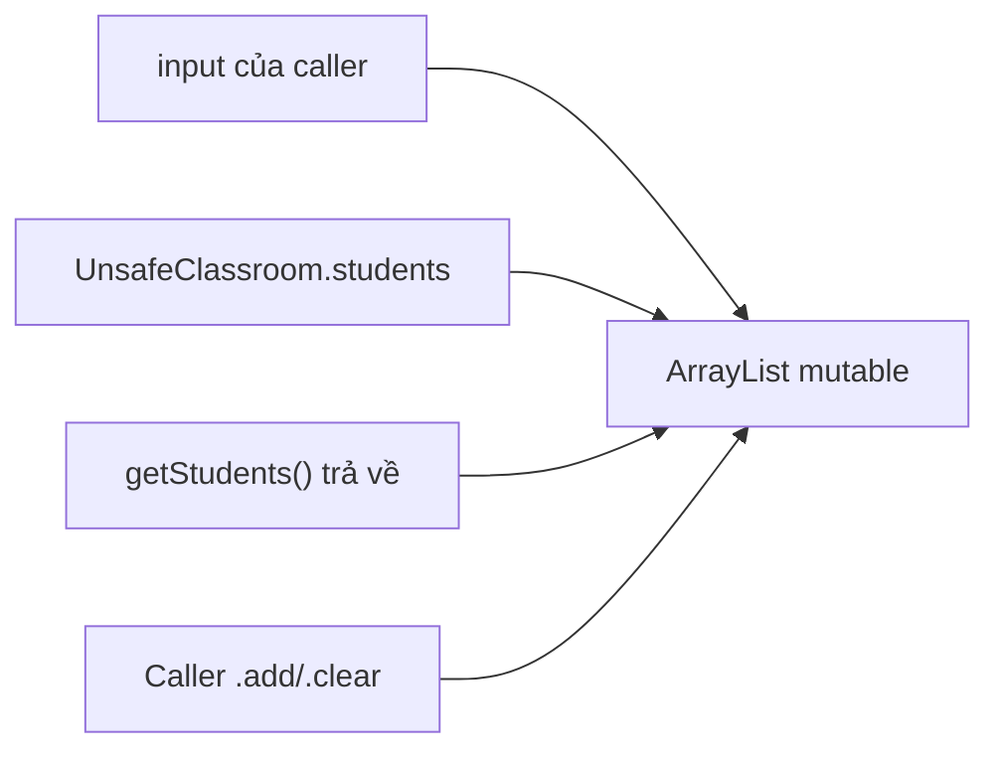

# Ngăn lộ dữ liệu nội bộ có thể thay đổi trong Java

Trong lập trình hướng đối tượng, **đóng gói (encapsulation)** nghĩa là đối tượng kiểm soát cách trạng thái của chính nó được truy cập và thay đổi. Một lỗi phổ biến là khai báo trường `private` nhưng lại trả trực tiếp đối tượng mutable đang nằm trong trường đó hoặc giữ nguyên tham chiếu mutable mà bên ngoài truyền vào.

Ví dụ, một lớp có quy tắc “danh sách học viên không vượt sức chứa” sẽ mất quyền kiểm soát nếu bên ngoài có thể gọi `getStudents().add(...)` mà không đi qua phương thức đăng ký có kiểm tra.

**Mục tiêu của bài:** nhận diện khi nào một tham chiếu làm lộ trạng thái nội bộ; sử dụng defensive copy, các giá trị bất biến và API có kiểm soát để bảo vệ invariant của đối tượng.

## 1. Vì sao `private` vẫn có thể không an toàn?

Xét lớp sau:

```java
import java.util.List;

class UnsafeClassroom {
    private final List<String> students;

    UnsafeClassroom(List<String> students) {
        this.students = students;
    }

    List<String> getStudents() {
        return students;
    }
}
```

Trường `students` là `private final`, nhưng **đối tượng danh sách** vẫn có thể thay đổi. Có hai đường làm thay đổi dữ liệu bên trong mà không cần một setter nào:

```java
List<String> input = new java.util.ArrayList<>(List.of("An"));
UnsafeClassroom room = new UnsafeClassroom(input);

input.add("Bình");             // Đường 1: sửa qua tham chiếu gốc
room.getStudents().clear();    // Đường 2: sửa qua tham chiếu getter trả ra

System.out.println(input);     // []
System.out.println(room.getStudents()); // []
```

Cùng một danh sách được giữ bởi `input`, trường `students` và kết quả `getStudents()`. Phép gán tham chiếu không sao chép đối tượng.



Dữ liệu bị lộ ở cả hai chiều:

- **Đầu vào (inbound aliasing):** constructor hoặc setter lưu nguyên tham chiếu của caller; caller còn giữ nó và có thể sửa về sau.
- **Đầu ra (outbound aliasing):** getter hay một phương thức trả trực tiếp tham chiếu nội bộ; caller sửa được đối tượng qua kết quả trả về.

Điều này không chỉ làm hỏng quy tắc nghiệp vụ. Nó còn gây lỗi khó tái hiện khi có nhiều thành phần cùng giữ tham chiếu, dẫn đến dữ liệu bị sửa ngoài dự kiến.

## 2. Một thiết kế an toàn: sửa qua hành vi, đọc qua snapshot

Lớp dưới đây cho phép **thay đổi danh sách học viên có kiểm soát** qua `enroll()`, nhưng giữ quyền quyết định mọi thay đổi nội bộ. Constructor sao chép đầu vào; getter trả về **snapshot không thể sửa cấu trúc**.

Lưu toàn bộ mã sau trong **`Main.java`**, chạy với Java 17 hoặc Java 21:

```java
import java.util.ArrayList;
import java.util.Arrays;
import java.util.HashSet;
import java.util.List;
import java.util.Objects;
import java.util.Set;

final class EnrollmentBook {
    private final int capacity;
    private final List<String> students;

    EnrollmentBook(int capacity, List<String> initialStudents) {
        if (capacity <= 0) {
            throw new IllegalArgumentException("Sức chứa phải dương");
        }
        Objects.requireNonNull(initialStudents, "initialStudents");

        // 1. Sao chép tham chiếu list của caller.
        List<String> copied = new ArrayList<>(initialStudents);
        if (copied.size() > capacity) {
            throw new IllegalArgumentException("Vượt sức chứa");
        }

        // 2. Kiểm tra dữ liệu trước khi công bố đối tượng.
        Set<String> unique = new HashSet<>();
        for (String student : copied) {
            validateName(student);
            if (!unique.add(student)) {
                throw new IllegalArgumentException("Học viên trùng");
            }
        }

        this.capacity = capacity;
        this.students = copied;
    }

    void enroll(String student) {
        validateName(student);
        if (students.size() >= capacity) {
            throw new IllegalStateException("Lớp đã đủ chỗ");
        }
        if (students.contains(student)) {
            throw new IllegalArgumentException("Học viên đã tồn tại");
        }
        students.add(student);
    }

    List<String> getStudents() {
        return List.copyOf(students);
    }

    int size() {
        return students.size();
    }

    private static void validateName(String student) {
        if (student == null || student.isBlank()) {
            throw new IllegalArgumentException("Tên học viên không hợp lệ");
        }
    }
}

final class Attachment {
    private final byte[] data;

    Attachment(byte[] original) {
        this.data = Objects.requireNonNull(original, "original").clone();
    }

    byte[] getData() {
        return data.clone();
    }
}

public class Main {
    public static void main(String[] args) {
        List<String> input = new ArrayList<>(List.of("An"));
        EnrollmentBook book = new EnrollmentBook(3, input);

        input.add("Bình"); // Chỉ thay đổi input của caller
        System.out.println(book.getStudents()); // [An]

        List<String> firstSnapshot = book.getStudents();
        try {
            firstSnapshot.add("Cường");
        } catch (UnsupportedOperationException ex) {
            System.out.println("Không thể sửa snapshot");
        }

        book.enroll("Bình"); // Thay đổi qua API kiểm soát
        System.out.println(firstSnapshot);      // [An]
        System.out.println(book.getStudents()); // [An, Bình]
        System.out.println(book.size());        // 2

        byte[] original = {1, 2, 3};
        Attachment attachment = new Attachment(original);
        original[0] = 9; // Không sửa dữ liệu đã lưu
        byte[] exposed = attachment.getData();
        exposed[1] = 8;  // Không sửa dữ liệu đã lưu
        System.out.println(Arrays.toString(attachment.getData()));
    }
}
```

Chạy:

```bash
javac Main.java
java Main
```

Kết quả:

```text
[An]
Không thể sửa snapshot
[An]
[An, Bình]
2
[1, 2, 3]
```

Lưu ý về ý nghĩa của ví dụ:

- `new ArrayList<>(initialStudents)` tách **danh sách nội bộ** khỏi danh sách mà caller còn giữ.
- `List.copyOf(students)` trả về danh sách không thể sửa cấu trúc với nội dung tại thời điểm gọi. Khi `book.enroll(...)` chạy, snapshot cũ `firstSnapshot` vẫn giữ `[An]`.
- Những người học trong ví dụ được biểu diễn bằng `String`, vốn bất biến, nên không có đường sửa thêm qua từng phần tử.
- `Attachment` cần `clone()` **cả khi nhận lẫn khi trả** mảng, vì `byte[]` luôn mutable.
- Lớp `EnrollmentBook` **vẫn là mutable**: điều được bảo vệ là quyền thay đổi qua API kiểm soát, không phải cấm mọi thay đổi.

## 3. Defensive copy ở đầu vào và đầu ra

**Defensive copy** là tạo bản sao dữ liệu ở ranh giới tin cậy, để mã khác không thể sửa trạng thái mà đối tượng cần sở hữu độc lập.

| Ranh giới | Mã dễ làm lộ dữ liệu | Cách bảo vệ điển hình |
| --- | --- | --- |
| Constructor nhận list | `this.items = items;` | `this.items = List.copyOf(items);` hoặc `new ArrayList<>(items)` |
| Setter nhận list | `this.items = items;` | Kiểm tra và sao chép trước khi lưu |
| Getter trả list mutable | `return items;` | `return List.copyOf(items);` hoặc `new ArrayList<>(items)` |
| Constructor nhận mảng | `this.bytes = bytes;` | `this.bytes = bytes.clone();` |
| Getter trả mảng | `return bytes;` | `return bytes.clone();` |
| Getter trả `Date` mutable | `return createdAt;` | Trả bản sao `new Date(createdAt.getTime())` hoặc thiết kế dùng `Instant` |
| Trả `Map` nội bộ | `return scores;` | `Map.copyOf(scores)` nếu dữ liệu bên trong an toàn |
| Trả object mutable lồng nhau | `return settings;` | Bản sao sâu phù hợp hoặc value object bất biến |

**Không phải trường hợp nào cũng dùng `List.copyOf`.** Nếu lớp muốn sửa collection nội bộ, có thể lưu `new ArrayList<>(input)` và chỉ sao chép khi trả ra. Nếu bản thân collection nội bộ phải bất biến, có thể lưu `List.copyOf(input)`. Lựa chọn tùy vào hành vi mà lớp cần hỗ trợ.

`List.copyOf`, `Set.copyOf`, `Map.copyOf` không chấp nhận phần tử hoặc khóa/giá trị `null` tương ứng theo hợp đồng. Khi dữ liệu có `null` hợp lệ, cần chọn một cấu trúc và cách sao chép phù hợp khác, với hợp đồng API rõ ràng.

## 4. Unmodifiable view không giống snapshot

Java có nhiều cách trả về dữ liệu chỉ đọc, nhưng hai cách sau không có cùng ý nghĩa:

```java
import java.util.ArrayList;
import java.util.Collections;
import java.util.List;

List<String> backing = new ArrayList<>(List.of("A"));

List<String> view = Collections.unmodifiableList(backing);
List<String> snapshot = List.copyOf(backing);

backing.add("B");

System.out.println(view);     // [A, B]
System.out.println(snapshot); // [A]
```

| Cơ chế | Caller có `add/remove` qua kết quả? | Thay đổi cấu trúc của list gốc có hiện ra? |
| --- | --- | --- |
| `return internalList;` | Có, nếu list mutable | Có; caller còn sửa được trực tiếp |
| `Collections.unmodifiableList(internalList)` | Không | **Có**: đây là view bám theo list gốc |
| `List.copyOf(internalList)` | Không | **Không**: giữ nội dung snapshot tại lúc sao chép |
| `new ArrayList<>(internalList)` | Có, trên bản sao riêng | **Không**: sửa bản sao không ảnh hưởng list gốc |

`Collections.unmodifiableList` rất hữu ích nếu chủ ý cho người dùng **quan sát trạng thái đang thay đổi** mà không cho sửa trực tiếp qua view. Tuy nhiên, nếu yêu cầu là “dữ liệu nhận được phải cố định sau lời gọi”, cần snapshot.

Một số lưu ý:

- `List.copyOf` có thể tái sử dụng một list vốn đã không thể sửa được, nên đừng giả định nó luôn tạo **một đối tượng list mới**.
- Cả unmodifiable view và snapshot **đều không tự biến phần tử mutable thành bất biến**.
- `new ArrayList<>(...)` tạo list độc lập về cấu trúc nhưng caller **được phép sửa bản sao**. Điều này có thể là hợp đồng API hợp lệ nếu người nhận cần thao tác trên dữ liệu riêng.

## 5. Một snapshot list vẫn có thể làm lộ phần tử

Khi phần tử mutable, `List.copyOf` và `new ArrayList<>(...)` chỉ sao chép **cấu trúc hoặc tham chiếu**, không tạo bản sao trạng thái từng phần tử:

```java
class MutableLesson {
    String title;
    MutableLesson(String title) { this.title = title; }
}

MutableLesson lesson = new MutableLesson("OOP");
java.util.List<MutableLesson> snapshot =
        java.util.List.copyOf(java.util.List.of(lesson));
lesson.title = "Đã đổi";
System.out.println(snapshot.get(0).title); // Đã đổi
```

Vậy phải kiểm tra **quyền sửa phần tử** chứ không chỉ `add/remove` của container. Nếu cần giữ lịch sử hoặc bản chụp ổn định, hãy chuyển mỗi phần tử thành value object bất biến (ví dụ `record Lesson(String title)` với kiểm tra trong constructor) hoặc copy những thành phần mutable cần thiết. Chiến lược deep copy theo đồ thị và biểu diễn immutable được phân tích riêng ở bài kế tiếp.

## 6. Thiết kế API đóng gói: chỉ công bố hành vi cần thiết

Thay vì trả thẳng `List<OrderLine>` mutable để bên gọi có thể tăng số lượng tùy ý, một lớp giỏ hàng nên cung cấp các hành vi:

```java
void addItem(String sku, int quantity);
void changeQuantity(String sku, int newQuantity);
void removeItem(String sku);
List<ItemView> getItems();  // ItemView là value object bất biến
```

Bên trong mỗi phương thức, lớp kiểm tra các quy tắc như `quantity > 0`, không trùng mã hoặc không vượt giới hạn đặt hàng. Getter chỉ trả dữ liệu cần hiển thị, không trao cho caller quyền phá vỡ quy tắc nghiệp vụ.

Không phải lúc nào getter cũng cần tạo toàn bộ bản sao lớn. Một API có thể trả:

- Giá trị nguyên thủy hoặc immutable value (`int`, `String`, `LocalDate`).
- Snapshot bất biến gồm các phần tử cũng bất biến.
- Kết quả tính toán hoặc DTO chỉ chứa dữ liệu cần thiết.
- Read-only view **nếu đã chủ đích chấp nhận dữ liệu thay đổi theo thời gian**.
- Trình lặp/luồng dữ liệu có hợp đồng rõ về khả năng thay đổi và vòng đời.

Đừng công bố một trường `public final List<...>` chỉ vì trường đó không thể gán lại. Chính list vẫn có thể bị thêm, xóa hoặc sửa phần tử.

## 7. Nhận diện rò rỉ theo loại dữ liệu

| Kiểu dữ liệu | Đường rò rỉ phổ biến | Cách quan sát/phòng vệ |
| --- | --- | --- |
| `byte[]`, `int[]` | Constructor giữ mảng, getter trả thẳng mảng | `clone()` ở cả hai chiều (phần tử nguyên thủy) |
| `MutableItem[]` | Clone mảng nhưng phần tử vẫn chia sẻ | Xem tiếp trạng thái của từng phần tử |
| `java.util.Date` | Caller gọi `setTime()` trên tham chiếu chung | Copy `new Date(date.getTime())`, hoặc dùng `Instant` |
| `List<T>` | Getter trả `ArrayList`; constructor giữ input list | Snapshot/copy với chính sách phần tử phù hợp |
| `Map<K,V>`, `Set<T>` | Trả nội bộ hoặc chia sẻ key/value mutable | `copyOf` chỉ bảo vệ cấu trúc; vẫn xét object lồng nhau |

Ví dụ `Collections.unmodifiableMap(internal)` chỉ là view, vẫn nhìn thấy cập nhật của map nội bộ. Ngược lại, `Map.copyOf(internal)` tạo snapshot cấu trúc theo hợp đồng nhưng không sao chép sâu key/value. Đặc biệt tránh thay đổi field tham gia `equals/hashCode` của key trong `HashMap`, vì tra cứu có thể hỏng.

Đối với API cũ buộc dùng `Date` và mảng, sao chép tại ranh giới thường cần thiết. Đối với mô hình mới, `Instant`, value object bất biến và API truy vấn hẹp thường làm quyền sở hữu dữ liệu dễ hiểu hơn.

## 8. Giới hạn của defensive copy và những lỗi cần tránh

| Nhầm lẫn | Hậu quả | Cách nghĩ đúng |
| --- | --- | --- |
| Trường `private` đồng nghĩa không thể sửa từ bên ngoài | Vẫn lộ nếu giữ/trả tham chiếu mutable | Kiểm tra mọi đường vào/ra của tham chiếu |
| Có `final` là dữ liệu bất biến | Chỉ chặn gán lại biến/trường | Bảo vệ chính đối tượng được tham chiếu |
| `Collections.unmodifiableList()` tạo snapshot | Thấy thay đổi của backing list | Dùng `List.copyOf()` nếu cần nội dung cố định |
| `List.copyOf()` sao chép luôn phần tử | Phần tử mutable vẫn bị sửa | Chọn immutable element hoặc deep copy |
| Sao chép chỉ trong getter | Caller vẫn sửa qua tham chiếu constructor nhận | Phòng vệ cả đầu vào và đầu ra |
| Sao chép chỉ trong constructor | Getter vẫn trả mảng/list nội bộ mutable | Không trả trực tiếp tham chiếu mutable |
| Getter trả bản sao rồi sửa bản sao để cập nhật đối tượng | Thay đổi không tác động tới trạng thái thật | Cập nhật bằng phương thức nghiệp vụ |
| Gọi `clone()` ở mọi nơi | Sao chép nông hoặc không hỗ trợ | Chọn chiến lược sao chép theo kiểu dữ liệu |
| Copy collection trong lúc luồng khác đang sửa | Snapshot có thể lỗi hoặc không nhất quán | Phối hợp đồng bộ phù hợp trước khi chụp snapshot |
| Tạo bản sao rất lớn cho mỗi lần đọc | Tăng CPU, bộ nhớ và áp lực GC | Xem xét immutable model, view có hợp đồng rõ hoặc API truy vấn hẹp |

**Defensive copy không tự làm lớp thread-safe.** Nếu một luồng cập nhật `ArrayList` trong khi luồng khác gọi `List.copyOf`, vẫn có thể có race condition, dữ liệu không nhất quán hoặc ngoại lệ. Khi nhiều luồng truy cập cùng trạng thái mutable, cần đồng bộ hoặc chọn cấu trúc dữ liệu phù hợp; snapshot phải được tạo dưới cơ chế bảo vệ trạng thái nhất quán.

Một vấn đề tương tự có thể xuất hiện nếu caller đồng thời sửa collection trong lúc constructor đang sao chép nó. Nếu đầu vào được chia sẻ giữa nhiều luồng, bên gọi và bên nhận cần thỏa thuận về đồng bộ/ownership thay vì kỳ vọng `new ArrayList<>(input)` tự khắc phục tranh chấp.

## 9. Chi phí hiệu năng và quyết định thiết kế

Sao chép một list có `n` phần tử thường cần **O(n)** thời gian và bộ nhớ cho cấu trúc list sao chép. Nếu gọi một getter snapshot hàng nghìn lần trên collection rất lớn, chi phí có thể đáng kể. Nhưng bỏ phòng vệ chỉ để giảm cấp phát có thể phá invariant và gây lỗi khó kiểm soát.

Có thể cân nhắc:

- Chụp snapshot một lần ở ranh giới request hoặc transaction thay vì mỗi thao tác đọc nhỏ.
- Trả về **dữ liệu tối thiểu** thực sự cần, như `size()`, `containsStudent(id)` hoặc một DTO được tính sẵn.
- Mô hình dữ liệu bất biến, cache snapshot được cập nhật khi trạng thái thay đổi, hoặc persistent collection khi ứng dụng có yêu cầu rõ.
- Giữ mutable state bên trong lớp và dùng thao tác nghiệp vụ để chỉnh sửa, thay vì trao trực tiếp collection cho mọi caller.

Bảo vệ trạng thái nên là **hợp đồng thiết kế có chủ đích**: caller được quyền quan sát gì, có được giữ kết quả lâu dài không, có được sửa bản trả ra không, và khi dữ liệu nội bộ thay đổi thì kết quả cũ có phản ánh thay đổi hay không?

## 10. Kiểm thử rò rỉ trạng thái nội bộ

Có thể kiểm thử trực tiếp hai chiều rò rỉ dữ liệu cho một lớp như `EnrollmentBook`:

```java
List<String> input = new ArrayList<>(List.of("An"));
EnrollmentBook book = new EnrollmentBook(2, input);

// Thử thay đổi dữ liệu caller đã đưa vào.
input.add("Bình");
if (book.size() != 1) {
    throw new AssertionError("Constructor làm lộ trạng thái");
}

// Thử thay đổi dữ liệu do getter trả về.
List<String> snapshot = book.getStudents();
try {
    snapshot.add("Cường");
    throw new AssertionError("Getter cho phép sửa snapshot");
} catch (UnsupportedOperationException expected) {
    // Đúng hợp đồng: kết quả không cho sửa cấu trúc.
}

// Thay đổi qua API chính thức không làm đổi snapshot cũ.
book.enroll("Bình");
if (!snapshot.equals(List.of("An"))) {
    throw new AssertionError("Snapshot cũ bị thay đổi");
}
```

Đoạn kiểm thử này dùng riêng trong một phương thức, ví dụ `main`, khi lớp `EnrollmentBook` đã được khai báo. Với trường chứa phần tử mutable, kiểm thử cần tiến thêm một bước: thay đổi trường của **phần tử** thông qua tham chiếu bên ngoài rồi xác nhận trạng thái bên trong vẫn được bảo vệ.

## 11. Câu hỏi tự kiểm tra

**1.** `private final List<String> students;` rồi `return students;` đã đảm bảo đóng gói chưa?

**Trả lời:** Chưa, nếu list là mutable. Caller có thể `add/remove/clear` trực tiếp qua tham chiếu được trả về.

**2.** Constructor dùng `this.students = List.copyOf(input)` nhưng getter trả `students`. Điều này có ổn không?

**Trả lời:** Có thể ổn khi các phần tử cũng bất biến (như `String`) và lớp giữ list không thể sửa cấu trúc. Tuy nhiên cần kiểm tra các đối tượng phần tử trước khi kết luận lớp bất biến sâu.

**3.** `Collections.unmodifiableList(internal)` có ngăn người đang giữ `internal` sửa nó không?

**Trả lời:** Không. Nó chỉ ngăn thay đổi **qua view**; các cập nhật trên backing list vẫn được phản ánh trong view.

**4.** `byte[] getBytes() { return bytes.clone(); }` có đủ nếu constructor gán `this.bytes = input;` không?

**Trả lời:** Chưa. Caller còn giữ `input` và có thể sửa mảng nội bộ. Phải sao chép cả khi nhận vào.

**5.** Một `List<MutableLesson>` đã `List.copyOf` có thể bị thay đổi tiêu đề một phần tử không?

**Trả lời:** Có, nếu bên ngoài vẫn giữ tham chiếu đến chính `MutableLesson`. Cần phần tử bất biến hoặc sao chép sâu theo hợp đồng.

**6.** Nếu lớp cần cập nhật học viên, có bắt buộc biến nó thành immutable không?

**Trả lời:** Không. Lớp có thể mutable nhưng trạng thái được đóng gói: dùng `enroll/remove` để kiểm tra quy tắc, và chỉ trả snapshot hoặc kết quả đọc an toàn.

**Ghi nhớ:** Quyền truy cập `private` che tên trường, nhưng **không tự che đối tượng mutable** được trường tham chiếu. Để ngăn lộ dữ liệu nội bộ, kiểm soát tham chiếu ở **cả đầu vào và đầu ra**, cân nhắc trạng thái của các phần tử lồng nhau và công bố hành vi nghiệp vụ thay vì phát tán trực tiếp cấu trúc dữ liệu có thể sửa.