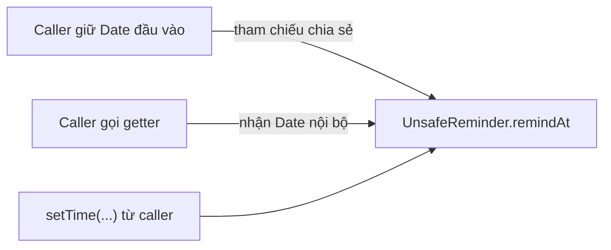
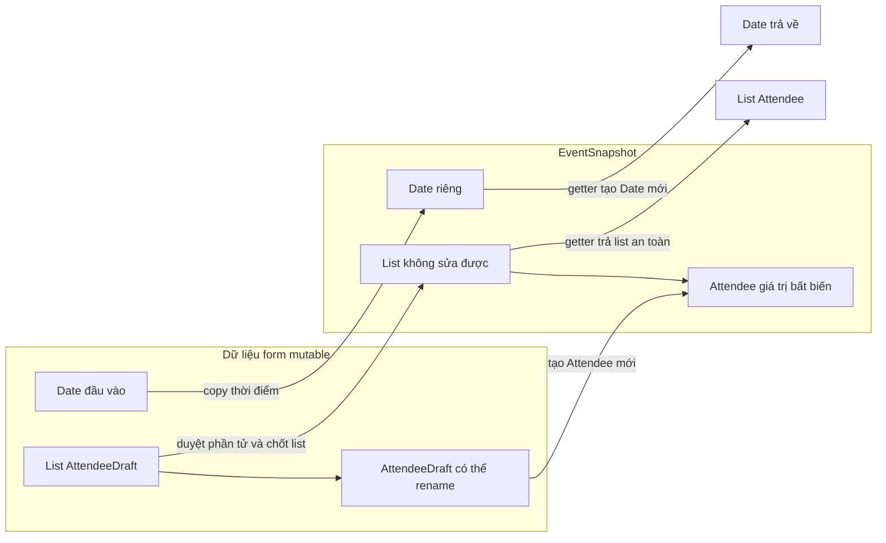

# Sao chép phòng vệ và biểu diễn bất biến trong Java

Trong OOP, **đóng gói** không dừng ở việc khai báo field là `private`. Nếu một đối tượng giữ tham chiếu đến dữ liệu *có thể thay đổi* (mutable) do nơi khác sở hữu, hoặc trả tham chiếu mutable nội bộ qua getter, mã bên ngoài vẫn có thể phá vỡ trạng thái của đối tượng mà không cần gọi setter.

**Sao chép phòng vệ (defensive copying)** là tạo bản sao tại ranh giới nhận/trả dữ liệu để ngăn thay đổi ngoài ý muốn. **Biểu diễn bất biến (immutable representation)** là lựa chọn cách lưu và công bố trạng thái sao cho sau khi tạo xong, trạng thái có thể quan sát của đối tượng không đổi.

Hai kỹ thuật liên quan nhưng khác nhau:

- Defensive copy kiểm soát **chia sẻ tham chiếu** với dữ liệu mutable.
- Immutable representation kiểm soát **khả năng thay đổi trạng thái**; nó thường dùng kiểu bất biến, giá trị nguyên thủy và các collection snapshot của phần tử bất biến.
- Có trường hợp cần bản sao khi nhận **và** khi trả; chỉ bảo vệ một chiều không đủ.
- Một đối tượng có `private final` field vẫn có thể thay đổi trạng thái quan sát được nếu field ấy tham chiếu đối tượng mutable.

Bài này sử dụng Java 11+ (để dùng `String.isBlank()` và `List.copyOf()`). Ví dụ thực tế là chụp lại lịch sự kiện để lưu bản ghi cố định, ngay cả khi màn hình nhập liệu tiếp tục chỉnh sửa danh sách người tham gia.

## 1. Vì sao `private final` chưa đảm bảo bất biến?

Ví dụ sau có hai đường “rò rỉ” tham chiếu:

```java
import java.util.Date;

public final class UnsafeReminder {
    private final Date remindAt;

    public UnsafeReminder(Date remindAt) {
        this.remindAt = remindAt; // Giữ đúng đối tượng Date bên ngoài truyền vào
    }

    public Date getRemindAt() {
        return remindAt; // Trả đúng Date nội bộ ra ngoài
    }
}
```

Đoạn sử dụng:

```java
Date supplied = new Date(1_000L);
UnsafeReminder reminder = new UnsafeReminder(supplied);

supplied.setTime(2_000L); // Sửa qua tham chiếu mà constructor nhận
System.out.println(reminder.getRemindAt().getTime()); // 2000

reminder.getRemindAt().setTime(3_000L); // Sửa qua tham chiếu getter làm lộ
System.out.println(reminder.getRemindAt().getTime()); // 3000
```

Không có phương thức `setRemindAt` và field là `private final`, nhưng thời điểm nhắc vẫn thay đổi. `final` chỉ cấm gán lại biến `remindAt` thành một tham chiếu khác; nó **không đóng băng đối tượng `Date`** đang được tham chiếu.

Có hai đường cần kiểm soát:



Với đối tượng mutable, đóng gói bị phá vỡ ngay cả khi không nhìn thấy field trực tiếp.

## 2. Defensive copy ở cả constructor và getter

Thay vì chia sẻ cùng một `Date`, lớp tạo bản sao khi nhận đầu vào và khi trả kết quả:

```java
import java.util.Date;
import java.util.Objects;

public final class SafeReminder {
    private final Date remindAt;

    public SafeReminder(Date remindAt) {
        Objects.requireNonNull(remindAt, "remindAt");
        this.remindAt = new Date(remindAt.getTime());
    }

    public Date getRemindAt() {
        return new Date(remindAt.getTime());
    }
}
```

Kiểm chứng:

```java
Date source = new Date(1_000L);
SafeReminder reminder = new SafeReminder(source);

source.setTime(2_000L);
Date returned = reminder.getRemindAt();
returned.setTime(3_000L);

System.out.println(reminder.getRemindAt().getTime()); // 1000
```

| Ranh giới | Cách làm | Lỗi được ngăn |
| --- | --- | --- |
| **Đầu vào** | `new Date(remindAt.getTime())` | Caller sửa `source` sau khi truyền vào |
| **Đầu ra** | `return new Date(remindAt.getTime())` | Caller sửa `Date` lấy qua getter |
| Trạng thái nội bộ | `private final Date remindAt`; không cung cấp thao tác tự sửa | Mã bên ngoài không thay đổi thời điểm đã chụp |

Lớp này **bất biến theo hành vi có thể quan sát** nếu chính lớp không sửa `remindAt`: mọi lần gọi getter đều thể hiện một thời điểm. Tuy nhiên, biểu diễn bên trong vẫn dùng một đối tượng `Date` vốn mutable. Có cách biểu diễn đơn giản hơn ở phần tiếp theo.

### Chọn biểu diễn thực sự bất biến thay vì cứ sao chép

Nếu mục đích chỉ là lưu một thời điểm, Java có kiểu `Instant` bất biến (`java.time`):

```java
import java.time.Instant;
import java.util.Objects;

public final class Reminder {
    private final Instant remindAt;

    public Reminder(Instant remindAt) {
        this.remindAt = Objects.requireNonNull(remindAt, "remindAt");
    }

    public Instant getRemindAt() {
        return remindAt; // Chia sẻ kiểu bất biến là an toàn
    }

    public Reminder reschedule(Instant newTime) {
        return new Reminder(newTime); // Trả instance mới
    }
}
```

Gọi `remindAt.plusSeconds(60)` trả một `Instant` mới; đối tượng `Instant` cũ không bị sửa. Vì thế không cần copy mỗi khi getter trả `Instant`. Một lựa chọn khác là lưu `private final long epochMillis` và chuyển đổi tại ranh giới API; primitive `long` không chứa tham chiếu tới trạng thái mutable.

**Nguyên tắc:** ưu tiên kiểu bất biến phù hợp nếu có. Defensive copy có ý nghĩa khi vẫn cần tương tác với API cung cấp kiểu mutable như `Date`, array hoặc collection có phần tử mutable.

## 3. Bản sao nông (shallow copy) khác bản sao sâu (deep copy)

Hãy xem một danh sách chứa các đối tượng mutable:

```java
import java.util.ArrayList;
import java.util.List;

class GuestDraft {
    String name;

    GuestDraft(String name) {
        this.name = name;
    }
}

List<GuestDraft> input = new ArrayList<>();
input.add(new GuestDraft("An"));

List<GuestDraft> copy = new ArrayList<>(input);

System.out.println(input == copy);            // false
System.out.println(input.get(0) == copy.get(0)); // true

copy.get(0).name = "Bình";
System.out.println(input.get(0).name);        // Bình
```

`new ArrayList<>(input)` tạo danh sách mới, nhưng chỉ **sao chép các tham chiếu phần tử**. Do đó hai danh sách có cấu trúc riêng, còn phần tử `GuestDraft` đầu tiên vẫn chia sẻ.

| Cách làm | Container có độc lập? | Phần tử mutable có độc lập? |
| --- | --- | --- |
| `List<T> b = a` | Không | Không |
| `new ArrayList<>(a)` | Có | Không |
| `List.copyOf(a)` | Có snapshot cấu trúc về mặt ngữ nghĩa, không sửa được | Không, nếu phần tử mutable |
| Tạo list mới và copy mỗi phần tử mutable | Có | Có, đối với các phần tử đã sao chép đúng |
| Tạo list mới chứa các giá trị vốn bất biến | Có | An toàn khi chia sẻ các giá trị bất biến |

“Deep copy” không có nghĩa Java tự động sao chép toàn bộ mọi đối tượng có thể truy cập. Cần **xác định đồ thị đối tượng nào thuộc sở hữu của lớp**, phần nào mutable và phần nào phải tách khỏi caller. Với đồ thị có chu trình, quan hệ tham chiếu chung, tài nguyên ngoài hoặc thực thể định danh, deep copy tổng quát vừa khó vừa có thể sai ngữ nghĩa nghiệp vụ.

Ví dụ, sao chép một `BankAccount` “sâu” có thể làm xuất hiện hai instance cùng đại diện một tài khoản thật, gây hiểu nhầm rằng hai số dư độc lập là hợp lệ. Khi muốn lưu thông tin tài khoản tại một thời điểm, nên tạo **snapshot giá trị** (mã tài khoản, số dư đã quan sát, thời điểm), thay vì tự nhân bản thực thể nghiệp vụ.

## 4. Ví dụ hoàn chỉnh: lịch sự kiện có bản chụp bất biến

Yêu cầu: form đăng ký sự kiện sử dụng `Date` mutable và danh sách `AttendeeDraft` có thể sửa tên. Sau khi xác nhận, tạo `EventSnapshot` giữ **thời điểm và danh sách người tham gia như ở lúc xác nhận**. Mọi thay đổi từ form sau đó không được làm biến đổi bản chụp.

Điều kiện thiết kế:

1. Thời điểm sự kiện đã chụp không đổi.
2. Danh sách tham gia không thể bị thêm/xóa qua API snapshot.
3. Từng người tham gia trong snapshot cũng phải bất biến, không chỉ riêng list.
4. Dữ liệu không hợp lệ bị từ chối lúc xây dựng; không lưu danh sách dở dang có thể bị caller sửa tiếp.
5. Có thể đọc snapshot mà không cần caller sao chép thêm đối tượng.

### Tệp `EventSnapshot.java`

```java
import java.util.ArrayList;
import java.util.Date;
import java.util.List;
import java.util.Objects;

public final class EventSnapshot {
    private final Date startsAt;
    private final List<Attendee> attendees;

    public EventSnapshot(Date startsAt, List<AttendeeDraft> drafts) {
        Objects.requireNonNull(startsAt, "startsAt");
        Objects.requireNonNull(drafts, "drafts");

        // Sao chép Date của caller trước khi giữ lại.
        Date startCopy = new Date(startsAt.getTime());

        // Sao chép *từng phần tử mutable* thành giá trị bất biến.
        List<Attendee> values = new ArrayList<>();
        for (AttendeeDraft draft : drafts) {
            Objects.requireNonNull(draft, "draft");
            values.add(new Attendee(draft.getId(), draft.getName()));
        }

        this.startsAt = startCopy;
        this.attendees = List.copyOf(values);
    }

    public Date getStartsAt() {
        return new Date(startsAt.getTime());
    }

    public List<Attendee> getAttendees() {
        // An toàn vì list không sửa được và Attendee bất biến.
        return attendees;
    }

    // Giá trị bất biến bên trong snapshot.
    public static final class Attendee {
        private final String id;
        private final String name;

        private Attendee(String id, String name) {
            this.id = requireText(id, "id");
            this.name = requireText(name, "name");
        }

        public String getId() {
            return id;
        }

        public String getName() {
            return name;
        }
    }

    // Chỉ dùng làm dữ liệu nhập, cố ý cho phép đổi tên.
    public static final class AttendeeDraft {
        private final String id;
        private String name;

        public AttendeeDraft(String id, String name) {
            this.id = requireText(id, "id");
            this.name = requireText(name, "name");
        }

        public String getId() {
            return id;
        }

        public String getName() {
            return name;
        }

        public void rename(String newName) {
            name = requireText(newName, "name");
        }
    }

    private static String requireText(String value, String field) {
        Objects.requireNonNull(value, field);
        String text = value.strip();
        if (text.isBlank()) {
            throw new IllegalArgumentException(field + " không được trống");
        }
        return text;
    }
}
```

Quan sát cấu trúc:

- `EventSnapshot` là `final` và không cung cấp setter; hai field của nó là `private final`.
- `Date` được copy ở constructor **và** getter. Nếu chỉ copy ở constructor nhưng getter trả thẳng field, caller vẫn sửa được; nếu chỉ copy ở getter, đối tượng đầu vào vẫn có thể tác động tới snapshot.
- `List.copyOf(values)` tạo snapshot cấu trúc list không sửa được, trong khi các `Attendee` bên trong có `String` bất biến và field `final`.
- `AttendeeDraft` là đối tượng mutable của bước nhập liệu. Constructor tạo **`Attendee` mới cho từng draft**, không giữ tham chiếu tới `AttendeeDraft`.
- `requireText` kiểm tra dữ liệu tại thời điểm tạo. Mã bên ngoài không có cách sửa `id` hoặc `name` bên trong một `Attendee` đã chụp.
- Mã lớp chính không trả thẳng một `ArrayList` mutable. Trả list bất biến chứa phần tử bất biến được vì caller không thể làm thay đổi trạng thái snapshot qua đường này.

### Tệp `Demo.java`

```java
import java.util.ArrayList;
import java.util.Date;
import java.util.List;

public class Demo {
    public static void main(String[] args) {
        Date dateFromForm = new Date(1_000L);
        EventSnapshot.AttendeeDraft an =
                new EventSnapshot.AttendeeDraft("U01", "An");

        List<EventSnapshot.AttendeeDraft> formAttendees =
                new ArrayList<>();
        formAttendees.add(an);

        EventSnapshot snapshot =
                new EventSnapshot(dateFromForm, formAttendees);

        // Form được sửa sau lúc xác nhận.
        dateFromForm.setTime(2_000L);
        an.rename("Bình");
        formAttendees.add(
                new EventSnapshot.AttendeeDraft("U02", "Chi"));

        // Caller thử sửa Date lấy từ getter.
        snapshot.getStartsAt().setTime(3_000L);

        System.out.println(snapshot.getStartsAt().getTime());
        System.out.println(snapshot.getAttendees().size());
        System.out.println(snapshot.getAttendees().get(0).getName());

        try {
            snapshot.getAttendees().clear();
        } catch (UnsupportedOperationException expected) {
            System.out.println("Không cho sửa danh sách snapshot");
        }
    }
}
```

Biên dịch/chạy bằng JDK 11+:

```bash
javac EventSnapshot.java Demo.java
java Demo
```

Kết quả:

```text
1000
1
An
Không cho sửa danh sách snapshot
```

Sự khác biệt của ba loại dữ liệu rõ ràng:

| Dữ liệu | Sau khi sửa form | Snapshot trả về |
| --- | --- | --- |
| `dateFromForm` | 2000 | `getStartsAt().getTime() == 1000` |
| `an.name` | Bình | `getAttendees().get(0).getName()` là An |
| `formAttendees.size()` | 2 | `getAttendees().size()` là 1 |
| `Date` trả từ getter | Caller đổi thành 3000 | Lần getter kế tiếp vẫn 1000 |
| List từ getter | `clear()` ném ngoại lệ | Dữ liệu snapshot giữ nguyên |

### Đường đi của dữ liệu



Sơ đồ minh họa ý nghĩa sở hữu dữ liệu, không mô tả địa chỉ bộ nhớ hay cấu trúc nội bộ của các lớp collection.

## 5. `Collections.unmodifiableList` và `List.copyOf` khác nhau ở điểm nào?

Hai API đều có thể làm caller không sửa list thông qua tham chiếu nhận được, nhưng **không bảo vệ cùng một kiểu thay đổi**.

```java
import java.util.ArrayList;
import java.util.Collections;
import java.util.List;

List<String> source = new ArrayList<>();
source.add("A");

List<String> view = Collections.unmodifiableList(source);
List<String> snapshot = List.copyOf(source);

source.add("B");

System.out.println(view);     // [A, B]
System.out.println(snapshot); // [A]
```

- `Collections.unmodifiableList(source)` tạo **view không cho sửa qua view**, nhưng vẫn theo dõi các thay đổi từ `source`.
- `List.copyOf(source)` có ngữ nghĩa **snapshot cấu trúc** tại thời điểm gọi (có thể tái sử dụng một instance vốn đã không sửa được). Thêm/xóa vào list gốc sau đó không làm thay đổi list kết quả.
- **Cả hai đều không tự deep copy các phần tử mutable.** Nếu list chứa `AttendeeDraft`, gọi `rename()` trên phần tử được chia sẻ vẫn có thể làm thay đổi dữ liệu quan sát qua list.
- `List.copyOf` từ chối phần tử `null`. Khi cần giữ `null`, phải chọn biểu diễn hoặc chính sách validation khác một cách có chủ đích.

Với dữ liệu `List<String>` hoặc `List<Attendee>` bất biến như ví dụ trên, `List.copyOf` là lựa chọn gọn và an toàn để công bố snapshot; với `List<MutableItem>` phải xử lý phần tử trước.

### Phương án getter trả bản sao của list mutable

Nếu không thể thay thế element type, có thể cần copy mỗi phần tử cả khi nhận và khi trả:

```java
import java.util.ArrayList;
import java.util.List;

static List<java.util.Date> copyDates(List<java.util.Date> input) {
    List<java.util.Date> result = new ArrayList<>();
    for (java.util.Date date : input) {
        result.add(new java.util.Date(date.getTime()));
    }
    return result;
}
```

Khi lưu `private final List<Date> dates = copyDates(input)`, getter nên trả `copyDates(dates)` nếu muốn tránh lộ từng `Date` mutable. Nhưng thiết kế này phải sao chép lặp lại và dễ quên ranh giới. Nếu chuyển sang `List<Instant>`, vừa gọn hơn vừa dễ giữ bất biến.

## 6. Array, map, set và dữ liệu lồng nhau

### Array

Một array có thể thay đổi từng phần tử hoặc vị trí:

```java
public final class TagSet {
    private final String[] tags;

    public TagSet(String[] tags) {
        this.tags = tags.clone(); // Copy khi nhận
    }

    public String[] getTags() {
        return tags.clone();      // Copy khi trả
    }
}
```

Với `String[]`, clone đủ cho mục tiêu này vì mỗi `String` bất biến. Với `Date[]`, clone chỉ sao chép **các tham chiếu phần tử**, vẫn phải copy từng `Date` nếu cần độc lập hoàn toàn. Array đa chiều cũng tương tự: `matrix.clone()` chỉ tạo outer array mới.

Nên kiểm tra `null` và các bất biến của từng phần tử trong constructor của lớp dùng trong sản phẩm; ví dụ `TagSet` tập trung vào hành vi clone để dễ quan sát.

### Map và Set

`Map.copyOf(map)` và `Set.copyOf(set)` tạo container không sửa được và tách cấu trúc khỏi các thay đổi tiếp theo của đầu vào; chúng **không tự deep copy** key/value/element mutable. Với `HashMap`, không nên dùng đối tượng làm key rồi thay đổi field tham gia `equals`/`hashCode`: thao tác tra cứu có thể không còn hoạt động đúng vì vị trí băm được quyết định theo hash cũ.

### Object graph

Nếu một `Order` giữ `List<OrderLine>`, mỗi `OrderLine` lại giữ `Product` có thể đổi giá, việc chỉ copy `Order` và `List` không đảm bảo tổng giá trị chụp vẫn cố định.

Trong trường hợp cần báo cáo cố định, hãy lưu:

```java
final class OrderLineSnapshot {
    final String productCode;
    final long unitPriceVnd;
    final int quantity;

    OrderLineSnapshot(String productCode, long unitPriceVnd,
                      int quantity) {
        this.productCode = productCode;
        this.unitPriceVnd = unitPriceVnd;
        this.quantity = quantity;
    }
}
```

Các field ở đây là giá trị nguyên thủy hoặc `String` bất biến; không giữ đối tượng `Product` mutable. Trong sản phẩm thực tế cần bổ sung validation cho giá/số lượng và các chính sách số học. Ý tưởng quan trọng là **chụp những giá trị nghiệp vụ cần bất biến**, thay vì cố sao chép toàn bộ đồ thị đối tượng một cách mù quáng.

## 7. Phân biệt “bất biến” với “không sửa được qua một tham chiếu”

| Thuật ngữ | Ý nghĩa | Ví dụ |
| --- | --- | --- |
| **Mutable object** | Trạng thái của instance có thể thay đổi | `Date`, `ArrayList`, `StringBuilder` |
| **Immutable object** | Trạng thái có thể quan sát không đổi sau khi tạo | `String`, `Instant`, một snapshot được thiết kế đúng |
| **Unmodifiable view** | Không sửa container thông qua view, nhưng nguồn có thể thay đổi | `Collections.unmodifiableList(source)` |
| **Structural snapshot** | Tách cấu trúc container ở thời điểm chụp | `List.copyOf(source)` |
| **Shallow copy** | Copy lớp vỏ/container, giữ tham chiếu các phần tử | `new ArrayList<>(source)` |
| **Defensive copy** | Copy ở ranh giới để bảo vệ quyền sở hữu và bất biến | `new Date(input.getTime())` trong constructor/getter |
| **Deep copy theo phạm vi cần thiết** | Copy cả phần mutable bên trong cần tách khỏi bên ngoài | Đổi mỗi `AttendeeDraft` thành `Attendee` mới |

Một lớp không tự động bất biến vì nó có tên `ImmutableSomething`, dùng `final class`, mọi field `private final`, hoặc getter trả collection không sửa được. Muốn kết luận bất biến phải xét **toàn bộ đường mà caller có thể sửa dữ liệu** và mọi tham chiếu mutable lồng nhau.

Trong Java 16+ có `record` giúp viết đối tượng chứa dữ liệu ngắn gọn, nhưng record cũng **không deep copy tự động**:

```java
// Java 16+
import java.util.List;

public record TeamSnapshot(List<String> members) {
    public TeamSnapshot {
        members = List.copyOf(members);
    }
}
```

Ở đây record chụp lại cấu trúc `List<String>` trong canonical constructor; accessor trả về list đã không sửa được. Nếu thay `String` bằng đối tượng mutable, phải xử lý cả phần tử và có thể cần constructor/accessor tùy chỉnh. Cú pháp `record` chỉ giúp giảm boilerplate, không thay thế thiết kế quyền sở hữu dữ liệu.

## 8. Đưa việc sao chép vào đúng ranh giới

Không phải mọi thứ đều cần sao chép. Copy tốn thời gian và bộ nhớ, nhất là với đồ thị lớn hoặc dữ liệu mà ứng dụng **cố ý chia sẻ**. Hãy chọn theo hợp đồng API.

| Tình huống | Lựa chọn hợp lý |
| --- | --- |
| Field nhận đối tượng mutable mà lớp muốn sở hữu độc lập | Defensive copy ở constructor/setter thích hợp |
| Getter không được làm lộ đối tượng mutable nội bộ | Copy ở getter hoặc trả kiểu bất biến |
| Danh sách giá trị bất biến cần snapshot | `List.copyOf` hoặc cách chụp tương đương |
| Danh sách chứa phần tử mutable cần snapshot độc lập | Copy hoặc biến đổi từng phần tử thành giá trị bất biến |
| Nhiều thành phần *cố ý* dùng chung một đối tượng nghiệp vụ | Định nghĩa rõ quyền sửa, đồng bộ và vòng đời; không copy tùy tiện |
| Dữ liệu đã vốn bất biến như `String`, `Instant` | Chia sẻ tham chiếu thường an toàn |
| Giao dịch lớn hoặc dữ liệu khối lượng cao | Cân nhắc cost copy, thiết kế value object/snapshot theo phạm vi cần thiết |

Cần phân biệt **snapshot giá trị** với **identity của entity**. Một bản ghi giao dịch bất biến có thể lưu tài khoản nguồn/đích dưới dạng mã tài khoản và số tiền; không nhất thiết phải clone cả đối tượng tài khoản. Copy một thực thể định danh có thể tạo ra hai phiên bản trạng thái độc lập nhưng trùng ID, gây nhầm lẫn.

## 9. Bất biến và đồng thời: lợi ích, nhưng không phải toàn bộ giải pháp

Đối tượng thực sự bất biến thường dễ chia sẻ giữa các luồng vì không có thao tác làm biến đổi trạng thái nội bộ sau khi tạo. Tuy vậy:

- Trong khi **đang dựng snapshot**, nếu luồng khác sửa `List` hoặc từng `AttendeeDraft` cùng lúc, kết quả copy có thể không nhất quán hoặc phép duyệt có thể lỗi. Cần lấy dữ liệu dưới khóa phù hợp, snapshot từ dữ liệu ổn định hoặc dùng quy trình đồng bộ ở nơi sở hữu dữ liệu.
- Nếu ứng dụng có biến `currentSnapshot` bị thay thế liên tục bởi các luồng, việc **công bố tham chiếu mới** vẫn cần cơ chế hiển thị phù hợp như `volatile`, lock hoặc cấu trúc concurrent tương ứng. Bất biến của từng snapshot không tự đồng bộ việc gán tham chiếu.
- Bất biến của một đối tượng không thay thế giao dịch database khi phải bảo đảm các bản ghi khác nhau thay đổi nguyên tử.

Ví dụ `EventSnapshot` giả định form không bị một luồng khác sửa đồng thời trong lúc constructor đang sao chép. Nó cung cấp trạng thái ổn định **sau** khi tạo thành công.

## 10. Những lỗi hay gặp khi kiểm tra tính bất biến

| Cách viết hoặc nhận định | Rủi ro | Cách xử lý |
| --- | --- | --- |
| `this.date = inputDate;` | Caller có thể sửa đối tượng nội bộ | Copy khi nhận hoặc chuyển sang kiểu bất biến |
| `return date;` với `date` là `Date` | Getter lộ tham chiếu mutable | Copy khi trả |
| `private final List<Item> items` | `final` không ngăn sửa list hoặc item | Xem rõ khả năng mutable của container và phần tử |
| `Collections.unmodifiableList(input)` | Thay đổi từ `input` vẫn hiện qua view | Snapshot cấu trúc khi cần |
| `List.copyOf(listOfMutableItems)` | Các phần tử còn chia sẻ | Chụp/copy từng phần tử |
| `array.clone()` cho array đối tượng lồng nhau | Chỉ copy một tầng array | Copy đúng các tầng dữ liệu mutable cần cách ly |
| Copy entity rồi giữ cùng định danh | Có thể tạo trạng thái trùng ID không nhất quán | Tạo value snapshot thay cho nhân bản entity |
| Getter trả kiểu bất biến nhưng constructor giữ dữ liệu mutable | Thay đổi qua tham chiếu đầu vào vẫn lọt vào | Phòng vệ cả inbound lẫn outbound |
| “Object đã immutable nên việc tạo nó từ dữ liệu đang bị thay đổi là an toàn” | Có thể chụp trạng thái không nhất quán | Đồng bộ quá trình đọc/chụp dữ liệu |

## 11. Bài tập ứng dụng

**Bài 1 — sửa lỗi rò rỉ tham chiếu**

Cho lớp:

```java
public final class ExamSession {
    private final java.util.Date beginsAt;

    public ExamSession(java.util.Date beginsAt) {
        this.beginsAt = beginsAt;
    }

    public java.util.Date getBeginsAt() {
        return beginsAt;
    }
}
```

Hãy viết lại constructor và getter để caller không sửa được `beginsAt` sau khi tạo, đồng thời từ chối `null`.

*Hướng dẫn:* dùng `Objects.requireNonNull`; tạo `new Date(input.getTime())` ở cả hai ranh giới.

**Bài 2 — chọn đúng mức sao chép**

Giả sử có `List<StringBuilder> notes`. Bạn cần trả một snapshot mà bên ngoài không thể làm đổi nội dung ghi chú trong đối tượng nguồn. Viết phương thức chuyển từng `StringBuilder` thành `String` và trả `List.copyOf` kết quả. Giải thích tại sao `List.copyOf(notes)` riêng lẻ không đáp ứng yêu cầu.

**Bài 3 — đọc hiểu output**

```java
java.util.List<String> original =
        new java.util.ArrayList<>(java.util.List.of("A"));

java.util.List<String> view =
        java.util.Collections.unmodifiableList(original);
java.util.List<String> snapshot =
        java.util.List.copyOf(original);

original.add("B");

System.out.println(view);
System.out.println(snapshot);
```

**Đáp án:** `view` in `[A, B]`, `snapshot` in `[A]`. Cả hai có thể ném `UnsupportedOperationException` khi caller cố `add(...)` qua chúng, nhưng view không tách cấu trúc khỏi list nguồn.

**Bài 4 — thiết kế hệ thống**

Bạn có `Order` mutable và yêu cầu lập hóa đơn đã phát hành không thay đổi khi giá sản phẩm được cập nhật về sau. Hãy xác định dữ liệu nào nên chụp vào `InvoiceSnapshot` (mã hàng, tên, giá tại thời điểm bán, số lượng, thành tiền...), dữ liệu nào nên lưu bằng định danh tham chiếu, và ai chịu trách nhiệm bảo đảm snapshot được tạo từ một trạng thái giao dịch nhất quán.

*Gợi ý:* không sao chép cả entity `Product` mutable vào hóa đơn rồi hy vọng nó mãi giữ giá cũ. Biến thông tin cần thiết thành các giá trị bất biến và chốt chúng trong giao dịch nghiệp vụ phù hợp.

### Tự kiểm tra khi thiết kế một lớp

Khi một lớp cần giữ trạng thái ổn định, hãy trả lời:

1. Trạng thái nào là **bất biến về nghiệp vụ**; trạng thái nào cần thay đổi có kiểm soát?
2. Có field nào giữ `Date`, array, collection hoặc object mutable từ bên ngoài không?
3. Caller còn giữ tham chiếu nào để sửa dữ liệu **sau khi đưa vào constructor**?
4. Getter có trả ra trực tiếp một đối tượng mutable nội bộ không?
5. Nếu collection đã snapshot, **các phần tử** có thật sự bất biến không?
6. Có thể dùng `Instant`, `String`, kiểu giá trị riêng hay primitive thay cho một cấu trúc mutable không?
7. Có cần copy đồng thời nhất quán và công bố an toàn giữa nhiều luồng không?

**Điểm cốt lõi:** sao chép phòng vệ tạo ranh giới sở hữu dữ liệu; biểu diễn bất biến giúp đối tượng giữ nguyên ý nghĩa theo thời gian. Khi phối hợp chúng đúng chỗ, lớp Java giữ được bất biến của mình mà vẫn cung cấp API dễ sử dụng và kiểm thử.