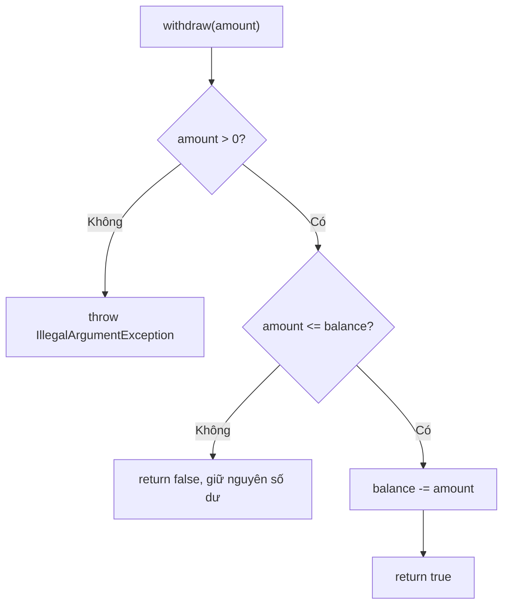
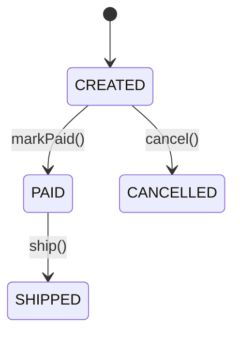

# Ví dụ bảo vệ số dư và trạng thái đơn hàng trong Java

**Chủ đề:** OOP → Đóng gói (Encapsulation) → Ví dụ bảo vệ số dư và trạng thái đơn hàng.

Hai bài toán dễ gặp khi thiết kế đối tượng: **số dư tài khoản không được âm** và **đơn hàng không thể chuyển tùy ý giữa các trạng thái**. Cả hai đều cần nhiều hơn một trường `private`: đối tượng phải kiểm tra điều kiện trước khi thực hiện thay đổi, chỉ công khai thao tác có ý nghĩa và bảo đảm trạng thái hợp lệ sau thao tác.

## 1. Vấn đề: khi bên ngoài có thể sửa trạng thái tùy ý

Hãy xem thiết kế ban đầu:

```java
class UnsafeAccount {
    public long balanceCents;
}

class UnsafeOrder {
    public String status;
}
```

Mã gọi có thể thực hiện:

```java
UnsafeAccount account = new UnsafeAccount();
account.balanceCents = -50_000;       // Số dư âm

UnsafeOrder order = new UnsafeOrder();
order.status = "SHIPPED";             // Giao hàng dù chưa thanh toán
order.status = "SOMETHING_ELSE";      // Trạng thái không thuộc nghiệp vụ
```

Các phép gán này hợp lệ về cú pháp, nhưng phá **bất biến (invariant)** của đối tượng:

| Đối tượng | Bất biến phải giữ | Ví dụ vi phạm |
|---|---|---|
| Tài khoản | Số dư không âm; thao tác với số tiền hợp lệ | Rút vượt số dư hoặc nạp số tiền âm |
| Đơn hàng | Trạng thái phải thuộc tập cho phép; chuyển trạng thái đúng thứ tự | Từ CREATED chuyển thẳng sang SHIPPED |
| Cả hai | Dữ liệu chỉ đổi qua những hành vi được kiểm tra | Mã ngoài gán trực tiếp trường |

Thiết kế tốt cho người dùng lớp **yêu cầu hành động** (`deposit`, `withdraw`, `markPaid`, `ship`), còn đối tượng **quyết định hành động đó có hợp lệ hay không**.

## 2. Ví dụ Java hoàn chỉnh: Account và Order

Ví dụ chạy được bằng **Java 17 trở lên**, không cần thư viện bên ngoài. Lưu toàn bộ mã sau vào `EncapsulationDemo.java`.

```java
import java.util.List;
import java.util.Objects;

public class EncapsulationDemo {

    // ---------- BẢO VỆ SỐ DƯ ----------
    public static final class Account {
        private final String accountNumber;
        private long balanceCents;

        public Account(String accountNumber, long initialCents) {
            if (accountNumber == null || accountNumber.isBlank()) {
                throw new IllegalArgumentException("Mã tài khoản không hợp lệ");
            }
            if (initialCents < 0) {
                throw new IllegalArgumentException("Số dư ban đầu không thể âm");
            }
            this.accountNumber = accountNumber;
            this.balanceCents = initialCents;
        }

        public String accountNumber() {
            return accountNumber;
        }

        public synchronized long balanceCents() {
            return balanceCents;
        }

        public synchronized void deposit(long amountCents) {
            requirePositive(amountCents);

            // Nếu cộng tràn long, Math.addExact ném ArithmeticException.
            // Phép gán chưa chạy nên số dư cũ không bị thay đổi.
            long nextBalance = Math.addExact(balanceCents, amountCents);
            balanceCents = nextBalance;
        }

        public synchronized boolean withdraw(long amountCents) {
            requirePositive(amountCents);

            if (amountCents > balanceCents) {
                return false; // Không đủ tiền: giữ nguyên số dư
            }

            balanceCents -= amountCents;
            return true;
        }

        private static void requirePositive(long amountCents) {
            if (amountCents <= 0) {
                throw new IllegalArgumentException("Số tiền phải lớn hơn 0");
            }
        }
    }

    // ---------- BẢO VỆ TRẠNG THÁI ĐƠN HÀNG ----------
    public enum OrderStatus {
        CREATED, PAID, SHIPPED, CANCELLED
    }

    // Record Java 16+: đối tượng dòng hàng chỉ có dữ liệu đọc được.
    public record OrderItem(String sku, int quantity) {
        public OrderItem {
            if (sku == null || sku.isBlank()) {
                throw new IllegalArgumentException("SKU không hợp lệ");
            }
            if (quantity <= 0) {
                throw new IllegalArgumentException("Số lượng phải dương");
            }
        }
    }

    public static final class Order {
        private final String orderId;
        private final List<OrderItem> items;
        private OrderStatus status;

        public Order(String orderId, List<OrderItem> items) {
            if (orderId == null || orderId.isBlank()) {
                throw new IllegalArgumentException("Mã đơn hàng không hợp lệ");
            }
            Objects.requireNonNull(items, "items");
            if (items.isEmpty()) {
                throw new IllegalArgumentException("Đơn hàng cần có sản phẩm");
            }

            this.orderId = orderId;
            this.items = List.copyOf(items);
            this.status = OrderStatus.CREATED;
        }

        public String orderId() {
            return orderId;
        }

        public List<OrderItem> items() {
            return items; // Danh sách không sửa được, item là record bất biến
        }

        public synchronized OrderStatus status() {
            return status;
        }

        // Chỉ gọi khi tầng nghiệp vụ đã xác thực thanh toán thành công.
        public synchronized void markPaid() {
            requireStatus(OrderStatus.CREATED, "thanh toán");
            status = OrderStatus.PAID;
        }

        public synchronized void ship() {
            requireStatus(OrderStatus.PAID, "giao hàng");
            status = OrderStatus.SHIPPED;
        }

        public synchronized void cancel() {
            requireStatus(OrderStatus.CREATED, "hủy");
            status = OrderStatus.CANCELLED;
        }

        private void requireStatus(OrderStatus expected, String action) {
            if (status != expected) {
                throw new IllegalStateException(
                    "Không thể " + action + " khi đơn ở trạng thái " + status
                );
            }
        }
    }

    public static void main(String[] args) {
        Account account = new Account("ACC-001", 100_000);
        account.deposit(50_000);

        System.out.println("Rút 25.000: " + account.withdraw(25_000));
        System.out.println("Số dư: " + account.balanceCents());
        System.out.println("Rút 200.000: " + account.withdraw(200_000));
        System.out.println("Số dư sau khi rút thất bại: " + account.balanceCents());

        try {
            account.deposit(-1);
        } catch (IllegalArgumentException ex) {
            System.out.println("Nạp tiền âm bị từ chối");
        }

        Order order = new Order(
            "ORD-001",
            List.of(new OrderItem("BOOK-JAVA", 2))
        );

        System.out.println("Trạng thái đầu: " + order.status());
        order.markPaid();
        order.ship();
        System.out.println("Trạng thái cuối: " + order.status());

        try {
            order.cancel();
        } catch (IllegalStateException ex) {
            System.out.println("Không thể hủy: " + order.status());
        }

        System.out.println("Số dòng hàng: " + order.items().size());
    }
}
```

Biên dịch và chạy trong thư mục chứa tệp:

```bash
javac EncapsulationDemo.java
java EncapsulationDemo
```

Kết quả mong đợi:

```text
Rút 25.000: true
Số dư: 125000
Rút 200.000: false
Số dư sau khi rút thất bại: 125000
Nạp tiền âm bị từ chối
Trạng thái đầu: CREATED
Trạng thái cuối: SHIPPED
Không thể hủy: SHIPPED
Số dòng hàng: 1
```

Ví dụ trên chỉ mô phỏng **trạng thái trong bộ nhớ**. Chức năng `markPaid()` đánh dấu thanh toán đã được xác thực ở bên ngoài; nó **không thực hiện thanh toán thật** hay tự kiểm tra giao dịch từ cổng thanh toán.

## 3. Bảo vệ số dư bằng bất biến và phương thức có kiểm tra

Hợp đồng của `Account` là:

```text
Đối tượng hợp lệ: balanceCents >= 0
Tiền nạp/rút hợp lệ: amountCents > 0
```

Số dư là `private`, nên đoạn này **không biên dịch** từ mã ngoài `Account`:

```java
Account account = new Account("ACC-002", 0);
// account.balanceCents = -10; // Lỗi: balanceCents has private access
```

Bên ngoài chỉ có thể dùng những hành vi đã cho phép:

| Phương thức | Đầu vào | Thành công | Bị từ chối |
|---|---|---|---|
| `new Account(id, initial)` | ID không rỗng, số dư đầu kỳ không âm | Tạo đối tượng hợp lệ | `IllegalArgumentException` |
| `deposit(amount)` | Số tiền dương, phép cộng không tràn | Tăng số dư | `IllegalArgumentException` hoặc `ArithmeticException` |
| `withdraw(amount)` | Số tiền dương | Đủ tiền: giảm số dư, trả `true` | Không đủ: trả `false`, không đổi số dư |
| `balanceCents()` | Không có | Đọc giá trị hiện tại | Không cấp quyền ghi |

### Tại sao kiểm tra phải xảy ra trước phép gán?

```java
public synchronized void deposit(long amountCents) {
    requirePositive(amountCents);
    long nextBalance = Math.addExact(balanceCents, amountCents);
    balanceCents = nextBalance;
}
```

Trình tự này tạo một điểm cập nhật rõ ràng:

1. Từ chối số tiền không dương.
2. Tính kết quả mới bằng `Math.addExact`; nếu phép cộng tràn `long`, ngoại lệ xảy ra **trước phép gán**.
3. Chỉ khi mọi kiểm tra đã thành công mới cập nhật `balanceCents`.

Trong `withdraw`, điều kiện `amountCents > balanceCents` được kiểm tra trước phép trừ nên số dư không bao giờ âm do rút vượt hạn mức:



Trả `false` cho việc thiếu tiền là một lựa chọn API: đây có thể là kết quả nghiệp vụ thông thường. Nếu yêu cầu sử dụng rõ nguyên nhân, có thể thiết kế kết quả kiểu enum như `SUCCESS`, `INSUFFICIENT_FUNDS` thay cho `boolean`. Dữ liệu đầu vào không hợp lệ, chẳng hạn tiền âm, được xử lý bằng ngoại lệ.

### Vì sao dùng `long` với đơn vị nhỏ nhất?

Lưu tiền theo đơn vị nguyên (`balanceCents`) giúp ví dụ tránh biểu diễn không chính xác của `double` với nhiều số thập phân nhị phân. Trong hệ thống thật cần quy định đồng tiền, đơn vị nhỏ nhất, làm tròn, hạn mức và định dạng; có thể dùng `BigDecimal` phù hợp với nghiệp vụ. **Không nên chỉ đổi tên từ `double balance` sang `long balance` mà bỏ qua quy tắc tiền tệ.**

## 4. Bảo vệ trạng thái đơn hàng bằng chuyển đổi hợp lệ

Đơn hàng có bốn trạng thái:

| Trạng thái | Ý nghĩa |
|---|---|
| `CREATED` | Vừa tạo, chưa được xác nhận đã thanh toán |
| `PAID` | Đã ghi nhận thanh toán thành công |
| `SHIPPED` | Đã thực hiện bước gửi hàng trong ví dụ |
| `CANCELLED` | Bị hủy trước khi thanh toán |

Trong phiên bản nghiệp vụ minh họa này, các chuyển đổi hợp lệ chỉ gồm:



| Trạng thái hiện tại | Hành động | Trạng thái tiếp theo | Kết quả |
|---|---|---|---|
| `CREATED` | `markPaid()` | `PAID` | Hợp lệ |
| `CREATED` | `cancel()` | `CANCELLED` | Hợp lệ |
| `PAID` | `ship()` | `SHIPPED` | Hợp lệ |
| `CREATED` | `ship()` | Không đổi | `IllegalStateException` |
| `SHIPPED` | `cancel()` | Không đổi | `IllegalStateException` |
| `CANCELLED` | `markPaid()` | Không đổi | `IllegalStateException` |

Từ khóa `enum` giới hạn tập trạng thái, tránh lỗi viết chuỗi tự do như `"SHIPED"`. Nhưng **enum chưa đủ**: nếu công khai `setStatus(OrderStatus status)`, người gọi vẫn có thể nhảy từ `CREATED` sang `SHIPPED`.

Thay vào đó, các phương thức có tên theo hành động:

```java
public synchronized void ship() {
    requireStatus(OrderStatus.PAID, "giao hàng");
    status = OrderStatus.SHIPPED;
}
```

Thao tác này vừa đọc trạng thái hiện tại, vừa kiểm tra, rồi mới thay đổi. Nếu đơn hàng chưa thanh toán hoặc đã hủy, lời gọi bị từ chối mà không cập nhật `status`.

Lưu ý: trong một hệ thống thực, có thể phải hỗ trợ hoàn tiền, trả hàng, hủy sau thanh toán hoặc nhiều trạng thái vận chuyển hơn. Sơ đồ trên là **quy tắc do ví dụ đặt ra**, không phải một danh sách trạng thái chuẩn dùng cho mọi ứng dụng thương mại điện tử.

## 5. Giữ các đường truy cập khác không phá đóng gói

Đóng gói bị phá nếu một getter trả thẳng collection nội bộ còn có thể sửa:

```java
class UnsafeOrder {
    private final List<String> items = new java.util.ArrayList<>();

    public List<String> items() {
        return items;
    }
}

UnsafeOrder order = new UnsafeOrder();
order.items().add(""); // Bên ngoài bỏ qua mọi validation
```

Trong `Order` hoàn chỉnh, dữ liệu đầu vào được sao chép:

```java
this.items = List.copyOf(items);
```

Kết quả `items()` có thể được trả ra bởi vì danh sách đó không hỗ trợ các phép sửa như `add`, `clear`, `set`. Ngoài ra, `OrderItem` là `record` có thành phần `String` và `int`, nên không có phần tử mutable mà người gọi có thể thay đổi để lách validation.

```java
List<OrderItem> source = new java.util.ArrayList<>();
source.add(new OrderItem("BOOK-JAVA", 2));

Order order = new Order("ORD-002", source);
source.clear();                    // Không xóa item đã lưu trong order
System.out.println(order.items().size()); // 1

// order.items().clear();         // Ném UnsupportedOperationException
```

**Quan trọng:** `List.copyOf` tạo danh sách không sửa được, nhưng chỉ là bảo vệ **nông (shallow)**. Nếu phần tử là đối tượng có setter, mã bên ngoài vẫn có thể sửa chính phần tử đó qua tham chiếu chung. Khi đó cần thiết kế phần tử bất biến hoặc tạo defensive copy cả phần tử.

Tương tự, trường `private final List<T>` không làm nội dung danh sách tự bất biến: `final` ngăn gán lại tham chiếu của trường, không ngăn `add` hay `remove` trên đối tượng danh sách.

## 6. Vì sao `synchronized` xuất hiện trong hai lớp?

Nếu có nhiều thread cùng cập nhật một đối tượng, `private` ngăn truy cập trực tiếp **nhưng không tự loại bỏ race condition**.

Ví dụ phương thức rút tiền kiểu:

```java
if (balanceCents >= amount) {
    balanceCents -= amount;
}
```

Nếu hai thread đều đọc được số dư cũ trước khi một thread cập nhật, kết quả có thể không tương ứng với thứ tự giao dịch hợp lệ. Vì thế ví dụ dùng các phương thức `synchronized` cho thao tác đọc/ghi số dư, và cho các chuyển trạng thái đơn hàng:

```java
public synchronized boolean withdraw(long amountCents) { /* ... */ }
public synchronized long balanceCents() { /* ... */ }
public synchronized void markPaid() { /* ... */ }
```

Với **cùng một instance**, `synchronized` bảo đảm tại một thời điểm chỉ một thread thực thi một phương thức synchronized khóa trên instance đó. Nó cũng thiết lập quan hệ hiển thị bộ nhớ phù hợp giữa các lần khóa/mở khóa. Điều này giúp phép kiểm tra và cập nhật trạng thái trong phương thức không bị chồng chéo trên cùng object.

Những giới hạn cần nhớ:

- `synchronized` trên một đối tượng **không đồng bộ hai instance khác nhau**, kể cả hai instance biểu diễn cùng tài khoản trong cơ sở dữ liệu.
- Việc chuyển tiền qua **hai tài khoản** hoặc phối hợp thanh toán với **đơn hàng** cần một thiết kế giao dịch rõ ràng; chỉ khóa từng instance chưa đủ để bảo đảm một thao tác xuyên nhiều đối tượng là nguyên tử.
- Ứng dụng nhiều tiến trình hoặc nhiều máy cần biện pháp ở tầng lưu trữ như transaction, locking, optimistic version hoặc cơ chế điều phối thích hợp.
- Phạm vi `private/public` là kiểm soát truy cập **mã nguồn Java**, không phải kiểm tra quyền người dùng. Một API cho rút tiền vẫn cần xác thực và phân quyền ở tầng dịch vụ.

## 7. Thiết kế lỗi: từ chối thay đổi nhưng giữ nguyên trạng thái

Trong ví dụ, có hai loại lỗi chủ yếu:

| Tình huống | Cách báo | Trạng thái sau |
|---|---|---|
| Tạo account với số dư âm | `IllegalArgumentException` | Không có account hợp lệ được tạo |
| Nạp `0` hoặc số tiền âm | `IllegalArgumentException` | Số dư cũ |
| Nạp làm tràn `long` | `ArithmeticException` | Số dư cũ |
| Rút vượt số dư | `false` | Số dư cũ |
| Giao hàng khi chưa thanh toán | `IllegalStateException` | `CREATED` |
| Hủy đơn đã giao | `IllegalStateException` | `SHIPPED` |

Việc “giữ nguyên trạng thái nếu thao tác bị từ chối” làm cho hành vi dễ dự đoán và dễ kiểm thử. Với hai ví dụ trên, kiểm tra xảy ra trước phép gán; không có các tác động mạng/cơ sở dữ liệu nên việc từ chối rất rõ ràng.

Tuy nhiên, trong ứng dụng thật, thao tác có thể vừa sửa database vừa gọi API bên ngoài. Khi thất bại sau một phần tác động, cần transaction, idempotency, retry hoặc cơ chế bù trừ phù hợp. **Một phương thức Java đơn lẻ không tự bảo đảm rollback những hệ thống ngoài nó.**

## 8. Cách kiểm tra ví dụ bằng các trường hợp biên

Ngoài kết quả từ `main`, hãy dùng bảng sau để chủ động thử các trường hợp sai:

| Trường hợp kiểm tra | Thao tác | Điều mong đợi |
|---|---|---|
| Số dư khởi tạo âm | `new Account("A", -1)` | Ném `IllegalArgumentException` |
| Nạp số 0 | `deposit(0)` | Ném `IllegalArgumentException`, số dư giữ nguyên |
| Rút số âm | `withdraw(-1)` | Ném `IllegalArgumentException` |
| Rút bằng số dư | `withdraw(balance)` | Trả `true`, số dư về 0 |
| Rút nhiều hơn số dư | `withdraw(balance + 1)` với giá trị không tràn | Trả `false`, số dư không đổi |
| Cộng số dư tràn | Số dư gần `Long.MAX_VALUE`, nạp thêm | Ném `ArithmeticException`, số dư giữ nguyên |
| Giao hàng quá sớm | `ship()` trên đơn `CREATED` | Ném `IllegalStateException` |
| Thanh toán đơn đã hủy | `markPaid()` trên `CANCELLED` | Ném `IllegalStateException` |
| Sửa danh sách mặt hàng đầu vào | `source.clear()` sau khi tạo order | Đơn hàng vẫn giữ mặt hàng |
| Sửa danh sách mặt hàng trả về | `order.items().clear()` | `UnsupportedOperationException` |

Có thể thử một trường hợp đơn giản ngay trong `main`:

```java
Account zero = new Account("ZERO", 5);
try {
    zero.withdraw(-10);
    throw new AssertionError("Phải từ chối tiền âm");
} catch (IllegalArgumentException expected) {
    if (zero.balanceCents() != 5) {
        throw new AssertionError("Số dư đã bị sửa khi thao tác thất bại");
    }
}
```

Đoạn kiểm tra này dùng `AssertionError` do mã tự ném, nên không phụ thuộc tùy chọn `-ea` của JVM.

## 9. Bài tập mở rộng đúng hai tình huống

**Bài 1 — Hạn mức rút.** Thêm `dailyWithdrawnCents` và `dailyLimitCents` cho `Account`. Khi rút, kiểm tra cùng lúc số dư và hạn mức còn lại; chỉ cập nhật hai trường nếu mọi điều kiện đều hợp lệ. Xử lý phép cộng số tiền đã rút để tránh overflow. Viết trường hợp thử rằng giao dịch bị từ chối **không thay đổi trường nào**.

**Bài 2 — Luồng đơn hàng.** Thêm trạng thái `DELIVERED` vào enum và phương thức `confirmDelivery()`, chỉ hợp lệ từ `SHIPPED`. Vẽ lại Mermaid và thử gọi `confirmDelivery()` từ `CREATED` để kiểm tra lớp từ chối.

**Bài 3 — Hủy sau thanh toán.** Giả sử nghiệp vụ cho hủy đơn `PAID` nhưng yêu cầu hoàn tiền. Đề xuất trách nhiệm giữa `Order`, dịch vụ thanh toán và database transaction để tránh đơn bị hủy trong khi hoàn tiền thất bại. Không nên chỉ thêm phép gán `status = CANCELLED` rồi coi như mọi tác động bên ngoài đã hoàn tất.

**Bài 4 — Ranh giới API.** Giải thích vì sao `private balanceCents`, `private status`, `List.copyOf(items)` và các phương thức `withdraw/ship` lần lượt bảo vệ những đường truy cập nào. Nếu đổi `items` sang danh sách phần tử mutable, phải thay đổi cách thiết kế ra sao?

---

**Kết luận:** Với tài khoản, đóng gói giúp **bảo vệ bất biến số dư** qua nạp/rút hợp lệ. Với đơn hàng, đóng gói giúp **bảo vệ luồng trạng thái** qua các chuyển đổi có điều kiện. Trường `private` chặn gán trực tiếp, nhưng tính đúng đắn thực sự đến từ **constructor kiểm tra đầu vào, phương thức có ý nghĩa nghiệp vụ, cập nhật sau khi kiểm tra và không làm lộ dữ liệu mutable**.