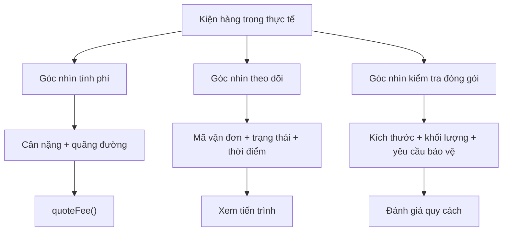
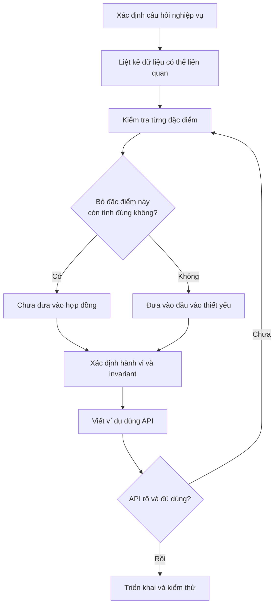

# Trừu tượng hóa và chọn đặc điểm thiết yếu trong OOP (Java)

**Trừu tượng hóa (abstraction)** là quá trình xác định những đặc điểm và hành vi **cần thiết cho một mục đích cụ thể**, đồng thời tạm bỏ qua những chi tiết không ảnh hưởng đến mục đích đó. Trong lập trình hướng đối tượng, ta sử dụng kết quả của quá trình ấy để thiết kế lớp, đối tượng, interface và các hợp đồng tương tác.

Điểm mấu chốt: **không tồn tại một danh sách đặc điểm “thiết yếu” đúng cho mọi bài toán**. Một thông tin quan trọng với bộ phận giao hàng có thể hoàn toàn không cần thiết cho bộ phận tính giá hoặc báo cáo.

## 1. Từ đối tượng ngoài đời đến mô hình phần mềm

Xét một **kiện hàng** trong hệ thống thương mại điện tử. Ngoài thực tế, kiện hàng có thể có hàng chục thông tin: mã vận đơn, cân nặng, kích thước, màu hộp, địa chỉ lấy hàng, người gửi, người nhận, đơn vị vận chuyển, trạng thái, lịch sử quét mã, ảnh chụp và nhiều thông tin khác.

Nếu đang xây dựng chức năng **báo phí giao hàng theo cân nặng và quãng đường**, ta có thể chỉ cần:

- `weightGrams`: cân nặng tính bằng gram;
- `distanceKm`: quãng đường tính bằng kilomet;
- hành vi `quoteFee(...)`: tính và trả về mức phí dự kiến.

Những thông tin như màu hộp, ảnh chụp hay người đang cầm kiện hàng **không tham gia công thức tính phí của ví dụ này**, nên không cần xuất hiện trong API tính phí.

Nhưng với chức năng **theo dõi vận chuyển**, mô hình phù hợp lại khác: mã vận đơn, trạng thái hiện tại và thời điểm cập nhật là các yếu tố thiết yếu; cân nặng có thể không cần.

| Ngữ cảnh sử dụng | Đặc điểm thiết yếu | Hành vi/câu hỏi cần trả lời | Chi tiết có thể bỏ qua |
|---|---|---|---|
| Ước tính phí vận chuyển | Cân nặng, quãng đường, chính sách dịch vụ | “Phí dự kiến bao nhiêu?” | Màu hộp, ảnh chụp kiện hàng |
| Theo dõi kiện hàng | Mã vận đơn, trạng thái, thời điểm cập nhật | “Hàng đang ở đâu trong quy trình?” | Công thức tính cước |
| Kiểm tra đóng gói | Kích thước, cân nặng, yêu cầu dễ vỡ | “Có phù hợp quy cách đóng gói?” | Lịch sử thanh toán |
| Chăm sóc khách hàng | Mã đơn, trạng thái, thông tin liên hệ cần thiết | “Khách đang gặp vấn đề gì?” | Thuật toán nội bộ tối ưu tuyến đường |

Các cột “có thể bỏ qua” là **phụ thuộc yêu cầu đang xét**. Nếu phí vận chuyển thực tế có phụ thu hàng dễ vỡ, đặc điểm `fragile` trở thành đầu vào thiết yếu của tính phí; khi đó mô hình phải được thay đổi theo quy tắc nghiệp vụ.

### Trừu tượng hóa không phải sao chép toàn bộ thực tế

Một lớp `Shipment` chứa mọi dữ liệu mà mọi bộ phận có thể dùng thường trở thành mô hình quá lớn. Thay vào đó, ta có thể xác định **các góc nhìn hoặc hợp đồng riêng cho từng nhu cầu**, rồi chỉ chia sẻ dữ liệu khi có lý do thiết kế.



Sơ đồ này chỉ diễn tả cách **phân tích yêu cầu để chọn mô hình**, không nhất thiết là sơ đồ kế thừa giữa các lớp Java.

## 2. Trừu tượng hóa cần trả lời những câu hỏi nào?

Khi biến một khái niệm trong bài toán thành lớp hoặc interface, nên trả lời theo thứ tự:

1. **Mục đích là gì?** Chức năng đang cần quyết định hoặc tính toán điều gì?
2. **Thông tin nào bắt buộc để đưa ra kết quả đúng?** Nếu bỏ trường này, chức năng có còn thực hiện chính xác không?
3. **Hành vi nào thuộc trách nhiệm của đối tượng?** Ví dụ “báo phí” thuộc chính sách tính cước, không thuộc màu sắc giao diện.
4. **Quy tắc nào phải luôn đúng?** Cân nặng phải dương, quãng đường không âm, trạng thái phải nằm trong tập cho phép.
5. **Chi tiết nào có thể thay đổi mà người dùng API không cần biết?** Ví dụ bảng giá, cách tính phụ phí và nguồn cấu hình.
6. **Có bao nhiêu tình huống thực tế đang được yêu cầu?** Đừng tạo trước hàng loạt kiểu lớp cho những tính năng chưa tồn tại.

Nếu không thể mô tả rõ **người dùng mô hình cần làm gì** bằng một vài câu, thường vẫn quá sớm để chốt danh sách field và phương thức.

## 3. Ví dụ Java hoàn chỉnh: trừu tượng hóa chức năng báo phí

Để minh họa, ta thiết kế một API chỉ nhận những dữ liệu cần để **ước tính phí giao hàng**. Hai chính sách tính phí khác nhau sẽ tuân thủ cùng một hợp đồng.

Quy tắc minh họa, **không phải bảng giá của hãng vận chuyển**:

- Phí cơ bản: 12.000 VND.
- Mỗi kilomet: 1.000 VND.
- Mỗi kilogram được tính phí (làm tròn cân nặng lên kilogram tiếp theo): 2.000 VND.
- Giao nhanh: phụ thu 18.000 VND so với phí tiêu chuẩn.

File `ShippingAbstractionDemo.java` (Java 17+):

```java
import java.util.Objects;

public class ShippingAbstractionDemo {

    // Dữ liệu tối thiểu mà phép báo phí trong ví dụ cần biết.
    record QuoteInput(int weightGrams, int distanceKm) {
        QuoteInput {
            if (weightGrams <= 0) {
                throw new IllegalArgumentException(
                    "Cân nặng phải lớn hơn 0 gram"
                );
            }
            if (distanceKm < 0) {
                throw new IllegalArgumentException(
                    "Quãng đường không được âm"
                );
            }
        }
    }

    // Hợp đồng: ai tính phí cũng phải trả về số tiền VND.
    interface ShippingPricing {
        long quoteFee(QuoteInput input);
    }

    static final class StandardPricing implements ShippingPricing {
        @Override
        public long quoteFee(QuoteInput input) {
            Objects.requireNonNull(input, "input");

            long chargedKg = ((long) input.weightGrams() + 999) / 1_000;
            return 12_000L
                + input.distanceKm() * 1_000L
                + chargedKg * 2_000L;
        }
    }

    static final class ExpressPricing implements ShippingPricing {
        private final ShippingPricing basePricing;

        ExpressPricing(ShippingPricing basePricing) {
            this.basePricing =
                Objects.requireNonNull(basePricing, "basePricing");
        }

        @Override
        public long quoteFee(QuoteInput input) {
            return Math.addExact(basePricing.quoteFee(input), 18_000L);
        }
    }

    static void printQuote(
            String serviceName,
            QuoteInput input,
            ShippingPricing pricing) {

        System.out.println(
            serviceName + ": " + pricing.quoteFee(input) + " VND"
        );
    }

    public static void main(String[] args) {
        QuoteInput input = new QuoteInput(1_500, 5);

        ShippingPricing standard = new StandardPricing();
        ShippingPricing express = new ExpressPricing(standard);

        printQuote("Tiêu chuẩn", input, standard);
        printQuote("Giao nhanh", input, express);
    }
}
```

Kết quả:

```text
Tiêu chuẩn: 21000 VND
Giao nhanh: 39000 VND
```

Giải thích phép tính:

- `1_500` gram được làm tròn lên **2 kg tính cước**.
- Phí tiêu chuẩn = `12_000 + 5 × 1_000 + 2 × 2_000 = 21_000` VND.
- Phí giao nhanh = `21_000 + 18_000 = 39_000` VND.

### Các quyết định trừu tượng hóa trong ví dụ

| Thành phần | Vai trò | Vì sao được chọn? |
|---|---|---|
| `QuoteInput` | Chứa dữ liệu đầu vào thiết yếu | Thuật toán ví dụ chỉ cần cân nặng và quãng đường |
| `ShippingPricing` | Hợp đồng tính phí | Nơi gọi yêu cầu kết quả phí, không cần biết thuật toán cụ thể |
| `StandardPricing` | Một cách thực hiện hợp đồng | Chứa công thức cước tiêu chuẩn |
| `ExpressPricing` | Một chính sách phụ thu dựa trên chính sách nền | Tái sử dụng hành vi tính phí thay vì sao chép công thức |
| `printQuote(...)` | Nơi sử dụng hợp đồng | Làm việc với `ShippingPricing` mà không phân biệt lớp triển khai |

`ShippingPricing` diễn đạt **đối tượng có thể làm gì**: báo phí từ đầu vào hợp lệ. Công thức chi tiết được đặt trong implementation. Nếu có chính sách giao hàng mới, code gọi `quoteFee` vẫn có thể làm việc với implementation mới, miễn là hợp đồng không đổi.

Ví dụ dùng `long` để biểu diễn **đơn vị VND nguyên**. Trong hệ thống thực, các loại tiền tệ khác nhau, phí có phần thập phân hoặc yêu cầu làm tròn đặc biệt có thể cần kiểu tiền tệ riêng hay `BigDecimal`. Tương tự, tính cước thực tế có thể cần thể tích, vùng giao, giới hạn cân nặng và phụ phí khác; khi yêu cầu đổi, phải điều chỉnh mô hình đầu vào phù hợp.

**Ý nghĩa chính không nằm ở công thức vận chuyển**, mà ở cách ta chỉ đưa các yếu tố cần cho hành vi được yêu cầu vào API.

## 4. Tại sao không đưa mọi chi tiết vào một lớp?

Một thiết kế ban đầu có thể trông như sau:

```java
class EverythingShipment {
    String trackingId;
    String senderName;
    String recipientName;
    String boxColor;
    String vehicleLicense;
    int weightGrams;
    int distanceKm;
    String status;
    int retryCount;
    String supportAgent;
    // ... rất nhiều trường không cùng trách nhiệm
}
```

Nếu API tính phí nhận toàn bộ `EverythingShipment`, caller phải hiểu và phụ thuộc vào một mô hình lớn ngay cả khi chỉ cần hai con số. Về sau, việc thay đổi thông tin vận hành khác cũng dễ tác động dây chuyền đến code tính cước.

Để mô hình tốt hơn, có thể tách một dữ liệu đầu vào phục vụ **riêng cho báo phí**:

```java
record QuoteInput(int weightGrams, int distanceKm) {
    QuoteInput {
        if (weightGrams <= 0 || distanceKm < 0) {
            throw new IllegalArgumentException("Thông số không hợp lệ");
        }
    }
}
```

Với chức năng theo dõi, lại có thể chọn những đặc điểm khác:

```java
import java.time.Instant;
import java.util.Objects;

enum DeliveryStatus {
    CREATED, PICKED_UP, IN_TRANSIT, DELIVERED
}

record TrackingSnapshot(
    String trackingId,
    DeliveryStatus status,
    Instant updatedAt
) {
    TrackingSnapshot {
        if (trackingId == null || trackingId.isBlank()) {
            throw new IllegalArgumentException("Thiếu mã vận đơn");
        }
        Objects.requireNonNull(status, "status");
        Objects.requireNonNull(updatedAt, "updatedAt");
    }
}
```

Đây là **hai mô hình dữ liệu riêng theo nhu cầu**, không nhất thiết phải là hai lớp con của một lớp `Shipment`. Trong ứng dụng thực, service có thể lấy dữ liệu từ cùng một đối tượng nghiệp vụ hoặc nguồn lưu trữ rồi tạo các góc nhìn phù hợp.

Không nên tách lớp một cách máy móc chỉ để giảm số field. Nếu một thực thể nghiệp vụ thực sự có trách nhiệm quản lý toàn bộ vòng đời giao hàng, lớp domain đó vẫn có thể chứa nhiều thông tin. Điều cần tránh là **ép mọi đối tượng sử dụng phải phụ thuộc vào tất cả chi tiết của nó**.

## 5. Abstraction khác gì encapsulation?

Hai khái niệm phối hợp với nhau nhưng không đồng nghĩa:

| Khía cạnh | Trừu tượng hóa (*abstraction*) | Đóng gói (*encapsulation*) |
|---|---|---|
| Câu hỏi chính | **Cần nhìn thấy đặc điểm, hành vi nào?** | **Ai được truy cập và thay đổi trạng thái bằng cách nào?** |
| Trọng tâm | Chọn bản chất phù hợp một mục đích | Bảo vệ dữ liệu, che giấu chi tiết triển khai qua ranh giới API |
| Ví dụ | `ShippingPricing.quoteFee(input)` | Giữ field nội bộ `private`, kiểm tra đầu vào trước khi lưu |
| Lợi ích | Giảm độ phức tạp mà caller phải hiểu | Duy trì invariant, ngăn sửa trạng thái không kiểm soát |

Một lớp có toàn bộ field là `private` vẫn có thể là **trừu tượng hóa kém** nếu cung cấp 30 getter/setter không liên quan đến trách nhiệm của nó.

Ngược lại, một interface nhỏ có thể diễn đạt **trừu tượng hóa tốt**, nhưng implementation bên dưới vẫn cần đóng gói để ngăn trạng thái nội bộ bị thay đổi sai.

Một cách ghi nhớ thực tế:

- **Abstraction:** chọn *cái gì quan trọng và hệ thống có thể làm gì*.
- **Encapsulation:** kiểm soát *làm thế nào để sử dụng đúng những khả năng đó*.

## 6. Có bắt buộc dùng abstract class hay interface mới là trừu tượng hóa?

**Không.** Trừu tượng hóa là hoạt động **tư duy và thiết kế mô hình**; `abstract class` và `interface` chỉ là các cơ chế ngôn ngữ giúp thể hiện hợp đồng hoặc chia sẻ một phần thiết kế.

Ví dụ `QuoteInput` ở trên cũng là một trừu tượng hóa: record chỉ giữ thông tin thiết yếu cho việc báo giá. Nó không có từ khóa `abstract`.

Trong Java, có thể lựa chọn:

| Cơ chế | Khi hữu ích | Lưu ý |
|---|---|---|
| Lớp cụ thể (*concrete class*) | Có một trách nhiệm rõ và implementation trực tiếp | Vẫn là trừu tượng hóa nếu mô hình loại bỏ chi tiết không cần |
| `record` | Mô hình dữ liệu mang ngữ nghĩa giá trị, giữ tập component gọn | Record không mặc nhiên bất biến sâu nếu chứa field tham chiếu tới object mutable |
| `interface` | Nhiều implementation cần chung hợp đồng hành vi | Không cần tạo interface cho mọi lớp khi chưa có nhu cầu rõ |
| `abstract class` | Muốn kết hợp hợp đồng với hành vi/trạng thái chung có chủ đích | Kế thừa lớp tạo ràng buộc mạnh hơn; tránh dùng chỉ để “cho đúng OOP” |
| Composition | Cấu thành hành vi từ các đối tượng khác | Có thể tránh các hệ phân cấp kế thừa phức tạp |

Ví dụ `ExpressPricing` **chứa một** `ShippingPricing` thay vì sao chép thuật toán hoặc kế thừa `StandardPricing`. Đây là composition: giao nhanh bổ sung chính sách trên một hành vi báo phí đã có.

**Trừu tượng hóa tốt không được đo bằng số interface hoặc tầng kế thừa**, mà bằng mức độ mô hình phục vụ đúng nhu cầu và giúp code thay đổi dễ dàng.

## 7. Chọn đặc điểm thiết yếu bằng một quy trình có thể áp dụng

Giả sử cần thiết kế API “Báo phí vận chuyển dự kiến”.



Có thể dùng bảng kiểm tra nhỏ trong bước phân tích:

| Đặc điểm ứng viên | Có tác động đến báo phí trong yêu cầu hiện tại? | Quyết định |
|---|---|---|
| Cân nặng | Có, thay đổi phí theo mức kg tính cước | Giữ lại |
| Quãng đường | Có, quyết định phí theo km | Giữ lại |
| Màu hộp | Không | Loại khỏi API báo phí |
| Tên người nhận | Không dùng trong công thức phí | Loại khỏi API báo phí |
| Chính sách tiêu chuẩn/giao nhanh | Có, tác động mức phí | Thể hiện qua implementation/chọn policy |
| Vùng giao hàng | Chưa có quy tắc theo vùng | Hoãn; bổ sung khi có yêu cầu được xác nhận |

Cần phân biệt **thiết yếu cho phiên bản bài toán hiện tại** với **có thể quan trọng trong tương lai**. Trừu tượng hóa không yêu cầu dự đoán mọi thay đổi sẽ xảy ra; nếu phát sinh quy tắc mới, mô hình có thể được mở rộng hoặc tái cấu trúc trên cơ sở nhu cầu thực.

## 8. Chọn hành vi, không chỉ chọn dữ liệu

Một lỗi thường gặp là chỉ hỏi “Đối tượng có những thuộc tính gì?” mà quên “Đối tượng chịu trách nhiệm làm gì?”.

Ví dụ mô hình phí kiểu chứa số liệu và để caller tự tính:

```java
class RawRate {
    long baseFee;
    long perKm;
    long perKg;
}

// Caller phải tự biết cách tính, cách làm tròn kg,
// giới hạn đầu vào và logic phụ thu.
```

Với kiểu thiết kế đó, nhiều caller có thể tự nhân chia khác nhau, khiến quy tắc bị lặp và dễ sai.

Hợp đồng như:

```java
interface ShippingPricing {
    long quoteFee(QuoteInput input);
}
```

giữ **hành vi báo phí** ở nơi chịu trách nhiệm. Caller nhận một kết quả theo đơn vị được quy định, thay vì bắt buộc biết thuật toán nội bộ. Đây là một mức trừu tượng hữu ích khi nhiều phần của hệ thống cùng cần báo phí.

Dĩ nhiên nếu ứng dụng chỉ dùng một công thức cố định trong một chỗ, một lớp cụ thể với phương thức `quoteFee` cũng có thể đủ. Interface có ích khi hợp đồng được dùng bởi nhiều implementation, cần thay thế policy hoặc giảm phụ thuộc của caller vào cách tính.

## 9. Một trừu tượng hóa cần hợp đồng và giới hạn rõ ràng

Đặt tên đẹp chưa đủ. API phải giải thích rõ **đầu vào, đầu ra, đơn vị, lỗi và giới hạn**.

Với `ShippingPricing.quoteFee(QuoteInput)`:

| Câu hỏi về hợp đồng | Quyết định của ví dụ |
|---|---|
| Đầu vào gồm gì? | Cân nặng tính bằng gram và quãng đường tính bằng km |
| Giá trị hợp lệ? | Cân nặng dương, quãng đường không âm |
| Đầu ra có nghĩa gì? | Số tiền phí dự kiến tính bằng VND nguyên |
| Làm tròn ra sao? | Cân nặng tính cước làm tròn lên kg |
| Hệ thống có cam kết giá thực tế cuối cùng không? | Không; đây chỉ là mô hình ví dụ báo giá |
| Nếu truyền `null`? | Implementation trong ví dụ từ chối với `NullPointerException` qua `Objects.requireNonNull` |

Khi hợp đồng mơ hồ, người dùng API có thể hiểu sai: `weight` là gram hay kilogram? `distance` là km hay mét? Phí có bao gồm phụ thu chưa?

Một trừu tượng hóa **quá chung** như `Calculator.calculate(Object input)` có thể khiến caller phải ép kiểu và đoán ý nghĩa. Tên, kiểu dữ liệu và quy tắc nên thể hiện đúng điều người dùng API cần biết.

Trong ứng dụng lớn, có thể dùng kiểu chuyên biệt (`Weight`, `Distance`, `Money`) nếu đơn vị và phép toán phức tạp. Nhưng việc tạo nhiều kiểu mới cũng có chi phí; chỉ nên thực hiện khi chúng thực sự giúp giảm lỗi hoặc thể hiện quy tắc quan trọng.

## 10. Nhận biết mô hình thiếu hoặc thừa trừu tượng

| Dấu hiệu | Vấn đề | Hướng điều chỉnh |
|---|---|---|
| Một lớp chứa mọi dữ liệu của nhiều nhóm nghiệp vụ | Quá nhiều trách nhiệm, caller phụ thuộc dư thừa | Phân tích các góc nhìn và hợp đồng theo use case |
| Hàm nhận cả entity lớn nhưng chỉ dùng hai field | Dữ liệu đầu vào không phản ánh nhu cầu | Xem xét dùng kiểu đầu vào gọn, phù hợp |
| Lặp công thức tính phí ở nhiều màn hình | Thiếu trừu tượng hành vi chung | Đưa chính sách tính phí vào một API chịu trách nhiệm |
| `interface` chỉ có một implementation và không có nhu cầu thay thế/hợp đồng rõ | Có thể trừu tượng quá sớm | Cân nhắc bắt đầu từ lớp cụ thể |
| Có `BaseAbstractManager` cùng nhiều tầng kế thừa chỉ để chia sẻ vài dòng | Kế thừa ràng buộc quá nhiều | Cân nhắc composition hoặc phương thức hỗ trợ |
| API dùng `Object`, `Map<String,Object>` cho dữ liệu ổn định | Hợp đồng kiểu dữ liệu mờ, lỗi chỉ xuất hiện lúc chạy | Dùng DTO/record có kiểu và validation |
| Bỏ qua đặc điểm ảnh hưởng trực tiếp tới quy tắc | Mô hình chưa đủ | Bổ sung dữ liệu hoặc hành vi theo yêu cầu đã xác nhận |

Mục tiêu là **đủ cụ thể để tránh hiểu sai, đủ gọn để loại bỏ chi tiết không cần thiết**. Đây là một quyết định thiết kế theo ngữ cảnh, không phải một công thức cố định.

## 11. Tự kiểm tra

### Bài 1 — Chọn dữ liệu thiết yếu

Một hệ thống cần quyết định **vé xem phim có được giảm giá học sinh hay không** dựa trên hai điều kiện: người mua có tình trạng học sinh hợp lệ và suất chiếu diễn ra vào ngày ưu đãi.

Dữ liệu ứng viên: họ tên, mã ghế, `isStudent`, ngày suất chiếu, màu giao diện, số điện thoại.

**Gợi ý đáp án:** `isStudent` và ngày suất chiếu là hai yếu tố cần thiết theo quy tắc được nêu. Mã ghế hay số điện thoại không ảnh hưởng đến quyết định ưu đãi trong bài toán hiện tại. Có thể dùng API như:

```java
boolean eligibleForDiscount(boolean isStudent, java.time.LocalDate showDate);
```

Nếu quy tắc sau này yêu cầu kiểm tra hiệu lực thẻ học sinh hoặc loại suất chiếu, cần bổ sung dữ liệu/hành vi tương ứng.

### Bài 2 — Dự đoán kết quả từ hợp đồng

Với `ShippingAbstractionDemo` ở trên:

```java
QuoteInput input = new QuoteInput(1_001, 0);
ShippingPricing pricing = new StandardPricing();
System.out.println(pricing.quoteFee(input));
```

**Đáp án: `16000`** vì `1_001` gram được làm tròn lên `2` kg, phí là `12_000 + 0 + 2 × 2_000`. Kết quả cho thấy chính sách làm tròn là một phần quan trọng của hợp đồng, dù caller không cần tự tính.

### Bài 3 — Phản biện thiết kế

Một lập trình viên đề xuất interface:

```java
interface AnythingService {
    Object execute(Object input);
}
```

**Câu hỏi:** Interface này có luôn tốt hơn một class cụ thể vì nó “trừu tượng hơn” không?

**Đáp án:** Không. Đây là hợp đồng quá mơ hồ: không cho biết đầu vào là kiểu nào, thao tác cụ thể là gì, kết quả mang ý nghĩa gì. Trong trường hợp báo phí, `ShippingPricing.quoteFee(QuoteInput)` diễn đạt nhu cầu rõ hơn nhiều và cho phép compiler kiểm tra kiểu.

### Bài 4 — Tự thiết kế

Hãy chọn một trong hai use case cho cùng đối tượng “sách thư viện”:

- **Tra cứu sách:** tìm theo tên, tác giả và mã ISBN.
- **Mượn sách:** kiểm tra số bản có thể cho mượn và cập nhật trạng thái mượn.

Với use case đã chọn, hãy viết danh sách **đặc điểm thiết yếu**, **hành vi** và **invariant**. Sau đó phác thảo một class hoặc record Java có API nhỏ nhất đáp ứng yêu cầu. Giải thích vì sao một số dữ liệu của use case còn lại không cần đặt vào API này.

---

**Ghi nhớ:** Trừu tượng hóa là **chọn đúng đặc điểm và hành vi cho một mục đích**, chứ không phải đưa càng nhiều thuộc tính vào lớp càng tốt hoặc dùng thật nhiều `abstract class`. Hãy bắt đầu từ câu hỏi nghiệp vụ, xác định dữ liệu đủ để trả lời, thiết kế hành vi có hợp đồng rõ ràng, rồi giữ các chi tiết triển khai ra khỏi phần API mà caller không cần biết.