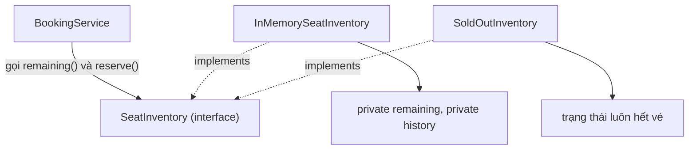

# Phân biệt trừu tượng (Abstraction) với đóng gói (Encapsulation) trong Java

**Trừu tượng** và **đóng gói** đều là nguyên lý quan trọng của lập trình hướng đối tượng (OOP), nhưng giải quyết hai vấn đề khác nhau:

- **Trừu tượng (abstraction):** chọn và công bố những **khả năng cần thiết** của một đối tượng, giúp mã sử dụng tập trung vào *đối tượng làm được gì* mà không phải phụ thuộc vào chi tiết thực hiện.
- **Đóng gói (encapsulation):** tổ chức dữ liệu cùng các thao tác liên quan và **kiểm soát cách trạng thái nội bộ được truy cập hoặc thay đổi**, giúp đối tượng tự bảo vệ các quy tắc của mình.

Ví dụ, hệ thống bán vé cần thao tác `reserve(2)` mà không cần biết số ghế đang lưu trong `HashMap`, cơ sở dữ liệu hay dịch vụ khác: đó là góc nhìn **trừu tượng**. Hệ thống cũng phải ngăn mã bên ngoài tự sửa số ghế thành `-10` hoặc bỏ qua điều kiện còn chỗ: đó là mục tiêu **đóng gói**.

Hai nguyên lý thường bổ trợ nhau, nhưng **không đồng nghĩa**. Một lớp có thể dùng `private` để đóng gói tốt mà không cần khai báo `interface`; ngược lại, có `interface` chưa bảo đảm mọi đối tượng triển khai đều bảo vệ trạng thái đúng cách.

## 1. So sánh từ mục tiêu đến cách thực hiện

| Góc nhìn | Trừu tượng (Abstraction) | Đóng gói (Encapsulation) |
| --- | --- | --- |
| Câu hỏi chính | “Người dùng cần biết và sử dụng **khả năng nào**?” | “Ai được **đọc/sửa trạng thái** và qua con đường nào?” |
| Mục tiêu | Giảm phụ thuộc vào chi tiết triển khai; thể hiện hợp đồng dễ hiểu | Bảo vệ tính nhất quán của dữ liệu và các quy tắc nghiệp vụ |
| Phần được che giấu | Chi tiết thuật toán, cấu trúc lưu trữ, cách triển khai không thuộc hợp đồng | Quyền truy cập trực tiếp vào trường và cấu trúc nội bộ cần kiểm soát |
| Công cụ Java thường gặp | `interface`, `abstract class`, tham số theo kiểu interface, API công khai được thiết kế gọn | `private`, phương thức có validation, defensive copy, immutable value, giới hạn quyền truy cập |
| Dấu hiệu ở phía sử dụng | Code gọi `inventory.reserve(2)`, không biết đối tượng lưu kho thế nào | Code không thể tự gán `inventory.remaining = -10` |
| Lỗi khi thiết kế kém | Code nghiệp vụ phụ thuộc nhiều lớp cụ thể hoặc chi tiết lưu trữ | Caller sửa dữ liệu nội bộ mà không qua kiểm tra |
| Tiêu chí đánh giá | Hợp đồng có đủ khả năng cần thiết và giấu chi tiết không liên quan không? | Có đường nào từ bên ngoài phá vỡ bất biến (*invariant*) của đối tượng không? |

Không nên hiểu “trừu tượng chỉ dùng interface” hay “đóng gói chỉ dùng private”. Một lớp thông thường với một số phương thức công khai có thể là một **abstraction tốt**; ngược lại, một trường `private final List<...>` vẫn có thể bị sửa gián tiếp nếu lớp trả ra danh sách mutable đó.

## 2. Ví dụ hoàn chỉnh: cùng một bài toán, hai nguyên lý

Ta thiết kế một chức năng đặt chỗ:

- `SeatInventory` mô tả **hợp đồng** tồn kho ghế: xem số chỗ còn lại và yêu cầu giữ chỗ.
- `InMemorySeatInventory` là một cách thực hiện, giữ số ghế trong trường `private` và kiểm tra trước khi giảm.
- `SoldOutInventory` là một cách thực hiện khác, luôn thông báo hết vé.
- `BookingService` chỉ phụ thuộc vào **`SeatInventory`**, nên không phải biết đối tượng cụ thể bên dưới.

Đặt toàn bộ mã sau trong file **`Main.java`**, chạy với Java 11 trở lên:

```java
import java.util.ArrayList;
import java.util.List;
import java.util.Objects;

// TRỪU TƯỢNG: mô tả hợp đồng mà code đặt vé cần.
interface SeatInventory {
    int remaining();

    // Số ghế yêu cầu phải > 0.
    // Trả true nếu giữ chỗ thành công; false nếu không đủ chỗ.
    boolean reserve(int seats);
}

// Một triển khai lưu trạng thái trong bộ nhớ.
final class InMemorySeatInventory implements SeatInventory {
    private int remaining;
    private final List<Integer> successfulReservations =
            new ArrayList<>();

    InMemorySeatInventory(int initialSeats) {
        if (initialSeats < 0) {
            throw new IllegalArgumentException(
                    "Số ghế ban đầu không được âm");
        }
        this.remaining = initialSeats;
    }

    @Override
    public int remaining() {
        return remaining;
    }

    @Override
    public boolean reserve(int seats) {
        if (seats <= 0) {
            throw new IllegalArgumentException(
                    "Số ghế đặt phải lớn hơn 0");
        }
        if (seats > remaining) {
            return false;
        }

        // ĐÓNG GÓI: chỉ logic bên trong được phép giảm số ghế.
        remaining -= seats;
        successfulReservations.add(seats);
        return true;
    }

    // Trả snapshot, không trao list mutable nội bộ cho caller.
    List<Integer> reservationHistory() {
        return List.copyOf(successfulReservations);
    }
}

// Một triển khai hợp đồng khác: địa điểm đã hết vé.
final class SoldOutInventory implements SeatInventory {
    @Override
    public int remaining() {
        return 0;
    }

    @Override
    public boolean reserve(int seats) {
        if (seats <= 0) {
            throw new IllegalArgumentException(
                    "Số ghế đặt phải lớn hơn 0");
        }
        return false;
    }
}

// Code nghiệp vụ làm việc qua kiểu trừu tượng.
final class BookingService {
    private final SeatInventory inventory;

    BookingService(SeatInventory inventory) {
        this.inventory = Objects.requireNonNull(
                inventory, "inventory");
    }

    boolean book(int seats) {
        return inventory.reserve(seats);
    }

    int availableSeats() {
        return inventory.remaining();
    }
}

public class Main {
    public static void main(String[] args) {
        InMemorySeatInventory warehouse =
                new InMemorySeatInventory(5);
        BookingService service = new BookingService(warehouse);

        System.out.println(service.book(2));          // true
        System.out.println(service.availableSeats()); // 3
        System.out.println(service.book(4));          // false
        System.out.println(service.availableSeats()); // 3

        List<Integer> snapshot = warehouse.reservationHistory();
        System.out.println(snapshot); // [2]
        try {
            snapshot.add(100);
        } catch (UnsupportedOperationException ex) {
            System.out.println("Không sửa được lịch sử bên ngoài");
        }

        // Không đổi BookingService khi đổi cách triển khai.
        BookingService soldOutService =
                new BookingService(new SoldOutInventory());
        System.out.println(soldOutService.book(1)); // false

        // warehouse.remaining = -10;
        // Dòng trên không biên dịch: remaining là private.
    }
}
```

Biên dịch và chạy:

```bash
javac Main.java
java Main
```

Kết quả:

```text
true
3
false
3
[2]
Không sửa được lịch sử bên ngoài
false
```

### Phân tích: phần nào là trừu tượng?

`SeatInventory` cung cấp hai khả năng rõ ràng là `remaining()` và `reserve(int)`. `BookingService` được viết theo hợp đồng đó và có thể nhận bất kỳ triển khai **tuân thủ cùng ngữ nghĩa**: đối tượng lưu trong bộ nhớ, đối tượng làm việc với kho dữ liệu, hoặc đối tượng phục vụ kiểm thử.

Sự phụ thuộc thể hiện như sau:



`BookingService` không cần `instanceof InMemorySeatInventory`, không đọc trường `remaining`, không quyết định cách lưu dữ liệu. Nếu sau này có `DatabaseSeatInventory`, ta có thể truyền một triển khai mới mà giữ nguyên giao diện sử dụng của `BookingService`, miễn là nó đáp ứng hợp đồng.

**Có interface không tự động làm mọi thiết kế trở nên trừu tượng tốt.** Nếu interface để lộ chi tiết như `getInternalHashMap()`, `getJdbcConnection()` trong một API đặt vé thông thường, code sử dụng vẫn bị kéo vào chi tiết triển khai. Ngược lại, các phương thức công khai của một lớp cụ thể vẫn có thể tạo một abstraction phù hợp nếu chúng che giấu chi tiết tốt.

### Phân tích: phần nào là đóng gói?

`InMemorySeatInventory` giữ `remaining` và `successfulReservations` bên trong đối tượng. Caller không thể làm `remaining = -10` hoặc xóa lịch sử trực tiếp. Thay vào đó, caller gọi `reserve(seats)`, nơi lớp tự kiểm tra:

1. Số ghế yêu cầu phải lớn hơn 0.
2. Không được đặt quá số ghế còn lại.
3. Chỉ khi hợp lệ mới giảm `remaining` và ghi nhận lịch sử.

Các quy tắc đó là **bất biến của đối tượng**: `remaining` không âm, số lượng giữ chỗ ghi lại là số dương và phép đặt quá tồn kho không tự ý làm số dư âm. Constructor thiết lập trạng thái hợp lệ ban đầu, còn phương thức cập nhật tiếp tục duy trì nó.

Dù danh sách lịch sử là `private`, lớp còn trả `List.copyOf(successfulReservations)` để caller không sửa collection nội bộ qua một tham chiếu được chia sẻ. Vì các phần tử là `Integer` bất biến, snapshot này không có vấn đề phần tử mutable.

Ví dụ trên giả định sử dụng tuần tự. **`private` không làm thao tác kiểm tra rồi cập nhật trở nên an toàn khi nhiều luồng cùng đặt vé**; hệ thống đồng thời cần đồng bộ hoặc cơ chế nguyên tử thích hợp.

## 3. Vì sao hai nguyên lý thường đi cùng nhau nhưng vẫn khác nhau?

Hãy xét hai câu hỏi độc lập với lớp đặt chỗ:

**Câu hỏi A — API có che được chi tiết không?**

Code nghiệp vụ chỉ cần `book(2)` và `availableSeats()`. Nó không cần biết ứng dụng dùng `ArrayList`, JDBC hay hệ thống phân tán. Thiết kế này tập trung vào **trừu tượng** và khả năng thay thế cách thực hiện.

**Câu hỏi B — dữ liệu có được bảo vệ không?**

Nếu một phương thức của lớp trả ra `ArrayList` nội bộ rồi code khác gọi `clear()`, trạng thái bị thay đổi ngoài quy trình nghiệp vụ. Thiết kế này tập trung vào **đóng gói** và kiểm soát trạng thái.

Hai vấn đề có thể xảy ra riêng rẽ:

| Tình huống | Trừu tượng | Đóng gói |
| --- | --- | --- |
| Service sử dụng `SeatInventory`; lớp triển khai giữ trường `private`, chỉ sửa qua API có kiểm tra | Tốt | Tốt |
| Lớp `SimpleCounter` có `private count` và `increment()`, được sử dụng trực tiếp trong một chương trình nhỏ | Vẫn có API trừu tượng ở mức lớp; không có interface riêng | Có thể tốt |
| Một interface trả ra collection nội bộ mutable để caller sửa tự do | Có biểu hiện interface nhưng hợp đồng có thể rò chi tiết | Kém |
| Service đọc thẳng trường public của một triển khai cụ thể | Phụ thuộc cách biểu diễn trạng thái | Kém nếu trạng thái cần bảo vệ |

Sự khác biệt có thể gói trong một câu để nhớ: **trừu tượng quyết định đối tượng công bố *khả năng gì*; đóng gói quyết định đối tượng duy trì *quyền kiểm soát trạng thái* như thế nào.**

Tuy nhiên, cả hai đều có khía cạnh “che giấu chi tiết”. Để không nhầm, hãy xem **mục đích của việc che giấu**: che chi tiết triển khai để khách hàng dùng một hợp đồng rõ ràng, hay chặn đường can thiệp phá vỡ quy tắc nội bộ.

## 4. Không bắt buộc có `interface` mới gọi là trừu tượng

Trừu tượng là một hoạt động **thiết kế**: chọn những khái niệm quan trọng và bỏ đi chi tiết không cần thiết ở một tầng sử dụng cụ thể. Java có nhiều công cụ hỗ trợ:

| Công cụ | Điều nó giúp diễn đạt | Khi phù hợp |
| --- | --- | --- |
| Phương thức `public` trong lớp thường | Một tập hành vi mà caller được phép dùng | Đối tượng đơn giản, không cần nhiều triển khai |
| `interface` | Hợp đồng chung cho những triển khai khác nhau | Client cần phụ thuộc vào khả năng thay vì lớp cụ thể |
| `abstract class` | Hợp đồng chung kèm trạng thái/cài đặt chia sẻ cho lớp con | Các triển khai có mối quan hệ kế thừa và quy tắc chung thực sự |
| Value object / API dịch vụ | Một khái niệm nghiệp vụ rõ ràng | Che thao tác tính toán, kiểm tra, hoặc công nghệ lưu trữ |

Ví dụ một lớp cụ thể vẫn có trừu tượng ở API của nó:

```java
final class Thermostat {
    private int targetCelsius = 24;

    void increaseTarget() {
        if (targetCelsius >= 30) {
            throw new IllegalStateException("Đã đạt giới hạn");
        }
        targetCelsius++;
    }

    int targetCelsius() {
        return targetCelsius;
    }
}
```

Caller chỉ cần biết `increaseTarget()` và `targetCelsius()`, không cần điều khiển trực tiếp giá trị trường hay hiểu các bước kiểm tra. Đây là một API trừu tượng có ích **ngay cả khi không có interface/abstract class riêng**. Trường `private` và kiểm tra giới hạn đồng thời thực hiện đóng gói.

Trong Java, từ khóa `abstract` có ý nghĩa cú pháp riêng: `abstract class` không thể được khởi tạo trực tiếp, và phương thức `abstract` chưa có thân cần được triển khai bởi lớp con cụ thể (trừ trường hợp kế thừa vẫn trừu tượng). **Đừng đồng nhất từ khóa `abstract` với toàn bộ nguyên lý abstraction**.

## 5. Đóng gói không chỉ là thêm `private` và getter/setter

Kiểu viết sau làm yếu ranh giới kiểm soát:

```java
class WeakAccount {
    private int balance;

    public int getBalance() {
        return balance;
    }

    public void setBalance(int balance) {
        this.balance = balance;
    }
}
```

`balance` đúng là `private`, nhưng bất kỳ caller nào cũng có thể gọi `setBalance(-1_000)`. Nếu quy tắc nghiệp vụ là số dư không âm, setter tự do khiến lớp không duy trì được invariant.

Một API có hành vi phù hợp hơn:

```java
final class SafeAccount {
    private long balance;

    SafeAccount(long openingBalance) {
        if (openingBalance < 0) {
            throw new IllegalArgumentException("Số dư âm");
        }
        this.balance = openingBalance;
    }

    void deposit(long amount) {
        if (amount <= 0 || amount > Long.MAX_VALUE - balance) {
            throw new IllegalArgumentException("Số tiền nạp không hợp lệ");
        }
        balance += amount;
    }

    boolean withdraw(long amount) {
        if (amount <= 0) {
            throw new IllegalArgumentException("Số tiền rút phải dương");
        }
        if (amount > balance) {
            return false;
        }
        balance -= amount;
        return true;
    }

    long getBalance() {
        return balance;
    }
}
```

`SafeAccount` buộc mọi thay đổi số dư đi qua hành vi có kiểm tra. Trong chương trình thực tế, tiền tệ thường cần mô hình đơn vị/kiểu tiền chính xác hơn; `long` ở đây chỉ minh họa nguyên lý đóng gói trạng thái. Lớp chưa bảo đảm an toàn khi nhiều luồng cùng truy cập.

Nguyên tắc là: **cho caller quyền thực hiện thao tác hợp lệ, không trao quyền tự ý phá trạng thái**.

## 6. Mức truy cập trong Java liên quan gì tới đóng gói?

Java dùng access modifier để thiết lập phạm vi hiển thị của lớp, trường, constructor và phương thức.

| Mức truy cập | Phạm vi chính |
| --- | --- |
| `private` | Chỉ bên trong lớp khai báo (theo các quy tắc truy cập của Java đối với nested classes) |
| Không ghi modifier (*package-private*) | Trong cùng package |
| `protected` | Trong cùng package và qua quan hệ lớp con ở những trường hợp truy cập Java cho phép |
| `public` | Có thể truy cập từ các vị trí phù hợp; còn chịu ảnh hưởng của hệ thống module nếu có |

Lựa chọn modifier theo hợp đồng của đối tượng, không phải chỉ để tránh lỗi biên dịch:

- Trường lưu invariant thường nên để `private`.
- API công khai chỉ cần chứa các thao tác mà bên dùng thực sự được phép thực hiện.
- Mở `protected` cho trường mutable có thể khiến lớp con can thiệp vào invariant; hãy cân nhắc cung cấp phương thức mở rộng được kiểm soát.
- `public` không sai: chính các hành vi công khai là bề mặt mà abstraction cần công bố.

Các modifier là **cơ chế kỹ thuật**. Đóng gói tốt còn phụ thuộc vào thiết kế phương thức, các ràng buộc được thực thi và cách đối tượng tham chiếu đến dữ liệu mutable khác.

## 7. Những lỗi thiết kế dễ nhầm lẫn

**Lỗi 1: “Có interface là đã đóng gói.”**

```java
interface Basket {
    void add(String sku);
}

class LeakyBasket implements Basket {
    public final List<String> internalItems = new ArrayList<>();

    @Override
    public void add(String sku) {
        internalItems.add(sku);
    }
}
```

Đoạn này là ví dụ minh họa, cần các `import java.util.List;` và `import java.util.ArrayList;` nếu biên dịch riêng. `Basket` cung cấp một giao diện sử dụng, nhưng một caller đang giữ tham chiếu kiểu `LeakyBasket` có thể sửa `internalItems` trực tiếp. Khai báo `final` chỉ chặn gán lại trường, không chặn chỉnh sửa `ArrayList`.

**Lỗi 2: “Có `private` thì không cần trừu tượng.”**

Một dịch vụ phụ thuộc trực tiếp vào `MySqlSeatInventory` có thể vẫn nhìn thấy API đóng gói tốt, nhưng nếu nhu cầu là chuyển sang PostgreSQL hoặc giả lập khi kiểm thử thì phụ thuộc loại cụ thể có thể gây khó. Tạo `SeatInventory` giúp thể hiện hợp đồng ổn định khi thực sự có nhiều triển khai. Không nên tạo interface chỉ vì quy tắc máy móc “lớp nào cũng cần interface”.

**Lỗi 3: “Getter luôn an toàn vì nó chỉ đọc.”**

```java
private final List<String> names = new ArrayList<>();

List<String> getNames() {
    return names; // Trả tham chiếu mutable nội bộ.
}
```

Caller có thể gọi `getNames().clear()`. Có thể trả `List.copyOf(names)` khi muốn snapshot bất biến về cấu trúc, hoặc dùng read-only view nếu đã chủ đích cho người dùng quan sát danh sách đang thay đổi. Với phần tử mutable, sao chép collection mới chỉ là sao chép nông.

**Lỗi 4: “Giấu hết mọi thứ sẽ tạo API tốt.”**

Nếu một lớp không cung cấp thao tác mà client cần, client sẽ tìm đường vòng: ép kiểu, dùng reflection, sửa cơ sở dữ liệu trực tiếp hoặc nhân bản logic. Abstraction tốt cần công bố **đủ khả năng có ý nghĩa**; encapsulation tốt cần kiểm soát những thay đổi quan trọng, chứ không phải giấu mọi hành vi.

**Lỗi 5: “Một tầng abstraction tốt tự động bảo đảm nghiệp vụ đúng.”**

`SeatInventory` mô tả khả năng đặt ghế nhưng không tự thực thi đồng bộ, lưu bền vững hay tính nguyên tử. Mỗi triển khai phải giữ ngữ nghĩa đã cam kết. Ví dụ dữ liệu bị hai request đồng thời sửa có thể vượt khả năng đặt vé nếu không có transaction/lock thích hợp dù code dùng interface đúng.

## 8. Cách tự đánh giá một thiết kế OOP

Khi review một lớp, thử trả lời hai nhóm câu hỏi:

| Câu hỏi về abstraction | Câu hỏi về encapsulation |
| --- | --- |
| Caller cần khả năng nào? | Những trạng thái nào phải luôn hợp lệ? |
| Hợp đồng có nói rõ kết quả, lỗi và điều kiện đầu vào? | Những đường cập nhật nào có thể phá invariant? |
| Có thể đổi cách triển khai mà không sửa code nghiệp vụ? | Có lộ mảng/list/map hoặc object mutable nội bộ không? |
| API có tránh lộ chi tiết công nghệ không cần thiết? | Constructor và mỗi thao tác sửa có kiểm tra điều kiện không? |
| Có tạo quá nhiều tầng interface không mang lại giá trị? | Quyền truy cập có được giới hạn đúng mức không? |

Nếu lớp chỉ có một cách dùng và một cách triển khai ổn định, một public API rõ ràng trên lớp cụ thể có thể là đủ. Nếu nhiều module cần dùng chung một hợp đồng và có khả năng thay đổi triển khai, interface hoặc abstract class thường giúp cách ly phụ thuộc tốt hơn.

Dù theo cách nào, quy tắc dữ liệu vẫn phải nằm ở nơi có thể kiểm soát nó. Đừng chuyển trách nhiệm kiểm tra số dư, sức chứa hoặc tính nhất quán cho mọi caller bên ngoài chỉ vì đã đặt tên phương thức đẹp.

## 9. Bài tập nhanh

**Bài 1.** Một lớp có trường `private List<String> items` và getter trả trực tiếp list đó. Vấn đề chính liên quan đến nguyên lý nào?

**Đáp án:** **Đóng gói**: caller có thể sửa nội bộ qua alias. Sửa bằng API chỉ đọc phù hợp hoặc defensive copy, tùy hợp đồng.

**Bài 2.** `BookingService` tự viết SQL `SELECT ... FOR UPDATE` để trừ ghế. Muốn hỗ trợ hai loại kho dữ liệu mà không viết lại nghiệp vụ, nên chú ý nguyên lý nào?

**Đáp án:** **Trừu tượng**: định nghĩa hợp đồng `SeatInventory`, chuyển xử lý SQL vào triển khai tương ứng. Vẫn phải bảo đảm transaction/tính nguyên tử ở triển khai.

**Bài 3.** Có phải `interface PaymentGateway` chắc chắn đóng gói an toàn dữ liệu thẻ?

**Đáp án:** **Không**. Interface không tự quyết định cách lưu trữ, bảo vệ hay công bố dữ liệu. Việc giữ bí mật và kiểm soát trạng thái phụ thuộc vào thiết kế và triển khai cụ thể.

**Bài 4.** Một lớp `Thermostat` không khai báo interface nhưng có `increaseTarget()` và trường `private targetCelsius`. Nó có thể thể hiện cả hai nguyên lý không?

**Đáp án:** **Có**. Hai phương thức tạo API ở mức trừu tượng hợp lý; trường riêng tư và kiểm tra giới hạn bảo vệ trạng thái.

**Bài 5.** Nếu thay `InMemorySeatInventory` bằng `SoldOutInventory` mà `BookingService` không cần đổi, điều gì được minh họa?

**Đáp án:** Code sử dụng được lập trình theo **hợp đồng trừu tượng**. Từng lớp triển khai vẫn phải tự bảo đảm các quy tắc trạng thái và hành vi đã cam kết.

**Ghi nhớ:** Khi thiết kế OOP, hãy xác định **khả năng cần công bố cho bên sử dụng** (trừu tượng) và **ranh giới kiểm soát trạng thái bên trong** (đóng gói). Hai việc này cùng giúp code dễ hiểu, dễ thay đổi và ít lỗi, nhưng mỗi việc xử lý một loại rủi ro thiết kế khác nhau.