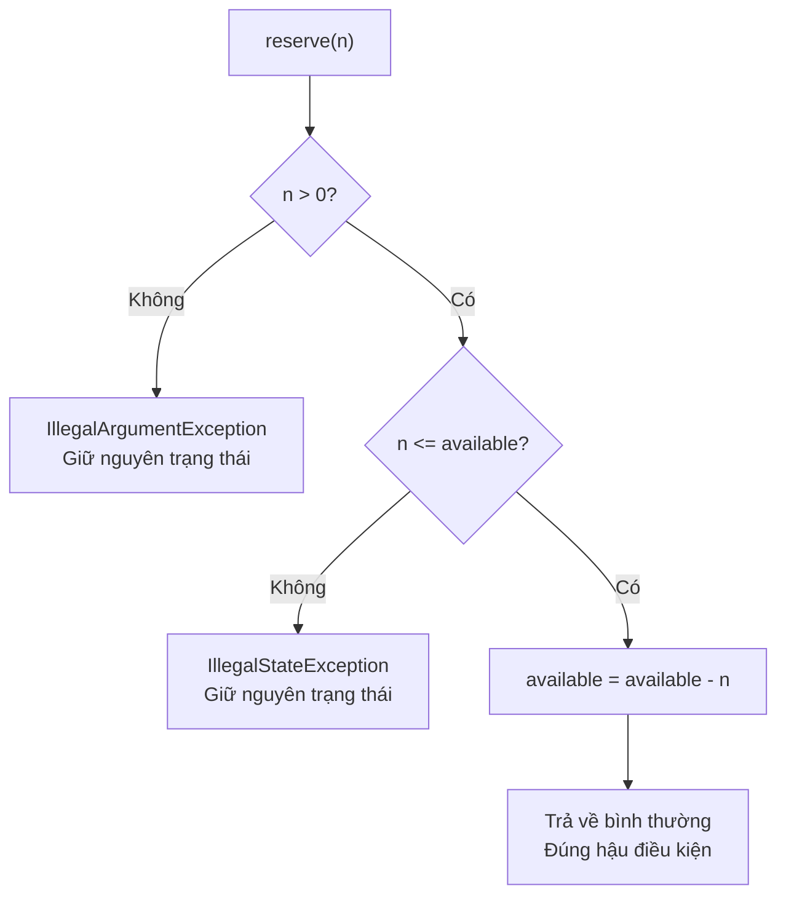

# Tiền điều kiện, hậu điều kiện và cam kết hành vi trong OOP (Java)

Khi làm việc với một đối tượng, câu hỏi quan trọng không chỉ là **“phương thức này làm gì?”** mà còn là: **“Phải đúng điều gì trước khi gọi, và người gọi được bảo đảm điều gì sau khi gọi?”**. Đây là cách nhìn theo **hợp đồng hành vi** (*behavioral contract*), thường gắn với tư tưởng *Design by Contract*.

Trong thiết kế trừu tượng, người sử dụng một interface nên có thể dựa vào những cam kết đó mà không cần biết bên trong triển khai bằng mảng, database hay bộ đếm. Nếu hai lớp cùng quảng cáo một interface nhưng lại có quy tắc hành vi khác nhau, kiểu dữ liệu có vẻ tương thích vẫn có thể gây lỗi.

Bài học xây dựng một ví dụ Java về **quản lý số ghế còn trống**. Từ đó phân biệt rõ tiền điều kiện, hậu điều kiện, bất biến và cách kiểm chứng một triển khai có giữ đúng hợp đồng hay không.

## 1. Ba khái niệm chính

| Khái niệm | Câu hỏi cần trả lời | Ví dụ với thao tác đặt ghế |
| --- | --- | --- |
| **Tiền điều kiện** (*precondition*) | Phải đúng **trước khi** thực hiện thao tác hợp lệ? | Số ghế muốn đặt > 0 và không vượt số ghế còn trống |
| **Hậu điều kiện** (*postcondition*) | Nếu thao tác **hoàn thành bình thường**, điều gì phải đúng? | Số ghế còn trống giảm đúng bằng số đã đặt |
| **Bất biến** (*invariant*) | Điều gì phải luôn đúng tại các trạng thái công khai hợp lệ của đối tượng? | `0 <= available <= capacity` |

Ta có thể diễn đạt bằng ký hiệu gần với logic Hoare:

```text
{ P }  operation  { Q }
```

Ở đây:

- `P` là tiền điều kiện;
- `operation` là phép toán/phương thức;
- `Q` là hậu điều kiện khi phép toán kết thúc bình thường.

Ví dụ, với `reserve(2)`, nếu trước lời gọi còn 5 ghế, tiền điều kiện được đáp ứng thì khi phương thức trả về bình thường phải còn đúng 3 ghế.

**Lưu ý:** công thức trên không tự quy định chuyện gì xảy ra khi `P` sai hoặc có ngoại lệ. Nếu muốn caller biết phương thức xử lý lỗi thế nào, phải mô tả thêm **hợp đồng thất bại**: loại ngoại lệ, giá trị trả về và trạng thái đối tượng có thay đổi hay không.

### Bất biến và điều kiện cục bộ khác nhau

Bất biến không chỉ là “điều kiện kiểm tra input”. Với một bộ đếm ghế:

- `capacity` là tổng số ghế, cố định và dương.
- `available` là số ghế có thể đặt, thay đổi sau giao dịch.
- Bất biến `0 <= available <= capacity` phải được giữ khi đối tượng vừa được tạo và sau mỗi phương thức công khai kết thúc, kể cả đường thất bại được bảo đảm giữ nguyên trạng thái.

Một triển khai có thể tạm sử dụng các biến trung gian trong thân phương thức. Điều quan trọng là trạng thái được quan sát qua API tại các điểm hợp lệ luôn tuân thủ bất biến; mô hình đa luồng còn cần quy tắc đồng bộ riêng.

## 2. Từ yêu cầu nghiệp vụ đến hợp đồng

Giả sử một phòng có `capacity = 10` và ban đầu `available = 10`. Người dùng có thể đặt hoặc trả lại ghế.

| Thao tác | Tiền điều kiện thành công | Hậu điều kiện khi trả về bình thường |
| --- | --- | --- |
| `new InMemorySeatInventory(capacity)` | `capacity > 0` | `capacity() == capacity` và `available() == capacity` |
| `reserve(n)` | `n > 0` và `n <= available_before` | `available_after = available_before - n` |
| `release(n)` | `n > 0` và `n <= capacity - available_before` | `available_after = available_before + n` |
| `capacity()` | Không có điều kiện đặc biệt | Trả tổng số ghế không đổi |
| `available()` | Không có điều kiện đặc biệt | Trả số ghế còn trống hiện tại; không tự thay đổi trạng thái |

`available_before` biểu thị số ghế ngay **trước** khi phương thức xử lý; `available_after` là số ghế ngay **sau** khi phương thức trả về bình thường. Java không có cú pháp đặc biệt tên `old(...)` để lấy trạng thái cũ: trong kiểm thử, ta thường lưu giá trị trước lời gọi vào biến.

Đây là mô hình **đếm ghế tổng hợp**; `release(n)` hiểu là trả lại `n` ghế đã được đặt trên hệ thống, không xác thực người nào đã đặt. Muốn kiểm soát quyền hủy từng vé, cần một mô hình có mã đặt chỗ và chủ sở hữu; không nên suy diễn quyền đó chỉ từ bộ đếm.

## 3. Đặt cam kết vào interface

Interface diễn tả **khả năng được cung cấp và những bảo đảm được mong đợi**, thay vì chỉ liệt kê tên phương thức. Java không cưỡng chế mọi tiền/hậu điều kiện ở mức kiểu dữ liệu, vì vậy tài liệu API và kiểm thử hợp đồng rất quan trọng.

Tệp `SeatInventory.java`:

```java
/**
 * Bộ đếm số ghế cho một phòng có sức chứa cố định.
 *
 * Bất biến: capacity() > 0 và 0 <= available() <= capacity().
 * Không có bảo đảm thread-safe ở interface này.
 */
public interface SeatInventory {

    /** Tổng số ghế, không đổi trong vòng đời đối tượng. */
    int capacity();

    /** Số ghế còn có thể đặt tại thời điểm gọi. */
    int available();

    /**
     * Đặt đúng n ghế.
     *
     * Tiền điều kiện để thành công:
     * n > 0 và n <= available() trước lời gọi.
     *
     * Hậu điều kiện khi thành công:
     * available() mới = available() cũ - n;
     * capacity() không đổi.
     *
     * Khi n <= 0, ném IllegalArgumentException.
     * Khi số ghế không đủ, ném IllegalStateException.
     * Khi thất bại theo hai trường hợp này, trạng thái giữ nguyên.
     */
    void reserve(int n);

    /**
     * Trả lại đúng n ghế đã đặt (theo tổng số lượng).
     *
     * Tiền điều kiện để thành công:
     * n > 0 và n <= capacity() - available() trước lời gọi.
     *
     * Hậu điều kiện khi thành công:
     * available() mới = available() cũ + n;
     * capacity() không đổi.
     *
     * Khi n <= 0, ném IllegalArgumentException.
     * Khi trả vượt số ghế đang được đặt, ném IllegalStateException.
     * Khi thất bại theo hai trường hợp này, trạng thái giữ nguyên.
     */
    void release(int n);
}
```

Ví dụ này cố ý **quy định cả kết quả thành công lẫn lỗi thường gặp**. Một caller biết rõ rằng:

- Gọi `reserve(3)` hợp lệ khi còn ít nhất 3 ghế.
- Nếu thành công, *đúng 3 ghế* đã bị trừ; không thể chỉ trừ 1 và coi là hoàn thành.
- Nếu yêu cầu không hợp lệ hoặc thiếu ghế, phương thức ném ngoại lệ đã mô tả, **không trừ ghế một phần**.
- Tổng sức chứa không thay đổi.

Đó chính là ý nghĩa của **cam kết hành vi**. Chỉ khai báo `void reserve(int n);` chưa cho biết những điều trên.

## 4. Triển khai Java giữ đúng hợp đồng

Tệp `InMemorySeatInventory.java`:

```java
public final class InMemorySeatInventory implements SeatInventory {
    private final int capacity;
    private int available;

    public InMemorySeatInventory(int capacity) {
        if (capacity <= 0) {
            throw new IllegalArgumentException(
                    "capacity phải lớn hơn 0");
        }

        this.capacity = capacity;
        this.available = capacity;
    }

    @Override
    public int capacity() {
        return capacity;
    }

    @Override
    public int available() {
        return available;
    }

    @Override
    public void reserve(int n) {
        requirePositive(n);

        if (n > available) {
            throw new IllegalStateException("Không đủ ghế");
        }

        // Mọi kiểm tra đã thành công mới thay đổi trạng thái.
        available -= n;
    }

    @Override
    public void release(int n) {
        requirePositive(n);

        int reserved = capacity - available;
        if (n > reserved) {
            throw new IllegalStateException(
                    "Số ghế trả vượt số đã đặt");
        }

        available += n;
    }

    private static void requirePositive(int n) {
        if (n <= 0) {
            throw new IllegalArgumentException(
                    "Số ghế phải lớn hơn 0");
        }
    }
}
```

Vì `capacity > 0`, `0 <= available <= capacity` và `n` đã được kiểm tra, các phép trừ/cộng trong phiên bản **đơn luồng** này đều nằm trong phạm vi `int` hợp lệ:

- `reserve` chỉ trừ khi `n <= available`, nên không tạo số âm.
- `release` chỉ cộng khi `n <= capacity - available`, nên không vượt `capacity`.
- Trong các nhánh ném ngoại lệ thông thường, field `available` chưa bị sửa.

### Chạy ví dụ

Tệp `Main.java`:

```java
public class Main {
    public static void main(String[] args) {
        SeatInventory seats = new InMemorySeatInventory(10);

        seats.reserve(3);
        System.out.println(seats.available()); // 7

        seats.release(1);
        System.out.println(seats.available()); // 8

        try {
            seats.reserve(9);
        } catch (IllegalStateException ex) {
            System.out.println("Bị từ chối: " + ex.getMessage());
        }

        System.out.println(seats.available()); // Vẫn là 8
        System.out.println(seats.capacity());  // 10
    }
}
```

Chạy bằng JDK 11 trở lên (ví dụ này cũng dùng được với nhiều JDK cũ hơn):

```bash
javac SeatInventory.java InMemorySeatInventory.java Main.java
java Main
```

Kết quả:

```text
7
8
Bị từ chối: Không đủ ghế
8
10
```

Đối tượng `seats` được khai báo với **kiểu interface**, còn kiểu thực tế là `InMemorySeatInventory`. Caller sử dụng **hợp đồng**, không cần biết field `available` được lưu ở đâu.

### Sơ đồ kiểm tra khi đặt ghế



Thứ tự kiểm tra **trước khi thay đổi** giúp bảo đảm lỗi thông thường không làm đối tượng ở trạng thái nửa chừng.

## 5. Tiền điều kiện: trách nhiệm của caller và kiểm tra của callee

Một cách nhìn hữu ích:

- **Caller** chịu trách nhiệm yêu cầu một hành vi trong miền hợp lệ do hợp đồng công bố.
- **Callee** (đối tượng triển khai) chịu trách nhiệm đáp ứng hậu điều kiện nếu lời gọi hợp lệ và hoàn thành bình thường.
- Hợp đồng có thể quy định callee **kiểm tra và từ chối** một số lời gọi sai; không nên mặc định mọi input sai đều ném đúng một loại ngoại lệ nếu tài liệu API chưa hứa điều đó.

Ví dụ `reserve(3)` khi còn 5 ghế là lời gọi hợp lệ. Nếu implementation giảm xuống còn 4, đó là **lỗi của implementation** dù không có exception. Ngược lại, `reserve(8)` khi còn 5 ghế vi phạm tiền điều kiện thành công; ở API ví dụ, hợp đồng bổ sung rằng nó phải ném `IllegalStateException` và giữ nguyên trạng thái.

**Không nên dùng `assert` làm cơ chế duy nhất kiểm tra dữ liệu đầu vào công khai:**

```java
// Không phù hợp làm bảo vệ duy nhất của API public:
assert n > 0;
```

Java assertions thường **bị tắt mặc định** khi chạy nếu không bật tùy chọn `-ea`. Assertions thích hợp để phát hiện giả định nội bộ trong phát triển/kiểm thử; với đầu vào API quan trọng, dùng kiểm tra chạy ổn định như:

```java
if (n <= 0) {
    throw new IllegalArgumentException("n phải dương");
}
```

Tương tự, `Objects.requireNonNull(value, "value")` hữu ích để bảo đảm tham số tham chiếu không `null`, nhưng bản thân nó không kiểm tra mọi quy tắc nghiệp vụ như “số lượng phải nằm trong khoảng cho phép”.

## 6. Hậu điều kiện: phải cụ thể và kiểm chứng được

Xét mô tả mơ hồ:

> “Đặt ghế thành công thì số ghế được cập nhật.”

Câu này chưa đủ: tăng hay giảm? Giảm bao nhiêu? Có ảnh hưởng đến sức chứa không?

Hợp đồng tốt hơn ghi:

```text
Trước reserve(n):
    1 <= n <= available_before

Sau khi trả về bình thường:
    available_after == available_before - n
    capacity_after == capacity_before
```

Nếu một phương thức còn trả kết quả, hậu điều kiện có thể mô tả **quan hệ giữa kết quả và trạng thái**:

```java
/**
 * Thử đặt n ghế.
 * Yêu cầu: n > 0.
 *
 * Trả true nếu đã đặt thành công và available giảm đúng n.
 * Trả false nếu không đủ ghế và available giữ nguyên.
 */
boolean tryReserve(int n);
```

So với `reserve(n)`, `tryReserve(n)` cho phép trường hợp thiếu ghế như **một kết quả bình thường (`false`)**. Đây là **hợp đồng khác**, không phải cách viết ngẫu nhiên cùng một ý. Việc chọn trả `boolean`, kết quả có kiểu riêng hay ném ngoại lệ tùy ứng dụng; điều cần thiết là nhất quán giữa API, triển khai và caller.

### Hậu điều kiện không chỉ là giá trị trả về

Ngoài kết quả, cam kết hành vi có thể bao gồm:

- Field/đối tượng nào được phép thay đổi và phần nào phải giữ nguyên.
- Dữ liệu nào được lưu bền vững hoặc sự kiện nào đã được phát ra nếu API quy định.
- Thứ tự thao tác có thể quan sát (nếu thật sự là một phần của hợp đồng).
- Ngoại lệ và hiệu ứng phụ khi lỗi.
- Điều kiện thời gian, thứ tự hoặc thread-safety **nếu đã được ghi rõ**.

Không nên hứa những bảo đảm chưa được thiết kế, ví dụ “đã ghi thành công xuống database” khi phương thức thực chất mới chỉ sửa field trong bộ nhớ.

## 7. Bất biến đối tượng: cam kết xuyên suốt vòng đời

Với `SeatInventory`:

```text
I: capacity > 0
   0 <= available <= capacity
```

Để giữ `I`, cần xem **cả constructor và mọi phương thức có thể thay đổi trạng thái**.

| Giai đoạn | Điều phải chứng minh |
| --- | --- |
| Constructor | Đối tượng khi tạo xong thỏa `I` |
| `reserve(n)` thành công | Nếu `I` đúng trước gọi và tiền điều kiện đúng, `I` vẫn đúng sau cập nhật |
| `release(n)` thành công | Nếu `I` đúng trước gọi và tiền điều kiện đúng, `I` vẫn đúng sau cập nhật |
| Thao tác bị từ chối | Trạng thái giữ nguyên theo hợp đồng, vì thế vẫn thỏa `I` |
| Getter | Không gây thay đổi làm hỏng `I` |

Bất biến sẽ trở nên khó đảm bảo nếu cho phép mã ngoài chỉnh trực tiếp field:

```java
// Thiết kế không nên cho phép:
inventory.available = -100;
```

Vì vậy `private`, constructor có kiểm tra và API có quy tắc cùng hỗ trợ việc bảo vệ bất biến. Đó là một liên hệ trực tiếp giữa **đóng gói** và **trừu tượng**: chi tiết triển khai bị giấu, còn người dùng thấy cam kết ổn định.

## 8. Hợp đồng và tính thay thế (Liskov Substitution Principle)

Trừu tượng chỉ hữu ích khi một implementation có thể thay thế implementation khác mà **không làm sai kỳ vọng của client**.

Giả sử `SeatInventory` bảo đảm `reserve(1)` thành công khi còn ít nhất 1 ghế. Một triển khai “chỉ chấp nhận đặt tối thiểu 2 ghế” nhưng vẫn tuyên bố implement `SeatInventory` đã **tăng yêu cầu tiền điều kiện** một cách không được hợp đồng cho phép.

Ví dụ phản ví dụ (mã Java minh họa lỗi thiết kế):

```java
public final class BatchOnlySeatInventory implements SeatInventory {
    private final SeatInventory delegate;

    public BatchOnlySeatInventory(int capacity) {
        this.delegate = new InMemorySeatInventory(capacity);
    }

    public int capacity() {
        return delegate.capacity();
    }

    public int available() {
        return delegate.available();
    }

    public void reserve(int n) {
        if (n < 2) { // SAI hợp đồng: loại cả reserve(1) hợp lệ
            throw new IllegalArgumentException("Phải đặt ít nhất 2 ghế");
        }
        delegate.reserve(n);
    }

    public void release(int n) {
        delegate.release(n);
    }
}
```

Nếu người dùng chỉ biết kiểu `SeatInventory`, họ có quyền viết:

```java
SeatInventory seats = new BatchOnlySeatInventory(10);
seats.reserve(1); // Theo hợp đồng interface là hợp lệ.
```

Nhưng lớp trên ném ngoại lệ, nên **vi phạm cam kết**, dù mã vẫn biên dịch.

Nguyên tắc trong thiết kế kiểu con:

| Khía cạnh | Khi thay thế một implementation bằng kiểu con/implementation khác |
| --- | --- |
| Tiền điều kiện | Không được **mạnh hơn** cam kết gốc đối với những lời gọi client hợp lệ |
| Hậu điều kiện | Không được **yếu hơn** cam kết gốc |
| Bất biến | Vẫn phải tôn trọng các bất biến quan sát được của hợp đồng |
| Kết quả lỗi | Phải giữ đúng các bảo đảm lỗi đã công bố |
| Hiệu ứng phụ | Không phát sinh những tác động trái với những gì hợp đồng đã cam kết |

Một implementation được phép hỗ trợ **thêm** đầu vào nếu không làm sai lời gọi cũ, hoặc đưa ra **bảo đảm mạnh hơn** khi thành công mà vẫn giữ các bảo đảm chung. Nhưng không được âm thầm từ chối một trường hợp hợp lệ mà interface đã cho phép.

Nếu thực sự có quy tắc “bắt buộc đặt theo lô từ 2 ghế”, hãy thiết kế **hợp đồng khác** rõ ràng hoặc để dịch vụ nghiệp vụ riêng kiểm tra chính sách đó trước khi dùng bộ đếm; không nên áp yêu cầu bổ sung không được công bố lên implementation của cùng interface.

## 9. Kiểm thử hợp đồng độc lập với chi tiết triển khai

Một bài test chỉ kiểm tra “method được gọi” sẽ bỏ lỡ lỗi hậu điều kiện. Cần so sánh **trạng thái trước/sau** và hành vi khi input sai.

Tạo tệp `ContractTest.java` không cần thư viện ngoài:

```java
public class ContractTest {

    public static void main(String[] args) {
        // Có thể đổi sang một implementation hợp lệ khác.
        SeatInventory seats = new InMemorySeatInventory(5);

        check(seats.capacity() == 5, "Sai capacity ban đầu");
        check(seats.available() == 5, "Sai available ban đầu");

        int before = seats.available();
        seats.reserve(2);

        check(seats.available() == before - 2,
                "Sai hậu điều kiện reserve");
        check(seats.capacity() == 5,
                "reserve làm đổi capacity");

        before = seats.available();
        seats.release(1);

        check(seats.available() == before + 1,
                "Sai hậu điều kiện release");

        int preserved = seats.available();
        try {
            seats.reserve(99);
            throw new AssertionError(
                    "Phải từ chối yêu cầu đặt vượt số ghế");
        } catch (IllegalStateException expected) {
            // Đúng kiểu ngoại lệ đã hứa
        }
        check(seats.available() == preserved,
                "Thất bại mà số ghế lại thay đổi");

        try {
            seats.reserve(0);
            throw new AssertionError("reserve(0) phải bị từ chối");
        } catch (IllegalArgumentException expected) {
            // Đúng kiểu ngoại lệ đã hứa
        }
        check(seats.available() == preserved,
                "reserve(0) không được thay đổi số ghế");

        try {
            seats.release(99);
            throw new AssertionError(
                    "Phải từ chối trả vượt số ghế đã đặt");
        } catch (IllegalStateException expected) {
            // Đúng kiểu ngoại lệ đã hứa
        }
        check(seats.available() == preserved,
                "release lỗi nhưng làm đổi số ghế");

        check(seats.available() >= 0
                        && seats.available() <= seats.capacity(),
                "Bất biến số ghế bị phá vỡ");

        System.out.println("PASS: Hợp đồng được giữ");
    }

    private static void check(boolean ok, String message) {
        if (!ok) {
            throw new AssertionError(message);
        }
    }
}
```

Biên dịch/chạy:

```bash
javac SeatInventory.java InMemorySeatInventory.java ContractTest.java
java ContractTest
```

Kết quả:

```text
PASS: Hợp đồng được giữ
```

Trong dự án thực tế, có thể chuyển các kiểm tra này sang **JUnit**, rồi áp dụng cùng một bộ test cho nhiều implementation thông qua factory. Đây được gọi là **contract test**: kiểm tra sự tuân thủ lời hứa từ interface, không phụ thuộc cách lưu dữ liệu.

### Có thể mở rộng kiểm thử thế nào?

- Kiểm tra constructor nhận `capacity = 0` hoặc âm phải bị từ chối.
- Đặt đúng toàn bộ số ghế còn trống (trường hợp biên), sau đó kiểm tra `available() == 0`.
- Trả đúng toàn bộ số ghế đã đặt rồi kiểm tra `available() == capacity()`.
- Tạo nhiều chuỗi đặt/trả hợp lệ và sau mỗi bước kiểm tra bất biến.
- Chạy chung bộ kiểm tra với implementation mới sử dụng database hoặc dữ liệu phân tán, đồng thời tách những cam kết về lỗi mạng/transaction khỏi mô hình bộ nhớ nếu có khác biệt được công bố.

Test minh họa trên **không chứng minh đúng với mọi đầu vào**; nó xác nhận một số kịch bản điển hình và biên. Thiết kế có thể kết hợp test sinh dữ liệu (*property-based testing*) hay lập luận từ bất biến để tăng độ tin cậy.

## 10. Những giới hạn quan trọng của hợp đồng

### Ngoại lệ và trạng thái sau khi lỗi

Trong ví dụ, yêu cầu không hợp lệ hoặc không đủ ghế phải để nguyên trạng thái. Đây là một cam kết mạnh: **không cập nhật một phần** trong các nhánh thất bại đã biết.

Một phương thức khác có thể chỉ hứa “không làm mất tính hợp lệ của đối tượng” khi lỗi, dù trạng thái đã thay đổi một phần. Nếu ứng dụng đòi trạng thái y nguyên sau mọi lỗi, phải ghi rõ và thiết kế để đáp ứng (ví dụ transaction/rollback khi thao tác trải qua nhiều bước). **Không được tự suy ra rằng mọi exception luôn rollback toàn bộ.**

### Giao diện đồng bộ hay bất đồng bộ

Nếu `reserve` chỉ gửi yêu cầu đến hàng đợi, hậu điều kiện “đã giảm số ghế” **không thể mặc nhiên áp dụng ngay khi method trả về**. API bất đồng bộ có thể hứa “yêu cầu đã được chấp nhận để xử lý”, còn cam kết cập nhật số ghế gắn với một kết quả hoàn tất sau đó. Hãy viết hợp đồng phù hợp với thời điểm thực sự bảo đảm được kết quả.

### Đa luồng: không dùng check-then-act thiếu đồng bộ

`InMemorySeatInventory` hiện tại **không thread-safe**. Nếu hai luồng cùng gọi `reserve(1)` khi còn một ghế, cả hai có thể cùng qua điều kiện kiểm tra trước khi cập nhật. Bất biến hoặc hậu điều kiện có thể bị phá vỡ do race condition.

Nếu yêu cầu đặt ghế đồng thời trong một tiến trình, cần bảo vệ **toàn bộ thao tác kiểm tra và thay đổi trạng thái** bằng đồng bộ hóa thích hợp. Trong ví dụ đơn giản, có thể khai báo các phương thức đọc/ghi trạng thái là `synchronized` để bảo vệ cùng một monitor, với phạm vi hợp đồng đa luồng được thiết kế rõ ràng. Với nhiều tiến trình hoặc nhiều máy, `synchronized` ở JVM không thay thế khóa/giao dịch hoặc cơ chế nhất quán ở nơi lưu trữ chung.

Đặc biệt tránh dựa vào:

```java
if (seats.available() >= 1) {
    seats.reserve(1);
}
```

như một bảo đảm thành công trong môi trường đồng thời. Giữa lời gọi `available()` và `reserve(1)`, luồng khác có thể đặt hết ghế. Hãy để **phương thức đặt ghế tự thực hiện kiểm tra và cập nhật nguyên tử** theo mô hình đồng thời đã cam kết.

### Annotation không tự biến tài liệu thành kiểm tra

`@NotNull`, các annotation validation hoặc đặc tả hợp đồng có thể hỗ trợ công cụ, framework và static analysis, nhưng **không tự bảo đảm mọi caller luôn được kiểm tra** nếu không có cơ chế thực thi phù hợp. Java cũng không có sẵn cú pháp `requires`/`ensures` áp dụng tự động cho mọi interface.

Với mọi ràng buộc quan trọng, xác định rõ nơi kiểm tra chạy thật (constructor, phương thức, validator, transaction boundary) và nơi ghi tài liệu.

## 11. Luyện tập: tìm lỗi vi phạm hợp đồng

**Bài 1 — hậu điều kiện sai**

```java
public void reserve(int n) {
    if (n <= 0) {
        throw new IllegalArgumentException();
    }
    if (n > available) {
        throw new IllegalStateException();
    }
    available--; // Sai khi n > 1
}
```

Vì sao sai? Dù `reserve(3)` thành công, số ghế chỉ giảm 1, trái hậu điều kiện `available_after = available_before - 3`. Sửa thành `available -= n`.

**Bài 2 — bất biến bị phá vỡ**

```java
public void release(int n) {
    if (n <= 0) {
        throw new IllegalArgumentException();
    }
    available += n; // Chưa kiểm tra n <= capacity - available
}
```

Nếu chỉ có một ghế đang được đặt nhưng gọi `release(3)`, số ghế trống có thể vượt tổng sức chứa. Hãy bổ sung kiểm tra `n > capacity - available` trước khi cộng và báo `IllegalStateException`.

**Bài 3 — tiền điều kiện bị siết chặt**

Một lớp triển khai `SeatInventory` lại chỉ cho phép đặt tối thiểu 5 ghế. Khi còn 10 ghế, `reserve(2)` thuộc miền hợp lệ của interface nhưng bị lớp này từ chối. Hãy chỉ ra nguyên tắc bị vi phạm và đề xuất tách quy tắc đặt tối thiểu ra chính sách riêng.

**Bài 4 — thiết kế phương thức mới**

Bổ sung hợp đồng cho:

```java
boolean tryReserve(int n);
```

Yêu cầu: `n > 0`; khi đủ ghế trả `true` và giảm đúng `n`; khi thiếu ghế trả `false` và giữ nguyên trạng thái; khi `n <= 0` ném `IllegalArgumentException` và cũng không thay đổi trạng thái. Tự triển khai và viết test cho cả ba đường đi.

**Bài 5 — thuộc tính không thay đổi**

Thêm phương thức `int reserved()` mà không giữ field mới. Định nghĩa hậu điều kiện cho getter mới bằng công thức `reserved() == capacity() - available()`. Giải thích vì sao đây là giá trị suy ra, và test rằng tổng `reserved() + available()` luôn bằng `capacity()` ở các trạng thái hợp lệ.

## Checklist khi viết hợp đồng hành vi

Trước khi công bố một interface hoặc phương thức quan trọng, hãy tự hỏi:

1. **Tiền điều kiện** gồm yêu cầu gì về tham số, trạng thái hiện tại, quyền truy cập hoặc tài nguyên?
2. **Hậu điều kiện** mô tả được bằng quan hệ cụ thể nào giữa giá trị trước/sau và kết quả trả về?
3. **Bất biến** nào phải luôn được giữ bởi constructor và các phương thức sửa trạng thái?
4. Khi tiền điều kiện không đạt hoặc thao tác thất bại, **loại lỗi và trạng thái còn lại** được cam kết đến đâu?
5. Có implementation nào siết chặt tiền điều kiện hoặc giảm cam kết của interface, làm mất khả năng thay thế không?
6. Hợp đồng áp dụng khi **method trả về ngay**, khi một tác vụ async hoàn thành, hay sau commit transaction?
7. Các thuộc tính về thread-safety, độ bền dữ liệu và side effect có được công bố chính xác với thực tế triển khai không?
8. Có test chạy lại được trên nhiều implementation để bảo vệ các cam kết không?

**Ghi nhớ:** Trừu tượng tốt là một lời hứa có thể kiểm chứng. Tiền điều kiện xác định phạm vi yêu cầu hợp lệ; hậu điều kiện nói rõ kết quả được bảo đảm; bất biến giữ đối tượng nhất quán; hợp đồng lỗi và khả năng thay thế giúp người dùng API dự đoán đúng hành vi mà không cần mở mã nguồn triển khai.