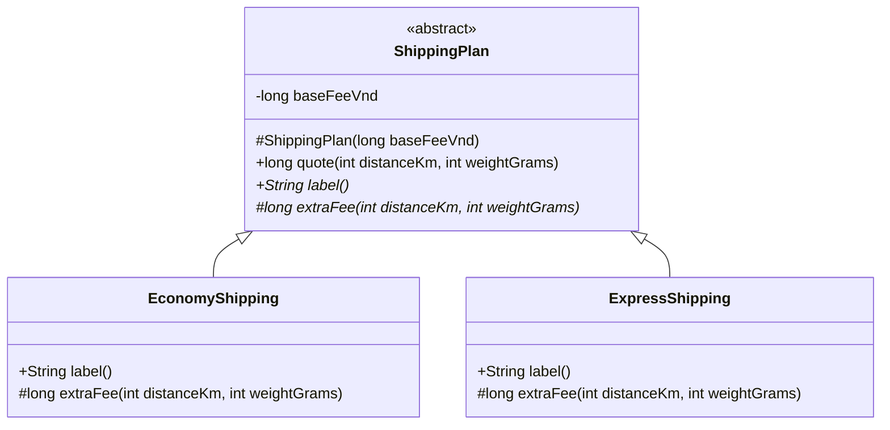
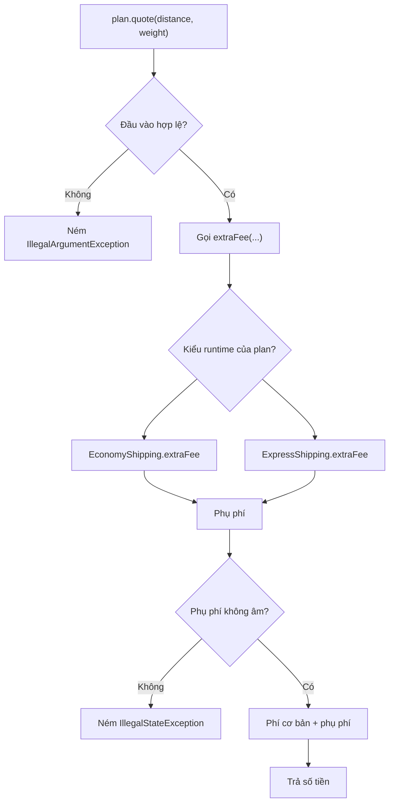

# Lớp trừu tượng và phương thức trừu tượng trong Java

> **OOP → Trừu tượng.** Khi nhiều đối tượng có chung một bản chất và quy trình xử lý, nhưng một số bước phải khác nhau ở từng loại, Java cho phép định nghĩa **lớp trừu tượng** (`abstract class`) làm nền và **phương thức trừu tượng** (`abstract method`) làm những điểm mà lớp con phải triển khai. Người sử dụng chỉ cần biết hợp đồng chung; mỗi lớp con tự thực hiện phần đặc thù của mình.

## 1. Lớp trừu tượng giải quyết vấn đề gì?

Giả sử hệ thống có hai cách vận chuyển: tiết kiệm và hỏa tốc. Cả hai đều phải:

- Nhận khoảng cách và khối lượng hợp lệ.
- Có một khoản phí cơ bản.
- Tính một khoản phụ phí theo chính sách của từng loại.
- Trả tổng phí vận chuyển.

Nếu sao chép toàn bộ quy trình vào từng lớp, những bước kiểm tra chung dễ bị viết khác nhau hoặc bỏ sót. Một lớp trừu tượng có thể định nghĩa quy trình thống nhất và chỉ yêu cầu lớp con tính phần phụ phí.



Trong sơ đồ, dấu `*` đánh dấu các phương thức trừu tượng theo quy ước chú thích của bài này.

**Lớp trừu tượng** là lớp có từ khóa `abstract`. Không thể tạo instance trực tiếp bằng `new`, nhưng vẫn có thể khai báo biến kiểu lớp trừu tượng để giữ tham chiếu tới instance của lớp con.

**Phương thức trừu tượng** chỉ khai báo tên, tham số, kiểu trả về và quy tắc truy cập; nó **không có thân phương thức**. Lớp con cụ thể (`concrete class`) phải cung cấp triển khai thích hợp nếu còn kế thừa phương thức trừu tượng chưa được triển khai.

## 2. Cú pháp cơ bản

```java
abstract class Shape {
    private final String color;

    protected Shape(String color) {
        this.color = color;
    }

    public String color() {           // Phương thức thường, có thân
        return color;
    }

    public abstract double area();    // Chỉ có khai báo, kết thúc bằng ;
}

final class Circle extends Shape {
    private final double radius;

    Circle(String color, double radius) {
        super(color);                 // Gọi constructor của lớp cha
        if (radius <= 0) {
            throw new IllegalArgumentException("Bán kính phải dương");
        }
        this.radius = radius;
    }

    @Override
    public double area() {
        return Math.PI * radius * radius;
    }
}
```

Sử dụng:

```java
Shape shape = new Circle("Đỏ", 2.0);
System.out.println(shape.color());  // Đỏ
System.out.println(shape.area());   // 12.566370614359172

// Shape invalid = new Shape("Xanh"); // Lỗi biên dịch
```

Lớp `Shape` cung cấp trạng thái `color`, constructor, phương thức thường `color()` và một yêu cầu `area()`. `Circle` thừa hưởng phần chung, đồng thời phải viết cách tính diện tích.

**Không được nhầm:**

| Cú pháp | Hợp lệ? | Ý nghĩa |
|---|---|---|
| `abstract class Shape { ... }` | Có | Lớp nền không được khởi tạo trực tiếp |
| `abstract double area();` | Có, trong lớp trừu tượng | Hợp đồng chưa có implementation |
| `double area() { return 0; }` | Có | Phương thức cụ thể, có thân |
| `abstract double area() { return 0; }` | Không | `abstract` không được có thân phương thức |
| `new Shape(...)` khi `Shape` abstract | Không | Không thể tạo trực tiếp instance lớp abstract |
| `Shape s = new Circle(...)` | Có | Đa hình: tham chiếu kiểu cha trỏ tới đối tượng lớp con |

Một lớp trừu tượng **có thể không chứa phương thức abstract nào**. Khi đó, `abstract` vẫn ngăn tạo instance trực tiếp, thường để thể hiện rằng lớp chỉ nên dùng làm lớp nền.

## 3. Ví dụ thực tế hoàn chỉnh: tính phí vận chuyển

Lưu vào tệp `AbstractClassDemo.java` và chạy bằng **Java 17+**:

```java
import java.util.List;

public class AbstractClassDemo {

    static abstract class ShippingPlan {
        private final long baseFeeVnd;

        protected ShippingPlan(long baseFeeVnd) {
            if (baseFeeVnd < 0) {
                throw new IllegalArgumentException("Phí cơ bản không thể âm");
            }
            this.baseFeeVnd = baseFeeVnd;
        }

        // Quy trình chung; final để lớp con không bỏ qua bước kiểm tra.
        public final long quote(int distanceKm, int weightGrams) {
            if (distanceKm <= 0 || weightGrams <= 0) {
                throw new IllegalArgumentException(
                    "Khoảng cách và khối lượng phải dương"
                );
            }

            long extra = extraFee(distanceKm, weightGrams);
            if (extra < 0) {
                throw new IllegalStateException("Phụ phí không thể âm");
            }

            return Math.addExact(baseFeeVnd, extra);
        }

        public abstract String label();

        // Mỗi phương án tự định nghĩa cách tính phụ phí.
        protected abstract long extraFee(int distanceKm, int weightGrams);
    }

    static final class EconomyShipping extends ShippingPlan {
        EconomyShipping() {
            super(10_000); // Phí cơ bản 10.000 VND
        }

        @Override
        public String label() {
            return "Tiết kiệm";
        }

        @Override
        protected long extraFee(int distanceKm, int weightGrams) {
            // 1.000 VND mỗi km
            return Math.multiplyExact(1_000L, distanceKm);
        }
    }

    static final class ExpressShipping extends ShippingPlan {
        ExpressShipping() {
            super(20_000); // Phí cơ bản 20.000 VND
        }

        @Override
        public String label() {
            return "Hỏa tốc";
        }

        @Override
        protected long extraFee(int distanceKm, int weightGrams) {
            // 2.000 VND mỗi km, cộng 3.000 VND mỗi kg (làm tròn lên).
            long feeByDistance = Math.multiplyExact(2_000L, distanceKm);
            long billedKg = (weightGrams - 1L) / 1_000L + 1L;
            long feeByWeight = Math.multiplyExact(3_000L, billedKg);
            return Math.addExact(feeByDistance, feeByWeight);
        }
    }

    public static void main(String[] args) {
        List<ShippingPlan> plans = List.of(
            new EconomyShipping(),
            new ExpressShipping()
        );

        for (ShippingPlan plan : plans) {
            System.out.println(
                plan.label() + ": " + plan.quote(5, 1_500) + " VND"
            );
        }

        // ShippingPlan plan = new ShippingPlan(10_000); // Không hợp lệ
    }
}
```

Chạy trong thư mục chứa file:

```bash
javac AbstractClassDemo.java
java AbstractClassDemo
```

Kết quả:

```text
Tiết kiệm: 15000 VND
Hỏa tốc: 36000 VND
```

Phép tính cụ thể:

| Gói | Phí cơ bản | Phụ phí | Tổng |
|---|---:|---:|---:|
| Tiết kiệm | 10.000 VND | 5 km × 1.000 = 5.000 VND | **15.000 VND** |
| Hỏa tốc | 20.000 VND | 5 km × 2.000 + 2 kg × 3.000 = 16.000 VND | **36.000 VND** |

Khoảng cách và khối lượng được kiểm tra một lần ở lớp nền. Ví dụ gọi `quote(0, 1500)` bị từ chối bằng `IllegalArgumentException` trước khi thực hiện phép tính phụ phí.

`Math.multiplyExact` và `Math.addExact` giúp phát hiện tràn kiểu `long` bằng `ArithmeticException`; nhờ vậy không âm thầm xuất ra mức phí vô lý khi số đầu vào quá lớn. Đây là mô hình minh họa phí trong bộ nhớ, không biểu diễn toàn bộ quy tắc định giá thực tế.

### Vì sao `abstract` và `final` được dùng cùng nhau ở đây?

`ShippingPlan` là lớp `abstract` để các lớp cụ thể kế thừa. Trong lớp đó, `quote(...)` là phương thức **concrete** và được gắn `final`: không lớp con nào được ghi đè toàn bộ quy trình kiểm tra và cộng phí.

Trong khi đó, `extraFee(...)` là **abstract**: mỗi loại vận chuyển bắt buộc cung cấp cách tính riêng.



Đây là một dạng **Template Method**: lớp cha giữ bộ khung thuật toán, còn lớp con triển khai một bước thay đổi. Nhờ thế, đoạn mã gọi `plan.quote(...)` không cần biết cách tính nội bộ của từng loại vận chuyển.

## 4. Đa hình với tham chiếu kiểu trừu tượng

```java
ShippingPlan plan = new ExpressShipping();
long fee = plan.quote(5, 1_500);
```

Biến `plan` có **kiểu tham chiếu** là `ShippingPlan`, trong khi instance thực tế là `ExpressShipping`.

- Mã gọi chỉ được sử dụng các thành viên có thể truy cập qua kiểu `ShippingPlan`.
- Khi `quote` gọi `extraFee`, Java chọn implementation dựa trên **kiểu thực tế của đối tượng** (`ExpressShipping`), theo cơ chế dynamic dispatch.
- Nếu thay bằng `new EconomyShipping()`, cùng dòng `quote` chạy phần phụ phí của Economy mà không cần sửa logic phía người dùng.

Điểm quan trọng: từ khóa `abstract` không tự tạo đa hình; chính **kế thừa và ghi đè phương thức instance** tạo ra hành vi chọn implementation khi chạy. Lớp abstract giúp diễn đạt rõ những hành vi bắt buộc và phần dùng chung.

Đoạn mã nên phụ thuộc vào hợp đồng:

```java
static void printQuote(ShippingPlan plan) {
    System.out.println(plan.label() + ": " + plan.quote(3, 2_000));
}
```

Nếu sau này có `OvernightShipping extends ShippingPlan`, chỉ cần cài đặt những phương thức trừu tượng còn thiếu. Hàm `printQuote` không cần thêm chuỗi `if` hoặc `switch` để kiểm tra tên từng loại.

## 5. Constructor của lớp trừu tượng vẫn chạy

Lớp trừu tượng không thể được khởi tạo trực tiếp, **nhưng được phép có constructor** để thiết lập phần trạng thái chung khi một lớp con được tạo.

Trong ví dụ:

```java
protected ShippingPlan(long baseFeeVnd) {
    if (baseFeeVnd < 0) {
        throw new IllegalArgumentException("Phí cơ bản không thể âm");
    }
    this.baseFeeVnd = baseFeeVnd;
}
```

`EconomyShipping()` gọi `super(10_000)`. Constructor lớp cha khởi tạo `baseFeeVnd`, rồi quá trình khởi tạo lớp con tiếp tục. Nếu constructor lớp cha ném ngoại lệ, việc tạo instance lớp con không hoàn thành thành công.

Các quy tắc liên quan:

1. **Constructor không được khai báo `abstract`** vì constructor phải có phần thân và không được ghi đè như phương thức instance.
2. Nếu lớp cha không có constructor không tham số, lớp con cần gọi constructor phù hợp bằng `super(...)`.
3. Constructor của lớp trừu tượng có thể là `protected` để phục vụ các lớp con; không cần công khai constructor chỉ vì lớp có public API.
4. **Tránh gọi phương thức có thể bị override từ constructor**. Khi constructor lớp cha chạy, các trường riêng của lớp con có thể chưa được khởi tạo đầy đủ; lời gọi đa hình lúc này dễ gây lỗi trạng thái.

Ví dụ rủi ro:

```java
abstract class Base {
    Base() {
        initialize(); // Không nên: gọi phương thức override quá sớm
    }
    protected abstract void initialize();
}

final class Child extends Base {
    private String name = "Ready";

    @Override
    protected void initialize() {
        // Có thể thấy name == null vì initializer của Child chưa chạy.
        System.out.println(name);
    }
}
```

Hãy để constructor thiết lập trạng thái mà nó sở hữu. Việc gọi các hook mở rộng nên diễn ra sau khi đối tượng đã khởi tạo đầy đủ.

## 6. Quy tắc ghi đè phương thức trừu tượng

Một phương thức trừu tượng chỉ có phần khai báo:

```java
protected abstract long extraFee(int distanceKm, int weightGrams);
```

Lớp con cụ thể triển khai:

```java
@Override
protected long extraFee(int distanceKm, int weightGrams) {
    return Math.multiplyExact(1_000L, distanceKm);
}
```

Các quy tắc cốt lõi:

| Tình huống | Kết quả |
|---|---|
| Lớp concrete kế thừa phương thức abstract mà không cài đặt | Lỗi biên dịch |
| Lớp con vẫn `abstract` và chưa cài đặt phương thức | Hợp lệ, để lớp cháu tiếp tục triển khai |
| Ghi đè với cùng tên, tham số và kiểu trả về phù hợp | Hợp lệ |
| Đổi tham số thành chữ ký khác | Là overload, không thay thế yêu cầu override |
| Hạ phạm vi từ `protected` xuống `private` | Không hợp lệ |
| Dùng `@Override` khi chữ ký không thực sự ghi đè | Trình biên dịch báo lỗi, giúp phát hiện sai sót |

Java cho phép **kiểu trả về hiệp biến (covariant return type)** với các kiểu tham chiếu, ví dụ phương thức lớp cha trả `Animal` còn phương thức override trả `Dog extends Animal`. Không thể tùy tiện đổi kiểu trả về sang một kiểu nguyên thủy khác.

Phương thức abstract không được là `private`, `static` hay `final`, vì nó cần được lớp con **ghi đè**. Lớp `abstract` cũng không được đồng thời khai báo `final`: một từ khóa yêu cầu khả năng kế thừa để hoàn thiện hành vi, từ khóa kia cấm kế thừa.

### Khi lớp con vẫn còn trừu tượng

```java
abstract class Document {
    abstract String render();
}

abstract class PrintableDocument extends Document {
    void printInfo() {
        System.out.println("Document có thể được in");
    }
    // Chưa cần implement render() vì lớp này vẫn abstract.
}

final class Invoice extends PrintableDocument {
    @Override
    String render() {
        return "Hóa đơn";
    }
}
```

`Invoice` là lớp concrete nên phải hoàn thành `render()`. Lớp trung gian `PrintableDocument` có thể bổ sung hành vi chung mà tiếp tục để lớp cháu quyết định phần render.

## 7. Lớp trừu tượng khác gì interface?

Cả hai đều giúp **ẩn chi tiết triển khai đằng sau một hợp đồng**, nhưng có cách dùng khác nhau.

| Tiêu chí | `abstract class` | `interface` |
|---|---|---|
| Vai trò thường gặp | Lớp nền chia sẻ trạng thái và implementation | Hợp đồng về khả năng/hành vi |
| Trường instance | Có thể có, kể cả `private`, mutable hoặc `final` | Không có trường instance; các trường khai báo là hằng `public static final` |
| Constructor | Có, được gọi qua constructor lớp con | Không có constructor instance |
| Phương thức có thân | Có | Có thể có `default`, `static` và một số phương thức `private` hỗ trợ triển khai |
| Phương thức trừu tượng | Có thể có, không bắt buộc | Phương thức instance thông thường không có thân mặc định là `public abstract` |
| Kế thừa trong một lớp | Một lớp chỉ `extends` trực tiếp một lớp cha | Một lớp có thể `implements` nhiều interface |
| Khi phù hợp | Cùng họ đối tượng, cùng dữ liệu và quy trình xử lý | Nhiều loại đối tượng khác họ nhưng có chung khả năng |

Ví dụ một khả năng độc lập với họ lớp:

```java
interface Trackable {
    String trackingCode();
}

final class Parcel implements Trackable {
    private final String code;

    Parcel(String code) {
        this.code = code;
    }

    @Override
    public String trackingCode() {
        return code;
    }
}
```

Nếu chỉ cần nói một đối tượng có khả năng cung cấp mã theo dõi, interface có thể là lựa chọn đơn giản. Nếu các loại vận chuyển thật sự dùng chung phí nền, quy trình kiểm tra, constructor và logic tính tổng, lớp trừu tượng như `ShippingPlan` có cơ sở hợp lý.

Không phải lúc nào cũng cần cả interface lẫn abstract class. Hãy chỉ thêm tầng trừu tượng khi nó diễn đạt một hợp đồng có ích và giảm phụ thuộc vào chi tiết cụ thể.

## 8. Những lỗi thường gặp

**Lỗi 1 — Cố khởi tạo lớp trừu tượng**

```java
abstract class Vehicle {
    abstract void move();
}

// Vehicle v = new Vehicle(); // Không thể khởi tạo lớp abstract
```

Cần một lớp concrete triển khai hành vi:

```java
class Bicycle extends Vehicle {
    @Override
    void move() {
        System.out.println("Đạp xe");
    }
}

Vehicle v = new Bicycle(); // Hợp lệ
v.move();                  // Đạp xe
```

**Lỗi 2 — Thiếu `@Override` hoặc viết sai chữ ký**

```java
abstract class Processor {
    abstract void process(String value);
}

// Sai: process(int) không implement process(String).
// class MyProcessor extends Processor {
//     void process(int value) {}
// }
```

Lớp concrete phải cài đặt **đúng chữ ký** và phạm vi truy cập phù hợp. Dùng `@Override` để được trình biên dịch kiểm tra.

**Lỗi 3 — Đặt mọi thứ vào lớp cha trừu tượng**

Nếu hai loại đối tượng chỉ tình cờ có một phương thức giống tên nhưng không chia sẻ ý nghĩa và quy tắc, ép chúng vào cùng một abstract class tạo ra quan hệ kế thừa giả tạo. Ưu tiên quan hệ **“là một loại”** hợp lý; với khả năng độc lập, cân nhắc interface hoặc composition.

**Lỗi 4 — Lớp nền công khai quá nhiều trạng thái mutable**

```java
abstract class BadPlan {
    protected long fee; // Lớp con có thể đổi tùy ý, bỏ qua validation
}
```

Nên ưu tiên `private` và cung cấp các phương thức `protected` cần thiết, thay vì để lớp con trực tiếp sửa trường mà lớp nền có trách nhiệm bảo vệ.

**Lỗi 5 — Cho lớp con override cả quy trình chung**

Khi lớp cha cần bảo đảm một bước kiểm tra bắt buộc, cân nhắc để phương thức chứa quy trình là `final` và chỉ để các hook phù hợp là `abstract`, như `quote` và `extraFee` trong ví dụ.

## 9. Bài tập thực hành

**Bài 1 — Hệ thống tính lương.** Tạo `abstract class Employee` có `private final String id`, constructor kiểm tra ID, phương thức cụ thể `id()` và `public abstract long monthlyPay()`. Viết `FullTimeEmployee` trả lương cố định và `HourlyEmployee` tính theo giờ. Tạo `List<Employee>`, duyệt và in lương theo đa hình.

**Bài 2 — Bảo vệ quy trình.** Đưa bước kiểm tra số giờ làm không âm vào phương thức cụ thể `final` của lớp cha nếu mọi nhân viên đều cần quy tắc này. Xác định bước nào nên trừu tượng, bước nào không cần cho lớp con sửa.

**Bài 3 — Kế thừa nhiều tầng.** Tạo `abstract class Media` với `abstract int durationSeconds()`; thêm lớp trừu tượng trung gian `AudioMedia`, sau đó tạo lớp concrete `PodcastEpisode`. Xác định lớp nào được phép bỏ qua việc triển khai phương thức và tại sao.

**Bài 4 — Chọn công cụ phù hợp.** Hệ thống có `Invoice`, `Order`, `Shipment`, đều cần `exportCsv()` nhưng không cùng trạng thái hoặc quy trình xử lý. Bạn sẽ chọn interface hay abstract class? Giải thích dựa trên khả năng chia sẻ trạng thái/implementation và giới hạn đơn kế thừa.

**Tự kiểm tra nhanh:**

- Có thể khai báo `ShippingPlan plan` không? **Có**, vì đó là kiểu tham chiếu.
- Có thể viết `new ShippingPlan(...)` không? **Không**, vì lớp abstract.
- Abstract class có constructor, trường dữ liệu và phương thức có thân không? **Có**.
- Abstract class có nhất thiết phải khai báo ít nhất một phương thức abstract không? **Không**.
- Một lớp concrete kế thừa abstract method mà không implement được không? **Không**, trừ khi đã có implementation phù hợp được kế thừa từ lớp khác.
- `abstract` và `final` có thể cùng dùng trên một phương thức không? **Không**.

**Ghi nhớ:** **Lớp trừu tượng** lưu những điểm chung và đặt khung quy tắc cho một họ đối tượng; **phương thức trừu tượng** xác định phần lớp con phải thực hiện. Kết hợp kế thừa, `@Override` và đa hình giúp mã gọi làm việc với một hợp đồng ổn định, trong khi các lớp concrete cung cấp hành vi riêng.