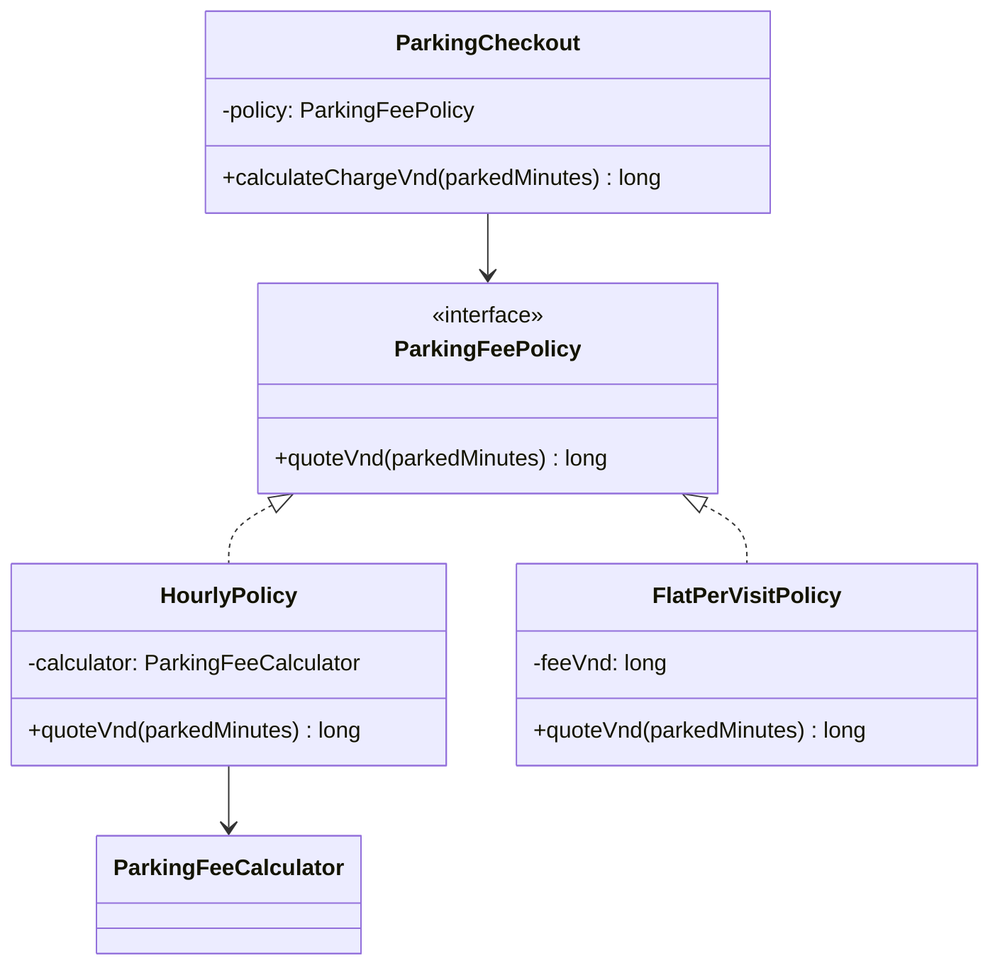
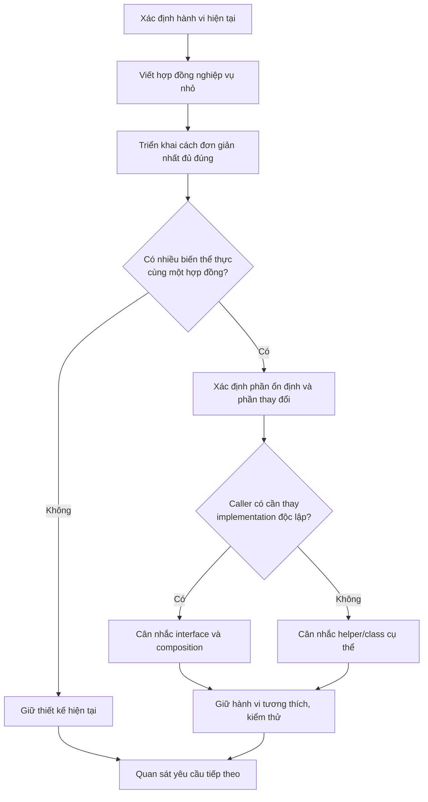

# Mức trừu tượng phù hợp với bài toán trong Java OOP

Một thiết kế OOP tốt không nhất thiết có nhiều `interface`, `abstract class` hay tầng kế thừa. Giá trị của **trừu tượng hóa (abstraction)** nằm ở việc chọn đúng lượng thông tin và hành vi mà người sử dụng cần biết để giải quyết bài toán.

Nếu trừu tượng **quá ít**, quy tắc nghiệp vụ rải rác ở nhiều nơi, caller phải biết cách tính và chi tiết triển khai. Nếu trừu tượng **quá nhiều**, một yêu cầu đơn giản có thể kéo theo hàng loạt interface, lớp trung gian và cấu hình khó theo dõi.

**Mức trừu tượng phù hợp** là mức giúp thể hiện rõ trách nhiệm, che được chi tiết có khả năng thay đổi và giữ luồng sử dụng dễ hiểu, với chi phí thiết kế tương xứng với nhu cầu thực tế.

## 1. Nhận biết ba mức thiết kế

Giả sử bãi gửi xe tính phí theo quy tắc:

- Miễn phí 15 phút đầu.
- Sau 15 phút, mỗi **giờ bắt đầu** được tính 5.000 VND.
- Thời gian gửi phải không âm; phép tính không được âm thầm tràn số.

Cùng một yêu cầu có thể được thể hiện ở những mức khác nhau:

| Cách thiết kế | Dấu hiệu | Hệ quả |
|---|---|---|
| **Quá thấp** | Mỗi màn hình tự tính `minutes`, làm tròn giờ, nhân tiền | Lặp quy tắc, dễ tính không nhất quán |
| **Phù hợp lúc đầu** | Một lớp `ParkingFeeCalculator` với phương thức `calculateVnd(...)` | Người dùng API chỉ cần đưa thời gian và nhận tiền |
| **Quá cao so với nhu cầu** | Tạo `AbstractFeeFactory`, `GenericRateResolver<T>`, hệ phân cấp nhiều tầng cho một công thức cố định | Tăng số khái niệm phải hiểu mà chưa có lợi ích rõ ràng |

Trừu tượng hóa ở đây không phải chọn giữa “có class” và “có interface”. Ngay một **class cụ thể với phương thức mang ý nghĩa nghiệp vụ** cũng là một sự trừu tượng hóa hữu ích.

## 2. Bắt đầu bằng hợp đồng nhỏ, rõ và đủ dùng

Khi chương trình chỉ có **một chính sách tính phí**, ta có thể bắt đầu bằng một lớp cụ thể.

File `ParkingFeeCalculator.java`:

```java
public final class ParkingFeeCalculator {
    private static final long FREE_MINUTES = 15;
    private static final long MINUTES_PER_HOUR = 60;
    private static final long PRICE_PER_HOUR_VND = 5_000;

    /**
     * Tính phí bằng VND.
     * parkedMinutes: thời gian gửi tính theo phút nguyên, >= 0.
     * Sau 15 phút miễn phí, làm tròn thời gian tính cước lên từng giờ.
     */
    public long calculateVnd(long parkedMinutes) {
        if (parkedMinutes < 0) {
            throw new IllegalArgumentException(
                "Thời gian gửi không được âm"
            );
        }

        if (parkedMinutes <= FREE_MINUTES) {
            return 0;
        }

        long chargedMinutes = parkedMinutes - FREE_MINUTES;

        // Tránh (chargedMinutes + 59) có thể tràn long.
        long fullHours = chargedMinutes / MINUTES_PER_HOUR;
        long extraHour = chargedMinutes % MINUTES_PER_HOUR == 0 ? 0 : 1;
        long chargedHours = fullHours + extraHour;

        return Math.multiplyExact(chargedHours, PRICE_PER_HOUR_VND);
    }

    public static void main(String[] args) {
        ParkingFeeCalculator pricing = new ParkingFeeCalculator();

        System.out.println(pricing.calculateVnd(15)); // 0
        System.out.println(pricing.calculateVnd(16)); // 5000
        System.out.println(pricing.calculateVnd(75)); // 5000
        System.out.println(pricing.calculateVnd(76)); // 10000
    }
}
```

Chạy:

```bash
javac ParkingFeeCalculator.java
java ParkingFeeCalculator
```

Tại sao mức trừu tượng này phù hợp?

1. **Tên phương thức nói lên hành vi**: `calculateVnd` trả phí theo VND.
2. **Đầu vào vừa đủ**: với chính sách được nêu, chỉ cần thời gian gửi theo phút; không bắt caller cung cấp biển số, chủ xe, màu xe.
3. **Chi tiết được giữ bên trong**: caller không cần biết thời gian miễn phí, làm tròn giờ hay nhân đơn giá.
4. **Bất biến được bảo vệ**: thời gian âm bị từ chối, phép nhân dùng `Math.multiplyExact` để phát hiện tràn số qua `ArithmeticException` thay vì trả kết quả sai.
5. **Không có lớp trung gian thừa**: chưa có nhiều thuật toán cần thay thế nên chưa cần interface.

Ở đây `long` là số tiền VND nguyên. Trong hệ thống hỗ trợ nhiều tiền tệ, tỷ giá hoặc quy tắc làm tròn phức tạp, một kiểu `Money` riêng có thể hợp lý hơn; với bài toán một mức phí VND cố định, nó chưa bắt buộc.

### Ranh giới hành vi quan trọng hơn số lớp

Một cách viết ít trừu tượng hơn là để caller tự xử lý:

```java
// Minh họa thiết kế không nên lặp ở nhiều caller.
long chargeable = Math.max(0, minutes - 15);
long hours = chargeable / 60 + (chargeable % 60 == 0 ? 0 : 1);
long fee = hours * 5_000L;
```

Nếu logic này xuất hiện trong UI, API, báo cáo và batch job, mỗi nơi phải tự biết cùng một quy tắc. Chỉ cần thay đổi thời gian miễn phí sẽ có nguy cơ quên cập nhật một chỗ.

`ParkingFeeCalculator.calculateVnd(...)` cung cấp **ranh giới trách nhiệm** đúng mức: caller biết *yêu cầu báo phí*, còn lớp tính phí biết *cách tính*.

## 3. Khi bài toán thực sự có nhiều chính sách, nâng mức trừu tượng

Một thời gian sau, yêu cầu thay đổi: hệ thống quản lý **nhiều bãi**, trong đó có bãi tính phí theo giờ và bãi tính **giá cố định 3.000 VND cho một lượt**. Cùng một chức năng checkout phải hỗ trợ hai chính sách được cấu hình theo từng bãi.

Đây là một **điểm biến thiên có thật**: thuật toán tính phí có thể thay đổi trong khi hành vi checkout vẫn giống nhau. Lúc này, tạo interface chung có mục đích rõ ràng.

File `ParkingEvolutionDemo.java` (đặt cùng thư mục với `ParkingFeeCalculator.java`):

```java
import java.util.Objects;

public class ParkingEvolutionDemo {

    interface ParkingFeePolicy {
        long quoteVnd(long parkedMinutes);
    }

    static final class HourlyPolicy implements ParkingFeePolicy {
        private final ParkingFeeCalculator calculator =
            new ParkingFeeCalculator();

        @Override
        public long quoteVnd(long parkedMinutes) {
            return calculator.calculateVnd(parkedMinutes);
        }
    }

    static final class FlatPerVisitPolicy implements ParkingFeePolicy {
        private final long feeVnd;

        FlatPerVisitPolicy(long feeVnd) {
            if (feeVnd < 0) {
                throw new IllegalArgumentException("Phí phải không âm");
            }
            this.feeVnd = feeVnd;
        }

        @Override
        public long quoteVnd(long parkedMinutes) {
            if (parkedMinutes < 0) {
                throw new IllegalArgumentException(
                    "Thời gian gửi không được âm"
                );
            }
            return feeVnd;
        }
    }

    static final class ParkingCheckout {
        private final ParkingFeePolicy policy;

        ParkingCheckout(ParkingFeePolicy policy) {
            this.policy = Objects.requireNonNull(policy, "policy");
        }

        long calculateChargeVnd(long parkedMinutes) {
            return policy.quoteVnd(parkedMinutes);
        }
    }

    public static void main(String[] args) {
        ParkingCheckout garageA =
            new ParkingCheckout(new HourlyPolicy());

        ParkingCheckout garageB =
            new ParkingCheckout(new FlatPerVisitPolicy(3_000));

        System.out.println(garageA.calculateChargeVnd(76)); // 10000
        System.out.println(garageB.calculateChargeVnd(76)); // 3000
    }
}
```

Chạy:

```bash
javac ParkingFeeCalculator.java ParkingEvolutionDemo.java
java ParkingEvolutionDemo
```

Kiến trúc lúc này:



**Điểm đáng chú ý:** `ParkingCheckout` sử dụng hợp đồng `ParkingFeePolicy` mà không biết bãi nào đang áp dụng công thức nào. Chính sách được truyền vào từ ngoài (*dependency injection* ở mức constructor), vì thế có thể cấu hình bãi A, bãi B hoặc thay chính sách mà không sửa logic checkout.

Ở phiên bản đầu, interface chưa tạo ra lợi ích rõ. Ở phiên bản có hai chính sách và một luồng checkout dùng chung, interface giảm phụ thuộc vào implementation thực tế.

Điều kiện để nâng mức trừu tượng **không phải** “đã có hai lớp thì bắt buộc phải tạo interface”. Câu hỏi cần đặt là: **Có một hợp đồng ổn định mà nhiều cách thực hiện cần tuân theo và có caller hưởng lợi từ việc không biết implementation không?**

## 4. Tránh những trừu tượng quá tổng quát

Có thể đẩy bài toán báo phí vào một hệ thống trừu tượng chung như:

```java
// Ví dụ minh họa thiết kế quá tổng quát đối với yêu cầu này:
interface UniversalOperation<I, C, R> {
    R execute(I input, C context);
}

interface GenericRule<T> {
    boolean matches(T data);
}

abstract class AbstractRateEngine<I, C, R> {
    abstract R run(I input, C context);
}
```

Các định nghĩa trên **không sai về cú pháp**, nhưng nếu chỉ để tính phí gửi xe, chúng buộc người đọc phải hiểu thêm nhiều khái niệm mà không diễn đạt trực tiếp ý nghĩa nghiệp vụ.

So với:

```java
interface ParkingFeePolicy {
    long quoteVnd(long parkedMinutes);
}
```

hợp đồng thứ hai cho biết rõ:

- Đối tượng chịu trách nhiệm về **phí gửi xe**.
- Dữ liệu đầu vào là **số phút gửi**.
- Kết quả là **số tiền VND**.
- Caller không cần ép kiểu `Object` hay biết cấu trúc `context` tùy ý.

**Generic không đồng nghĩa với trừu tượng tốt.** Generic có giá trị khi nhiều bài toán thực sự có cùng cấu trúc thuật toán, cần tái sử dụng kiểu an toàn. Nếu chỉ thấy các trường hợp “có vẻ giống nhau” về tên gọi, một bộ khung quá chung có thể che mờ sự khác biệt nghiệp vụ.

### Dấu hiệu “trừu tượng quá cao”

- Người đọc phải mở 5–7 file mới tìm thấy công thức báo phí.
- Để thêm một chính sách đơn giản, phải tạo factory, registry, handler, context và cấu hình mà không có lý do nghiệp vụ.
- Các hàm nhận `Object`, `Map<String, Object>` hoặc tham số không rõ đơn vị, rồi ép kiểu lúc chạy.
- Nhiều lớp chỉ chuyển tiếp lời gọi đến lớp tiếp theo mà không kiểm tra, chuyển đổi hoặc bảo vệ trách nhiệm nào.
- API công khai chứa chi tiết hạ tầng của một framework chung dù chức năng dùng nó không cần biết.
- Những khái niệm chỉ tồn tại vì “biết đâu tương lai sẽ dùng”.

Một mức trừu tượng cao **vẫn có thể hợp lý** nếu hệ thống thật sự là một engine áp dụng quy tắc được cấu hình động cho hàng trăm loại nghiệp vụ. Tuy nhiên, đó là **bài toán khác** và đòi hỏi hợp đồng, dữ liệu và yêu cầu vận hành riêng.

## 5. Tránh mức trừu tượng quá thấp

Ở chiều ngược lại, mã có thể dính chặt vào chi tiết đến mức caller phải chịu trách nhiệm thay cho domain.

Ví dụ dịch vụ báo phí trả thông số rồi để caller tự tính:

```java
class ParkingRateData {
    long freeMinutes = 15;
    long pricePerHour = 5_000;
}

// UI, REST controller, export CSV và batch job
// tự tính số giờ, tiền, kiểm tra đầu vào...
```

Các nơi sử dụng có thể làm tròn khác nhau hoặc bỏ qua kiểm tra tràn số. Khi đó, dù toàn bộ field có đặt `private` và thêm getter, mô hình vẫn **chưa trừu tượng hóa đúng hành vi cần thiết**.

Một thiết kế tốt có xu hướng công khai yêu cầu mang ý nghĩa nghiệp vụ, chẳng hạn `calculateVnd(parkedMinutes)`, thay vì bắt mọi caller thực hiện từng bước thuật toán.

Đừng hiểu điều này thành nguyên tắc “mọi phép toán đều phải chuyển vào class mới”. Phép cộng hai giá trị đơn giản không đòi hỏi một `AdditionService`. Hãy trừu tượng hóa khi có **quy tắc nghiệp vụ, trách nhiệm hoặc thay đổi cần gom lại**.

## 6. Những tiêu chí để chọn mức trừu tượng

Có thể đánh giá một thiết kế theo các tiêu chí sau.

| Tiêu chí | Câu hỏi thực hành | Dấu hiệu tốt |
|---|---|---|
| **Đúng ngôn ngữ nghiệp vụ** | Tên lớp/phương thức có nói đúng việc nó làm không? | `ParkingFeePolicy`, `quoteVnd` dễ hiểu hơn `UniversalProcessor` |
| **Một trách nhiệm rõ ràng** | Thay đổi quy tắc nào sẽ khiến lớp cần sửa? | Chính sách tính phí thay đổi trong policy; checkout xử lý checkout |
| **Số điểm biến thiên thực tế** | Có những implementation nào khác nhau đang được dùng? | Interface xuất hiện khi checkout thực sự cần thay policy |
| **Độ ổn định của hợp đồng** | Điều gì ít thay đổi hơn: đầu vào/đầu ra hay thuật toán? | `quoteVnd(minutes)` ổn định trong khi công thức có thể đổi |
| **Chi phí hiểu và điều hướng** | Để sửa một quy tắc phải đọc bao nhiêu lớp? | Có thể tìm điểm sửa từ một tên nghiệp vụ |
| **Kiểm thử** | Có kiểm tra được quy tắc mà không khởi động toàn hệ thống không? | Gọi trực tiếp calculator/policy bằng input xác định |
| **Phụ thuộc** | Caller có biết chi tiết implementation không? | Checkout phụ thuộc interface khi cần lựa chọn nhiều policy |
| **Khả năng mở rộng thực tế** | Thêm một biến thể đã được yêu cầu có cần sửa khắp nơi không? | Thêm implementation mới, thay cấu hình đúng chỗ |

Không có một thang điểm tuyệt đối. Khi hai thiết kế đều giải quyết đúng bài toán, hãy ưu tiên thiết kế **ít khái niệm hơn** cho đến khi có bằng chứng nhu cầu biến thiên hoặc tái sử dụng mới.

## 7. Trừu tượng theo trách nhiệm, không theo tên kỹ thuật

Một lỗi khác là tạo các tầng chung chỉ vì muốn sơ đồ lớp “đẹp”:

```text
BaseComponent
  └── AbstractComponent
        └── CommonComponent
              └── ParkingComponent
```

Hệ phân cấp này không nói lên “vì sao các lớp cần kế thừa” hay “hành vi nào chung”. Kế thừa còn tạo ràng buộc: lớp con phụ thuộc hành vi và hợp đồng lớp cha, trong khi nhiều nhu cầu biến thiên có thể dùng composition đơn giản hơn.

Trong ví dụ tính phí, `ParkingCheckout` **chứa** một `ParkingFeePolicy`. Điều đó phản ánh rõ quan hệ “checkout sử dụng một chính sách”, không ép checkout trở thành một loại policy.

Cân nhắc **composition** khi muốn lựa chọn hành vi khi chạy, và **kế thừa** khi thật sự có quan hệ *is-a* cùng hợp đồng thay thế được mà hệ phân cấp mang lại lợi ích thiết thực.

Trừu tượng hóa cũng không đồng nhất với **đóng gói**:

- Trừu tượng hóa quyết định **caller cần thấy khả năng nào**.
- Đóng gói quyết định **trạng thái và chi tiết được kiểm soát thế nào**.

Hai nguyên tắc bổ sung nhau. Đặt mọi field `private` không tự bảo đảm mức trừu tượng phù hợp nếu API vẫn buộc caller biết chi tiết công thức.

## 8. Điều chỉnh mức trừu tượng khi yêu cầu thay đổi

Nên tiến hóa thiết kế theo bằng chứng thay vì dự báo mọi tính năng tương lai.



### Một quy trình refactor an toàn

1. **Ghi rõ hành vi hiện tại.** Ví dụ 0, 15, 16, 75 và 76 phút phải ra bao nhiêu tiền; đầu vào âm bị từ chối.
2. **Xác định chỗ lặp hoặc chỗ biến thiên.** Nếu có hai thuật toán cùng được checkout sử dụng, ta có lý do tạo hợp đồng chung.
3. **Trích xuất interface hẹp.** Chỉ đưa vào những hành vi mà mọi implementation có ý nghĩa tuân theo, tránh phương thức “chưa hỗ trợ” hoặc ép kiểu.
4. **Di chuyển cách tính sau interface mà giữ kết quả.** Dùng cùng bộ ca kiểm tra nghiệp vụ trước và sau refactor.
5. **Giảm phụ thuộc tại caller.** Cho checkout nhận policy qua constructor hoặc cấu hình ở composition root.
6. **Đánh giá lại độ phức tạp.** Nếu tổng số lớp tăng nhiều nhưng code gọi và khả năng thay đổi không tốt hơn, xem xét thu hẹp hoặc loại bớt tầng trung gian.

Các ca thử quan trọng cho `ParkingFeeCalculator`:

| Phút gửi | Kết quả mong đợi | Ý nghĩa |
|---:|---:|---|
| 0 | 0 | Không gửi vẫn không âm |
| 15 | 0 | Đúng giới hạn miễn phí |
| 16 | 5.000 | Bắt đầu tính giờ đầu |
| 75 | 5.000 | Đủ 60 phút sau miễn phí |
| 76 | 10.000 | Bắt đầu giờ tiếp theo |
| -1 | Exception | Từ chối dữ liệu không hợp lệ |

Khi thiết kế thay đổi, các ca này giúp kiểm chứng rằng trừu tượng hóa mới **không làm đổi quy tắc cũ** ngoài ý muốn.

## 9. Các quyết định dễ gây tranh luận

**“Một class luôn phải có một interface?”** Không. Interface hữu ích khi có hợp đồng dùng chung, nhiều implementation, API cho bên ngoài, hoặc nhu cầu thay thế/giả lập rõ. Một class cụ thể nhỏ thường đơn giản hơn nếu chỉ có một cách triển khai.

**“Có hai đoạn code giống nhau thì phải gom ngay?”** Không nhất thiết. Hai đoạn giống cú pháp nhưng khác lý do thay đổi có thể thuộc hai trách nhiệm riêng. Gom quá sớm dễ tạo hàm chung đầy điều kiện. Cần phân biệt **trùng lặp thuật toán và quy tắc nghiệp vụ thật sự** với sự tương đồng tình cờ.

**“Dùng generic càng nhiều thì càng tái sử dụng tốt?”** Không. Generic cải thiện an toàn kiểu khi dùng đúng bài toán, nhưng một interface quá chung có thể khiến ý nghĩa nghiệp vụ bị mất. Tái sử dụng chỉ có giá trị khi làm chi phí thay đổi và hiểu hệ thống thấp hơn.

**“Trừu tượng hóa có phải giấu tất cả thông tin?”** Không. Một API vẫn cần thể hiện đầy đủ những gì caller phải biết: đơn vị đầu vào, ràng buộc hợp lệ, ý nghĩa đầu ra, lỗi có thể xảy ra. Che cả những điều này sẽ tạo ra hợp đồng mơ hồ.

**“Không tạo abstraction trước là vi phạm SOLID?”** Không. Các nguyên tắc thiết kế hỗ trợ quyết định theo bối cảnh; chúng không yêu cầu mỗi lớp phải phụ thuộc vào interface riêng ngay từ đầu. Phân tách phần ổn định và phần thay đổi khi có nhu cầu là một cách áp dụng có trách nhiệm.

## 10. Bài tập tự kiểm tra

### Bài 1: Thiết kế đang thiếu hay thừa abstraction?

Bạn được giao làm chương trình chỉ gửi email nội bộ bằng một nhà cung cấp cố định. Mã nguồn đề xuất có: `EmailProviderFactory`, `AbstractEmailAdapter`, `DefaultEmailAdapter`, `GenericMessageBus` và `EmailBridge`; tất cả chỉ dẫn đến một lời gọi gửi email.

**Gợi ý:** Có khả năng đây là mức trừu tượng quá cao cho yêu cầu hiện tại. Hãy bắt đầu từ một API `EmailSender.send(message)` với implementation cụ thể nếu đủ, đồng thời xác định rõ cần xử lý xác thực, retry và lỗi ở đâu. Nếu sau này có nhiều nhà cung cấp và cùng một caller cần thay implementation, khi đó mới cân nhắc hợp đồng đa implementation.

### Bài 2: Dự đoán kết quả

Dùng `ParkingFeeCalculator` ở phần 2:

```java
ParkingFeeCalculator calculator = new ParkingFeeCalculator();
System.out.println(calculator.calculateVnd(135));
```

**Đáp án: `10000`.** Sau 15 phút miễn phí, còn 120 phút tính cước, tương ứng đúng hai giờ. Hợp đồng làm tròn giờ nằm bên trong calculator, caller không tự lặp thuật toán.

### Bài 3: Chọn interface khi nào?

Một hệ thống đăng ký hội nghị mới có duy nhất cách xác nhận vé bằng QR. Sáu tháng sau, khách doanh nghiệp yêu cầu thêm cách xác nhận qua mã OTP, nhưng cả hai đều phải hỗ trợ `verify(ticket, proof)` và trả kết quả xác nhận.

Hãy nêu thời điểm thích hợp để cân nhắc hợp đồng `TicketVerifier`, ai sử dụng hợp đồng đó và những thông tin nào cần đưa vào API. Chú ý: nếu QR và OTP có loại chứng cứ khác nhau, hợp đồng đầu vào phải được thiết kế có kiểu rõ ràng; không nên dùng `Object proof` chỉ để giữ vẻ “tổng quát”.

### Bài 4: Chọn mô hình vừa đủ

Một ứng dụng nhỏ lưu lịch hẹn, mỗi lịch hẹn chỉ có thời điểm bắt đầu và thời điểm kết thúc. Yêu cầu hiện tại chỉ là kiểm tra `start < end` và hiển thị thời lượng.

Hãy đề xuất một `record Appointment(LocalDateTime start, LocalDateTime end)` có compact constructor kiểm tra đầu vào, cùng phương thức `duration()`. Giải thích vì sao chưa cần tạo `IAppointment`, `AbstractAppointment` hay registry chiến lược khi chưa có biến thể nào thật sự cần chúng.

---

**Ghi nhớ:** Mức trừu tượng phù hợp là mức **đủ để gom trách nhiệm, bảo vệ hợp đồng và giảm phụ thuộc không cần thiết**, đồng thời vẫn dễ đọc và sửa. Hãy bắt đầu từ nhu cầu cụ thể và API nhỏ nhất giải quyết đúng bài toán; nâng mức trừu tượng khi xuất hiện những biến thể hoặc nhu cầu phối hợp thực sự, và kiểm chứng việc nâng cấp không làm thay đổi hành vi nghiệp vụ.