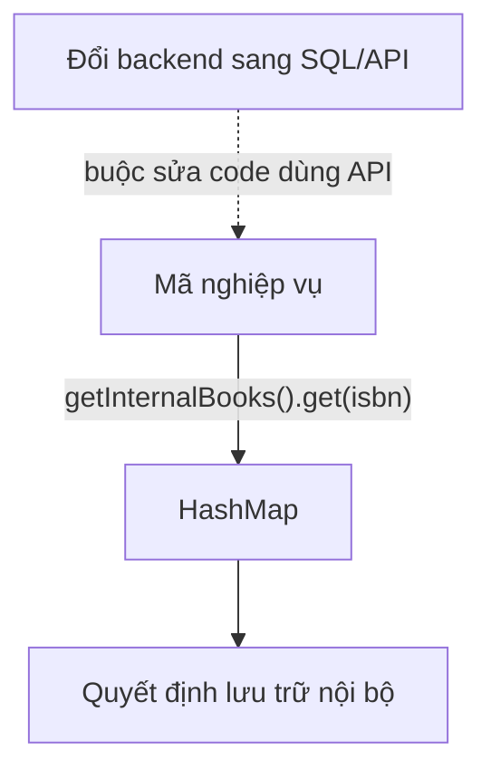
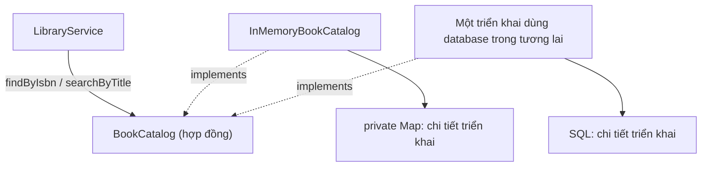

# Rò rỉ chi tiết thực hiện qua giao diện sử dụng (Leaky Abstraction) trong Java

Trong OOP, **trừu tượng** giúp người sử dụng một đối tượng tập trung vào **hợp đồng và hành vi cần thiết**, thay vì phải hiểu toàn bộ cách triển khai bên trong. **Rò rỉ chi tiết thực hiện qua giao diện sử dụng** (*leaky abstraction*) xảy ra khi những yếu tố đáng lẽ chỉ thuộc bên trong lớp/module lại xuất hiện trong API hoặc hành vi quan sát được, khiến mã bên ngoài phải hiểu, phụ thuộc hay xử lý chúng.

Ví dụ: nghiệp vụ cần “tìm sách theo mã”, nhưng một API lại bắt bên gọi truy cập `HashMap` chứa sách, nhớ cấu trúc khóa, rồi tự kiểm tra `null`. Khi đổi cách lưu sách sang cơ sở dữ liệu, hợp đồng cũ trở thành vật cản.

> Không phải mọi chi tiết kỹ thuật đều là “rò rỉ”. Một API xử lý tệp **có thể hợp lý** khi nhận `Path` hoặc ném `IOException`. Cần đánh giá chi tiết nào thuộc **hợp đồng có chủ đích** của người dùng API, chi tiết nào chỉ là quyết định nội bộ không cần thiết.

## 1. Nhận diện qua một API rò rỉ

Giả sử có lớp lưu sách trong bộ nhớ:

```java
import java.util.HashMap;

record Book(String isbn, String title) {}

class LeakyBookStore {
    private final HashMap<String, Book> books = new HashMap<>();

    void add(Book book) {
        books.put(book.isbn(), book);
    }

    // Trả trực tiếp kiểu lưu trữ và dữ liệu bên trong.
    HashMap<String, Book> getInternalBooks() {
        return books;
    }
}
```

Người sử dụng bị đẩy vào chi tiết nội bộ:

```java
LeakyBookStore store = new LeakyBookStore();
store.add(new Book("J-01", "Java OOP"));

Book found = store.getInternalBooks().get("J-01");
store.getInternalBooks().clear(); // Bỏ qua toàn bộ quy tắc của store!
```

Ở đây có **hai vấn đề liên quan nhưng khác nhau**:

1. **Rò rỉ abstraction:** API buộc caller biết rằng dữ liệu nằm trong `HashMap<String, Book>` và phải gọi `get()`. Nếu backend đổi sang truy vấn SQL, caller không còn cách sử dụng phù hợp mà không sửa mã.
2. **Phá vỡ đóng gói:** Getter trả chính tham chiếu `HashMap` có thể thay đổi; caller có thể `clear()`, `put()` hoặc `remove()` mà không đi qua quy tắc nghiệp vụ.

Một API có thể rò rỉ chi tiết triển khai **ngay cả khi dữ liệu không sửa được**: ví dụ trả về `HashMap` được copy mỗi lần gọi thì caller vẫn biết kiểu lưu trữ và phải tự thực hiện thao tác tìm kiếm.



Nguyên tắc cần nhớ: **abstraction tốt che được quyết định có thể thay đổi mà caller không cần biết, đồng thời công bố đủ ngữ nghĩa để caller làm đúng công việc**.

## 2. Sửa bằng hợp đồng biểu đạt nghiệp vụ

Thay vì hỏi “dữ liệu đang nằm trong cấu trúc nào?”, người dùng nên hỏi “tôi có thể tìm sách này không?” và “tôi có thể tìm các sách theo từ khóa nào?”.

Một hợp đồng rõ ràng có thể là:

```java
interface BookCatalog {
    Optional<Book> findByIsbn(String isbn);
    List<Book> searchByTitle(String keyword, int limit);
}
```

Trong đó:

- `findByIsbn` trả `Optional.empty()` khi không có sách.
- `searchByTitle` trả tối đa `limit` sách có tên chứa từ khóa; danh sách kết quả chỉ phục vụ đọc.
- Caller không cần biết việc tìm kiếm sử dụng `Map`, SQL, cache hay HTTP.
- Các kiểu `Optional` và `List` là kiểu Java tổng quát được chọn theo **ngữ nghĩa kết quả**; API không buộc caller sử dụng một loại collection cụ thể.

### Ví dụ đầy đủ có thể biên dịch

Lưu toàn bộ vào **`Main.java`** và chạy với Java 17 hoặc Java 21:

```java
import java.util.ArrayList;
import java.util.HashMap;
import java.util.List;
import java.util.Locale;
import java.util.Map;
import java.util.Objects;
import java.util.Optional;

record Book(String isbn, String title) {
    Book {
        if (isbn == null || isbn.isBlank()) {
            throw new IllegalArgumentException("ISBN không được trống");
        }
        if (title == null || title.isBlank()) {
            throw new IllegalArgumentException("Tiêu đề không được trống");
        }
    }
}

interface BookCatalog {
    Optional<Book> findByIsbn(String isbn);

    // Kết quả có tối đa limit phần tử; limit phải dương.
    // Trong ví dụ, so khớp không phân biệt chữ hoa/chữ thường.
    List<Book> searchByTitle(String keyword, int limit);
}

final class InMemoryBookCatalog implements BookCatalog {
    // Quyết định lưu trữ này không xuất hiện trong BookCatalog.
    private final Map<String, Book> books = new HashMap<>();

    InMemoryBookCatalog(List<Book> initialBooks) {
        Objects.requireNonNull(initialBooks, "initialBooks");

        for (Book book : List.copyOf(initialBooks)) {
            if (books.putIfAbsent(book.isbn(), book) != null) {
                throw new IllegalArgumentException(
                        "Trùng ISBN: " + book.isbn());
            }
        }
    }

    @Override
    public Optional<Book> findByIsbn(String isbn) {
        validateIsbn(isbn);
        return Optional.ofNullable(books.get(isbn));
    }

    @Override
    public List<Book> searchByTitle(String keyword, int limit) {
        if (keyword == null || keyword.isBlank()) {
            throw new IllegalArgumentException("Từ khóa không hợp lệ");
        }
        if (limit <= 0) {
            throw new IllegalArgumentException("Giới hạn phải dương");
        }

        String needle = keyword.toLowerCase(Locale.ROOT);
        List<Book> result = new ArrayList<>();

        // Sắp xếp để thứ tự kết quả ổn định, không phụ thuộc HashMap.
        books.values().stream()
                .filter(book -> book.title()
                        .toLowerCase(Locale.ROOT).contains(needle))
                .sorted((a, b) -> a.isbn().compareTo(b.isbn()))
                .limit(limit)
                .forEach(result::add);

        return List.copyOf(result);
    }

    private static void validateIsbn(String isbn) {
        if (isbn == null || isbn.isBlank()) {
            throw new IllegalArgumentException("ISBN không hợp lệ");
        }
    }
}

final class LibraryService {
    private final BookCatalog catalog;

    LibraryService(BookCatalog catalog) {
        this.catalog = Objects.requireNonNull(catalog, "catalog");
    }

    void printBook(String isbn) {
        String title = catalog.findByIsbn(isbn)
                .map(Book::title)
                .orElse("Không tìm thấy");
        System.out.println(title);
    }

    void printMatches(String keyword, int limit) {
        for (Book book : catalog.searchByTitle(keyword, limit)) {
            System.out.println(book.isbn() + ": " + book.title());
        }
    }
}

public class Main {
    public static void main(String[] args) {
        BookCatalog catalog = new InMemoryBookCatalog(List.of(
                new Book("J-01", "Java OOP"),
                new Book("S-02", "Spring Data"),
                new Book("J-03", "Advanced Java")
        ));
        LibraryService service = new LibraryService(catalog);

        service.printBook("S-02");
        service.printBook("UNKNOWN");
        service.printMatches("java", 2);

        List<Book> snapshot = catalog.searchByTitle("java", 10);
        try {
            snapshot.clear();
        } catch (UnsupportedOperationException ex) {
            System.out.println("Kết quả không thể bị sửa từ caller");
        }
    }
}
```

Chạy:

```bash
javac Main.java
java Main
```

Kết quả:

```text
Spring Data
Không tìm thấy
J-01: Java OOP
J-03: Advanced Java
Kết quả không thể bị sửa từ caller
```

### Điều gì được cải thiện?



`LibraryService` chỉ dùng hợp đồng `BookCatalog`. Muốn thay thế `InMemoryBookCatalog` bằng triển khai dùng cơ sở dữ liệu, mã nghiệp vụ có thể giữ nguyên **nếu** triển khai mới bảo đảm cùng điều kiện đầu vào, ngữ nghĩa kết quả, thứ tự, giới hạn và chính sách lỗi.

Việc trả `List.copyOf(result)` tránh cho caller sửa collection kết quả. Vì `Book` là một record chứa hai `String` bất biến, phần tử không có trạng thái mutable lộ ra ngoài. Với record chứa `List`, mảng hoặc đối tượng mutable, cần phòng vệ thêm; `record` và `List.copyOf` không tự tạo bản sao sâu.

Lưu ý: `BookCatalog` là API đọc. Ví dụ chủ ý không định nghĩa thao tác thêm/sửa/xóa sách từ bên ngoài. Nếu có nhu cầu ghi, nên thiết kế các thao tác nghiệp vụ riêng cùng quy tắc bảo toàn dữ liệu thay vì mở một `Map` nội bộ để caller chỉnh sửa tùy ý.

## 3. Những kiểu rò rỉ thường gặp trong ứng dụng Java

Rò rỉ không chỉ xảy ra khi trả collection. Nó có thể xuất hiện ở **kiểu dữ liệu, ngoại lệ, vòng đời tài nguyên, thứ tự thao tác và hành vi ẩn**.

| API có dấu hiệu rò rỉ | Caller phải biết gì? | Hợp đồng có thể phù hợp hơn |
| --- | --- | --- |
| `HashMap<String, Book> getBooks()` | Cấu trúc lưu trữ và quy tắc khóa | `Optional<Book> findByIsbn(String)` |
| `ResultSet findStudent(long id)` | JDBC, con trỏ dòng và kết nối đang mở | `Optional<Student> findById(long)` |
| `EntityManager getManager()` | Cơ chế persistence của JPA | Phương thức truy vấn/thao tác nghiệp vụ |
| `boolean createOrder(Map<String,Object> rawRow)` | Tên cột hoặc cấu trúc bản ghi vật lý | `createOrder(CreateOrderCommand command)` |
| `void updateCacheKey(String redisKey)` | Quy ước khóa Redis | `invalidateProduct(ProductId id)` |
| `void setBalanceField(long rawValue)` | Chi tiết lưu trạng thái số dư | `deposit(amount)`, `withdraw(amount)` |
| Trả ORM entity có lazy association cho tầng web | Session còn mở và quy tắc lazy loading | DTO đã materialize hoặc query theo nhu cầu |
| Ném lỗi truy vấn SQL trực tiếp từ API miền nghiệp vụ | Driver/database và cách diễn giải lỗi | Lỗi có ngữ nghĩa của nghiệp vụ, giữ nguyên nhân gốc |
| Trả `Stream` đang phụ thuộc kết nối DB chưa đóng | Lifetime của connection và trách nhiệm đóng stream | Trả kết quả đã materialize hoặc tài liệu hóa rõ stream cần đóng |

Đây là các **dấu hiệu**, không phải quy tắc cấm tuyệt đối. Nếu đang viết một thư viện JDBC cấp thấp cho nhà phát triển database, trả `ResultSet` hoặc nhận `Connection` có thể là hợp đồng chính đáng. Câu hỏi quan trọng là: *đối tượng sử dụng thực sự cần biết chi tiết đó để thực hiện trách nhiệm của họ không?*

## 4. Ví dụ API dữ liệu: khi `SQLException` đi qua sai tầng

Giả sử dịch vụ ứng dụng có nhiệm vụ kiểm tra sách tồn tại:

```java
// Ví dụ thể hiện sự phụ thuộc không cần thiết vào JDBC:
interface LeakyAvailability {
    boolean isAvailable(String isbn) throws java.sql.SQLException;
}
```

Một controller hoặc một lớp tính phí sử dụng interface này phải xử lý `SQLException`, mặc dù nó chỉ quan tâm “sách có sẵn không?”. API này tiết lộ rằng hiện tại triển khai có thể dùng cơ sở dữ liệu quan hệ và có thể khiến việc chuyển backend khó khăn hơn.

Một hợp đồng miền nghiệp vụ có thể là:

```java
interface BookAvailability {
    boolean isAvailable(String isbn);
}

// Ví dụ lỗi do ứng dụng định nghĩa:
class CatalogUnavailableException extends RuntimeException {
    CatalogUnavailableException(String message, Throwable cause) {
        super(message, cause);
    }
}
```

Tầng adapter dùng JDBC có thể bắt `SQLException` rồi ném `CatalogUnavailableException` với **cause gốc** để giữ khả năng chẩn đoán. Caller cần phân biệt được `false` (tra cứu thành công nhưng không có sách) với **thất bại hệ thống** (không thể tra cứu). Không nên biến mọi ngoại lệ thành `false` vì như vậy sai ý nghĩa kết quả.

Mẫu minh họa chuyển lỗi:

```java
// Trong một JDBC adapter thực tế:
try {
    // Thực hiện truy vấn
} catch (java.sql.SQLException ex) {
    throw new CatalogUnavailableException(
            "Tạm thời không kiểm tra được danh mục", ex);
}
```

Đoạn trên mô tả **phần xử lý lỗi**, không phải một class hoàn chỉnh để biên dịch độc lập. Trong code sản xuất, hãy đặt nó trong phương thức adapter thực hiện JDBC và quy định rõ lỗi nào có thể retry, lỗi nào là không hợp lệ, lỗi nào cần trả thông báo cho người dùng.

Cũng không cần che giấu mọi ngoại lệ kỹ thuật bằng một loại ngoại lệ chung. Hợp đồng phải giữ đủ ý nghĩa để caller ra quyết định đúng (ví dụ kiểm tra đầu vào, xung đột, không tồn tại, không truy cập được dịch vụ) mà không bị ép hiểu tên driver hoặc SQL vendor.

## 5. Rò rỉ qua thời điểm thực thi và vòng đời tài nguyên

Giả sử một repository trả về `Stream<Book>` mà việc đọc từng phần tử vẫn cần `ResultSet` và `Connection` mở. Caller tưởng đang làm việc với collection Java thuần, nhưng khi duyệt stream ngoài transaction đã đóng sẽ gặp lỗi. Thứ bị rò rỉ là **điều kiện vòng đời** của chi tiết persistence.

Có hai lựa chọn hợp lệ, tùy yêu cầu:

**Đọc số lượng vừa phải và trả kết quả độc lập:**

```java
List<Book> findRecentBooks(int limit);
```

Implementation truy vấn, chuyển dữ liệu thành `Book`, đóng tài nguyên rồi trả một danh sách với hợp đồng rõ ràng.

**Xử lý streaming thật sự với dataset lớn:**

```java
// Hợp đồng phải nói rõ caller sở hữu Stream và cần đóng.
java.util.stream.Stream<Book> streamRecentBooks();
```

Nếu dùng phương án streaming, phải tài liệu hóa việc caller sử dụng `try-with-resources` khi stream sở hữu tài nguyên cần đóng; tránh để việc truy cập nguồn dữ liệu phụ thuộc vào một session “tình cờ còn mở”. Trả `Stream` **không tự bảo đảm** nó đóng connection khi duyệt xong; việc đóng phụ thuộc cách adapter triển khai `onClose` và hợp đồng API.

Ngoài kiểu dữ liệu, có thể rò rỉ qua những điều kiện thứ tự:

- Phải gọi `connect()` rồi mới được `find()`, dù trách nhiệm mở kết nối thuộc adapter.
- Phải gọi `flush()` sau mỗi cập nhật để dữ liệu “thật sự” tồn tại, mặc dù người dùng API chỉ muốn lưu một đơn hàng.
- Phải biết gọi `initializeLazyFields()` trước khi serialize một DTO.

Một API tốt cố gắng **quản lý điều kiện nội bộ trong phạm vi sở hữu của nó** hoặc biến những điều kiện thực sự cần thiết thành một hợp đồng rõ ràng, thay vì để caller phát hiện ngầm qua lỗi runtime.

## 6. Thiết kế để không vô tình lộ mô hình dữ liệu

Có những API không lộ `HashMap` hay JDBC nhưng vẫn làm lộ **cấu trúc bảng, tên trường hạ tầng hoặc cách ghép dữ liệu**:

```java
// Hợp đồng buộc caller biết cột storage và giá trị mã hóa:
Map<String, Object> loadRow(String tableName, long primaryKey);

// Hợp đồng hướng nghiệp vụ:
Optional<OrderSummary> findOrderSummary(OrderId orderId);
```

Ví dụ thứ hai sử dụng các kiểu miền nghiệp vụ như `OrderId`, `OrderSummary`. Bên ngoài không cần biết dữ liệu được lấy từ một bảng, nhiều bảng, cache hay HTTP. Mỗi kiểu miền nghiệp vụ cần được định nghĩa rõ: đơn hàng là gì, trường nào có giá trị gì, có được trả kết quả rỗng không.

Trong ứng dụng Spring, repository có thể cần `JpaRepository` ở adapter, nhưng không nhất thiết để mọi service/controller phụ thuộc trực tiếp các entity, lazy proxy và `EntityManager`. Điều này không có nghĩa **luôn phải tạo thêm một interface mới**. Hãy tạo ranh giới abstraction ở nơi có nhu cầu bảo vệ thay đổi hoặc chia trách nhiệm thực tế.

### `Page` / `Pageable` có phải luôn là rò rỉ?

Không. Nếu hợp đồng phục vụ tìm kiếm phân trang và người dùng hiểu rõ thứ tự, trang, số lượng, thì **phân trang là yêu cầu nghiệp vụ hoặc sản phẩm thực sự**. Tuy nhiên, buộc API lõi phụ thuộc vào `org.springframework.data.domain.Page` có thể không cần thiết nếu những caller cần dùng ngoài Spring.

Có thể chọn một kiểu kết quả độc lập khi ranh giới module thực sự cần:

```java
record SearchPage<T>(
        List<T> items, long totalItems, int page, int pageSize) {
    SearchPage {
        items = List.copyOf(items);
        if (totalItems < 0 || page < 0 || pageSize <= 0) {
            throw new IllegalArgumentException("Thông số trang không hợp lệ");
        }
    }
}
```

Nhưng không nên tạo `SearchPage` mới chỉ để “tránh dùng Spring” khi cả hệ thống cố ý xây trên Spring Data và hợp đồng hiện tại đã phù hợp. **Trừu tượng là lựa chọn ranh giới có giá trị**, không phải số lượng tầng wrapper.

## 7. Rò rỉ chi tiết thực hiện còn biểu hiện ở hành vi

API được khai báo bằng kiểu tổng quát chưa chắc thực sự độc lập với triển khai. Ví dụ:

```java
List<Book> searchByTitle(String keyword);
```

Nếu không có hợp đồng bổ sung, caller rất dễ vô tình dựa vào một đặc tính hiện tại:

- **Thứ tự:** kết quả từ `HashMap.values()` có thứ tự không cam kết. Khi chuyển sang PostgreSQL hoặc đổi cách duyệt, các phần tử đảo vị trí.
- **Phân biệt hoa/thường:** một backend so khớp `"java"` và `"Java"`, backend khác không so khớp.
- **Phân trang:** một triển khai tự giới hạn 100 kết quả, triển khai khác trả tất cả.
- **Độ mới dữ liệu:** cache có độ trễ cập nhật, còn truy vấn trực tiếp có thể phản ánh dữ liệu mới hơn.
- **Ngoại lệ:** “không tìm thấy” trả `null` ở nơi này nhưng ném lỗi ở nơi khác.
- **Chi phí:** một thao tác tưởng truy cập bộ nhớ hóa ra gọi HTTP trong mỗi vòng lặp.

Để abstraction thực sự đáng tin, **định nghĩa hành vi quan sát được**: điều kiện đầu vào, kết quả khi không tìm thấy, thứ tự, giới hạn, cách xử lý trùng lặp, lỗi và giới hạn hiệu năng có ý nghĩa. Không cần mô tả mỗi dòng triển khai; chỉ cần những gì caller phải có khả năng dựa vào.

Một ví dụ: `searchByTitle("java", 10)` trong bài quy định so khớp không phân biệt hoa/thường và sắp xếp theo ISBN tăng dần. Vì vậy các adapter tương lai phải tuân theo, không thể trả thứ tự tùy ý rồi cho rằng “cùng trả `List<Book>` là đủ”.

**Không che giấu vấn đề phân tán:** đọc từ remote service có timeout, lỗi mạng và độ trễ mà một truy cập memory thông thường không có. Một interface không thể xóa các thuộc tính đó. Hợp đồng nên biểu đạt timeout, retry hoặc lỗi sẵn có theo mức độ caller cần hiểu, tránh tạo kỳ vọng sai rằng mọi triển khai có đặc tính giống in-memory.

## 8. Cách refactor một API đã rò rỉ

Giả sử hệ thống đã có nhiều chỗ gọi `getInternalBooks().get(isbn)`. Có thể cải tiến theo thứ tự:

1. **Liệt kê hành vi caller đang thực sự cần:** tìm theo ISBN, kiểm tra tồn tại, tìm theo tiêu đề, xuất thống kê, có thật sự cần chỉnh trực tiếp dữ liệu không?
2. **Định nghĩa hợp đồng theo nhu cầu ấy:** `findByIsbn`, `searchByTitle`, `addBook` nếu cập nhật thuộc trách nhiệm của API. Ghi rõ kết quả và lỗi.
3. **Cài đặt hợp đồng trên cấu trúc hiện tại:** giữ `HashMap` riêng tư; chuyển logic tìm/kiểm tra vào bên trong.
4. **Di chuyển các caller sang API mới:** để chúng dùng hành vi thay vì thao tác dữ liệu thô.
5. **Ngừng công bố đường truy cập cũ** khi các caller đã được chuyển và tương thích phiên bản cho phép; với thư viện công khai, có thể cần giai đoạn `@Deprecated` và chính sách nâng cấp.
6. **Kiểm thử hợp đồng qua nhiều triển khai hoặc một fake độc lập:** caller không nên cần ép kiểu về `InMemoryBookCatalog`.

Không nên vội thiết kế interface quá tổng quát như:

```java
interface Repository {
    Object execute(String command, Object[] arguments);
}
```

API này không còn lộ `HashMap` nhưng lại **mất ngữ nghĩa nghiệp vụ** và chuyển gánh nặng parse, ép kiểu, kiểm tra lỗi sang caller. Đây không phải abstraction tốt. Hợp đồng nên đủ cụ thể để người dùng làm đúng công việc mà không biết chi tiết nội bộ.

Nếu thay đổi cách triển khai là nhu cầu chưa hề tồn tại, một class cụ thể với public API rõ ràng vẫn hoàn toàn có thể là abstraction phù hợp. Không bắt buộc dựng `interface` cho mỗi lớp.

## 9. Checklist khi review giao diện sử dụng

| Câu hỏi | Dấu hiệu cần điều chỉnh |
| --- | --- |
| Tên phương thức có mô tả hành vi mà caller cần? | `getRawRows`, `getInternalMap`, `executeSql` trong API miền nghiệp vụ |
| Kiểu tham số/kết quả có làm lộ framework/backend? | Controller phải cầm `EntityManager` hoặc `ResultSet` |
| Caller có thể thay đổi trạng thái nội bộ ngoài ý muốn? | Getter trả `List`/mảng mutable đang được lớp giữ |
| Kết quả “không tìm thấy” hoặc “lỗi hệ thống” có rõ? | Cùng `null` đại diện nhiều tình huống khác nhau |
| Có điều kiện ẩn về thời điểm hoặc thứ tự gọi? | Phải mở transaction thủ công để đọc DTO tưởng đã hoàn chỉnh |
| Có hành vi không được cam kết nhưng caller đang dựa vào? | Dựa vào thứ tự duyệt `HashMap` |
| Thay triển khai có buộc sửa caller? | Bên gọi dùng trực tiếp class/SQL/khóa cache thay vì hợp đồng |
| API có quá trừu tượng đến mức vô nghĩa không? | `Object execute(...)` và caller phải ép kiểu mọi nơi |
| API có bảo vệ điều kiện nghiệp vụ? | Caller bỏ qua validation bằng cách sửa dữ liệu thô |
| Ranh giới này có thật sự cần tách? | Tạo thêm nhiều lớp trung gian chỉ chuyển tiếp y nguyên lời gọi |

**Đừng đánh đồng “ẩn mọi thứ” với abstraction tốt.** Những lựa chọn ảnh hưởng hành vi người dùng (ví dụ thứ tự tìm kiếm, phân trang, thất bại truy vấn, quyền sửa dữ liệu) phải được mô tả rõ. Điều cần ẩn là chi tiết cài đặt không cần thiết để sử dụng hợp đồng.

## 10. Bài tập tự kiểm tra

**Câu 1.** `Map<String, Product> getInternalCache()` trong một service bán hàng có vấn đề gì?

**Đáp án:** Caller biết cấu trúc cache, quy tắc khóa và có thể sửa dữ liệu nếu map mutable. Khi thay cache bằng hệ thống khác, caller bị ảnh hưởng. Hãy cân nhắc `Optional<Product> findProduct(String id)` hoặc thao tác nghiệp vụ có ý nghĩa.

**Câu 2.** Đổi `HashMap` trả về thành `Collections.unmodifiableMap(internal)` đã xóa hoàn toàn rò rỉ abstraction chưa?

**Đáp án:** **Chưa chắc.** View ngăn sửa qua tham chiếu đó nhưng vẫn buộc caller hiểu map/khóa; hơn nữa backing map thay đổi thì view cũng phản ánh. Chặn sửa và che cấu trúc triển khai là hai vấn đề khác nhau.

**Câu 3.** Một API `readFile(Path path) throws IOException` có phải là leaky abstraction?

**Đáp án:** **Không nhất thiết.** Khi mục đích công khai là thao tác trực tiếp với file, `Path` và `IOException` chính là phần hợp đồng. Nếu API là `getCustomerProfile()` nhưng caller phải biết đường dẫn JSON và xử lý lỗi file thì có thể đó là rò rỉ không cần thiết.

**Câu 4.** Hai triển khai cùng `BookCatalog` nhưng một bên tìm kiếm phân biệt chữ hoa, một bên không. Thay thế cho nhau có an toàn không?

**Đáp án:** Nếu hợp đồng quy định không phân biệt hoa/thường, triển khai khác đã vi phạm hợp đồng. Trừu tượng tốt đòi hỏi tương thích **hành vi**, không chỉ tương thích chữ ký phương thức.

**Câu 5.** Dùng một interface `findById()` để bọc `HashMap` có tự bảo đảm an toàn nhiều luồng và transaction không?

**Đáp án:** **Không.** Interface chỉ biểu đạt hợp đồng; tính nguyên tử, visibility và transaction thuộc trách nhiệm triển khai và cần được quy định nếu caller phụ thuộc vào chúng.

**Câu 6.** Tại sao không nên đổi mọi API thành `Object execute(String command)` để giấu hoàn toàn cách thực hiện?

**Đáp án:** Vì caller phải biết chuỗi lệnh, parse dữ liệu và ép kiểu, tức chi tiết bị chuyển sang caller, còn hợp đồng kiểu dữ liệu và ngữ nghĩa trở nên khó kiểm chứng.

**Ghi nhớ:** Đánh giá một abstraction bằng việc code bên ngoài **cần biết những gì để dùng nó đúng**, và **mức độ ảnh hưởng khi cài đặt thay đổi**. API tốt công bố hành vi, dữ liệu và lỗi ở mức phù hợp với người dùng; giữ chi tiết lưu trữ, framework và trạng thái riêng ở nơi sở hữu chúng. Đồng thời, đừng che giấu các thuộc tính quan sát được mà caller thực sự cần dựa vào.