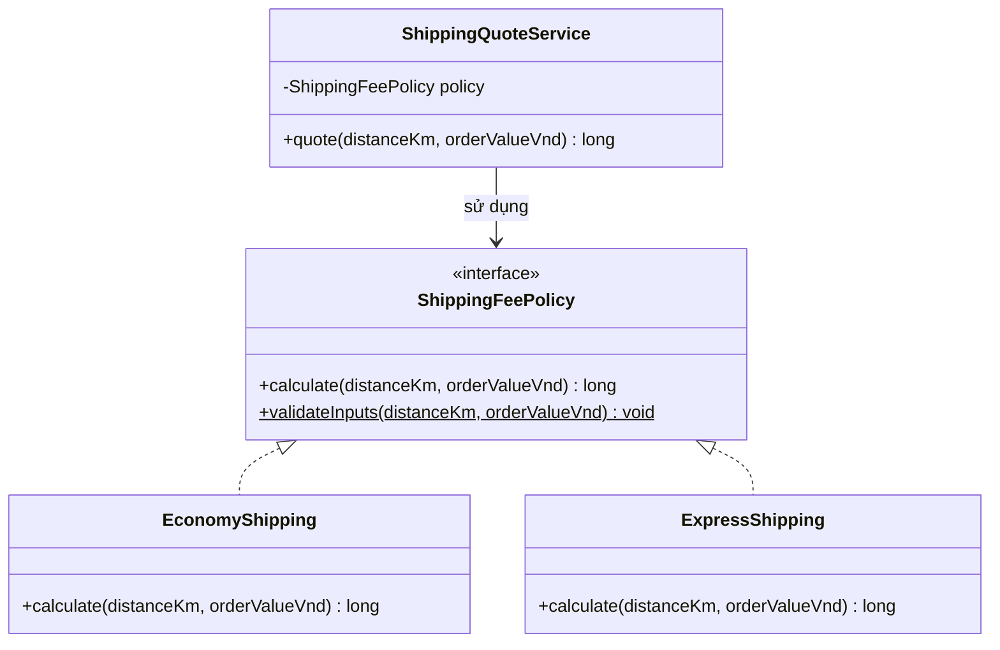
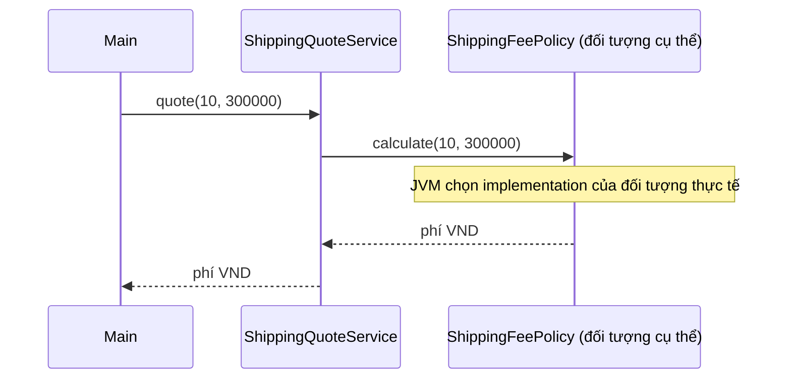

# Khai báo và thực hiện giao diện (interface) trong Java

Trong lập trình hướng đối tượng, **giao diện (interface)** mô tả những hành vi mà một kiểu đối tượng cam kết cung cấp. Một lớp **thực hiện giao diện** (*implements*) bằng cách viết mã cho các phương thức thuộc hợp đồng đó.

Ví dụ: hệ thống bán hàng có nhiều cách tính phí giao hàng. Dịch vụ thanh toán chỉ cần yêu cầu “tính phí giao cho quãng đường và giá trị đơn này”, không cần biết phí được tính theo gói tiết kiệm hay giao nhanh. Interface cho phép tách **điều người gọi cần** khỏi **cách từng lớp tính toán**.

Bài học dùng Java 11 trở lên, với các ví dụ tệp `.java` có thể biên dịch trực tiếp.

## 1. Cú pháp căn bản

Khai báo một giao diện:

```java
public interface Greeter {
    String greet(String name);
}
```

Khai báo một lớp thực hiện:

```java
public final class VietnameseGreeter implements Greeter {
    @Override
    public String greet(String name) {
        return "Xin chào, " + name;
    }
}
```

Sử dụng:

```java
Greeter greeter = new VietnameseGreeter();
System.out.println(greeter.greet("Lan")); // Xin chào, Lan
```

Các thành phần cần hiểu:

| Cú pháp | Ý nghĩa |
| --- | --- |
| `interface Greeter` | Khai báo kiểu giao diện có tên `Greeter` |
| `String greet(String name);` | Chữ ký phương thức; ở đây là phương thức abstract, chưa có thân |
| `class VietnameseGreeter implements Greeter` | Lớp cam kết thực hiện giao diện |
| `@Override` | Đề nghị trình biên dịch kiểm tra rằng phương thức thực sự override/implement một phương thức kế thừa |
| `public String greet(...)` | Cung cấp thân phương thức; `public` là bắt buộc vì hợp đồng interface là public |
| `Greeter greeter = new VietnameseGreeter()` | Biến có kiểu interface giữ tham chiếu tới đối tượng triển khai cụ thể |

Trong một interface, phương thức instance thông thường không có thân như `greet` ở trên **ngầm là `public abstract`**. Vì vậy:

```java
String greet(String name);
```

tương đương với:

```java
public abstract String greet(String name);
```

Lớp triển khai bắt buộc dùng phương thức `public`, không thể giảm mức truy cập thành `protected`, package-private hay `private`.

Điểm quan trọng: **interface là một kiểu dữ liệu**, nhưng không thể tạo trực tiếp bằng `new Greeter()`. Ta tạo đối tượng từ một lớp cụ thể thực hiện interface (hoặc từ một biểu thức/lớp ẩn danh phù hợp), rồi lưu tham chiếu của nó dưới kiểu giao diện.

## 2. Bài toán thực tế: thay đổi cách tính phí giao hàng

Giả sử một đơn hàng cần báo phí theo hai chính sách:

- **Tiết kiệm:** phí cơ bản 10.000 VND cộng 2.500 VND cho mỗi km; miễn phí khi giá trị hàng đạt từ 500.000 VND.
- **Giao nhanh:** phí cơ bản 20.000 VND cộng 5.000 VND cho mỗi km; không miễn phí theo giá trị hàng.

Quãng đường là số km nguyên không âm và giá trị đơn hàng là số tiền nguyên VND không âm. Với các giá trị lớn khiến phép tính `long` tràn số, ví dụ báo lỗi thay vì trả phí sai.

Ta muốn phần thanh toán không cần chứa một chuỗi `if (shippingType.equals(...))` để tự quyết định mọi công thức. Thay vào đó, dịch vụ thanh toán **phụ thuộc vào interface**.

### Bước 1: định nghĩa hợp đồng trong `ShippingFeePolicy.java`

```java
/**
 * Chính sách tính phí giao hàng.
 *
 * distanceKm >= 0 và orderValueVnd >= 0.
 * Kết quả là số tiền nguyên VND không âm.
 * Với đầu vào âm, ném IllegalArgumentException.
 * Nếu tính phí bị tràn long, có thể ném ArithmeticException.
 */
public interface ShippingFeePolicy {

    long calculate(int distanceKm, long orderValueVnd);

    // Phương thức static dùng chung để kiểm tra đầu vào.
    static void validateInputs(int distanceKm, long orderValueVnd) {
        if (distanceKm < 0 || orderValueVnd < 0) {
            throw new IllegalArgumentException(
                    "Quãng đường và giá trị đơn không được âm");
        }
    }
}
```

Ở đây `calculate(...)` là **điểm mở rộng**: mỗi chính sách tự đưa ra công thức, nhưng mọi chính sách đều phải giữ quy tắc đầu vào và kết quả đã mô tả. `validateInputs(...)` là phương thức `static` thuộc chính interface; các lớp triển khai có thể gọi nó trực tiếp qua `ShippingFeePolicy.validateInputs(...)`.

Về mặt thiết kế, không phải lúc nào cũng nên đặt logic dùng chung trong interface. Ở ví dụ này, việc kiểm tra hai tham số là một phần thống nhất của hợp đồng, nên phương thức `static` ngắn giúp minh họa khả năng của interface trong Java hiện đại.

### Bước 2: triển khai chính sách tiết kiệm

Tệp `EconomyShipping.java`:

```java
public final class EconomyShipping implements ShippingFeePolicy {

    private static final long FREE_SHIPPING_FROM_VND = 500_000L;
    private static final long BASE_FEE_VND = 10_000L;
    private static final long PER_KM_VND = 2_500L;

    @Override
    public long calculate(int distanceKm, long orderValueVnd) {
        ShippingFeePolicy.validateInputs(distanceKm, orderValueVnd);

        if (orderValueVnd >= FREE_SHIPPING_FROM_VND) {
            return 0L;
        }

        long distanceFee =
                Math.multiplyExact(PER_KM_VND, (long) distanceKm);
        return Math.addExact(BASE_FEE_VND, distanceFee);
    }
}
```

`EconomyShipping` dùng `implements ShippingFeePolicy`. Trình biên dịch kiểm tra lớp đã cung cấp phương thức `calculate(int, long)` với kiểu trả về phù hợp. Công thức và các hằng số nội bộ thuộc lớp cụ thể; caller dùng interface không cần biết chúng.

### Bước 3: triển khai chính sách giao nhanh

Tệp `ExpressShipping.java`:

```java
public final class ExpressShipping implements ShippingFeePolicy {

    private static final long BASE_FEE_VND = 20_000L;
    private static final long PER_KM_VND = 5_000L;

    @Override
    public long calculate(int distanceKm, long orderValueVnd) {
        ShippingFeePolicy.validateInputs(distanceKm, orderValueVnd);

        long distanceFee =
                Math.multiplyExact(PER_KM_VND, (long) distanceKm);
        return Math.addExact(BASE_FEE_VND, distanceFee);
    }
}
```

Hai lớp đều **đáp ứng cùng chữ ký**, nhưng triển khai hành vi khác nhau. Đó là nền tảng để chương trình sử dụng tính đa hình: lời gọi `policy.calculate(...)` chạy phương thức của lớp thực tế mà biến `policy` đang tham chiếu.

### Bước 4: dịch vụ sử dụng giao diện, không lệ thuộc lớp cụ thể

Tệp `ShippingQuoteService.java`:

```java
import java.util.Objects;

public final class ShippingQuoteService {
    private final ShippingFeePolicy policy;

    public ShippingQuoteService(ShippingFeePolicy policy) {
        this.policy = Objects.requireNonNull(policy, "policy");
    }

    public long quote(int distanceKm, long orderValueVnd) {
        return policy.calculate(distanceKm, orderValueVnd);
    }
}
```

`ShippingQuoteService` không viết `new EconomyShipping()` hay `new ExpressShipping()` bên trong. Đối tượng chính sách được đưa vào qua constructor. Đây là một ví dụ đơn giản của **dependency injection bằng constructor**: thành phần cấp cao nhận một dependency qua kiểu trừu tượng. Không cần framework để sử dụng cách thiết kế này.

### Bước 5: chạy ví dụ tổng hợp

Tệp `Main.java`, cùng thư mục với bốn tệp trên:

```java
public class Main {
    public static void main(String[] args) {
        ShippingFeePolicy economyPolicy = new EconomyShipping();
        ShippingFeePolicy expressPolicy = new ExpressShipping();

        ShippingQuoteService economyQuote =
                new ShippingQuoteService(economyPolicy);
        ShippingQuoteService expressQuote =
                new ShippingQuoteService(expressPolicy);

        System.out.println(economyQuote.quote(10, 300_000));
        System.out.println(economyQuote.quote(10, 600_000));
        System.out.println(expressQuote.quote(10, 300_000));

        try {
            expressQuote.quote(-1, 300_000);
        } catch (IllegalArgumentException ex) {
            System.out.println("Từ chối: " + ex.getMessage());
        }
    }
}
```

Chạy bằng terminal:

```bash
javac ShippingFeePolicy.java EconomyShipping.java ExpressShipping.java ShippingQuoteService.java Main.java
java Main
```

Kết quả:

```text
35000
0
70000
Từ chối: Quãng đường và giá trị đơn không được âm
```

Giải thích kết quả:

| Chính sách | Quãng đường | Giá trị hàng | Phí trả về |
| --- | ---: | ---: | ---: |
| Economy | 10 km | 300.000 VND | 10.000 + 2.500 × 10 = **35.000 VND** |
| Economy | 10 km | 600.000 VND | **0 VND** (đủ điều kiện miễn phí) |
| Express | 10 km | 300.000 VND | 20.000 + 5.000 × 10 = **70.000 VND** |

Dịch vụ chỉ biết `ShippingFeePolicy`. Khi bổ sung một chính sách thứ ba, ta tạo lớp khác thực hiện cùng interface rồi truyền vào dịch vụ; phần tính phí tại `ShippingQuoteService` không cần sửa.

## 3. Luồng đa hình nhìn từ interface



Mũi tên nét đứt với đầu tam giác rỗng biểu thị quan hệ **realization/implements**. `ShippingQuoteService` hợp tác với `ShippingFeePolicy` qua một field có kiểu interface.

Luồng thực hiện:



Trong một lời gọi cụ thể, `policy` có thể tham chiếu `EconomyShipping` hoặc `ExpressShipping`. Java quyết định **implementation của phương thức instance** tại thời điểm chạy dựa trên kiểu thực tế của đối tượng. Trình biên dịch vẫn dùng **kiểu của biến tham chiếu** để kiểm tra những phương thức có thể gọi.

Ví dụ:

```java
ShippingFeePolicy policy = new EconomyShipping();
long fee = policy.calculate(8, 200_000); // Hợp lệ

// policy.onlyEconomyFeature(); // Không hợp lệ nếu method
// này không được khai báo trong ShippingFeePolicy.
```

Nếu cần hành vi chỉ có ở một lớp cụ thể, hãy tự hỏi có nên thêm một hợp đồng riêng hay không. Ép kiểu liên tục từ interface xuống lớp triển khai thường là dấu hiệu phần trừu tượng chưa phù hợp.

## 4. Những quy tắc khi khai báo và thực hiện interface

### Phương thức abstract phải được thực hiện đầy đủ

```java
interface Printer {
    void print(String text);
    int pagesPrinted();
}
```

Một lớp **concrete** khai báo `implements Printer` phải cung cấp đầy đủ phương thức abstract chưa được kế thừa từ nơi khác:

```java
class ConsolePrinter implements Printer {
    private int pages;

    @Override
    public void print(String text) {
        System.out.println(text);
        pages++;
    }

    @Override
    public int pagesPrinted() {
        return pages;
    }
}
```

Nếu thiếu `pagesPrinted()`, lớp concrete sẽ không biên dịch. Lớp `abstract` có thể chọn chỉ triển khai một phần hợp đồng để lớp con hoàn thiện:

```java
abstract class BasePrinter implements Printer {
    @Override
    public int pagesPrinted() {
        return 0;
    }
    // Chưa định nghĩa print(String): được phép vì class abstract.
}
```

Chú ý `pagesPrinted()` của `BasePrinter` ở đây trả `0` cố định chỉ để minh họa cú pháp; nếu sử dụng thực tế, triển khai cần trả số trang chính xác theo hợp đồng mong muốn.

### Không thể thu hẹp quyền truy cập

```java
interface Task {
    void execute(); // implicit public abstract
}

class MyTask implements Task {
    @Override
    public void execute() { // Bắt buộc public
        System.out.println("Thực hiện");
    }
}
```

Viết `void execute()` thiếu `public` khi implement sẽ gây lỗi biên dịch vì đang cố giảm quyền truy cập của phương thức `public`.

### Chữ ký phải tương thích

Phương thức triển khai phải khớp tên và danh sách tham số; kiểu trả về phải tương thích, bao gồm quy tắc **covariant return type** với kiểu tham chiếu. Khai báo một overload có tham số khác không thay thế được phương thức phải implement.

```java
interface Parser {
    String parse(String input);
}

class TrimParser implements Parser {
    @Override
    public String parse(String input) {
        return input.trim();
    }

    // Đây là overload, không phải cách thay thế parse(String).
    public String parse(int value) {
        return Integer.toString(value);
    }
}
```

`@Override` rất hữu ích: nếu gõ nhầm `parse(Object)` thay cho `parse(String)`, trình biên dịch sẽ báo không có phương thức đúng để override.

## 5. Interface có thể khai báo cả phương thức có thân

Trong `ShippingFeePolicy` ở ví dụ chính, `calculate(int,long)` là phương thức **abstract** cần được lớp cụ thể hiện thực, còn `static validateInputs(...)` đã có thân và được gọi bằng tên interface. Java hiện đại còn cho phép:

~~~java
interface NamedTask {
    String name();                        // public abstract

    default String describe() {           // Java 8+
        return "Task: " + name();
    }

    static boolean isValid(String value) { // Java 8+
        return value != null && !value.isBlank();
    }

    private String normalized() {         // Java 9+
        return name().strip();
    }
}
~~~

`default` tạo hành vi instance có thể kế thừa/override; `static` không được gọi như phương thức instance; `private` là helper trong interface (ở ví dụ này chưa được gọi). Mọi field khai báo trực tiếp trong interface ngầm là `public static final`, không có state instance. Để học **đầy đủ** quy tắc modifier, field, xung đột default và tính tương thích ngôn ngữ, xem bài *Thành viên mặc định và giới hạn tùy ngôn ngữ*.

## 6. `implements` nhiều interface vẫn chỉ tạo một đối tượng

Một class có thể nhận nhiều hợp đồng qua danh sách phân cách bằng dấu phẩy:

~~~java
interface Printable { void print(); }
interface Exportable { String export(); }

class Report implements Printable, Exportable {
    public void print() { System.out.println("In báo cáo"); }
    public String export() { return "report"; }
}

Report report = new Report();
Printable printer = report;
Exportable exporter = report;
~~~

Hai biến interface `printer` và `exporter` tham chiếu **cùng một** `Report`; chúng không tạo thêm instance và mỗi biến chỉ cung cấp API của vai trò tương ứng. Một interface cũng có thể `extends` nhiều interface khác, còn class Java chỉ trực tiếp `extends` một class.

Nếu các interface độc lập có cùng default method, Java có quy tắc giải quyết xung đột, không chọn ngẫu nhiên. Bài *Một đối tượng đảm nhận nhiều giao diện* có trace thay đổi trạng thái qua nhiều tham chiếu và các trường hợp method collision.

## 7. Interface khác abstract class ở vai trò thiết kế

| Nhu cầu | Interface | Abstract class |
|---|---|---|
| Mở API cho nhiều loại class khác nhau | Khai báo hợp đồng qua `implements` | Ràng buộc vào một họ kế thừa |
| Dùng nhiều vai trò đồng thời | Cho phép `implements` nhiều interface | Class chỉ có một superclass trực tiếp |
| Chia sẻ constructor, field instance, thuật toán nền | Không có constructor/field instance | Hỗ trợ trạng thái và phần triển khai dùng chung |

Ví dụ `ShippingQuoteService` chỉ quan tâm `ShippingFeePolicy`; nó không cần biết các chính sách có chung superclass hay không. Nếu một nhóm chính sách thật sự dùng cùng công thức nền và trạng thái cấu hình, nhóm đó có thể kế thừa một abstract class `implements ShippingFeePolicy`, còn chính sách độc lập vẫn `implements` trực tiếp. Bài *Chọn giao diện hay lớp trừu tượng* triển khai minh họa đầy đủ cùng lựa chọn composition.

## 8. Kiểm tra hợp đồng của nhiều implementation

Dù cả `EconomyShipping` và `ExpressShipping` đều biên dịch, chương trình vẫn có thể sai nếu implementation trả phí âm hoặc bỏ qua yêu cầu dữ liệu không âm. Trình biên dịch kiểm tra **chữ ký**; các ràng buộc nghiệp vụ phải được giữ bằng code và kiểm thử.

Tệp `ContractCheck.java`:

```java
public class ContractCheck {
    public static void main(String[] args) {
        ShippingFeePolicy[] policies = {
            new EconomyShipping(),
            new ExpressShipping()
        };

        for (ShippingFeePolicy policy : policies) {
            long fee = policy.calculate(10, 300_000);
            if (fee < 0) {
                throw new AssertionError("Phí giao hàng bị âm");
            }

            boolean rejected = false;
            try {
                policy.calculate(-1, 300_000);
            } catch (IllegalArgumentException expected) {
                rejected = true;
            }

            if (!rejected) {
                throw new AssertionError("Không từ chối quãng đường âm");
            }
        }

        require(
                new EconomyShipping().calculate(10, 300_000) == 35_000,
                "Sai phí Economy");
        require(
                new EconomyShipping().calculate(10, 600_000) == 0,
                "Sai điều kiện miễn phí");
        require(
                new ExpressShipping().calculate(10, 300_000) == 70_000,
                "Sai phí Express");

        System.out.println("PASS: Các implementation giữ hợp đồng");
    }

    private static void require(boolean condition, String message) {
        if (!condition) {
            throw new AssertionError(message);
        }
    }
}
```

Chạy:

```bash
javac ShippingFeePolicy.java EconomyShipping.java ExpressShipping.java ContractCheck.java
java ContractCheck
```

Kết quả:

```text
PASS: Các implementation giữ hợp đồng
```

Trong dự án thực tế, những kiểm tra này có thể thành test JUnit chạy với nhiều implementation. Việc **dùng cùng một bộ kiểm tra hành vi** giúp phát hiện một lớp mới implement đúng chữ ký nhưng vi phạm quy tắc mà client đang dựa vào.

### Một vài lỗi biên dịch cần nhận diện

| Mã hoặc tình huống | Vấn đề | Cách sửa |
| --- | --- | --- |
| `new ShippingFeePolicy()` | Interface không có instance để khởi tạo trực tiếp | `new EconomyShipping()` hoặc một implementation khác |
| Class implement thiếu `calculate` | Class concrete chưa đáp ứng hợp đồng | Viết đủ phương thức hoặc khai báo class `abstract` |
| `long calculate(...)` thiếu `public` | Giảm quyền truy cập của phương thức interface | Thêm `public` |
| Viết `calculate(long, long)` thay vì `calculate(int, long)` | Overload khác chữ ký, không thực hiện phương thức yêu cầu | Khớp đúng danh sách kiểu tham số |
| Gọi `policy.specialFeature()` không thuộc interface | Kiểu biến không công bố phương thức đó | Thiết kế lại hợp đồng hoặc dùng đúng kiểu khi thật sự cần |
| Gọi `policy.validateInputs(...)` | Static method không là phương thức instance kế thừa | Dùng `ShippingFeePolicy.validateInputs(...)` |
| Hai default method xung đột | Không có implementation duy nhất được chọn | Override và phân giải xung đột |
| Dùng interface như kho field mutable | Field trong interface luôn là hằng `public static final` | Đặt trạng thái trong class hoặc đối tượng phù hợp |

## 9. Cách tổ chức tệp trong dự án thật

Ví dụ trên để các lớp trong cùng thư mục không khai báo package, thuận tiện cho người mới biên dịch bằng `javac`. Với ứng dụng lớn, hãy dùng package rõ ràng. Ví dụ:

```text
src/main/java/com/example/shipping/
├── ShippingFeePolicy.java
├── EconomyShipping.java
├── ExpressShipping.java
└── ShippingQuoteService.java
```

Mỗi tệp sẽ khai báo `package com.example.shipping;` ở đầu. `Main` hay một REST controller ở package khác sử dụng interface bằng `import` tương ứng. Khi có Spring, một bean thuộc lớp triển khai có thể được inject vào service qua constructor, nhưng **bản thân interface Java không phụ thuộc Spring**. Nếu nhiều bean cùng implement một interface, cấu hình cần làm rõ implementation nào được chọn; đó là việc của cơ chế DI, không phải quyết định tự động của Java interface.

Một cách thiết kế thường hiệu quả là cho domain/service phụ thuộc vào **giao diện nhỏ có mục đích rõ ràng**, thay vì gom mọi thao tác không liên quan vào một “siêu interface”. Nếu client chỉ cần tính phí, không nên buộc nó phải biết thêm giao diện lưu đơn hàng, gửi email và theo dõi bưu kiện.

## 10. Tự thực hành

**Bài tập A — thay công thức mà không sửa service.** Tạo `SameDayShipping implements ShippingFeePolicy` với phí 35.000 VND + 7.000 VND mỗi km, không miễn phí. Giữ nguyên kiểm tra đầu vào. Truyền vào `ShippingQuoteService` rồi tính phí cho 4 km. **Kết quả mong đợi: 63.000 VND**.

**Bài tập B — dự đoán lỗi biên dịch.**

```java
interface Reader {
    String read();
}

class FileReaderExample implements Reader {
    String read() {
        return "data";
    }
}
```

Lỗi nằm ở đâu? Phương thức của `Reader` ngầm là `public`, còn `FileReaderExample.read()` không có modifier nên là package-private. Sửa thành `public String read()` và nên thêm `@Override`.

**Bài tập C — interface nhiều phương thức.** Tạo `Resizable` với `void resize(int width, int height)` và `int area()`. Triển khai `Rectangle` sao cho chiều dài/rộng phải dương, `area()` trả diện tích và không làm đổi trạng thái. Hãy quyết định rõ xử lý trường hợp nhân số `int` bị tràn.

**Bài tập D — nhiều interface.** Viết `interface Identifiable { String id(); }` và `interface Printable { void print(); }`; tạo một lớp `Invoice` thực hiện cả hai. Dùng hai biến có kiểu interface để gọi hành vi tương ứng trên cùng một đối tượng.

**Bài tập E — default method.** Tạo `interface Named { String name(); default String displayName() { return name().trim(); } }`. Cài đặt một lớp sử dụng default method và một lớp override nó. Quan sát cách client gọi `displayName()` qua biến `Named`.

## Ghi nhớ khi đọc hoặc thiết kế interface

Một interface tốt trả lời được: **“Đối tượng triển khai phải cung cấp những hành vi nào, với dữ liệu vào và kết quả như thế nào?”**. Khi thực hiện interface, hãy kiểm tra chữ ký, quyền truy cập `public`, những cam kết nghiệp vụ và các trường hợp lỗi. Khi sử dụng interface, hãy tạo đối tượng triển khai rồi thao tác qua **kiểu giao diện** để giảm sự phụ thuộc vào chi tiết bên trong.

Ba dòng then chốt:

```java
interface Action { void run(); }       // Khai báo hợp đồng
class Job implements Action {          // Thực hiện hợp đồng
    @Override public void run() { System.out.println("Run"); }
}
```

Và:

```java
Action action = new Job(); // Biến theo interface, đối tượng theo class
action.run();              // Gọi implementation của Job
```

Khi đã phân biệt được **`interface` khai báo hợp đồng**, **`implements` cung cấp hành vi** và **biến kiểu interface gọi qua đa hình**, bạn có thể mở rộng ứng dụng bằng các triển khai mới mà vẫn giữ nguyên cách sử dụng từ phía client.