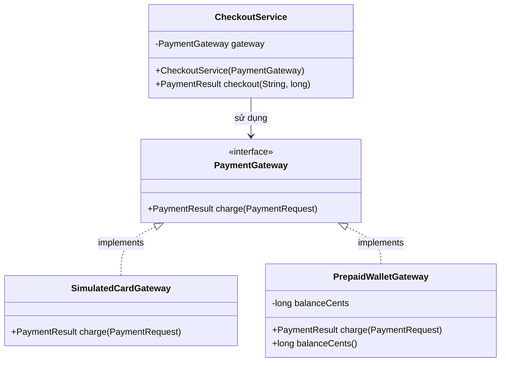
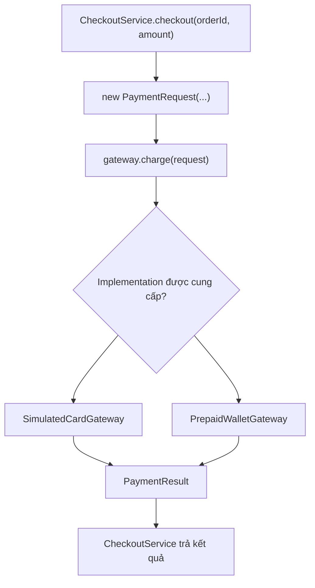

# Lập trình dựa trên giao diện (Programming to Interfaces) trong Java

> **Chủ đề:** OOP → Giao diện. Khi một thành phần chỉ cần biết **một khả năng/hợp đồng** của thành phần khác, hãy cho nó phụ thuộc vào `interface` thay vì lớp triển khai cụ thể. Nhờ vậy, mã nghiệp vụ có thể làm việc với nhiều implementation, thay đổi công nghệ phía sau và kiểm thử bằng fake mà không phải sửa logic chính.

## 1. Vấn đề khi phụ thuộc trực tiếp vào lớp cụ thể

Giả sử `CheckoutService` thực hiện thanh toán qua một bộ xử lý thẻ:

```java
class CardGateway {
    boolean charge(long amountCents) {
        // Ví dụ mô phỏng, không kết nối cổng thanh toán thật.
        return true;
    }
}

class CheckoutService {
    private final CardGateway gateway = new CardGateway();

    boolean checkout(long amountCents) {
        return gateway.charge(amountCents);
    }
}
```

Ở đây `CheckoutService` tự tạo và phụ thuộc trực tiếp vào `CardGateway`. Nếu muốn dùng ví trả trước, giả lập lỗi thanh toán khi kiểm thử hoặc thay nhà cung cấp, thường phải sửa `CheckoutService` hoặc thêm các nhánh `if` để lựa chọn loại gateway.

**Nguyên tắc lập trình dựa trên giao diện:** thay vì biết *ai* xử lý, `CheckoutService` chỉ cần biết *có thể yêu cầu thanh toán như thế nào*.

```java
interface PaymentGateway {
    PaymentResult charge(PaymentRequest request);
}
```

Giao diện mô tả **hành vi mà bên sử dụng được quyền dựa vào**. Những lớp khác nhau có thể `implements PaymentGateway` và tự quyết định cách thực hiện.

## 2. Mối quan hệ giữa người dùng giao diện và lớp triển khai



Mũi tên từ `CheckoutService` tới `PaymentGateway` là **phụ thuộc vào abstraction**. Các lớp gateway là **implementation** của hợp đồng. `CheckoutService` không cần ép kiểu hoặc kiểm tra `instanceof` để quyết định gửi yêu cầu tới lớp nào.

Ba vai trò thường gặp:

| Vai trò | Trong ví dụ | Trách nhiệm |
|---|---|---|
| Giao diện | `PaymentGateway` | Khai báo thao tác thanh toán |
| Thành phần sử dụng | `CheckoutService` | Điều phối checkout bằng hợp đồng chung |
| Lớp triển khai | `SimulatedCardGateway`, `PrepaidWalletGateway` | Thực hiện cách thanh toán cụ thể |

Hợp đồng không chỉ là **chữ ký hàm**. Nó nên mô tả ý nghĩa tham số, giá trị trả về, trường hợp thất bại, tác động lên hệ thống và việc một lời gọi có thể bị thực hiện lặp hay không.

## 3. Ví dụ Java hoàn chỉnh: thay implementation mà không sửa CheckoutService

Tạo tệp `InterfaceProgrammingDemo.java` (Java 17 trở lên):

```java
import java.util.Objects;

public class InterfaceProgrammingDemo {

    public record PaymentRequest(String orderId, long amountCents) {
        public PaymentRequest {
            if (orderId == null || orderId.isBlank()) {
                throw new IllegalArgumentException("Mã đơn hàng không hợp lệ");
            }
            if (amountCents <= 0) {
                throw new IllegalArgumentException("Số tiền phải dương");
            }
        }
    }

    public record PaymentResult(boolean successful, String description) {
        public PaymentResult {
            Objects.requireNonNull(description, "description");
        }
    }

    public interface PaymentGateway {
        PaymentResult charge(PaymentRequest request);
    }

    // Implementation A: giả lập một cổng thẻ luôn trả thành công.
    public static final class SimulatedCardGateway implements PaymentGateway {
        @Override
        public PaymentResult charge(PaymentRequest request) {
            Objects.requireNonNull(request, "request");
            return new PaymentResult(true, "Thẻ mô phỏng: " + request.orderId());
        }
    }

    // Implementation B: ví trả trước có số dư được quản lý trong bộ nhớ.
    public static final class PrepaidWalletGateway implements PaymentGateway {
        private long balanceCents;

        public PrepaidWalletGateway(long openingBalanceCents) {
            if (openingBalanceCents < 0) {
                throw new IllegalArgumentException("Số dư không thể âm");
            }
            this.balanceCents = openingBalanceCents;
        }

        @Override
        public synchronized PaymentResult charge(PaymentRequest request) {
            Objects.requireNonNull(request, "request");

            if (request.amountCents() > balanceCents) {
                return new PaymentResult(false, "Ví không đủ số dư");
            }

            balanceCents -= request.amountCents();
            return new PaymentResult(true, "Ví đã trừ tiền");
        }

        public synchronized long balanceCents() {
            return balanceCents;
        }
    }

    // Lớp nghiệp vụ chỉ phụ thuộc vào PaymentGateway.
    public static final class CheckoutService {
        private final PaymentGateway gateway;

        public CheckoutService(PaymentGateway gateway) {
            this.gateway = Objects.requireNonNull(gateway, "gateway");
        }

        public PaymentResult checkout(String orderId, long amountCents) {
            PaymentRequest request = new PaymentRequest(orderId, amountCents);
            return gateway.charge(request);
        }
    }

    public static void main(String[] args) {
        CheckoutService cardCheckout =
            new CheckoutService(new SimulatedCardGateway());

        PrepaidWalletGateway wallet = new PrepaidWalletGateway(50_000);
        CheckoutService walletCheckout = new CheckoutService(wallet);

        PaymentResult card = cardCheckout.checkout("ORD-01", 120_000);
        PaymentResult walletOk = walletCheckout.checkout("ORD-02", 30_000);
        PaymentResult walletFail = walletCheckout.checkout("ORD-03", 30_000);

        System.out.println("CARD: " + card.successful());
        System.out.println("WALLET 1: " + walletOk.successful());
        System.out.println("WALLET 2: " + walletFail.successful());
        System.out.println("WALLET BALANCE: " + wallet.balanceCents());
    }
}
```

Biên dịch và chạy:

```bash
javac InterfaceProgrammingDemo.java
java InterfaceProgrammingDemo
```

Kết quả mong đợi:

```text
CARD: true
WALLET 1: true
WALLET 2: false
WALLET BALANCE: 20000
```

`CheckoutService` có **một** constructor nhận `PaymentGateway` và **một** cách xử lý `checkout`. Dù được truyền cổng thẻ hay ví, nó vẫn gọi `gateway.charge(request)`. Lời gọi thực tế đến implementation phù hợp với đối tượng được truyền vào.

Trong ví dụ, `SimulatedCardGateway` luôn thành công để minh họa thay thế implementation; đây **không phải** tích hợp thẻ thật. `PrepaidWalletGateway` quản lý trạng thái trong một instance và đồng bộ lệnh trừ tiền bằng `synchronized`. Hệ thống thanh toán thật còn yêu cầu xác thực, idempotency, transaction, lưu trữ bền vững và xử lý kết quả không chắc chắn từ bên ngoài.

### Kiểu biến và đối tượng thực tế

```java
PaymentGateway gateway = new SimulatedCardGateway();
PaymentResult result =
    gateway.charge(new PaymentRequest("ORD-04", 10_000));
```

- Kiểu **khai báo** của `gateway` là `PaymentGateway`: người gọi chỉ có thể dựa vào các thành viên truy cập được từ hợp đồng này.
- **Đối tượng thực** là `SimulatedCardGateway`: việc gọi phương thức instance được triển khai trong lớp này.
- Thay bằng `new PrepaidWalletGateway(50_000)` vẫn hợp lệ về kiểu, vì lớp đó cũng `implements PaymentGateway`.
- Java chọn implementation của phương thức instance theo **kiểu runtime của đối tượng**, một biểu hiện của đa hình (polymorphism).



Chính bước **cung cấp đối tượng triển khai** quyết định hành vi. `interface` không tự biết cách tạo gateway nào, không tự kết nối dịch vụ ngoài và không tự xử lý cấu hình.

## 4. Dependency Injection bằng constructor

Trong ví dụ, `CheckoutService` nhận `PaymentGateway` từ bên ngoài:

```java
public CheckoutService(PaymentGateway gateway) {
    this.gateway = Objects.requireNonNull(gateway, "gateway");
}
```

Đây là **constructor injection**: phụ thuộc được cung cấp lúc tạo `CheckoutService`, giúp lớp không cần viết `new SimulatedCardGateway()` ở bên trong.

Có thể chọn implementation trong thành phần khởi tạo ứng dụng (*composition root*):

```java
PaymentGateway selected = new SimulatedCardGateway();
// Hoặc: new PrepaidWalletGateway(50_000);

CheckoutService service = new CheckoutService(selected);
```

Không cần Spring hay thư viện DI để sử dụng kỹ thuật này. Framework DI có thể tự cấu hình và cung cấp object, nhưng **nguyên tắc thiết kế** vẫn là cho mã nghiệp vụ nhận abstraction đã được tạo sẵn.

| Thiết kế | Hệ quả |
|---|---|
| `new CardGateway()` ngay trong `CheckoutService` | Gắn chặt lớp nghiệp vụ với một implementation và cách khởi tạo |
| Constructor nhận `CardGateway` cụ thể | Cho phép truyền từ ngoài nhưng vẫn ràng buộc vào một lớp |
| Constructor nhận `PaymentGateway` | Có thể truyền bất kỳ implementation tuân thủ hợp đồng |
| Tạo interface chỉ để bọc một helper đơn giản, không có nhu cầu thay đổi | Có thể thêm cấu trúc mà không mang lại lợi ích rõ ràng |

**Dependency Inversion Principle (DIP)** nói về hướng phụ thuộc giữa mã cấp cao và chi tiết triển khai: cả hai nên dựa trên abstraction phù hợp. **Dependency Injection (DI)** là một cách *cung cấp* phụ thuộc đó. Hai khái niệm có quan hệ nhưng không đồng nhất.

## 5. Kiểm thử không cần dùng dịch vụ thanh toán thật

Một lợi ích cụ thể của lập trình dựa trên giao diện là có thể thay gateway bằng **fake** đơn giản để kiểm tra logic sử dụng.

Giả sử vẫn dùng các kiểu `PaymentGateway`, `PaymentRequest`, `PaymentResult`, `CheckoutService` đã định nghĩa bên trong `InterfaceProgrammingDemo`. Ta có thể viết một lớp test độc lập `CheckoutContractCheck.java` như sau, đặt cùng thư mục:

```java
public class CheckoutContractCheck {
    static final class RecordingGateway
            implements InterfaceProgrammingDemo.PaymentGateway {

        InterfaceProgrammingDemo.PaymentRequest lastRequest;
        int calls;

        @Override
        public InterfaceProgrammingDemo.PaymentResult charge(
                InterfaceProgrammingDemo.PaymentRequest request) {
            calls++;
            lastRequest = request;
            return new InterfaceProgrammingDemo.PaymentResult(true, "fake-ok");
        }
    }

    public static void main(String[] args) {
        RecordingGateway fake = new RecordingGateway();
        InterfaceProgrammingDemo.CheckoutService checkout =
            new InterfaceProgrammingDemo.CheckoutService(fake);

        InterfaceProgrammingDemo.PaymentResult result =
            checkout.checkout("ORDER-T1", 25_000);

        if (!result.successful()
                || fake.calls != 1
                || !fake.lastRequest.orderId().equals("ORDER-T1")
                || fake.lastRequest.amountCents() != 25_000) {
            throw new AssertionError("Hợp đồng checkout không đúng");
        }

        System.out.println("PASS");
    }
}
```

Chạy sau khi đã tạo cả hai tệp:

```bash
javac InterfaceProgrammingDemo.java CheckoutContractCheck.java
java CheckoutContractCheck
```

Kết quả: `PASS`.

Ở đây, fake giúp quan sát rằng `CheckoutService` đã gửi đúng `orderId` và `amountCents`, chỉ gọi `charge` một lần, và chuyển kết quả về người gọi. Không cần mạng, credentials hay tài khoản thanh toán.

**Giới hạn:** test này chứng minh cách `CheckoutService` làm việc với giao diện, **không** chứng minh tích hợp cổng thanh toán thật đúng. Mỗi implementation thực tế vẫn cần kiểm thử riêng; giả lập không nên che mất lỗi về giao dịch, timeout hay trạng thái thanh toán không xác định.

## 6. Interface là hợp đồng hành vi, không chỉ là chữ ký

Một interface có thể biên dịch đúng nhưng các implementation vẫn có hành vi mâu thuẫn nếu hợp đồng thiếu rõ ràng.

Ví dụ với `PaymentGateway.charge`, cần định nghĩa:

| Khía cạnh | Câu hỏi hợp đồng cần trả lời |
|---|---|
| Đầu vào | Số tiền có phải dương? `orderId` có bắt buộc? |
| Kết quả | `successful=false` biểu thị điều gì? |
| Lỗi | Timeout, tham số sai hoặc lỗi kỹ thuật được báo bằng cách nào? |
| Tác dụng phụ | Một lời gọi có trừ tiền, lưu trạng thái hay gửi sự kiện không? |
| Gọi lặp | Nếu cùng `orderId` được gọi lại, giao dịch có thể bị thu tiền hai lần không? |
| Concurrency | Gateway có an toàn khi dùng chung giữa nhiều luồng không? |
| Vòng đời | Implementation có kết nối, thread hay resource cần đóng không? |

Trong mã minh họa, request tự kiểm tra dữ liệu; kết quả `successful` phân biệt thành công và không thành công ở mức đơn giản. Đây chưa phải thiết kế thanh toán sản xuất. Với một API thanh toán thật, thường cần mã giao dịch/idempotency key, phân biệt `DECLINED` với `UNKNOWN`, tránh coi timeout là thất bại chắc chắn và không tùy tiện retry lệnh thu tiền.

**Thay thế implementation** có ích khi các implementation giữ đúng **ngữ nghĩa mà người dùng giao diện kỳ vọng**. Nếu một gateway có thể trừ tiền hai lần cho cùng một yêu cầu còn gateway khác không, chỉ có cùng chữ ký Java là chưa đủ để xem chúng thay thế được trong mọi ngữ cảnh. Đây là phần thực tế của nguyên tắc thay thế Liskov (LSP).

## 7. Ngôn ngữ hỗ trợ nhiều dạng interface, nhưng không tự sinh implementation

Java cho interface chứa `public abstract` method, `default` method (Java 8+), `static` method (Java 8+) và helper `private` (Java 9+). Một lớp có thể implement nhiều interface; các field khai báo trong interface luôn là `public static final`, không phải trạng thái instance.

Ví dụ `PaymentGateway` ở bài này chỉ cần abstract method `charge`, vì mỗi loại gateway phải tự quyết định quy trình thanh toán. Thêm default `charge` trả “thành công” giả sẽ **che giấu việc triển khai chưa hoàn tất** và làm hợp đồng nguy hiểm hơn. Những default method hợp lý thường được xây dựng từ hành vi đã có của interface, không bịa ra thành công nghiệp vụ.

Nếu hai interface độc lập có default method cùng chữ ký, class triển khai có thể phải override để phân giải. Quy tắc cú pháp, thứ tự ưu tiên và hạn chế theo phiên bản được học tại bài *Thành viên mặc định và giới hạn tùy ngôn ngữ*; việc một đối tượng làm nhiều vai trò có bài riêng tiếp theo.

## 8. Lập trình dựa trên interface trong thư viện Java

Một ví dụ quen thuộc là khai báo theo interface của collection:

```java
import java.util.ArrayList;
import java.util.LinkedList;
import java.util.List;

List<String> names = new ArrayList<>();
names.add("An");
names.add("Bình");

names = new LinkedList<>(names);
System.out.println(names.size()); // 2
```

Biến `names` được khai báo `List<String>`, nên mã dùng các thao tác thuộc hợp đồng `List`, bất kể triển khai là `ArrayList` hay `LinkedList`.

Nhưng **không phải mọi implementation có hiệu năng hay hành vi bổ sung giống nhau**: một số danh sách không cho sửa, một số có đặc điểm truy cập ngẫu nhiên khác nhau. Lựa chọn implementation vẫn phải dựa vào nhu cầu thật.

Chữ ký API cũng nên diễn đạt yêu cầu tối thiểu:

```java
static void printAll(Iterable<String> values) {
    for (String value : values) {
        System.out.println(value);
    }
}
```

Nếu chỉ cần duyệt, `Iterable<String>` có thể diễn đạt nhu cầu tốt hơn `ArrayList<String>`. Nếu cần truy cập theo chỉ số và kích thước, `List<String>` là phù hợp hơn.

Tuy nhiên, **không nên tự động biến mọi kiểu thành `Object` hoặc `Iterable`**: hợp đồng quá chung khiến người gọi và người triển khai thiếu thông tin. Chọn abstraction **đủ hẹp về trách nhiệm và đủ mạnh để mô tả nghiệp vụ**.

## 9. Khi nào nên tạo interface riêng?

Một interface riêng mang lại giá trị khi:

- Có nhiều implementation với cùng một ý nghĩa nghiệp vụ.
- Một dependency là ranh giới hạ tầng dễ thay đổi: gửi thông báo, lưu trữ, thanh toán, đồng bộ dữ liệu.
- Thành phần nghiệp vụ cần test độc lập bằng fake, stub hoặc spy.
- Nhiều người cùng làm việc dựa trên một hợp đồng ổn định.
- Muốn một module cấp cao không phải import các chi tiết thư viện/kết nối của module cấp thấp.

Ngược lại, nếu chỉ có một helper nhỏ, không có hợp đồng thay thế hữu ích, tạo hàng loạt `IXxx`, `XxxImpl` chỉ thêm file và tầng gọi. Interface nên xuất phát từ **điều mà bên sử dụng thật sự cần**, không chỉ từ thói quen “mỗi class phải có một interface”.

### Lỗi thiết kế thường gặp

| Lỗi | Hệ quả | Cách sửa |
|---|---|---|
| Service giữ `new ConcreteGateway()` bên trong | Không thay gateway bằng injection | Nhận `PaymentGateway` qua constructor |
| API trả kiểu implementation không cần thiết | Lộ chi tiết cấu trúc | Trả interface/kiểu nghiệp vụ phù hợp |
| Dùng `instanceof` để chọn loại gateway | Service biết và phân nhánh theo mọi implementation | Đưa hành vi khác nhau vào implementation của interface |
| Interface quá lớn với nhiều phương thức không liên quan | Lớp triển khai bị ép thực hiện phần không cần | Tách các hợp đồng có trách nhiệm rõ (ISP) |
| Implementation làm sai ngữ nghĩa của interface | Lỗi chỉ xuất hiện khi thay implementation | Ghi rõ hợp đồng và dùng contract tests |
| Tạo interface chỉ để đủ mẫu code | Tăng độ phức tạp không có giá trị | Bắt đầu từ nhu cầu thay thế hoặc ranh giới phụ thuộc |
| Coi interface là cơ chế quản lý transaction | Thay implementation nhưng dữ liệu vẫn có thể không nhất quán | Thiết kế transaction, error handling, idempotency riêng |

## 10. Bài tập thực hành

**Bài 1 – Gửi thông báo.** Tạo `NotificationSender` với `void send(String destination, String message)`. Viết hai implementation `ConsoleSender` và `InMemorySender`, rồi tạo `OrderNotifier` nhận `NotificationSender` qua constructor. Dùng fake để xác nhận một thông báo đã được gửi đúng nội dung.

**Bài 2 – Thay gateway.** Thêm `RejectAllGateway` trả `PaymentResult(false, "...")` cho mọi yêu cầu. Tạo `CheckoutService` mới với gateway đó mà không sửa bất kỳ dòng nào trong `CheckoutService`.

**Bài 3 – Hợp đồng gọi lặp.** Chỉnh giao diện thanh toán để nhận một `idempotencyKey` và thiết kế implementation giả lập lưu kết quả theo key. Chứng minh hai yêu cầu trùng key không trừ tiền hai lần. Mô tả rủi ro khi lưu cache key chỉ trong RAM.

**Bài 4 – Chọn abstraction.** Một phương thức chỉ cần đọc các phần tử chuỗi từ cấu trúc dữ liệu. Nên nhận `ArrayList<String>`, `List<String>`, `Collection<String>` hay `Iterable<String>`? Giải thích khả năng nào thực sự cần thiết.

**Bài 5 – Phân biệt DI và interface.** Có thể làm constructor injection với một concrete class không? Có. Vậy khi nào thêm interface mới có lợi? Hãy trả lời bằng khả năng thay thế implementation và phạm vi phụ thuộc.

**Điểm cần nhớ:** Lập trình dựa trên giao diện giúp phần nghiệp vụ tập trung vào **hợp đồng nó cần**, trong khi các lớp khác thực hiện chi tiết cụ thể. Thực hành quan trọng nhất là xác định **đúng abstraction, đúng quyền sở hữu dependency và đúng ngữ nghĩa khi thay implementation** — không phải thêm interface cho mọi class.