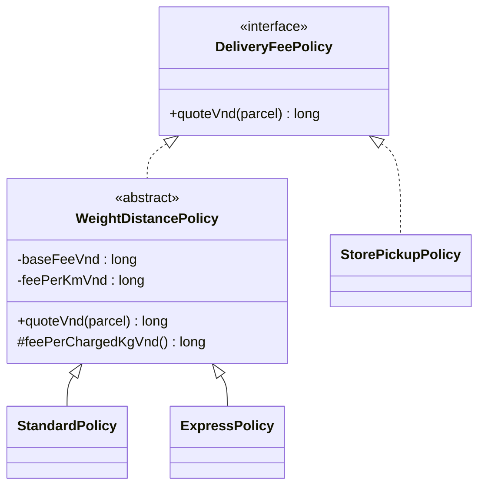
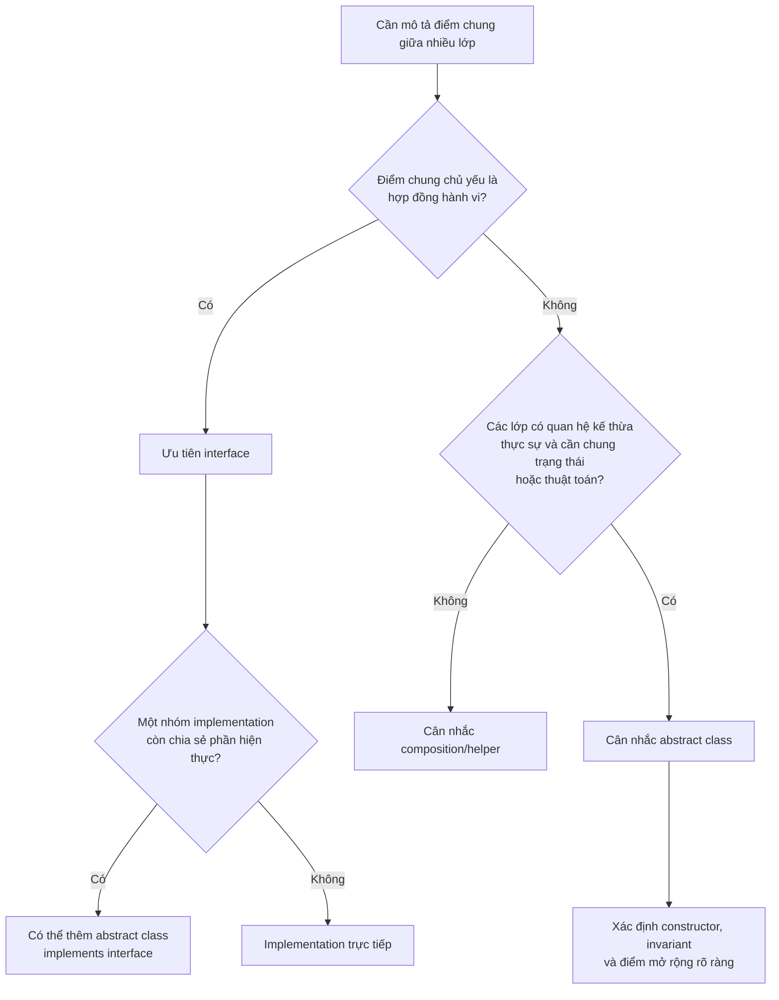

# Chọn giao diện (interface) hay lớp trừu tượng (abstract class) trong Java

Khi nhiều đối tượng cung cấp hành vi giống nhau, Java cho phép mô tả điểm chung bằng **`interface`** hoặc **`abstract class`**. Cả hai đều hỗ trợ đa hình (*polymorphism*), nhưng giải quyết các nhu cầu thiết kế khác nhau:

- **Interface** phù hợp khi cần quy định **một hợp đồng hành vi** để các lớp, dù không cùng họ kế thừa, đều có thể thực hiện.
- **Abstract class** phù hợp khi các lớp con thực sự thuộc **một họ lớp**, cần kế thừa **trạng thái, constructor hoặc phần thuật toán đã triển khai chung**.

Hai lựa chọn có thể **phối hợp**: một abstract class có thể `implements` một interface và cung cấp phần triển khai dùng chung cho một số lớp con. Điểm xuất phát nên là trách nhiệm và mối quan hệ trong bài toán, không phải mong muốn tạo thêm tầng kiến trúc.

## 1. So sánh bản chất và giới hạn ngôn ngữ

| Tiêu chí | `interface` | `abstract class` |
|---|---|---|
| Mục đích chính | Khai báo hợp đồng/khả năng mà đối tượng cung cấp | Định nghĩa nền tảng chung cho các lớp có quan hệ kế thừa |
| Khai báo | `interface FeePolicy { ... }` | `abstract class BasePolicy { ... }` |
| Quan hệ với lớp cụ thể | `implements` | `extends` |
| Một lớp có thể sử dụng bao nhiêu? | Implement nhiều interface | Trực tiếp extends tối đa **một** lớp |
| Constructor | **Không có constructor** | Có constructor, thường dùng để khởi tạo trạng thái nền |
| Trạng thái instance | Không khai báo được instance field thông thường | Có thể có instance field, kể cả `private final` |
| Field khai báo trực tiếp | Mặc nhiên `public static final` | Có thể là instance/static, mang các access modifier phù hợp |
| Phương thức có phần thân | Có `default`, `static` và `private` (theo phiên bản Java) | Có phương thức thường, `static`, `final`, `private`... |
| Phương thức trừu tượng | Phương thức khai báo không có thân mặc nhiên `public abstract` (trừ các trường hợp đặc biệt như `private`/`static`/`default`) | Có thể khai báo `abstract` với mức truy cập thích hợp, nhưng không `private` |
| Trạng thái sử dụng | Diễn đạt “**có thể làm việc gì**” | Diễn đạt “**là một dạng của lớp nền**” và tái sử dụng phần chung |
| Thay đổi API | Thêm abstract method có thể làm các implementation phải cập nhật; `default` có thể hỗ trợ tiến hóa | Thay đổi trạng thái/hành vi được kế thừa có thể ảnh hưởng trực tiếp đến lớp con |

Điều quan trọng: **interface không chỉ chứa phương thức trừu tượng**, và **abstract class không bắt buộc phải có abstract method**. Một abstract class vẫn có thể được đánh dấu `abstract` chỉ để ngăn khởi tạo trực tiếp.

Một lớp không thể `new` trực tiếp interface hoặc abstract class:

```java
interface Exporter {
    void export();
}

abstract class AbstractExporter {
    abstract void export();
}

// new Exporter();         // Lỗi biên dịch
// new AbstractExporter(); // Lỗi biên dịch
```

Nhưng có thể tạo instance của lớp cụ thể implement/extends, kể cả anonymous class triển khai đủ phương thức cần thiết.

## 2. Câu hỏi quyết định: hợp đồng hay trạng thái chung?

Giả sử một hệ thống cần tính **phí giao hàng**. Mỗi chiến lược có thể trả lời cùng câu hỏi:

> Với một kiện hàng có cân nặng và quãng đường xác định, phí vận chuyển dự kiến bằng bao nhiêu VND?

Một số cách tính phụ thuộc cân nặng, quãng đường; cách khác có thể cho miễn phí khi nhận hàng tại điểm giao dịch. Với nơi sử dụng chức năng báo phí, điều quan trọng là **gọi được một thao tác thống nhất**.

Ta có thể định nghĩa:

```java
interface DeliveryFeePolicy {
    long quoteVnd(Parcel parcel);
}
```

Interface này không yêu cầu mọi cách tính phí phải kế thừa cùng một thuật toán hay có cùng trạng thái. Nó chỉ buộc chúng cung cấp kết quả báo phí theo hợp đồng.

Sau đó, nếu có **hai chính sách đều dựa trên phí nền + quãng đường + kilogram tính cước**, việc lặp lại phép tính ở cả hai là cơ hội cân nhắc một abstract class dùng chung. Một cách tính **nhận hàng tại cửa hàng** có thể trực tiếp implement interface mà không phải kế thừa công thức tính cước trên.

Đây là tình huống phối hợp `interface` và `abstract class` có lý do nghiệp vụ rõ ràng.

## 3. Ví dụ Java hoàn chỉnh: interface làm hợp đồng, abstract class chia sẻ thuật toán

File `DeliveryFeeDemo.java` (Java 17+):

```java
import java.util.Objects;

public class DeliveryFeeDemo {

    // Dữ liệu cần thiết cho bài toán báo phí trong ví dụ.
    record Parcel(int weightGrams, int distanceKm) {
        Parcel {
            if (weightGrams <= 0) {
                throw new IllegalArgumentException(
                    "Cân nặng phải lớn hơn 0 gram"
                );
            }
            if (distanceKm < 0) {
                throw new IllegalArgumentException(
                    "Quãng đường không được âm"
                );
            }
        }
    }

    // Hợp đồng chung: không áp đặt cách tính.
    interface DeliveryFeePolicy {
        long quoteVnd(Parcel parcel);
    }

    // Nền tảng chia sẻ thuật toán cho các cách tính theo cân nặng.
    static abstract class WeightDistancePolicy
            implements DeliveryFeePolicy {

        private final long baseFeeVnd;
        private final long feePerKmVnd;

        protected WeightDistancePolicy(
                long baseFeeVnd, long feePerKmVnd) {

            if (baseFeeVnd < 0 || feePerKmVnd < 0) {
                throw new IllegalArgumentException(
                    "Các mức phí không được âm"
                );
            }

            this.baseFeeVnd = baseFeeVnd;
            this.feePerKmVnd = feePerKmVnd;
        }

        @Override
        public final long quoteVnd(Parcel parcel) {
            Objects.requireNonNull(parcel, "parcel");

            // Làm tròn lên kg tính cước, tránh phép cộng int bị tràn.
            long chargedKg = ((long) parcel.weightGrams() + 999L) / 1_000L;

            long rate = feePerChargedKgVnd();
            if (rate < 0) {
                throw new IllegalStateException(
                    "Đơn giá theo kg không hợp lệ"
                );
            }

            long distanceFee =
                Math.multiplyExact(feePerKmVnd, parcel.distanceKm());
            long weightFee = Math.multiplyExact(rate, chargedKg);

            return Math.addExact(
                Math.addExact(baseFeeVnd, distanceFee),
                weightFee
            );
        }

        // Điểm khác biệt được lớp con quyết định.
        protected abstract long feePerChargedKgVnd();
    }

    static final class StandardPolicy extends WeightDistancePolicy {
        StandardPolicy() {
            super(10_000L, 1_000L);
        }

        @Override
        protected long feePerChargedKgVnd() {
            return 2_000L;
        }
    }

    static final class ExpressPolicy extends WeightDistancePolicy {
        ExpressPolicy() {
            super(18_000L, 1_500L);
        }

        @Override
        protected long feePerChargedKgVnd() {
            return 4_000L;
        }
    }

    // Một chính sách khác hẳn: không cần kế thừa thuật toán trên.
    static final class StorePickupPolicy implements DeliveryFeePolicy {
        @Override
        public long quoteVnd(Parcel parcel) {
            Objects.requireNonNull(parcel, "parcel");
            return 0L;
        }
    }

    static void show(
            String name, DeliveryFeePolicy policy, Parcel parcel) {
        System.out.println(name + ": " + policy.quoteVnd(parcel) + " VND");
    }

    public static void main(String[] args) {
        Parcel parcel = new Parcel(1_200, 5);

        show("Tiêu chuẩn", new StandardPolicy(), parcel);
        show("Giao nhanh", new ExpressPolicy(), parcel);
        show("Nhận tại cửa hàng", new StorePickupPolicy(), parcel);
    }
}
```

Chạy:

```bash
javac DeliveryFeeDemo.java
java DeliveryFeeDemo
```

Kết quả:

```text
Tiêu chuẩn: 19000 VND
Giao nhanh: 33500 VND
Nhận tại cửa hàng: 0 VND
```

Cách tính trong ví dụ:

- `1_200` gram được làm tròn thành **2 kg tính cước**.
- Tiêu chuẩn = `10_000 + 5 × 1_000 + 2 × 2_000 = 19_000` VND.
- Giao nhanh = `18_000 + 5 × 1_500 + 2 × 4_000 = 33_500` VND.
- Nhận tại cửa hàng: miễn phí theo quy tắc ví dụ.

Đây là công thức minh họa để thấy thiết kế OOP; không đại diện giá cước của bất kỳ hãng vận chuyển nào.

### Sơ đồ quan hệ



Từ ví dụ, có thể thấy hai mức trách nhiệm:

**`DeliveryFeePolicy` định nghĩa hợp đồng.** Phần code in báo phí chỉ biết một biến kiểu `DeliveryFeePolicy` và gọi `quoteVnd(...)`. Cách tính có thể là tiêu chuẩn, nhanh hoặc nhận tại cửa hàng. Caller không phải dùng `instanceof` để phân loại rồi tự tính.

**`WeightDistancePolicy` chia sẻ một phần hiện thực.** Nó sở hữu đơn giá nền và đơn giá theo kilomet, kiểm tra constructor, tính khối lượng làm tròn, kiểm tra kết quả, đồng thời cung cấp một bước mở rộng `feePerChargedKgVnd()`. Hai lớp con `StandardPolicy` và `ExpressPolicy` chỉ cung cấp phần khác nhau.

Phương thức `quoteVnd` trong abstract class được đánh dấu `final` để lớp con không vô tình phá vỡ luồng kiểm tra và tính phí chung; lớp con chỉ được tùy biến tại điểm mở rộng đã định nghĩa. Đây là một dạng *Template Method* đơn giản. Phương thức trừu tượng `feePerChargedKgVnd()` chỉ được gọi lúc báo phí, **không gọi trong constructor** khi lớp con chưa khởi tạo xong.

`StorePickupPolicy` không phải một dạng tính phí theo khối lượng, vì vậy nếu ép nó `extends WeightDistancePolicy` rồi trả về 0 ở các bước tính là đang tạo một quan hệ kế thừa gượng ép. Implement trực tiếp interface phản ánh nghiệp vụ chính xác hơn.

## 4. Những khác biệt thực sự ảnh hưởng đến quyết định

### 4.1. Nhiều vai trò không buộc phải chung một superclass

~~~java
interface Printable { void print(); }
interface Archivable { void archive(); }

class Invoice implements Printable, Archivable {
    public void print() { System.out.println("In hóa đơn"); }
    public void archive() { System.out.println("Lưu hóa đơn"); }
}
~~~

`Invoice` có thể đáp ứng **hai khả năng độc lập** mà không cần ép vào một class cha chứa cả hai. Nếu thật sự thuộc một họ `Document` có trạng thái chung, nó vẫn có thể `extends Document implements Printable, Archivable`. Java chỉ cho class trực tiếp `extends` **một** superclass; interface thì có thể `extends` nhiều interface. Bài *Một đối tượng đảm nhận nhiều giao diện* tập trung vào các biến tham chiếu, xung đột cùng chữ ký và sự phối hợp trạng thái khi một instance có nhiều vai trò.

### 4.2. Khi cần constructor và trạng thái dùng chung

Interface không có constructor và cũng không giữ instance field thông thường. Khai báo:

```java
interface Limits {
    int MAX_RETRIES = 3; // Mặc nhiên public static final
}
```

không có nghĩa mỗi implementation sở hữu một `MAX_RETRIES` riêng biệt. Đây là **hằng số static** gắn với interface.

Nếu nhiều lớp con thực sự phải chia sẻ trạng thái nền và các bước khởi tạo thống nhất, abstract class giúp đặt constructor và kiểm soát các field:

```java
abstract class BaseProcessor {
    private final int maxRetries;

    protected BaseProcessor(int maxRetries) {
        if (maxRetries < 0) {
            throw new IllegalArgumentException("maxRetries âm");
        }
        this.maxRetries = maxRetries;
    }

    protected final int maxRetries() {
        return maxRetries;
    }

    public abstract void process();
}
```

Lưu ý: dùng abstract class **chỉ để chia sẻ vài dòng mã** có thể tạo phụ thuộc kế thừa không đáng có. Một lớp helper hoặc một đối tượng được truyền vào theo **composition** đôi khi tốt hơn, đặc biệt khi các lớp cần dùng chung thuật toán nhưng không thực sự thuộc một họ kế thừa.

### 4.3. `default` method hỗ trợ chia sẻ hành vi, không chia sẻ trạng thái

~~~java
interface Named {
    String name();

    default String displayName() {
        return "[" + name() + "]";
    }
}
~~~

Lớp implement `Named` có thể dùng `displayName()` mà không tự viết lại, vì hành vi mặc định được suy ra từ method `name()` của hợp đồng. Nhưng interface vẫn **không có instance field hay constructor**. Khi thuật toán chung cần field cấu hình, invariant và điểm mở rộng của một họ class, abstract class hoặc composition vẫn là lựa chọn cần xét. Bài *Thành viên mặc định và giới hạn tùy ngôn ngữ* phân tích đầy đủ modifier và quy tắc kết hợp default method.

## 5. Xung đột `default` có thể làm đổi chi phí kết hợp các vai trò

Nếu hai interface **độc lập** đều khai báo `default String label()`, class implement cả hai không thể để Java tự chọn ngẫu nhiên. Nó phải override `label()` để cung cấp một hành vi thống nhất, có thể chủ động gọi `A.super.label()` hoặc `B.super.label()` khi hợp lệ.

Ngược lại, nếu superclass có một phương thức instance concrete cùng chữ ký tương thích, implementation của class thường được ưu tiên hơn default của interface. Đây là một giới hạn khi chia sẻ hành vi qua nhiều interface, không phải lý do mặc định để thay chúng bằng một abstract class duy nhất: quyết định còn phụ thuộc vào nhu cầu **trạng thái/constructor chung**. Bài chuyên sâu về *Thành viên mặc định và giới hạn tùy ngôn ngữ* có ví dụ Java chạy được cho từng quy tắc phân giải.

## 6. Chọn theo quan hệ nghiệp vụ và điểm thay đổi

Một cách ra quyết định có thể dùng trực tiếp trong review thiết kế:



Những câu hỏi thực tế nên đặt:

1. **Caller cần gì?** Nếu caller chỉ cần gọi `send()`, `quoteVnd()` hoặc `save()`, hãy bắt đầu từ hợp đồng hành vi gọn, bất kể implementation là loại đối tượng nào.
2. **Có trạng thái chung không?** Nếu cần constructor chung kiểm tra cấu hình, field dùng chung và một phần thuật toán ổn định, abstract class có giá trị.
3. **Có quan hệ “is-a” đúng nghĩa không?** Một `StandardPolicy` có thể là dạng đặc biệt của `WeightDistancePolicy`. Một `StorePickupPolicy` thì không, dù cùng trả phí.
4. **Lớp có cần kế thừa một superclass khác?** Nếu có, việc ràng buộc vào một abstract class mới có thể không khả thi vì Java chỉ hỗ trợ một superclass. Interface có tính kết hợp tốt hơn.
5. **Hành vi nào thật sự biến thiên?** Trừu tượng hóa nên phản ánh nhu cầu đã có hoặc biến thiên dự kiến có cơ sở, thay vì tạo nhiều tầng trước khi xác định trách nhiệm.

## 7. Khi nào nên chọn composition thay cho abstract class?

Giả sử hai lớp rất khác nhau đều cần một thuật toán kiểm tra mã số. Chúng không cùng họ nghiệp vụ, nên bắt cả hai `extends AbstractValidatorUser` chỉ để tái sử dụng đoạn code kiểm tra là gượng ép.

Một đối tượng hỗ trợ độc lập có thể được **kết hợp**:

```java
import java.util.Objects;

final class CodeValidator {
    String requireValid(String code) {
        Objects.requireNonNull(code, "code");
        if (code.isBlank()) {
            throw new IllegalArgumentException("Code không được rỗng");
        }
        return code.strip();
    }
}

final class GiftVoucher {
    private final String code;

    GiftVoucher(String code, CodeValidator validator) {
        this.code = validator.requireValid(code);
    }
}

final class EventTicket {
    private final String code;

    EventTicket(String code, CodeValidator validator) {
        this.code = validator.requireValid(code);
    }
}
```

`GiftVoucher` và `EventTicket` dùng lại `CodeValidator` nhưng không phải kế thừa nhau. Khi quy tắc kiểm tra chung phù hợp, composition cho phép tái sử dụng mà không chiếm mất quan hệ kế thừa của lớp.

Tùy quy mô bài toán, một phương thức utility `static` hoặc value object `Code` cũng có thể đơn giản hơn việc inject một validator riêng. **Không phải mọi chức năng dùng chung đều cần một interface hoặc abstract class.**

## 8. Những sai lầm thường gặp

| Thiết kế dễ mắc lỗi | Vì sao chưa phù hợp | Hướng cải thiện |
|---|---|---|
| Tạo interface cho mọi class dù chỉ có một implementation và không có nhu cầu hợp đồng | Tăng số file/tầng mà chưa có lợi ích rõ | Bắt đầu từ class cụ thể; trích interface khi có nhu cầu thực |
| Đưa tất cả implementation vào cùng một abstract class lớn | Lớp con bị ràng buộc vào dữ liệu/hành vi không phù hợp | Interface nhỏ theo khả năng; chia sẻ hiện thực bằng composition hoặc abstract base cho đúng nhóm |
| Dùng interface để chứa tập hằng số chung | Mượn interface cho mục đích không phải hợp đồng hành vi | Dùng class/enum chuyên trách cho hằng số |
| Tạo `abstract class` chỉ chứa một abstract method và không có logic/trạng thái dùng chung | Có thể tạo hạn chế single inheritance không cần thiết | Cân nhắc interface |
| Đưa nhiều `default method` có trạng thái giả lập qua getter vào interface | Làm hợp đồng phụ thuộc nhiều chi tiết và tăng nguy cơ xung đột | Chuyển thuật toán sang component hoặc base class nếu cùng họ |
| Cho subclass sửa tự do mọi bước của thuật toán nền | Dễ phá invariant, dẫn đến kết quả không nhất quán | Giữ phần thuật toán ổn định bằng `final`, chỉ mở điểm tùy biến cần thiết |
| Không bảo đảm các implementation tuân theo cùng hợp đồng | Caller phải kiểm tra kiểu cụ thể, mất đa hình | Nêu rõ điều kiện đầu vào, đầu ra, lỗi và quy tắc chung |

Một interface tốt không chỉ là “cùng tên phương thức”. Nếu `quoteVnd` ở policy A trả **VND**, nhưng policy B lại trả **nghìn VND**, cả hai có cùng chữ ký mà vẫn **vi phạm hợp đồng ý nghĩa**. Để dùng đa hình đúng, mọi implementation phải bảo toàn kỳ vọng của caller: đơn vị, phạm vi dữ liệu, lỗi và các quy tắc đã công bố.

## 9. Tự kiểm tra kiến thức

**Bài 1 — Nên chọn gì?**

Một ứng dụng cho phép xuất báo cáo ra CSV và PDF. Đầu ra khác nhau, nhưng người gọi chỉ muốn `export(report)`, không quan tâm định dạng cụ thể.

**Gợi ý:** Một `ReportExporter` interface là lựa chọn tự nhiên để thể hiện hợp đồng. Chỉ bổ sung abstract class nếu có phần xử lý chung thực sự đáng chia sẻ, chẳng hạn chính sách đặt tên file hoặc kiểm tra đầu vào thống nhất cho một nhóm exporter.

**Bài 2 — Kết quả nào xảy ra?**

```java
interface A {
    default String description() {
        return "A";
    }
}

interface B {
    default String description() {
        return "B";
    }
}

class C implements A, B {
    // Chưa override description()
}
```

**Đáp án:** Lớp `C` sẽ báo lỗi biên dịch vì xung đột hai default method; cần định nghĩa `description()` để giải quyết.

**Bài 3 — Vì sao abstract class có constructor?**

Hai lớp `StandardShipping` và `ExpressShipping` phải có cùng `regionCode` hợp lệ và dùng chung thuật toán xử lý vùng giao hàng. Hãy thiết kế `abstract class RegionShipping` nhận mã vùng trong constructor, gán field `private final`, triển khai một phần logic, đồng thời để một phương thức `protected abstract` cho lớp con tự tính phụ phí.

**Gợi ý:** Abstract class phù hợp nếu hai lớp thật sự cùng một họ chính sách và dùng chung bất biến/thuật toán. Nếu nhiều chính sách khác kiểu cũng phải dùng qua cùng service, có thể để `RegionShipping implements ShippingPolicy`, còn các chính sách không dùng vùng giao có thể implement `ShippingPolicy` trực tiếp.

**Bài 4 — Có thể implement nhiều interface không?**

```java
interface Searchable {
    void search();
}

interface Auditable {
    void audit();
}

class CatalogService implements Searchable, Auditable {
    public void search() {
        System.out.println("Searching");
    }

    public void audit() {
        System.out.println("Audit logged");
    }
}
```

**Đáp án:** Hợp lệ. `CatalogService` thực hiện hai hợp đồng. Vì các phương thức của interface là `public`, phương thức triển khai phải là `public`; không thể dùng quyền truy cập hẹp hơn.

---

**Ghi nhớ:** Chọn **`interface`** khi muốn mô tả **hợp đồng/khả năng có thể được nhiều loại đối tượng thực hiện**. Chọn **`abstract class`** khi có **họ lớp kế thừa hợp lý**, cần **constructor, trạng thái hoặc thuật toán dùng chung**. Có thể kết hợp cả hai, đồng thời ưu tiên **composition** nếu chỉ muốn tái sử dụng chức năng giữa những lớp không có quan hệ kế thừa thực sự. Tiêu chí cuối cùng là API rõ ràng, đúng nghiệp vụ và dễ thay đổi.