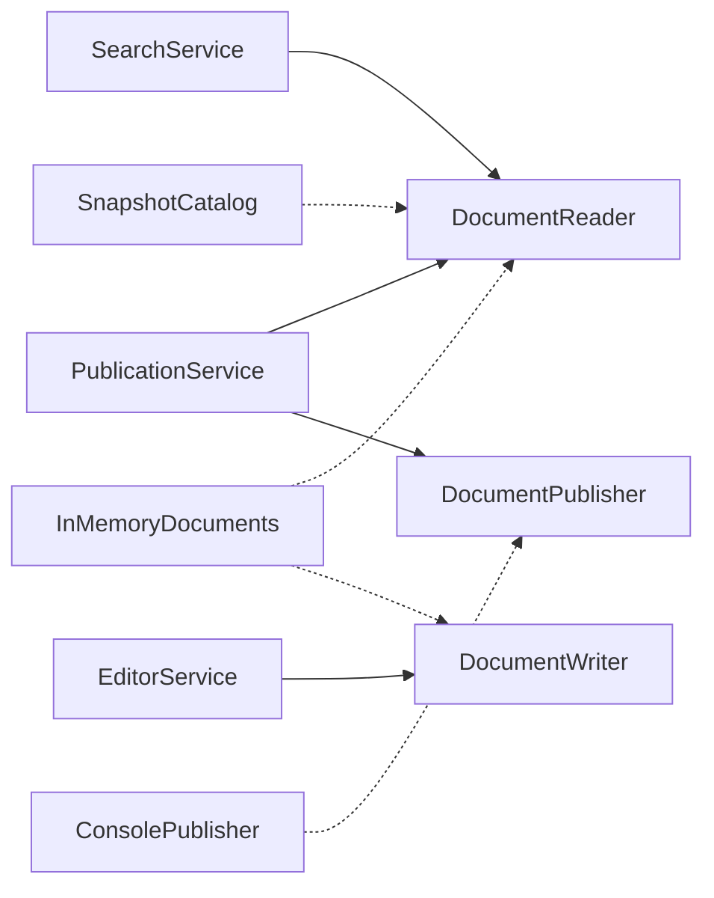

# Giao diện nhỏ và phân tách vai trò trong Java

Khi thiết kế OOP, `interface` là nơi mô tả **hợp đồng sử dụng**: mã bên ngoài được phép yêu cầu đối tượng làm gì. Nếu đưa quá nhiều khả năng không liên quan vào một interface, các lớp và service sẽ phải biết hoặc triển khai cả những phương thức không phục vụ trách nhiệm của chúng.

**Interface Segregation Principle (ISP)** — nguyên tắc phân tách giao diện trong SOLID — phát biểu theo ý nghĩa thực hành: **client không nên bị buộc phụ thuộc vào những phương thức nó không sử dụng**.

Trong Java, “client” ở đây có thể là một lớp service, một module, một đối tượng phụ thuộc vào interface hoặc một lớp phải `implements` interface. Giải pháp thường là chia hợp đồng lớn thành **các interface nhỏ, gắn kết theo vai trò hoặc nhu cầu sử dụng**. “Nhỏ” là nhỏ về *trách nhiệm*, không phải một quy tắc cứng rằng mỗi interface chỉ được có một phương thức.

## 1. Dấu hiệu một interface quá rộng

Giả sử ứng dụng quản lý tài liệu khai báo:

```java
interface DocumentManager {
    String read(String id);
    void save(String id, String content);
    void delete(String id);
    void publish(String id);
}
```

Một công cụ tìm kiếm chỉ cần `read()`. Một kho tài liệu đã xuất bản chỉ cho phép đọc, nhưng nếu muốn triển khai `DocumentManager` thì vẫn phải cung cấp cả `save()`, `delete()`, `publish()`:

```java
final class ReadOnlyArchive implements DocumentManager {
    @Override
    public String read(String id) {
        return "Nội dung từ kho lưu trữ";
    }

    @Override
    public void save(String id, String content) {
        throw new UnsupportedOperationException("Chỉ đọc");
    }

    @Override
    public void delete(String id) {
        throw new UnsupportedOperationException("Chỉ đọc");
    }

    @Override
    public void publish(String id) {
        throw new UnsupportedOperationException("Không hỗ trợ");
    }
}
```

Đây là một **mùi thiết kế**: interface công bố những khả năng mà một số đối tượng tuân theo hợp đồng không thể thực hiện. Điều đó khiến caller dễ tưởng thao tác hợp lệ rồi gặp `UnsupportedOperationException` ở runtime.

Vấn đề còn xảy ra ở phía client. Nếu `SearchService` nhận một `DocumentManager`, mã tìm kiếm có thể bị ảnh hưởng bởi các thay đổi liên quan đến xuất bản, xóa hoặc ghi dữ liệu dù không sử dụng chúng. Việc thay đổi một giao diện rộng cũng kéo theo nhiều lớp triển khai và các fake/mock trong kiểm thử phải cập nhật.

## 2. Phân tách theo khả năng mà client thực sự cần

Thay vì một hợp đồng bao trùm, ta định nghĩa các vai trò độc lập:

```java
interface DocumentReader {
    Optional<Document> findById(String id);
}

interface DocumentWriter {
    void save(Document document);
}

interface DocumentPublisher {
    void publish(Document document);
}
```

Mỗi service chỉ nhận kiểu thể hiện khả năng cần thiết:

| Client hoặc triển khai | Phụ thuộc/triển khai | Lý do |
| --- | --- | --- |
| `SearchService` | `DocumentReader` | Chỉ tra cứu tài liệu |
| `EditorService` | `DocumentWriter` | Chỉ lưu bản nháp |
| `PublicationService` | `DocumentReader` và `DocumentPublisher` | Tìm tài liệu rồi xuất bản |
| `InMemoryDocuments` | `DocumentReader`, `DocumentWriter` | Có cả khả năng đọc và ghi |
| `SnapshotCatalog` | `DocumentReader` | Dữ liệu chỉ đọc |
| `ConsolePublisher` | `DocumentPublisher` | Chỉ xử lý hành vi xuất bản |

Một lớp **được phép triển khai nhiều interface nhỏ** khi thực sự cung cấp nhiều khả năng. ISP không đòi phải tạo đúng một class cho mỗi interface.



Các mũi tên liền chỉ sự phụ thuộc của client, mũi tên đứt biểu diễn các lớp triển khai hợp đồng. `SearchService` không cần biết lớp cung cấp dữ liệu có cho phép sửa hay không.

## 3. Ví dụ Java chạy được: đọc, ghi và xuất bản tài liệu

Đặt toàn bộ đoạn dưới đây vào file **`Main.java`**, biên dịch bằng **Java 17 hoặc Java 21**.

```java
import java.util.HashMap;
import java.util.List;
import java.util.Map;
import java.util.Objects;
import java.util.Optional;

// Value object đơn giản: các thành phần đều là String bất biến.
record Document(String id, String title, String content) {
    Document {
        if (id == null || id.isBlank()) {
            throw new IllegalArgumentException("ID không hợp lệ");
        }
        if (title == null || title.isBlank()) {
            throw new IllegalArgumentException("Tiêu đề không hợp lệ");
        }
        Objects.requireNonNull(content, "content");
    }
}

// Chỉ mô tả khả năng đọc.
interface DocumentReader {
    Optional<Document> findById(String id);
}

// Chỉ mô tả khả năng ghi.
interface DocumentWriter {
    void save(Document document);
}

// Vai trò công bố tài liệu ra một kênh.
interface DocumentPublisher {
    void publish(Document document);
}

// Một lớp có thể cung cấp cả hai khả năng đọc và ghi.
final class InMemoryDocuments implements DocumentReader, DocumentWriter {
    private final Map<String, Document> documents = new HashMap<>();

    @Override
    public Optional<Document> findById(String id) {
        Objects.requireNonNull(id, "id");
        return Optional.ofNullable(documents.get(id));
    }

    @Override
    public void save(Document document) {
        Objects.requireNonNull(document, "document");
        documents.put(document.id(), document);
    }
}

// Kho dữ liệu chỉ đọc: không có save(), delete() hay publish().
final class SnapshotCatalog implements DocumentReader {
    private final Map<String, Document> snapshot;

    SnapshotCatalog(Map<String, Document> source) {
        this.snapshot = Map.copyOf(
                Objects.requireNonNull(source, "source"));
    }

    @Override
    public Optional<Document> findById(String id) {
        Objects.requireNonNull(id, "id");
        return Optional.ofNullable(snapshot.get(id));
    }
}

// Một triển khai công bố đơn giản phục vụ ví dụ.
final class ConsolePublisher implements DocumentPublisher {
    @Override
    public void publish(Document document) {
        Objects.requireNonNull(document, "document");
        System.out.println("Xuất bản: " + document.title());
    }
}

// Client chỉ phụ thuộc vào khả năng đọc.
final class SearchService {
    private final DocumentReader reader;

    SearchService(DocumentReader reader) {
        this.reader = Objects.requireNonNull(reader, "reader");
    }

    String findTitle(String id) {
        return reader.findById(id)
                .map(Document::title)
                .orElse("Không tìm thấy");
    }
}

// Client chỉ phụ thuộc vào khả năng ghi.
final class EditorService {
    private final DocumentWriter writer;

    EditorService(DocumentWriter writer) {
        this.writer = Objects.requireNonNull(writer, "writer");
    }

    void saveDraft(Document document) {
        writer.save(document);
    }
}

// Client cần hai vai trò, nên khai báo rõ hai phụ thuộc.
final class PublicationService {
    private final DocumentReader reader;
    private final DocumentPublisher publisher;

    PublicationService(DocumentReader reader,
                       DocumentPublisher publisher) {
        this.reader = Objects.requireNonNull(reader, "reader");
        this.publisher = Objects.requireNonNull(publisher, "publisher");
    }

    boolean publishById(String id) {
        Optional<Document> found = reader.findById(id);
        if (found.isEmpty()) {
            return false;
        }
        publisher.publish(found.get());
        return true;
    }
}

public class Main {
    public static void main(String[] args) {
        InMemoryDocuments storage = new InMemoryDocuments();
        EditorService editor = new EditorService(storage);
        SearchService search = new SearchService(storage);

        editor.saveDraft(
                new Document("DOC-1", "Java ISP", "Nội dung bài học"));

        System.out.println(search.findTitle("DOC-1"));

        PublicationService publication =
                new PublicationService(storage, new ConsolePublisher());
        System.out.println(publication.publishById("DOC-1"));

        System.out.println(search.findTitle("UNKNOWN"));

        Map<String, Document> source = new HashMap<>();
        source.put("PUB-1",
                new Document("PUB-1", "Bản đã duyệt", "Nội dung"));
        DocumentReader readOnlyCatalog = new SnapshotCatalog(source);
        source.clear(); // Không thay đổi dữ liệu đã chụp.
        SearchService archiveSearch = new SearchService(readOnlyCatalog);

        System.out.println(archiveSearch.findTitle("PUB-1"));
    }
}
```

Chạy:

```bash
javac Main.java
java Main
```

Kết quả:

```text
Java ISP
Xuất bản: Java ISP
true
Không tìm thấy
Bản đã duyệt
```

**Giải thích thiết kế:**

1. `SearchService` biết đến `DocumentReader`, không biết `save()` hay `publish()`. Ta có thể cấp cho nó `InMemoryDocuments` hoặc `SnapshotCatalog` mà không thay đổi mã của service.
2. `EditorService` nhận `DocumentWriter`, không cần các phương thức tìm kiếm hay xuất bản.
3. `PublicationService` cần **hai khả năng**, nên phụ thuộc vào hai interface. Một client hoàn toàn có thể dùng nhiều interface; “phân tách” không có nghĩa cấm kết hợp.
4. `SnapshotCatalog` chỉ triển khai `DocumentReader`, vì vậy không phải ném `UnsupportedOperationException` cho các phương thức ghi/xóa mà nó không hỗ trợ.
5. `Map.copyOf(source)` bảo vệ snapshot trước thay đổi cấu trúc của map ngoài. Các `Document` trong ví dụ chứa `String` bất biến. Nếu giá trị map là những đối tượng mutable, cần xem xét sao chép sâu hay value object an toàn hơn.

Lỗi sử dụng sai vai trò được trình biên dịch phát hiện sớm. Ví dụ dưới đây **cố tình không hợp lệ**:

```java
DocumentReader catalog = new SnapshotCatalog(Map.of());
// new EditorService(catalog); // Lỗi biên dịch:
// EditorService cần DocumentWriter, catalog chỉ có kiểu DocumentReader.
```

Nếu một đối tượng cụ thể thực sự có cả khả năng đọc và ghi, caller có thể giữ tham chiếu theo từng interface ở nơi phù hợp. Thiết kế trên phân quyền **ở mức API kiểu dữ liệu**, không tự thay thế xác thực và phân quyền bảo mật khi triển khai hệ thống thực tế.

## 4. ISP khác gì “mỗi interface chỉ có một phương thức”?

Một interface có nhiều phương thức vẫn hợp lý nếu chúng phục vụ **cùng một vai trò gắn kết**.

Ví dụ:

```java
interface DocumentReader {
    Optional<Document> findById(String id);
    List<Document> findByTitle(String keyword);
    boolean existsById(String id);
}
```

Ba phương thức cùng hỗ trợ **tra cứu tài liệu**. Nếu mọi client đọc dữ liệu nhìn nhận đây là một nhóm hành vi phù hợp thì interface trên có thể là một thiết kế tốt. Ngược lại, nếu các client chỉ dùng từng phần độc lập và việc thêm/sửa hợp đồng khiến chúng phải phụ thuộc nhiều khả năng không liên quan, có thể tách tiếp.

Tiêu chí phân tách hiệu quả:

- Các phương thức có phục vụ cùng một **nhu cầu hoặc vai trò của client** không?
- Những nhóm client khác nhau có cần các tập phương thức khác nhau không?
- Một triển khai có phải cung cấp phương thức không có ý nghĩa hoặc chỉ ném `UnsupportedOperationException` không?
- Một thay đổi ở nhóm hành vi A có bắt nhóm client/triển khai chỉ sử dụng B phải chỉnh sửa không?
- Tên interface có diễn đạt được một khả năng rõ ràng (`Reader`, `Writer`, `Publisher`) hay chỉ là một cái tên tổng quát (`Manager`, `EverythingService`)?

**Không nên đếm số phương thức máy móc.** Hai phương thức không cùng trách nhiệm vẫn có thể tạo interface kém; năm phương thức cùng phục vụ một hợp đồng nhất quán có thể hoàn toàn phù hợp.

## 5. Kết hợp các vai trò khi thật sự cần

Java cho phép một interface kế thừa nhiều interface khác:

```java
interface DocumentEditor extends DocumentReader, DocumentWriter {
    // Có thể thêm hành vi thực sự thuộc vai trò biên tập.
}
```

`DocumentEditor` biểu thị vai trò có cả khả năng đọc và ghi. Hữu ích khi một client hoặc một nhóm triển khai **thật sự yêu cầu cả hai** như một hợp đồng thống nhất.

Tuy nhiên, cần hiểu hai điểm:

- Lớp `InMemoryDocuments implements DocumentReader, DocumentWriter` **không tự động trở thành một `DocumentEditor`**. Muốn dùng kiểu kết hợp, lớp phải khai báo `implements DocumentEditor` (hoặc một lớp con/adapter triển khai đúng interface ấy).
- Client chỉ cần đọc vẫn nên nhận `DocumentReader`. Không nên đổi mọi tham số thành `DocumentEditor` chỉ vì đã có giao diện kết hợp.

Khi làm việc với các capability có thể tổ hợp, không nhất thiết mọi cấu hình đều tồn tại. Ví dụ kho chỉ đọc có thể hỗ trợ `DocumentReader` mà không hỗ trợ `DocumentWriter`; công cụ xuất bản có thể nhận một `Document` mà không thể tự tìm kiếm dữ liệu.

## 6. ISP và các nguyên lý OOP liên quan

| Nguyên lý | Câu hỏi trọng tâm | Quan hệ với interface nhỏ |
| --- | --- | --- |
| **ISP** — Interface Segregation Principle | Client có bị phụ thuộc vào phương thức không dùng? | Chia hợp đồng theo nhu cầu sử dụng thực tế |
| **SRP** — Single Responsibility Principle | Module/lớp có một lý do chính để thay đổi? | Thường hỗ trợ cùng hướng phân chia nhưng áp dụng lên trách nhiệm của module/lớp |
| **DIP** — Dependency Inversion Principle | Thành phần nghiệp vụ phụ thuộc vào hợp đồng ổn định hay chi tiết cài đặt? | Interface theo vai trò tạo những abstraction phù hợp cho dependency injection |
| **LSP** — Liskov Substitution Principle | Triển khai có tuân thủ hành vi mà hợp đồng đã hứa? | Tránh interface bắt triển khai hỗ trợ thao tác vô nghĩa rồi ném lỗi không được cam kết |

Có thể hình dung: **SRP giúp phân định trách nhiệm**, **ISP giúp định hình bề mặt hợp đồng theo client**, **DIP giúp client phụ thuộc vào hợp đồng**, còn **LSP yêu cầu triển khai tôn trọng ngữ nghĩa hợp đồng đó**.

Ví dụ `ReadOnlyArchive` triển khai một `DocumentManager` công bố `save()` nhưng luôn ném `UnsupportedOperationException`. Đây là dấu hiệu trực tiếp của ISP kém và có thể tạo vấn đề về khả năng thay thế nếu hợp đồng `save()` hứa rằng các triển khai đều có thể lưu.

## 7. Tách giao diện mà vẫn giữ nguyên lớp triển khai

Một hiểu nhầm là phân tách interface đồng nghĩa phải chia một class thành nhiều class hoặc nhiều service nhỏ.

Thực tế, `InMemoryDocuments` trong ví dụ vẫn **một lớp** cung cấp hai vai trò. Việc tách interface chủ yếu cải thiện **quan hệ phụ thuộc của người sử dụng**:

```java
final class SearchService {
    private final DocumentReader reader;
    // ...
}
```

Nếu mã tìm kiếm được viết như sau, nó phụ thuộc nhiều khả năng hơn cần thiết:

```java
// Mẫu phụ thuộc rộng không cần thiết:
final class SearchServiceTooBroad {
    private final InMemoryDocuments storage;

    SearchServiceTooBroad(InMemoryDocuments storage) {
        this.storage = storage;
    }
}
```

Lúc này chỉ có thể truyền đúng `InMemoryDocuments` hoặc lớp con của nó (ở đây lớp là `final` nên không có lớp con); một nguồn dữ liệu chỉ đọc khác không thể thay thế dễ dàng. Dùng `DocumentReader` thể hiện rõ nhu cầu và cho phép các triển khai độc lập đáp ứng hợp đồng đó.

Tuy nhiên, **không phải lúc nào cũng cần tạo interface**. Trong phạm vi một ứng dụng nhỏ, nếu một loại đối tượng cụ thể là hợp đồng ổn định và không có nhiều vai trò khác nhau, phụ thuộc trực tiếp vào class đôi khi đơn giản hơn. ISP hướng dẫn cách tổ chức *khi đã có giao diện*, không yêu cầu “mỗi class phải có một interface”.

## 8. Kiểm thử dễ hơn nhờ vai trò nhỏ

Một service chỉ phụ thuộc vào `DocumentReader` có thể được kiểm thử bằng một fake rất nhỏ, không cần khởi tạo repository, kết nối DB hay giả lập phương thức ghi/xóa/xuất bản.

Đoạn dưới giả định các kiểu `Document`, `DocumentReader`, `SearchService` đã được định nghĩa như ví dụ chính; đặt trong một phương thức hoặc bài kiểm thử:

```java
DocumentReader fake = id -> {
    if ("DOC-1".equals(id)) {
        return Optional.of(new Document("DOC-1", "Bản mẫu", ""));
    }
    return Optional.empty();
};

SearchService service = new SearchService(fake);

if (!"Bản mẫu".equals(service.findTitle("DOC-1"))) {
    throw new AssertionError("Tìm tiêu đề sai");
}
if (!"Không tìm thấy".equals(service.findTitle("UNKNOWN"))) {
    throw new AssertionError("Xử lý tài liệu vắng mặt sai");
}
```

Interface `DocumentReader` chỉ có một phương thức trừu tượng nên là **functional interface** và có thể dùng lambda như trên. Nếu sau này ta thêm nhiều phương thức trừu tượng vào `DocumentReader`, đoạn lambda sẽ không còn hợp lệ: đó là một lý do thực tế để cân nhắc khả năng tương thích khi mở rộng hợp đồng.

Kiểm thử không phải lý do duy nhất để tách interface. Giá trị chính là code dùng API chỉ biết những khả năng nó cần; dễ tạo fake chỉ là một lợi ích đi kèm.

## 9. Những sai lầm khi áp dụng

| Sai lầm | Vì sao có vấn đề? | Cách xử lý |
| --- | --- | --- |
| Một interface `SuperService` chứa đọc, ghi, xuất báo cáo, gửi email | Client phụ thuộc nhiều vai trò không dùng | Tách theo nhóm nhu cầu của client |
| Phương thức không hỗ trợ chỉ `throw UnsupportedOperationException` | API hứa khả năng nhưng triển khai không thực hiện được | Không triển khai capability không có, hoặc định nghĩa rõ hỗ trợ tùy chọn |
| Tách một interface cho từng getter đơn lẻ | Tăng số loại không mang lại ranh giới có ý nghĩa | Nhóm theo vai trò gắn kết thay vì theo số phương thức |
| Client cần `read` nhưng nhận kiểu `DocumentEditor` | Client bị phụ thuộc cả quyền ghi | Dùng `DocumentReader` |
| Dùng `default` method rỗng để che khả năng không hỗ trợ | Thao tác trông thành công nhưng không thực hiện gì | Chỉ dùng default method khi có hành vi mặc định đúng hợp đồng |
| Một interface thay đổi liên tục, nhiều nơi phải sửa mock | Hợp đồng quá rộng hoặc thiếu ổn định | Phân tích nhóm client chịu ảnh hưởng rồi tách nếu có cơ sở |
| Chỉ tách chữ ký mà bỏ qua ngữ nghĩa | Triển khai có hành vi trái kỳ vọng | Ghi rõ tiền điều kiện, kết quả, lỗi, thứ tự và nhất quán |
| Coi interface là cơ chế phân quyền bảo mật | Caller có thể vượt ranh giới kiểu dữ liệu qua API khác | Vẫn phải có authorization tại tầng nghiệp vụ/hạ tầng |
| Tạo hàng loạt interface một cách máy móc | Khó điều hướng, nhiều lớp chuyển tiếp vô ích | Chỉ tách tại những ranh giới có nhu cầu thật |

**Về `default` method:** phương thức mặc định là tính năng hợp lệ của Java, rất hữu ích cho hành vi có thể suy ra từ hợp đồng hiện tại. Nhưng thêm một `default void publish() { }` vào interface chung chỉ để mọi triển khai “biên dịch được” sẽ che đi sự khác nhau về khả năng hỗ trợ, không giải quyết nguyên nhân của interface quá rộng.

## 10. Quy trình cải tiến một giao diện quá rộng

Giả sử hệ thống đang dùng `DocumentManager` lớn ở nhiều nơi:

1. **Xem từng nhóm client thực sự gọi phương thức nào.** Ví dụ service tìm kiếm chỉ gọi `read`, editor chỉ gọi `save`, publisher chỉ gọi `publish`.
2. **Xác định các vai trò ổn định.** Nhóm phương thức có ý nghĩa nhất quán theo client; tránh chia dựa trên số lượng cơ học.
3. **Tạo interface nhỏ có hợp đồng rõ.** Ví dụ `DocumentReader`, `DocumentWriter`, `DocumentPublisher` với quy tắc đầu vào/kết quả/lỗi được mô tả.
4. **Cho các triển khai khai báo đúng capability chúng có.** Lớp chỉ đọc không cần triển khai ghi/xóa.
5. **Chuyển client sang yêu cầu hẹp nhất phù hợp.** Constructor của `SearchService` nhận `DocumentReader` thay cho `DocumentManager`.
6. **Kiểm tra tương thích hành vi và kiểm thử.** Thay một implementation khác mà client vẫn chạy đúng hợp đồng; nếu đang duy trì thư viện công khai, lên kế hoạch tương thích API trước khi bỏ interface cũ.

Không bắt buộc xóa interface cũ ngay trong một hệ thống có nhiều client đang dùng. Có thể di chuyển từng client, dùng adapter ở ranh giới và loại bỏ hợp đồng rộng khi không còn phụ thuộc và việc thay đổi phiên bản cho phép.

## 11. Bài tập tự kiểm tra

**Câu 1.** Một `ReportService` chỉ cần xuất CSV, nhưng constructor nhận `OfficeSuite` có `exportCsv()`, `sendEmail()`, `manageUsers()`. Điều bất hợp lý là gì?

**Đáp án:** Client phụ thuộc vào những khả năng không dùng. Có thể định nghĩa vai trò `CsvExporter` và chỉ yêu cầu interface đó.

**Câu 2.** `ReadOnlyArchive` bắt buộc triển khai `save()` rồi ném `UnsupportedOperationException`. Nên xem xét điều gì?

**Đáp án:** Tách `Reader` và `Writer` để kho chỉ đọc chỉ triển khai khả năng đọc. Nếu không hỗ trợ là một phần hợp đồng tùy chọn được thiết kế rõ thì cần mô tả và xử lý riêng, không để caller bất ngờ.

**Câu 3.** `interface UserReader` có `findById`, `findByEmail`, `existsById`. Nó có vi phạm ISP vì chứa ba phương thức không?

**Đáp án:** Không thể kết luận chỉ từ số phương thức. Cần xem chúng có tạo thành vai trò tra cứu gắn kết và phù hợp nhu cầu của client hay không.

**Câu 4.** Một lớp có thể vừa `implements DocumentReader, DocumentWriter` vừa bảo đảm ISP không?

**Đáp án:** Có. Các client vẫn nhận từng interface theo nhu cầu của mình. Phân tách interface không cấm một lớp cung cấp nhiều vai trò.

**Câu 5.** Nếu `SearchService` chỉ nhận `DocumentReader`, có phải hệ thống đã ngăn tuyệt đối hành vi sửa dữ liệu?

**Đáp án:** Không. Nó chỉ hạn chế khả năng nhìn thấy qua kiểu tham chiếu đó trong Java. Phân quyền thực tế, cập nhật ở module khác và giới hạn an ninh vẫn phải được quản lý đúng.

**Ghi nhớ:** Thiết kế interface theo **vai trò của người sử dụng**, giữ các khả năng có liên quan trong cùng một hợp đồng, và để mỗi client phụ thuộc vào tập phương thức cần thiết. Sự phân tách hợp lý giảm phụ thuộc, tránh các phương thức “không hỗ trợ”, giúp thay thế triển khai và viết kiểm thử dễ dàng hơn — trong khi vẫn giữ API đủ rõ và không phát sinh quá nhiều interface vô nghĩa.