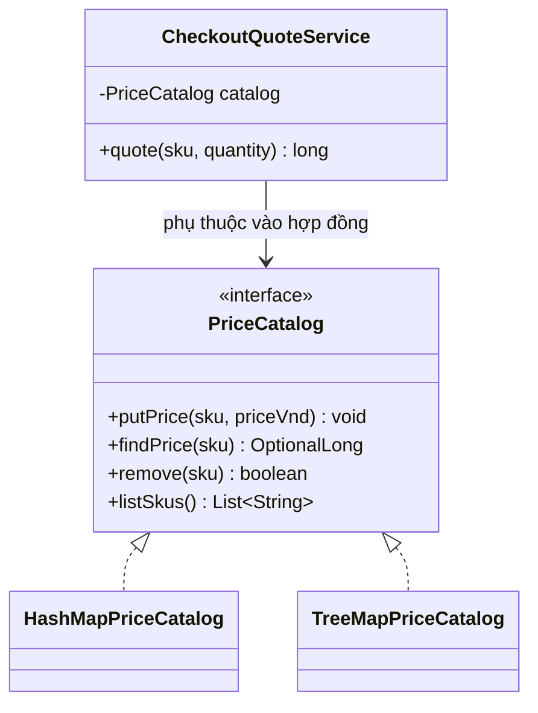
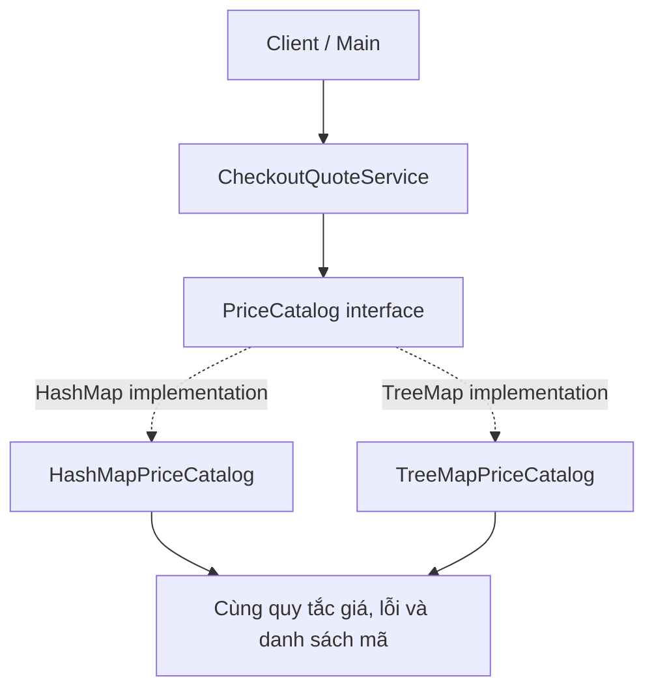

# Thay thế cách thực hiện mà giữ hợp đồng trong Java OOP

Một interface giúp mã sử dụng phụ thuộc vào **hành vi được hứa**, thay vì phụ thuộc trực tiếp vào thuật toán hoặc cấu trúc dữ liệu bên trong. Nhờ vậy, ta có thể đổi cách thực hiện (*implementation*) mà phần còn lại của chương trình vẫn hoạt động đúng.

Điều kiện để thay thế an toàn không chỉ là “hai lớp cùng `implements` một interface”. Chúng còn phải giữ **hợp đồng hành vi (behavioral contract)**: cùng ý nghĩa thao tác, cùng quy tắc đầu vào, kết quả, trạng thái, lỗi và các bảo đảm quan sát được đã công bố.

Ví dụ xuyên suốt: một hệ thống bán hàng cần tra cứu bảng giá sản phẩm theo mã SKU. Phiên bản đầu lưu giá bằng `HashMap`; phiên bản khác dùng `TreeMap`. Dịch vụ báo tiền thanh toán không cần biết cấu trúc nào đang được dùng.

## 1. “Thay implementation” nghĩa là gì?

Giả sử chương trình có phụ thuộc sau:

```java
HashMapPriceCatalog catalog = new HashMapPriceCatalog();
CheckoutQuoteService checkout = new CheckoutQuoteService(catalog);
```

Phía sử dụng hiện biết một lớp cụ thể `HashMapPriceCatalog`. Một thiết kế linh hoạt hơn khai báo phụ thuộc bằng interface:

```java
PriceCatalog catalog = new HashMapPriceCatalog();
CheckoutQuoteService checkout = new CheckoutQuoteService(catalog);
```

Khi cần cách lưu khác:

```java
PriceCatalog catalog = new TreeMapPriceCatalog();
CheckoutQuoteService checkout = new CheckoutQuoteService(catalog);
```

Đối tượng thực tế thay đổi nhưng **constructor và logic của `CheckoutQuoteService` không phải chỉnh sửa**. Đó là sử dụng *đa hình* và *lập trình hướng tới giao diện*.



Sự thay thế phải giữ những điều mà client có quyền kỳ vọng:

| Khía cạnh của hợp đồng | Ví dụ yêu cầu phải giữ |
| --- | --- |
| Chữ ký | `findPrice(String)` trả về `OptionalLong` |
| Đầu vào hợp lệ | SKU gồm 3–12 chữ in hoa/chữ số |
| Ngữ nghĩa dữ liệu | Giá có thể bằng 0, không được âm |
| Kết quả | SKU không tồn tại trả `OptionalLong.empty()` |
| Cập nhật | `putPrice` ghi đè giá trước đó cho cùng SKU |
| Thứ tự | `listSkus()` trả mã theo thứ tự từ điển tăng dần |
| Khả năng sửa | Danh sách trả về là snapshot không sửa được |
| Lỗi | SKU sai hoặc giá âm bị từ chối theo quy tắc đã hứa |

Những yêu cầu này **không được trình biên dịch tự kiểm tra hết** chỉ nhờ từ khóa `implements`. Cần tài liệu rõ ràng và kiểm thử trên từng cách thực hiện.

## 2. Định nghĩa hợp đồng trước khi chọn cấu trúc dữ liệu

Tạo tệp **`PriceCatalog.java`**:

```java
import java.util.List;
import java.util.OptionalLong;

/**
 * Bảng giá theo SKU, chạy trong bộ nhớ trong ví dụ này.
 *
 * Hợp đồng:
 * - SKU hợp lệ: 3..12 ký tự A-Z hoặc 0-9, giữ nguyên chữ hoa.
 * - Giá là số nguyên VND không âm; giá 0 là hợp lệ.
 * - Không có SKU trùng: putPrice ghi đè giá cũ.
 * - Không có SKU: findPrice trả OptionalLong.empty().
 * - listSkus trả snapshot không sửa được, sắp xếp tăng dần.
 * - Tham số không hợp lệ: IllegalArgumentException.
 * - Không cam kết an toàn khi nhiều luồng truy cập đồng thời.
 */
public interface PriceCatalog {

    void putPrice(String sku, long priceVnd);

    OptionalLong findPrice(String sku);

    /** true nếu thực sự xóa một SKU đã tồn tại. */
    boolean remove(String sku);

    List<String> listSkus();

    static void requireSku(String sku) {
        if (sku == null || !sku.matches("[A-Z0-9]{3,12}")) {
            throw new IllegalArgumentException(
                    "SKU phải gồm 3-12 ký tự A-Z hoặc 0-9");
        }
    }

    static void requirePrice(long priceVnd) {
        if (priceVnd < 0) {
            throw new IllegalArgumentException(
                    "Giá VND không được âm");
        }
    }
}
```

Hai phương thức `static` trong interface chỉ dùng để chia sẻ kiểm tra đầu vào của ví dụ. Chúng được gọi qua tên `PriceCatalog` và **không phải các phương thức instance được override**.

Chúng ta chủ động làm hợp đồng đủ chính xác để hai cách lưu trữ khác nhau vẫn cho kết quả giống nhau về hành vi. Ví dụ, không để `HashMap` trả thứ tự bất kỳ còn `TreeMap` trả thứ tự sắp xếp, vì khi đó mã in bảng giá có thể đổi kết quả chỉ do thay implementation.

## 3. Implementation A: lưu trữ bằng HashMap

Tạo **`HashMapPriceCatalog.java`**:

```java
import java.util.ArrayList;
import java.util.Collections;
import java.util.HashMap;
import java.util.List;
import java.util.Map;
import java.util.OptionalLong;

public final class HashMapPriceCatalog implements PriceCatalog {
    private final Map<String, Long> prices = new HashMap<>();

    @Override
    public void putPrice(String sku, long priceVnd) {
        PriceCatalog.requireSku(sku);
        PriceCatalog.requirePrice(priceVnd);
        prices.put(sku, priceVnd);
    }

    @Override
    public OptionalLong findPrice(String sku) {
        PriceCatalog.requireSku(sku);
        Long value = prices.get(sku);
        return value == null
                ? OptionalLong.empty()
                : OptionalLong.of(value);
    }

    @Override
    public boolean remove(String sku) {
        PriceCatalog.requireSku(sku);
        return prices.remove(sku) != null;
    }

    @Override
    public List<String> listSkus() {
        List<String> result = new ArrayList<>(prices.keySet());
        Collections.sort(result);
        return List.copyOf(result);
    }
}
```

`HashMap` không đảm bảo thứ tự duyệt khóa. Vì hợp đồng yêu cầu danh sách mã được sắp xếp, implementation này phải **tự sắp xếp** trước khi trả ra.

`List.copyOf` giúp tạo danh sách snapshot không sửa được; sửa catalog sau đó không làm danh sách kết quả thay đổi. Ở đây phần tử là `String` bất biến, nên không có vấn đề rò rỉ đối tượng phần tử mutable.

Lưu ý chi tiết quan trọng: khi giá bằng 0, `prices.get(sku)` trả `Long.valueOf(0)`, khác `null`. Vì thế `OptionalLong.of(0)` vẫn thể hiện **SKU có tồn tại với giá 0 VND**. Không được dùng kiểm tra `value == 0` để kết luận SKU vắng mặt.

## 4. Implementation B: lưu trữ bằng TreeMap

Tạo **`TreeMapPriceCatalog.java`**:

```java
import java.util.ArrayList;
import java.util.List;
import java.util.NavigableMap;
import java.util.OptionalLong;
import java.util.TreeMap;

public final class TreeMapPriceCatalog implements PriceCatalog {
    private final NavigableMap<String, Long> prices = new TreeMap<>();

    @Override
    public void putPrice(String sku, long priceVnd) {
        PriceCatalog.requireSku(sku);
        PriceCatalog.requirePrice(priceVnd);
        prices.put(sku, priceVnd);
    }

    @Override
    public OptionalLong findPrice(String sku) {
        PriceCatalog.requireSku(sku);
        Long value = prices.get(sku);
        return value == null
                ? OptionalLong.empty()
                : OptionalLong.of(value);
    }

    @Override
    public boolean remove(String sku) {
        PriceCatalog.requireSku(sku);
        return prices.remove(sku) != null;
    }

    @Override
    public List<String> listSkus() {
        return List.copyOf(new ArrayList<>(prices.navigableKeySet()));
    }
}
```

`TreeMap` duy trì thứ tự khóa theo quy tắc so sánh tự nhiên của `String`. Vì SKU chỉ dùng chữ in hoa và chữ số, thứ tự đó phù hợp quy định tăng dần trong ví dụ.

Hai lớp khác nhau về **cách tổ chức dữ liệu**:

| Chi tiết | `HashMapPriceCatalog` | `TreeMapPriceCatalog` |
| --- | --- | --- |
| Cấu trúc nội bộ | Bảng băm | Cây tìm kiếm có thứ tự |
| Tìm/thêm/xóa thông thường | Trung bình gần `O(1)` (không phải bảo đảm tuyệt đối) | `O(log n)` |
| Duyệt mã có thứ tự | Phải sắp xếp trước khi trả | Khóa vốn được duy trì có thứ tự |
| `listSkus()` | `O(n log n)` do sắp xếp trong trường hợp tổng quát | `O(n)` để tạo snapshot |
| Kiểu sử dụng từ client | `PriceCatalog` | `PriceCatalog` |

Độ phức tạp nói trên chỉ là đặc tính thuật toán khái quát; thời gian thực tế còn phụ thuộc dữ liệu, máy ảo và môi trường chạy. **Hiệu năng có thể khác**, nhưng đầu ra và quy tắc đã cam kết phải giữ nguyên.

## 5. Dịch vụ chỉ phụ thuộc vào giao diện

Tạo **`CheckoutQuoteService.java`**:

```java
import java.util.NoSuchElementException;
import java.util.Objects;

public final class CheckoutQuoteService {
    private final PriceCatalog catalog;

    public CheckoutQuoteService(PriceCatalog catalog) {
        this.catalog = Objects.requireNonNull(catalog, "catalog");
    }

    public long quote(String sku, int quantity) {
        if (quantity <= 0) {
            throw new IllegalArgumentException(
                    "Số lượng mua phải lớn hơn 0");
        }

        long priceVnd = catalog.findPrice(sku)
                .orElseThrow(() -> new NoSuchElementException(
                        "Không tìm thấy SKU: " + sku));

        return Math.multiplyExact(priceVnd, (long) quantity);
    }
}
```

Dịch vụ biết **kiểu trừu tượng `PriceCatalog`** và các hành vi được hứa của nó; không thao tác trực tiếp `HashMap`, `TreeMap` hoặc tên lớp triển khai. Constructor nhận dependency từ bên ngoài, là một hình thức *constructor injection* đơn giản, không cần framework.

`Math.multiplyExact` ném `ArithmeticException` nếu phép nhân giá với số lượng vượt miền `long`; tránh âm thầm tràn số và báo giá sai.

Dịch vụ có thể trông cậy vào các kết quả của hợp đồng:

- Giá bằng 0 vẫn là giá hợp lệ, nên đơn hàng miễn phí có tổng 0.
- SKU không có dẫn đến `OptionalLong.empty()` và dịch vụ chủ động ném `NoSuchElementException`.
- SKU sai cú pháp bị catalog từ chối bằng `IllegalArgumentException`.
- Không cần xét nhánh riêng cho từng implementation.

### Chạy hai cách thực hiện mà không sửa service

Tạo **`Main.java`**:

```java
public class Main {
    public static void main(String[] args) {
        // java Main       -> HashMap
        // java Main tree  -> TreeMap
        PriceCatalog catalog =
                args.length > 0 && args[0].equals("tree")
                ? new TreeMapPriceCatalog()
                : new HashMapPriceCatalog();

        catalog.putPrice("MS02", 250_000);
        catalog.putPrice("KB01", 150_000);

        CheckoutQuoteService checkout =
                new CheckoutQuoteService(catalog);

        System.out.println(catalog.listSkus());
        System.out.println(checkout.quote("KB01", 3));

        catalog.putPrice("KB01", 175_000);
        System.out.println(checkout.quote("KB01", 3));

        System.out.println(catalog.remove("MS02"));
        System.out.println(catalog.listSkus());
    }
}
```

Biên dịch:

```bash
javac PriceCatalog.java HashMapPriceCatalog.java TreeMapPriceCatalog.java CheckoutQuoteService.java Main.java
```

Chạy lần lượt:

```bash
java Main
java Main tree
```

**Cả hai lần đều cho kết quả:**

```text
[KB01, MS02]
450000
525000
true
[KB01]
```

Khi đổi cách lưu, chỉ có **chỗ cấu hình/tạo đối tượng** thay đổi, còn `CheckoutQuoteService` hoạt động như cũ.



Đây là ý nghĩa thực tế của **thay implementation mà giữ hợp đồng**. Hình thức lưu trữ thay đổi, còn client vẫn tương tác với cùng một khả năng ở mức nghiệp vụ.

## 6. Kiểm thử hợp đồng trên nhiều cách thực hiện

Chỉ kiểm tra mã biên dịch là chưa đủ. Java kiểm tra rằng lớp triển khai có đủ chữ ký tương thích; nó **không tự chứng minh** rằng `listSkus()` sắp xếp đúng, `putPrice()` ghi đè hay `findPrice()` phân biệt “không có” với “giá bằng 0”.

Một cách kiểm tra là chạy **cùng bộ test** trên các implementation khác nhau. Tạo **`PriceCatalogContractTest.java`**:

```java
import java.util.List;
import java.util.OptionalLong;

public class PriceCatalogContractTest {
    public static void main(String[] args) {
        verify(new HashMapPriceCatalog());
        verify(new TreeMapPriceCatalog());
        System.out.println("PASS: cả hai cách thực hiện giữ hợp đồng");
    }

    static void verify(PriceCatalog catalog) {
        check(catalog.listSkus().isEmpty(),
                "Catalog mới phải rỗng");

        check(catalog.findPrice("KB01").equals(OptionalLong.empty()),
                "SKU không có phải trả OptionalLong.empty()");

        // Thêm ngược thứ tự để phát hiện thứ tự liệt kê sai.
        catalog.putPrice("MS02", 200_000);
        catalog.putPrice("KB01", 100_000);
        catalog.putPrice("FR03", 0);

        check(catalog.listSkus()
                        .equals(List.of("FR03", "KB01", "MS02")),
                "SKU phải được sắp xếp tăng dần");

        check(catalog.findPrice("FR03").getAsLong() == 0,
                "Giá 0 vẫn là SKU tồn tại");

        // Snapshot giữ nguyên sau khi catalog bị thay đổi.
        List<String> before = catalog.listSkus();
        catalog.remove("MS02");
        check(before.equals(List.of("FR03", "KB01", "MS02")),
                "Snapshot không được đổi");

        expect(UnsupportedOperationException.class,
                () -> before.add("NEW1"));

        // Cập nhật SKU cũ không tạo bản ghi trùng.
        catalog.putPrice("KB01", 125_000);
        check(catalog.findPrice("KB01").getAsLong() == 125_000,
                "putPrice phải ghi đè giá cũ");
        check(catalog.listSkus().equals(List.of("FR03", "KB01")),
                "Không được sinh mã trùng");

        check(!catalog.remove("MS02"),
                "Xóa mã đã vắng mặt phải trả false");
        check(catalog.remove("FR03"),
                "Xóa mã tồn tại phải trả true");

        // Hai implementation phải từ chối cùng đầu vào sai.
        expect(IllegalArgumentException.class,
                () -> catalog.putPrice("bad", 10));
        expect(IllegalArgumentException.class,
                () -> catalog.putPrice("AA01", -1));
        expect(IllegalArgumentException.class,
                () -> catalog.findPrice(null));
        expect(IllegalArgumentException.class,
                () -> catalog.remove("!"));

        check(catalog.listSkus().equals(List.of("KB01")),
                "Lỗi input không được phá dữ liệu đã có");
    }

    static void expect(Class<? extends RuntimeException> type,
                       Runnable action) {
        try {
            action.run();
        } catch (RuntimeException ex) {
            if (type.isInstance(ex)) {
                return;
            }
            throw new AssertionError(
                    "Sai loại ngoại lệ: " + ex.getClass().getName(), ex);
        }
        throw new AssertionError("Thiếu ngoại lệ " + type.getName());
    }

    static void check(boolean passed, String message) {
        if (!passed) {
            throw new AssertionError(message);
        }
    }
}
```

Chạy:

```bash
javac PriceCatalog.java HashMapPriceCatalog.java TreeMapPriceCatalog.java PriceCatalogContractTest.java
java PriceCatalogContractTest
```

Kết quả dự kiến:

```text
PASS: cả hai cách thực hiện giữ hợp đồng
```

Test trên minh họa nhiều phần của hợp đồng: trạng thái ban đầu, sắp xếp, snapshot, giá 0, ghi đè, xóa và validation. Nó không chứng minh toán học mọi tình huống; khi mở rộng hệ thống, có thể chuyển thành JUnit parameterized tests và bổ sung kịch bản biên.

**Điểm đáng chú ý:** test nhận tham số `PriceCatalog`. Khi thêm cách thực hiện mới, ta chỉ cần tạo đối tượng mới rồi chạy `verify(...)`. Không nên sao chép một bộ test gần giống cho từng lớp, vì chúng dễ phát triển thành những định nghĩa hợp đồng không nhất quán.

## 7. Khi nào một lớp “implements đúng” nhưng vẫn vi phạm hợp đồng?

Giả sử có lớp sau:

```java
import java.util.List;
import java.util.OptionalLong;

public final class BrokenCatalog implements PriceCatalog {
    @Override
    public void putPrice(String sku, long priceVnd) {
        // Không lưu gì: vi phạm ý nghĩa của putPrice.
    }

    @Override
    public OptionalLong findPrice(String sku) {
        return OptionalLong.of(0); // Mọi SKU đều được báo có giá 0.
    }

    @Override
    public boolean remove(String sku) {
        return true; // Ngay cả khi SKU không tồn tại.
    }

    @Override
    public List<String> listSkus() {
        return List.of();
    }
}
```

Lớp này **có thể biên dịch** vì đủ phương thức theo cú pháp của `PriceCatalog`. Nhưng nó không giữ hợp đồng hành vi: sau `putPrice("KB01", 100_000)`, giá phải tra được là 100.000; mã không có phải trả `OptionalLong.empty()`; `remove` chỉ trả true khi thực sự xóa.

Vì vậy có hai lớp kiểm tra độc lập:

| Lớp kiểm tra | Công cụ hỗ trợ | Ví dụ |
| --- | --- | --- |
| **Tương thích kiểu** | Trình biên dịch Java | Đủ phương thức, tham số, kiểu trả về, phạm vi truy cập |
| **Tương thích hành vi** | Đặc tả, test, lập luận và quan sát thực thi | Ghi đè đúng, xử lý lỗi đúng, kết quả được sắp xếp |

Một subclass hoặc implementation có thể vượt qua phần đầu và vẫn thất bại ở phần sau.

## 8. Liên hệ nguyên lý thay thế Liskov (LSP)

**Liskov Substitution Principle** nói theo cách thực dụng: khi mã client được viết đúng theo hợp đồng của kiểu trừu tượng, thay đối tượng hiện tại bằng một kiểu con/implementation hợp lệ không làm phá vỡ tính đúng đắn mà client dựa vào.

Áp dụng vào `PriceCatalog`:

- **Không siết chặt tiền điều kiện:** nếu interface chấp nhận SKU `"KB01"`, một implementation không thể tự ý yêu cầu mã dài tối thiểu 8 ký tự rồi từ chối `"KB01"`.
- **Không làm yếu hậu điều kiện:** sau khi `putPrice("KB01", 100_000)` hoàn thành, implementation phải cho phép tìm thấy đúng giá đó; không được tùy ý cập nhật sau vài giây nếu hợp đồng hiện tại hứa có hiệu lực ngay.
- **Giữ bất biến:** số tiền lưu là `long >= 0` và chỉ có một giá hiện hành cho mỗi SKU.
- **Giữ các bảo đảm lỗi và hiệu ứng phụ đã công bố:** không âm thầm xóa cả catalog khi một yêu cầu bị từ chối.
- **Giữ các tính chất quan sát được:** danh sách mã được sắp xếp, không sửa được và là snapshot.

Những điểm này mạnh hơn sự giống nhau của tên phương thức. Nếu quy tắc thật sự khác, hãy **định nghĩa interface khác hoặc một chính sách nghiệp vụ riêng**, thay vì tự nhận cùng hợp đồng nhưng gây bất ngờ cho client.

### Điều gì *được phép* khác?

Giữa hai implementation, các chi tiết **không được hợp đồng cố định** có thể khác:

- Cấu trúc dữ liệu, thuật toán, cách cache.
- Mức sử dụng bộ nhớ, chi phí tìm kiếm, cách tổ chức nội bộ.
- Log kỹ thuật không thuộc API công khai.
- Cách triển khai validation miễn là đầu vào và lỗi quan sát được vẫn đúng như hợp đồng.

Ngược lại, nếu API đã cam kết thread-safe, lưu bền vững hay thao tác nguyên tử, implementation mới cũng phải giữ các bảo đảm đó. Chúng **không còn là chi tiết có thể bỏ qua**.

## 9. Đặt điểm thay thế ở ngoài mã nghiệp vụ

Nếu tạo implementation trực tiếp trong `CheckoutQuoteService`:

```java
// Thiết kế gắn chặt, khó đổi:
public CheckoutQuoteService() {
    this.catalog = new HashMapPriceCatalog();
}
```

thì dịch vụ phải sửa khi đổi sang `TreeMapPriceCatalog`. Phụ thuộc vào interface ở field chưa đủ nếu constructor vẫn quyết định lớp cụ thể.

Cách tốt hơn:

```java
public CheckoutQuoteService(PriceCatalog catalog) {
    this.catalog = java.util.Objects.requireNonNull(catalog);
}
```

Chỗ khởi tạo ứng dụng (composition root) chọn implementation và **tiêm phụ thuộc** vào service. Khi chạy thật với dependency injection framework, có thể dùng cấu hình để chọn bean nhưng nguyên lý Java vẫn vậy.

Cần phân biệt:

- **Thay thế triển khai ở lần khởi chạy tiếp theo:** đổi cấu hình/tạo đối tượng rồi tiêm vào service; không phải chỉnh thuật toán báo giá.
- **Thay thế động ngay khi đang chạy:** cần quyết định cách quản lý tham chiếu, trạng thái cũ, dữ liệu chuyển đổi và đồng thời. Tự đổi một biến cấu hình không làm mọi đối tượng đã tạo tự nhận implementation mới.

Trong ví dụ, hai catalog đều bắt đầu rỗng. Để chuyển từ một catalog đã có dữ liệu sang cái khác, phải **chuyển dữ liệu hiện có** theo cách bảo toàn hợp đồng. Chỉ đổi `new HashMapPriceCatalog()` thành `new TreeMapPriceCatalog()` không tự chuyển những giá đã lưu trong đối tượng cũ.

## 10. Khi thay bằng database, HTTP hoặc cache

Thay `HashMap` bằng repository dùng database nghe có vẻ chỉ là đổi nơi lưu. Nhưng độ trễ, giao dịch, lỗi mạng và khả năng đồng thời có thể làm **khác hợp đồng quan sát được**.

Ví dụ:

| Thay đổi implementation | Câu hỏi hợp đồng cần giải quyết |
| --- | --- |
| Dùng database | `putPrice` trả về sau khi ghi đã được commit hay chỉ gửi lệnh? |
| Dùng cache | Sau khi cập nhật, `findPrice` có thể trả giá cũ không? Trong bao lâu? |
| Dùng HTTP | Mạng lỗi được biểu diễn bằng ngoại lệ nào? Có retry hay không? |
| Dùng lưu trữ phân tán | Có đảm bảo đọc thấy ngay dữ liệu vừa ghi hay chỉ nhất quán sau một khoảng? |
| Chạy nhiều luồng | Hai lần cập nhật đồng thời được tuần tự hóa hay xử lý tranh chấp ra sao? |
| Lưu bản sao bất biến | Là snapshot tại thời điểm nào? Khi nguồn đổi thì bản sao có cập nhật không? |

Nếu API yêu cầu “`putPrice` hoàn thành thì `findPrice` trả giá mới”, triển khai có cache cũ hoặc ghi bất đồng bộ **không được tuyên bố thay thế tương đương** khi chưa có cơ chế đáp ứng yêu cầu ấy.

Khi yêu cầu sản phẩm thay đổi, có thể phải **điều chỉnh hợp đồng một cách công khai** (chẳng hạn chuyển sang `CompletionStage`, khai báo lỗi I/O, hoặc đưa vào cơ chế kiểm soát phiên bản). Đừng giấu những khác biệt có ý nghĩa sau một interface có chữ ký giống hệt rồi xem là tương thích.

## 11. Checklist đánh giá một cách thực hiện mới

Trước khi thay lớp đang chạy bằng lớp mới, kiểm tra các câu hỏi:

1. **Cùng chữ ký:** tên, tham số, kiểu trả về, khả năng truy cập có tương thích không?
2. **Cùng miền đầu vào:** dữ liệu trước đây hợp lệ có còn được chấp nhận không?
3. **Cùng ý nghĩa kết quả:** giá trị trả về, trạng thái và thứ tự quan sát có giống các cam kết không?
4. **Cùng hành vi lỗi:** ngoại lệ, rollback/giữ nguyên trạng thái và null/empty có đúng như tài liệu?
5. **Cùng bất biến:** các phương thức sửa dữ liệu có giữ đối tượng ở trạng thái hợp lệ?
6. **Cùng bảo đảm đã công bố:** thread-safety, tính nguyên tử, độ bền, tính nhất quán có bị giảm?
7. **Chuyển đổi trạng thái:** nếu implementation cũ đã có dữ liệu, việc thay thế có cần migration?
8. **Kiểm thử:** cùng một bộ test hợp đồng có chạy được với tất cả implementation hay không?

### Tự luyện tập

**Bài 1.** Tạo `LinkedHashMapPriceCatalog implements PriceCatalog`. Dùng `LinkedHashMap` để giữ thứ tự thêm, nhưng `listSkus()` vẫn phải **sắp xếp theo mã tăng dần** để giữ hợp đồng. Chạy lại `PriceCatalogContractTest.verify(...)` cho lớp mới.

**Bài 2.** Sửa `TreeMapPriceCatalog` để trả danh sách khóa theo thứ tự giảm dần. Mã có còn biên dịch? Có. Nó có tương thích hành vi? **Không**, vì vi phạm cam kết thứ tự `listSkus()`.

**Bài 3.** Giả sử SKU hợp lệ có giá bằng 0. Nếu một implementation viết `if (value == 0) return OptionalLong.empty();`, dịch vụ báo tiền có thể sai như thế nào? Hãy tạo test chứng minh giá 0 và “mã không tồn tại” là hai trạng thái khác nhau.

**Bài 4.** Nếu cần dùng cùng `CheckoutQuoteService` với một catalog từ database, hãy viết rõ ít nhất bốn cam kết bổ sung về lỗi truy cập dữ liệu, tính nhất quán sau cập nhật, thời điểm commit và xử lý đồng thời trước khi quyết định có thể dùng nguyên interface hay không.

**Điểm cần nhớ:** interface tạo **điểm có thể thay thế**, nhưng chỉ hợp đồng hành vi nhất quán mới biến sự thay thế thành an toàn. Thiết kế nên để client phụ thuộc vào trừu tượng, implementation chịu trách nhiệm tuân thủ lời hứa, và một bộ kiểm thử dùng chung kiểm chứng lời hứa đó.