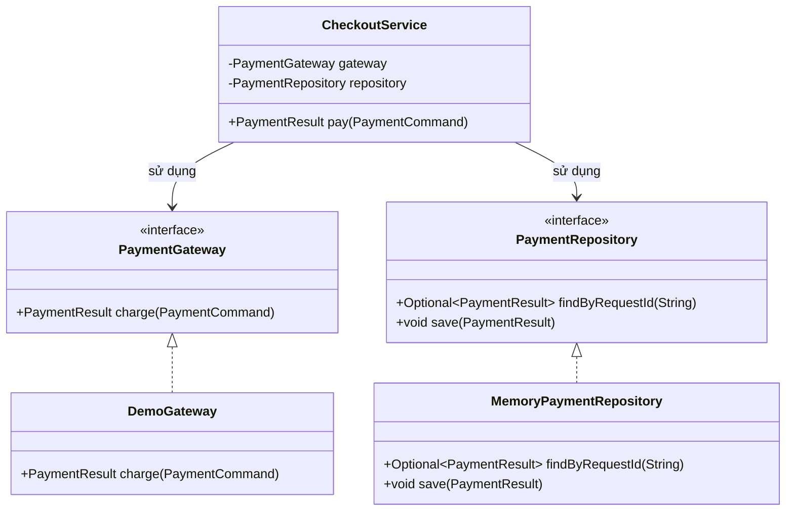

# Thiết kế giao diện thanh toán hoặc lưu trữ trong Java

**Chủ đề:** OOP → Giao diện (Interface) → Thiết kế giao diện thanh toán hoặc lưu trữ.

Khi xây dựng chức năng thanh toán, mã nghiệp vụ thường cần **gửi yêu cầu thu tiền** và **lưu kết quả giao dịch**. Đó là hai khả năng khác nhau. Chúng có thể được mô tả bằng hai giao diện nhỏ: `PaymentGateway` để xử lý thanh toán và `PaymentRepository` để truy xuất/lưu dữ liệu. Mã sử dụng chỉ biết **hợp đồng**, còn việc gọi API bên ngoài hay ghi cơ sở dữ liệu thuộc về lớp triển khai.

Bài học sử dụng Java 17 và một bộ xử lý thanh toán **mô phỏng**, chạy được mà không cần tài khoản hoặc dịch vụ bên ngoài.

## 1. Bắt đầu từ trách nhiệm, không bắt đầu từ tên thư viện

Một thiết kế phụ thuộc trực tiếp vào chi tiết có thể trông như sau:

```java
class CheckoutService {
    // Mã nghiệp vụ tự quyết định cách thanh toán và nơi lưu dữ liệu.
    private final VendorCardClient cardClient = new VendorCardClient();
    private final SqlPaymentDao dao = new SqlPaymentDao();

    void checkout(/* ... */) {
        // ... gọi cardClient rồi ghi dao
    }
}
```

`VendorCardClient` và `SqlPaymentDao` ở đây là **tên minh họa**, không phải lớp có sẵn trong JDK. Kiểu thiết kế này gây khó khi thay nhà cung cấp, đổi nơi lưu trữ, hoặc kiểm thử trường hợp lỗi vì `CheckoutService` gắn trực tiếp với các implementation.

Trước khi viết code, hãy xác định các hợp đồng:

| Thành phần | Câu hỏi cần trả lời | Hợp đồng nên thể hiện |
|---|---|---|
| Thanh toán | Làm sao gửi yêu cầu thu tiền và nhận kết quả? | `PaymentGateway.charge(...)` |
| Lưu trữ | Làm sao tìm kết quả theo mã yêu cầu và lưu kết quả mới? | `PaymentRepository.findByRequestId(...)`, `save(...)` |
| Nghiệp vụ | Ai kiểm tra yêu cầu, phối hợp thao tác, quyết định trả kết quả? | `CheckoutService.pay(...)` |
| Lắp ghép hệ thống | Ai tạo gateway và repository thực tế? | Mã khởi tạo ứng dụng / dependency injection |

Hai interface có cùng mục tiêu về **phân tách phụ thuộc**, nhưng không nên gộp vào một `PaymentManager` khổng lồ: thay cách lưu trữ không nhất thiết buộc phải thay cách thanh toán.



Mũi tên từ `CheckoutService` tới interface thể hiện **hướng phụ thuộc của mã nguồn**. Hai implementation hiện tại có thể được thay bằng lớp gọi cổng thanh toán hoặc database mà không phải thay đổi chữ ký của `CheckoutService`.

## 2. Thiết kế dữ liệu đi qua ranh giới interface

Một giao diện tốt không chỉ là tên phương thức. Dữ liệu đầu vào/đầu ra cần diễn đạt đúng nghiệp vụ và hạn chế trạng thái không hợp lệ.

Ví dụ:

```java
public enum PaymentStatus {
    APPROVED, DECLINED
}

public record PaymentCommand(
        String requestId,
        String orderId,
        long amountCents
) {
    public PaymentCommand {
        if (requestId == null || requestId.isBlank()) {
            throw new IllegalArgumentException("Thiếu mã yêu cầu");
        }
        if (orderId == null || orderId.isBlank()) {
            throw new IllegalArgumentException("Thiếu mã đơn hàng");
        }
        if (amountCents <= 0) {
            throw new IllegalArgumentException("Số tiền phải dương");
        }
    }
}

public record PaymentResult(
        String requestId,
        String orderId,
        long amountCents,
        PaymentStatus status,
        String providerReference
) {}
```

Trong đó:

- `requestId` xác định **một yêu cầu thanh toán logic**; khi gọi lại cùng yêu cầu, hệ thống cần có chính sách xử lý trùng lặp.
- `orderId` cho biết yêu cầu thuộc đơn hàng nào.
- `amountCents` là số tiền nguyên theo **đơn vị nhỏ nhất giả định** để tránh lỗi số thực khi minh họa. Hệ thống tiền tệ thật cần quy tắc currency/scale và làm tròn rõ ràng.
- `PaymentStatus` dùng enum thay cho chuỗi tự do như `"SUCCESSS"`.
- `providerReference` là mã tham chiếu từ nơi thực hiện giao dịch; ví dụ mô phỏng sẽ tự tạo một giá trị.

`record` được hỗ trợ ổn định từ Java 16, phù hợp để mô tả dữ liệu trao đổi bất biến ở mức các thành phần primitive/`String`/`enum`. Nó cũng sinh `equals`, `hashCode`, `toString` và accessor.

Ở ranh giới thật, trạng thái thanh toán có thể cần thêm `PENDING`, `UNKNOWN`, `REFUNDED` và mã lỗi. Hai trạng thái trên đủ để dạy thiết kế interface, **không đại diện đầy đủ cho mọi hệ thống thanh toán**.

## 3. Ví dụ hoàn chỉnh, có thể biên dịch và chạy

Lưu toàn bộ đoạn sau thành **`PaymentInterfacesDemo.java`**. Tất cả kiểu được đặt trong một lớp ngoài để ví dụ chạy độc lập.

```java
import java.util.Map;
import java.util.Objects;
import java.util.Optional;
import java.util.concurrent.ConcurrentHashMap;

public class PaymentInterfacesDemo {

    enum PaymentStatus {
        APPROVED, DECLINED
    }

    record PaymentCommand(
            String requestId, String orderId, long amountCents) {

        PaymentCommand {
            if (requestId == null || requestId.isBlank()) {
                throw new IllegalArgumentException("requestId không hợp lệ");
            }
            if (orderId == null || orderId.isBlank()) {
                throw new IllegalArgumentException("orderId không hợp lệ");
            }
            if (amountCents <= 0) {
                throw new IllegalArgumentException("Số tiền phải dương");
            }
        }
    }

    record PaymentResult(
            String requestId,
            String orderId,
            long amountCents,
            PaymentStatus status,
            String providerReference) {

        PaymentResult {
            Objects.requireNonNull(requestId);
            Objects.requireNonNull(orderId);
            Objects.requireNonNull(status);
            Objects.requireNonNull(providerReference);
        }
    }

    // Giao diện #1: thực hiện thanh toán.
    interface PaymentGateway {
        PaymentResult charge(PaymentCommand command);
    }

    // Giao diện #2: lưu và tìm kết quả thanh toán.
    interface PaymentRepository {
        Optional<PaymentResult> findByRequestId(String requestId);
        void save(PaymentResult result);
    }

    // Mô phỏng: duyệt giao dịch <= 100.000 cents.
    static final class DemoGateway implements PaymentGateway {
        private int chargeCalls;

        @Override
        public PaymentResult charge(PaymentCommand command) {
            Objects.requireNonNull(command, "command");
            chargeCalls++;

            PaymentStatus status = command.amountCents() <= 100_000
                    ? PaymentStatus.APPROVED
                    : PaymentStatus.DECLINED;

            String reference = status == PaymentStatus.APPROVED
                    ? "DEMO-" + command.requestId()
                    : "DECLINED";

            return new PaymentResult(
                    command.requestId(),
                    command.orderId(),
                    command.amountCents(),
                    status,
                    reference
            );
        }

        int chargeCalls() {
            return chargeCalls;
        }
    }

    // Bộ lưu trữ trong bộ nhớ; mất dữ liệu khi ứng dụng kết thúc.
    static final class MemoryPaymentRepository implements PaymentRepository {
        private final Map<String, PaymentResult> records =
                new ConcurrentHashMap<>();

        @Override
        public Optional<PaymentResult> findByRequestId(String requestId) {
            Objects.requireNonNull(requestId, "requestId");
            return Optional.ofNullable(records.get(requestId));
        }

        @Override
        public void save(PaymentResult result) {
            Objects.requireNonNull(result, "result");

            PaymentResult existing =
                    records.putIfAbsent(result.requestId(), result);

            if (existing != null && !existing.equals(result)) {
                throw new IllegalStateException(
                        "requestId đã có kết quả khác"
                );
            }
        }
    }

    // Mã nghiệp vụ chỉ phụ thuộc vào hai interface.
    static final class CheckoutService {
        private final PaymentGateway gateway;
        private final PaymentRepository repository;

        CheckoutService(
                PaymentGateway gateway,
                PaymentRepository repository) {
            this.gateway = Objects.requireNonNull(gateway, "gateway");
            this.repository = Objects.requireNonNull(
                    repository, "repository"
            );
        }

        // synchronized chỉ khóa trên CHÍNH instance service này.
        synchronized PaymentResult pay(PaymentCommand command) {
            Objects.requireNonNull(command, "command");

            Optional<PaymentResult> previous =
                    repository.findByRequestId(command.requestId());

            if (previous.isPresent()) {
                PaymentResult saved = previous.get();

                // Không cho dùng lại requestId với nội dung khác.
                if (!saved.orderId().equals(command.orderId())
                        || saved.amountCents() != command.amountCents()) {
                    throw new IllegalArgumentException(
                            "requestId đã dùng cho yêu cầu khác"
                    );
                }
                return saved;
            }

            PaymentResult result = gateway.charge(command);

            if (!result.requestId().equals(command.requestId())
                    || !result.orderId().equals(command.orderId())
                    || result.amountCents() != command.amountCents()) {
                throw new IllegalStateException(
                        "Gateway trả kết quả không khớp yêu cầu"
                );
            }

            repository.save(result);
            return result;
        }
    }

    public static void main(String[] args) {
        DemoGateway gateway = new DemoGateway();
        PaymentRepository repository = new MemoryPaymentRepository();

        CheckoutService checkout =
                new CheckoutService(gateway, repository);

        PaymentCommand request1 =
                new PaymentCommand("REQ-01", "ORDER-01", 50_000);

        PaymentResult first = checkout.pay(request1);
        PaymentResult repeated = checkout.pay(request1);

        PaymentResult rejected = checkout.pay(
                new PaymentCommand("REQ-02", "ORDER-02", 150_000)
        );

        System.out.println("REQ-01: " + first.status());
        System.out.println("REQ-01 lặp: " + repeated.status());
        System.out.println("REQ-02: " + rejected.status());
        System.out.println("Số lần gọi gateway: " + gateway.chargeCalls());
        System.out.println(
                "Có lưu REQ-01: " +
                repository.findByRequestId("REQ-01").isPresent()
        );
    }
}
```

Chạy:

```bash
javac PaymentInterfacesDemo.java
java PaymentInterfacesDemo
```

Kết quả:

```text
REQ-01: APPROVED
REQ-01 lặp: APPROVED
REQ-02: DECLINED
Số lần gọi gateway: 2
Có lưu REQ-01: true
```

**Giải thích:** có ba lần gọi `checkout.pay(...)`, nhưng lần thứ hai dùng lại `REQ-01` và được trả từ repository. Trong phạm vi **cùng instance `CheckoutService` đang chạy và cùng dữ liệu trong RAM**, gateway chỉ nhận hai lệnh mới.

Bài toán thanh toán thực tế không thể coi đoạn mã này là giải pháp chống thu tiền trùng ở môi trường production: nếu chương trình chết sau khi gateway đã thu tiền nhưng trước khi `repository.save`, lần gọi lại có thể gửi lệnh thu tiền lần nữa. Cần idempotency được bảo đảm ở phía gateway, trạng thái bền vững và cơ chế xử lý phục hồi.

## 4. Ý nghĩa của từng giao diện

### `PaymentGateway`: ranh giới hệ thống bên ngoài

```java
interface PaymentGateway {
    PaymentResult charge(PaymentCommand command);
}
```

Interface này cố ý không nhắc đến URL, JSON, thư viện HTTP, token hoặc tên nhà cung cấp. Những chi tiết ấy phải nằm trong adapter cụ thể.

Ví dụ một implementation thật trong tương lai có thể mang hình dạng:

```java
final class ExternalPaymentGateway implements PaymentGateway {
    private final ExternalPaymentClient client;

    ExternalPaymentGateway(ExternalPaymentClient client) {
        this.client = client;
    }

    @Override
    public PaymentResult charge(PaymentCommand command) {
        // 1. Ánh xạ PaymentCommand sang request của nhà cung cấp.
        // 2. Gửi request với idempotency key.
        // 3. Ánh xạ response và lỗi về hợp đồng ứng dụng.
        // Đây là phác thảo adapter; chưa có ExternalPaymentClient thật.
        throw new UnsupportedOperationException("Chưa tích hợp");
    }
}
```

Đoạn trên là **phác thảo thiết kế**, không phải phần của ví dụ chạy độc lập. Khi triển khai thật, phải xác định hành vi khi timeout, mạng gián đoạn, lỗi từ chối, phản hồi không xác định, thanh toán bất đồng bộ và khả năng retry. Không được coi mọi exception là “chưa trừ tiền”.

### `PaymentRepository`: ranh giới nơi lưu trữ

```java
interface PaymentRepository {
    Optional<PaymentResult> findByRequestId(String requestId);
    void save(PaymentResult result);
}
```

Mã nghiệp vụ chỉ yêu cầu **tìm theo mã** và **lưu kết quả**. Nó không phụ thuộc vào JDBC, JPA, MongoDB hay cấu trúc bảng cụ thể.

| Implementation | Cách lưu | Khi nào thích hợp? |
|---|---|---|
| `MemoryPaymentRepository` | `ConcurrentHashMap` trong RAM | Demo, test đơn giản |
| `JdbcPaymentRepository` | SQL và JDBC | Ứng dụng cần dữ liệu bền vững |
| `JpaPaymentRepository` | ORM/JPA | Dự án đã dùng JPA, entity và transaction |
| `RemotePaymentRepository` | API lưu trữ ở dịch vụ khác | Kiến trúc tách dịch vụ khi có lý do rõ ràng |

Tên implementation ở ba dòng cuối chỉ mô tả khả năng thiết kế, **không phải mã đã triển khai trong ví dụ này**. Để thay từ RAM sang database, cần thực hiện đúng semantics của `findByRequestId`/`save` và xử lý uniqueness/transaction/race condition.

Một nguyên tắc rất quan trọng: `Optional.empty()` có nghĩa “không tìm thấy”, **không nên che giấu lỗi kết nối database** bằng cách trả `Optional.empty()`. Lỗi hạ tầng nên được báo đúng để caller phân biệt “vắng dữ liệu” với “không truy vấn được”.

## 5. Constructor injection: cung cấp implementation từ bên ngoài

```java
CheckoutService checkout =
        new CheckoutService(
                new DemoGateway(),
                new MemoryPaymentRepository()
        );
```

`CheckoutService` nhận phụ thuộc qua constructor. Nó không biết, và không cần biết, hai đối tượng đó được tạo bằng cách nào.

Đó là **Dependency Injection (DI)** thực hiện thủ công. Không cần Spring để áp dụng. Khi dùng framework DI, việc lựa chọn bean/configuration thay cho đoạn `new` sẽ do cấu hình ứng dụng thực hiện, còn hợp đồng vẫn giữ nguyên.

Sự khác nhau cần ghi nhớ:

- **Interface** định nghĩa một tập hành vi mà implementation phải hỗ trợ.
- **Dependency Injection** là cách cung cấp phụ thuộc cho thành phần cần sử dụng.
- **Dependency Inversion Principle (DIP)** định hướng để logic cấp cao phụ thuộc vào abstraction phù hợp thay vì chi tiết triển khai.

Có thể constructor-inject cả concrete class, vì thế **DI không tự đồng nghĩa với sử dụng interface**. Interface hữu ích khi một ranh giới có nhiều implementation hoặc cần cô lập dependency trong kiểm thử.

## 6. Kiểm thử CheckoutService bằng fake thay vì cổng thật

Để kiểm tra logic phối hợp, có thể tạo một implementation rất nhỏ cho `PaymentGateway` và dùng `MemoryPaymentRepository`. Đặt đoạn sau trong file **`CheckoutServiceCheck.java`** cạnh `PaymentInterfacesDemo.java`:

```java
public class CheckoutServiceCheck {

    static final class FakeGateway
            implements PaymentInterfacesDemo.PaymentGateway {
        int calls;

        @Override
        public PaymentInterfacesDemo.PaymentResult charge(
                PaymentInterfacesDemo.PaymentCommand command) {
            calls++;
            return new PaymentInterfacesDemo.PaymentResult(
                    command.requestId(),
                    command.orderId(),
                    command.amountCents(),
                    PaymentInterfacesDemo.PaymentStatus.APPROVED,
                    "FAKE-" + command.requestId()
            );
        }
    }

    public static void main(String[] args) {
        FakeGateway fake = new FakeGateway();
        var repository =
                new PaymentInterfacesDemo.MemoryPaymentRepository();
        var checkout =
                new PaymentInterfacesDemo.CheckoutService(fake, repository);

        var request = new PaymentInterfacesDemo.PaymentCommand(
                "REQ-TEST", "ORDER-TEST", 25_000
        );

        var first = checkout.pay(request);
        var second = checkout.pay(request);

        if (first.status() !=
                    PaymentInterfacesDemo.PaymentStatus.APPROVED
                || !first.equals(second)
                || fake.calls != 1
                || repository.findByRequestId("REQ-TEST").isEmpty()) {
            throw new AssertionError("CheckoutService sai hợp đồng");
        }

        try {
            checkout.pay(new PaymentInterfacesDemo.PaymentCommand(
                    "REQ-TEST", "ORDER-KHAC", 25_000
            ));
            throw new AssertionError(
                    "Phải từ chối requestId trùng nội dung khác"
            );
        } catch (IllegalArgumentException expected) {
            // Hành vi đúng.
        }

        if (fake.calls != 1) {
            throw new AssertionError("Gateway bị gọi lại ngoài ý muốn");
        }

        System.out.println("PASS");
    }
}
```

Chạy:

```bash
javac PaymentInterfacesDemo.java CheckoutServiceCheck.java
java CheckoutServiceCheck
```

Kết quả mong đợi:

```text
PASS
```

Fake ghi nhận số lần gọi, cho phép kiểm tra checkout không gọi gateway khi request đã có kết quả lưu. Bài test này kiểm tra **mã nghiệp vụ với fake**, không xác minh tính đúng đắn của hệ thống thanh toán bên ngoài.

Có thể viết các bài test khác cho trường hợp gateway trả kết quả sai `orderId`, repository không lưu được hoặc `requestId` bị sử dụng lại với số tiền khác.

## 7. Những điều hợp đồng thanh toán phải nói rõ

Chữ ký `PaymentResult charge(PaymentCommand)` chỉ mô tả kiểu dữ liệu. Với hệ thống thật, phải bổ sung các quy tắc:

| Khía cạnh | Câu hỏi cần trả lời |
|---|---|
| Input | Số tiền dùng đơn vị nào, currency nào, phạm vi `requestId` ra sao? |
| Thành công | Khi nào một khoản tiền được coi là đã thu thành công? |
| Từ chối | `DECLINED` có nghĩa không thu được tiền hay chỉ chưa xác nhận? |
| Timeout | Không nhận được phản hồi thì có thể tiền đã bị trừ chưa? |
| Idempotency | Gửi lại cùng `requestId` có phát sinh khoản thu mới không? |
| Retry | Những lỗi nào được phép tự thử lại? |
| Persistence | Kết quả nào cần ghi bền vững trước khi thông báo thành công? |
| Concurrency | Có thể đồng thời xử lý cùng một yêu cầu ở nhiều instance không? |
| Security | Ai được phép yêu cầu thanh toán cho đơn hàng? |

**Đặc biệt:** `synchronized` trong `CheckoutService.pay` chỉ tuần tự hóa các lời gọi trên **một đối tượng service cụ thể**. Nó không khóa các instance khác, các tiến trình khác hoặc database. `ConcurrentHashMap` giúp các thao tác riêng lẻ của map an toàn hơn khi nhiều luồng dùng, nhưng **không biến chuỗi “tìm → gọi cổng → lưu” thành giao dịch nguyên tử**.

Ở môi trường thật, một hướng xử lý là:

1. Đảm bảo ràng buộc unique `requestId` tại tầng lưu trữ bền vững, hoặc quản lý một bản ghi yêu cầu có trạng thái.
2. Gửi **idempotency key** tới nhà cung cấp thanh toán theo hợp đồng của họ.
3. Lưu trạng thái/biên nhận giao dịch, phân biệt kết quả chắc chắn với trường hợp đang chờ/không xác định.
4. Thiết kế phục hồi khi tiến trình chết hoặc mạng đứt giữa các bước; retry có kiểm soát, reconciliation khi cần.
5. Không giữ lock database kéo dài một cách ngây thơ qua các lời gọi mạng chậm; chọn chiến lược transaction/state machine phù hợp.

Những điều này nằm ở yêu cầu nghiệp vụ/hạ tầng, không tự được giải quyết bằng việc khai báo `interface`.

## 8. Tránh thiết kế interface quá lớn hoặc quá phụ thuộc công nghệ

Một giao diện như sau làm lộ chi tiết SQL cho mọi mã nghiệp vụ:

```java
interface BadPaymentStore {
    java.sql.ResultSet runSql(String rawSql) throws java.sql.SQLException;
}
```

Nó cũng khiến mọi caller phải biết cấu trúc bảng, truy vấn và vòng đời `ResultSet`. Đây là abstraction quá thấp nếu mục tiêu chỉ là tìm/lưu thanh toán.

Giao diện phù hợp với nhu cầu nghiệp vụ hơn:

```java
interface PaymentRepository {
    Optional<PaymentResult> findByRequestId(String requestId);
    void save(PaymentResult result);
}
```

Nhờ vậy implementation có thể tự dùng SQL, nhưng người gọi không phải quản lý kết nối hoặc biết database.

Tương tự, tránh dồn quá nhiều hành vi không liên quan:

```java
interface EverythingPayment {
    void charge();
    void saveToDatabase();
    void sendEmail();
    void printReceipt();
    void exportCsv();
}
```

Một lớp chỉ cần lưu giao dịch sẽ bị ép biết về email, in ấn và xuất CSV. Nên tách hợp đồng nhỏ theo **trách nhiệm thực sự** — ứng dụng của Interface Segregation Principle (ISP). Tuy nhiên, cũng không cần tạo một interface cho từng phương thức nếu các hành vi thuộc cùng một trách nhiệm gắn kết.

### Quy tắc chọn interface hay abstract class

| Nhu cầu | Thường phù hợp |
|---|---|
| Nhiều adapter khác nhau cần cùng hợp đồng gọi thanh toán | `interface PaymentGateway` |
| Nhiều cách lưu trữ khác nhau với cùng thao tác dữ liệu | `interface PaymentRepository` |
| Một họ implementation có trạng thái chung, constructor và quy trình dùng chung | Cân nhắc `abstract class` |
| Chỉ có một thuật toán nhỏ, không có nhu cầu thay thế hoặc ranh giới đáng kể | Có thể dùng class đơn giản, chưa cần interface |

Lựa chọn dựa vào **điều mà client thật sự sử dụng**. Đừng tạo interface chỉ vì tên lớp có hậu tố `Impl` hoặc vì một mẫu kiến trúc bắt buộc mọi class phải có interface.

## 9. Bài tập thực hành

**Bài 1 — đổi cách lưu.** Viết `FilePaymentRepository implements PaymentRepository` hoặc phác thảo `JdbcPaymentRepository`. Chỉ thay phần khởi tạo trong `main`, giữ nguyên `CheckoutService`. Xác định cách lưu idempotency key và phòng ghi trùng.

**Bài 2 — thêm gateway.** Viết `RejectAllGateway implements PaymentGateway` luôn trả `DECLINED`. Xác nhận checkout vẫn hoạt động mà không sửa mã nghiệp vụ.

**Bài 3 — test kết quả bất thường.** Viết fake gateway trả `PaymentResult` với `orderId` khác yêu cầu. Dự đoán ngoại lệ mà `CheckoutService` ném, và xác nhận repository chưa lưu kết quả ấy.

**Bài 4 — sự cố giữa hai bước.** Mô phỏng gateway trả APPROVED nhưng repository ném lỗi khi `save`. Trả lời: tiền đã được thu hay chưa? Có an toàn khi gọi `charge` lại không? Đề xuất xử lý idempotency và trạng thái bền vững.

**Bài 5 — chọn hợp đồng tối thiểu.** Một màn hình chỉ cần đọc trạng thái thanh toán, không được phép tạo lệnh thu tiền. Nên cho màn hình nhận `PaymentGateway`, `PaymentRepository` hay một interface truy vấn chỉ đọc? Giải thích theo nguyên tắc cấp quyền/trách nhiệm tối thiểu.

**Ghi nhớ:** Thiết kế giao diện thanh toán hoặc lưu trữ bắt đầu từ **hợp đồng nghiệp vụ ổn định và ranh giới trách nhiệm rõ ràng**. `PaymentGateway` che cách giao tiếp nhà cung cấp; `PaymentRepository` che cách lưu trữ; `CheckoutService` điều phối thông qua các abstraction. Điều đó giúp thay implementation và kiểm thử dễ hơn, nhưng tính đúng đắn của thanh toán thật vẫn phụ thuộc vào idempotency, xử lý lỗi, transaction và lưu trữ bền vững.