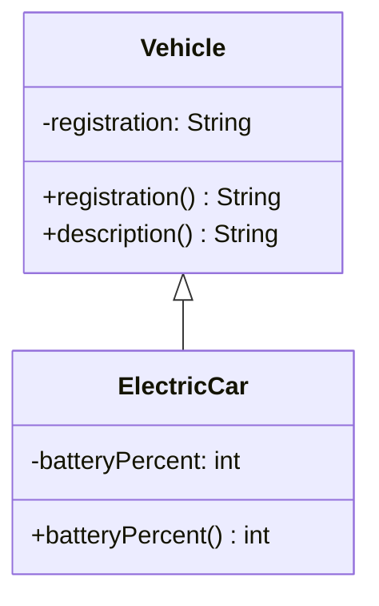
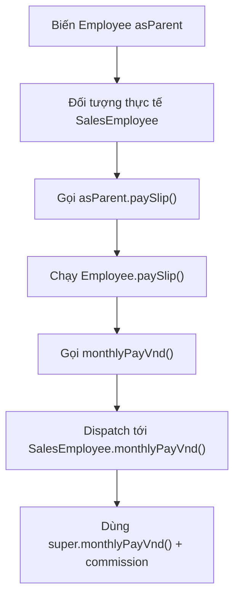

# Kế thừa trạng thái và hành vi trong Java OOP

**Kế thừa (inheritance)** cho phép một lớp con (*subclass*) mở rộng một lớp cha (*superclass*), sử dụng những thành phần có thể truy cập từ lớp cha và định nghĩa thêm trạng thái hoặc hành vi riêng. Trong Java, quan hệ này được khai báo bằng từ khóa `extends`.

Khi gặp câu “lớp con kế thừa trạng thái và hành vi”, cần phân biệt hai việc:

- **Trạng thái (state)**: dữ liệu của đối tượng được biểu diễn bằng các field. Một đối tượng lớp con chứa phần trạng thái do lớp cha định nghĩa, cộng với các field mà lớp con tự khai báo.
- **Hành vi (behavior)**: các phương thức lớp cha cung cấp. Lớp con có thể sử dụng phương thức được kế thừa, bổ sung phương thức mới hoặc **ghi đè** (*override*) một phương thức instance được phép ghi đè.

Kế thừa không có nghĩa là tạo hai đối tượng riêng biệt (một “cha”, một “con”) rồi nối chúng lại. Với `new Child(...)`, đó là **một đối tượng** có kiểu thực tế `Child`; quá trình khởi tạo phần thuộc lớp cha và lớp con diễn ra theo chuỗi constructor.

## 1. Cú pháp và hình dung quan hệ is-a

```java
class Vehicle {
    private final String registration;

    Vehicle(String registration) {
        this.registration = registration;
    }

    public String registration() {
        return registration;
    }

    public String description() {
        return "Phương tiện " + registration;
    }
}

class ElectricCar extends Vehicle {
    private final int batteryPercent;

    ElectricCar(String registration, int batteryPercent) {
        super(registration); // Khởi tạo phần lớp cha
        this.batteryPercent = batteryPercent;
    }

    public int batteryPercent() {
        return batteryPercent;
    }
}
```

Một `ElectricCar` **là một** `Vehicle`: `ElectricCar extends Vehicle` biểu diễn quan hệ *is-a*. Đối tượng `ElectricCar` có thông tin đăng ký do phần `Vehicle` quản lý, đồng thời có mức pin riêng. Nó cũng sử dụng được `description()` và `registration()` của `Vehicle`.

```java
ElectricCar car = new ElectricCar("EV-001", 87);

System.out.println(car.registration());   // EV-001
System.out.println(car.description());    // Phương tiện EV-001
System.out.println(car.batteryPercent()); // 87
```

Sơ đồ lớp:



Mũi tên từ `ElectricCar` tới `Vehicle` là **quan hệ kế thừa**; nó không nói rằng có một object `Vehicle` độc lập được tạo bên cạnh object `ElectricCar`.

Java cho một lớp kế thừa trực tiếp **tối đa một lớp cha**. Nếu không viết `extends`, lớp thông thường mặc nhiên có superclass là `Object` (ngoại trừ chính `Object`). Một lớp vẫn có thể triển khai nhiều interface qua `implements`, nhưng đó không phải đa kế thừa trạng thái từ nhiều lớp cha.

## 2. Kế thừa trạng thái: field của cha nằm trong đối tượng con

Điểm dễ nhầm: lớp con có phần trạng thái do lớp cha khai báo, nhưng **không phải mọi field lớp cha đều có thể truy cập trực tiếp trong mã lớp con**.

Với field `private`:

```java
class Account {
    private long balance;

    Account(long openingBalance) {
        if (openingBalance < 0) {
            throw new IllegalArgumentException("Số dư ban đầu âm");
        }
        this.balance = openingBalance;
    }

    public final long balance() {
        return balance;
    }

    protected final void credit(long amount) {
        if (amount <= 0) {
            throw new IllegalArgumentException("Số tiền phải dương");
        }
        balance = Math.addExact(balance, amount);
    }
}

class RewardAccount extends Account {
    RewardAccount(long openingBalance) {
        super(openingBalance);
    }

    public void receiveReward(long rewardVnd) {
        credit(rewardVnd); // Dùng hành vi có kiểm tra của lớp cha
    }

    // Không thể viết: balance += rewardVnd;
    // Vì Account.balance là private.
}
```

`Account.balance` vẫn tồn tại như một phần trạng thái của đối tượng `RewardAccount`, dù mã lớp con **không có quyền truy cập trực tiếp** đến tên field `balance`. Lớp cha kiểm soát cách số dư thay đổi thông qua `credit(...)`; như vậy các quy tắc hợp lệ không bị lặp ở lớp con.

Một ví dụ sử dụng:

```java
RewardAccount account = new RewardAccount(100_000);
account.receiveReward(20_000);

System.out.println(account.balance()); // 120000
```

**Không nên chuyển toàn bộ field lớp cha thành `protected` chỉ vì muốn lớp con dùng được.** Việc cho phép lớp con sửa trực tiếp field có thể khiến lớp cha khó giữ bất biến. Thường nên giữ field `private` rồi cung cấp những phương thức `protected` hoặc `public` có ý nghĩa rõ và kiểm tra đầu vào.

### Các mức truy cập tác động ra sao?

| Thành phần khai báo ở lớp cha | Mã lớp con có thể dùng? | Ghi chú |
|---|---|---|
| `public` instance method/field | Có, ở nơi lớp con có quyền thấy lớp cha | Cẩn trọng với public mutable field |
| `protected` instance method/field | Có, theo quy tắc truy cập `protected` của Java | Khi khác package có giới hạn cụ thể về biểu thức nhận truy cập |
| Package-private (không ghi modifier) | Chỉ trong cùng package | Không nên dùng khi kỳ vọng subclass khác package gọi trực tiếp |
| `private` field/method | Không thể truy cập trực tiếp trong mã lớp con | Trạng thái private của cha vẫn có mặt trong đối tượng con; có thể tiếp cận qua API hợp lệ |
| `public final` instance method | Được sử dụng nhưng **không override** | Lớp cha cố định cách thực thi hành vi này |
| Constructor | **Không được kế thừa** | Lớp con khai báo constructor riêng, gọi constructor cha qua `super(...)` |

Theo nghĩa ngôn ngữ Java, **private members không được kế thừa như thành viên mà lớp con có thể sử dụng trực tiếp**. Đừng diễn giải điều này thành “field private của cha không có trong đối tượng con”.

## 3. Kế thừa hành vi: dùng lại, bổ sung và override

Giả sử trong hệ thống nhân sự, nhân viên bán hàng có lương cơ bản và thêm hoa hồng. Các nhân viên đều có mã định danh và cách trình bày phiếu lương giống nhau, nhưng công thức thu nhập có thể khác.

Dưới đây là **ví dụ Java chạy độc lập**, thể hiện rõ ba loại hành vi:

1. **Kế thừa nguyên vẹn** `id()`.
2. **Override** `monthlyPayVnd()`.
3. **Bổ sung** `commissionVnd()`.

File `InheritanceDemo.java`:

```java
public class InheritanceDemo {

    static class Employee {
        private final String id;
        private final long basePayVnd;

        Employee(String id, long basePayVnd) {
            if (id == null || id.isBlank()) {
                throw new IllegalArgumentException("Mã nhân viên rỗng");
            }
            if (basePayVnd < 0) {
                throw new IllegalArgumentException("Lương cơ bản âm");
            }

            this.id = id.strip();
            this.basePayVnd = basePayVnd;
        }

        // Phương thức kế thừa được, nhưng không cho override.
        public final String id() {
            return id;
        }

        // Lớp con có thể định nghĩa cách tính riêng.
        public long monthlyPayVnd() {
            return basePayVnd;
        }

        // Hành vi chung: gọi phương thức có thể override.
        public String paySlip() {
            return id() + ": " + monthlyPayVnd() + " VND";
        }
    }

    static final class SalesEmployee extends Employee {
        private final long commissionVnd;

        SalesEmployee(
                String id, long basePayVnd, long commissionVnd) {
            super(id, basePayVnd);

            if (commissionVnd < 0) {
                throw new IllegalArgumentException("Hoa hồng âm");
            }
            this.commissionVnd = commissionVnd;
        }

        @Override
        public long monthlyPayVnd() {
            return Math.addExact(
                super.monthlyPayVnd(), commissionVnd
            );
        }

        public long commissionVnd() {
            return commissionVnd;
        }
    }

    public static void main(String[] args) {
        Employee regular = new Employee("E01", 12_000_000L);
        SalesEmployee sales =
            new SalesEmployee("S01", 10_000_000L, 3_000_000L);

        System.out.println(regular.paySlip());
        System.out.println(sales.paySlip());

        Employee asParent = sales;
        System.out.println(asParent.monthlyPayVnd());
        System.out.println(asParent.id());
    }
}
```

Chạy bằng JDK 11+:

```bash
javac InheritanceDemo.java
java InheritanceDemo
```

Kết quả:

```text
E01: 12000000 VND
S01: 13000000 VND
13000000
S01
```

Phân tích:

- `SalesEmployee` **không khai báo lại** `id()` hoặc `paySlip()`; chúng là hành vi được dùng lại từ `Employee`.
- `SalesEmployee.monthlyPayVnd()` ghi đè phương thức cha. Từ khóa `@Override` để compiler kiểm tra xem chữ ký có thật sự override được không.
- `super.monthlyPayVnd()` gọi cách tính ở `Employee` rồi cộng hoa hồng. `super` không phải tên của một đối tượng cha riêng biệt.
- `Math.addExact` ném `ArithmeticException` nếu tổng vượt giới hạn `long`, tránh trả sai âm thầm.
- `commissionVnd()` là hành vi riêng của `SalesEmployee`; biến có **kiểu khai báo `Employee`** không gọi trực tiếp được phương thức này.

Ví dụ này minh họa một mô hình thu nhập đơn giản, không đại diện đầy đủ quy tắc lương, thuế hay hoa hồng của doanh nghiệp.

## 4. Đa hình: phương thức chạy theo loại đối tượng thực tế

Xem hai dòng:

```java
Employee asParent =
    new SalesEmployee("S02", 8_000_000L, 1_500_000L);

System.out.println(asParent.monthlyPayVnd()); // 9500000
```

Biến `asParent` có **kiểu khai báo** là `Employee`, nhưng đối tượng thực tế được tạo bởi `new SalesEmployee(...)`. Khi gọi một phương thức instance đã được override, Java sử dụng **dynamic dispatch** để thực hiện phiên bản phù hợp với kiểu runtime `SalesEmployee`.

Đây là lý do `Employee.paySlip()` có thể gọi `monthlyPayVnd()` mà không biết lớp con cụ thể: lần gọi tới đối tượng `SalesEmployee` vẫn chọn phương thức override.



Tuy nhiên, **kiểu khai báo vẫn giới hạn những phương thức có thể gọi ở thời điểm biên dịch**:

```java
Employee employee =
    new SalesEmployee("S03", 5_000_000L, 2_000_000L);

employee.monthlyPayVnd();   // Hợp lệ
// employee.commissionVnd(); // Lỗi biên dịch
```

Nếu có nhu cầu làm việc trực tiếp với hành vi dành riêng cho subclass, nên xem lại kiểu biến/API. Ép kiểu xuống subclass chỉ khi đã có lý do thiết kế rõ và biết chắc kiểu runtime; không nên dựa vào chuỗi `instanceof` và cast chỉ để thay thế đa hình ở mọi nơi.

## 5. Phần trạng thái của cha được khởi tạo trước phần riêng của con

Một constructor con phải đi qua constructor cha, nhưng **constructor không được kế thừa** như phương thức. Ví dụ:

~~~java
class Parent {
    Parent(String code) {
        System.out.println("Parent: " + code);
    }
}
class Child extends Parent {
    Child() {
        super("A01");
        System.out.println("Child");
    }
}
~~~

`new Child()` in `Parent: A01` rồi `Child`. Nếu lớp cha chỉ có constructor có tham số thì không thể bỏ `super("A01")` và trông đợi compiler tự gọi một `Parent()` không tồn tại.

Phần khởi tạo field/instance block của lớp con chạy **sau** phần constructor cha. Vì thế constructor cha không nên gọi method overridable: lời gọi có thể dispatch vào lớp con khi field của con còn `null` hoặc `0`. Phần chi tiết về `this(...)`, static initialization, thứ tự initializer và thất bại constructor được triển khai bằng một chương trình truy vết riêng ở bài chuỗi khởi tạo.

## 6. Field là trạng thái, không được dispatch như method

**Override** thay implementation của một phương thức instance theo kiểu runtime. **Overload** là cùng tên nhưng khác danh sách tham số và được chọn chủ yếu tại biên dịch. **Field hiding** là lớp con khai báo lại field cùng tên; truy cập field dựa trên kiểu của biểu thức, không chọn động theo đối tượng.

~~~java
class Parent {
    String label = "parent";
    String label() { return "parent-method"; }
}
class Child extends Parent {
    String label = "child"; // Field hiding.
    @Override String label() { return "child-method"; }
}

Parent value = new Child();
System.out.println(value.label);   // parent
System.out.println(value.label()); // child-method
~~~

Hai field `label` cùng tồn tại trong một object `Child` nên dễ nhầm về dữ liệu nào đang được đọc. Trong mô hình thực, giữ field `private` rồi cung cấp API phù hợp thường an toàn hơn. Tương tự, phương thức `static` cùng chữ ký là *hiding*, không phải instance override; hãy gọi bằng tên lớp để tránh nhầm với dispatch động.

## 7. Những quy tắc override phải tôn trọng

Một phương thức override hợp lệ không chỉ là “viết lại tên giống nhau”.

| Quy tắc | Điều cần nhớ |
|---|---|
| Phương thức phải có thể override | Không override `private`, `final` hoặc `static` method theo nghĩa instance override |
| Danh sách tham số | Cùng chữ ký thích hợp; thay đổi danh sách tham số thành **overload** |
| Kiểu trả về | Có thể dùng kiểu trả về **covariant** khi phù hợp, không tùy tiện đổi kiểu |
| Quyền truy cập | Không được giảm mức truy cập của phương thức được override |
| Checked exceptions | Không khai báo checked exception mới/rộng hơn ngoài phạm vi cho phép của phương thức cha |
| Hợp đồng hành vi | Phải giữ kỳ vọng mà người dùng kiểu cha dựa vào |

Ví dụ khi cha công khai phương thức:

```java
class Parent {
    public Number amount() {
        return 1;
    }
}

class Child extends Parent {
    @Override
    public Integer amount() {
        return 2;
    }
}
```

`Integer` là subtype của `Number`, nên kiểu trả về trong ví dụ **covariant hợp lệ**.

Ngược lại:

```java
class WrongChild extends Parent {
    // @Override
    // protected Integer amount() { return 3; }
    // Sai vì giảm quyền truy cập public xuống protected.
}
```

Điểm thực hành quan trọng hơn cú pháp là **tính thay thế được (substitutability)**: nếu caller làm việc đúng với `Parent`, đưa một `Child` vào không nên bất ngờ phá những cam kết mà `Parent` đã thiết lập. Ví dụ nếu `Employee.monthlyPayVnd()` cam kết trả thu nhập không âm, subclass không nên tùy tiện trả giá trị âm để biểu diễn lỗi.

## 8. Kế thừa trạng thái có nguy cơ tạo phụ thuộc chặt

Khi subclass dựa vào nhiều chi tiết nội bộ của superclass, thay đổi superclass có thể làm hỏng subclass dù API công khai vẫn trông giống trước. Đây là một dạng vấn đề **fragile base class**.

Ví dụ thiết kế rủi ro:

```java
class MutableBalance {
    protected long balance; // Mọi subclass được phép sửa trực tiếp

    void deposit(long amount) {
        balance += amount; // Chưa kiểm tra dữ liệu hoặc tràn số
    }
}

class SpecialBalance extends MutableBalance {
    void applyBonus(long bonus) {
        balance += bonus; // Đi vòng qua mọi quy tắc mà cha có thể đặt ra
    }
}
```

Subclass phụ thuộc trực tiếp vào field `balance`. Nếu về sau lớp cha bổ sung giới hạn số dư, ghi audit log hay yêu cầu kiểm tra nghiệp vụ, `SpecialBalance` có thể tiếp tục bỏ qua các quy tắc đó.

Một thiết kế tốt hơn:

- Giữ field `private`.
- Cung cấp phương thức `protected final` có ý nghĩa như `creditValidated(...)` nếu subclass thật sự cần mở rộng.
- Xác định rõ **điểm được phép tùy biến** bằng phương thức protected hoặc interface có hợp đồng.
- Hạn chế gọi phương thức override trong quá trình constructor.
- Không để subclass phụ thuộc vào bố cục field hoặc thứ tự gọi phương thức nội bộ nếu không được cam kết.

Đây không có nghĩa mọi field `protected` đều sai, nhưng nên cân nhắc chi phí ràng buộc mà nó đặt lên hệ phân cấp.

## 9. Phần trạng thái chung chỉ nên có mặt ở superclass khi quan hệ is-a đúng

`SalesEmployee extends Employee` là một phân loại nghiệp vụ hợp lý nếu nhân viên bán hàng tôn trọng hợp đồng chung về nhân viên. Ngược lại, `OrderService` **sử dụng** một `PaymentGateway`, chứ không phải một loại gateway. Để dùng chức năng thanh toán, hãy giữ một `PaymentGateway` làm collaborator:

~~~java
interface PaymentGateway {
    void charge(long amountVnd);
}
final class OrderService {
    private final PaymentGateway gateway;
    OrderService(PaymentGateway gateway) {
        this.gateway = java.util.Objects.requireNonNull(gateway);
    }
    void pay(long amountVnd) {
        if (amountVnd <= 0) {
            throw new IllegalArgumentException("Số tiền phải dương");
        }
        gateway.charge(amountVnd);
    }
}
~~~

**Composition** giúp thay gateway hoặc phối hợp nhiều thành phần mà không làm phát sinh superclass giả. Với inheritance, subclass gắn trực tiếp vào hợp đồng và extension points của cha; với composition, việc cộng tác xảy ra thông qua field/interface. Quyết định nên dựa trên khả năng thay thế đúng ngữ nghĩa, không chỉ số dòng code có thể dùng lại.

## 10. Checklist kiểm tra thiết kế kế thừa

Trước khi cho một lớp `extends` lớp khác, hãy kiểm tra:

1. **Có quan hệ is-a thật không?** Lớp con được dùng thay lớp cha mà không phá hợp đồng?
2. **Trạng thái nào thuộc lớp cha?** Field chung có được khởi tạo và kiểm soát ở superclass?
3. **Phương thức nào được kế thừa nguyên vẹn?** Không cần override nếu hành vi cha đã đúng.
4. **Phương thức nào phải override?** Có lý do nghiệp vụ rõ và dùng `@Override`?
5. **Điểm mở rộng có an toàn không?** Có phương thức `final` hoặc `protected` phù hợp để bảo vệ invariant?
6. **Constructor có đúng chuỗi không?** `super(...)` nhận dữ liệu hợp lệ, không lộ đối tượng chưa khởi tạo?
7. **Có cách dùng composition đơn giản hơn không?** Tránh thừa kế thừa để tái sử dụng vài hàm.
8. **Kiểm thử có xác minh qua tham chiếu kiểu cha không?** Kiểm tra dynamic dispatch và tính thay thế được.

## 11. Bài tập tự kiểm tra

### Bài 1 — Dự đoán kết quả

```java
class Animal {
    String sound() {
        return "unknown";
    }

    String describe() {
        return "Sound: " + sound();
    }
}

class Cat extends Animal {
    @Override
    String sound() {
        return "meow";
    }
}

Animal a = new Cat();
System.out.println(a.describe());
```

**Đáp án:** `Sound: meow`. Phương thức `describe()` được dùng lại từ `Animal`, nhưng lời gọi `sound()` bên trong nó được dispatch tới `Cat.sound()`.

### Bài 2 — Có phải lớp con nhìn thấy mọi field?

```java
class Base {
    private int secret = 7;

    public int secret() {
        return secret;
    }
}

class Derived extends Base {
    int read() {
        // return secret; // Lỗi biên dịch
        return secret();
    }
}
```

**Đáp án:** `return secret()` hợp lệ, vì đây là public method của cha. `return secret` không hợp lệ vì `secret` là private field của `Base`.

### Bài 3 — Tìm chỗ không phải override

```java
class Base {
    void print(int value) {
        System.out.println("Base " + value);
    }
}

class Derived extends Base {
    void print(String value) {
        System.out.println("Derived " + value);
    }
}
```

**Đáp án:** `Derived.print(String)` là **overload**, không phải override `Base.print(int)`. Lớp con có thể gọi cả hai phương thức theo kiểu đối số tương ứng.

### Bài 4 — Thiết kế lớp con có kiểm tra

Hãy tạo `StudentAccount extends Account`, trong đó:

- `Account` giữ `private long balance`, không cho số dư âm.
- `Account` cung cấp `public final long balance()` và một phương thức bảo vệ để cộng tiền hợp lệ.
- `StudentAccount` có `private final String universityCode` được kiểm tra trong constructor.
- Phương thức `receiveScholarship(long amount)` cộng tiền thông qua API của lớp cha, không trực tiếp sửa field.
- Viết test: tạo `StudentAccount`, nhận học bổng, đọc số dư và thử truyền số tiền không hợp lệ.

Khi giải, hãy kiểm tra rằng **trạng thái chung vẫn do lớp cha bảo vệ**, còn lớp con chỉ bổ sung thông tin và hành vi chuyên biệt.

---

**Ghi nhớ:** Kế thừa cho phép lớp con **mang phần trạng thái được khai báo ở lớp cha** và **dùng lại hoặc ghi đè hành vi** theo các quy tắc truy cập, constructor và override của Java. Đối tượng con vẫn là **một đối tượng duy nhất**. Hãy giữ dữ liệu chung được đóng gói, phân biệt method overriding với field hiding, tôn trọng hợp đồng lớp cha và chỉ dùng kế thừa khi quan hệ *is-a* thực sự có ý nghĩa.