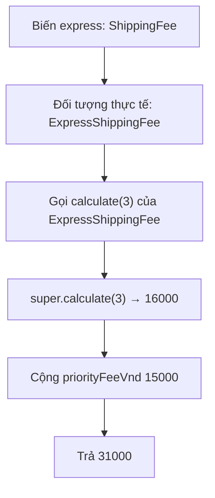
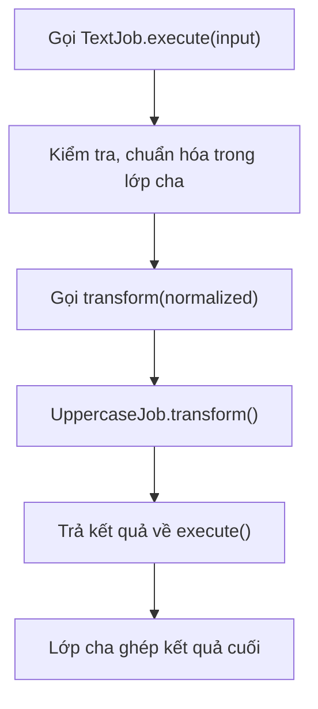

# Mở rộng hành vi của lớp cha trong Java

Khi một lớp con kế thừa lớp cha bằng từ khóa `extends`, nó có thể **dùng lại hành vi sẵn có** và bổ sung những phần đặc thù của mình. Một kỹ thuật quan trọng là **ghi đè phương thức (method overriding)**: lớp con cung cấp cách thực hiện mới cho một phương thức thể hiện mà lớp cha cho phép ghi đè.

Ví dụ, hệ thống vận chuyển có một quy tắc tính phí cơ bản. Giao hàng ưu tiên vẫn cần quy tắc ấy nhưng cộng thêm phụ phí. Thay vì chép toàn bộ công thức vào lớp con, ta gọi `super.calculate(...)` để tận dụng hành vi lớp cha rồi thêm phần riêng.

Bài này tập trung vào cách **mở rộng hành vi của lớp cha**, ý nghĩa của `super`, phương thức nào có thể ghi đè, cách bảo vệ quy tắc chung và lúc nào nên cân nhắc dùng composition thay cho kế thừa.

## 1. Kế thừa, ghi đè và mở rộng hành vi

Một lớp con khai báo:

```java
class Parent {
    void greet() {
        System.out.println("Xin chào");
    }
}

class Child extends Parent {
    @Override
    void greet() {
        super.greet();
        System.out.println("Rất vui được gặp bạn");
    }
}
```

Khi chạy:

```java
new Child().greet();
```

Kết quả:

```text
Xin chào
Rất vui được gặp bạn
```

Cách hoạt động:

1. `Child extends Parent`: `Child` là một lớp con của `Parent`.
2. `@Override` xác nhận `Child.greet()` ghi đè một phương thức có thể ghi đè của lớp cha. Nếu chữ ký không phù hợp, trình biên dịch sẽ báo lỗi.
3. `super.greet()` gọi **cách thực hiện của lớp cha** đối với phương thức đó.
4. Lớp con thực hiện thêm bước riêng sau lời gọi `super.greet()`.

Nếu lớp con **không ghi đè**, nó có thể gọi trực tiếp phương thức được kế thừa (tùy quyền truy cập). Nếu lớp con ghi đè nhưng **không gọi `super`**, nó sẽ thay thế toàn bộ hành vi của phương thức, và phải tự bảo đảm hợp đồng của lớp cha.

| Tình huống | Kết quả |
| --- | --- |
| Không override `greet()` | `Child` dùng hành vi được kế thừa từ `Parent` |
| Override và gọi `super.greet()` | Chạy hành vi lớp cha, sau đó thực hiện phần bổ sung |
| Override nhưng không gọi `super.greet()` | Chạy phần triển khai mới của lớp con |
| Viết `greet(String name)` thay vì `greet()` | Thường là **overloading** (thêm phương thức khác tham số), không ghi đè `greet()` |
| Viết `super.greet()` ngoài phương thức/constructor instance phù hợp | Không hợp lệ; `super` cần ngữ cảnh lớp con |

**Quan trọng:** Không phải lúc nào “mở rộng” cũng có nghĩa thêm lệnh sau `super`. Có trường hợp cần thao tác **trước**, **sau** hoặc **bao quanh** hành vi của lớp cha (kiểm tra, đo thời gian, logging, làm giàu kết quả). Thứ tự phải dựa trên hợp đồng thực tế.

## 2. Ví dụ Java hoàn chỉnh: giao hàng ưu tiên

Lưu toàn bộ mã sau vào file **`Main.java`** và chạy với Java 17 hoặc Java 21.

```java
import java.util.List;

class ShippingFee {
    private final long baseFeeVnd;

    ShippingFee(long baseFeeVnd) {
        if (baseFeeVnd < 0) {
            throw new IllegalArgumentException("Phí cơ bản không được âm");
        }
        this.baseFeeVnd = baseFeeVnd;
    }

    public long calculate(int distanceKm) {
        if (distanceKm <= 0) {
            throw new IllegalArgumentException("Quãng đường phải dương");
        }

        long distanceFee = Math.multiplyExact(2_000L, distanceKm);
        return Math.addExact(baseFeeVnd, distanceFee);
    }

    public String label() {
        return "Giao tiêu chuẩn";
    }
}

final class ExpressShippingFee extends ShippingFee {
    private final long priorityFeeVnd;

    ExpressShippingFee(long baseFeeVnd, long priorityFeeVnd) {
        super(baseFeeVnd);

        if (priorityFeeVnd < 0) {
            throw new IllegalArgumentException("Phụ phí không được âm");
        }
        this.priorityFeeVnd = priorityFeeVnd;
    }

    @Override
    public long calculate(int distanceKm) {
        // Giữ kiểm tra và công thức chuẩn của lớp cha.
        long standardFee = super.calculate(distanceKm);

        // Phần mở rộng dành riêng cho giao ưu tiên.
        return Math.addExact(standardFee, priorityFeeVnd);
    }

    @Override
    public String label() {
        return super.label() + " + ưu tiên";
    }
}

public class Main {
    public static void main(String[] args) {
        ShippingFee normal = new ShippingFee(10_000);
        ShippingFee express = new ExpressShippingFee(10_000, 15_000);

        List<ShippingFee> options = List.of(normal, express);
        for (ShippingFee option : options) {
            System.out.println(
                option.label() + ": " + option.calculate(3) + " VND"
            );
        }

        try {
            express.calculate(0);
        } catch (IllegalArgumentException ex) {
            System.out.println("Lỗi: " + ex.getMessage());
        }
    }
}
```

Biên dịch, chạy:

```bash
javac Main.java
java Main
```

Kết quả:

```text
Giao tiêu chuẩn: 16000 VND
Giao tiêu chuẩn + ưu tiên: 31000 VND
Lỗi: Quãng đường phải dương
```

Đối với quãng đường 3 km:

- Phí chuẩn: `10_000 + 2_000 × 3 = 16_000` VND.
- Phí ưu tiên: `16_000 + 15_000 = 31_000` VND.
- Lớp con không viết lại logic kiểm tra `distanceKm > 0`. Khi `ExpressShippingFee.calculate(0)` gọi `super.calculate(0)`, ngoại lệ của lớp cha tiếp tục được áp dụng.

`Math.addExact` và `Math.multiplyExact` giúp phát hiện tràn số `long` (ném `ArithmeticException`) thay vì âm thầm tạo phí sai. Đây là lựa chọn minh họa để công thức đơn giản vẫn có xử lý sai số nguyên.

### Thành phần nào thuộc lớp cha, lớp con?

| Thành phần | `ShippingFee` | `ExpressShippingFee` |
| --- | --- | --- |
| Phí cơ bản | Trường `private baseFeeVnd` | Kế thừa hành vi sử dụng trường nhưng không truy cập trực tiếp trường `private` |
| Tính phí cơ bản | `calculate(distanceKm)` | Dùng `super.calculate(distanceKm)` |
| Phụ phí ưu tiên | Không có | Trường `private priorityFeeVnd` |
| Tính phí tổng | Trả phí chuẩn | Override `calculate()` để cộng phụ phí |
| Tên phương thức hiển thị | `label()` | Override, nối mô tả bổ sung |
| Khởi tạo | `ShippingFee(long)` | `ExpressShippingFee(long, long)` gọi `super(...)` |

Lớp con mở rộng **hành vi có sẵn** và **trạng thái riêng**, chứ không sao chép tất cả trường của lớp cha thành các trường mới.

## 3. Đa hình: biến kiểu lớp cha có thể chạy phương thức lớp con

Hai biến trong ví dụ đều có kiểu khai báo `ShippingFee`:

```java
ShippingFee normal = new ShippingFee(10_000);
ShippingFee express = new ExpressShippingFee(10_000, 15_000);
```

Nhưng khi gọi `express.calculate(3)`, Java thực hiện **phiên bản override của `ExpressShippingFee`**, bởi đối tượng thực tế có kiểu `ExpressShippingFee`.



Hiện tượng lựa chọn phương thức **instance được override** dựa trên đối tượng thực tế được gọi là *dynamic dispatch*. Nhờ đó cùng một đoạn mã `option.calculate(distance)` có thể làm việc với nhiều lớp con của `ShippingFee`.

Lưu ý: kiểu khai báo của biến vẫn quyết định **những phương thức nào có thể gọi tại thời điểm biên dịch**. Nếu `ExpressShippingFee` có một phương thức riêng không khai báo trong `ShippingFee`, biến `ShippingFee express` không gọi trực tiếp phương thức đó nếu không có chuyển kiểu hợp lệ. Đa hình không tự thêm API của lớp con vào kiểu lớp cha.

## 4. Hai cách dùng `super` phục vụ hai mục tiêu

Trong ví dụ, `super(baseFeeVnd)` **khởi tạo phần superclass** khi tạo `ExpressShippingFee`; còn `super.calculate(distanceKm)` chạy **implementation của phương thức lớp cha** trên chính object hiện tại:

~~~java
ExpressShippingFee(long base, long priority) {
    super(base); // Chọn constructor cha.
    if (priority < 0) throw new IllegalArgumentException();
    this.priorityFeeVnd = priority;
}

@Override
public long calculate(int km) {
    return Math.addExact(super.calculate(km), priorityFeeVnd);
}
~~~

Constructor không được override. Trên Java 17/21, `super(...)` hoặc `this(...)` tường minh phải là câu lệnh đầu trong constructor, và nếu không ghi, compiler thử chèn `super()`. Quy tắc chuỗi khởi tạo cùng thứ tự field initializer được học riêng trong bài khởi tạo lớp con.

**Điểm tinh tế:** `super.calculate()` chọn thân phương thức cha tại điểm gọi; nếu thân ấy gọi một hook instance được override, hook vẫn dispatch tới implementation của lớp con. Vì vậy không nên xem `super` như một cơ chế bỏ qua mọi hành vi subclass.

## 5. Không nhầm override với overload hoặc static hiding

| Cơ chế | Nhận biết | Lựa chọn implementation |
| --- | --- | --- |
| **Overriding** | Instance method cùng chữ ký phù hợp ở subclass, thường có `@Override` | Theo kiểu runtime |
| **Overloading** | Phương thức cùng tên, khác danh sách tham số | Chọn chữ ký tại biên dịch |
| **Static method hiding** | Subclass khai báo static method cùng chữ ký hợp lệ | Theo lớp/kiểu của biểu thức, không theo runtime instance |
| **Field hiding** | Subclass khai báo field trùng tên | Theo kiểu tĩnh/ngữ cảnh truy cập |

~~~java
class Base {
    String sound() { return "base"; }
}
class Child extends Base {
    @Override String sound() { return "child"; }
    String sound(int volume) { return "volume=" + volume; } // Overload.
}

Base value = new Child();
System.out.println(value.sound()); // child
// value.sound(2); // Không biên dịch: Base không có sound(int).
~~~

Đặc biệt, **static method không được override**. Đừng dùng `@Override` để đánh dấu một static method trùng tên; nếu có nhu cầu đa hình runtime, dùng instance method và hợp đồng phù hợp.

## 6. Các điều kiện để override hợp lệ

- Phương thức cha phải là instance method có thể override; `private`, `final` và `static` không tham gia instance overriding.
- Tên và danh sách tham số phải tương ứng với chữ ký được override. Đổi `int` thành `long` tạo overload khác, và `@Override` sẽ giúp phát hiện nhầm.
- Kiểu trả về phải tương thích; Java cho phép **covariant return** khi kiểu trả về là reference subtype thích hợp.
- Không giảm access modifier; ví dụ phương thức cha `public` thì phương thức con cũng phải `public`.
- Không mở rộng checked exceptions vượt hợp đồng phương thức cha; unchecked exception không bị ràng buộc cú pháp tương tự nhưng vẫn phải tôn trọng hợp đồng hành vi.

Một override hợp lệ về cú pháp vẫn có thể sai nghiệp vụ nếu nó bỏ qua kiểm tra đầu vào, thay đổi bất biến hoặc khiến caller đang dùng kiểu cha nhận kết quả bất ngờ. Khi không cho lớp con thay toàn bộ quy trình, hãy cố định phương thức điều phối bằng `final` và công bố hook phù hợp như ví dụ **Template Method** bên dưới.

## 7. Khi nào phải gọi `super`, khi nào không?

Java **không bắt buộc** phương thức override phải gọi `super.method()`. Điều cần xem là *hợp đồng hành vi*.

### Phù hợp với `super`

Khi lớp con chỉ cần thêm một quy tắc nhưng vẫn giữ cách thực hiện cơ bản của cha. Trong ví dụ vận chuyển, phụ phí ưu tiên được cộng sau `super.calculate(distanceKm)`.

### Không nhất thiết gọi `super`

Khi hợp đồng cho phép thay thế toàn bộ thuật toán. Ví dụ, lớp cha mô tả một phương pháp vẽ cơ bản nhưng lớp con có một cách vẽ độc lập vẫn đáp ứng đầy đủ ngữ nghĩa.

### Cần cân nhắc trước khi gọi

- Gọi `super` hai lần có thể gây tác động lặp lại nếu phương thức cha thay đổi trạng thái hoặc gọi API bên ngoài.
- Gọi `super` trước hay sau phần bổ sung quyết định thứ tự side effect, kiểm tra điều kiện và lỗi.
- Bỏ lời gọi `super` có thể vô tình bỏ qua validation, ghi lịch sử hoặc duy trì invariant của lớp cha.
- Nếu `super.method()` ném ngoại lệ, các câu lệnh đặt sau sẽ không chạy trừ khi mã chủ động bắt hoặc xử lý lỗi.
- `super` chỉ gọi triển khai của cha tại vị trí đó; nó không “đóng băng” toàn bộ lời gọi động phát sinh bên trong. Nếu phương thức cha tiếp tục gọi một phương thức có thể override khác, phương thức đó vẫn có thể dispatch vào lớp con.

Không nên cố định một quy tắc “override nào cũng phải gọi `super`”. Hãy đọc hợp đồng được lớp cha công bố và thiết kế điểm mở rộng phù hợp.

## 8. Mở rộng an toàn bằng Template Method

Override cả một phương thức nghiệp vụ đôi khi khiến lớp con bỏ sót bước quan trọng, chẳng hạn kiểm tra dữ liệu trước khi xử lý. **Template Method** đặt quy trình chính trong một phương thức `final`; lớp con chỉ mở rộng phần được chỉ định qua `protected` hook.

Ví dụ độc lập, lưu trong **`TemplateDemo.java`**:

```java
import java.util.Locale;
import java.util.Objects;

abstract class TextJob {
    // Trình tự chung do lớp cha kiểm soát; lớp con không override.
    public final String execute(String input) {
        Objects.requireNonNull(input, "input");

        String normalized = input.trim();
        if (normalized.isEmpty()) {
            throw new IllegalArgumentException("Nội dung không được trống");
        }

        String transformed = transform(normalized);
        return "Đã xử lý: " + transformed;
    }

    // Điểm mở rộng mà lớp con phải cung cấp.
    protected abstract String transform(String normalized);
}

final class UppercaseJob extends TextJob {
    @Override
    protected String transform(String normalized) {
        return normalized.toUpperCase(Locale.ROOT);
    }
}

public class TemplateDemo {
    public static void main(String[] args) {
        TextJob job = new UppercaseJob();
        System.out.println(job.execute("  java oop  "));
    }
}
```

Chạy `javac TemplateDemo.java` và `java TemplateDemo`:

```text
Đã xử lý: JAVA OOP
```

Trong thiết kế này:

1. `execute()` là quy trình bắt buộc: kiểm tra `null`, chuẩn hóa, từ chối dữ liệu trống rồi tạo kết quả.
2. `final` chặn lớp con ghi đè `execute()` và vô tình bỏ qua các bước chung.
3. `transform()` là điểm mở rộng được chỉ định rõ; lớp con thay đổi thuật toán biến đổi, không thay đổi hợp đồng đầu vào của `execute()`.



Template Method hữu ích khi nhiều lớp con dùng chung **thứ tự xử lý bất biến** nhưng thay đổi một vài bước. Không nên lạm dụng nếu chỉ để thêm một câu lệnh đơn giản hoặc khi các biến thể không có quan hệ kế thừa hợp lý.

## 9. Mở rộng hành vi sau khi khởi tạo xong

Trong khi `super(...)` chạy, field riêng của subclass có thể vẫn đang mang giá trị mặc định. Nếu constructor cha gọi method overridable, Java vẫn dispatch tới override của con:

~~~java
class Parent {
    Parent() { show(); }
    void show() { System.out.println("parent"); }
}
class Child extends Parent {
    String label = "Sẵn sàng";
    @Override void show() { System.out.println(label); }
}
// new Child() in null, vì initializer label chưa chạy.
~~~

Đây là hệ quả của **thứ tự khởi tạo**, không phải bug ngẫu nhiên hay race condition. Các hook cho subclass nên được gọi sau khi đối tượng hoàn tất khởi tạo. Bài về constructor chain sẽ lần theo thứ tự này cùng static block, instance block và ngoại lệ trong constructor.

## 10. Những trường hợp kế thừa không phải lựa chọn tốt

Kế thừa hợp lý khi lớp con thực sự là **một dạng chuyên biệt của lớp cha** và giữ được hợp đồng hành vi. Nếu chỉ muốn cộng một tính năng tùy chọn (log, metrics, retry, cache, phụ phí), **composition/decorator** đôi khi linh hoạt hơn:

```java
interface PriceCalculator {
    long calculate(int quantity);
}

final class SurchargeCalculator implements PriceCalculator {
    private final PriceCalculator delegate;
    private final long surcharge;

    SurchargeCalculator(PriceCalculator delegate, long surcharge) {
        this.delegate = java.util.Objects.requireNonNull(delegate);
        if (surcharge < 0) {
            throw new IllegalArgumentException("Phụ phí âm");
        }
        this.surcharge = surcharge;
    }

    @Override
    public long calculate(int quantity) {
        return Math.addExact(delegate.calculate(quantity), surcharge);
    }
}
```

Đây là ví dụ **thành phần có thể kết hợp**: `SurchargeCalculator` giữ một `PriceCalculator` khác rồi thêm phí. Khi cần nhiều biến thể kết hợp, không nhất thiết xây một cây lớp con như `ExpressInternationalDiscountedShipping`.

So sánh:

| Tiêu chí | `extends` / override | Composition / delegate |
| --- | --- | --- |
| Quan hệ | `is-a`: lớp con là một loại lớp cha | `has-a`: đối tượng chứa/tham chiếu một thành phần khác |
| Cách dùng lại hành vi | Gọi phương thức kế thừa hoặc `super.method()` | Gọi `delegate.method()` |
| Điểm mở rộng | Do lớp cha thiết kế; có thể bị ràng buộc bởi `protected` / `final` | Do interface và đối tượng delegate quyết định |
| Ghép nhiều tính năng | Có thể tạo nhiều lớp con và tổ hợp phức tạp | Thường dễ kết hợp nhiều wrapper |
| Rủi ro chính | Phụ thuộc chặt vào hợp đồng và chi tiết lớp cha | Có thêm đối tượng/ủy quyền và phải quản lý vòng đời thích hợp |

Không phải composition luôn tốt hơn: nếu mô hình có quan hệ phân cấp thực sự, các biến thể chia sẻ nhiều quy tắc cố định và lớp cha cung cấp hook rõ ràng, kế thừa vẫn rất hợp lý. Hãy chọn theo quan hệ miền nghiệp vụ và độ ổn định của hợp đồng.

## 11. Lỗi thường gặp và cách sửa

| Lỗi | Điều xảy ra | Cách sửa |
| --- | --- | --- |
| Override rồi gọi `calculate(...)` thay vì `super.calculate(...)` trong cùng phương thức | Có thể đệ quy vô hạn (`StackOverflowError`) | Gọi `super.calculate(...)` nếu cần triển khai của cha |
| Quên `@Override` và đổi kiểu tham số | Tạo overload, không ghi đè | Thêm `@Override` để trình biên dịch kiểm tra |
| Lớp con bỏ kiểm tra đầu vào vốn do cha bảo đảm | Đối tượng có thể vi phạm hợp đồng | Giữ validation hoặc đưa quy trình chung vào phương thức `final` |
| Override phương thức `final` hoặc `private` | Không được phép override theo quy tắc Java | Dùng điểm mở rộng mà lớp cha công bố |
| Nhầm `static` hiding với override | Lựa chọn theo kiểu tham chiếu/lớp, không đa hình instance | Dùng instance method khi cần dynamic dispatch |
| Lớp cha gọi hook override trong constructor | Lớp con được gọi khi chưa khởi tạo xong | Không gọi phương thức overridable trong constructor |
| Lớp con sử dụng trực tiếp trường `protected` mutable của cha | Dễ phá invariant của cha | Giữ trường `private`, cung cấp phương thức/hook kiểm soát |
| Dùng `extends` chỉ để tái sử dụng vài dòng code | Kết hợp tính năng khó, quan hệ `is-a` yếu | Cân nhắc composition/delegation |

## 12. Tự kiểm tra

**Câu 1.** Trong `ExpressShippingFee.calculate()`, vì sao gọi `super.calculate(distanceKm)` thay vì `calculate(distanceKm)`?

**Đáp án:** `super` chỉ định triển khai lớp cha. Gọi `calculate(...)` không có `super` ngay trong override thường quay lại phương thức của lớp con và gây đệ quy.

**Câu 2.** `ShippingFee shipping = new ExpressShippingFee(10000, 15000);` rồi `shipping.calculate(3)` chạy phương thức nào?

**Đáp án:** `ExpressShippingFee.calculate()`, vì đây là lời gọi phương thức instance được override và dispatch dựa trên kiểu đối tượng thực tế.

**Câu 3.** Lớp con có thể override constructor không?

**Đáp án:** Không. Constructor không được kế thừa. Lớp con gọi constructor lớp cha bằng `super(...)` trong quá trình khởi tạo.

**Câu 4.** `protected abstract String transform(...)` và `public final String execute(...)` trong Template Method phân chia trách nhiệm ra sao?

**Đáp án:** `execute()` giữ quy trình cố định và invariant; `transform()` cho lớp con triển khai biến thể được kiểm soát.

**Câu 5.** Có nên để lớp cha khai báo `protected List<Order> orders` để lớp con tùy ý chỉnh sửa không?

**Đáp án:** Không nên nếu lớp cha cần bảo vệ tính nhất quán của dữ liệu. Để trường `private` và cung cấp thao tác/hook có hợp đồng rõ ràng thường an toàn hơn.

**Câu 6.** Khi muốn bổ sung logging, cache và retry theo nhiều tổ hợp, kế thừa có luôn là lựa chọn dễ nhất không?

**Đáp án:** Không. Composition/decorator có thể ghép các khả năng linh hoạt hơn và giảm số lượng lớp con.

**Ghi nhớ:** Để mở rộng hành vi lớp cha, dùng `extends` khi quan hệ `is-a` và hợp đồng kế thừa hợp lý, `@Override` để thay hoặc bổ sung triển khai, `super.method()` để tái dùng hành vi cha và `super(...)` để khởi tạo phần lớp cha. Nếu cần bảo vệ một quy trình không cho lớp con bỏ qua, thiết kế `final` template method cùng điểm mở rộng `protected` rõ ràng.