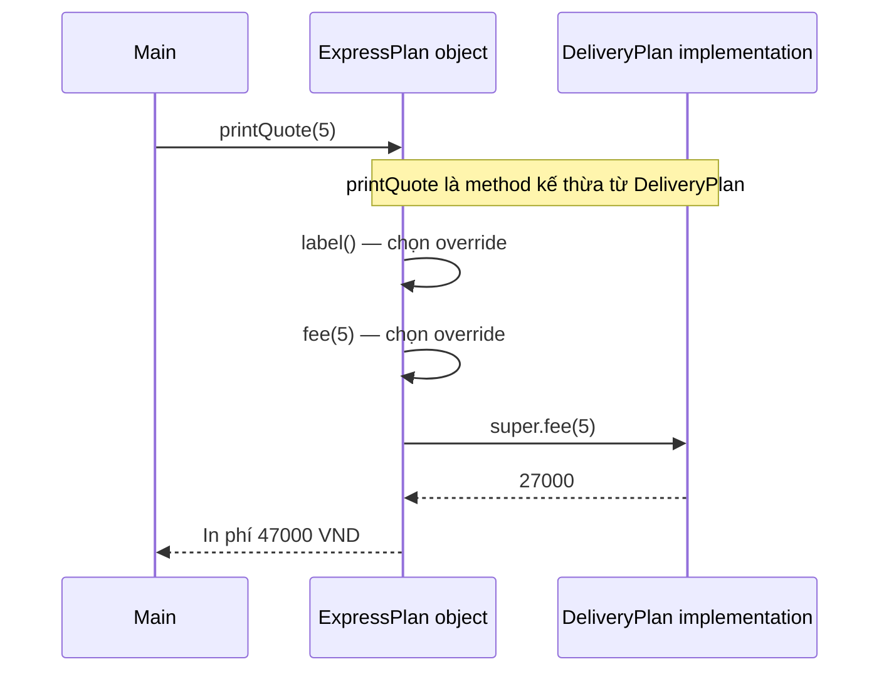

# Ghi đè phương thức và gọi hành vi lớp cha trong Java

**Method overriding (ghi đè phương thức)** cho phép lớp con cung cấp cách thực hiện riêng cho một **phương thức instance có thể kế thừa** từ lớp cha, trong khi mã sử dụng vẫn gọi qua hợp đồng của lớp cha. Khi lớp con muốn **giữ một phần xử lý của lớp cha rồi bổ sung hành vi**, Java cung cấp cú pháp `super.method(...)`.

Hai câu hỏi cần phân biệt:

- **Ghi đè:** “Khi đối tượng thực tế là lớp con, phương thức nào được chạy?”
- **Gọi `super`:** “Bên trong phương thức của lớp con, làm sao gọi phiên bản phù hợp được kế thừa từ lớp cha thay vì gọi lại chính phương thức vừa ghi đè?”

Bài này sử dụng Java 11 trở lên, minh họa bằng bài toán tính phí giao hàng với hai gói: giao thường và giao nhanh. Ví dụ được đặt trong **một tệp Java** để có thể biên dịch, chạy và tự kiểm tra kết quả ngay.

## 1. Nhận diện overriding bằng ví dụ tối giản

```java
class Notification {
    public void send() {
        System.out.println("Gửi thông báo thông thường");
    }
}

class EmailNotification extends Notification {
    @Override
    public void send() {
        System.out.println("Gửi qua email");
    }
}
```

Khi gọi:

```java
Notification message = new EmailNotification();
message.send(); // Gửi qua email
```

Biến `message` có **kiểu khai báo** là `Notification`, nhưng đối tượng thực tế được tạo bởi `new EmailNotification()`. Vì `send()` là phương thức instance được override, Java chọn phiên bản của **lớp đối tượng thực tế** khi chạy. Đây là **dynamic method dispatch** và là một dạng đa hình (polymorphism).

`@Override` không phải điều kiện khiến JVM thực hiện ghi đè; nó là annotation để **trình biên dịch xác nhận ý định ghi đè**. Nếu viết sai tên hoặc chữ ký, annotation giúp phát hiện lỗi sớm.

### Ghi đè khác việc khai báo phương thức mới

Hai phương thức cùng tên không nhất thiết là override. Để ghi đè đúng, phương thức ở lớp con phải phù hợp chữ ký phương thức kế thừa, tức là tên và danh sách kiểu tham số tương ứng theo quy tắc Java; kiểu trả về cũng phải tương thích.

```java
class Parent {
    public void process(String text) {
        System.out.println("Parent: " + text);
    }
}

class Child extends Parent {
    @Override
    public void process(String text) {
        System.out.println("Child: " + text);
    }

    public void process(int count) {
        System.out.println("Count: " + count);
    }
}
```

Ở đây `process(String)` là **override**, còn `process(int)` là **overload** (cùng tên nhưng tham số khác). Không thể ghi `@Override` trên `process(int)` trong trường hợp này vì lớp cha không có phương thức tương ứng để ghi đè.

## 2. Ví dụ hoàn chỉnh: mở rộng hành vi lớp cha bằng `super`

Yêu cầu:

- Gói **giao thường**: phí nền 12.000 VND và thêm 3.000 VND cho mỗi km.
- Gói **giao nhanh**: giữ phép tính của gói thường rồi cộng phụ phí ưu tiên 20.000 VND.
- Quãng đường phải là số nguyên không âm; nếu tính tiền `long` bị tràn, ném `ArithmeticException` thay vì trả sai.
- Một phương thức `printQuote` được định nghĩa ở lớp cha có thể sử dụng kết quả của phương thức `fee` đã được lớp con ghi đè.

Tệp **`OverrideAndSuperDemo.java`**:

```java
public class OverrideAndSuperDemo {

    static class DeliveryPlan {
        private static final long BASE_VND = 12_000L;
        private static final long PER_KM_VND = 3_000L;

        public String label() {
            return "Giao thường";
        }

        public long fee(int distanceKm) {
            if (distanceKm < 0) {
                throw new IllegalArgumentException(
                        "Quãng đường không được âm");
            }
            long distanceFee =
                    Math.multiplyExact(PER_KM_VND, (long) distanceKm);
            return Math.addExact(BASE_VND, distanceFee);
        }

        // Không override ở lớp con, nhưng gọi các method có thể override.
        public void printQuote(int distanceKm) {
            System.out.println(
                    label() + " (" + distanceKm + " km): "
                    + fee(distanceKm) + " VND");
        }
    }

    static final class ExpressPlan extends DeliveryPlan {
        private static final long PRIORITY_VND = 20_000L;

        @Override
        public String label() {
            return "Giao nhanh (nền: " + super.label() + ")";
        }

        @Override
        public long fee(int distanceKm) {
            // Gọi lại toàn bộ logic kiểm tra và tính phí của lớp cha.
            long standardFee = super.fee(distanceKm);
            return Math.addExact(standardFee, PRIORITY_VND);
        }
    }

    public static void main(String[] args) {
        DeliveryPlan standard = new DeliveryPlan();
        DeliveryPlan express = new ExpressPlan();

        standard.printQuote(5);
        express.printQuote(5);

        System.out.println(standard.fee(5)); // 27000
        System.out.println(express.fee(5));  // 47000

        try {
            express.fee(-1);
        } catch (IllegalArgumentException ex) {
            System.out.println("Từ chối: " + ex.getMessage());
        }
    }
}
```

Biên dịch và chạy:

```bash
javac OverrideAndSuperDemo.java
java OverrideAndSuperDemo
```

Kết quả dự kiến:

```text
Giao thường (5 km): 27000 VND
Giao nhanh (nền: Giao thường) (5 km): 47000 VND
27000
47000
Từ chối: Quãng đường không được âm
```

Phí của gói thường ở 5 km là 12.000 + 3.000 × 5 = **27.000 VND**. Gói nhanh gọi lại công thức của lớp cha và cộng thêm 20.000, cho kết quả **47.000 VND**.

### Vì sao `super.fee(distanceKm)` quan trọng?

Trong `ExpressPlan.fee`:

```java
@Override
public long fee(int distanceKm) {
    long standardFee = super.fee(distanceKm);
    return Math.addExact(standardFee, PRIORITY_VND);
}
```

`super.fee(distanceKm)` chọn phiên bản `fee` ở lớp cha `DeliveryPlan`, thực thi cả **kiểm tra quãng đường** lẫn **tính phí nền**, rồi lớp con bổ sung phụ phí. Nếu viết:

```java
@Override
public long fee(int distanceKm) {
    return Math.addExact(fee(distanceKm), PRIORITY_VND); // SAI
}
```

thì `fee(distanceKm)` không có `super` sẽ lại gọi `ExpressPlan.fee` trên cùng đối tượng, tiếp tục gọi chính nó và dẫn đến **đệ quy không có điểm dừng**, thường kết thúc bằng `StackOverflowError`. Điều này không có nghĩa mọi lời gọi method cùng tên đều là lỗi; lỗi cụ thể là tự gọi lại mà không có điều kiện dừng.

Chú ý: `super.fee` **không tạo thêm một đối tượng lớp cha**. Nó dùng chính đối tượng `ExpressPlan` hiện tại, nhưng chọn cách thực hiện của phương thức cha tại vị trí lời gọi.

## 3. Đa hình vẫn xảy ra bên trong phương thức của lớp cha

Điều thú vị trong ví dụ là `printQuote` **không được override**. Tuy vậy, thân của nó gọi:

```java
public void printQuote(int distanceKm) {
    System.out.println(
            label() + " (" + distanceKm + " km): "
            + fee(distanceKm) + " VND");
}
```

Khi `express.printQuote(5)` chạy trên đối tượng thực tế là `ExpressPlan`:

1. `printQuote` của `DeliveryPlan` chạy vì lớp con không override nó.
2. Lời gọi `label()` trong thân `printQuote` được phân giải động đến `ExpressPlan.label()`.
3. Lời gọi `fee(5)` được phân giải động đến `ExpressPlan.fee(5)`.
4. Trong `ExpressPlan.fee(5)`, `super.fee(5)` gọi logic của `DeliveryPlan`, rồi lớp con cộng phụ phí.



Sơ đồ mô tả logic gọi method, **không** có ý rằng một đối tượng `DeliveryPlan` riêng được tạo ra.

Điều này giải thích sức mạnh của overriding: lớp cha có thể định nghĩa một quy trình chung gọi các “điểm mở rộng” là phương thức có thể override; lớp con thay đổi các điểm đó mà không phải viết lại toàn bộ quy trình. Tuy nhiên, cần thận trọng khi gọi phương thức có thể override trong **constructor lớp cha** vì tại thời điểm đó field initializer của lớp con có thể chưa chạy.

## 4. `super.method()` và `super(...)` không giống nhau

Cả hai cùng dùng từ khóa `super` nhưng phục vụ hai mục đích khác nhau:

| Cú pháp | Mục đích | Được dùng ở đâu? |
| --- | --- | --- |
| `super.method(args)` | Gọi một phương thức instance phù hợp từ phần cài đặt của superclass | Trong ngữ cảnh instance của lớp con, khi phương thức đó có thể truy cập |
| `super(args)` | Gọi constructor của lớp cha trong chuỗi xây dựng đối tượng | Trong constructor của lớp con |
| `this.method(args)` hoặc `method(args)` | Gọi phương thức trên đối tượng hiện tại, có thể được phân giải động | Trong ngữ cảnh instance |
| `this(args)` | Gọi constructor khác của cùng lớp | Trong constructor, theo quy tắc constructor invocation |
| `super.field` | Truy cập field của lớp cha nếu mức truy cập cho phép và cần phân biệt tên | Trong ngữ cảnh instance |

Trong Java 11, lời gọi `super(args)` hoặc `this(args)` tường minh phải là câu lệnh đầu tiên của constructor. `super.method(args)` là lời gọi phương thức thông thường và **không có yêu cầu vị trí đầu tiên** như thế.

Ví dụ constructor:

```java
class Vehicle {
    private final String code;

    Vehicle(String code) {
        this.code = code;
    }

    public String code() {
        return code;
    }
}

class Car extends Vehicle {
    Car(String code) {
        super(code); // Constructor của Vehicle
    }

    @Override
    public String code() {
        return "CAR-" + super.code(); // Method của Vehicle
    }
}
```

Kết quả `new Car("42").code()` là `"CAR-42"`.

Một method của superclass được gọi qua `super` vẫn có thể tự gọi method khác theo cơ chế đa hình. `super` quyết định **phiên bản ở điểm gọi ban đầu**, chứ không làm mọi lời gọi sâu bên trong bị “khóa” thành bản cha.

## 5. Những quy tắc để ghi đè hợp lệ

### Cùng tên và tham số; kiểu trả về tương thích

```java
class Document {
    public Document copy() {
        return new Document();
    }
}

class PdfDocument extends Document {
    @Override
    public PdfDocument copy() {
        return new PdfDocument();
    }
}
```

Đây là ví dụ **covariant return type**: method lớp con được phép trả về kiểu tham chiếu cụ thể hơn, tức `PdfDocument` là kiểu con của `Document`.

Nhưng nếu lớp cha trả `int` thì lớp con không được đổi thành `long` khi override cùng chữ ký, vì kiểu trả về nguyên thủy phải tương thích theo quy tắc Java. Cũng không thể tạo một overload chỉ bằng việc thay đổi kiểu trả về.

### Không được giảm mức truy cập

```java
class BaseService {
    protected void execute() {
        System.out.println("Base");
    }
}

class PublicService extends BaseService {
    @Override
    public void execute() { // protected -> public: hợp lệ
        System.out.println("Child");
    }
}
```

Nếu lớp cha khai báo `public void execute()`, lớp con không được override thành `protected void execute()` hoặc package-private. Nếu method cha `protected`, method con có thể giữ `protected` hoặc mở rộng thành `public`.

### Checked exception không được mở rộng tùy tiện

```java
import java.io.IOException;
import java.io.FileNotFoundException;

class FileSource {
    public String read() throws IOException {
        return "data";
    }
}

class LocalFileSource extends FileSource {
    @Override
    public String read() throws FileNotFoundException {
        return "local";
    }
}
```

`FileNotFoundException` là loại con của `IOException`, vì vậy khai báo ở lớp con hợp lệ. Nếu method lớp cha không khai báo checked exception, override không được tự bổ sung một checked exception mới không tương thích. Với **unchecked exception** như `IllegalArgumentException`, Java không áp đặt cùng giới hạn về khai báo `throws`, nhưng lớp con vẫn nên tôn trọng hợp đồng hành vi của lớp cha.

### `@Override` giúp bắt lỗi sai chữ ký

```java
class BaseReport {
    public void export(String format) {}
}

class CsvReport extends BaseReport {
    // Ví dụ SAI nếu dùng @Override:
    // @Override
    // public void export(Object format) {}
}
```

`export(Object)` là overload khác tham số, không thay thế `export(String)`. Annotation `@Override` khiến trình biên dịch báo lỗi thay vì để lập trình viên tưởng đã ghi đè thành công.

## 6. Phương thức nào không thể được override theo cách thông thường?

| Loại method/đặc điểm | Hành vi thực tế |
| --- | --- |
| Instance method có thể kế thừa và không `final` | Có thể override nếu chữ ký, quyền truy cập, kiểu trả về và exception phù hợp |
| `final` instance method | **Không thể override**; dùng khi cần khóa hành vi ở cấp đó |
| `static` method | Không override; khai báo cùng tên/chữ ký ở lớp con là **method hiding** |
| `private` method | Không được kế thừa nên không override được; tên trùng ở lớp con là method riêng |
| Constructor | Không phải method được kế thừa, nên không override |
| Abstract method | Lớp con concrete phải cung cấp implementation nếu chưa có implementation kế thừa phù hợp |
| Interface default method | Lớp triển khai có thể override; có cú pháp gọi phiên bản default phù hợp qua `InterfaceName.super.method()` |

### `static`: method hiding khác overriding

```java
class Animal {
    static String category() {
        return "Động vật";
    }

    String sound() {
        return "Âm thanh chung";
    }
}

class Dog extends Animal {
    static String category() {
        return "Chó";
    }

    @Override
    String sound() {
        return "Gâu";
    }
}

Animal a = new Dog();

System.out.println(Animal.category()); // Động vật
System.out.println(Dog.category());    // Chó
System.out.println(a.sound());         // Gâu
```

`category()` là static, gọi qua tên lớp để thể hiện rõ method hiding; không có dynamic dispatch như `sound()`. Không thể dùng `@Override` cho `Dog.category()`.

### `private`: không có method nào để kế thừa

```java
class Parent {
    private void audit() {
        System.out.println("Audit nội bộ Parent");
    }

    public void run() {
        audit(); // Luôn là logic private của Parent
    }
}

class Child extends Parent {
    public void audit() {
        System.out.println("Audit của Child");
    }
}
```

`new Child().run()` in `"Audit nội bộ Parent"`. `Child.audit()` là method mới chứ không override `Parent.audit()`, bởi `private` method của cha không được kế thừa. Việc cho hai method trùng tên không khiến lời gọi bên trong `Parent.run()` trở thành dynamic dispatch tới method của con.

### `final`: cấm ghi đè

```java
class Transaction {
    public final void validateId() {
        System.out.println("Kiểm tra ID cố định");
    }
}

class Payment extends Transaction {
    // Không hợp lệ:
    // @Override public void validateId() {}
}
```

Từ khóa `final` trên một method ngăn subclass thay đổi cách thực hiện method đó. Điều này có thể bảo vệ một bước bắt buộc trong quy trình. Tuy nhiên, `final` không phải giải pháp thay cho thiết kế hợp đồng tốt.

## 7. `super`, field hiding và dynamic dispatch

Field không hoạt động như method override. Nếu hai lớp khai báo field trùng tên, tên field được chọn theo **kiểu tại thời điểm biên dịch** và ngữ cảnh truy cập.

```java
class Parent {
    public String name = "Parent";

    public String getName() {
        return name;
    }
}

class Child extends Parent {
    public String name = "Child";

    @Override
    public String getName() {
        return name;
    }

    public String parentField() {
        return super.name;
    }
}

Parent value = new Child();

System.out.println(value.name);               // Parent
System.out.println(value.getName());          // Child
System.out.println(((Child) value).parentField()); // Parent
```

Đây là **field hiding**, không phải đa hình field. Hai field trùng tên tạo ra hai trạng thái riêng trong cùng đối tượng, thường dễ gây nhầm lẫn. Trong thiết kế thực tế, nên giữ field `private` và truyền dữ liệu qua API phù hợp thay vì cố tình đặt field trùng tên để thay đổi hành vi.

`super.name` chọn field phù hợp được khai báo ở superclass và có thể truy cập từ lớp con; nó không phải cú pháp “gọi getter”.

## 8. Gọi hành vi cha hay thay thế hoàn toàn?

Có hai phương án phổ biến khi override:

**Phương án A — thay thế hoàn toàn**

```java
class TextFormatter {
    public String format(String text) {
        return text.trim();
    }
}

class UppercaseFormatter extends TextFormatter {
    @Override
    public String format(String text) {
        return text.strip().toUpperCase(java.util.Locale.ROOT);
    }
}
```

Ở đây lớp con định nghĩa toàn bộ hành vi mới; không gọi `super.format(...)`. Cần lưu ý `trim` và `strip` khác cách xử lý một số ký tự khoảng trắng Unicode, vì vậy nếu hợp đồng yêu cầu chuẩn hóa chính xác, phải chọn một quy tắc nhất quán. Đây là ví dụ cho thấy **override hợp lệ về cú pháp chưa chắc tương đương về hợp đồng**.

**Phương án B — giữ phần cha rồi bổ sung**

```java
class CheckedFormatter extends TextFormatter {
    @Override
    public String format(String text) {
        if (text == null) {
            throw new IllegalArgumentException("text không được null");
        }
        String base = super.format(text);
        return "[" + base + "]";
    }
}
```

Lớp con tái sử dụng bước chuẩn hóa của cha rồi thêm dấu ngoặc. Hợp đồng của kiểu cha phải cho phép định dạng mới này. Nếu phía sử dụng đòi kết quả là **chuỗi trim nguyên bản**, thêm dấu ngoặc có thể phá hợp đồng dù mã chạy đúng.

Do đó, trước khi override, hãy xác định: **điểm mở rộng mà lớp cha cho phép là gì?** Nếu thay đổi hành vi dẫn tới phá điều kiện đầu vào, đầu ra hoặc bất biến được công bố, tốt hơn nên dùng một interface/chiến lược khác thay vì subclass làm sai hợp đồng.

### Liên hệ Liskov Substitution Principle

Nếu `Parent` cho phép `process(1)` và cam kết đầu ra hợp lệ, `Child` không được bất ngờ từ chối `1` chỉ vì muốn quy tắc mới nghiêm hơn. Theo nguyên lý thay thế Liskov (LSP), lớp con không nên:

- **Siết chặt tiền điều kiện** đối với lời gọi hợp lệ của lớp cha.
- **Làm yếu hậu điều kiện** mà lớp cha hứa.
- **Phá bất biến** hoặc đưa thêm tác động phụ trái với cam kết quan sát được.
- **Làm thay đổi ngữ nghĩa lỗi** nếu đó là phần hợp đồng đã công bố.

Một method được override có thể gọi `super.method(...)` mà vẫn vi phạm LSP nếu phần bổ sung sau đó làm sai kết quả. Ngược lại, method thay thế hoàn toàn vẫn hợp lệ nếu giữ đúng hợp đồng.

## 9. Khi `super` không phải lựa chọn tốt nhất

Gọi `super.method()` có giá trị khi lớp con thực sự đang **mở rộng** cách thực hiện của lớp cha. Không nên dùng `super` chỉ để tránh sao chép code nếu quan hệ kế thừa về mặt nghiệp vụ không đúng.

Ví dụ: một lớp `AuditEmailSender extends EmailSender` chỉ để tận dụng mã gửi email, rồi override để log, có thể tạo quan hệ kế thừa dễ hỏng khi lớp cha thay đổi. Nếu nghiệp vụ cần bọc hành vi, **composition/decorator** thường diễn đạt rõ hơn: `AuditedSender` giữ một `Sender` bên trong và gọi `delegate.send(...)` rồi ghi log theo hợp đồng.

```java
interface Sender {
    void send(String message);
}

class AuditedSender implements Sender {
    private final Sender delegate;

    AuditedSender(Sender delegate) {
        this.delegate = java.util.Objects.requireNonNull(delegate);
    }

    @Override
    public void send(String message) {
        delegate.send(message);
        System.out.println("Đã yêu cầu gửi");
    }
}
```

Ở đây `delegate.send(...)` là **ủy quyền cho đối tượng khác**, còn `super.send(...)` là gọi implementation trong chuỗi kế thừa của **chính đối tượng hiện tại**. Hai kỹ thuật khác nhau về cấu trúc và mục đích.

Khi có nhiều tầng kế thừa `A <- B <- C`, phương thức `C.foo()` gọi `super.foo()` sẽ tìm implementation thích hợp theo chuỗi superclass bắt đầu từ `B`. Không có cú pháp Java thông thường `super.super.foo()` để tự bỏ qua trực tiếp một cấp. Nếu `B.foo()` cần hành vi của `A`, chính `B` quyết định việc gọi `super.foo()`.

## 10. Cẩn trọng khi constructor lớp cha gọi method override

Tình huống sau biên dịch được nhưng dễ gây lỗi:

```java
public class ConstructorTrap {
    static class Parent {
        Parent() {
            show(); // Gọi phương thức có thể override
        }

        void show() {
            System.out.println("Parent.show");
        }
    }

    static class Child extends Parent {
        private String value = "Đã sẵn sàng";

        Child() {
            System.out.println("Child constructor");
        }

        @Override
        void show() {
            System.out.println("Child.show: " + value);
        }
    }

    public static void main(String[] args) {
        new Child();
    }
}
```

Kết quả:

```text
Child.show: null
Child constructor
```

Nguyên nhân:

1. Khi tạo `Child`, Java cấp phát object và thiết lập giá trị mặc định cho các field.
2. Constructor `Parent` chạy **trước** các instance initializer/field initializer của `Child`.
3. Lời gọi `show()` từ `Parent` vẫn có **dynamic dispatch** đến `Child.show()`.
4. Vào thời điểm này `Child.value` đang là `null`; phép gán `"Đã sẵn sàng"` chưa thực hiện.

Nếu `Child.show()` gọi `value.length()`, có thể xảy ra `NullPointerException`. Vì vậy **tránh gọi method có thể override trong constructor** khi phụ thuộc trạng thái của subclass chưa hoàn tất. Constructor lớp cha nên chỉ dùng dữ liệu và hành vi mà nó kiểm soát an toàn; nếu cần thao tác dựa trên đối tượng hoàn chỉnh, hãy gọi sau khi khởi tạo xong.

## 11. Kiểm chứng kết quả ghi đè bằng một chương trình nhỏ

Tệp **`OverrideCheck.java`** dưới đây minh họa kiểm tra cả kiểu khai báo và kiểu thực tế; có thể biên dịch độc lập:

```java
public class OverrideCheck {
    static class Base {
        int compute(int x) {
            return x * 2;
        }

        String type() {
            return "Base";
        }
    }

    static final class Derived extends Base {
        @Override
        int compute(int x) {
            return super.compute(x) + 5;
        }

        @Override
        String type() {
            return "Derived";
        }
    }

    public static void main(String[] args) {
        Base base = new Base();
        Base childAsBase = new Derived();

        require(base.compute(3) == 6, "Base.compute sai");
        require(childAsBase.compute(3) == 11,
                "Override hoặc super.compute sai");

        require("Base".equals(base.type()), "Sai Base.type");
        require("Derived".equals(childAsBase.type()),
                "Không có dynamic dispatch");

        System.out.println("PASS: overriding và super hoạt động");
    }

    static void require(boolean condition, String error) {
        if (!condition) {
            throw new AssertionError(error);
        }
    }
}
```

Chạy:

```bash
javac OverrideCheck.java
java OverrideCheck
```

Kết quả:

```text
PASS: overriding và super hoạt động
```

Đây là kiểm tra khái niệm; với dự án lớn nên dùng JUnit để viết test cho **hành vi và hợp đồng** thay vì chỉ kiểm tra đã gọi phương thức cha hay chưa. Mã lớp con có thể biên dịch, in log như dự kiến, nhưng vẫn sai quy tắc nghiệp vụ trong tình huống biên.

## 12. Những lỗi thường gặp

| Cách viết / nhận định | Vấn đề | Cách sửa |
| --- | --- | --- |
| `super.method()` là một đối tượng cha riêng | Sai bản chất: vẫn là cùng một đối tượng subclass | Hiểu `super` là lựa chọn phần implementation được kế thừa |
| `method()` trong override muốn gọi bản cha | Có thể gọi lại chính override và đệ quy | Dùng `super.method()` nếu muốn bản cha |
| `@Override` trên overload có tham số khác | Không ghi đè method cha | Khớp chữ ký hoặc bỏ annotation nếu cố ý overload |
| Giảm `public` thành `protected` | Lỗi biên dịch | Giữ/mở rộng phạm vi truy cập |
| Ghi đè `final` method | Lỗi biên dịch | Dùng điểm mở rộng hợp lệ khác |
| Tưởng `static` chạy đa hình | Static method là hiding, không dynamic dispatch | Gọi static qua tên lớp |
| Tưởng method `private` của cha bị override | Private method không được kế thừa | Dùng API `protected`/`public` nếu thật sự cần mở rộng |
| Gọi `super.foo()` khi `foo` chỉ abstract, không có thân phù hợp | Không có implementation để gọi theo cách đó | Cài đặt hành vi ở lớp con hoặc thiết kế lại chuỗi kế thừa |
| Override để từ chối input mà cha cho phép | Có thể vi phạm LSP | Dùng hợp đồng riêng hoặc giữ nguyên miền hợp lệ |
| Constructor gọi method có thể override | Subclass có thể chưa khởi tạo field | Trì hoãn lời gọi tới sau khởi tạo |
| Tưởng field trùng tên cũng override | Field hiding dựa trên kiểu tĩnh | Tránh field trùng tên; dùng method khi cần đa hình |

## 13. Bài tập tự thực hành

**Bài tập 1 — dự đoán đầu ra**

```java
class A {
    String name() { return "A"; }
}
class B extends A {
    @Override
    String name() { return super.name() + "B"; }
}
class C extends B {
    @Override
    String name() { return super.name() + "C"; }
}

A ref = new C();
System.out.println(ref.name()); // ?
```

**Đáp án:** `ABC`. Lời gọi đầu tiên được phân giải tới `C.name()`, sau đó `C` gọi `B.name()`, `B` gọi `A.name()` rồi ghép lần lượt.

**Bài tập 2 — phân biệt override và overload**

```java
class Printer {
    void print(String s) { System.out.println("P:" + s); }
}
class ColoredPrinter extends Printer {
    void print(Object s) { System.out.println("C:" + s); }
}

Printer p = new ColoredPrinter();
p.print("hello"); // ?
```

**Đáp án:** `P:hello`. `print(Object)` của lớp con là overload; `print(String)` của lớp cha không bị override. Trình biên dịch chọn chữ ký dựa trên **kiểu tĩnh** của biểu thức và kiểu tham số; runtime chỉ dispatch động cho phương thức đã chọn khi có override hợp lệ.

**Bài tập 3 — mở rộng gói giao hàng**

Thêm lớp `DiscountedExpressPlan` theo cách kế thừa hoặc phối hợp phù hợp, giảm 5.000 VND từ phí của gói nhanh (không dưới 0). Nếu dùng kế thừa, lưu ý `ExpressPlan` trong ví dụ đang là `final`, do đó phải chủ động thiết kế lại điểm mở rộng hoặc chọn composition. Hãy giải thích lựa chọn theo **hợp đồng**, không chỉ theo lượng code có thể tái sử dụng.

**Bài tập 4 — bảo vệ quy tắc cha**

Cho lớp cha có phương thức `calculatePrice` kiểm tra giá không âm, lớp con cần cộng phụ phí nhưng không được bỏ qua validation. Hãy override bằng `super.calculatePrice(...)` rồi cộng phụ phí bằng phép tính kiểm soát tràn số. Viết kiểm tra cho input âm, giá bình thường và giá sát giới hạn `long`.

### Ghi nhớ

- **Override** làm thay đổi cách thực hiện phương thức instance được kế thừa, còn client vẫn có thể sử dụng kiểu lớp cha.
- **Dynamic dispatch** chọn bản override theo loại đối tượng thực tế.
- **`super.method(...)`** gọi phần thực hiện của superclass từ lớp con để kế thừa và mở rộng hành vi; **`super(...)`** là lời gọi constructor, không phải cùng cú pháp/ý nghĩa.
- Ghi đè đúng chữ ký chỉ là **đúng cú pháp**. Thiết kế tốt còn phải bảo vệ hợp đồng hành vi, trạng thái hợp lệ và kỳ vọng của mã sử dụng.