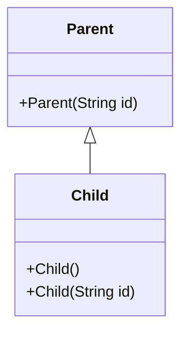
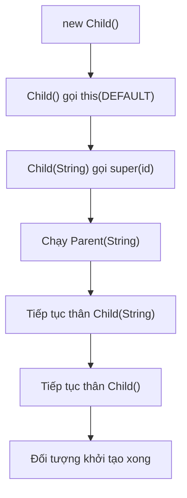
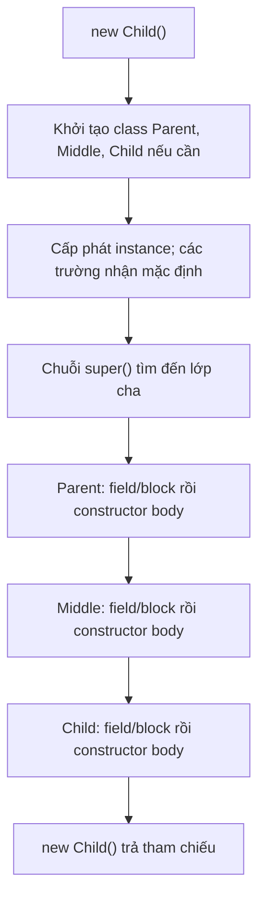

# Khởi tạo lớp con và chuỗi khởi tạo lớp cha trong Java

> **OOP → Kế thừa.** Khi tạo một đối tượng thuộc lớp con, Java phải khởi tạo phần trạng thái được thừa hưởng từ lớp cha trước, rồi mới hoàn tất phần trạng thái của lớp con. Hiểu **chuỗi constructor**, `super(...)`, `this(...)` và thứ tự chạy các initializer giúp giải thích vì sao một đoạn mã in ra theo thứ tự tưởng như ngược với nơi ta viết `new Child()`.

## 1. Nhìn ngay vào lời gọi `new Child()`

Giả sử có quan hệ kế thừa:



Một đối tượng `Child` **cũng chứa phần trạng thái do `Parent` định nghĩa**. Trước khi constructor `Child` hoàn tất, constructor `Parent` phải được thực thi trong chuỗi khởi tạo.

Ví dụ đơn giản:

```java
public class ConstructorChainDemo {
    static class Parent {
        Parent(String id) {
            System.out.println("Parent: " + id);
        }
    }

    static final class Child extends Parent {
        Child() {
            this("DEFAULT");
            System.out.println("Child()");
        }

        Child(String id) {
            super(id);
            System.out.println("Child(String): " + id);
        }
    }

    public static void main(String[] args) {
        new Child();
    }
}
```

Lưu thành `ConstructorChainDemo.java` và chạy:

```bash
javac ConstructorChainDemo.java
java ConstructorChainDemo
```

Kết quả:

```text
Parent: DEFAULT
Child(String): DEFAULT
Child()
```

Dù bắt đầu bằng `new Child()`, chương trình đi qua constructor `Child()` để chuyển sang `Child(String)`, rồi gọi `Parent(String)`. Các **phần thân constructor** được thực thi từ lớp cha trở xuống, sau đó quay về constructor đã gọi bằng `this(...)`.



Điểm cần phân biệt: Java không tạo ra ba đối tượng riêng cho `Child()`, `Child(String)` và `Parent(String)`. Chuỗi constructor này khởi tạo **cùng một đối tượng Child**.

## 2. `super(...)` và `this(...)` làm gì?

| Cú pháp | Mục đích | Ví dụ |
|---|---|---|
| `super(args)` | Chọn và gọi một constructor của **lớp cha trực tiếp** | `super(id)` |
| `this(args)` | Chuyển sang một constructor khác trong **cùng lớp** | `this("DEFAULT")` |
| Không viết lời gọi nào | Trình biên dịch ngầm thêm lời gọi `super()` khi hợp lệ | Constructor không ghi `super(...)` |
| `super.someMethod()` | Gọi implementation của phương thức từ lớp cha | Không phải lời gọi constructor |
| `this.someMethod()` | Gọi phương thức trên đối tượng hiện tại | Không phải lời gọi constructor |

Với **Java 17**, lời gọi constructor tường minh bằng `this(...)` hoặc `super(...)` phải là **câu lệnh đầu tiên** trong constructor. Không thể gọi cả hai trực tiếp trong cùng một constructor, vì mỗi constructor chỉ có một đường chuyển tiếp khởi tạo phù hợp.

```java
class Base {
    Base(int code) {
        System.out.println("Base " + code);
    }
}

class Derived extends Base {
    Derived() {
        this(10);             // Chuyển sang constructor khác của Derived
    }

    Derived(int code) {
        super(code);          // Gọi constructor của Base
        System.out.println("Derived " + code);
    }
}
```

Constructor `Derived()` dùng `this(10)`; `Derived(int)` dùng `super(code)`. Chuỗi đó dẫn tới constructor của lớp cha. Nếu tạo vòng lặp constructor bằng các lời gọi `this(...)` quay về nhau, Java sẽ báo lỗi biên dịch vì recursive constructor invocation.

**Constructor không phải phương thức bình thường:** không có kiểu trả về, không được kế thừa và không được override. Một lớp con có thể định nghĩa constructor cùng danh sách tham số với lớp cha, nhưng đó là hai constructor độc lập.

### Lỗi thường gặp: lớp cha không có constructor không tham số

```java
class Parent {
    Parent(String id) {}
}

class Child extends Parent {
    Child() {
        // Trình biên dịch ngầm thử super(), nhưng Parent() không tồn tại.
    }
}
```

Ví dụ trên **không biên dịch**. Khi đã khai báo `Parent(String)`, Java không tự thêm constructor `Parent()`. Sửa bằng cách chọn constructor có sẵn:

```java
class Child extends Parent {
    Child() {
        super("C-001");
    }
}
```

Hoặc thêm constructor `Parent()` nếu thực sự phù hợp với quy tắc khởi tạo của lớp cha.

Constructor lớp cha phải **truy cập được** từ lớp con. Ví dụ một constructor `private` của lớp cha thông thường không thể được lớp con độc lập gọi trực tiếp. `protected` là lựa chọn thường gặp khi lớp được thiết kế để kế thừa và cần cho phép lớp con gọi constructor.

## 3. Thứ tự đầy đủ: static, instance field, initializer block, constructor

Đây là phần dễ gây nhầm nhất. Xét ba tầng kế thừa `Parent → Middle → Child`.

Lưu **toàn bộ** ví dụ thành `InitializationOrderDemo.java` (Java 17+):

```java
public class InitializationOrderDemo {
    private static void log(String text) {
        System.out.println(text);
    }

    private static int init(String label, int value) {
        log(label);
        return value;
    }

    static class Parent {
        static {
            log("Parent: static block");
        }

        private final int parentValue =
                init("Parent: instance field", 10);

        {
            log("Parent: instance block");
        }

        Parent(String source) {
            log("Parent: constructor, value=" + parentValue
                    + ", source=" + source);
        }
    }

    static class Middle extends Parent {
        static {
            log("Middle: static block");
        }

        private final int middleValue =
                init("Middle: instance field", 20);

        {
            log("Middle: instance block");
        }

        Middle() {
            super("Middle");
            log("Middle: constructor, value=" + middleValue);
        }
    }

    static final class Child extends Middle {
        static {
            log("Child: static block");
        }

        private final int childValue =
                init("Child: instance field", 30);

        {
            log("Child: instance block");
        }

        Child() {
            super();
            log("Child: constructor, value=" + childValue);
        }
    }

    public static void main(String[] args) {
        log("main: before new");
        new Child();
        log("main: after new");
    }
}
```

Biên dịch/chạy:

```bash
javac InitializationOrderDemo.java
java InitializationOrderDemo
```

Kết quả chính xác trong lần chạy chương trình này:

```text
main: before new
Parent: static block
Middle: static block
Child: static block
Parent: instance field
Parent: instance block
Parent: constructor, value=10, source=Middle
Middle: instance field
Middle: instance block
Middle: constructor, value=20
Child: instance field
Child: instance block
Child: constructor, value=30
main: after new
```

### Vì sao thứ tự như vậy?

Có **hai quá trình cần phân biệt**:

**A. Khởi tạo lớp (`static`) khi lớp được sử dụng chủ động lần đầu**

Trước khi tạo `Child`, JVM cần bảo đảm việc khởi tạo các lớp trong chuỗi kế thừa đã hoàn tất. Khi các lớp chưa từng được khởi tạo, các static initializer lần lượt chạy từ cha đến con:

```text
Parent static → Middle static → Child static
```

Static field initializer và static initializer block trong **cùng một lớp** được thực hiện theo thứ tự khai báo. Khởi tạo lớp thường chỉ chạy **một lần cho mỗi lần khởi tạo lớp trong class loader tương ứng**, không lặp mỗi khi gọi `new`.

**B. Khởi tạo một instance**

Sau bước cấp phát và thiết lập giá trị mặc định cho các trường instance, chuỗi constructor đi từ lớp con ngược lên cho tới lớp cha. Khi thực thi phần khởi tạo của từng lớp, thứ tự quan sát là:

```text
Parent instance fields/blocks → Parent constructor body
→ Middle instance fields/blocks → Middle constructor body
→ Child instance fields/blocks → Child constructor body
```

Trong **mỗi lớp**, các instance field initializer và instance initializer block chạy xen kẽ theo **thứ tự xuất hiện trong mã nguồn**, sau khi constructor lớp cha hoàn tất và trước phần thân constructor của lớp hiện tại.

Một chú ý quan trọng: đừng hiểu rằng *mọi* field initializer của tất cả các lớp luôn chạy trước *mọi* initializer block. Chúng đan xen theo thứ tự khai báo trong từng lớp.



Sơ đồ mô tả hành vi quan sát ở mức học Java. JVM có thể tối ưu cách cấp phát vật lý, nhưng phải giữ ngữ nghĩa khởi tạo mà Java yêu cầu.

## 4. Giá trị mặc định xuất hiện trước field initializer

Java cấp phát đối tượng và thiết lập giá trị mặc định cho các trường instance trước khi chạy logic khởi tạo:

| Loại trường instance | Giá trị mặc định trước khi được khởi tạo |
|---|---|
| `byte`, `short`, `int`, `long` | `0` (theo kiểu tương ứng) |
| `float`, `double` | `0.0` |
| `boolean` | `false` |
| `char` | Ký tự `'\\u0000'` |
| Kiểu tham chiếu (`String`, `List`, object...) | `null` |

Ví dụ:

```java
class Counter {
    int count;              // Mặc định 0
    String label = "Ready"; // Field initializer thay null bằng "Ready"

    Counter() {
        count = 1;          // Constructor body thay 0 bằng 1
    }
}
```

Sau `new Counter()`, `count == 1` và `label.equals("Ready")`.

**Không suy từ đây rằng biến cục bộ cũng tự có giá trị mặc định:** biến local trong phương thức phải được gán trước khi đọc, nếu không sẽ lỗi biên dịch.

Các lớp con vẫn có các trường riêng của mình nhận giá trị mặc định trước khi constructor lớp cha thực thi. Điều này đặc biệt quan trọng nếu constructor lớp cha gọi đến một phương thức bị lớp con override.

## 5. Rủi ro: constructor lớp cha gọi phương thức có thể bị override

Đây là một tình huống kỹ thuật quan trọng. Khi constructor lớp cha gọi một phương thức instance bị lớp con override, **dynamic dispatch vẫn xảy ra**: phiên bản ở lớp con có thể chạy khi trường của lớp con chưa được khởi tạo bằng field initializer.

Ví dụ chạy độc lập, lưu `ConstructorOverrideTrap.java`:

```java
public class ConstructorOverrideTrap {
    static class Parent {
        Parent() {
            System.out.println("Parent sees: " + description());
        }

        String description() {
            return "Parent";
        }
    }

    static final class Child extends Parent {
        private String name = "Ready";

        @Override
        String description() {
            return name;
        }
    }

    public static void main(String[] args) {
        Child child = new Child();
        System.out.println("After construction: " + child.description());
    }
}
```

Kết quả:

```text
Parent sees: null
After construction: Ready
```

Lý do:

1. `new Child()` bắt đầu chuỗi khởi tạo.
2. `Parent()` chạy **trước** field initializer `name = "Ready"` của `Child`.
3. `Parent()` gọi `description()`, nhưng Java điều phối đến `Child.description()`.
4. Lúc đó `name` vẫn là giá trị mặc định `null`; chỉ sau khi trở về phần khởi tạo `Child`, trường mới nhận `"Ready"`.

Nếu `description()` gọi `name.length()` lúc đó, chương trình có thể ném `NullPointerException`.

**Quy tắc thiết kế:** tránh gọi phương thức có thể bị override từ constructor. Constructor nên thiết lập những trạng thái mà chính lớp đó sở hữu; hãy chạy các hook mở rộng sau khi toàn bộ đối tượng đã khởi tạo xong, hoặc thiết kế phương thức khởi tạo riêng không thể bị override khi phù hợp.

## 6. `this(...)` có khiến field initializer của lớp con chạy lại không?

**Không.** Khi một constructor chuyển sang constructor khác **trong cùng lớp** bằng `this(...)`, các instance initializer của lớp đó **không chạy lại lần nữa**. Chúng chỉ chạy một lượt cho object đang tạo.

Ví dụ:

```java
public class SameClassChainDemo {
    static class Item {
        int quantity = initialize();

        private int initialize() {
            System.out.println("field initializer");
            return 1;
        }

        Item() {
            this(5);
            System.out.println("Item()");
        }

        Item(int amount) {
            // super() ngầm định ở đây
            quantity = amount;
            System.out.println("Item(int)");
        }
    }

    public static void main(String[] args) {
        Item item = new Item();
        System.out.println(item.quantity);
    }
}
```

Kết quả:

```text
field initializer
Item(int)
Item()
5
```

`this(5)` không tạo object mới, chỉ chuyển sang một constructor khác để dùng chung đường khởi tạo. Nếu mỗi lần chuyển constructor đều chạy lại field initializer, kết quả sẽ không tương ứng với ngữ nghĩa của Java.

Lưu ý: `this(...)` có thể làm nhiều **thân constructor** trong cùng lớp chạy theo thứ tự ngược lại chuỗi lời gọi, nhưng không làm một object được cấp phát nhiều lần.

## 7. Khi có ngoại lệ trong chuỗi khởi tạo

Constructor có thể từ chối đầu vào hoặc thất bại trong khi khởi tạo.

```java
class Parent {
    Parent(int initial) {
        if (initial < 0) {
            throw new IllegalArgumentException("initial phải không âm");
        }
    }
}

class Child extends Parent {
    private final String name = createName();

    static String createName() {
        System.out.println("Child field initialized");
        return "OK";
    }

    Child(int initial) {
        super(initial);
        System.out.println("Child constructor body");
    }
}
```

Nếu gọi `new Child(-1)`, constructor `Parent(-1)` ném `IllegalArgumentException`, nên field initializer `name = createName()` và phần thân constructor `Child` **không được chạy**.

Điều này dẫn tới một nguyên tắc thực tế: nếu code tạo resource (file, socket, connection) trong quá trình khởi tạo mà bước sau có thể lỗi, phải tự thiết kế cách đóng resource đã mở trên đường thất bại. Java **không tự gọi `close()` cho một đối tượng đang được khởi tạo dở**.

Nếu một static initializer thất bại, đó là lỗi ở **khởi tạo lớp**, khác với lỗi ở constructor instance; JVM có các quy tắc đánh dấu lớp khởi tạo thất bại, và những lần sử dụng tiếp theo có thể ném `NoClassDefFoundError`. Vì vậy, tránh thực hiện quá nhiều I/O hoặc tác động khó phục hồi ngay trong static initializer.

## 8. Phân biệt constructor chaining với method overriding

| Cơ chế | Được chọn như thế nào? | Thời điểm có ý nghĩa |
|---|---|---|
| `this(...)` | Constructor overload của cùng lớp; chọn theo kiểu/đối số tại biên dịch | Khi tạo đối tượng |
| `super(...)` | Constructor của lớp cha trực tiếp, chọn theo tham số và quyền truy cập | Khi khởi tạo phần cha |
| Override method | Implementation instance được chọn theo kiểu runtime của object | Khi gọi phương thức |
| `super.method()` | Gọi implementation tương ứng ở lớp cha | Khi thực thi phương thức |
| Static initializer | JVM kích hoạt khi lớp được khởi tạo theo ngữ nghĩa Java | Thường trước lần tạo instance đầu tiên |

Không thể override constructor. Tên constructor trùng tên lớp vì cú pháp khởi tạo, không có nghĩa constructor được dispatch đa hình như phương thức instance.

Cũng không cần viết `super()` trong mọi constructor: nếu constructor không bắt đầu bằng `this(...)` hay `super(...)`, Java 17 tự thêm `super()` **chỉ khi** constructor không tham số ở lớp cha truy cập được.

## 9. Kinh nghiệm thiết kế cây kế thừa an toàn

1. **Để constructor lớp cha chịu trách nhiệm trạng thái của lớp cha.** Nếu lớp cha cần `id`, hãy nhận và kiểm tra `id` bằng `super(id)`. Lớp con tiếp tục kiểm tra trường của nó sau đó.
2. **Tránh gọi phương thức override được trong constructor.** Đừng để lớp cha phụ thuộc vào dữ liệu của lớp con chưa khởi tạo.
3. **Giữ constructor đơn giản.** Constructor nên thiết lập invariant rõ ràng, hạn chế I/O, gửi sự kiện hoặc đăng ký `this` ra bên ngoài quá sớm.
4. **Dùng `this(...)` để giảm trùng logic khởi tạo.** Tập trung kiểm tra đầu vào ở một constructor chính, tránh lặp một chuỗi câu lệnh ở nhiều overload.
5. **Không tự giả định lớp cha có constructor mặc định.** Đọc chữ ký constructor và quyền truy cập của lớp cha khi viết `extends`.
6. **Đặt phần chung ở lớp cha nhưng giữ quyền sở hữu hợp lý.** Không nên dùng kế thừa chỉ để tái sử dụng vài dòng nếu quan hệ “là một loại” không đúng về mặt mô hình.
7. **Kiểm tra cả trường hợp ngoại lệ.** Nếu constructor cha thất bại, các bước khởi tạo con sẽ không diễn ra; bảo đảm không để lại resource đã mở ở bước trước.

## 10. Bài tập tự kiểm tra

**Bài 1 — dự đoán kết quả:**

```java
class A {
    A() { System.out.print("A "); }
}

class B extends A {
    B() { System.out.print("B "); }
}

class C extends B {
    C() { System.out.print("C "); }
}

// new C(); sẽ in gì?
```

**Đáp án:** `A B C ` vì các constructor của lớp cha phải hoàn thành trước phần thân constructor lớp con.

**Bài 2 — sửa lỗi biên dịch.** Viết lớp `Person` chỉ có constructor `Person(String name)`. Viết `Student extends Person`, ban đầu không ghi `super(name)` để xem lỗi. Sau đó sửa constructor `Student(String name, int grade)` và thêm kiểm tra `grade` hợp lệ.

**Bài 3 — thứ tự trường và khối initializer.** Tạo `Base` và `Derived`, mỗi lớp có một field initializer, một instance block và một constructor in tên của bước. Dự đoán sáu dòng được in khi `new Derived()`, rồi chạy kiểm chứng.

**Bài 4 — lỗi override sớm.** Sửa ví dụ `ConstructorOverrideTrap` để constructor `Parent` không gọi `description()`. Chuyển lời gọi ra `main` sau khi khởi tạo và so sánh kết quả.

**Bài 5 — vòng `this(...)`.** Thử tạo hai constructor `Example()` và `Example(int)` sao cho mỗi constructor đều gọi constructor còn lại. Giải thích lỗi biên dịch và sửa để chuỗi kết thúc bằng một constructor gọi `super(...)`.

**Bài 6 — trường hợp lỗi.** Trong ví dụ `Parent/Child` ở mục 7, dự đoán có dòng `Child field initialized` xuất hiện không khi `new Child(-1)`. Giải thích dựa trên chuỗi khởi tạo.

**Ghi nhớ:** Khi `new Child()`, Java phải khởi tạo lớp cha và hoàn tất phần khởi tạo instance của lớp cha trước phần instance của lớp con. `super(...)` chuyển tới constructor lớp cha, `this(...)` nối các constructor cùng lớp, còn **field initializer/instance block của mỗi lớp chạy theo thứ tự khai báo trước thân constructor của chính lớp đó**. Đặc biệt, constructor lớp cha không nên gọi phương thức có thể bị lớp con override vì lúc ấy trường của lớp con chưa sẵn sàng.