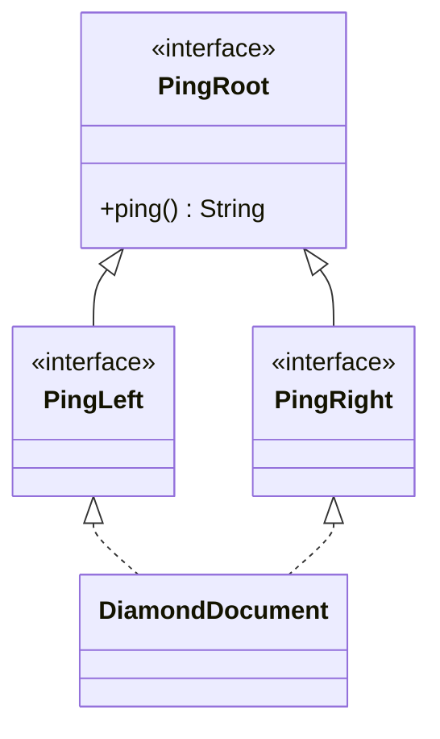
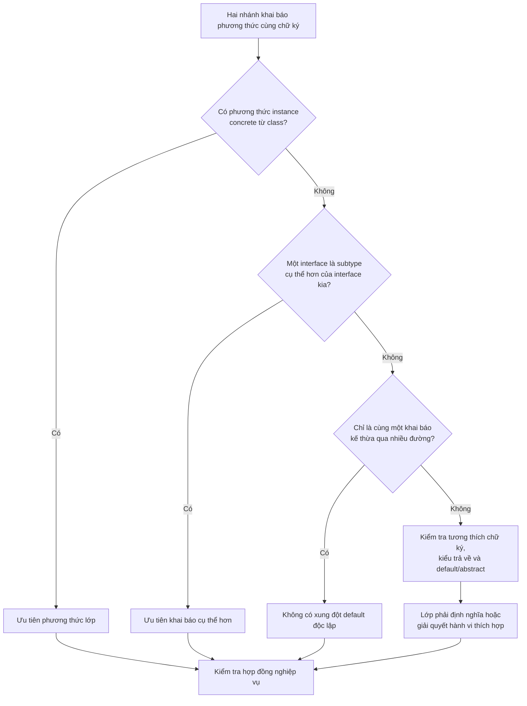

# Kế thừa đơn, kế thừa đa và xung đột hành vi trong Java

Khi thiết kế OOP, đôi khi một đối tượng cần kết hợp nhiều khả năng: hóa đơn có thể **xuất PDF**, **xuất CSV** và **ghi nhật ký thao tác**; một thiết bị có thể **in** và **quét**. Câu hỏi đặt ra là: Java cho phép kế thừa bao nhiêu lớp, kết hợp được bao nhiêu interface, và nếu nhiều nhánh định nghĩa cùng một hành vi thì phương thức nào được thực thi?

**Kết luận cốt lõi:** Một lớp Java chỉ có **một superclass trực tiếp** (kế thừa đơn với `extends`), nhưng có thể **implement nhiều interface**. Interface có thể `extends` nhiều interface khác. Từ Java 8, interface có `default method` mang phần thân, vì vậy khi kết hợp nhiều interface có thể xuất hiện **xung đột hành vi**, được giải quyết bằng các quy tắc của Java hoặc bằng việc lớp tự override.

## 1. Kế thừa đơn: mỗi lớp có tối đa một lớp cha trực tiếp

Ví dụ đơn giản:

```java
class Document {
    private final String id;

    Document(String id) {
        this.id = id;
    }

    public String id() {
        return id;
    }

    public String summary() {
        return "Document " + id;
    }
}

class Invoice extends Document {
    private final long amountVnd;

    Invoice(String id, long amountVnd) {
        super(id);  // Gọi constructor của Document
        if (amountVnd < 0) {
            throw new IllegalArgumentException("Số tiền âm");
        }
        this.amountVnd = amountVnd;
    }

    public long amountVnd() {
        return amountVnd;
    }
}
```

`Invoice extends Document` nghĩa là một hóa đơn là một loại tài liệu theo mô hình này. Một đối tượng `Invoice` có phần trạng thái do `Document` quản lý và phần trạng thái do `Invoice` khai báo; nó cũng sử dụng được `id()`, `summary()` của lớp cha.

```java
Invoice invoice = new Invoice("INV-01", 100_000L);

System.out.println(invoice.id());         // INV-01
System.out.println(invoice.summary());    // Document INV-01
System.out.println(invoice.amountVnd());  // 100000
```

**Java không cho một lớp trực tiếp extends hai class:**

```java
class Printer {}
class Scanner {}

// Sai cú pháp Java:
// class MultiFunction extends Printer, Scanner {}
```

Java chỉ chấp nhận một tên lớp cha sau `extends` trong khai báo lớp. Tuy vậy, chuỗi kế thừa có thể dài hơn một tầng, ví dụ `Object -> Document -> Invoice`. “Kế thừa đơn” không có nghĩa toàn bộ hệ phân cấp chỉ có hai lớp.

### Vì sao Java không hỗ trợ đa kế thừa lớp?

Giả sử cả `Printer` và `Scanner` đều có field `status`, constructor yêu cầu dữ liệu và phương thức `reset()`. Nếu một lớp kế thừa trực tiếp cả hai, cần trả lời:

- Phần trạng thái nào được lưu và khởi tạo trước?
- Nếu hai lớp cha có cùng phương thức `reset()`, chọn cách nào?
- Nếu hai nhánh tổ tiên cùng kế thừa một lớp gốc, phần trạng thái lớp gốc nên tồn tại một hay nhiều lần?

Đó là nhóm vấn đề thường liên quan đến **diamond problem** (*bài toán hình kim cương*) trong các ngôn ngữ cho phép đa kế thừa implementation/state từ nhiều lớp. Java tránh loại đa kế thừa lớp này và cung cấp cơ chế interface để kết hợp các hợp đồng hành vi.

## 2. Một lớp có thể thực hiện nhiều interface

Interface biểu diễn **khả năng/hợp đồng** thay vì đòi hỏi quan hệ kế thừa trạng thái từ một lớp cha.

```java
interface Printable {
    void print();
}

interface Scannable {
    String scan();
}

class OfficeMachine implements Printable, Scannable {
    @Override
    public void print() {
        System.out.println("Printing");
    }

    @Override
    public String scan() {
        return "Scanned document";
    }
}
```

`OfficeMachine` triển khai cả hai hợp đồng. Các interface không có constructor và không có instance field thông thường; field khai báo trong interface mặc nhiên là `public static final`, tức hằng số của interface chứ không phải dữ liệu riêng của từng instance.

Một lớp còn có thể **vừa extends một superclass, vừa implements nhiều interface**:

```java
class Asset {
    private final String assetCode;

    Asset(String assetCode) {
        this.assetCode = assetCode;
    }

    public String assetCode() {
        return assetCode;
    }
}

class NetworkPrinter extends Asset implements Printable, AutoCloseable {
    NetworkPrinter(String assetCode) {
        super(assetCode);
    }

    @Override
    public void print() {
        System.out.println("Printing from " + assetCode());
    }

    @Override
    public void close() {
        System.out.println("Release printer resource");
    }
}
```

`NetworkPrinter` chỉ kế thừa lớp `Asset`, nhưng cung cấp hai khả năng `Printable` và `AutoCloseable`. Đây là **kế thừa nhiều kiểu/hợp đồng**, không phải đa kế thừa lớp.

Một interface cũng có thể kế thừa **nhiều interface**:

```java
interface Searchable {
    void search(String keyword);
}

interface Auditable {
    void audit(String action);
}

interface SearchableAndAuditable extends Searchable, Auditable {
    // Kết hợp hai hợp đồng.
}
```

Một lớp concrete triển khai `SearchableAndAuditable` phải cung cấp đủ những phương thức trừu tượng cần thiết, trừ khi đã kế thừa implementation phù hợp.

## 3. Khi nào nhiều interface trở thành xung đột?

Với interface chỉ có phương thức trừu tượng, nhiều hợp đồng cùng đòi hỏi một chữ ký tương thích thường có thể dùng **một implementation**:

```java
interface Notifier {
    void send(String message);
}

interface Dispatcher {
    void send(String message);
}

class EmailWorker implements Notifier, Dispatcher {
    @Override
    public void send(String message) {
        System.out.println("Email: " + message);
    }
}
```

Hai interface trên cùng yêu cầu `send(String)` trả `void`, không có implementation nào cạnh tranh nhau. `EmailWorker` chỉ cần viết một phương thức để thỏa mãn cả hai.

Tuy nhiên, nếu hai interface đưa ra những yêu cầu **không thể cùng thỏa mãn**, ví dụ cùng chữ ký nhưng kiểu trả về không tương thích, sẽ không thể kết hợp bằng một class Java hợp lệ:

```java
interface StringReader {
    String read();
}

interface IntegerReader {
    Integer read();
}

// Sai: Không thể cung cấp một phương thức read() không tham số
// có kiểu trả về vừa là String vừa là Integer:
// class BrokenReader implements StringReader, IntegerReader {}
```

**Chữ ký phương thức** trong Java không phân biệt chỉ bằng kiểu trả về. Đừng cố tạo hai phương thức `read()` không đối số và chỉ khác kiểu trả về.

Xung đột hành vi rõ ràng hơn xuất hiện với **`default method`**.

## 4. Default method: hành vi có sẵn trong interface

Từ Java 8, interface có thể cung cấp implementation mặc định:

```java
interface PdfExportable {
    default String render() {
        return "Nội dung PDF";
    }
}

interface CsvExportable {
    default String render() {
        return "Nội dung CSV";
    }
}
```

Một lớp muốn thực hiện cả hai interface này sẽ gặp câu hỏi: lời gọi `render()` nên sử dụng implementation nào?

```java
// Không biên dịch: hai default method độc lập cùng chữ ký.
// class Report implements PdfExportable, CsvExportable {}
```

Java không tự chọn ngẫu nhiên một phương thức. Lớp phải cung cấp implementation tường minh:

```java
class Report implements PdfExportable, CsvExportable {
    @Override
    public String render() {
        return PdfExportable.super.render()
            + "\n---\n"
            + CsvExportable.super.render();
    }
}
```

Cú pháp `InterfaceName.super.method()` cho phép gọi implementation `default` của **superinterface trực tiếp thích hợp** trong lớp đang triển khai. Ví dụ trên, `Report` chọn kết hợp cả hai kết quả. Trong bài toán thật, ghép PDF và CSV thành một chuỗi chỉ là ví dụ về **cơ chế phân giải xung đột**; thiết kế export thường nên dùng hai hành vi đặt tên rõ ràng hoặc hai strategy riêng.

Điểm chính là **lớp có trách nhiệm xác định ý nghĩa nghiệp vụ khi các hành vi mặc định không thống nhất**.

## 5. Ba quy tắc chọn phương thức cần nhớ

### Quy tắc A — Phương thức instance cụ thể của lớp được ưu tiên

Nếu superclass có một phương thức instance cụ thể cùng chữ ký với default method của interface, **phương thức của lớp** được chọn.

```java
class BaseLabel {
    public String label() {
        return "Từ superclass";
    }
}

interface Labeled {
    default String label() {
        return "Từ interface";
    }
}

class LabeledDocument extends BaseLabel implements Labeled {
    // Không cần override label()
}

LabeledDocument doc = new LabeledDocument();
System.out.println(doc.label()); // Từ superclass
```

Quy tắc này thường gọi là **class wins**: phương thức được kế thừa từ lớp có ưu tiên cao hơn default method cạnh tranh từ interface. Nó giúp việc bổ sung default method vào một interface ít gây thay đổi bất ngờ cho các lớp đã có implementation cụ thể.

Cần lưu ý: không nên suy rộng thành “mọi phương thức trong superclass đều thắng” bất kể abstract/concrete và truy cập. Trong thiết kế thực tế, nếu superclass khai báo phương thức **abstract** tương ứng, subclass concrete có thể vẫn phải tự triển khai.

### Quy tắc B — Interface cụ thể hơn được ưu tiên

Nếu một interface kế thừa một interface khác rồi override default method, phương thức của **subinterface cụ thể hơn** được chọn.

```java
interface Named {
    default String name() {
        return "Named";
    }
}

interface DetailedNamed extends Named {
    @Override
    default String name() {
        return "DetailedNamed";
    }
}

class DetailedReport implements Named, DetailedNamed {
    // Không cần override: DetailedNamed cụ thể hơn.
}

System.out.println(new DetailedReport().name()); // DetailedNamed
```

Không có “hai default method ngang hàng” trong ví dụ này: `DetailedNamed` là subtype của `Named`, nên implementation cụ thể hơn đã quyết định kết quả.

### Quy tắc C — Hai default method độc lập cùng mức phải được giải quyết

Nếu một lớp kế thừa hai default method cùng chữ ký từ hai interface không có quan hệ ưu tiên, compiler yêu cầu lớp giải quyết xung đột:

```java
interface A {
    default String status() {
        return "A";
    }
}

interface B {
    default String status() {
        return "B";
    }
}

class C implements A, B {
    @Override
    public String status() {
        return A.super.status() + " + " + B.super.status();
    }
}

System.out.println(new C().status()); // A + B
```

Một lớp có thể chọn hoàn toàn cách thực hiện mới thay vì gọi cả hai default implementation:

```java
@Override
public String status() {
    return "C tự định nghĩa trạng thái";
}
```

Cách nào đúng phụ thuộc hợp đồng nghiệp vụ. **Mục đích của override không phải chỉ để làm cho code biên dịch**, mà để xác định hành vi một cách có chủ đích.

## 6. Ví dụ Java hoàn chỉnh: nhiều interface và ba tình huống chọn hành vi

Lưu thành file `InheritanceConflictDemo.java`:

```java
public class InheritanceConflictDemo {

    static class Document {
        private final String id;

        Document(String id) {
            if (id == null || id.isBlank()) {
                throw new IllegalArgumentException("id không hợp lệ");
            }
            this.id = id;
        }

        public String label() {
            return "Document: " + id;
        }
    }

    interface PdfPrintable {
        default String render() {
            return "PDF";
        }
    }

    interface CsvExportable {
        default String render() {
            return "CSV";
        }
    }

    interface Auditable {
        void audit(String event);
    }

    // Hai default method cùng chữ ký, phải override.
    static final class Invoice extends Document
            implements PdfPrintable, CsvExportable, Auditable {

        Invoice(String id) {
            super(id);
        }

        @Override
        public String render() {
            return PdfPrintable.super.render()
                + " | "
                + CsvExportable.super.render();
        }

        @Override
        public void audit(String event) {
            System.out.println("Audit " + label() + ": " + event);
        }
    }

    // Phương thức lớp thắng default method của interface.
    static class BaseTitle {
        public String title() {
            return "Từ class";
        }
    }

    interface TitleProvider {
        default String title() {
            return "Từ interface";
        }
    }

    static final class TitleDocument
            extends BaseTitle implements TitleProvider {
    }

    // Subinterface cụ thể hơn có ưu tiên.
    interface RootTag {
        default String tag() {
            return "Root";
        }
    }

    interface SpecificTag extends RootTag {
        @Override
        default String tag() {
            return "Specific";
        }
    }

    static final class TaggedDocument
            implements RootTag, SpecificTag {
    }

    // Hai đường kế thừa cùng MỘT default method gốc.
    interface PingRoot {
        default String ping() {
            return "PONG";
        }
    }

    interface PingLeft extends PingRoot {}
    interface PingRight extends PingRoot {}

    static final class DiamondDocument
            implements PingLeft, PingRight {
        // Không có hai implementation độc lập.
    }

    public static void main(String[] args) {
        Invoice invoice = new Invoice("INV-01");

        System.out.println(invoice.label());
        System.out.println(invoice.render());
        invoice.audit("created");

        System.out.println(new TitleDocument().title());
        System.out.println(new TaggedDocument().tag());
        System.out.println(new DiamondDocument().ping());
    }
}
```

Chạy bằng JDK 11+:

```bash
javac InheritanceConflictDemo.java
java InheritanceConflictDemo
```

Kết quả:

```text
Document: INV-01
PDF | CSV
Audit Document: INV-01: created
Từ class
Specific
PONG
```

Đối chiếu:

| Dòng kết quả | Lý do |
|---|---|
| `Document: INV-01` | `Invoice` kế thừa phương thức concrete `label()` của superclass |
| `PDF | CSV` | `Invoice` tự override `render()` để giải quyết hai default method độc lập |
| `Audit ...` | `Invoice` thực hiện phương thức trừu tượng từ `Auditable` |
| `Từ class` | Phương thức concrete ở `BaseTitle` được ưu tiên hơn `TitleProvider.default title()` |
| `Specific` | `SpecificTag` cụ thể hơn `RootTag` |
| `PONG` | Cả `PingLeft` và `PingRight` cùng thừa hưởng **một** default method gốc từ `PingRoot`, không phải hai implementation độc lập |

### Điểm tinh tế: kim cương không luôn tạo xung đột

Sơ đồ:



Hai nhánh `PingLeft` và `PingRight` **không tự override `ping()`**; cả hai cùng thừa hưởng một khai báo từ `PingRoot`, nên `DiamondDocument` không phải phân giải xung đột.

Nếu `PingLeft` và `PingRight` **mỗi bên override `ping()` bằng default riêng**, `DiamondDocument` sẽ nhận hai implementation ngang hàng và bắt buộc tự override.

Hình kim cương chỉ mô tả cấu trúc quan hệ; **xung đột có hay không phụ thuộc những phương thức thực sự được kế thừa và quy tắc ưu tiên**.

## 7. Không chỉ default method: xung đột còn đến từ tên và hợp đồng

### 7.1. Hằng số trùng tên

Field trong interface là `public static final`. Nếu hai interface khai báo hằng số cùng tên, lớp implement cả hai cần chỉ rõ nguồn khi truy cập:

```java
interface PdfConfig {
    String FORMAT = "pdf";
}

interface CsvConfig {
    String FORMAT = "csv";
}

class ExportJob implements PdfConfig, CsvConfig {
    public String formats() {
        // return FORMAT; // Mơ hồ
        return PdfConfig.FORMAT + "," + CsvConfig.FORMAT;
    }
}
```

Không có đa hình runtime cho hằng số hay field. **Field hiding/name ambiguity** là chuyện khác với override instance method.

### 7.2. Static method của interface

Static method được gọi bằng **tên interface**; lớp implement không kế thừa static method của interface theo cách gọi qua instance:

```java
interface Formats {
    static String normalize(String format) {
        return format.strip().toLowerCase();
    }
}

String result = Formats.normalize(" PDF "); // pdf
```

Không có xung đột dynamic dispatch giữa hai static method cùng tên từ hai interface, vì chúng được gọi qua tên interface tương ứng.

### 7.3. Cùng chữ ký nhưng hợp đồng ý nghĩa khác nhau

Giả sử một interface `MetersProvider` có `double distance()` trả về **mét**, còn một interface khác `KilometersProvider` cũng có `double distance()` nhưng trả về **kilomet**. Chúng có chữ ký tương thích về mặt cú pháp, nhưng ghép hai hợp đồng bằng một phương thức có thể gây lỗi đơn vị.

Ngay cả khi Java cho phép triển khai một phương thức để đáp ứng hai chữ ký, điều đó **không bảo đảm hợp đồng nghiệp vụ tương thích**.

Trong trường hợp này nên tách tên thành `distanceMeters()` / `distanceKilometers()`, dùng kiểu đơn vị rõ nghĩa hoặc thiết kế adapter thay vì cưỡng ép một override mang hai ý nghĩa.

## 8. Trình tự ra quyết định khi có xung đột hành vi

Có thể kiểm tra theo sơ đồ sau:



Đây là quy trình **đọc và kiểm tra thiết kế** cho các tình huống phổ biến, không thay thế toàn bộ quy tắc biên dịch của Java (ví dụ các trường hợp generic, erasure, override-equivalence, abstract method và kiểu trả về covariant).

Một nguyên tắc thực hành hữu ích là: **luôn viết `@Override` khi chủ động triển khai hoặc ghi đè hành vi**; compiler sẽ giúp phát hiện nhiều lỗi do sai chữ ký.

## 9. Nên dùng interface, kế thừa lớp hay composition?

Có thể kết hợp nhiều interface không có nghĩa đó luôn là cách tổ chức tốt nhất.

| Nhu cầu | Lựa chọn thường phù hợp | Vì sao |
|---|---|---|
| Lớp con thật sự là một loại cụ thể hơn của lớp cha | `extends` một class | Chuyên biệt hóa trạng thái và hành vi theo quan hệ *is-a* |
| Một loại đối tượng cần nhiều khả năng độc lập | `implements` nhiều interface | Ghép các hợp đồng mà không đa kế thừa trạng thái |
| Nhiều implementation cần chung API, không cần state chung | Interface | Caller làm việc với hành vi thống nhất |
| Nhiều lớp cùng một họ cần chung state/constructor/thuật toán | Cân nhắc abstract class làm superclass | Chia sẻ phần hiện thực có kiểm soát |
| Muốn kết hợp/đổi chiến lược xử lý lúc chạy | Composition/delegation | Không buộc lớp hiện tại phải kế thừa implementation |
| Hai interface có cùng tên hành vi nhưng ngữ nghĩa khác nhau | Tách hợp đồng hoặc dùng adapter | Tránh ép một phương thức làm hai nhiệm vụ trái nhau |

### Ví dụ composition thay cho cố gắng đa kế thừa lớp

Một hóa đơn cần xuất PDF và CSV. Thay vì muốn `Invoice extends PdfWriter, CsvWriter` (không hợp lệ), có thể cho hóa đơn **sử dụng** các chiến lược xuất dữ liệu:

```java
interface Exporter {
    String export(String content);
}

final class PdfExporter implements Exporter {
    @Override
    public String export(String content) {
        return "PDF: " + content;
    }
}

final class CsvExporter implements Exporter {
    @Override
    public String export(String content) {
        return "CSV: " + content;
    }
}

final class InvoiceService {
    public String exportInvoice(
            String invoiceText, Exporter exporter) {
        return exporter.export(invoiceText);
    }
}
```

Ở ví dụ này, `InvoiceService` không phải một loại `PdfExporter` hay `CsvExporter`. Nó **ủy quyền công việc** cho đối tượng phù hợp. Một interface hành vi nhỏ có thể phục vụ nhiều implementation, và việc thêm định dạng mới không cần thay đổi hệ phân cấp của `InvoiceService`.

Nếu ứng dụng cần xuất PDF/CSV thực sự, các class sẽ trả byte stream, file hoặc kết quả theo hợp đồng rõ ràng thay vì chuỗi tiền tố như mô phỏng.

Composition đặc biệt hữu ích khi các nguồn hành vi chứa **state và constructor riêng**, những thứ Java không cho kế thừa từ nhiều class cùng lúc.

## 10. Những hiểu lầm phổ biến

| Nhận định | Đúng/Sai | Giải thích |
|---|---|---|
| Java cho phép một class extends hai class | **Sai** | Một superclass trực tiếp |
| Java cho phép một class implements nhiều interface | **Đúng** | Kết hợp nhiều hợp đồng |
| Interface có thể extends nhiều interface khác | **Đúng** | Kế thừa nhiều giao diện |
| Mọi interface chỉ có abstract method | **Sai** | Có thể có default, static, private method tùy phiên bản Java |
| Hai interface cùng khai báo một abstract method tương thích luôn xung đột | **Sai** | Một implementation có thể đáp ứng cả hai |
| Hai default method độc lập cùng chữ ký sẽ được chọn ngẫu nhiên | **Sai** | Phải áp dụng quy tắc phân giải; thường cần override |
| Hai đường đến cùng một default method gốc luôn gây lỗi kim cương | **Sai** | Không có hai implementation độc lập trong trường hợp đó |
| Phương thức concrete của superclass thường thắng default method interface | **Đúng** | Quy tắc ưu tiên class |
| Subinterface có default override thường thắng superinterface | **Đúng** | Ưu tiên kiểu cụ thể hơn |
| Implement nhiều interface giống như kế thừa nhiều instance state | **Sai** | Interface không có instance field/constructor |
| `InterfaceName.super.method()` gọi được mọi method của interface | **Sai** | Chỉ dùng đúng ngữ cảnh và với default implementation thích hợp; không dùng để gọi abstract/static method tùy ý |

## 11. Bài tập thực hành

### Bài 1 — Chương trình có biên dịch không?

```java
interface Left {
    default String run() {
        return "L";
    }
}

interface Right {
    default String run() {
        return "R";
    }
}

class Combined implements Left, Right {
}
```

**Đáp án:** **Không.** `Combined` phải override `run()` để giải quyết hai default method độc lập cùng chữ ký. Có thể chọn một implementation:

```java
@Override
public String run() {
    return Left.super.run();
}
```

### Bài 2 — Class hay interface được chọn?

```java
class Parent {
    public String code() {
        return "P";
    }
}

interface Code {
    default String code() {
        return "I";
    }
}

class Child extends Parent implements Code {
}

System.out.println(new Child().code());
```

**Đáp án:** `P`, vì `Parent` có phương thức instance concrete và được ưu tiên hơn default của `Code`.

### Bài 3 — Có xung đột kim cương không?

```java
interface Root {
    default int value() {
        return 1;
    }
}

interface A extends Root {}
interface B extends Root {}
class C implements A, B {}

System.out.println(new C().value());
```

**Đáp án:** Biên dịch được, in `1`. `A` và `B` không tự định nghĩa hai cách thực hiện khác nhau mà cùng kế thừa từ `Root`.

### Bài 4 — Chọn cách thiết kế

Một `SmartDevice` cần chức năng **sạc pin**, **định vị GPS** và **phát nhạc**. Có ba class sẵn `BatteryManager`, `GpsEngine` và `MusicPlayer`, mỗi class giữ state và có constructor riêng.

**Câu hỏi:** Có nên viết `SmartDevice extends BatteryManager, GpsEngine, MusicPlayer` không?

**Gợi ý:** Không thể trong Java. Hãy cân nhắc interface biểu diễn những khả năng cần công khai (`Chargeable`, `Locatable`, `Playable`), còn implementation `SmartDevice` **chứa** các đối tượng `BatteryManager`, `GpsEngine`, `MusicPlayer` và ủy quyền thao tác. Đây là cách giữ được nhiều hành vi mà không cần đa kế thừa state.

---

**Ghi nhớ:** Java dùng **kế thừa đơn cho class**, nhưng cho phép **implement nhiều interface** và **interface extends nhiều interface**. Default method giúp interface chia sẻ hành vi, đồng thời đặt ra quy tắc xung đột: **class concrete được ưu tiên; interface cụ thể hơn được ưu tiên; hai default độc lập phải được giải quyết rõ ràng**. Đừng chỉ sửa cho code biên dịch: hãy kiểm tra các hành vi có cùng ý nghĩa nghiệp vụ hay không, và dùng **composition** khi muốn phối hợp nhiều thành phần mang trạng thái riêng.