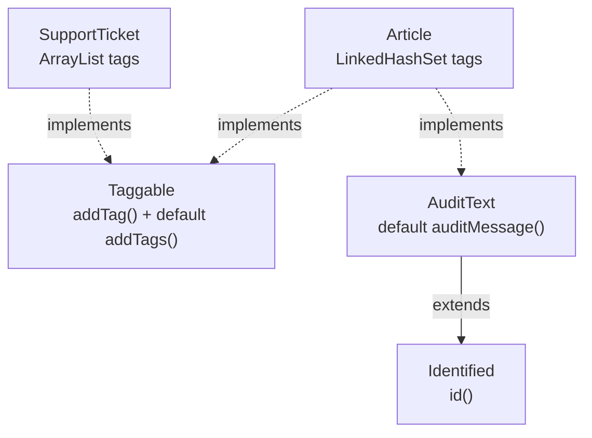

# Mixin, trait và tái sử dụng hành vi tùy ngôn ngữ

Trong lập trình hướng đối tượng, một nhu cầu thường gặp là: **nhiều lớp không cùng một nhánh kế thừa vẫn cần sử dụng chung một hành vi**. Ví dụ, `Article` và `SupportTicket` đều cần thao tác gắn nhiều thẻ, nhưng không nhất thiết có cùng lớp cha về mặt nghiệp vụ.

**Mixin** và **trait** là những cách tổ chức khả năng dùng chung như vậy. Tuy nhiên, đây không phải hai từ khóa có định nghĩa cú pháp giống nhau trong mọi ngôn ngữ:

- **Mixin** thường chỉ một đơn vị cung cấp hành vi để “trộn” vào lớp khác, thay vì buộc mọi lớp tham gia cùng một cây kế thừa.
- **Trait** thường là một cấu trúc ngôn ngữ mô tả một tập khả năng/phương thức, đôi khi có cài đặt mặc định; quy tắc kết hợp, trạng thái và xung đột phụ thuộc từng ngôn ngữ.
- **Java** không có từ khóa `mixin` hoặc `trait` riêng. Java sử dụng **interface với `default method`** (từ Java 8) để chia sẻ một số cách thực hiện, đồng thời có thể dùng **composition/delegation** khi cần tái sử dụng trạng thái và thuật toán phức tạp.

Điểm học quan trọng là **tái sử dụng hành vi mà không xây dựng một quan hệ `is-a` giả tạo**; đồng thời phải hiểu giới hạn của từng cơ chế thay vì gọi mọi dạng kế thừa là mixin.

## 1. Vì sao chỉ kế thừa lớp cha chưa đủ?

Java cho phép một lớp chỉ `extends` **một lớp cha trực tiếp**, nhưng có thể `implements` **nhiều interface**:

```java
class BaseEntity {}

interface Searchable {}
interface Exportable {}

class Article extends BaseEntity implements Searchable, Exportable {}
```

Giả sử ứng dụng còn có `SupportTicket extends TicketBase`. Cả `Article` lẫn `SupportTicket` đều cần `addTags(...)`, nhưng việc ép chúng kế thừa một lớp `TaggableBase` vừa có thể đụng giới hạn một lớp cha, vừa tạo quan hệ phân cấp không thực sự phản ánh nghiệp vụ.

Một giải pháp là định nghĩa **khả năng nhỏ** ở interface, rồi để các lớp triển khai khả năng ấy theo trạng thái riêng. Một `default method` có thể cung cấp quy trình dùng chung dựa trên các phương thức trừu tượng của interface.

## 2. Java: tái sử dụng hành vi bằng interface default method

Ví dụ `Taggable` đặt ra một thao tác cơ bản `addTag(String)` và cung cấp thêm hành vi `addTags(List<String>)`:

```java
interface Taggable {
    void addTag(String tag);

    default void addTags(List<String> tags) {
        for (String tag : tags) {
            addTag(tag);
        }
    }
}
```

`addTags()` là một cách thực hiện dùng chung. Lớp triển khai chỉ cần định nghĩa cách thêm **một thẻ** theo chính sách của nó. Phương thức mặc định gọi `addTag()` theo cơ chế dispatch thông thường, do đó sử dụng triển khai của đối tượng thực tế.

Điều này tương tự một **mixin cung cấp hành vi**: interface không cần biết các thẻ được lưu trong `ArrayList`, `Set` hay một nguồn dữ liệu khác.

Tuy nhiên, interface Java **không mang trường instance** để mỗi đối tượng tự có một `List` riêng. Những trường khai báo trong interface đều là hằng/biến cấp interface (`public static final` ngầm định); chúng không trở thành trường mutable độc lập của từng đối tượng.

## 3. Ví dụ đầy đủ: cùng hành vi cho hai lớp không có chung lớp cha nghiệp vụ

Lưu đoạn sau vào **`Main.java`**; chạy bằng Java 17 hoặc Java 21.

```java
import java.util.ArrayList;
import java.util.LinkedHashSet;
import java.util.List;
import java.util.Objects;
import java.util.Set;

// Một khả năng dùng chung; không sở hữu trạng thái instance.
interface Taggable {
    void addTag(String tag);

    default void addTags(List<String> tags) {
        Objects.requireNonNull(tags, "tags");
        for (String tag : tags) {
            addTag(tag); // Gọi implementation của đối tượng hiện tại.
        }
    }
}

// Cung cấp dữ liệu tối thiểu để hành vi khác sử dụng.
interface Identified {
    String id();
}

// Một cách thực hiện mặc định dựa trên hợp đồng Identified.
interface AuditText extends Identified {
    default String auditMessage(String action) {
        if (action == null || action.isBlank()) {
            throw new IllegalArgumentException("Hành động không hợp lệ");
        }
        return "[" + id() + "] " + action;
    }
}

final class Article implements Taggable, AuditText {
    private final String id;
    private final Set<String> tags = new LinkedHashSet<>();

    Article(String id) {
        if (id == null || id.isBlank()) {
            throw new IllegalArgumentException("ID bài viết không hợp lệ");
        }
        this.id = id;
    }

    @Override
    public String id() {
        return id;
    }

    @Override
    public void addTag(String tag) {
        if (tag == null || tag.isBlank()) {
            throw new IllegalArgumentException("Thẻ không được trống");
        }
        tags.add(tag); // Set loại bỏ thẻ trùng.
    }

    List<String> tagsSnapshot() {
        return List.copyOf(tags);
    }
}

final class SupportTicket implements Taggable {
    private final List<String> tags = new ArrayList<>();

    @Override
    public void addTag(String tag) {
        if (tag == null || tag.isBlank()) {
            throw new IllegalArgumentException("Thẻ không được trống");
        }
        tags.add(tag); // Ticket cho phép ghi nhận thẻ lặp lại.
    }

    List<String> tagsSnapshot() {
        return List.copyOf(tags);
    }
}

public class Main {
    public static void main(String[] args) {
        Article article = new Article("ART-7");
        article.addTags(List.of("java", "oop", "java"));

        SupportTicket ticket = new SupportTicket();
        ticket.addTags(List.of("urgent", "support", "urgent"));

        System.out.println(article.tagsSnapshot());
        System.out.println(ticket.tagsSnapshot());
        System.out.println(article.auditMessage("đã xuất bản"));
    }
}
```

Biên dịch và chạy:

```bash
javac Main.java
java Main
```

Kết quả:

```text
[java, oop]
[urgent, support, urgent]
[ART-7] đã xuất bản
```

**Phân tích:**

1. `Article` và `SupportTicket` đều nhận được `addTags()` từ `Taggable`, không cần sao chép vòng lặp trong hai lớp.
2. `Article.addTag()` dùng `LinkedHashSet`, loại thẻ trùng và giữ thứ tự chèn. `SupportTicket.addTag()` dùng `ArrayList`, cho phép lặp.
3. Mỗi lớp tự sở hữu và bảo vệ trạng thái qua trường `private`; `Taggable` không biết cấu trúc lưu trữ.
4. `Article` còn thực hiện `AuditText`. `auditMessage()` dùng `id()` do `Article` cung cấp; `SupportTicket` không có nghĩa vụ cung cấp chức năng audit.
5. `List.copyOf(...)` giúp caller không thể sửa cấu trúc các danh sách trả về. Với `String` bất biến, các phần tử cũng an toàn trước việc sửa trạng thái.



### Một giới hạn cần thấy ngay

`Taggable.addTags()` gọi `addTag()` nhiều lần; **nó không tự bảo đảm tính nguyên tử**. Nếu danh sách có ba thẻ nhưng thẻ thứ ba không hợp lệ, hai thẻ trước có thể đã được thêm. Muốn thao tác “hoặc thêm tất cả, hoặc không thêm gì”, lớp triển khai phải thiết kế lại bước xác thực và cập nhật, hoặc override `addTags()` để thực thi đúng hợp đồng.

Đó là lý do một `default method` chia sẻ được mã nguồn nhưng **không tự bảo đảm mọi ngữ nghĩa nghiệp vụ** cho tất cả lớp triển khai.

## 4. Mixin dựa trên default method phải tính đến xung đột

Nếu hai interface **độc lập** cùng cung cấp `default String greet()`, lớp implement cả hai phải tự định nghĩa một kết quả:

~~~java
interface ShortGreeting {
    default String greet() { return "Xin chào"; }
}
interface FriendlyGreeting {
    default String greet() { return "Chào bạn!"; }
}
final class Greeter implements ShortGreeting, FriendlyGreeting {
    @Override
    public String greet() {
        return ShortGreeting.super.greet()
                + " / " + FriendlyGreeting.super.greet();
    }
}
~~~

`new Greeter().greet()` trả `"Xin chào / Chào bạn!"`. Nếu bỏ override, compiler sẽ báo xung đột default method. `InterfaceName.super.method()` chỉ gọi default implementation hợp lệ trong ngữ cảnh kế thừa interface, không gọi abstract/static method tùy ý.

Java còn ưu tiên phương thức instance concrete từ **class** hơn default của interface và ưu tiên khai báo interface **chuyên biệt hơn** khi có quan hệ kế thừa. Hai đường dẫn đến **cùng một** default method gốc thường không tạo xung đột độc lập. Bài **Kế thừa đơn, kế thừa đa và xung đột hành vi** có bảng và chương trình kiểm chứng đầy đủ các quy tắc này; ở đây điều quan trọng là mixin/default tạo hành vi dùng chung nhưng cũng thêm nghĩa vụ duy trì hợp đồng tương thích.

## 5. `default` không biến Java thành đa kế thừa lớp

Một interface Java có thể chứa:

- Phương thức trừu tượng, ví dụ `void addTag(String tag)`.
- Phương thức `default` có thân để cung cấp một cách thực hiện.
- Phương thức `static`, được gọi qua tên interface.
- Phương thức `private` hỗ trợ tái sử dụng mã **trong chính interface** (từ Java 9).
- Trường hằng `public static final` (kể cả khi không ghi đủ modifier).

Nhưng interface Java **không chứa trường instance riêng cho từng đối tượng**. Nó cũng không có constructor giống lớp thông thường, và Java không cho phép một lớp `extends` đồng thời hai lớp cha.

Ngoài ra, interface không thể định nghĩa `default` method ghi đè các phương thức của `Object` như `equals(Object)`, `hashCode()`, `toString()`. Chúng thuộc hợp đồng gốc của đối tượng; muốn thay cách triển khai, hãy thực hiện ở lớp phù hợp.

Vì vậy, default method là công cụ **chia sẻ hành vi dựa trên hợp đồng**, đặc biệt phù hợp khi hành vi chung được biểu diễn bằng các phép gọi tới phương thức trừu tượng hoặc các phương thức public khác. Nó không phải nơi “nhét” trạng thái mutable dùng chung toàn hệ thống.

## 6. Trait/mixin trong các ngôn ngữ khác nhau

Thuật ngữ có nguồn gốc và quy tắc khác nhau. Bảng sau nêu cách nhìn ở mức thiết kế, không áp một ngôn ngữ làm chuẩn cho tất cả.

| Ngôn ngữ/cơ chế | Cách tái sử dụng hành vi | Trạng thái và cách xử lý xung đột |
| --- | --- | --- |
| **Java** — interface `default` | Lớp implements nhiều interface, nhận phương thức mặc định | Không có trường instance trong interface; Java có quy tắc ưu tiên và yêu cầu override khi xung đột |
| **Scala** — `trait` | Lớp kết hợp nhiều trait; trait có thể mang cả triển khai và trạng thái | Có quy tắc linearization/method resolution; các trait có thể khai báo trường, phải hiểu thứ tự kết hợp |
| **Rust** — `trait` | Định nghĩa hành vi chung và cài đặt cho kiểu (`impl Trait for Type`), có default method | Trait không đưa các trường instance vào struct; method resolution, associated types và quy tắc coherence theo Rust |
| **Kotlin** — `interface` | Interface hỗ trợ phương thức có thân; một lớp có thể implement nhiều interface | Interface không có backing field cho property; xung đột triển khai cần giải quyết rõ |
| **Python** — mixin qua multiple inheritance | Lớp mixin cung cấp phương thức để nhiều lớp kế thừa và kết hợp | Hành vi được phân giải bằng MRO; thường dùng `super()` phối hợp trong đa kế thừa |
| **Ruby** — module | `include`/`prepend` module vào chuỗi tra cứu phương thức | Quy tắc lookup theo ancestor chain; module có thể tương tác với trạng thái instance của object |
| **C++** — multiple inheritance / CRTP | Có thể dùng lớp mixin/template để bổ sung hành vi | Quy tắc kế thừa, name lookup và diamond khác Java; cần thiết kế rõ quyền sở hữu và ambiguity |

Chẳng hạn, một **Rust trait** thường biểu đạt các phương thức bắt buộc và có thể cung cấp cách thực hiện mặc định; kiểu dữ liệu lưu trường riêng theo định nghĩa struct. Một **Scala trait** có thể mang trạng thái và phối hợp các cách triển khai theo linearization. Vì thế câu “trait luôn không có state” hoặc “mixin luôn sao chép method vào lớp” đều quá tổng quát để áp dụng cho mọi ngôn ngữ.

Khi đọc tài liệu một ngôn ngữ cụ thể, cần hỏi: *cơ chế này có giữ trạng thái instance không, có nhiều lớp cha không, ưu tiên phương thức thế nào, và `super` có ý nghĩa gì?*

## 7. Khi nào Java nên dùng default method, abstract class hay composition?

Ba kỹ thuật có thể cùng đáp ứng nhu cầu dùng lại mã, nhưng phục vụ những kiểu quan hệ khác nhau.

| Kỹ thuật | Nên ưu tiên khi | Giới hạn/rủi ro |
| --- | --- | --- |
| Interface + `default` | Nhiều lớp khác nguồn gốc cùng có một **khả năng**, và hành vi chung dựa trên hợp đồng nhỏ | Không chứa trạng thái instance; dễ phát sinh xung đột default hoặc hành vi mặc định không phù hợp |
| Abstract class | Có quan hệ `is-a` thực sự, quy tắc chung, trường instance cần được lớp cha kiểm soát | Java chỉ có một lớp cha trực tiếp; lớp con gắn chặt với phân cấp |
| Composition/delegation | Muốn dùng lại thuật toán hoặc đối tượng có trạng thái độc lập, có thể thay thế/kết hợp khi chạy | Cần quản lý đối tượng delegate và chuyển tiếp lời gọi |
| Utility `static` | Thuật toán thuần, không cần hợp đồng của đối tượng | Không biểu diễn khả năng có thể thay thế qua dispatch như interface |

Một ví dụ delegation với khả năng ghi audit:

```java
interface AuditSink {
    void record(String message);
}

final class ConsoleAuditSink implements AuditSink {
    @Override
    public void record(String message) {
        System.out.println(message);
    }
}

final class ArticleService {
    private final AuditSink auditSink;

    ArticleService(AuditSink auditSink) {
        this.auditSink = java.util.Objects.requireNonNull(auditSink);
    }

    void publish(String articleId) {
        // Thực hiện quy trình xuất bản ...
        auditSink.record("Đã xuất bản " + articleId);
    }
}
```

Ở đây `ArticleService` **chứa một `AuditSink`**, không cần kế thừa từ `AuditableBase` và không cần nhét việc I/O vào default method. Có thể thay `ConsoleAuditSink` bằng adapter ghi file, database hay hệ thống sự kiện mà giữ nguyên `ArticleService`.

Nếu logic chung **cần tài nguyên, transaction, phụ thuộc được cấu hình hoặc trạng thái riêng có vòng đời**, composition thường rõ ràng hơn một mixin Java với những trường `static` dùng chung.

## 8. Thiết kế hợp đồng cho default method có ích

Có hai cách nhìn sai dễ gặp.

**Sai lầm A: mọi hành vi đều nên đưa vào interface default.**

```java
interface PaymentAction {
    default void charge(long amount) {
        // Không nên đặt logic tài chính giả định ở đây chỉ để
        // mọi triển khai khỏi phải viết một phương thức bắt buộc.
    }
}
```

Một method rỗng có thể khiến caller tưởng rằng thanh toán đã thành công. Nếu mỗi triển khai có cách tính/đảm bảo an toàn khác nhau, hãy giữ `charge()` là phương thức trừu tượng và đòi hỏi triển khai đúng hợp đồng.

**Sai lầm B: default method có sẵn nghĩa là hành vi luôn an toàn.**

```java
interface MutableAccess {
    List<String> internalTags();

    default void append(String tag) {
        internalTags().add(tag);
    }
}
```

Đoạn trên buộc lớp triển khai làm lộ collection mutable qua `internalTags()`. Caller có thể bỏ qua `append()` và sửa trực tiếp `internalTags()`. Phương án `Taggable` ở ví dụ chính tốt hơn cho mục tiêu đóng gói: nó chỉ yêu cầu **hành vi** `addTag()` và để mỗi lớp giữ dữ liệu `private`.

Khi soạn default method:

1. Mô tả **ngữ nghĩa** của phương thức, gồm tham số hợp lệ, kết quả và lỗi.
2. Chỉ triển khai hành vi thực sự đúng cho **mọi** lớp đáp ứng interface.
3. Gọi các primitive operation do lớp thực hiện, thay vì đòi getter lộ trạng thái mutable.
4. Xác định hành vi khi thực hiện một phần: phương thức mặc định có thể không bảo đảm giao dịch/atomicity.
5. Không giả định default method tự cung cấp đồng bộ hoặc an toàn đa luồng.
6. Nếu thêm default vào một interface đã tồn tại, kiểm tra khả năng **xung đột chữ ký** với các interface/lớp khác đang được triển khai.

Thêm `default method` giúp phát triển API mà không buộc tất cả implementation viết phương thức mới trong trường hợp thông thường, nhưng **không phải lúc nào cũng tương thích**: xung đột với một default khác hoặc hợp đồng hiện có có thể gây lỗi biên dịch hoặc thay đổi hành vi.

## 9. Một số lỗi cần tránh

| Lỗi | Hậu quả | Cách xử lý |
| --- | --- | --- |
| Coi Java interface là lớp có state instance | Muốn dùng trường như `private List<String> tags` trong interface | Đặt trạng thái ở lớp thực hiện hoặc delegate |
| Hai interface có default cùng chữ ký | Lớp không biên dịch nếu chưa giải quyết xung đột | Override rõ ràng, có thể dùng `Interface.super.method()` |
| Override default nhưng quên quy tắc nghiệp vụ | Các lớp thực hiện cho kết quả không tương thích | Viết rõ hợp đồng và kiểm thử chung |
| Gọi `this.addTags(...)` bên trong chính override `addTags()` | Có thể gọi lại chính phương thức đó và đệ quy | Dùng `Taggable.super.addTags(...)` khi hợp lệ và chủ đích giữ logic mặc định |
| Đưa trạng thái mutable vào trường interface | Trường thực chất là `public static final` tham chiếu dùng chung | Dùng trường instance `private` của lớp thực hiện |
| Dùng interface default để thay mọi trường hợp composition | Kéo I/O, DB và stateful services vào hợp đồng | Chọn delegation cho thành phần có vòng đời |
| Tưởng Scala trait, Rust trait, Java default giống hệt | Hiểu sai trạng thái, linearization và phân giải method | Học quy tắc từng ngôn ngữ |
| Chia sẻ default method có side effect nhưng không xác định thứ tự | Khó đoán thao tác thành công một phần | Thiết kế ngữ nghĩa transaction và lỗi cụ thể |

## 10. Tự kiểm tra

**Câu 1.** Vì sao `Article` và `SupportTicket` có thể dùng chung `Taggable.addTags()` dù không có cùng lớp cha nghiệp vụ?

**Đáp án:** Hai lớp đều implements `Taggable`; default method dùng thao tác `addTag()` do từng lớp cung cấp, không phụ thuộc chi tiết lưu trữ hay kế thừa từ một lớp trạng thái chung.

**Câu 2.** Nếu `ShortGreeting` và `FriendlyGreeting` đều có `default String greet()`, một lớp implements cả hai có tự động dùng `ShortGreeting` không?

**Đáp án:** Không. Khi không có quan hệ ưu tiên thích hợp và hai default xung đột, lớp phải override `greet()` để định nghĩa rõ hành vi.

**Câu 3.** Có thể khai báo `private int count;` làm trường instance trong Java interface không?

**Đáp án:** Không. Trường của interface luôn có ngữ nghĩa `public static final`; không có trường instance riêng trong interface.

**Câu 4.** Default `addTags()` gọi `addTag()` ba lần, đến lần thứ ba ném lỗi. Hai thẻ trước có chắc được hoàn tác không?

**Đáp án:** Không. Phương thức default mẫu không triển khai rollback. Nếu cần tính nguyên tử, phải bổ sung hợp đồng và triển khai phù hợp.

**Câu 5.** Có nên chuyển một `AuditSink` ghi file và giữ kết nối thành default method của interface chỉ để tái sử dụng code?

**Đáp án:** Thường không. Thành phần có trạng thái, vòng đời và tài nguyên riêng phù hợp hơn với composition/delegation, ví dụ tiêm một `AuditSink` vào đối tượng sử dụng.

**Câu 6.** Trait ở Rust có thể được kết luận là giống trait ở Scala về trạng thái và method resolution không?

**Đáp án:** Không. Cùng tên “trait” nhưng luật ngôn ngữ khác nhau: Rust định nghĩa hành vi và các implementation cho kiểu; Scala có cơ chế mixin/linearization và cho phép trạng thái trong trait.

**Ghi nhớ:** Hãy tái sử dụng những hành vi **thật sự chung theo hợp đồng**, không ép các lớp khác bản chất vào một lớp cha chỉ vì muốn tiết kiệm mã. Trong Java, interface `default` là công cụ phù hợp cho hành vi chia sẻ không cần state instance; khi hành vi gắn với tài nguyên hoặc phụ thuộc có trạng thái, hãy cân nhắc composition. Còn khi làm việc với mixin/trait ở ngôn ngữ khác, luôn đối chiếu quy tắc kết hợp và xử lý xung đột của chính ngôn ngữ đó.