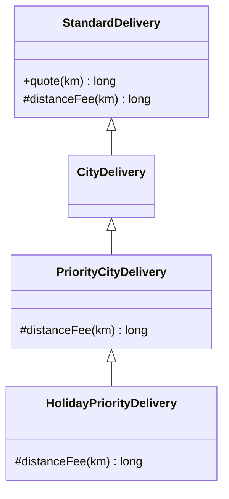
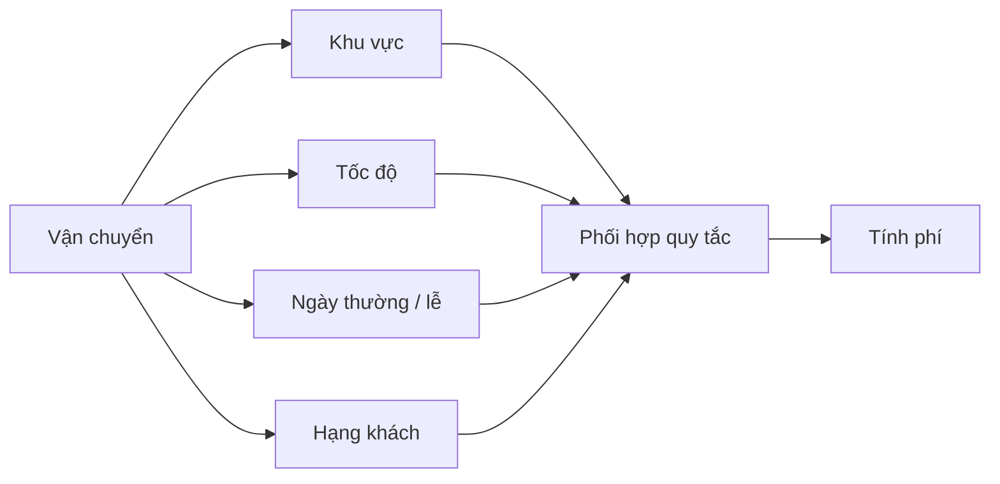
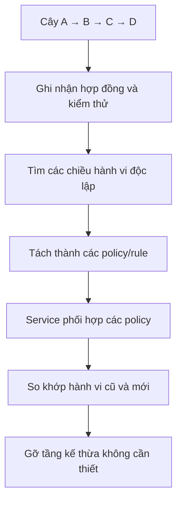

# Giới hạn và chi phí của cây kế thừa sâu trong Java

> **OOP → Kế thừa.** Kế thừa (`extends`) giúp lớp con tái sử dụng và chuyên biệt hóa hành vi của lớp cha. Nhưng khi một lớp phải đi qua quá nhiều tầng `A → B → C → D → E`, việc hiểu và sửa nó ngày càng tốn công: hành vi có thể nằm rải rác, thay đổi ở lớp cha ảnh hưởng nhiều lớp con, còn kiểm thử phải xét cả các tương tác kế thừa. Bài học này phân biệt **chi phí thiết kế/bảo trì** với **chi phí thực thi**, và chỉ ra khi nào nên chuyển sang composition.

## 1. “Cây kế thừa sâu” nghĩa là gì?

Xét một hệ thống tính phí vận chuyển:



`HolidayPriorityDelivery` có ba lớp tổ tiên trực tiếp/gián tiếp. Để biết `quote(3)` ra bao nhiêu, người đọc phải lần theo phương thức ở các cấp:

- `StandardDelivery.quote` quyết định công thức tổng.
- `StandardDelivery.distanceFee` tính phí khoảng cách mặc định.
- `PriorityCityDelivery.distanceFee` gọi `super.distanceFee` rồi cộng phí ưu tiên.
- `HolidayPriorityDelivery.distanceFee` lại gọi `super.distanceFee` rồi cộng phí ngày lễ.

Càng nhiều tầng **ghi đè và gọi ngược về lớp cha**, càng khó suy ra toàn bộ hành vi chỉ bằng cách nhìn một file.

**Độ sâu** là số cấp trên đường từ một lớp tới tổ tiên của nó, không phải số lớp con cùng kế thừa một lớp cha. Một cây có một lớp cha và mười lớp con trực tiếp vẫn **nông**; một đường `A → B → C → D → E` mới là ví dụ sâu.

## 2. Ví dụ Java chạy được: chi phí đọc hiểu của nhiều tầng override

Lưu đoạn mã sau thành `DepthCostDemo.java` (Java 17+):

```java
import java.util.List;
import java.util.Objects;

public class DepthCostDemo {

    // Tầng 1: quy tắc tính tổng và phí khoảng cách mặc định.
    static class StandardDelivery {
        private final long baseFeeVnd;

        StandardDelivery(long baseFeeVnd) {
            if (baseFeeVnd < 0) {
                throw new IllegalArgumentException("Phí cơ bản không thể âm");
            }
            this.baseFeeVnd = baseFeeVnd;
        }

        public final long quote(int distanceKm) {
            if (distanceKm <= 0) {
                throw new IllegalArgumentException("Khoảng cách phải dương");
            }
            long extra = distanceFee(distanceKm);
            if (extra < 0) {
                throw new IllegalStateException("Phụ phí không thể âm");
            }
            return Math.addExact(baseFeeVnd, extra);
        }

        protected long distanceFee(int km) {
            return Math.multiplyExact(2_000L, km);
        }
    }

    // Tầng 2: dùng cùng phí cơ bản của giao hàng nội thành.
    static class CityDelivery extends StandardDelivery {
        CityDelivery() {
            super(10_000L);
        }
    }

    // Tầng 3: thêm phí ưu tiên.
    static class PriorityCityDelivery extends CityDelivery {
        @Override
        protected long distanceFee(int km) {
            return Math.addExact(super.distanceFee(km), 5_000L);
        }
    }

    // Tầng 4: thêm phí ngày lễ.
    static final class HolidayPriorityDelivery extends PriorityCityDelivery {
        @Override
        protected long distanceFee(int km) {
            return Math.addExact(super.distanceFee(km), 3_000L);
        }
    }

    // Phương án composition: mỗi thành phần phí là một quy tắc riêng.
    @FunctionalInterface
    interface FeeRule {
        long calculate(int distanceKm);
    }

    static final class QuoteService {
        private final long baseFeeVnd;
        private final List<FeeRule> rules;

        QuoteService(long baseFeeVnd, List<FeeRule> rules) {
            if (baseFeeVnd < 0) {
                throw new IllegalArgumentException("Phí cơ bản không thể âm");
            }
            this.baseFeeVnd = baseFeeVnd;
            this.rules = List.copyOf(
                Objects.requireNonNull(rules, "rules")
            );
        }

        long quote(int distanceKm) {
            if (distanceKm <= 0) {
                throw new IllegalArgumentException("Khoảng cách phải dương");
            }
            long total = baseFeeVnd;
            for (FeeRule rule : rules) {
                long fee = rule.calculate(distanceKm);
                if (fee < 0) {
                    throw new IllegalStateException("Phụ phí không thể âm");
                }
                total = Math.addExact(total, fee);
            }
            return total;
        }
    }

    public static void main(String[] args) {
        StandardDelivery deep = new HolidayPriorityDelivery();

        QuoteService composed = new QuoteService(
            10_000L,
            List.of(
                km -> Math.multiplyExact(2_000L, km),
                km -> 5_000L,
                km -> 3_000L
            )
        );

        System.out.println("Inheritance: " + deep.quote(3));
        System.out.println("Composition: " + composed.quote(3));
    }
}
```

Chạy:

```bash
javac DepthCostDemo.java
java DepthCostDemo
```

Kết quả:

```text
Inheritance: 24000
Composition: 24000
```

Với 3 km, cả hai cách đều tính **10.000 phí cơ bản + 6.000 phí khoảng cách + 5.000 phí ưu tiên + 3.000 phí ngày lễ = 24.000 VND**.

Sự khác nhau nằm ở **nơi lưu quy tắc** và **cách mở rộng**:

| Mục tiêu | Cây kế thừa sâu | Composition |
|---|---|---|
| Tìm nơi tính phí ưu tiên | Phải truy tới lớp `PriorityCityDelivery` | Tìm rule phí ưu tiên trong danh sách cấu hình |
| Thêm phí ngày lễ | Tạo lớp con mới, override và gọi `super` | Thêm một `FeeRule` |
| Kết hợp ưu tiên và ngày lễ theo thứ tự khác | Có thể cần thêm biến thể lớp con | Thay tổ hợp các rule |
| Chia sẻ kiểm tra đầu vào | Lớp cha `quote` | `QuoteService.quote` |
| Kiểm thử từng loại phí riêng | Có thể phải dựng cả chuỗi lớp | Có thể kiểm thử từng `FeeRule` |
| Nguy cơ phụ thuộc vào `super` | Cao hơn khi nhiều tầng override | Thấp hơn vì các quy tắc tách biệt |

**Composition không mặc nhiên tốt hơn trong mọi bài toán**: nếu một họ lớp thực sự có quan hệ “là một loại”, trạng thái chung và ít biến thể, kế thừa nông có thể đơn giản hơn. Mục tiêu là giảm những phụ thuộc không cần thiết, không phải xóa mọi `extends`.

## 3. Chi phí thứ nhất: phụ thuộc ngầm và “fragile base class”

Một lớp con được viết dựa trên hành vi hiện tại của lớp cha. Nếu lớp cha thay đổi cách gọi một phương thức `protected` có thể override, hành vi của lớp con có thể đổi mà không cần sửa một dòng nào trong lớp con.

Ví dụ:

```java
class BaseFormatter {
    String format(String value) {
        return decorate(value);
    }

    protected String decorate(String value) {
        return "[" + value + "]";
    }
}

class UpperFormatter extends BaseFormatter {
    @Override
    protected String decorate(String value) {
        return super.decorate(value.toUpperCase());
    }
}
```

Nếu `BaseFormatter.format` sau này chuyển sang gọi `decorate` hai lần, `UpperFormatter` cũng bị ảnh hưởng. Lớp con phụ thuộc vào **quy ước ngầm về lúc nào, bao nhiêu lần và theo thứ tự nào** lớp cha gọi hook.

Với cây nhiều tầng, sự phụ thuộc có thể thành chuỗi:

```text
HolidayPriorityDelivery
  → PriorityCityDelivery.distanceFee
    → StandardDelivery.distanceFee
```

Sửa công thức ở `StandardDelivery` sẽ ảnh hưởng các lớp con dựa vào `super.distanceFee`. Có khi đây là điều mong muốn, nhưng nếu lớp con giả định công thức cũ thì đây là lỗi phát sinh ngoài dự kiến.

Hiện tượng này thường được gọi là **fragile base class problem**: sửa lớp nền có thể phá lớp dẫn xuất dù chữ ký API vẫn giữ nguyên.

Cách giảm rủi ro:

- Ghi rõ phương thức nào là **extension point** cho lớp con override.
- Nêu hợp đồng của hook: điều kiện đầu vào, giá trị trả về, việc gọi một lần hay nhiều lần, side effect, ngoại lệ.
- Đánh dấu `final` cho phương thức kiểm soát quy trình quan trọng nếu lớp con không được thay toàn bộ thuật toán.
- Giữ trường nội bộ `private` khi có thể; dùng API `protected` có mục đích rõ, thay vì trao quyền sửa trực tiếp.
- Kiểm thử các implementation chịu ảnh hưởng khi sửa lớp nền.

## 4. Chi phí thứ hai: constructor phụ thuộc vào hành vi lớp lá

Với nhiều tầng kế thừa, constructor tổ tiên có thể gọi một method bị lớp lá override trong khi field riêng của lá vẫn chưa chạy initializer. Ví dụ:

~~~java
class Base {
    Base() { System.out.println("Base sees: " + display()); }
    String display() { return "base"; }
}
class Middle extends Base {
    @Override String display() { return "middle"; }
}
class Leaf extends Middle {
    String label = "READY";
    @Override String display() { return label; }
}
// new Leaf() in "Base sees: null".
~~~

Java dùng dynamic dispatch đến `Leaf.display()` ngay trong `Base()`, dù `Leaf.label` mới ở giá trị mặc định `null`. Việc đi qua nhiều lớp trung gian làm điểm xuất phát và implementation được gọi khó truy vết hơn; nếu override gọi `label.toUpperCase()`, sẽ xuất hiện `NullPointerException`.

Giữ constructor chỉ thiết lập trạng thái thuộc lớp hiện tại, tránh gọi hook overridable hoặc làm lộ `this` quá sớm. Trong chương này, bài **Khởi tạo lớp con và chuỗi khởi tạo lớp cha** giải thích đầy đủ static/instance initializer và constructor chaining; ở đây trọng tâm là **phạm vi ảnh hưởng tăng theo độ sâu**.

## 5. Chi phí thứ ba: cây lớp phình to khi kết hợp nhiều biến thể

Giả sử dịch vụ vận chuyển có các đặc tính độc lập:

- Khu vực: nội thành hoặc liên tỉnh.
- Tốc độ: thường hoặc hỏa tốc.
- Thời điểm: ngày thường hoặc lễ.
- Khách hàng: thường hoặc thành viên.

Nếu mỗi tổ hợp đều được mã hóa thành một lớp con, số phương án lý thuyết là:

\[
2 \times 2 \times 2 \times 2 = 16
\]

Nếu thêm một thuộc tính có 3 biến thể, số tổ hợp tăng lên:

\[
16 \times 3 = 48
\]

Không phải mọi tổ hợp thực tế đều được triển khai, nhưng số tổ hợp có thể tăng nhanh. Các tên lớp như `HolidayExpressMemberIntercityDelivery` báo hiệu thiết kế đang trộn **nhiều chiều thay đổi độc lập** trong một cây kế thừa.



Trong tình huống này, composition thường hợp lý: tách `DistanceFeePolicy`, `SpeedSurcharge`, `HolidaySurcharge`, `MembershipDiscount` thành các chiến lược/quy tắc có giao diện rõ ràng, sau đó phối hợp ở một service.

**Lưu ý:** các thành phần có thể có thứ tự áp dụng quan trọng, như giảm 10% trước hoặc sau phụ phí. Composition không tự giải quyết vấn đề đó; service phải định nghĩa thứ tự, quy tắc làm tròn, cách xử lý lỗi và kiểm tra hợp đồng.

## 6. Chi phí thứ tư: khó kiểm thử và khó đoán phạm vi ảnh hưởng

Một thay đổi nhỏ ở lớp cha có thể ảnh hưởng mọi lớp kế thừa, kể cả lớp ở nhánh mà người sửa không để ý.

| Kiểu thay đổi | Cần xem lại điều gì? |
|---|---|
| Thêm kiểm tra đầu vào ở lớp cha | Lớp con có truyền dữ liệu hợp lệ, có xử lý ngoại lệ mới không? |
| Đổi cách gọi hook `protected` | Override ở mọi nhánh còn đúng ngữ nghĩa không? |
| Thay cấu trúc trạng thái lớp cha | Lớp con có phụ thuộc trường/logic cũ không? |
| Thêm overload hoặc đổi visibility | Có gây nhầm lời gọi hoặc phá API lớp con không? |
| Chỉnh constructor lớp cha | Chuỗi `super(...)` và invariant lớp con có còn đúng không? |

Mỗi đường đi qua nhiều tầng lớp đều là một bối cảnh kiểm thử. Điều này không có nghĩa phải thử mọi tổ hợp bất khả thi, mà là **phạm vi regression có thể rộng hơn nhiều so với file vừa chỉnh**.

Một cách kiểm soát tốt là có **contract tests** cho hành vi lớp nền và các implementation quan trọng:

```java
static void assertQuote(DepthCostDemo.StandardDelivery plan,
                        int distanceKm,
                        long expected) {
    long actual = plan.quote(distanceKm);
    if (actual != expected) {
        throw new AssertionError(
            "Expected " + expected + " but was " + actual
        );
    }
}

// Gọi trong cùng package với DepthCostDemo:
assertQuote(new DepthCostDemo.HolidayPriorityDelivery(), 3, 24_000);
```

Ví dụ này dùng các kiểu nested package-private trong `DepthCostDemo` và là đoạn kiểm tra minh họa đặt cùng package; phương thức `assertQuote` cần nằm trong một class khi biên dịch. Trong dự án thật có thể dùng JUnit để kiểm thử tham số hóa nhiều implementation.

Với thiết kế composition, có thể kiểm thử riêng từng rule (phí khoảng cách, phí ngày lễ) và thêm bài kiểm thử phối hợp cho `QuoteService`. Sự tách biệt thường giúp xác định lỗi ở một chính sách cụ thể thay vì đi qua toàn bộ cây lớp.

## 7. Chi phí runtime: có phải càng sâu càng chậm?

**Không nên kết luận độ sâu của cây kế thừa tự động khiến chương trình chậm.** Cần tách các loại chi phí:

| Nhóm chi phí | Điều gì có thể tăng? | Có xảy ra trong mọi trường hợp? |
|---|---|---|
| Đọc hiểu/bảo trì | Phải lần theo nhiều override, constructor, trạng thái, nhánh lớp | Thường tăng khi phụ thuộc nhiều tầng |
| Kiểm thử/regression | Nhiều lớp con bị ảnh hưởng bởi thay đổi ở cha | Phụ thuộc thiết kế và số nhánh |
| Khởi tạo lớp và object | Có thêm constructor, initializer, trường instance cần xử lý | Tùy số lớp và code thực tế |
| Bộ nhớ object | Trường instance kế thừa và trường mới được lưu trong object | Tùy cấu trúc trường; không phải mỗi tầng là một object độc lập |
| Gọi phương thức | Có thể xuất hiện nhiều lớp gọi `super.method()` nối tiếp | Tùy code; JIT có thể inline/tối ưu |
| Class metadata | Nhiều class phải được nạp và quản lý hơn | Có, nhưng quy mô tác động cần đo |

Java dùng **dynamic dispatch** cho phương thức instance có thể override. JVM/JIT hiện đại có thể inline các lời gọi mà nó suy ra được đích, kể cả trên cây kế thừa, và tối ưu theo profile runtime. Vì vậy không có quy tắc kiểu “thêm một tầng `extends` thì mỗi lời gọi tăng X mili giây”.

Mặt khác, một override có gọi `super` nhiều tầng và mỗi tầng thực hiện thêm tính toán/I/O thì tổng công việc **thật sự** tăng. Đó là chi phí của **logic được chạy**, không phải chi phí vô điều kiện của từ khóa `extends`.

Khi đánh giá hiệu năng:

1. Xác định đường chạy thực tế cần tối ưu.
2. Dùng profiler hoặc benchmark có warm-up phù hợp (ví dụ JMH cho microbenchmark Java).
3. Đo latency, throughput, allocation và GC trước/sau thay đổi.
4. Ưu tiên thiết kế dễ bảo trì nếu chưa có bằng chứng cây kế thừa là nút thắt hiệu năng.

Tránh viết microbenchmark bằng một vòng lặp rỗng gọi phương thức và suy luận ngay từ thời gian đo: JVM có thể loại bỏ công việc không có tác động quan sát được.

## 8. Khi nào kế thừa vẫn là lựa chọn hợp lý?

Một hệ phân cấp thường hợp lý khi:

- Thực sự tồn tại quan hệ **is-a** ổn định: mọi `Circle` đều là một `Shape`.
- Lớp con thực hiện đúng hợp đồng lớp cha và có thể thay thế lớp cha ở vị trí gọi (**Liskov Substitution Principle — LSP**).
- Có hành vi hoặc trạng thái chung rõ ràng, không phải chỉ chia sẻ vài dòng tiện ích.
- Các điểm mở rộng được tài liệu hóa, có kiểm thử và không phụ thuộc quá nhiều vào chi tiết nội bộ của tổ tiên.
- Cây nông và các thay đổi của lớp cha ít làm lớp con phải hiểu lại toàn bộ quy tắc.

Ví dụ `abstract class Shape` với `abstract double area()` và các lớp `Circle`, `Rectangle` trực tiếp kế thừa có thể rất dễ hiểu. Không cần thay một cây đơn giản, đúng bản chất bằng hàng loạt chiến lược và factory chỉ vì muốn tránh kế thừa.

### Tín hiệu nên xem lại cây hiện tại

- Mỗi chức năng mới thường đòi một lớp con với tên ngày càng dài.
- Override hầu hết chỉ gọi `super.method()` rồi cộng/trừ một chút logic.
- Thay lớp nền gây lỗi ở nhánh không liên quan.
- Nhiều lớp con phải ghi đè phương thức bằng implementation rỗng hoặc ném `UnsupportedOperationException`.
- Test lớp lá phải thiết lập rất nhiều trạng thái của tổ tiên.
- Lớp con đọc/sửa nhiều trường `protected` mà lớp cha lẽ ra phải tự bảo vệ.
- Phải dùng `instanceof` hoặc ép kiểu liên tục để biết loại lớp con rồi xử lý riêng.

Đây là **dấu hiệu cần phân tích**, không phải bằng chứng tuyệt đối. Một số cây phân loại dữ liệu cố định vẫn thích hợp với inheritance.

## 9. Cách giảm độ sâu mà vẫn giữ được hành vi

Cách làm an toàn nhất là bắt đầu từ **hợp đồng quan sát được** thay vì xóa `extends` ngay.

1. **Liệt kê các trường hợp đang được hỗ trợ:** loại vận chuyển, tham số đầu vào, kết quả, exception và tác động phụ.
2. **Ghi lại hành vi hiện tại bằng kiểm thử:** đặc biệt là những lớp lá quan trọng và các trường hợp biên.
3. **Tách những chiều thay đổi độc lập:** ví dụ phí khoảng cách, ngày lễ, ưu tiên thành `FeeRule` hoặc các interface riêng.
4. **Đưa quy trình phối hợp vào một service/composer:** một nơi kiểm tra đầu vào, thứ tự áp dụng rule và xử lý overflow.
5. **Thay dần mã gọi ở ranh giới:** giữ adapter cho API cũ nếu cần tương thích, tránh thay toàn hệ thống trong một bước.
6. **So sánh kết quả cũ/mới theo trường hợp nghiệp vụ:** sau đó mới loại các lớp trung gian không còn giá trị.



Có thể dùng **composition + interface** cho khả năng tùy biến, và giữ lại một **abstract class nông** nếu thật sự cần khung thuật toán chung. Hai kỹ thuật không loại trừ nhau.

## 10. Dùng `final` và `sealed` để kiểm soát phạm vi kế thừa

Khi không muốn ai cũng tùy ý tạo lớp con, có thể hạn chế khả năng mở rộng:

```java
final class FixedPolicy {
    // Không class nào được extends FixedPolicy.
}
```

Từ Java 17, `sealed` cho phép một lớp/interface công khai tập subtype trực tiếp được phép:

```java
sealed interface DeliveryMode
        permits Economy, Express {
}

record Economy() implements DeliveryMode {
}

record Express() implements DeliveryMode {
}
```

`Economy` và `Express` là record nên ngầm định `final`; chúng có thể triển khai sealed interface theo quy tắc Java. Ví dụ sử dụng các kiểu trong cùng file/package phù hợp. Các subtype trực tiếp của sealed class/interface phải tuân theo quy tắc `final`, `sealed` hoặc `non-sealed` khi áp dụng.

`sealed` hữu ích khi tập biến thể thực sự có giới hạn. Nó giúp biết những subtype nào hợp lệ, nhưng **không tự giảm độ sâu của một cây đã dài**; dùng nó để kiểm soát khả năng mở rộng theo thiết kế. `final` phù hợp với những lớp không được xây dựng để trở thành lớp cha.

## 11. Các bài tập thực hành

**Bài 1 — vẽ đường gọi.** Với `DepthCostDemo`, hãy vẽ chuỗi các phương thức chạy khi gọi `new HolidayPriorityDelivery().quote(4)`. Tính kết quả và xác định chỗ nào có thể gây overflow.

**Bài 2 — thay quy tắc.** Thay phí ưu tiên thành 7.000 VND. So sánh vị trí phải sửa trong thiết kế inheritance và composition; giải thích vì sao không thể chỉ dựa vào số dòng code để kết luận thiết kế nào tốt hơn.

**Bài 3 — thêm biến thể.** Một loại giao hàng cần phụ phí giờ cao điểm nhưng không có phụ phí ngày lễ. Hãy thiết kế phiên bản composition có thể kết hợp phí khoảng cách, phí cao điểm và phí ưu tiên mà không tạo thêm một chuỗi subclass dài.

**Bài 4 — bẫy constructor.** Đưa ví dụ `Base → Middle → Leaf` ở mục 4 vào một lớp `main`, giải thích vì sao in `Base sees: null`; sau đó sửa để chỉ gọi `display()` sau khi khởi tạo hoàn tất.

**Bài 5 — đánh giá cây lớp thật.** Chọn một cây kế thừa trong project Java của bạn và trả lời: quan hệ is-a có đúng không, có bao nhiêu tầng, có bao nhiêu override gọi `super`, thay đổi ở lớp cha ảnh hưởng những lớp nào, và có chiều biến thể nào độc lập nên tách ra không?

**Ghi nhớ:** Giới hạn quan trọng nhất của cây kế thừa sâu là **sự kết dính giữa các lớp và chi phí suy luận về hành vi**, chứ không phải một “hình phạt tốc độ” mặc định do JVM áp đặt. Hãy giữ kế thừa cho quan hệ is-a rõ ràng; khi các đặc tính thay đổi độc lập hoặc chuỗi override trở nên khó kiểm soát, dùng **composition, interface và các quy tắc nhỏ** để giảm phụ thuộc.