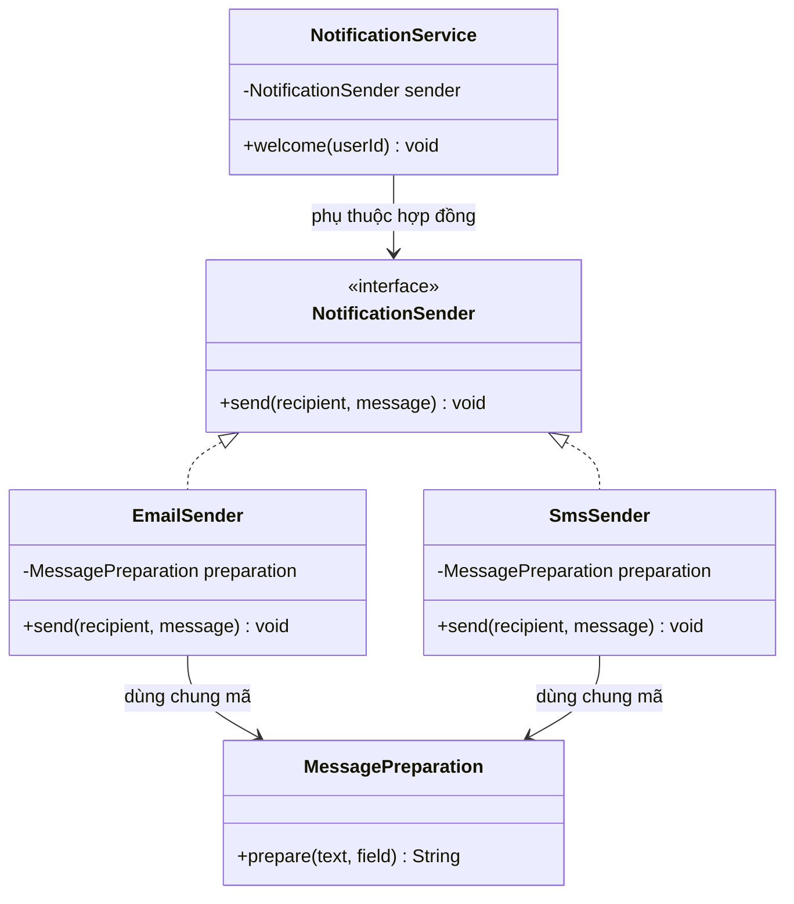

# Phân biệt kế thừa mã với quan hệ kiểu con trong Java

Trong Java OOP, hai ý tưởng dễ bị gộp chung là **kế thừa mã (implementation inheritance / code reuse)** và **quan hệ kiểu con (subtyping)**. Chúng thường xuất hiện cùng lúc khi viết `extends`, nhưng giải quyết hai câu hỏi khác nhau:

- **Kế thừa mã:** “Làm sao tận dụng lại một phần chương trình đã viết, tránh nhân bản thuật toán hoặc xử lý chung?”
- **Quan hệ kiểu con:** “Đối tượng thuộc kiểu này có thể được dùng thay cho một kiểu trừu tượng khác mà vẫn giữ đúng hợp đồng không?”

Sự phân biệt quan trọng vì **tái sử dụng được code không đồng nghĩa với thay thế được về mặt hành vi**. Một lớp con có thể kế thừa phương thức, biên dịch hợp lệ, nhưng làm sai những kỳ vọng mà chương trình đang đặt vào lớp cha.

Bài này tập trung vào cơ chế của Java, minh họa bằng interface, `extends`, `implements`, ủy quyền qua composition và nguyên lý thay thế Liskov (LSP).

## 1. Hai trục thiết kế không đồng nhất

| Góc nhìn | Kế thừa mã | Quan hệ kiểu con |
| --- | --- | --- |
| Mục đích | Tận dụng logic hoặc cấu trúc chung | Cho phép dùng một đối tượng dưới hợp đồng kiểu rộng hơn |
| Câu hỏi | “Code nào có thể dùng lại?” | “Có thể thay A bằng B mà client vẫn đúng không?” |
| Cơ chế điển hình | `extends`, lớp cơ sở, hoặc **composition/delegation** để tái sử dụng không cần kế thừa | `extends` class, `implements` interface, `extends` interface |
| Điều phía sử dụng quan tâm | Chi tiết thực hiện, chi phí bảo trì | Phương thức, tiền/hậu điều kiện, bất biến, hành vi lỗi |
| Rủi ro | Kết dính chặt lớp con với chi tiết lớp cha | Vi phạm hợp đồng dù tương thích chữ ký |
| Khi nên ưu tiên | Có xử lý chung thật sự cần chia sẻ | Các kiểu cần được sử dụng thay thế theo một hợp đồng |

**Về mặt ngôn ngữ Java:** khi `Child extends Parent`, `Child` là *subtype danh nghĩa* của `Parent` và có thể kế thừa các thành phần thích hợp từ cha. Không thể dùng `extends` để “chỉ lấy code mà tuyệt đối không tạo quan hệ kiểu con”. Nếu mục đích chỉ là tái sử dụng thuật toán, composition/delegation thường diễn đạt chính xác hơn.

Khi `Worker implements Runnable`, `Worker` là kiểu con của `Runnable` dù interface chủ yếu mô tả chữ ký hành vi. Về nguyên tắc, subtype không bắt buộc phải xuất phát từ việc kế thừa **mã nguồn triển khai** của một superclass. Lưu ý Java interface hiện đại có thể có `default` method, nên không nên khẳng định mọi interface hoàn toàn không chứa code.

Từ đây có ba khái niệm nên phân biệt rõ:

1. **Quan hệ subtype theo hệ kiểu Java:** trình biên dịch cho phép chuyển tham chiếu `Child` thành `Parent` hoặc một interface được implement.
2. **Kế thừa implementation:** lớp con nhận lại code phù hợp của superclass (có thể override nơi được phép).
3. **Subtype đúng về hành vi:** việc thay đối tượng không phá cam kết mà client được phép dựa vào; đây là nội dung cốt lõi của LSP.

Hai điều đầu do cơ chế ngôn ngữ hỗ trợ. Điều thứ ba cần **thiết kế, mô tả hợp đồng và kiểm thử**.

## 2. Quan hệ kiểu con: phía gọi dựa vào hợp đồng

Ví dụ `NotificationSender` mô tả một khả năng gửi thông báo ở mức nghiệp vụ:

```java
// NotificationSender.java
public interface NotificationSender {

    /**
     * Gửi một thông báo tới người nhận.
     * recipient và message phải khác null, không được rỗng/trắng.
     * Đầu vào sai: IllegalArgumentException.
     *
     * Ví dụ học tập dùng thao tác in ra console.
     * Khi hoàn thành bình thường, phát ra đúng một dòng thông báo.
     */
    void send(String recipient, String message);
}
```

Một thành phần sử dụng chỉ biết `NotificationSender`:

```java
// NotificationService.java
import java.util.Objects;

public final class NotificationService {
    private final NotificationSender sender;

    public NotificationService(NotificationSender sender) {
        this.sender = Objects.requireNonNull(sender, "sender");
    }

    public void welcome(String userId) {
        sender.send(userId, "Chào mừng bạn đến hệ thống!");
    }
}
```

`NotificationService` không cần biết thông báo đi qua email hay SMS. Một đối tượng thực hiện interface này có thể được truyền vào constructor. Đó là **quan hệ kiểu con được khai thác qua đa hình**.

Điểm quyết định không phải hai implementation có cùng code hay không. Chúng cần chấp nhận cùng miền đầu vào mà interface đã hứa, báo lỗi nhất quán và tạo hiệu ứng được mô tả. Nếu bản SMS tự ý từ chối tất cả chuỗi dài trên 20 ký tự trong khi hợp đồng chung không đặt giới hạn, nó không còn là implementation thay thế được cho tất cả client hợp lệ.

## 3. Tái sử dụng code bằng composition, không cần kế thừa lớp khác

Hai cách gửi thông báo đều cần chuẩn hóa và kiểm tra văn bản. Việc này có thể nằm trong một **đối tượng trợ giúp** thay vì ép cả email và SMS kế thừa một lớp cha chứa xử lý chung.

### Bộ xử lý dùng chung

```java
// MessagePreparation.java
public final class MessagePreparation {

    public String prepare(String text, String field) {
        if (text == null || text.isBlank()) {
            throw new IllegalArgumentException(
                    field + " không được trống");
        }
        return text.strip();
    }
}
```

### Hai implementation cùng sử dụng helper

```java
// EmailSender.java
public final class EmailSender implements NotificationSender {
    private final MessagePreparation preparation;

    public EmailSender(MessagePreparation preparation) {
        this.preparation = java.util.Objects.requireNonNull(
                preparation, "preparation");
    }

    @Override
    public void send(String recipient, String message) {
        String to = preparation.prepare(recipient, "recipient");
        String body = preparation.prepare(message, "message");
        System.out.println("[EMAIL] " + to + ": " + body);
    }
}
```

```java
// SmsSender.java
public final class SmsSender implements NotificationSender {
    private final MessagePreparation preparation;

    public SmsSender(MessagePreparation preparation) {
        this.preparation = java.util.Objects.requireNonNull(
                preparation, "preparation");
    }

    @Override
    public void send(String recipient, String message) {
        String to = preparation.prepare(recipient, "recipient");
        String body = preparation.prepare(message, "message");
        System.out.println("[SMS] " + to + ": " + body);
    }
}
```

Thử sử dụng qua interface:

```java
// Main.java
public class Main {
    public static void main(String[] args) {
        MessagePreparation preparation = new MessagePreparation();

        NotificationService emailService = new NotificationService(
                new EmailSender(preparation));
        NotificationService smsService = new NotificationService(
                new SmsSender(preparation));

        emailService.welcome("an@example.test");
        smsService.welcome("0900000000");
    }
}
```

Biên dịch và chạy các tệp trong cùng thư mục:

```bash
javac NotificationSender.java NotificationService.java MessagePreparation.java EmailSender.java SmsSender.java Main.java
java Main
```

Kết quả:

```text
[EMAIL] an@example.test: Chào mừng bạn đến hệ thống!
[SMS] 0900000000: Chào mừng bạn đến hệ thống!
```

**Phân tích:**

- `EmailSender` và `SmsSender` đều là **subtype của `NotificationSender`** vì khai báo `implements`.
- Hai lớp sử dụng lại `MessagePreparation.prepare(...)` bằng **composition/delegation**.
- Không có quan hệ `EmailSender extends SmsSender` hay `EmailSender extends MessagePreparation`. Chia sẻ bộ xử lý không ngụ ý “email là một SMS” hoặc “email là một bộ chuẩn hóa”.
- `NotificationService` dùng kiểu interface nên có thể nhận cả hai implementation. Sự thay thế đến từ hợp đồng của interface, không đến từ việc hai lớp cùng gọi helper.
- Trong ví dụ console, tiền điều kiện có cùng cách kiểm tra; đầu ra khác nhãn kênh nhưng vẫn đáp ứng cam kết “phát một dòng”.

Sơ đồ phân biệt rõ **implements** với **has-a / uses-a**:



Nếu sau này thay bộ chuẩn hóa bằng cách khác, hai sender vẫn giữ loại quan hệ của mình. Nếu thêm kênh thông báo, tạo implementation mới mà `NotificationService` không phải đổi.

## 4. `extends` thường kết hợp cả kế thừa mã và quan hệ subtype

`extends` có thể phù hợp nếu lớp con **thực sự là một trường hợp chuyên biệt hợp lệ** của lớp cha và các phần cài đặt chung là nền tảng ổn định.

```java
abstract class AbstractReport {
    public final String render() {
        String title = title();
        String body = body();

        return "=== " + title + " ===\n" + body;
    }

    protected abstract String title();
    protected abstract String body();
}

final class SalesReport extends AbstractReport {
    @Override
    protected String title() {
        return "Báo cáo bán hàng";
    }

    @Override
    protected String body() {
        return "Doanh thu: 1.000.000 VND";
    }
}
```

Sử dụng:

```java
AbstractReport report = new SalesReport();
System.out.println(report.render());
```

Kết quả:

```text
=== Báo cáo bán hàng ===
Doanh thu: 1.000.000 VND
```

Ở đây:

- `SalesReport extends AbstractReport` tạo **quan hệ subtype**: biến `AbstractReport` có thể giữ `SalesReport`.
- `SalesReport` **kế thừa mã thực hiện `render()`** của `AbstractReport`.
- `render()` là `final` để giữ khung xử lý chung. Lớp con chỉ điền các điểm mở rộng `title()`, `body()`, giúp hạn chế việc vô tình thay đổi định dạng kết quả.
- Đây là dạng **Template Method** đơn giản. Nếu mọi báo cáo thuộc họ này tuân thủ cùng định dạng, quan hệ kế thừa có lý do rõ ràng.

Tuy nhiên, **chỉ vì `render()` tái sử dụng được code không đủ để khẳng định mọi loại đối tượng in được đều nên kế thừa `AbstractReport`**. Một hóa đơn, biên lai hoặc nhãn vận chuyển có thể cần hợp đồng khác dù cùng có thao tác “tạo chuỗi hiển thị”.

### Tại sao extends đôi khi gây kết dính mạnh?

Lớp con có thể phụ thuộc vào trình tự gọi method, field/protected API, bước kiểm tra và các giả định bên trong lớp cha. Thay đổi phương thức cha có thể vô tình làm lớp con chạy khác. Composition giữ việc tái sử dụng ở ranh giới đối tượng và thường giảm phụ thuộc vào chi tiết một superclass lớn.

Điều này không có nghĩa composition luôn tốt hơn extends; sự lựa chọn dựa trên **ngữ nghĩa quan hệ**, hợp đồng cần giữ và mức kiểm soát điểm mở rộng.

## 5. Phản ví dụ ngắn: subtype danh nghĩa nhưng không thay thế được

Phát biểu hình học “hình vuông là hình chữ nhật” chưa đủ để bảo đảm `Square extends Rectangle` **đúng về hành vi**. Giả sử `Rectangle` cho phép `setWidth(w)` và `setHeight(h)` thay đổi hai chiều **độc lập**, còn `Square` buộc hai chiều luôn bằng nhau. Cả hai không thể cùng giữ những cam kết đó.

~~~java
// Ý tưởng tối giản: Rectangle có hai setter độc lập.
// Square extends Rectangle và override setWidth/setHeight
// để cập nhật cả hai chiều giữ hình vuông.
// Đây là mô hình CỐ Ý SAI về hợp đồng.
void resize(Rectangle shape) {
    shape.setWidth(5);   // Đúng hợp đồng Rectangle: height không đổi
    shape.setHeight(4);  // Đúng hợp đồng Rectangle: width vẫn là 5
    System.out.println(shape.area()); // Kỳ vọng 20
}
~~~

Nếu đối tượng thực là `Square` và mỗi setter cập nhật cả hai chiều, kết quả cuối thành `4 × 4 = 16`, khác kỳ vọng hợp lệ `5 × 4 = 20`. `extends` giúp code biên dịch vì subtype danh nghĩa đã được khai báo; **compiler không tự kiểm tra hậu điều kiện của setter**.

| Quan sát | Kết luận |
| --- | --- |
| `Square` kế thừa implementation và đúng chữ ký | Có subtype và khả năng dùng lại mã theo Java |
| Client dựa vào hai setter độc lập | `Square` không giữ được hợp đồng |
| Chỉ cần `area()` và dữ liệu hình bất biến | `Rectangle`, `Square` có thể cùng triển khai một `Shape` nhỏ hơn |

Bài **Phản ví dụ hình chữ nhật và hình vuông** dành trọn hai chương trình Java chạy được, bảng so sánh từng phương án sửa, postcondition và contract test cho tình huống này. Ở đây, điểm cần rút ra là: *kế thừa mã và subtype theo cú pháp không chứng minh khả năng thay thế về nghiệp vụ*.

## 6. LSP: ranh giới giữa tương thích kiểu và tương thích hành vi

Nguyên lý thay thế Liskov có thể hiểu thực dụng như sau:

> Mã được viết đúng theo hợp đồng của kiểu cha phải tiếp tục đúng khi nhận một đối tượng kiểu con hợp lệ, không phải viết nhánh đặc biệt chỉ để tránh lỗi do kiểu con gây ra.

Một subtype về hành vi cần giữ các ràng buộc mà client được phép dựa vào:

| Khía cạnh | Điều subtype cần tôn trọng | Ví dụ vi phạm |
| --- | --- | --- |
| **Tiền điều kiện** | Không tự ý **siết chặt** điều kiện của các lời gọi hợp lệ | Cha nhận số nguyên dương; con chỉ nhận số từ 100 trở lên |
| **Hậu điều kiện** | Không **làm yếu** kết quả đã hứa | Cha hứa trả danh sách đã sắp xếp; con trả thứ tự tùy ý |
| **Bất biến** | Không phá quy tắc trạng thái quan sát được | Cha hứa số dư không âm; con cho phép âm |
| **Lỗi** | Giữ những bảo đảm lỗi đã công bố | Cha hứa thao tác lỗi không thay đổi dữ liệu; con cập nhật dở dang |
| **Hiệu ứng phụ** | Không thêm tác động trái với hợp đồng | Getter hứa chỉ đọc; con lại xóa bản ghi |
| **Quy tắc thời điểm/đồng thời** | Giữ những bảo đảm nếu chúng là một phần của hợp đồng | API hứa cập nhật xong trước khi trả về; con chỉ gửi job async |

LSP **không** yêu cầu mọi implementation trả cùng một kết quả cụ thể trong mọi tình huống. Nếu hợp đồng `Shape.area()` chỉ hứa diện tích chính xác của **hình đang biểu diễn**, các hình khác nhau có thể trả số khác nhau, miễn là mỗi implementation đáp ứng ý nghĩa và ràng buộc đã cam kết.

Cũng không phải cứ override khác hành vi là vi phạm: mục đích của đa hình chính là hỗ trợ các hành vi cụ thể khác nhau **trong phạm vi hợp đồng chung**.

### Test hợp đồng để bắt vi phạm

Với một interface quan trọng, có thể viết **cùng bộ kiểm tra** cho mọi implementation:

```java
static void verifyShape(Shape shape) {
    long first = shape.area();
    long second = shape.area();

    if (first <= 0 || first != second) {
        throw new AssertionError("Vi phạm hợp đồng Shape bất biến");
    }
}
```

Bộ test minh họa này chỉ kiểm tra vài điều kiện quan sát được; để kiểm tra công thức diện tích đầy đủ cần trường hợp đã biết chiều/cạnh, test biên và xem xét hợp đồng thực tế. Khi dùng JUnit, cùng một test có thể nhận factory tạo nhiều implementation khác nhau.

Nếu test cho `Rectangle` bao gồm “`setWidth` không đổi `getHeight`”, `Square` ở phần trước sẽ thất bại. Không nên sửa test để bỏ điều kiện chỉ vì muốn duy trì cấu trúc kế thừa đã chọn; hãy xem lại quan hệ subtype.

## 7. Có thể kế thừa hành vi mặc định từ interface không?

Có. Từ Java 8, interface được phép có `default method`:

```java
interface Named {
    String name();

    default String displayName() {
        return name().strip();
    }
}

final class Customer implements Named {
    private final String name;

    Customer(String name) {
        this.name = name;
    }

    @Override
    public String name() {
        return name;
    }
}
```

`Customer` là subtype của `Named` và nhận lại phần implementation mặc định của `displayName()`. Điều này chứng minh:

- Interface là công cụ định nghĩa subtype/hợp đồng, nhưng **có thể đóng góp code**.
- Quan hệ subtype không đồng nghĩa “tất cả method phải do class tự viết từ đầu”.
- Bổ sung một `default` method phải cân nhắc tương thích với method đã có và quy tắc phân giải xung đột của Java.

Không nên đánh đồng “kế thừa mã” với từ khóa `extends` duy nhất. Trong Java, class có thể tái sử dụng default method theo interface, kế thừa code từ abstract superclass, hoặc tái sử dụng logic qua delegation mà **không có quan hệ subtype với đối tượng được ủy quyền**.

## 8. Tại sao “is-a” chỉ là bước kiểm tra ban đầu?

Câu hỏi “X là một Y không?” (*is-a*) hữu ích để xem xét kế thừa, nhưng ngôn ngữ tự nhiên đôi khi đánh lừa ta. “Hình vuông là hình chữ nhật” về toán học chưa đủ để đảm bảo **một đối tượng `Square` có thể thay thế `Rectangle` với hai setter độc lập**.

Nên hỏi cụ thể hơn:

1. Tất cả thao tác mà client được quyền gọi trên kiểu cha có còn hợp lệ với kiểu con không?
2. Tiền điều kiện của kiểu con có nghiêm ngặt hơn không?
3. Kết quả, trạng thái và hành vi lỗi có đúng với hợp đồng kiểu cha không?
4. Kiểu con có phải phá bất biến của mình để đáp ứng thao tác của kiểu cha không?
5. Mục tiêu chỉ là sử dụng lại vài dòng xử lý, hay thật sự cần client nhìn đối tượng dưới kiểu cha?

Nếu mục tiêu là tái sử dụng logic mà câu trả lời về hợp đồng subtype không rõ ràng, hãy xem xét **composition**:

```java
final class CsvExporter {
    private final TextEscaper escaper;

    CsvExporter(TextEscaper escaper) {
        this.escaper = escaper;
    }

    String exportCell(String text) {
        return escaper.escape(text);
    }
}

final class TextEscaper {
    String escape(String text) {
        return "\"" + text.replace("\"", "\"\"") + "\"";
    }
}
```

`CsvExporter` **dùng** `TextEscaper`; nó không phải một loại `TextEscaper`. Cách này tận dụng xử lý thoát ký tự mà không tạo quan hệ kiểu con sai nghĩa.

## 9. Một số điểm cần nhớ về hệ kiểu Java

### Lớp con và interface đều tạo khả năng gán tham chiếu

```java
class Animal { }
class Cat extends Animal { }

interface RunnableTask {
    void run();
}
class Job implements RunnableTask {
    @Override
    public void run() { }
}

Animal animal = new Cat();          // Hợp lệ
RunnableTask task = new Job();      // Hợp lệ
Object any = new Job();             // Object là kiểu cha của class
```

Việc gán này minh họa **quan hệ subtype theo khai báo**. Nó không tự chứng minh lớp con giữ đúng toàn bộ hợp đồng nghiệp vụ.

### Class kế thừa class khác cùng interface

```java
interface Auditable {
    void audit();
}

abstract class BaseEntity {
    private final String id;

    protected BaseEntity(String id) {
        this.id = id;
    }

    public final String getId() {
        return id;
    }
}

final class Invoice extends BaseEntity implements Auditable {
    Invoice(String id) {
        super(id);
    }

    @Override
    public void audit() {
        System.out.println("Audit invoice " + getId());
    }
}
```

`Invoice` vừa là subtype của `BaseEntity`, vừa là subtype của `Auditable`. Nó kế thừa mã `getId()` của superclass, nhưng phần xử lý `audit()` tự thực hiện. Một class Java chỉ có thể `extends` trực tiếp **một class**, còn có thể `implements` nhiều interface.

### Generic không tự “đi theo” subtype của phần tử

```java
List<Cat> cats = new ArrayList<>();
// List<Animal> animals = cats; // Không biên dịch
```

Dù `Cat extends Animal`, `List<Cat>` **không** là subtype của `List<Animal>` vì generic Java bất biến (*invariant*) với tham số kiểu thông thường. Nếu API chỉ cần đọc các phần tử kiểu `Animal`, có thể dùng `List<? extends Animal>` với những giới hạn tương ứng về việc thêm phần tử.

Điểm này nhắc rằng cần dựa trên **quy tắc hệ kiểu cụ thể**, không suy luận subtype bằng trực giác.

## 10. Khi nào nên chọn từng thiết kế?

| Nhu cầu chính | Thiết kế có thể phù hợp | Lý do |
| --- | --- | --- |
| Nhiều loại dịch vụ khác nhau cần cùng API | Interface và các lớp `implements` | Quan hệ subtype rõ, hỗ trợ thay thế |
| Hai lớp cần dùng chung thuật toán nhưng không cùng bản chất | Composition/delegation | Tận dụng mã mà không ép quan hệ `is-a` |
| Một họ lớp thực sự cùng hợp đồng và quy trình | Abstract superclass với điểm mở rộng được kiểm soát | Vừa subtype, vừa tái sử dụng khung thực hiện |
| Muốn thêm chức năng quanh đối tượng sẵn có | Decorator/composition | Có thể bọc hành vi mà không phụ thuộc inheritance |
| Muốn nhiều đối tượng chia sẻ xử lý tiện ích thuần túy | Helper hoặc utility phù hợp | Không phải tạo superclass chỉ vì vài hàm |
| Hợp đồng cha không phù hợp với kiểu con dự kiến | Tách interface chung nhỏ hơn hoặc thiết kế lại abstraction | Tránh phá LSP |

Đừng chọn kế thừa chỉ để giảm số dòng code. Một cấu trúc có ít dòng trùng lặp nhưng hợp đồng sai thường tốn công sửa và bảo trì hơn việc tách đúng trách nhiệm.

## 11. Bài tập suy luận

**Bài 1 — subtype và code reuse.** Cho `interface Payable` với `long amountVnd()`. Hai lớp `Invoice` và `Refund` đều `implements Payable` nhưng sử dụng các thuật toán khác nhau. Chúng có quan hệ subtype với `Payable` không? Có. Chúng có bắt buộc kế thừa mã từ cùng một superclass không? Không.

**Bài 2 — thay một xử lý chung.** Hai lớp `JsonExporter` và `XmlExporter` cùng cần chuẩn hóa tên file. Hãy viết `FilenameValidator` rồi inject vào cả hai. Đưa ra lý do vì sao `JsonExporter extends FilenameValidator` không phản ánh đúng quan hệ nghiệp vụ.

**Bài 3 — kiểm tra LSP.** `ReadableFile` hứa `read()` trả toàn bộ nội dung và không thay đổi file. Một subtype override `read()` để xóa file sau khi trả kết quả. Phương thức biên dịch đúng chữ ký, nhưng làm sai cam kết **không thay đổi trạng thái**. Đề xuất thiết kế khác cho hành vi “đọc rồi xóa”.

**Bài 4 — hình chữ nhật.** Chỉnh lại `RectanglePitfall` thành hai lớp bất biến thực hiện `Shape`. Tạo client tính tổng diện tích của một `List<Shape>` mà không cần `instanceof Rectangle` hoặc `instanceof Square`.

**Bài 5 — quyết định kế thừa.** Một lớp `CachedPriceRepository` muốn dùng lại cách tra cứu `DatabasePriceRepository`, nhưng cần cache và vẫn phải bảo đảm giá sau `updatePrice` được đọc thấy ngay. Hãy cân nhắc wrapper theo interface repository và cách vô hiệu hóa cache trước khi quyết định dùng `extends` hay composition. Giải thích điều kiện nào khiến một giải pháp không giữ hợp đồng quan sát được.

### Checklist thiết kế

Trước khi viết `extends`, tự hỏi: lớp con có thể thay thế lớp cha ở **mọi lời gọi hợp lệ** không? Bất biến của lớp con có mâu thuẫn với API lớp cha không? Nếu chỉ muốn dùng lại xử lý, có thể giữ một đối tượng trợ giúp thay vì kế thừa không? Phần chung nên là **hợp đồng** hay chỉ là **chi tiết thuật toán**?

**Thông điệp chính:** trong Java, `extends` lớp vừa tạo quan hệ kiểu con vừa có thể kế thừa code, nhưng chỉ **tương thích hành vi** mới làm quan hệ kiểu con có ý nghĩa an toàn. `implements` diễn tả một hợp đồng; composition/delegation cho phép tái sử dụng implementation mà không áp đặt quan hệ kiểu con. Thiết kế tốt chọn quan hệ dựa trên điều client được phép kỳ vọng, không chỉ dựa trên việc có thể chia sẻ bao nhiêu dòng code.