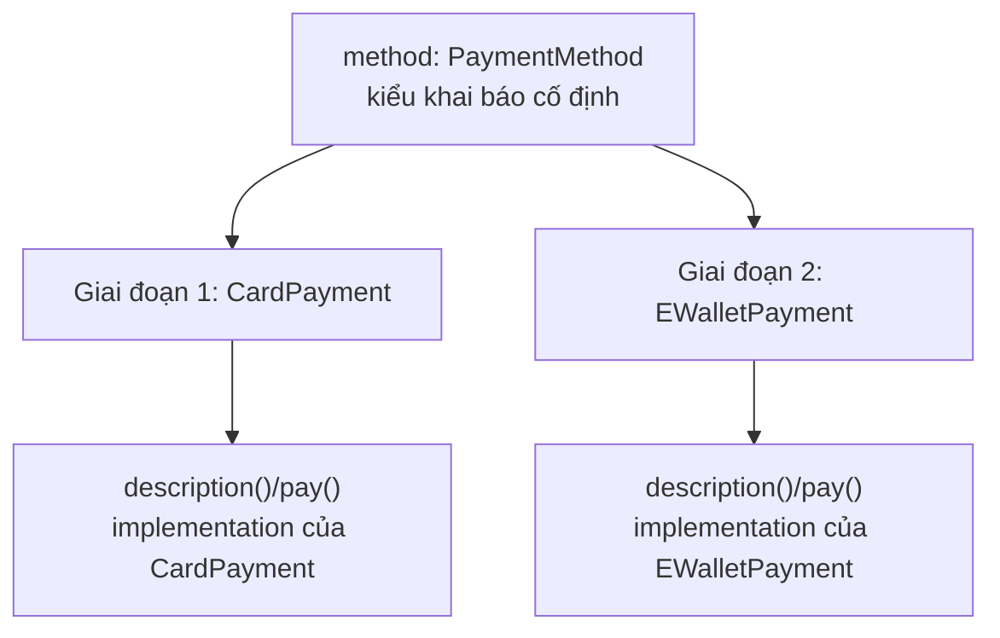

# Kiểu khai báo và kiểu thực tế của đối tượng trong Java

Trong Java, một biến kiểu tham chiếu có thể được khai báo bằng **kiểu cha** hoặc **interface**, trong khi đối tượng mà biến đang tham chiếu lại thuộc một **lớp con cụ thể**. Đây là nền tảng của tính đa hình (polymorphism) và khả năng thay thế đối tượng theo hợp đồng.

Ví dụ:

```java
Animal animal = new Dog();
```

Có hai thông tin phải tách bạch:

- **Kiểu khai báo** (*declared type*, thường là kiểu tĩnh/*static type* của biểu thức biến): `Animal`.
- **Kiểu thực tế** (*runtime type*, *dynamic type*) của đối tượng mà biến đang tham chiếu: `Dog`.

Hai kiểu có thể khác nhau nhưng không mâu thuẫn: `Dog` phải là kiểu con tương thích với `Animal` để phép gán này hợp lệ.

## 1. Hai kiểu quyết định hai điều khác nhau

| Khía cạnh | Kiểu khai báo | Kiểu thực tế |
|---|---|---|
| Xác định từ đâu? | Khai báo biến/tham số/kiểu biểu thức khi biên dịch | Lớp của đối tượng thực sự được tạo và tham chiếu lúc chạy |
| Ví dụ `Animal a = new Dog();` | `Animal` | `Dog` |
| Quyết định thao tác nào được gọi trực tiếp qua biến? | Chủ yếu theo kiểu mà trình biên dịch biết | Không tự làm xuất hiện phương thức chỉ có ở subclass trong API kiểu cha |
| Quyết định implementation của instance method đã override? | Xác định chữ ký có thể gọi | Chọn implementation ở runtime qua dynamic dispatch |
| Có thay đổi theo phép gán lại biến? | Không, kiểu khai báo cố định | Có thể thay đổi đối tượng được tham chiếu |
| Có tồn tại khi biến bằng `null`? | Có | Không có đối tượng nên không có runtime class |

Ví dụ:

```java
Animal current = new Dog();
current = new Cat(); // Hợp lệ nếu Cat extends Animal
// current vẫn có kiểu khai báo Animal.
```

Trong khi đó, **kiểu thực tế của từng đối tượng không biến đổi** từ `Dog` thành `Cat`. Phép gán chỉ làm biến `current` tham chiếu đến **một đối tượng khác**.

> Ghi nhớ: biến tham chiếu có **kiểu khai báo**; đối tượng được tham chiếu có **lớp runtime**. Một biến có thể lần lượt tham chiếu nhiều đối tượng thuộc các kiểu con tương thích.

## 2. Ví dụ chạy độc lập: một interface, nhiều kiểu thực tế

Ta cần xây dựng chức năng thanh toán, nơi mã xử lý chỉ quan tâm một hợp đồng chung: đối tượng có thể cung cấp thông tin phương thức thanh toán và xác nhận yêu cầu thanh toán.

File `DeclaredRuntimeTypeDemo.java` (Java 17+):

```java
import java.util.Objects;

public class DeclaredRuntimeTypeDemo {

    interface PaymentMethod {
        String description();
        String pay(long amountVnd);
    }

    static final class CardPayment implements PaymentMethod {
        private final String lastFourDigits;

        CardPayment(String lastFourDigits) {
            if (lastFourDigits == null
                    || !lastFourDigits.matches("[0-9]{4}")) {
                throw new IllegalArgumentException(
                    "Phải cung cấp đúng 4 chữ số cuối"
                );
            }
            this.lastFourDigits = lastFourDigits;
        }

        @Override
        public String description() {
            return "Thẻ ****" + lastFourDigits;
        }

        @Override
        public String pay(long amountVnd) {
            requirePositive(amountVnd);
            return "Thanh toán qua thẻ: " + amountVnd + " VND";
        }

        public String lastFourDigits() {
            return lastFourDigits;
        }
    }

    static final class EWalletPayment implements PaymentMethod {
        private final String walletId;

        EWalletPayment(String walletId) {
            this.walletId = Objects.requireNonNull(walletId, "walletId");
            if (walletId.isBlank()) {
                throw new IllegalArgumentException("Mã ví rỗng");
            }
        }

        @Override
        public String description() {
            return "Ví " + walletId;
        }

        @Override
        public String pay(long amountVnd) {
            requirePositive(amountVnd);
            return "Thanh toán qua ví: " + amountVnd + " VND";
        }
    }

    private static void requirePositive(long amountVnd) {
        if (amountVnd <= 0) {
            throw new IllegalArgumentException("Số tiền phải dương");
        }
    }

    static void checkout(PaymentMethod method, long amountVnd) {
        System.out.println(method.description());
        System.out.println(method.pay(amountVnd));
    }

    public static void main(String[] args) {
        PaymentMethod method = new CardPayment("1234");

        System.out.println(method.description());
        System.out.println(method.getClass().getSimpleName());
        checkout(method, 50_000L);

        method = new EWalletPayment("WALLET-7");
        System.out.println(method.description());
        System.out.println(method.getClass().getSimpleName());
        checkout(method, 30_000L);

        if (method instanceof CardPayment card) {
            System.out.println(card.lastFourDigits());
        } else {
            System.out.println("Không phải CardPayment");
        }
    }
}
```

Chạy:

```bash
javac DeclaredRuntimeTypeDemo.java
java DeclaredRuntimeTypeDemo
```

Kết quả:

```text
Thẻ ****1234
CardPayment
Thẻ ****1234
Thanh toán qua thẻ: 50000 VND
Ví WALLET-7
EWalletPayment
Ví WALLET-7
Thanh toán qua ví: 30000 VND
Không phải CardPayment
```

### Phân tích từng giai đoạn

**Ban đầu:**

```java
PaymentMethod method = new CardPayment("1234");
```

- `PaymentMethod` là **kiểu khai báo** của `method`.
- `CardPayment` là **kiểu thực tế** của đối tượng.
- Hai lời gọi `method.description()` và `method.pay(...)` được compiler chấp nhận vì hai phương thức thuộc hợp đồng `PaymentMethod`.
- Implementation được thực thi là phiên bản của `CardPayment`.

**Sau đó:**

```java
method = new EWalletPayment("WALLET-7");
```

- Kiểu khai báo của `method` **vẫn là** `PaymentMethod`.
- Đối tượng mà `method` tham chiếu giờ thuộc `EWalletPayment`.
- Những lời gọi giống hệt `method.description()` và `method.pay(...)` nay dispatch đến implementation của `EWalletPayment`.

Hàm `checkout(PaymentMethod, long)` không cần dùng `if/else` để hỏi đối tượng có phải thẻ hay ví. Đây là **đa hình qua interface**: cách sử dụng ổn định trong khi kiểu thực tế và implementation có thể khác nhau.

Lưu ý đây là mô phỏng hành vi thanh toán, không kết nối hệ thống thanh toán thật.

## 3. Quan hệ giữa kiểu khai báo, đối tượng và lời gọi phương thức



Sơ đồ thể hiện **hai thời điểm liên tiếp**, không hàm ý biến có thể đồng thời tham chiếu hai đối tượng.

Phải tách hai quyết định:

1. **Compile time:** Với biểu thức `method.pay(50000)`, chữ ký nào có thể gọi dựa vào **kiểu tĩnh** mà compiler biết?
2. **Runtime:** Nếu phương thức instance được override/implemented, thân phương thức nào sẽ chạy dựa vào **kiểu thực tế** của đối tượng?

Cách phân biệt này đặc biệt hữu ích khi làm việc với superclass, interface, dependency injection và các collection có phần tử mang kiểu cha.

## 4. Vì sao không gọi được phương thức riêng của lớp con?

```java
PaymentMethod payment = new CardPayment("5678");

// System.out.println(payment.lastFourDigits());
// LỖI BIÊN DỊCH: PaymentMethod không khai báo lastFourDigits().
```

Mặc dù **ta biết từ biểu thức `new`** rằng đối tượng được tạo là `CardPayment`, trình biên dịch kiểm tra `payment.lastFourDigits()` theo **kiểu khai báo của biến `payment`**. Interface `PaymentMethod` không có phương thức này.

Nếu phương thức thực sự chỉ dành cho `CardPayment`, có thể sử dụng biến đúng kiểu:

```java
CardPayment card = new CardPayment("5678");
System.out.println(card.lastFourDigits()); // 5678
```

Hoặc kiểm tra runtime type trước khi sử dụng tính năng riêng:

```java
PaymentMethod payment = new CardPayment("5678");

if (payment instanceof CardPayment card) {
    System.out.println(card.lastFourDigits()); // 5678
}
```

Đây là **pattern matching for instanceof** (chuẩn từ Java 16, dùng được ở Java 17). Biến pattern `card` chỉ được sử dụng trong phạm vi mà compiler biết điều kiện kiểm tra đã thành công.

**Góc độ thiết kế:** Nếu rất nhiều nơi phải kiểm tra `instanceof CardPayment` rồi mới xử lý thanh toán, hãy cân nhắc xem hành vi đó có thuộc **hợp đồng chung `PaymentMethod`** hay không. Không nên lạm dụng ép kiểu xuống để thay thế đa hình, nhưng cũng không nên đưa chi tiết riêng của thẻ vào interface nếu các phương thức thanh toán khác không có cùng ý nghĩa.

## 5. Hai phép chuyển kiểu tham chiếu nhìn từ declared/runtime type

```java
CardPayment card = new CardPayment("1234");
PaymentMethod payment = card;             // Upcast tự động
CardPayment same = (CardPayment) payment; // Downcast thành công
System.out.println(card == same);         // true
```

**Upcast** cho phép sử dụng kiểu rộng hơn theo `extends` hoặc `implements`, không đổi lớp runtime và không tạo object mới. **Downcast** yêu cầu xác nhận object thật sự thuộc kiểu con cần dùng:

```java
PaymentMethod payment = new EWalletPayment("WALLET-7");
if (payment instanceof CardPayment card) {
    System.out.println(card.lastFourDigits());
} else {
    System.out.println("Không phải CardPayment");
}
```

Nếu ép thẳng `(CardPayment) payment` khi runtime object là `EWalletPayment`, JVM ném `ClassCastException`. Ép `null` sang kiểu tham chiếu hợp lệ nhận `null` nhưng gọi method sau đó vẫn ném `NullPointerException`. Bài **Upcasting** phân tích nhiều góc nhìn cùng một đối tượng; bài **Downcasting và kiểm tra kiểu** đi sâu vào `instanceof`, pattern variable, `getClass()` và type erasure. Tại đây chỉ cần nhớ **declared type giới hạn API, runtime type quyết định override**.

## 6. Overriding dùng kiểu runtime, nhưng overloading chọn từ kiểu compile-time

Đây là điểm đặc biệt dễ nhầm khi đọc code Java: **ghi đè (override)** và **nạp chồng (overload)** đều dùng tên phương thức, nhưng quy tắc chọn khác nhau.

File `DispatchRulesDemo.java`:

```java
public class DispatchRulesDemo {

    static class Animal {
        String sound() {
            return "Unknown";
        }
    }

    static class Dog extends Animal {
        @Override
        String sound() {
            return "Woof";
        }
    }

    static void inspect(Animal animal) {
        System.out.println("Overload: Animal");
    }

    static void inspect(Dog dog) {
        System.out.println("Overload: Dog");
    }

    public static void main(String[] args) {
        Animal declaredAsAnimal = new Dog();
        Dog declaredAsDog = new Dog();

        System.out.println(declaredAsAnimal.sound());
        inspect(declaredAsAnimal);
        inspect(declaredAsDog);
        inspect((Dog) declaredAsAnimal);
    }
}
```

Kết quả:

```text
Woof
Overload: Animal
Overload: Dog
Overload: Dog
```

Giải thích:

- `declaredAsAnimal.sound()` chạy `Dog.sound()`, vì `sound()` là **phương thức instance được override** và đối tượng thực tế là `Dog`.
- `inspect(declaredAsAnimal)` gọi overload nhận `Animal`, vì lựa chọn overload dựa trên kiểu **biểu thức đối số** compiler biết là `Animal`.
- `inspect(declaredAsDog)` gọi overload nhận `Dog`.
- `inspect((Dog) declaredAsAnimal)` chọn overload nhận `Dog` vì biểu thức ép kiểu có **kiểu tĩnh `Dog`**, với phép kiểm tra ép kiểu phù hợp ở runtime.

Cần phân biệt **giai đoạn chọn chữ ký overload** với **giai đoạn chọn implementation override**. Nếu một overload tự nó là phương thức instance có override, sau khi compiler chọn chữ ký overload, Java vẫn có thể dynamic dispatch cho implementation của chữ ký đó.

### So sánh nhanh

| Trường hợp | Chủ yếu dựa vào | Ví dụ |
|---|---|---|
| Kiểm tra biến có thể gọi phương thức nào | Kiểu tĩnh của biểu thức | `Animal a` không gọi được phương thức chỉ có trong `Dog` |
| Chọn overload (`foo(Animal)` hay `foo(Dog)`) | Kiểu tĩnh của đối số và quy tắc overload | `foo(a)` với `Animal a = new Dog()` chọn overload `Animal` |
| Chọn implementation của phương thức instance được override | Kiểu runtime của receiver | `a.sound()` chạy `Dog.sound()` |
| Truy cập field | Kiểu tĩnh của biểu thức nhận | Field không dynamic dispatch |
| Chọn static method | Phân giải tĩnh theo kiểu khai báo/biểu thức | Static method không override kiểu runtime |

## 7. Trường và phương thức static không có dynamic dispatch

Một instance method override được chọn theo runtime class; với **field** cùng tên, Java chọn theo kiểu tĩnh của biểu thức, còn **static method** được phân giải theo kiểu/lớp tại biên dịch.

```java
class Base {
    String label = "Base";
    String label() { return "Base method"; }
    static String category() { return "Base static"; }
}
class Derived extends Base {
    String label = "Derived";
    @Override String label() { return "Derived method"; }
    static String category() { return "Derived static"; }
}

Base value = new Derived();
System.out.println(value.label);       // Base
System.out.println(value.label());     // Derived method
System.out.println(Base.category());   // Base static
System.out.println(Derived.category());// Derived static
```

Đây là **field hiding** và **static method hiding**, không phải ghi đè đa hình. Nên dùng tên lớp khi gọi static method và tránh field trùng tên trong cây lớp. Phần tiếp theo dùng sự khác biệt này để giải thích lỗi khi đọc các biểu thức Java có overload và override.

## 8. Null không có kiểu thực tế của đối tượng

```java
PaymentMethod method = null;

System.out.println(method instanceof CardPayment); // false

// method.description(); // Ném NullPointerException
// method.getClass();    // Ném NullPointerException
```

Biến `method` vẫn có kiểu khai báo `PaymentMethod`, nhưng hiện tại **không tham chiếu đến đối tượng** nào, nên không có lớp runtime để truy vấn.

Không nên gọi `method.getClass()` chỉ nhằm quyết định hành vi nghiệp vụ nếu polymorphism đã cung cấp hợp đồng chung. `getClass()` hữu ích khi debug hoặc cần kiểm tra đúng lớp runtime; trong một số framework, lớp runtime có thể là proxy/subclass do framework tạo ra, không nhất thiết là tên lớp domain mà bạn tưởng tượng.

### Kiểu runtime không phải “kiểu của giá trị primitive”

Các biến primitive cũng có kiểu compile-time (`int`, `double`, `boolean`), nhưng chúng không giữ tham chiếu tới đối tượng như biến `PaymentMethod`. Thảo luận `getClass()` và phân biệt kiểu khai báo/kiểu thực tế ở đây chủ yếu nói về **biến kiểu tham chiếu và đối tượng**.

## 9. Ứng dụng trong collection, API và dependency injection

### Collection chứa kiểu cha

```java
import java.util.ArrayList;
import java.util.List;

List<Animal> animals = new ArrayList<>();
animals.add(new Dog());
animals.add(new Cat());

for (Animal animal : animals) {
    System.out.println(animal.sound());
}
```

Giả sử `Cat extends Animal` và override `sound()`, vòng lặp hoạt động như sau:

- Biến lặp `animal` luôn có kiểu khai báo `Animal`.
- Mỗi phần tử có thể là đối tượng `Dog` hoặc `Cat`.
- `animal.sound()` dispatch theo lớp thực tế tương ứng.

Tuy nhiên, không thể gán `List<Dog>` cho `List<Animal>` chỉ vì `Dog extends Animal`:

```java
List<Dog> dogs = new ArrayList<>();
// List<Animal> all = dogs; // Lỗi biên dịch
```

Java generics mặc định **invariant**: nếu cho phép phép gán đó thì có thể thêm `Cat` vào một `List<Dog>`. Khi chỉ cần đọc các đối tượng con như kiểu cha, có thể dùng `List<? extends Animal>` với các giới hạn ghi tương ứng.

Đừng nhầm **kiểu runtime của phần tử** với **tham số generic** của một collection. Do *type erasure*, `getClass()` của `ArrayList<String>` không cho biết tham số kiểu `String` như metadata generic runtime của chính instance.

### API nhận interface

Một service có thể khai báo phụ thuộc:

```java
final class CheckoutService {
    private final PaymentMethod paymentMethod;

    CheckoutService(PaymentMethod paymentMethod) {
        this.paymentMethod =
            java.util.Objects.requireNonNull(paymentMethod);
    }

    String charge(long amountVnd) {
        return paymentMethod.pay(amountVnd);
    }
}
```

Trong thực tế, `CheckoutService` có thể nhận `CardPayment`, `EWalletPayment` hoặc một implementation khác đáp ứng hợp đồng. Nó **không cần** biết kiểu thực tế để thực hiện hành vi `pay(...)`. Đây là lợi ích thiết kế của việc khai báo theo **kiểu trừu tượng phù hợp**.

Điều này cũng xuất hiện khi dùng dependency injection trong Spring: field hoặc tham số constructor thường khai báo interface, còn container đưa vào một implementation cụ thể. Điểm quan trọng không phải “Spring làm đổi kiểu biến”, mà là **biến giữ nguyên kiểu interface và tham chiếu một object runtime thuộc implementation được cung cấp**.

## 10. Khi nào nên cast, khi nào nên thiết kế lại hợp đồng?

Một phép downcast hợp lệ không đồng nghĩa với thiết kế tốt. Xem ví dụ:

```java
void process(PaymentMethod method) {
    if (method instanceof CardPayment card) {
        System.out.println(card.lastFourDigits());
    } else if (method instanceof EWalletPayment) {
        System.out.println("Ví điện tử");
    }
}
```

Đoạn này hợp lý nếu chức năng **thực sự** cần dữ liệu chỉ có ở thẻ, chẳng hạn màn hình hiển thị bốn số cuối. Nhưng nếu mục đích chỉ là hiển thị **mô tả phương thức thanh toán**, tốt hơn dùng hợp đồng:

```java
void showPayment(PaymentMethod method) {
    System.out.println(method.description());
}
```

Điều kiện cân nhắc:

| Nếu cần… | Thường nên… |
|---|---|
| Thực thi một hành vi có ý nghĩa với mọi implementation | Khai báo hành vi trong interface/superclass rồi gọi đa hình |
| Sử dụng khả năng riêng của một subtype | Kiểm tra `instanceof` hoặc dùng kiểu subtype ở đúng phạm vi |
| Lặp chuỗi `instanceof` để chọn cùng một hành vi nghiệp vụ | Xem xét chuyển sang polymorphic method |
| Tạo một đối tượng từ nhiều nguồn nhưng dùng chung API | Khai báo biến/tham số bằng kiểu cha hoặc interface |
| Biết chính xác chỉ cần `CardPayment` và dùng API riêng của thẻ | Khai báo trực tiếp `CardPayment`, không upcast chỉ vì “cho OOP” |

**Nguyên tắc:** kiểu khai báo nên thể hiện **những năng lực caller cần**, không nhất thiết là lớp cụ thể đã được dùng để khởi tạo đối tượng.

## 11. Những hiểu lầm hay gặp

| Nhận định | Đúng/Sai | Giải thích |
|---|---|---|
| `Animal a = new Dog()` khiến đối tượng trở thành `Animal` | Sai | Đối tượng vẫn thuộc lớp runtime `Dog` |
| Có thể gọi mọi method của `Dog` qua biến `Animal` | Sai | Compiler chỉ cho các method hợp lệ theo kiểu tĩnh |
| `a.sound()` gọi override của `Dog` nếu `a` tham chiếu `Dog` | Đúng | Dynamic dispatch cho instance method |
| Downcast làm thay đổi lớp runtime của đối tượng | Sai | Chỉ kiểm tra và thay đổi kiểu biểu thức tham chiếu |
| Ép kiểu sai có thể ném `ClassCastException` | Đúng | Khi kiểu runtime không tương thích |
| Overload được chọn dựa hoàn toàn vào lớp runtime của đối số | Sai | Lựa chọn overload dựa vào kiểu compile-time của biểu thức |
| Field của lớp con override field lớp cha | Sai | Field có thể bị che khuất, không dispatch động |
| Static method được override như instance method | Sai | Static method hiding/lexical resolution |
| Biến bằng `null` không còn kiểu khai báo | Sai | Vẫn có kiểu khai báo; không có đối tượng runtime |
| `List<Dog>` là subtype của `List<Animal>` | Sai | Generic collections mặc định invariant |

## 12. Bài tập tự kiểm tra

### Bài 1 — Kết quả nào được in?

```java
class Shape {
    String draw() { return "Shape"; }
}

class Circle extends Shape {
    @Override
    String draw() { return "Circle"; }

    int radius() { return 5; }
}

Shape shape = new Circle();
System.out.println(shape.draw());
// System.out.println(shape.radius()); // Có biên dịch không?
```

**Đáp án:** In `Circle`, vì phương thức instance được override theo kiểu runtime. `shape.radius()` **không biên dịch**, vì `Shape` không có method `radius()`. Có thể kiểm tra `shape instanceof Circle circle` rồi gọi `circle.radius()`.

### Bài 2 — Đổi tham chiếu, đổi kiểu gì?

```java
Shape current = new Circle();
current = new Shape();
System.out.println(current.draw());
```

**Đáp án:** In `Shape`. Biến `current` luôn có kiểu khai báo `Shape`; trước phép gán nó tham chiếu `Circle`, sau phép gán nó tham chiếu một `Shape` mới.

### Bài 3 — Overload hay override?

```java
class Animal {}
class Dog extends Animal {}

static void show(Animal a) {
    System.out.println("Animal");
}

static void show(Dog d) {
    System.out.println("Dog");
}

Animal animal = new Dog();
show(animal);
```

**Đáp án:** In `Animal`. Hai phương thức `show(...)` là overload; compiler chọn theo kiểu khai báo của biểu thức `animal`, không theo đối tượng `Dog` đang nằm sau tham chiếu.

### Bài 4 — Nhận diện ép kiểu sai

```java
PaymentMethod payment = new EWalletPayment("WALLET-9");
CardPayment card = (CardPayment) payment;
```

**Đáp án:** Biên dịch được vì các quan hệ kiểu cho phép thử ép từ interface sang lớp implementation, nhưng ném `ClassCastException` khi chạy vì đối tượng thực tế là `EWalletPayment`. Cần kiểm tra kiểu trước hoặc tránh downcast nếu hợp đồng chung đã đủ.

---

**Ghi nhớ:** Trong `Parent p = new Child()`, **`Parent` là kiểu khai báo của biến, `Child` là kiểu thực tế của đối tượng**. Kiểu khai báo giới hạn những thành viên và overload mà compiler có thể chọn; kiểu thực tế quyết định implementation của phương thức instance được override khi chạy. Upcast không đổi đối tượng, downcast không tạo đối tượng mới và có thể thất bại. Thiết kế API dựa trên interface/superclass giúp tận dụng đa hình, còn `instanceof` và ép kiểu chỉ nên dùng khi thực sự cần hành vi riêng của subtype.