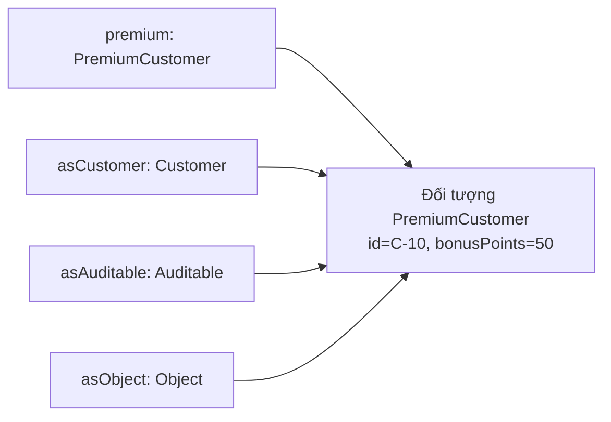
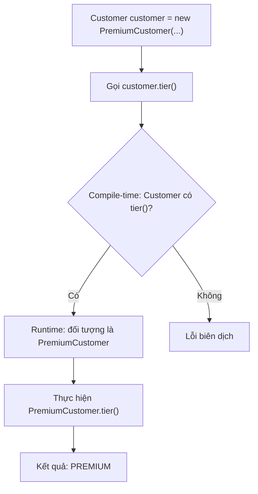

# Chuyển từ kiểu con sang kiểu cha trong Java (Upcasting)

Trong Java, **kiểu con** (*subtype*) có thể được sử dụng ở nơi chương trình yêu cầu **kiểu cha** (*supertype*), miễn là tồn tại quan hệ kế thừa hoặc triển khai interface hợp lệ. Chuyển một tham chiếu có kiểu con sang kiểu cha gọi là **upcasting**.

```java
class Animal {}
class Dog extends Animal {}

Dog dog = new Dog();
Animal animal = dog;  // Upcasting ngầm định: Dog -> Animal
```

Phép gán trên **không tạo thêm đối tượng `Animal`** và không biến `Dog` thành một đối tượng khác. Hai biến `dog` và `animal` cùng tham chiếu đến **một đối tượng `Dog`**, nhưng trình biên dịch kiểm tra các thao tác được phép thực hiện trên `animal` theo kiểu khai báo `Animal`.

Đây là cơ sở của **đa hình (polymorphism)**: cùng một đoạn mã làm việc với kiểu cha hoặc interface nhưng nhận được các cách thực hiện khác nhau từ đối tượng cụ thể.

## 1. Khi nào có thể upcast?

Trong Java, quan hệ subtype/supertype thông dụng xuất hiện qua `extends` và `implements`:

```java
class Vehicle {}

class Car extends Vehicle {}

interface Insurable {}

class Taxi extends Car implements Insurable {}
```

Một đối tượng `Taxi` có thể được nhìn qua các kiểu:

```java
Taxi taxi = new Taxi();
Car asCar = taxi;
Vehicle asVehicle = taxi;
Insurable asInsurable = taxi;
Object asObject = taxi;
```

Các phép gán trên đều hợp lệ. `Taxi` kế thừa `Car`, `Car` kế thừa `Vehicle`, mọi đối tượng lớp thông thường cuối cùng đều có `Object` trong cây kế thừa, và `Taxi` implements `Insurable`.

Cùng một đối tượng có thể mang **nhiều kiểu tham chiếu**. Upcasting thường không cần cú pháp ép kiểu tường minh:

```java
Vehicle a = taxi;           // Nên dùng: rõ ràng, ngắn gọn
Vehicle b = (Vehicle) taxi; // Hợp lệ nhưng cast này không cần thiết
```

Một phép chuyển sang kiểu cha hợp lệ không làm mất phần dữ liệu thuộc lớp con. Kiểu cha chỉ **giới hạn những thành phần nhìn thấy được khi biên dịch thông qua tham chiếu đó**.

## 2. Ví dụ thực tế: khách hàng thường và khách hàng Premium

Đặt toàn bộ mã sau trong file **`Main.java`**, biên dịch bằng Java 17 hoặc Java 21.

```java
import java.util.List;
import java.util.Objects;

interface Auditable {
    String auditLabel();
}

class Customer {
    private final String id;

    Customer(String id) {
        if (id == null || id.isBlank()) {
            throw new IllegalArgumentException("Mã khách hàng không hợp lệ");
        }
        this.id = id;
    }

    public String id() {
        return id;
    }

    public String tier() {
        return "STANDARD";
    }

    public String greeting() {
        return "Xin chào " + id;
    }
}

final class PremiumCustomer extends Customer implements Auditable {
    private int bonusPoints;

    PremiumCustomer(String id, int bonusPoints) {
        super(id);
        if (bonusPoints < 0) {
            throw new IllegalArgumentException("Điểm thưởng không được âm");
        }
        this.bonusPoints = bonusPoints;
    }

    @Override
    public String tier() {
        return "PREMIUM";
    }

    @Override
    public String greeting() {
        return "Ưu tiên cho " + id();
    }

    public void addPoints(int points) {
        if (points <= 0) {
            throw new IllegalArgumentException("Điểm cộng phải dương");
        }
        bonusPoints = Math.addExact(bonusPoints, points);
    }

    public int points() {
        return bonusPoints;
    }

    @Override
    public String auditLabel() {
        return id() + ":" + tier();
    }
}

public class Main {
    public static void main(String[] args) {
        PremiumCustomer premium = new PremiumCustomer("C-10", 40);

        // Cùng một đối tượng, nhìn qua ba kiểu tham chiếu.
        Customer asCustomer = premium;
        Auditable asAuditable = premium;
        Object asObject = premium;

        System.out.println(asCustomer.id());
        System.out.println(asCustomer.tier());
        System.out.println(asCustomer.greeting());
        System.out.println(asAuditable.auditLabel());
        System.out.println(asCustomer == premium);
        System.out.println(asObject.getClass().getSimpleName());

        premium.addPoints(10);
        System.out.println(premium.points());

        // Lặp qua các đối tượng khác loại nhưng có chung kiểu cha.
        List<Customer> customers = List.of(
                premium,
                new Customer("C-20")
        );

        for (Customer customer : customers) {
            System.out.println(customer.id() + " -> " + customer.tier());
        }
    }
}
```

Chạy:

```bash
javac Main.java
java Main
```

Kết quả:

```text
C-10
PREMIUM
Ưu tiên cho C-10
C-10:PREMIUM
true
PremiumCustomer
50
C-10 -> PREMIUM
C-20 -> STANDARD
```

### Vì sao kết quả như vậy?

**Một đối tượng, nhiều tham chiếu:**



- `asCustomer == premium` trả `true` vì hai tham chiếu cùng trỏ đến một đối tượng.
- `asObject.getClass().getSimpleName()` trả `PremiumCustomer` vì đối tượng thực tế vẫn là `PremiumCustomer`, không phải một bản sao `Customer`.
- `premium.addPoints(10)` cập nhật cùng đối tượng mà `asCustomer` đang tham chiếu.
- `asCustomer.tier()` trả `PREMIUM` vì Java thực hiện phương thức `tier()` được **override** trong lớp con.
- Vòng lặp `List<Customer>` có thể xử lý cả `Customer` và `PremiumCustomer` bằng một hợp đồng chung.

Đây là hai khía cạnh cần tách biệt:

| Khái niệm | Trong `Customer asCustomer = premium;` |
| --- | --- |
| Kiểu khai báo của tham chiếu (*compile-time type*) | `Customer` |
| Kiểu thực tế của đối tượng (*runtime class*) | `PremiumCustomer` |
| Thành phần có thể gọi khi biên dịch | Thành phần có thể truy cập qua hợp đồng `Customer` |
| Phiên bản phương thức instance đã override được chạy | Theo đối tượng thực tế: `PremiumCustomer` |
| Có tạo bản sao hoặc cắt phần dữ liệu lớp con? | **Không** |
| Tham chiếu có dùng chung trạng thái với biến ban đầu? | **Có** |

## 3. Upcasting làm giới hạn API nhìn thấy, không xóa hành vi lớp con

Trong ví dụ:

```java
PremiumCustomer premium = new PremiumCustomer("C-10", 40);
Customer customer = premium;
```

Qua `customer`, ta gọi được các phương thức mà kiểu `Customer` công bố:

```java
customer.id();
customer.tier();
customer.greeting();
```

Nhưng đoạn sau **không biên dịch**:

```java
// customer.addPoints(10); // Customer không khai báo addPoints()
// customer.points();      // Customer không khai báo points()
```

Lý do không phải đối tượng mất trường `bonusPoints`; mà là trình biên dịch không thể bảo đảm **mọi `Customer`** đều có các khả năng đặc thù của `PremiumCustomer`.

Tương tự:

```java
Auditable auditable = premium;
auditable.auditLabel(); // Hợp lệ

// auditable.tier();     // Không biên dịch: Auditable không khai báo tier()
```

Interface `Auditable` cung cấp **một góc nhìn khác** trên cùng đối tượng, chỉ công bố khả năng cần thiết cho việc audit.

Điểm thiết kế đáng giá: service xử lý danh sách khách hàng thường chỉ cần biết `Customer`; service ghi audit có thể chỉ cần `Auditable`; cả hai không cần phụ thuộc vào những phương thức riêng của lớp Premium.

## 4. Dynamic dispatch: phương thức override chạy theo đối tượng thực tế

Giả sử:

```java
Customer customer = new PremiumCustomer("C-11", 0);
String tier = customer.tier();
```

Quy trình chọn phương thức gồm hai phần:

1. **Biên dịch:** Java kiểm tra `Customer` có phương thức `tier()` hợp lệ và có thể truy cập không.
2. **Chạy chương trình:** với lời gọi phương thức instance được override, Java chọn triển khai tương ứng với đối tượng thực tế `PremiumCustomer`.



Điều này cho phép xây các hàm tổng quát:

```java
static void printTier(Customer customer) {
    System.out.println(customer.tier());
}
```

`printTier(new Customer("C-1"))` và `printTier(new PremiumCustomer("C-2", 10))` cùng biên dịch nhưng có thể in hai kết quả khác nhau. Đó là đa hình thông qua lớp cha.

**Không phải mọi thành phần trong Java đều dispatch theo runtime type.** Phương thức `static`, truy cập trường và lựa chọn **overload** có những quy tắc khác; xem phần tiếp theo.

## 5. Những điều upcasting không làm thay đổi

Lúc `Customer asCustomer = premium`, object vẫn là `PremiumCustomer` và instance method được override như `tier()` vẫn chọn implementation `PremiumCustomer.tier()`. Nhưng không phải mọi cú pháp đều được chọn theo runtime type:

| Biểu thức | Compiler/runtime lựa chọn |
| --- | --- |
| `asCustomer.tier()` | Phương thức thuộc API `Customer`; override dispatch theo object |
| `asCustomer.someField` | Field theo **kiểu tĩnh** nếu truy cập hợp lệ; không override |
| `Printer.print(asCustomer)` với overload `print(Customer)` và `print(PremiumCustomer)` | Chọn `print(Customer)` theo kiểu đối số tại biên dịch |
| `SomeType.staticMethod()` | Phương thức static không dispatch động theo object |

```java
class Parent {
    String description() { return "Parent"; }
}
class Child extends Parent {
    @Override String description() { return "Child"; }
}
Parent ref = new Child();
System.out.println(ref.description()); // Child
```

Để tận dụng đa hình, công bố hành vi chung qua phương thức trên superclass/interface; hạn chế field hiding và quá nhiều overload phụ thuộc kiểu cụ thể. Bài về **kiểu khai báo/kiểu thực tế** phân tích kỹ lựa chọn overload và field hiding.

## 6. Upcasting sang interface đặc biệt hữu ích ở ranh giới module

Giả sử một lớp xử lý thanh toán có thể triển khai nhiều khả năng:

```java
interface PaymentProcessor {
    boolean pay(long amount);
}

interface RefundProcessor {
    boolean refund(long amount);
}

final class CardGateway implements PaymentProcessor, RefundProcessor {
    @Override
    public boolean pay(long amount) {
        return amount > 0;
    }

    @Override
    public boolean refund(long amount) {
        return amount > 0;
    }
}
```

Ta có thể chuyển cùng đối tượng sang hai kiểu interface:

```java
CardGateway gateway = new CardGateway();
PaymentProcessor payments = gateway;
RefundProcessor refunds = gateway;

System.out.println(payments.pay(100));  // true
System.out.println(refunds.refund(100)); // true
```

Một service chỉ cần thu tiền có thể nhận `PaymentProcessor` thay vì phụ thuộc trực tiếp vào `CardGateway`. Điều này giúp giảm kết nối giữa các module, dễ thay adapter khi cần và tránh cấp cho client một bề mặt API rộng không cần thiết.

Tuy nhiên, **upcasting không phải cơ chế phân quyền bảo mật**. Nó giới hạn những phương thức gọi được thông qua kiểu tham chiếu tại thời điểm biên dịch, chứ không vô hiệu hóa API khác hay khả năng truy cập được cấp qua các đường khác. Hệ thống thanh toán thực vẫn cần kiểm tra quyền, transaction, idempotency và hợp đồng lỗi.

## 7. Tại sao đi ngược chiều cần kiểm tra?

```java
Customer base = new PremiumCustomer("C-30", 10);
PremiumCustomer premium = (PremiumCustomer) base; // Hợp lệ
System.out.println(premium.points());             // 10
```

Nếu thay bằng `new Customer("C-30")`, cast về `PremiumCustomer` ném `ClassCastException`: **không phải mọi Customer đều là PremiumCustomer**. Cần dùng `instanceof PremiumCustomer p` (Java 16+) trước khi gọi `p.points()` nếu không bảo đảm kiểu runtime.

Đây là ranh giới quan trọng của upcasting: sử dụng kiểu cha không đánh mất trạng thái con, nhưng API chỉ có ở con phải được truy cập qua subtype hợp lệ. Cơ chế kiểm tra, phân biệt `getClass()` và `instanceof`, các trường hợp `null` và generic erasure được thực hành sâu trong bài **Ép về kiểu con và kiểm tra kiểu**.

## 8. Upcasting và `null`

Chuyển kiểu tham chiếu không kiểm tra đối tượng có tồn tại:

```java
PremiumCustomer premium = null;
Customer customer = premium; // Hợp lệ
System.out.println(customer == null); // true
```

Không có `PremiumCustomer` nào được tạo ở đây. Phép gán `null` hợp lệ đối với kiểu tham chiếu, nhưng gọi `customer.tier()` sẽ gây `NullPointerException`.

Ngoài ra, mọi đối tượng `PremiumCustomer` là `Customer`, nhưng không phải mọi `Customer` đều là `PremiumCustomer`. Quan hệ subtype có hướng: chuyển **lên kiểu cha** thường ngầm định được; chuyển **xuống kiểu con** cần kiểm tra loại thực tế.

## 9. Upcasting trong collection và generics: một điểm dễ nhầm

Phép gán một phần tử có kiểu con sang biến kiểu cha là hợp lệ:

```java
PremiumCustomer premium = new PremiumCustomer("C-50", 5);
Customer customer = premium;
```

Nhưng `List<PremiumCustomer>` **không** là subtype của `List<Customer>`:

```java
List<PremiumCustomer> premiumList = List.of(premium);

// Không biên dịch:
// List<Customer> customers = premiumList;
```

Java generics mặc định **invariant** ở tham số kiểu. Nếu cho phép gán như trên, code có thể thêm một `Customer` thường vào list mà nơi sở hữu chỉ kỳ vọng `PremiumCustomer`.

Nếu chỉ cần đọc theo kiểu cha, dùng wildcard có upper bound:

```java
List<? extends Customer> customers = premiumList;

for (Customer c : customers) {
    System.out.println(c.tier());
}

// customers.add(new Customer("C-60")); // Không biên dịch
```

`? extends Customer` cho phép đọc phần tử theo kiểu `Customer`; không cho thêm tùy ý một `Customer` vào list đó (ngoại trừ `null` theo các quy tắc đặc biệt).

Nếu cần một list riêng thật sự có kiểu `List<Customer>`, có thể tạo mới từ các phần tử:

```java
List<Customer> separate = new java.util.ArrayList<>(premiumList);
separate.add(new Customer("C-60")); // Hợp lệ trên list riêng
```

Danh sách mới có **cấu trúc độc lập**, nhưng phần tử `premium` vẫn là cùng đối tượng được chia sẻ, không bị clone.

**Phân biệt:** `PremiumCustomer -> Customer` là chuyển kiểu tham chiếu của **một phần tử**; không có quy tắc tự động tương tự cho **tham số generic của toàn bộ collection**.

## 10. Khi nào nên sử dụng upcasting?

| Nhu cầu | Cách dùng | Lợi ích |
| --- | --- | --- |
| Hàm xử lý nhiều lớp con | Tham số `Customer` | Viết logic dùng chung và phát huy đa hình |
| Service phụ thuộc một khả năng nhỏ | Tham số `PaymentProcessor` | Giấu adapter cụ thể và tránh phụ thuộc không cần |
| Danh sách nhiều đối tượng cùng hệ phân cấp | `List<Customer>` chứa nhiều subtype | Duyệt/xử lý qua một API thống nhất |
| Đổi triển khai mà giữ client | Biến, trường, tham số theo interface | Giảm phụ thuộc vào lớp cụ thể |
| Kiểm thử với stub/fake | Truyền triển khai khác của interface | Không cần phụ thuộc implementation thật |
| Cần gọi phương thức riêng của subtype | Xem lại hợp đồng, hoặc downcast có kiểm tra | Tránh cast nguy hiểm nếu có thiết kế đa hình tốt hơn |

Không nhất thiết phải viết biến kiểu cha ở mọi nơi. Nếu đoạn mã thật sự cần toàn bộ khả năng đặc thù của `PremiumCustomer`, khai báo biến kiểu `PremiumCustomer` có thể rõ ràng hơn. **Upcasting hữu ích khi nó phản ánh đúng phạm vi trách nhiệm của code sử dụng.**

## 11. Lỗi thường gặp

| Nhận định sai | Thực tế |
| --- | --- |
| `Customer x = premium;` tạo một `Customer` mới | Không; hai tham chiếu cùng trỏ đến đối tượng `PremiumCustomer` |
| Upcasting xóa trường và phương thức của lớp con | Không; đối tượng không đổi, chỉ API được nhìn qua tham chiếu thay đổi |
| Sau upcasting mọi lời gọi đều chạy phiên bản lớp cha | Phương thức instance override vẫn dispatch theo lớp thực tế |
| `Customer` biến nào cũng ép về `PremiumCustomer` được | Sai; downcast cần đối tượng thật sự thuộc subtype đích |
| Kiểu tham chiếu quyết định kết quả `getClass()` | `getClass()` phản ánh lớp thực tế của đối tượng |
| `List<PremiumCustomer>` dùng trực tiếp như `List<Customer>` | Sai vì generic invariance; dùng wildcard khi phù hợp |
| Biến kiểu interface chặn hoàn toàn quyền sử dụng API khác | Không; giới hạn khả năng gọi qua kiểu tham chiếu, không phải security boundary |
| Có upcasting nghĩa là không cần kiểm tra hợp đồng lớp con | Subtype vẫn phải giữ ngữ nghĩa mà supertype cam kết để thay thế được |

## 12. Bài tự kiểm tra

**Câu 1.** Đoạn sau có bao nhiêu đối tượng `Dog`?

```java
Dog d = new Dog();
Animal a = d;
Object o = a;
```

**Đáp án:** Một đối tượng `Dog`; ba biến `d`, `a`, `o` cùng trỏ đến nó.

**Câu 2.** `Customer c = new PremiumCustomer("P-1", 0);` rồi `c.tier()` trả về gì?

**Đáp án:** `PREMIUM`, vì `tier()` là phương thức instance được override trong `PremiumCustomer`.

**Câu 3.** Tại sao `c.points()` không biên dịch dù đối tượng thực tế là Premium?

**Đáp án:** `Customer` không công bố `points()`. Trình biên dịch kiểm tra API của kiểu tham chiếu; nếu thật sự cần khả năng riêng, phải thiết kế lại hợp đồng hoặc kiểm tra kiểu rồi downcast.

**Câu 4.** `PremiumCustomer p = (PremiumCustomer) new Customer("C-1");` có hợp lệ không?

**Đáp án:** Mã ép kiểu có thể biên dịch vì hai lớp có quan hệ kế thừa, nhưng tại runtime sẽ ném `ClassCastException`: đối tượng thực tế chỉ là `Customer`.

**Câu 5.** `List<PremiumCustomer>` có thể gán trực tiếp sang `List<Customer>` không?

**Đáp án:** Không. Java generics invariant; nếu chỉ cần đọc theo kiểu cha, dùng `List<? extends Customer>`.

**Câu 6.** Trong mã `Base b = new Derived();`, vì sao `b.describe()` và `b.label` có thể lấy giá trị từ các lớp khác nhau?

**Đáp án:** Phương thức instance override được dispatch theo **đối tượng thực tế**, còn truy cập trường được giải quyết theo **kiểu tham chiếu**.

**Ghi nhớ:** Upcasting là **đổi góc nhìn kiểu dữ liệu của một tham chiếu**, không phải biến đổi hoặc sao chép đối tượng. Java kiểm tra những phương thức được phép gọi theo supertype; khi chạy, phương thức instance override vẫn thực hiện theo subtype thực tế. Dùng upcasting tại nơi cần hợp đồng chung để khai thác đa hình, giảm phụ thuộc vào lớp cụ thể và tránh ép kiểu xuống không cần thiết.