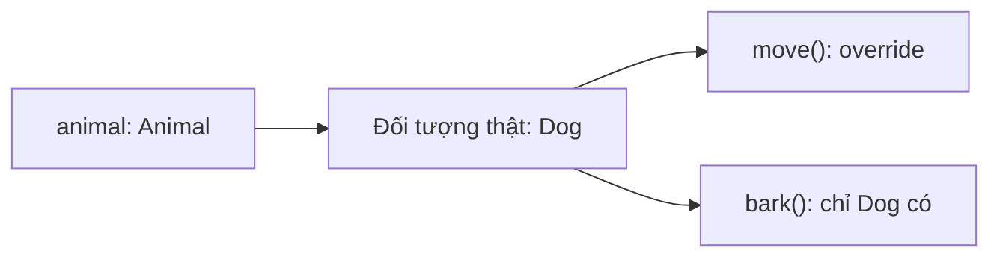
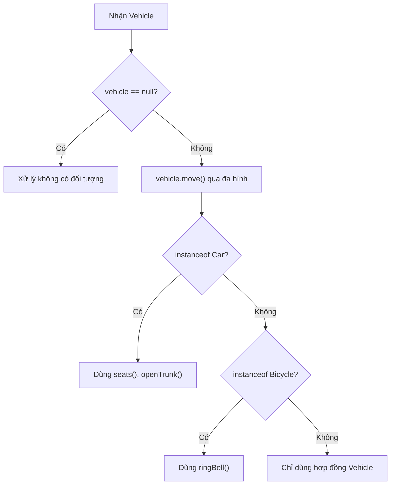

# Ép về kiểu con và kiểm tra kiểu trong Java

**Chủ đề:** OOP → Kiểu con → Ép về kiểu con và kiểm tra kiểu.

Trong OOP, một biến có thể được khai báo theo kiểu cha hoặc interface nhưng đang tham chiếu tới **đối tượng thực thuộc kiểu con**. Điều này giúp lập trình đa hình, nhưng cũng đặt ra câu hỏi: làm sao sử dụng một phương thức chỉ tồn tại ở lớp con mà không gây lỗi ép kiểu? Câu trả lời liên quan tới **upcasting**, **downcasting**, toán tử `instanceof` và `ClassCastException`.

## 1. Kiểu khai báo khác kiểu thực tế

```java
class Animal {
    void move() {
        System.out.println("Di chuyển");
    }
}

class Dog extends Animal {
    @Override
    void move() {
        System.out.println("Chạy");
    }

    void bark() {
        System.out.println("Gâu gâu");
    }
}

Animal animal = new Dog();
animal.move();          // Chạy
// animal.bark();       // Lỗi biên dịch: Animal không khai báo bark()
```

| Khái niệm | Ví dụ | Tác dụng |
|---|---|---|
| Kiểu khai báo/compile-time type | `Animal` | Quyết định các thành viên mà trình biên dịch cho phép truy cập qua biến |
| Kiểu thực tế/runtime type | `Dog` | Quyết định implementation của phương thức instance được override |
| Quan hệ kiểu con | `Dog extends Animal` | Cho phép dùng `Dog` ở nơi nhận `Animal` |

**Điểm quan trọng:** `animal.move()` gọi `Dog.move()` bằng cơ chế dispatch đa hình, dù biến được khai báo `Animal`. Không cần downcast để Java tìm đúng implementation của một phương thức đã nằm trong hợp đồng kiểu cha.



Biến tham chiếu không chứa bản sao object. `Animal animal = new Dog()` chỉ tạo **một** đối tượng `Dog`.

## 2. Upcasting: từ kiểu con sang kiểu cha

```java
Dog dog = new Dog();
Animal animal = dog;             // Upcasting ngầm định
Animal explicit = (Animal) dog;  // Hợp lệ nhưng không cần thiết
```

Mọi `Dog` đều là `Animal` trong quan hệ kế thừa, vì thế phép gán được chấp nhận không cần cast. Khi upcast:

- Object **vẫn là Dog**, không biến thành Animal.
- Những phương thức chỉ khai báo ở `Dog` không thể gọi trực tiếp qua biến `Animal`.
- Những phương thức của `Animal` được override sẽ chạy phiên bản của đối tượng thực.

Việc gán object cho interface mà lớp đó triển khai cũng là một phép chuyển lên abstraction:

```java
interface RunnableJob {
    void execute();
}

class EmailJob implements RunnableJob {
    @Override
    public void execute() {
        System.out.println("Sending email");
    }
}

RunnableJob job = new EmailJob();
job.execute(); // Sending email
```

Đây là cách thường dùng để giảm phụ thuộc vào một lớp cụ thể.

## 3. Downcasting: từ kiểu cha xuống kiểu con

```java
Animal animal = new Dog();

Dog dog = (Dog) animal; // Thành công vì runtime object là Dog
dog.bark();             // Gâu gâu
```

Downcasting cần ghi **kiểu đích trong dấu ngoặc**. Trình biên dịch cho phép thử chuyển kiểu nếu quan hệ kiểu có thể phù hợp, nhưng JVM vẫn phải kiểm tra đối tượng thực tế tại runtime.

```java
class Cat extends Animal {}

Animal animal = new Cat();
Dog dog = (Dog) animal; // ClassCastException
```

Hai lớp `Dog` và `Cat` cùng kế thừa `Animal` không có nghĩa một `Cat` có thể được coi là `Dog`.

| Tình huống | Java xử lý |
|---|---|
| `Animal a = new Dog();` | Upcast hợp lệ |
| `Dog d = (Dog) a;` khi a trỏ tới Dog | Downcast hợp lệ |
| `Dog d = (Dog) a;` khi a trỏ tới Cat | Biên dịch có thể thành công, runtime ném `ClassCastException` |
| `Dog d = (Dog) null;` | Thành công và d nhận `null` |
| `Integer i = (Integer) text;` khi `text` được khai báo `String` | Lỗi biên dịch vì các kiểu cụ thể không tương thích |

Cast **không tạo object, không sao chép object và không thay đổi runtime type**. Nó chỉ kiểm tra rằng tham chiếu hiện tại có thể được nhìn nhận theo kiểu đích.

## 4. Kiểm tra an toàn bằng `instanceof`

Với cú pháp truyền thống:

```java
static void handle(Animal animal) {
    if (animal instanceof Dog) {
        Dog dog = (Dog) animal;
        dog.bark();
    }
}
```

`instanceof` trả `true` khi tham chiếu không phải `null` và object thực tế là một instance tương thích với kiểu đích, **bao gồm cả lớp con của kiểu đó**.

Từ **Java 16**, có thể dùng pattern matching cho `instanceof`:

```java
static void handle(Animal animal) {
    if (animal instanceof Dog dog) {
        dog.bark(); // Không cần (Dog) animal nữa
    }
}
```

Pattern variable `dog` chỉ được dùng tại nơi mà trình biên dịch xác định chắc chắn phép kiểm tra đã thành công. Ví dụ flow scoping:

```java
static void check(Animal animal) {
    if (!(animal instanceof Dog dog)) {
        return;
    }
    dog.bark(); // Hợp lệ: đi đến đây nghĩa là kiểm tra đã thành công
}
```

Không thể tùy tiện dùng `dog` ở mọi câu lệnh phía sau một `if` nếu còn đường điều khiển mà điều kiện `instanceof` có thể sai.

### `instanceof` xử lý null thế nào?

```java
Animal a = null;

System.out.println(a instanceof Dog); // false
Dog d = (Dog) a;                       // Hợp lệ: d == null

// d.bark();    // NullPointerException
// a.getClass(); // NullPointerException
```

Cast `null` không gây `ClassCastException` với kiểu tham chiếu hợp lệ. Nhưng gọi phương thức qua tham chiếu `null` vẫn gây `NullPointerException`.

## 5. Ví dụ đầy đủ: phương tiện và chức năng riêng của từng kiểu con

Giả sử mọi phương tiện có thể di chuyển, còn ô tô có thể mở cốp, xe đạp có thể bấm chuông. Lưu chương trình dưới đây thành **`SubtypeCheckDemo.java`** và chạy bằng Java 17 trở lên.

```java
public class SubtypeCheckDemo {
    static abstract class Vehicle {
        private final String code;

        protected Vehicle(String code) {
            if (code == null || code.isBlank()) {
                throw new IllegalArgumentException("Mã không hợp lệ");
            }
            this.code = code;
        }

        String code() {
            return code;
        }

        abstract String move();
    }

    static class Car extends Vehicle {
        private final int seats;

        Car(String code, int seats) {
            super(code);
            if (seats <= 0) {
                throw new IllegalArgumentException("Số chỗ phải dương");
            }
            this.seats = seats;
        }

        int seats() {
            return seats;
        }

        String openTrunk() {
            return "Mở cốp " + code();
        }

        @Override
        String move() {
            return "Ô tô " + code() + " di chuyển";
        }
    }

    static final class ElectricCar extends Car {
        ElectricCar(String code, int seats) {
            super(code, seats);
        }

        @Override
        String move() {
            return "Xe điện " + code() + " di chuyển";
        }
    }

    static final class Bicycle extends Vehicle {
        Bicycle(String code) {
            super(code);
        }

        String ringBell() {
            return "Chuông " + code();
        }

        @Override
        String move() {
            return "Xe đạp " + code() + " di chuyển";
        }
    }

    static void inspect(Vehicle vehicle) {
        if (vehicle == null) {
            System.out.println("Không có phương tiện");
            return;
        }

        // Không cần cast: move() đã thuộc hợp đồng Vehicle.
        System.out.println("MOVE: " + vehicle.move());

        if (vehicle instanceof Car car) {
            System.out.println("SEATS: " + car.seats());
            System.out.println(car.openTrunk());
        } else if (vehicle instanceof Bicycle bicycle) {
            System.out.println(bicycle.ringBell());
        }
    }

    public static void main(String[] args) {
        Vehicle first = new ElectricCar("EV-01", 5);
        Vehicle second = new Bicycle("BK-02");
        Vehicle none = null;

        System.out.println(first instanceof Car);
        System.out.println(first instanceof ElectricCar);
        System.out.println(first instanceof Bicycle);
        System.out.println(none instanceof Car);
        System.out.println(first.getClass() == Car.class);

        inspect(first);
        inspect(second);
        inspect(none);

        try {
            Bicycle wrong = (Bicycle) first;
            System.out.println(wrong.ringBell());
        } catch (ClassCastException ex) {
            System.out.println("Downcast sai: ClassCastException");
        }
    }
}
```

Chạy:

```bash
javac SubtypeCheckDemo.java
java SubtypeCheckDemo
```

Kết quả:

```text
true
true
false
false
false
MOVE: Xe điện EV-01 di chuyển
SEATS: 5
Mở cốp EV-01
MOVE: Xe đạp BK-02 di chuyển
Chuông BK-02
Không có phương tiện
Downcast sai: ClassCastException
```

Giải thích:

1. `first` khai báo là `Vehicle`, nhưng đối tượng thật là `ElectricCar`.
2. `ElectricCar extends Car`, vì vậy `first instanceof Car` là `true`.
3. `first.move()` gọi phần override ở `ElectricCar` mà không cần ép kiểu.
4. `first.getClass() == Car.class` là `false` vì lớp runtime **chính xác** là `ElectricCar`.
5. Ép `first` thành `Bicycle` sai kiểu runtime, nên JVM ném `ClassCastException`.



Sơ đồ cho thấy **chỉ những hành vi đặc thù** mới cần kiểm tra kiểu. `move()` là hành vi chung và nên dùng trực tiếp qua abstraction.

## 6. `getClass()` có giống `instanceof` không?

**Không.** Hai phép kiểm tra trả lời các câu hỏi khác nhau.

| Biểu thức | Câu hỏi | Với đối tượng `ElectricCar` |
|---|---|---|
| `v instanceof Car` | Đối tượng là Car hoặc subtype của Car? | `true` |
| `v instanceof ElectricCar` | Đối tượng là ElectricCar hoặc subtype tương thích? | `true` |
| `v.getClass() == Car.class` | Runtime class chính xác là Car? | `false` |
| `v.getClass() == ElectricCar.class` | Runtime class chính xác là ElectricCar? | `true` |
| `v == null` | Không có đối tượng? | `false` |

Dùng `instanceof` khi muốn chấp nhận cả subtype; chỉ dùng kiểm tra `getClass()` khi yêu cầu thật sự cần đúng một class runtime. Khác với `instanceof`, lời gọi `getClass()` trên `null` ném `NullPointerException`.

Khi kiểu kiểm tra được giữ trong đối tượng `Class<?>`, có thể dùng:

```java
Class<?> expected = Car.class;
Object object = new ElectricCar("EV-09", 4);

System.out.println(expected.isInstance(object)); // true
```

`Class.isInstance()` hữu ích khi kiểu đích được xác định động; với kiểu viết cố định trong mã, `instanceof` dễ đọc hơn.

## 7. Kiểm tra kiểu qua interface

Downcast không chỉ giới hạn ở các lớp liên quan bằng `extends`. Một đối tượng có thể triển khai thêm interface thể hiện khả năng tùy chọn:

```java
interface Printable {
    void print();
}

interface Downloadable {
    void download();
}

final class Report implements Printable, Downloadable {
    @Override
    public void print() {
        System.out.println("In báo cáo");
    }

    @Override
    public void download() {
        System.out.println("Tải báo cáo");
    }
}

class InterfaceExample {
    static void handle(Printable printable) {
        printable.print();

        if (printable instanceof Downloadable downloadable) {
            downloadable.download();
        }
    }

    public static void main(String[] args) {
        handle(new Report());
    }
}
```

Biến `Printable` không cho phép gọi trực tiếp `download()`. Tuy nhiên, nếu object thật có hỗ trợ `Downloadable`, pattern matching sẽ đưa khả năng đó vào nhánh tương ứng.

Khi **mọi đối tượng** đi vào một phương thức đều bắt buộc có khả năng download, hãy cân nhắc thay đổi hợp đồng tham số thay vì kiểm tra kiểu ở khắp nơi. `instanceof` phù hợp nhất khi có khả năng phụ chỉ tồn tại trên một số implementation.

## 8. Lỗi biên dịch và `ClassCastException`

`ClassCastException` là `RuntimeException`: phép chuyển kiểu được phép thử tại biên dịch, nhưng object không tương thích ở thời điểm chạy.

```java
Object value = "hello";
Integer number = (Integer) value; // ClassCastException
```

Ở đây `value` khai báo là `Object`, đủ rộng để compiler cho phép thử cast tới `Integer`. Nhưng object thật là `String`.

Trong khi đó:

```java
String value = "hello";
// Integer number = (Integer) value; // Lỗi biên dịch
```

Vì `String` và `Integer` đều là những class cụ thể không có quan hệ subtype phù hợp, trình biên dịch có thể xác định phép cast không thể hợp lệ.

Đừng dùng `try/catch (ClassCastException)` để thay cho việc thiết kế điều kiện kiểu đúng. Trong mã thông thường, `instanceof` hoặc một abstraction tốt thường diễn đạt ý định rõ hơn.

## 9. Một ngoại lệ quan trọng: generics và type erasure

Java không giữ đầy đủ tham số generic để kiểm tra bằng `instanceof` lúc chạy.

```java
import java.util.List;

Object value = List.of("A", "B");

if (value instanceof List<?> elements) {
    System.out.println(elements.size()); // 2
    Object first = elements.get(0);
    System.out.println(first);            // A
}

// Không hợp lệ:
// if (value instanceof List<String> strings) { ... }
```

`List<?>` kiểm tra được **đối tượng có phải List không**. Nó không chứng minh rằng phần tử là `String`, `Integer` hay kiểu nào khác.

Phép cast như `(List<String>) value` có thể phát sinh cảnh báo **unchecked cast**; do type erasure, JVM không thể kiểm chứng toàn bộ kiểu phần tử chỉ tại vị trí cast. Lỗi có thể xuất hiện sau đó khi đọc phần tử và compiler chèn ép kiểu.

Khi xử lý dữ liệu không tin cậy, nên kiểm tra cấu trúc và nội dung phần tử, thay vì cố tắt cảnh báo ép kiểu mà không có bằng chứng.

## 10. Khi nào nên tránh downcasting?

Xem mã sau:

```java
if (animal instanceof Dog dog) {
    System.out.println(dog.sound());
} else if (animal instanceof Cat cat) {
    System.out.println(cat.sound());
}
```

Nếu tất cả `Animal` đều cần có `sound()`, hãy cho đó là một phần hợp đồng chung thay vì kiểm tra từng subtype:

```java
abstract class Animal {
    abstract String sound();
}

final class Dog extends Animal {
    @Override
    String sound() {
        return "Gâu";
    }
}

final class Cat extends Animal {
    @Override
    String sound() {
        return "Meo";
    }
}

class SoundDemo {
    static void play(Animal animal) {
        System.out.println(animal.sound());
    }

    public static void main(String[] args) {
        play(new Dog()); // Gâu
        play(new Cat()); // Meo
    }
}
```

Khi thêm một lớp con mới, `play` không cần viết thêm `else if`: dynamic dispatch chọn đúng hành vi.

| Nhu cầu | Lựa chọn thường phù hợp |
|---|---|
| Cần hành vi chung của mọi subtype | Phương thức trên superclass/interface và override |
| Chỉ một số object có khả năng đặc biệt | Interface khả năng riêng hoặc `instanceof` có kiểm tra |
| Cần truy cập API chỉ tồn tại ở một subtype | Downcast an toàn khi thực sự cần |
| Mã có hàng loạt `instanceof` cho cùng một hành động | Đánh giá lại mô hình đa hình |
| Cần runtime class chính xác, không chấp nhận subtype | `getClass()` khi có yêu cầu cụ thể |

Downcasting là **công cụ**, không phải mục tiêu. Nếu phải dùng nó liên tục để gọi một hành vi phổ biến, thiết kế abstraction có thể chưa phù hợp.

## 11. Bài tập tự luyện

1. Tạo `Animal animal = new Dog()`. Dự đoán `animal instanceof Animal`, `animal instanceof Dog`, `animal instanceof Cat` và `animal.getClass() == Animal.class`, rồi giải thích.
2. Tạo `List<Animal>` gồm `Dog` và `Cat`. Viết vòng lặp chỉ gọi `bark()` với `Dog`, sử dụng `instanceof Dog dog` để tránh `ClassCastException`.
3. Dùng `if (!(animal instanceof Dog dog)) return;`, giải thích vì sao `dog` được sử dụng sau `if` và sự khác biệt so với nhánh không có `return`.
4. Thiết kế một interface `Refundable` có `refund()`; chỉ một số loại `PaymentMethod` triển khai nó. Viết phương thức nhận `PaymentMethod` và gọi `refund()` khi khả dụng.
5. Chuyển đoạn code dùng `instanceof` để tính phí riêng từng kiểu `Order` sang đa hình bằng `calculateFee()` ở lớp cha hoặc interface.
6. Giải thích vì sao `List<?>` có thể kiểm tra bằng `instanceof` nhưng `List<String>` không thể dùng trực tiếp như vậy và nguy cơ của unchecked cast.

**Ghi nhớ:** Upcasting cho phép dùng một đối tượng kiểu con qua hợp đồng kiểu cha; downcasting chỉ hợp lệ khi **runtime object** thật sự tương thích với kiểu đích. `instanceof` kiểm tra trước khi sử dụng API riêng của subtype, còn **đa hình** nên được ưu tiên khi hành vi thuộc hợp đồng chung.