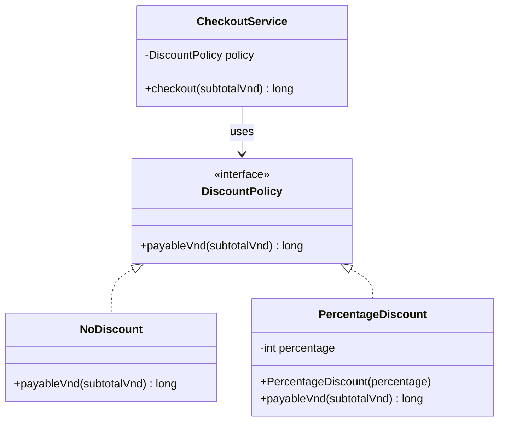
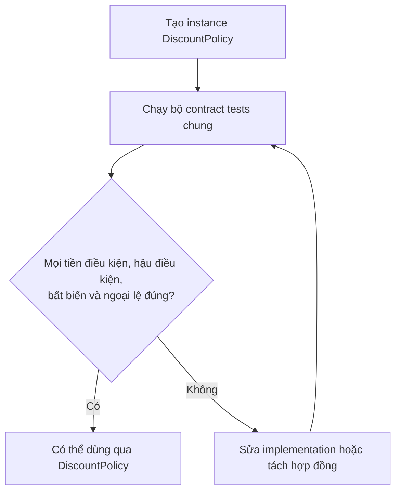

# Giữ đúng hợp đồng khi mở rộng kiểu trong Java OOP

## 1. Một kiểu con có thể thay thế kiểu cha khi nào?

Giả sử một dịch vụ thanh toán nhận một đối tượng `DiscountPolicy` để tính số tiền khách phải trả. Ban đầu ứng dụng dùng chính sách không giảm giá; sau đó thay bằng chính sách giảm 20%. Nếu dịch vụ có thể sử dụng cả hai mà **không phải sửa cách gọi, thêm những kiểm tra bất ngờ, hoặc chịu kết quả sai quy tắc**, thiết kế đang đi đúng hướng.

Trong OOP, “kiểu con” (*subtype*) không chỉ là chuyện Java cho phép khai báo `extends` hoặc `implements`. Quan trọng hơn là **đối tượng kiểu con phải giữ lời hứa về hành vi** mà mã sử dụng kiểu cha đang dựa vào.

Đây là tinh thần của **Liskov Substitution Principle (LSP)**:

> Ở những vị trí chương trình mong đợi một đối tượng thuộc kiểu T, ta có thể dùng đối tượng thuộc kiểu con của T mà vẫn giữ được tính đúng đắn của các hành vi đã được T cam kết.

Cụ thể, nếu client đã viết đúng theo hợp đồng của kiểu cha, việc thay một implementation hợp lệ bằng implementation khác không được phá các bảo đảm ấy.

### Hợp đồng (*contract*) của một kiểu gồm những gì?

Không chỉ gồm chữ ký phương thức:

| Thành phần | Câu hỏi cần trả lời |
| --- | --- |
| **Tiền điều kiện (precondition)** | Caller phải bảo đảm điều gì trước khi gọi? |
| **Hậu điều kiện (postcondition)** | Nếu phương thức hoàn tất bình thường, nó cam kết điều gì? |
| **Bất biến (invariant)** | Những điều kiện nào phải luôn đúng ở trạng thái quan sát được của đối tượng? |
| **Ngoại lệ và cách xử lý lỗi** | Đầu vào nào bị từ chối, lỗi nào có thể phát sinh? |
| **Tác động phụ (side effects)** | Lời gọi được phép thay đổi những gì? |
| **Ý nghĩa của hành vi** | “Lưu”, “rút tiền”, “tính giá” thật sự có nghĩa gì? |

Một lớp con có thể **biên dịch thành công**, nhưng vẫn vi phạm hợp đồng vì thay đổi ý nghĩa nghiệp vụ hoặc đưa ra một giới hạn mới mà người sử dụng kiểu cha không được báo trước.

## 2. Ba quy tắc quan trọng nhất

Giả sử `Child` là kiểu con của `Parent`, cả hai cung cấp hành vi `operate(x)`.

**(1) Không tăng yêu cầu đầu vào.** Kiểu con không được yêu cầu **tiền điều kiện mạnh hơn** tiền điều kiện kiểu cha. Nếu kiểu cha chấp nhận mọi số nguyên không âm, kiểu con không thể tự ý từ chối số `0` hoặc các số nhỏ hơn một ngưỡng.

**(2) Không giảm bảo đảm đầu ra.** Kiểu con không được cung cấp **hậu điều kiện yếu hơn**. Nếu kiểu cha cam kết kết quả thuộc một khoảng hợp lệ, kiểu con phải giữ kết quả trong khoảng đó. Nó có thể đưa ra bảo đảm chặt chẽ hơn, miễn vẫn thỏa hợp đồng chung.

**(3) Giữ bất biến và các cam kết quan sát được.** Nếu đối tượng hứa rằng số dư không âm hoặc phương thức không sửa dữ liệu đầu vào, kiểu con không được phá điều kiện đó. Các ngoại lệ bất ngờ, trạng thái bị thay đổi ngoài dự kiến hoặc thao tác âm thầm không thực hiện cũng có thể làm sai hợp đồng.

Tóm tắt:

| Khía cạnh | Kiểu con nên làm | Ví dụ vi phạm |
| --- | --- | --- |
| Tiền điều kiện | Giữ nguyên hoặc cho phép *nhiều* đầu vào hơn nếu phù hợp | Kiểu cha chấp nhận giá trị 0, kiểu con yêu cầu giá trị từ 500.000 trở lên |
| Hậu điều kiện | Giữ nguyên hoặc bảo đảm *mạnh* hơn | Kiểu cha trả tiền phải trả không vượt tiền gốc, kiểu con tính cao hơn tiền gốc |
| Bất biến | Giữ tất cả bất biến đã cam kết | Một phương thức khiến số dư âm khi hợp đồng cấm |
| Ngoại lệ | Không xuất hiện từ chối mới đối với các lời gọi vốn hợp lệ theo hợp đồng | Ném `UnsupportedOperationException` khi phương thức đáng lẽ phải hoạt động |
| Tác động phụ | Tuân thủ giới hạn tác động đã mô tả | Phương thức chỉ tính toán nhưng âm thầm xóa dữ liệu |

Việc “cho phép thêm đầu vào” không có nghĩa được tự ý thay đổi cách xử lý đầu vào sai. Nếu hợp đồng nêu rõ loại ngoại lệ cho trường hợp không hợp lệ, các implementation cũng phải theo điều đó.

## 3. Thiết kế một hợp đồng rõ ràng: DiscountPolicy

Xét giao diện tính số tiền phải thanh toán sau khi áp dụng giảm giá. Ta thỏa thuận trước:

- `payableVnd(subtotalVnd)` nhận **mọi `long` không âm**, bao gồm `0`.
- Đầu vào âm bị từ chối bằng `IllegalArgumentException`.
- Khi hoàn tất bình thường, kết quả **không âm và không lớn hơn `subtotalVnd`**.
- Kết quả dùng đơn vị **VND nguyên**; chính sách giảm phần trăm làm tròn phần tiền được giảm xuống đồng gần nhất.
- Lời gọi chỉ tính toán, không sửa đơn hàng, tài khoản hay trạng thái nào khác.

Hai implementation hợp lệ có thể tính ra **kết quả khác nhau**. LSP không yêu cầu tất cả kiểu con trả kết quả giống nhau; nó yêu cầu chúng cùng tuân thủ **những bảo đảm được công bố**.



`CheckoutService` chỉ biết `DiscountPolicy`. Nó không cần xác định đối tượng bên trong là `NoDiscount` hay `PercentageDiscount` trước khi gọi phương thức.

## 4. Ví dụ Java hoàn chỉnh có thể chạy

Tạo file **`DiscountDemo.java`** (JDK 11 trở lên):

```java
import java.util.Objects;

interface DiscountPolicy {
    /**
     * Contract:
     * - subtotalVnd >= 0: trả kết quả trong [0, subtotalVnd].
     * - subtotalVnd < 0: ném IllegalArgumentException.
     * - Không sửa trạng thái bên ngoài.
     */
    long payableVnd(long subtotalVnd);

    static void requireValidSubtotal(long subtotalVnd) {
        if (subtotalVnd < 0) {
            throw new IllegalArgumentException(
                    "Tổng tiền ban đầu không được âm");
        }
    }
}

final class NoDiscount implements DiscountPolicy {
    @Override
    public long payableVnd(long subtotalVnd) {
        DiscountPolicy.requireValidSubtotal(subtotalVnd);
        return subtotalVnd;
    }
}

final class PercentageDiscount implements DiscountPolicy {
    private final int percentage;

    PercentageDiscount(int percentage) {
        if (percentage < 0 || percentage > 100) {
            throw new IllegalArgumentException(
                    "Phần trăm giảm phải từ 0 đến 100");
        }
        this.percentage = percentage;
    }

    @Override
    public long payableVnd(long subtotalVnd) {
        DiscountPolicy.requireValidSubtotal(subtotalVnd);

        // Tính floor(subtotal * percentage / 100)
        // mà không nhân trực tiếp subtotal * percentage,
        // vì phép nhân đó có thể tràn long.
        long discountedVnd =
                (subtotalVnd / 100) * percentage
                + ((subtotalVnd % 100) * percentage) / 100;

        return subtotalVnd - discountedVnd;
    }
}

final class CheckoutService {
    private final DiscountPolicy policy;

    CheckoutService(DiscountPolicy policy) {
        this.policy = Objects.requireNonNull(policy, "policy");
    }

    long checkout(long subtotalVnd) {
        DiscountPolicy.requireValidSubtotal(subtotalVnd);

        long payable = policy.payableVnd(subtotalVnd);

        // Phòng vệ tại biên tích hợp nếu có implementation lỗi.
        if (payable < 0 || payable > subtotalVnd) {
            throw new IllegalStateException(
                    "DiscountPolicy đã vi phạm hợp đồng");
        }
        return payable;
    }
}

public class DiscountDemo {
    private static void verifyContract(DiscountPolicy policy) {
        long[] inputs = {0L, 105L, 1_000L, Long.MAX_VALUE};

        for (long input : inputs) {
            long actual = policy.payableVnd(input);
            if (actual < 0 || actual > input) {
                throw new AssertionError(
                        "Kết quả ngoài hợp đồng: " + actual);
            }
        }

        try {
            policy.payableVnd(-1);
            throw new AssertionError(
                    "Lẽ ra phải từ chối số tiền âm");
        } catch (IllegalArgumentException expected) {
            // Đúng loại ngoại lệ đã cam kết.
        }
    }

    public static void main(String[] args) {
        CheckoutService regular =
                new CheckoutService(new NoDiscount());
        CheckoutService promotion =
                new CheckoutService(new PercentageDiscount(20));

        System.out.println(regular.checkout(1_000));   // 1000
        System.out.println(promotion.checkout(1_000)); // 800
        System.out.println(promotion.checkout(105));   // 84

        verifyContract(new NoDiscount());
        verifyContract(new PercentageDiscount(20));
        verifyContract(new PercentageDiscount(100));

        System.out.println("Contract tests: PASS");
    }
}
```

Chạy:

```bash
javac DiscountDemo.java
java DiscountDemo
```

Đầu ra dự kiến:

```text
1000
800
84
Contract tests: PASS
```

### Vì sao đây là mở rộng kiểu đúng?

`NoDiscount` và `PercentageDiscount` đều `implements DiscountPolicy` và dùng `@Override` để hiện thực cùng hành vi công khai.

Khi `CheckoutService` nhận một `DiscountPolicy`, Java dùng **đa hình lúc chạy (dynamic dispatch)** để gọi đúng `payableVnd` của đối tượng thực tế. Dù cách tính khác nhau, cả hai giữ tiền điều kiện và hậu điều kiện chung.

Ví dụ với 105 VND và mức giảm 20%:
- Tiền giảm: làm tròn xuống `105 × 20 / 100 = 21` VND.
- Tiền phải trả: `105 - 21 = 84` VND.

Công thức trong code chia phép nhân theo thương và phần dư của 100 để tránh tràn khi `subtotalVnd` gần `Long.MAX_VALUE`. Với `percentage` từ 0 tới 100, số tiền được giảm không vượt số tiền gốc, nên phép trừ cuối cùng vẫn hợp lệ.

### Constructor có quy tắc riêng với phương thức

`new PercentageDiscount(120)` không hợp lệ vì phần trăm vượt 100. Điều này **không phải** hành vi “tăng tiền điều kiện của `payableVnd`”. Đây là hợp đồng **khởi tạo đối tượng**: một instance `PercentageDiscount` chỉ tồn tại ở trạng thái hợp lệ nếu constructor thành công.

Sau khi khởi tạo thành công, `payableVnd` vẫn phải chấp nhận **mọi subtotal không âm**, không tự ý thêm một ngưỡng mới.

## 5. Vi phạm tiền điều kiện: kiểu con tự thêm giới hạn

Xét một implementation khác:

```java
final class WrongMinimumDiscount implements DiscountPolicy {
    @Override
    public long payableVnd(long subtotalVnd) {
        DiscountPolicy.requireValidSubtotal(subtotalVnd);

        if (subtotalVnd < 500_000) {
            throw new IllegalStateException(
                    "Chỉ xử lý đơn từ 500.000 VND");
        }

        return subtotalVnd - 100_000;
    }
}
```

Đoạn này **biên dịch được**: nó hiện thực đúng chữ ký `long payableVnd(long)`. Nhưng nó vi phạm hợp đồng vì `DiscountPolicy` đã nói mọi subtotal từ `0` trở lên đều hợp lệ.

`CheckoutService` có quyền gọi `checkout(100_000)`. Với `NoDiscount` hay `PercentageDiscount`, thao tác hoạt động. Với `WrongMinimumDiscount`, thao tác lại ném `IllegalStateException`. Client phải thêm điều kiện riêng cho kiểu con, làm mất khả năng thay thế.

**Phương án đúng phụ thuộc vào nghiệp vụ:**

- Nếu đơn nhỏ không đủ điều kiện nhận khuyến mãi, có thể trả **nguyên subtotal** thay vì từ chối tính tiền.
- Nếu một loại giao dịch thật sự chỉ chấp nhận đơn từ 500.000 VND và cần từ chối đơn nhỏ, hãy mô hình hóa nó thành **hợp đồng khác**, thay vì tuyên bố nó là một `DiscountPolicy` có hợp đồng rộng hơn.

Ví dụ trả tiền gốc cho đơn không đủ ngưỡng:

```java
final class MinimumOrderPromotion implements DiscountPolicy {
    @Override
    public long payableVnd(long subtotalVnd) {
        DiscountPolicy.requireValidSubtotal(subtotalVnd);

        if (subtotalVnd < 500_000) {
            return subtotalVnd; // Hợp lệ: không giảm, không ném lỗi
        }

        return subtotalVnd - 100_000;
    }
}
```

Cả hai nhánh đều trả giá trị trong khoảng `[0, subtotalVnd]`. Loại chính sách này chấp nhận **đầy đủ miền đầu vào** mà interface đã hứa, nên phù hợp để thay thế các policy khác.

## 6. Vi phạm hậu điều kiện: trả kết quả sai cam kết

Một implementation kiểu “phụ thu” vô tình được đưa vào hệ thống giảm giá:

```java
final class WrongSurcharge implements DiscountPolicy {
    @Override
    public long payableVnd(long subtotalVnd) {
        DiscountPolicy.requireValidSubtotal(subtotalVnd);
        return Math.addExact(subtotalVnd, 1_000);
    }
}
```

Với `subtotalVnd = 10_000`, kết quả là `11_000`, lớn hơn số tiền đầu vào. Phương thức dùng đúng tên, đúng kiểu tham số, đúng kiểu trả về nhưng **không giữ hậu điều kiện** của `DiscountPolicy`.

Nếu ứng dụng cần cả phụ thu lẫn giảm giá, nên thiết kế một hợp đồng khác như `PriceAdjustment`, với miền kết quả, cách xử lý phí và tràn số được xác định rõ; không ép một hành vi khác bản chất vào hợp đồng “giảm giá”.

Trong ví dụ `CheckoutService`, việc kiểm tra giá trị trả về giúp phát hiện một phần lỗi tích hợp. Tuy nhiên, **kiểm tra phòng vệ ở caller không biến một implementation vi phạm thành kiểu con đúng**. Nếu implementation gây tác động phụ trước khi trả kết quả, một kiểm tra sau lời gọi không thể tự khôi phục mọi trạng thái đã bị sửa.

## 7. Bất biến và ngoại lệ cũng là một phần của hợp đồng

Giả sử lớp cơ sở `BankAccount` cam kết:
- Số dư không âm.
- `withdraw(amount)` chấp nhận mọi `amount > 0` không vượt số dư.
- Khi rút thành công, số dư giảm **đúng `amount`**.
- Nếu không đủ tiền, phương thức không thay đổi số dư.

Một lớp con tự động trừ thêm phí nhưng không sửa hợp đồng, hoặc từ chối các khoản rút nhỏ hơn một ngưỡng khi tài khoản vẫn đủ tiền, có thể làm hỏng logic của client.

Ví dụ một chương trình kiểm tra:

```java
long before = account.getBalanceVnd();
account.withdraw(100_000);

long after = account.getBalanceVnd();
if (after != before - 100_000) {
    throw new AssertionError("Sai hợp đồng rút tiền");
}
```

Đoạn kiểm tra hợp lệ **nếu** caller đã bảo đảm đủ tiền và kiểu cha đã cam kết rút đúng số tiền yêu cầu. Nếu lớp con trừ 101.000 đồng vì có phí, hậu điều kiện bị vi phạm.

Ngược lại, nếu hợp đồng **ngay từ đầu** quy định rút tiền có thể phát sinh phí theo một biểu phí đã công bố, kết quả và cách kiểm tra phải theo hợp đồng rộng hơn đó. Không thể kết luận vi phạm LSP chỉ vì các implementation trả dữ liệu khác nhau; phải đối chiếu với **cam kết thực sự của kiểu cha**.

### Ngoại lệ checked và unchecked

Java kiểm tra một phần tính hợp lệ của override tại thời điểm biên dịch:

- Phương thức override không được khai báo thêm **checked exception rộng hơn** phương thức bị override cho cùng đường kế thừa.
- Nhưng Java vẫn cho phép ném `RuntimeException`, ví dụ `UnsupportedOperationException`, từ một lời gọi vốn được kiểu cha cam kết sẽ thành công.

Vì thế, **đúng quy tắc biên dịch chưa đủ để đúng quy tắc hành vi**. Hợp đồng cần mô tả trường hợp nào được phép từ chối, ngoại lệ nào có ý nghĩa nghiệp vụ và những hậu quả quan sát được khi thao tác thất bại.

Đặc biệt, nếu một interface chỉ định rõ một thao tác là **tùy chọn** (optional operation), việc implementation không hỗ trợ thao tác đó có thể vẫn đúng hợp đồng. Chẳng hạn, một số thao tác ghi trong Java Collections được quy định là tùy chọn, nên một danh sách không sửa được không mặc nhiên là vi phạm LSP chỉ vì ném `UnsupportedOperationException` khi thêm phần tử. Phải đọc đúng hợp đồng của API đang xét.

## 8. Không thể “nâng cấp” quan hệ kiểu con chỉ bằng extends

Ví dụ quen thuộc trong thiết kế:

```java
class Bird {
    void fly() {
        System.out.println("Bay trên trời");
    }
}

class Penguin extends Bird {
    @Override
    void fly() {
        throw new UnsupportedOperationException(
                "Chim cánh cụt không bay được");
    }
}
```

Về phân loại sinh học, chim cánh cụt là chim. Nhưng nếu hợp đồng của `Bird.fly()` là **mọi con chim đều có thể bay**, thì `Penguin` không thể thay thế một `Bird` trong client cần gọi `fly()`. Đây là dấu hiệu **mô hình lớp đã đặt hành vi chung quá rộng**.

Một thiết kế khác:

```java
interface Bird {
    void eat();
}

interface Flyable {
    void fly();
}

final class Sparrow implements Bird, Flyable {
    @Override
    public void eat() {
        System.out.println("Ăn hạt");
    }

    @Override
    public void fly() {
        System.out.println("Chim sẻ bay");
    }
}

final class Penguin implements Bird {
    @Override
    public void eat() {
        System.out.println("Ăn cá");
    }
}
```

Giờ đây những vị trí chỉ cần “chim có thể ăn” dùng `Bird`; vị trí cần khả năng bay dùng `Flyable`. `Penguin` không hứa điều nó không làm được.

Bài học: **quan hệ “là một” trong đời thực chưa đủ để quyết định inheritance**. Một kiểu chỉ nên là kiểu con của kiểu khác nếu giữ được các hành vi mà client của kiểu cha có quyền kỳ vọng.

Không phải lúc nào cũng phải tách một interface cho mỗi phương thức; việc phân chia cần dựa trên khả năng và hợp đồng thật sự cần được chia sẻ.

## 9. Vì sao Java báo lỗi khi override một số chữ ký, nhưng không phát hiện hết vi phạm?

Java giúp kiểm tra **tính tương thích về kiểu**:

```java
class Parent {
    Number value() {
        return 1;
    }
}

class Child extends Parent {
    @Override
    Integer value() {
        return 2;
    }
}
```

Đây là một ví dụ về **covariant return type**: kiểu trả về `Integer` là kiểu con của `Number`, nên Java cho phép thay `Number` bằng `Integer` ở vị trí trả về.

Ngược lại, Java **không** cho override bằng cách tự đổi kiểu tham số:

```java
class Parent {
    void process(Number value) {}
}

class Child extends Parent {
    // Đây là overload, KHÔNG phải override:
    void process(Integer value) {}
}
```

Khi một biến khai báo kiểu `Parent` gọi `process` với `Number`, việc thêm overload `process(Integer)` ở `Child` không thay thế `process(Number)`. `@Override` sẽ giúp compiler cảnh báo nếu bạn thực sự định override nhưng chữ ký không khớp.

Java còn kiểm soát một số khía cạnh như phạm vi truy cập (không được thu hẹp access của phương thức override) và checked exceptions. Tuy nhiên, compiler **không chứng minh** được phương thức luôn trả kết quả nằm trong khoảng hợp lệ, không âm thầm xóa dữ liệu, hoặc không tăng tiền điều kiện.

Vì vậy cần cả:
1. **Kiểu và chữ ký hợp lệ** để Java cho phép thay thế.
2. **Hợp đồng hành vi được giữ đúng** để client hoạt động như mong đợi.

## 10. Kiểm thử hợp đồng chung cho mọi implementation

Một cách thực tế là viết bộ kiểm thử sử dụng **kiểu cha/interface**, rồi chạy nguyên bộ kiểm thử với **từng implementation**.

Ví dụ `verifyContract(DiscountPolicy policy)` ở phần trước kiểm tra:
- `0` là đầu vào hợp lệ.
- Số tiền nhỏ và thông thường đều xử lý được.
- Giá trị cực lớn `Long.MAX_VALUE` không phá giới hạn kết quả.
- Đầu vào âm được từ chối đúng loại ngoại lệ.
- Kết quả luôn thuộc khoảng `[0, subtotalVnd]`.

Bộ kiểm thử có thể thêm kiểm tra các quy tắc đặc thù như không gây tác động phụ hoặc không thay đổi đối tượng bên ngoài, nếu đó là một phần hợp đồng. Các thuộc tính cần quan sát ngoài kết quả trả về phải được kiểm tra bằng trạng thái hoặc dependency giả lập tương ứng.



Có thể mở rộng test bằng những trường hợp biên quan trọng khác: tỉ lệ `0%`, `100%`, subtotal không chia hết cho 100, giá trị sát `Long.MAX_VALUE`. Với JUnit, những test này có thể dùng một lớp test trừu tượng hoặc parameterized tests; cách tổ chức nào cũng nhằm **chạy cùng một bộ cam kết lên các đối tượng thay thế**.

Tuy nhiên, test chỉ kiểm tra những trường hợp đã được chọn, không chứng minh đúng với *mọi* đầu vào. Hãy kết hợp test với lập luận về thuật toán, các bất biến và kiểm tra phạm vi dữ liệu.

## 11. Khi thấy kiểu con vi phạm hợp đồng, nên sửa ở đâu?

Đừng vội thêm một chuỗi `instanceof` hoặc `if (policy instanceof ...)` ở mọi caller. Cách đó khiến client phụ thuộc vào từng kiểu cụ thể và bỏ qua lợi ích của đa hình.

Một số lựa chọn:

| Tình huống | Hướng xử lý hợp lý |
| --- | --- |
| Kiểu con bổ sung yêu cầu mới không có trong hợp đồng | Bỏ yêu cầu bổ sung ở phương thức chung, hoặc tạo hợp đồng chuyên biệt |
| Hai loại hành vi có ý nghĩa khác nhau | Thiết kế interface thể hiện đúng khả năng: `DiscountPolicy`, `SurchargePolicy`… |
| Kiểu cha hứa quá nhiều thao tác mà một số kiểu con không hỗ trợ | Thu hẹp/tách hợp đồng theo khả năng thật sự của các loại đối tượng |
| Kiểu con chỉ khác thuật toán, vẫn cùng cam kết | Giữ chung interface; dùng đa hình hoặc Strategy |
| Cần biến thể hành vi tùy trạng thái | Diễn đạt quy tắc trạng thái trong hợp đồng chung hoặc chuyển việc điều phối sang service thích hợp |
| Một kiểm tra riêng phát sinh ở nhiều caller | Xem lại hợp đồng thay vì buộc caller biết implementation nào đang chạy |

**Nguyên tắc thiết kế:** hãy mô hình hóa kiểu con theo **hành vi mà nó có thể bảo đảm**, không chỉ theo tên gọi hay vẻ giống nhau của dữ liệu.

## 12. Bài tập tự kiểm tra

**Bài 1 — dự đoán:** Với `DiscountPolicy` ở ví dụ, `PercentageDiscount(25).payableVnd(1_000)` trả gì? Trường hợp `payableVnd(0)` có được từ chối không?

*Đáp án:* trả `750`; `0` là đầu vào hợp lệ và kết quả phải là `0`.

**Bài 2 — tìm vi phạm:** Một implementation mới được viết như sau:

```java
final class WrongPolicy implements DiscountPolicy {
    @Override
    public long payableVnd(long subtotalVnd) {
        if (subtotalVnd <= 0) {
            throw new IllegalArgumentException("Phải > 0");
        }
        return subtotalVnd / 2;
    }
}
```

*Gợi ý:* kiểu cha chấp nhận `0`, còn kiểu mới từ chối `0`. Hậu điều kiện với giá trị dương có thể đúng, nhưng tiền điều kiện đã bị tăng.

**Bài 3 — sửa cho đúng:** Hãy viết `FixedPolicy` thay `WrongPolicy`, xử lý mọi `subtotalVnd >= 0`, ném `IllegalArgumentException` cho giá trị âm, và trả một kết quả trong `[0, subtotalVnd]`. Chạy `verifyContract` với implementation này.

**Bài 4 — thiết kế:** Bạn có `Account` với phương thức `withdraw` cam kết mọi khoản rút dương không vượt số dư đều thành công. Hệ thống thêm tài khoản chỉ được xem số dư, không được rút tiền. Có nên để `ReadOnlyAccount extends Account` rồi override `withdraw` để ném lỗi? Vì sao? Hãy thử tách `BalanceReadable` và `Withdrawable` để diễn đạt đúng khả năng.

**Bài 5 — thảo luận:** Nếu toàn bộ implementation của `DiscountPolicy` đều được phép trả giá trị lớn hơn subtotal để tính phụ phí, điều gì phải thay đổi? Chỉ sửa tên phương thức có đủ không, hay phải sửa hợp đồng, test và cách sử dụng của `CheckoutService`?

## Checklist khi thiết kế hoặc review kiểu con

- Kiểu cha/interface có mô tả chính xác miền đầu vào hợp lệ không?
- Kiểu con có từ chối một trường hợp mà kiểu cha đã hứa xử lý không?
- Kết quả trả về có giữ tất cả hậu điều kiện của kiểu cha không?
- Trạng thái và ngoại lệ có thể quan sát được có giữ đúng cam kết không?
- Client có cần dùng `instanceof` hoặc kiểm tra class cụ thể mới sử dụng an toàn không?
- Có thể chạy **cùng một bộ contract tests** cho mọi implementation không?
- Quan hệ kế thừa đang phản ánh **khả năng thay thế** hay chỉ là giống nhau về tên gọi/dữ liệu?

**Kết luận:** Mở rộng kiểu đúng không chỉ là kế thừa được thuộc tính hoặc biên dịch được một phương thức `@Override`. Kiểu con phải **giữ hợp đồng của kiểu cha**: không thêm đòi hỏi bất ngờ cho đầu vào hợp lệ, không giảm bảo đảm đầu ra, không phá bất biến và không tạo tác động ngoài dự kiến. Khi điều đó được bảo đảm, đa hình mới giúp ứng dụng mở rộng hành vi mà không phải viết lại mã đang phụ thuộc vào kiểu trừu tượng.