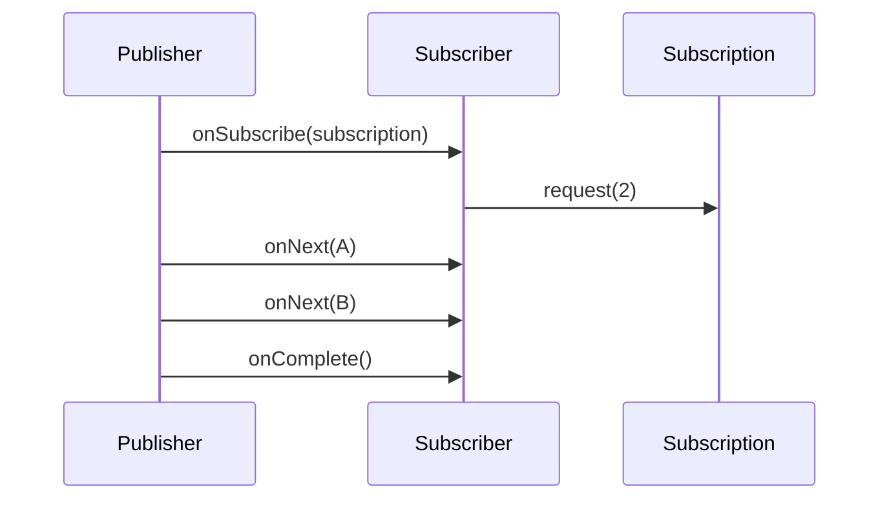

# Luồng dữ liệu, sự kiện, tín hiệu và các thuật ngữ nền tảng

Reactive Programming tổ chức chương trình quanh những luồng dữ liệu và sự kiện có thể xuất hiện theo thời gian. Thay vì luôn gọi một hàm, chờ kết quả rồi mới gọi hàm tiếp theo, ứng dụng mô tả cách dữ liệu được phát ra, biến đổi, kết hợp và tiêu thụ khi chúng sẵn sàng. Trong Java, Reactor cung cấp `Mono` và `Flux`; Reactive Streams định nghĩa hợp đồng trao đổi giữa `Publisher` và `Subscriber`, bao gồm cơ chế subscriber điều tiết lượng dữ liệu cần nhận bằng backpressure.

Để đọc và thiết kế một pipeline reactive, cần phân biệt ba khái niệm gần nhau nhưng không đồng nghĩa: **luồng dữ liệu** là chuỗi giá trị đi qua chương trình; **sự kiện** mô tả một điều đã xảy ra hoặc một thay đổi có ý nghĩa; **tín hiệu** là thông điệp giao thức mà publisher gửi đến subscriber để truyền dữ liệu hoặc thông báo trạng thái của luồng. Nắm được các khái niệm này giúp hiểu `Mono`, `Flux`, vòng đời subscription, demand, hoàn tất và lỗi trước khi sử dụng các toán tử phức tạp.

## 1. Luồng dữ liệu là gì?

Một luồng dữ liệu (data stream) là một chuỗi các phần tử được quan sát theo thứ tự phát ra. Các phần tử có thể là số đo cảm biến, bản ghi đọc từ cơ sở dữ liệu, thông điệp từ message broker, kết quả của một lời gọi HTTP, thay đổi trạng thái đơn hàng hoặc từng đoạn dữ liệu được tải xuống. Luồng có thể hữu hạn và kết thúc, hoặc liên tục trong thời gian dài.

Ví dụ, một dịch vụ nhận các sự kiện thay đổi trạng thái đơn hàng có thể quan sát chuỗi:

```text
OrderCreated -> PaymentReceived -> OrderPacked -> OrderShipped
```

Mỗi phần tử đến vào một thời điểm. Consumer có thể xử lý phần tử ngay khi nhận được, thay vì phải chờ toàn bộ chuỗi hoàn tất. Một luồng dữ liệu cũng không nhất thiết phải chứa sự kiện nghiệp vụ; nó có thể chỉ là các giá trị số, dòng văn bản, byte hoặc kết quả truy vấn.

Trong Reactive Programming, luồng thường được biểu diễn bằng một `Publisher<T>`. Publisher có khả năng phát ra không, một hoặc nhiều giá trị kiểu `T`, rồi kết thúc bình thường hoặc kết thúc bằng lỗi. Subscriber đăng ký để nhận các giá trị và tín hiệu vòng đời từ publisher. Luồng không chỉ là một collection được duyệt bằng vòng lặp: nó có thể được tạo ra theo thời gian, chịu ảnh hưởng của demand, được hủy và có thể tiếp tục phát trong khi chương trình đang thực hiện các công việc khác.

### Luồng hữu hạn và luồng liên tục

| Đặc điểm | Luồng hữu hạn | Luồng liên tục |
| --- | --- | --- |
| Số phần tử | Có điểm kết thúc xác định hoặc có thể đạt tới | Có thể tiếp tục vô thời hạn |
| Ví dụ | Danh sách kết quả tìm kiếm, đọc một file, truy vấn một trang dữ liệu | Sự kiện đơn hàng, telemetry, cập nhật giá, thông báo trực tiếp |
| Tín hiệu kết thúc | Thường phát `onComplete` sau phần tử cuối | Chỉ kết thúc khi nguồn hoàn tất, bị lỗi hoặc bị hủy |
| Cách tiêu thụ | Có thể xử lý đến hết rồi tổng hợp | Thường xử lý từng phần tử và quản lý tốc độ tiêu thụ |

Một `Flux` có thể đại diện cho cả hai loại. Việc dùng `Flux` không tự động có nghĩa là dữ liệu liên tục; `Flux.range(1, 5)` là một luồng hữu hạn, trong khi nguồn sự kiện từ broker có thể hoạt động trong thời gian dài.

## 2. Phân biệt dữ liệu, sự kiện và tín hiệu

Ba khái niệm này thường xuất hiện cùng nhau trong một pipeline, nhưng trả lời những câu hỏi khác nhau.

- **Dữ liệu (data):** giá trị được truyền và xử lý, ví dụ `Order`, `42`, một dòng log hoặc một đoạn byte.
- **Sự kiện (event):** một điều đã xảy ra có ý nghĩa đối với miền nghiệp vụ hoặc hệ thống, ví dụ `OrderCreated`, `PaymentFailed` hay `TemperatureExceeded`.
- **Tín hiệu (signal):** thông điệp thuộc giao thức reactive, cho biết có giá trị mới, luồng đã hoàn tất, luồng gặp lỗi hoặc subscriber đã được đăng ký.

Ví dụ, `OrderCreated` là dữ liệu được biểu diễn bằng một đối tượng sự kiện. Khi publisher phát đối tượng đó, subscriber nhận một tín hiệu `onNext(orderCreated)`. Khi không còn đơn hàng nào cần phát, publisher có thể gửi `onComplete`. `onComplete` là tín hiệu vòng đời, không phải một sự kiện nghiệp vụ như `OrderShipped`.

Trong kiến trúc hướng sự kiện, một sự kiện thường biểu đạt sự thay đổi đã xảy ra và có thể được nhiều thành phần quan tâm. Reactive Streams cung cấp cách vận chuyển các phần tử và điều phối việc tiêu thụ chúng. Hai cách tiếp cận có thể kết hợp: một `Flux<DomainEvent>` có thể mang sự kiện nghiệp vụ, còn Reactive Streams quy định cách các sự kiện đó được gửi đến subscriber.

Không nên gọi mọi phần tử của `Flux` là sự kiện. Một `Flux<Integer>` dùng để tính toán có thể chỉ là luồng giá trị. Ngược lại, một sự kiện nghiệp vụ có thể được lưu trong cơ sở dữ liệu hoặc truyền qua một message broker mà không sử dụng Reactor.

## 3. Tín hiệu trong Reactive Streams

Reactive Streams định nghĩa một giao thức nhỏ để publisher và subscriber phối hợp. Sau khi subscriber đăng ký, publisher gửi `onSubscribe` để cung cấp một `Subscription`. Subscriber dùng subscription để yêu cầu phần tử hoặc hủy việc nhận dữ liệu. Sau đó publisher có thể phát các tín hiệu dữ liệu `onNext`, hoặc một tín hiệu kết thúc `onError` hay `onComplete`.

### Các tín hiệu và thao tác chính

| Tên | Hướng trao đổi | Ý nghĩa |
| --- | --- | --- |
| `onSubscribe(subscription)` | Publisher -> Subscriber | Thông báo đăng ký thành công và trao subscription để điều khiển demand/cancellation |
| `request(n)` | Subscriber -> Subscription | Yêu cầu publisher phát tối đa thêm `n` phần tử theo demand |
| `onNext(value)` | Publisher -> Subscriber | Phát một phần tử dữ liệu |
| `onError(error)` | Publisher -> Subscriber | Kết thúc luồng do lỗi và chuyển nguyên nhân lỗi |
| `onComplete()` | Publisher -> Subscriber | Kết thúc luồng bình thường |
| `cancel()` | Subscriber -> Subscription | Hủy subscription, yêu cầu publisher ngừng phát dữ liệu cho subscriber đó |

`request` và `cancel` là các phương thức subscriber gọi trên `Subscription`, không phải callback mà publisher gọi trên subscriber. Sự phân biệt này quan trọng khi đọc log hoặc triển khai một subscriber tùy chỉnh.

Một vòng đời đơn giản có thể hình dung như sau:



Nếu publisher gặp lỗi, `onError(error)` được gửi thay cho `onComplete()`. Nếu subscriber gọi `cancel()` trước khi luồng kết thúc, publisher được yêu cầu dừng phát thêm phần tử cho subscription đó. Việc dừng một tác vụ bên ngoài có thể phụ thuộc vào khả năng hủy của nguồn dữ liệu.

### Quy tắc vòng đời cần nhớ

1. `onSubscribe` là tín hiệu đầu tiên mà subscriber nhận được cho một subscription.
2. Publisher chỉ phát `onNext` trong phạm vi demand mà subscriber đã yêu cầu.
3. Một subscription kết thúc bằng `onComplete` hoặc `onError`; hai tín hiệu kết thúc này loại trừ lẫn nhau.
4. Sau tín hiệu kết thúc, publisher không tiếp tục gửi `onNext` cho subscription đó.
5. `request(n)` phải dùng `n` dương. Yêu cầu không hợp lệ, chẳng hạn `request(0)` hoặc số âm, dẫn đến lỗi theo hợp đồng Reactive Streams.
6. Các tín hiệu của một subscription phải được phát tuần tự, không gọi chồng lấn đồng thời lên cùng một subscriber.

`cancel()` không phải tín hiệu kết thúc được gửi ngược lại cho subscriber. Đó là yêu cầu hủy từ phía subscriber. Sau khi hủy, subscriber không còn muốn nhận dữ liệu; tuy nhiên, tùy nguồn và thời điểm, một thao tác I/O đã được gửi đi có thể không thu hồi được.

## 4. Publisher, Subscriber và Subscription

Ba thành phần này tạo thành nền tảng của Reactive Streams.

### Publisher

`Publisher<T>` là nguồn có thể phát các phần tử kiểu `T` cho subscriber. Publisher có thể được tạo từ giá trị có sẵn, một phép tính, callback, message broker hoặc một nguồn I/O. Publisher không nhất thiết phải tạo dữ liệu ngay khi được khởi tạo; nhiều nguồn chỉ bắt đầu công việc khi có subscriber đăng ký.

Trong Reactor, `Flux<T>` và `Mono<T>` triển khai vai trò publisher. Một publisher có thể có nhiều subscriber, nhưng việc mỗi subscriber nhận cùng dữ liệu hay nhận một luồng độc lập phụ thuộc vào đặc tính nguồn và cách chia sẻ subscription.

### Subscriber

`Subscriber<T>` là bên nhận tín hiệu. Nó quyết định lượng dữ liệu muốn nhận thông qua demand và có thể hủy khi không còn cần kết quả. Trong ứng dụng, subscriber thường là framework web, một service tiếp tục xử lý pipeline, hoặc một đoạn mã đăng ký consumer.

Subscriber cần xử lý cả ba kết quả có thể xảy ra: nhận giá trị, hoàn tất bình thường và lỗi. Nếu chỉ cung cấp callback cho giá trị mà không có chính sách xử lý lỗi phù hợp, lỗi có thể bị ghi log hoặc xử lý theo mặc định của thư viện thay vì theo nghiệp vụ mong muốn.

### Subscription

`Subscription` là liên kết được publisher cấp cho subscriber sau khi đăng ký. Nó cung cấp hai thao tác chính: `request(n)` để điều tiết lượng phần tử và `cancel()` để dừng nhận dữ liệu. Demand được tính tích lũy; một yêu cầu mới bổ sung vào lượng phần tử subscriber còn có thể nhận.

Ví dụ dưới đây dùng `BaseSubscriber` của Reactor để yêu cầu hai phần tử ban đầu, sau đó yêu cầu thêm một phần tử sau mỗi lần xử lý:

```java
Flux.range(1, 5)
    .subscribe(new BaseSubscriber<Integer>() {
        @Override
        protected void hookOnSubscribe(Subscription subscription) {
            request(2);
        }

        @Override
        protected void hookOnNext(Integer value) {
            System.out.println("Đã xử lý: " + value);
            request(1);
        }
    });
```

Subscriber sẽ nhận lần lượt các giá trị `1` đến `5`. Ví dụ minh họa việc điều khiển demand; trong mã thực tế cần xác định xử lý gì xảy ra nếu thao tác trong `hookOnNext` thất bại và khi nào subscriber nên hủy. Các overload `subscribe` đơn giản của Reactor thường yêu cầu demand không giới hạn, vì vậy chúng tiện dụng nhưng không minh họa rõ cơ chế điều tiết từng phần tử.

## 5. Demand và backpressure

Demand là số lượng phần tử subscriber cho biết mình sẵn sàng nhận. Backpressure là cơ chế truyền nhu cầu đó ngược từ consumer về phía publisher để tốc độ phát dữ liệu không vượt quá khả năng tiêu thụ mà subscriber đã công bố.

Giả sử một nguồn tạo 10.000 sự kiện mỗi giây nhưng consumer chỉ xử lý được 2.000 sự kiện mỗi giây. Nếu dữ liệu cứ được đẩy vào một hàng đợi không giới hạn, bộ nhớ có thể tăng cho đến khi ứng dụng gặp sự cố. Với một nguồn hỗ trợ backpressure, subscriber có thể yêu cầu dữ liệu theo từng lô hoặc từng phần tử, giúp điều tiết lượng dữ liệu đang được chuyển giao.

Backpressure không có nghĩa là publisher luôn có thể làm chậm nguồn gốc. Một thiết bị cảm biến, callback từ thư viện hoặc nguồn sự kiện bên ngoài có thể không hỗ trợ demand. Khi chuyển nguồn như vậy thành `Flux`, adapter cần chọn chính sách khi consumer chậm, chẳng hạn buffer có giới hạn, bỏ phần tử, giữ giá trị mới nhất hoặc làm chậm nguồn nếu giao thức cho phép. Mỗi lựa chọn có hệ quả khác nhau đối với dữ liệu và nghiệp vụ.

Ví dụ, với số liệu nhiệt độ, giữ giá trị mới nhất có thể đủ cho màn hình giám sát. Với sự kiện thanh toán, bỏ một phần tử có thể làm sai lệch trạng thái giao dịch. Vì vậy, backpressure cần đi cùng chính sách quá tải, giới hạn bộ nhớ và khả năng quan sát hàng đợi.

## 6. Mono và Flux trong Reactor

Reactor cung cấp hai kiểu publisher phổ biến để thể hiện số lượng phần tử dự kiến:

| Kiểu | Số phần tử | Trường hợp sử dụng |
| --- | --- | --- |
| `Mono<T>` | Không hoặc một phần tử | Tìm một người dùng, lấy cấu hình, lưu một đơn hàng và trả về kết quả |
| `Flux<T>` | Không, một hoặc nhiều phần tử | Danh sách bản ghi, chuỗi sự kiện, dữ liệu đọc theo từng phần hoặc luồng thông báo |

Điểm quan trọng là `Mono` và `Flux` đều có thể hoàn tất hoặc lỗi. Không có giá trị không đồng nghĩa với lỗi:

```java
Mono<String> found = Mono.just("reactive");
Mono<String> missing = Mono.empty();
Mono<String> failed = Mono.error(new IllegalStateException("Nguồn dữ liệu lỗi"));

Flux<Integer> values = Flux.range(1, 3);
Flux<Integer> noValues = Flux.empty();
```

`found` phát một `onNext` rồi `onComplete`. `missing` không phát `onNext` nhưng vẫn `onComplete`. `failed` phát `onError` và không hoàn tất bình thường. `values` phát ba phần tử rồi hoàn tất; `noValues` hoàn tất mà không phát phần tử nào.

Vì vậy, không nên dùng một giá trị `null` để biểu diễn sự vắng mặt trong Reactive Streams. Hợp đồng không cho phép publisher phát `null` qua `onNext`; hãy dùng `Mono.empty()`, một kiểu bao giá trị phù hợp hoặc một sự kiện miền nghiệp vụ thể hiện trạng thái không tìm thấy.

## 7. Luồng cold và hot

Cold và hot mô tả cách nguồn chia sẻ dữ liệu giữa nhiều subscriber. Đây là các khái niệm thường dùng trong thư viện reactive, không phải hai loại tín hiệu riêng của giao thức Reactive Streams.

### Cold publisher

Một cold publisher thường bắt đầu tạo dữ liệu riêng cho từng subscriber. Mỗi lần đăng ký có thể kích hoạt lại nguồn và nhận lại chuỗi giá trị từ đầu. Ví dụ:

```java
Flux<Integer> numbers = Flux.range(1, 3);

numbers.subscribe(value -> System.out.println("A: " + value));
numbers.subscribe(value -> System.out.println("B: " + value));
```

Cả subscriber A và B đều nhận `1`, `2`, `3`. Điều này phù hợp với nguồn có thể tạo lại kết quả, chẳng hạn một phép biến đổi từ dữ liệu có sẵn hoặc một lời gọi được thực hiện cho mỗi subscriber. Với nguồn I/O, đăng ký lại có thể đồng nghĩa với việc thực hiện lại lời gọi bên ngoài.

### Hot publisher

Một hot publisher có thể phát dữ liệu độc lập với thời điểm subscriber đăng ký. Các subscriber đang hoạt động cùng quan sát luồng sự kiện đang diễn ra; subscriber đến muộn có thể bỏ lỡ các phần tử đã phát, trừ khi nguồn có cơ chế replay hoặc lưu giữ.

Ví dụ dùng `Sinks.Many` để phát sự kiện đến những subscriber hiện tại:

```java
Sinks.Many<String> sink = Sinks.many()
    .multicast()
    .onBackpressureBuffer();

Flux<String> events = sink.asFlux();
Disposable subscription = events.subscribe(System.out::println);

sink.tryEmitNext("OrderCreated");
sink.tryEmitNext("PaymentReceived");

subscription.dispose();
```

Trong ví dụ, sink là nguồn chia sẻ và `events` là publisher mà subscriber đăng ký. Cấu hình multicast, replay và buffer quyết định subscriber nào nhận được phần tử nào và hành vi khi consumer chậm. Mã thực tế nên kiểm tra kết quả `tryEmitNext`, xử lý trường hợp phát thất bại và quản lý vòng đời subscription.

Cold thường phù hợp với phép tính hoặc nguồn có thể tạo lại cho từng người đăng ký. Hot thường phù hợp với sự kiện trực tiếp được chia sẻ giữa nhiều thành phần. Cần chọn theo yêu cầu về phát lại dữ liệu, số subscriber và ý nghĩa của việc bỏ lỡ sự kiện.

## 8. Đồng bộ, bất đồng bộ và thời điểm phát tín hiệu

Reactive thường được dùng cho xử lý bất đồng bộ, nhưng hai khái niệm không đồng nghĩa. **Bất đồng bộ** mô tả việc caller không phải chờ một thao tác hoàn tất theo kiểu gọi hàm đồng bộ. **Reactive** còn mô tả luồng tín hiệu, cách kết hợp publisher, vòng đời subscription và cơ chế demand/backpressure.

Một publisher có thể phát tín hiệu đồng bộ ngay trên thread gọi `subscribe`, hoặc phát tín hiệu bất đồng bộ khi dữ liệu từ mạng hay timer sẵn sàng. Chỉ nhìn thấy `Mono` hoặc `Flux` trong chữ ký hàm không đủ để kết luận mã sẽ chạy trên thread khác. Trong Reactor, nhiều toán tử tiếp tục chạy trên thread đang phát tín hiệu cho đến khi pipeline có ranh giới scheduler phù hợp.

Ví dụ, `publishOn` và `subscribeOn` điều khiển nơi thực thi các phần của pipeline:

```java
Flux.range(1, 3)
    .map(this::cpuTransform)
    .publishOn(Schedulers.parallel())
    .map(this::formatResult)
    .subscribe(this::sendResult);
```

Ví dụ minh họa một ranh giới chuyển scheduler cho các bước phía sau `publishOn`. `subscribeOn` thường được dùng để điều khiển nơi subscription bắt đầu và quá trình upstream được khởi động. Scheduler quyết định nơi công việc chạy; nó không thay đổi ý nghĩa của `onNext`, `onError` hay `onComplete`.

Khi kết hợp nhiều nguồn bất đồng bộ, thứ tự phát có thể phụ thuộc vào thời điểm mỗi nguồn hoàn tất. Chẳng hạn `flatMap` có thể xử lý nhiều publisher con đồng thời, vì vậy phần tử từ các luồng con có thể xen kẽ theo thời điểm phát. Nếu nghiệp vụ yêu cầu giữ thứ tự nguồn, cần chọn toán tử như `concatMap` hoặc một cách phối hợp phù hợp. Không nên suy ra thứ tự nghiệp vụ chỉ từ thứ tự đăng ký các tác vụ.

## 9. Upstream, downstream và toán tử

Khi đọc pipeline, **upstream** chỉ phía nguồn phát dữ liệu, còn **downstream** chỉ phía nhận và xử lý tiếp. Các toán tử được nối thành chuỗi, mỗi toán tử nhận publisher ở phía upstream và trả về publisher mới cho downstream.

```java
Flux<Integer> result = Flux.range(1, 5)   // nguồn: upstream
    .filter(number -> number % 2 == 1)   // giữ số lẻ
    .map(number -> number * 10)          // biến đổi phần tử
    .take(2);                            // giới hạn số phần tử
```

Kết quả phát ra `10` và `30`, sau đó hoàn tất. Subscriber ở cuối chuỗi là downstream của các toán tử; `Flux.range` là nguồn upstream. Khi cần điều tra lỗi hoặc demand, cách gọi phía upstream/downstream giúp mô tả rõ tín hiệu đang đi theo hướng nào.

Một số toán tử cơ bản:

| Toán tử | Tác dụng |
| --- | --- |
| `map` | Biến đổi từng giá trị đồng bộ thành giá trị khác |
| `filter` | Chỉ cho các giá trị thỏa điều kiện đi tiếp |
| `flatMap` | Biến mỗi giá trị thành publisher con và hợp nhất kết quả, có thể chạy đồng thời |
| `concatMap` | Xử lý publisher con tuần tự và giữ thứ tự theo nguồn |
| `zip` | Kết hợp giá trị từ nhiều publisher khi có đủ dữ liệu tương ứng |
| `take(n)` | Chỉ lấy tối đa `n` phần tử rồi kết thúc phần tiêu thụ |
| `doOnNext` | Quan sát tín hiệu giá trị để logging hoặc đo lường; không dùng để thay thế biến đổi dữ liệu |

Toán tử tạo pipeline mới; nó không nhất thiết thực thi công việc ngay khi được gọi. Trong mô hình lazy phổ biến của Reactor, subscription kích hoạt việc phát dữ liệu. Vì vậy, việc tạo biến `Flux` hoặc `Mono` chưa đồng nghĩa với việc nguồn đã được đọc hay request đã được gửi đi.

## 10. Lỗi và hoàn tất là một phần của luồng

Một pipeline reactive có ba loại kết quả cơ bản: phát ra không hoặc nhiều giá trị rồi hoàn tất, phát ra lỗi, hoặc tiếp tục chưa có tín hiệu kết thúc. Lỗi là một tín hiệu terminal; sau `onError`, subscription đó không tiếp tục phát thêm giá trị. Muốn chuyển lỗi thành một kết quả khác hoặc publisher dự phòng, phải mô tả chính sách đó bằng toán tử.

```java
Flux<Integer> values = Flux.just(10, 5, 0)
    .map(number -> 100 / number)
    .onErrorResume(ArithmeticException.class, error -> Flux.just(-1));
```

Trong ví dụ, phép chia cho `0` phát sinh lỗi. `onErrorResume` thay phần còn lại của pipeline bằng publisher dự phòng phát `-1`, do đó subscriber nhận `10`, `20`, `-1` rồi hoàn tất. Cần phân biệt hoàn tất bình thường với lỗi đã được phục hồi: subscriber downstream thấy kết quả thay thế và `onComplete`, trong khi lỗi gốc đã được xử lý ở toán tử.

Các toán tử quan sát như `doOnError`, `doOnComplete` và `doFinally` giúp ghi nhận vòng đời. `doFinally` có thể quan sát kết thúc do hoàn tất, lỗi hoặc hủy. Logging các tín hiệu này giúp xác định pipeline kết thúc vì lý do nào, đặc biệt khi request của người dùng bị hủy trước khi nguồn hoàn tất.

## 11. Bảng thuật ngữ nền tảng

| Thuật ngữ | Cách hiểu trong Reactive Programming |
| --- | --- |
| Data stream | Chuỗi phần tử được phát theo thời gian |
| Event | Sự kiện hoặc thay đổi có ý nghĩa đối với miền nghiệp vụ/hệ thống |
| Signal | Tín hiệu giao thức truyền dữ liệu hoặc trạng thái vòng đời |
| Publisher | Nguồn phát các phần tử đến subscriber |
| Subscriber | Bên đăng ký và nhận tín hiệu từ publisher |
| Subscription | Liên kết cho phép yêu cầu demand và hủy đăng ký |
| Demand | Số phần tử subscriber sẵn sàng nhận |
| Backpressure | Cơ chế điều tiết phát dữ liệu theo nhu cầu tiêu thụ |
| Terminal signal | `onComplete` hoặc `onError`, kết thúc luồng |
| Cancellation | Yêu cầu dừng nhận dữ liệu qua `cancel()` |
| Cold publisher | Nguồn thường tạo luồng riêng cho mỗi subscriber |
| Hot publisher | Nguồn chia sẻ luồng đang diễn ra giữa các subscriber |
| Operator | Phép biến đổi, lọc hoặc kết hợp publisher |
| Upstream | Phía nguồn của một vị trí trong pipeline |
| Downstream | Phía tiêu thụ tiếp theo của một vị trí trong pipeline |
| Scheduler | Cơ chế xác định nơi thực thi một phần pipeline |
| Context | Dữ liệu ngữ cảnh gắn với quá trình xử lý reactive, ví dụ thông tin tracing |

## 12. Những nhầm lẫn thường gặp

- **Cho rằng `Flux` luôn là luồng vô hạn:** `Flux.range(1, 10)` là luồng hữu hạn. Số phần tử và thời gian tồn tại phụ thuộc nguồn.
- **Coi `onNext` là một sự kiện nghiệp vụ:** `onNext` là tín hiệu giao thức mang giá trị; giá trị đó có thể là sự kiện nghiệp vụ, bản ghi hoặc dữ liệu thông thường.
- **Coi `onComplete` là phần tử cuối:** đây là tín hiệu terminal riêng, không phải một giá trị được phát qua `onNext`.
- **Cho rằng `Mono.empty()` là lỗi:** publisher này hoàn tất bình thường mà không phát giá trị.
- **Cho rằng `Mono`/`Flux` luôn chạy bất đồng bộ trên thread khác:** nguồn có thể phát đồng bộ; scheduler và ranh giới chuyển thread phải được cấu hình hoặc được framework cung cấp.
- **Cho rằng backpressure tự giải quyết mọi quá tải:** nguồn không hỗ trợ demand vẫn cần buffer, drop, sampling hoặc chính sách giới hạn khác.
- **Cho rằng subscriber nào cũng nhận toàn bộ sự kiện của hot publisher:** subscriber đến muộn có thể bỏ lỡ dữ liệu đã phát nếu nguồn không replay.
- **Cho rằng gọi toán tử là pipeline đã chạy:** trong Reactor, pipeline thường được kích hoạt khi có subscription.
- **Cho rằng hủy subscription chắc chắn thu hồi được mọi tác vụ:** cancellation chỉ có thể dừng công việc mà nguồn hoặc adapter hỗ trợ hủy.

## 13. Tự kiểm tra cách hiểu

Hãy xem xét một pipeline `Flux<OrderEvent>` nhận các thay đổi trạng thái đơn hàng. Một subscriber hiển thị trạng thái mới nhất trên màn hình, một subscriber khác ghi lịch sử vào kho lưu trữ. Khi phân tích thiết kế này, cần trả lời được:

1. `OrderEvent` là giá trị dữ liệu hay tín hiệu Reactive Streams? Nó có thể là giá trị dữ liệu được truyền trong tín hiệu `onNext`.
2. Điều gì xảy ra khi publisher phát xong tất cả sự kiện? Nó gửi `onComplete`; đây không phải một `OrderEvent`.
3. Subscriber muốn xử lý chậm hơn nguồn thì điều tiết thế nào? Nó phát demand qua `request(n)`; nếu nguồn không hỗ trợ backpressure thì adapter cần chính sách buffer hoặc quá tải.
4. Subscriber màn hình đóng kết nối thì điều gì nên xảy ra? Framework có thể hủy subscription tương ứng; publisher và nguồn nên giải phóng công việc không còn cần thiết khi có thể.
5. Subscriber lưu lịch sử bị lỗi thì subscriber màn hình có nhất thiết phải lỗi theo không? Điều đó phụ thuộc hai subscriber dùng chung một pipeline hay được tách và điều phối riêng; lỗi và chính sách chia sẻ cần được thiết kế rõ ràng.

Khi đã phân biệt được luồng dữ liệu, sự kiện và tín hiệu; hiểu vòng đời `Publisher`–`Subscriber`–`Subscription`; và nắm demand cùng backpressure, người học có nền tảng để đọc các pipeline `Mono`/`Flux`. Các toán tử, scheduler, xử lý lỗi và kiểm thử ở những phần tiếp theo đều dựa trên các khái niệm này.
