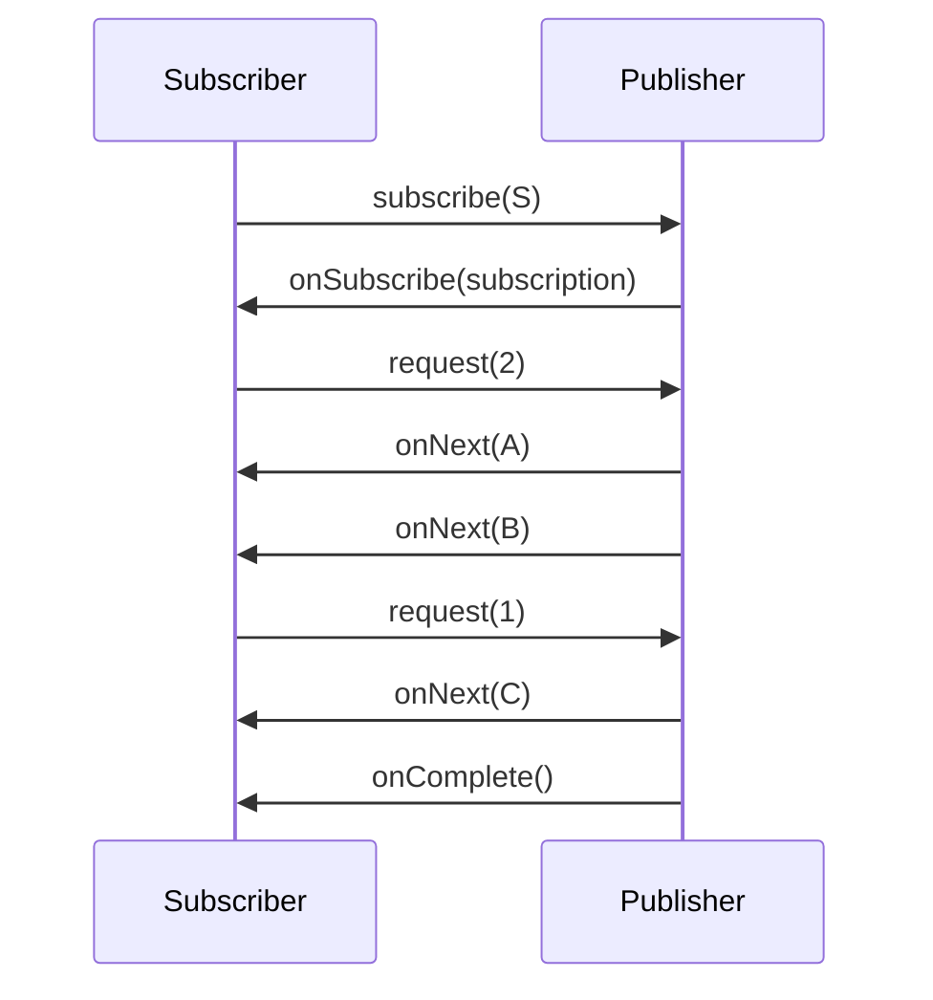

# Phân biệt lập trình phản ứng, hệ thống phản ứng và Reactive Streams

Ba thuật ngữ này thường xuất hiện cạnh nhau trong hệ sinh thái Java vì chúng cùng nói về khả năng phản hồi trước dữ liệu và sự kiện. Tuy nhiên, chúng mô tả ba vấn đề ở ba cấp độ khác nhau:

- **Lập trình phản ứng (reactive programming)** là cách tổ chức mã để mô tả và kết hợp các luồng dữ liệu hoặc sự kiện, thường theo hướng khai báo và bất đồng bộ.
- **Hệ thống phản ứng (reactive systems)** là cách thiết kế toàn bộ hệ thống để hệ thống phản hồi nhanh, có khả năng chịu lỗi và mở rộng khi tải thay đổi.
- **Reactive Streams** là một đặc tả giao tiếp giữa bên phát và bên nhận dữ liệu theo luồng, có cơ chế điều tiết nhu cầu (backpressure).

Hiểu đúng ranh giới này giúp chọn công cụ phù hợp và tránh kết luận rằng chỉ cần dùng `Mono` hoặc `Flux` là ứng dụng đã trở thành một reactive system.

## 1. Lập trình phản ứng: cách viết và kết hợp luồng dữ liệu

Lập trình phản ứng là một mô hình lập trình trong đó chương trình phản ứng với sự thay đổi của dữ liệu hoặc với các sự kiện đến theo thời gian. Thay vì chỉ viết một chuỗi lệnh tuần tự để lấy dữ liệu, xử lý rồi trả kết quả, ta mô tả cách dữ liệu đi qua các bước biến đổi và cách xử lý khi có giá trị mới, lỗi hoặc kết thúc.

Ví dụ, một ứng dụng theo dõi nhiệt độ có thể nhận các phép đo liên tục. Pipeline phản ứng có thể lọc những giá trị hợp lệ, đổi đơn vị và phát cảnh báo khi nhiệt độ vượt ngưỡng. Khi có phép đo mới, pipeline tiếp tục xử lý mà không cần viết lại toàn bộ chuỗi thao tác.

Trong Java, một pipeline với Project Reactor có thể được viết như sau:

```java
Flux<Integer> temperatures = Flux.just(24, 27, 31, 29, 35);

Flux<String> alerts = temperatures
    .filter(value -> value >= 30)
    .map(value -> "Cảnh báo: " + value + "°C");
```

Đoạn mã mô tả các bước lọc và biến đổi dữ liệu. Nó chưa tự tạo ra một luồng chạy song song: `Flux.just` phát các giá trị theo cách đồng bộ khi được đăng ký. Tính bất đồng bộ và việc chạy trên luồng nào phụ thuộc vào nguồn dữ liệu, scheduler và các toán tử được dùng.

Lập trình phản ứng thường có những đặc điểm sau:

- **Khai báo pipeline:** mô tả dữ liệu cần được lọc, biến đổi hoặc kết hợp như thế nào.
- **Xử lý theo sự kiện hoặc dữ liệu đến:** pipeline có thể tiếp tục nhận và xử lý nhiều giá trị theo thời gian.
- **Kết hợp các bước xử lý:** các toán tử giúp ghép lọc, ánh xạ, kết hợp, xử lý lỗi và các thao tác bất đồng bộ.
- **Quản lý vòng đời luồng:** luồng có thể phát giá trị, kết thúc bình thường hoặc kết thúc bằng lỗi; bên nhận cũng có thể hủy đăng ký.

Lập trình phản ứng là một lựa chọn ở cấp độ mã nguồn và thành phần. Một chương trình có thể dùng phong cách phản ứng trong một vài phần mà kiến trúc tổng thể vẫn chưa có các đặc tính của reactive system.

## 2. Hệ thống phản ứng: đặc tính của toàn bộ kiến trúc

Hệ thống phản ứng là một hệ thống được thiết kế để duy trì khả năng phản hồi khi gặp tải cao, sự cố hoặc thay đổi về quy mô. Khái niệm này thường được diễn giải qua bốn đặc tính trong Reactive Manifesto:

| Đặc tính | Ý nghĩa | Ví dụ |
|---|---|---|
| **Responsive — phản hồi nhanh** | Trả lời trong thời gian có thể dự đoán và phát hiện vấn đề rõ ràng. | API trả kết quả hoặc thông báo lỗi trong thời hạn xác định. |
| **Resilient — chịu lỗi** | Tiếp tục cung cấp dịch vụ khi một thành phần gặp sự cố. | Một instance lỗi được cô lập; yêu cầu được chuyển sang instance còn hoạt động. |
| **Elastic — co giãn** | Điều chỉnh tài nguyên theo biến động tải để duy trì khả năng phản hồi. | Tăng số worker khi lượng sự kiện tăng và giảm khi tải hạ. |
| **Message-driven — hướng thông điệp** | Các thành phần giao tiếp qua thông điệp bất đồng bộ, có ranh giới và mức độ phụ thuộc thấp. | Dịch vụ đơn hàng gửi sự kiện `OrderCreated` để dịch vụ kho xử lý độc lập. |

Bốn đặc tính có quan hệ với nhau. Giao tiếp qua thông điệp bất đồng bộ giúp các thành phần không phải chờ nhau trực tiếp và hỗ trợ cô lập lỗi. Khi các thành phần được tách biệt và có thể xử lý độc lập, hệ thống dễ phân phối tải hơn. Những cơ chế này góp phần duy trì khả năng phản hồi.

Một hệ thống không trở thành reactive system chỉ vì dùng message broker, WebFlux hoặc một thư viện reactive. Kiến trúc còn cần có chiến lược xử lý lỗi, cô lập thành phần, giới hạn tài nguyên, quan sát hệ thống và mở rộng phù hợp. Ngược lại, một hệ thống có thể đạt các đặc tính phản ứng bằng nhiều công nghệ khác nhau; Reactive Streams không phải điều kiện bắt buộc cho mọi reactive system.

## 3. Reactive Streams: hợp đồng trao đổi dữ liệu theo luồng

Reactive Streams là một đặc tả cho việc xử lý luồng dữ liệu bất đồng bộ với cơ chế backpressure không chặn. Mục tiêu của đặc tả là giúp bên phát dữ liệu và bên nhận dữ liệu phối hợp nhu cầu, tránh việc bên phát liên tục đẩy dữ liệu nhanh hơn khả năng xử lý của bên nhận.

Trong đặc tả Reactive Streams dành cho Java, bốn thành phần cốt lõi là:

| Thành phần | Vai trò |
|---|---|
| `Publisher<T>` | Phát các phần tử kiểu `T` đến một subscriber. |
| `Subscriber<T>` | Nhận các phần tử, lỗi và tín hiệu hoàn tất. |
| `Subscription` | Đại diện cho quan hệ đăng ký; cho phép yêu cầu số phần tử và hủy đăng ký. |
| `Processor<T, R>` | Vừa là subscriber nhận `T`, vừa là publisher phát `R`. |

Vòng đời cơ bản của một subscription diễn ra như sau:

1. Subscriber đăng ký với Publisher.
2. Publisher gọi `onSubscribe(subscription)` để cung cấp Subscription.
3. Subscriber gọi `request(n)` để báo rằng mình có thể nhận thêm `n` phần tử; nhu cầu này được cộng vào lượng demand chưa được đáp ứng.
4. Publisher phát các phần tử bằng `onNext(value)` theo nhu cầu đã nhận.
5. Luồng kết thúc bằng đúng một tín hiệu terminal: `onComplete()` hoặc `onError(error)`. Subscriber cũng có thể gọi `cancel()` để hủy việc nhận thêm dữ liệu.

Sơ đồ rút gọn:



Trong ví dụ, subscriber yêu cầu hai phần tử trước, sau đó yêu cầu thêm một phần tử. Publisher dựa vào nhu cầu đó để điều tiết lượng dữ liệu phát ra. Đây là **backpressure**: bên nhận chủ động báo lượng dữ liệu mình sẵn sàng xử lý.

Backpressure không đồng nghĩa với rate limiting. Backpressure là tín hiệu phối hợp nhu cầu giữa subscriber và publisher trong một luồng. Rate limiting thường giới hạn tốc độ hoặc số yêu cầu trong một khoảng thời gian ở một ranh giới hệ thống. Tùy pipeline, khi nhu cầu không theo kịp nguồn, một thành phần có thể lưu đệm, bỏ phần tử, phát lỗi hoặc áp dụng chính sách khác. Vì vậy, có backpressure không có nghĩa là bộ nhớ không thể tăng hoặc dữ liệu không bao giờ bị mất; cần hiểu chính sách cụ thể của từng toán tử và nguồn dữ liệu.

Reactive Streams định nghĩa hợp đồng và giao thức tín hiệu. Đặc tả không quy định toàn bộ bộ toán tử biến đổi dữ liệu, cách chọn thread hay kiến trúc triển khai ứng dụng.

## 4. Reactive Streams liên hệ với Mono, Flux và Project Reactor như thế nào?

Project Reactor là một thư viện reactive dành cho Java, cung cấp các kiểu dữ liệu và toán tử để xây dựng pipeline. Hai kiểu thường dùng nhất là:

- **`Mono<T>`:** biểu diễn một kết quả bất đồng bộ có thể có không hoặc một phần tử.
- **`Flux<T>`:** biểu diễn một luồng bất đồng bộ có thể có không, một hoặc nhiều phần tử.

Cả `Mono` và `Flux` đều triển khai hợp đồng Publisher của Reactive Streams thông qua các kiểu nền tảng của Reactor. Vì vậy, chúng có thể tham gia vào cơ chế đăng ký, yêu cầu dữ liệu, hủy đăng ký và tín hiệu kết thúc của Reactive Streams, đồng thời cung cấp nhiều toán tử tiện dụng.

Ví dụ về hai loại kết quả:

```java
Mono<User> user = userRepository.findById(userId);

Flux<Order> orders = orderRepository.findByUserId(userId);
```

Lệnh tìm một người dùng phù hợp với `Mono`, vì kết quả có tối đa một người dùng. Lệnh tìm các đơn hàng phù hợp với `Flux`, vì kết quả có thể gồm nhiều đơn hàng. Việc truy vấn có thật sự bất đồng bộ và không chặn hay không còn phụ thuộc vào cách repository và driver được triển khai.

Khi kết hợp các toán tử, ta có thể mô tả chuỗi xử lý:

```java
Mono<Receipt> receipt =
    orderRepository.findById(orderId)
        .switchIfEmpty(Mono.error(new OrderNotFoundException()))
        .flatMap(paymentService::charge)
        .map(payment -> Receipt.from(payment))
        .onErrorMap(error -> new CheckoutException(error));
```

Pipeline trên thể hiện cách kết hợp kết quả, chuyển sang thao tác bất đồng bộ tiếp theo và ánh xạ lỗi. Trong ứng dụng thực tế, cần chọn cách xử lý lỗi phù hợp với từng loại lỗi và quy tắc nghiệp vụ. Các toán tử như `publishOn` và `subscribeOn` còn cho phép kiểm soát scheduler tại những ranh giới thực thi phù hợp.

## 5. So sánh ba khái niệm

| Tiêu chí | Lập trình phản ứng | Hệ thống phản ứng | Reactive Streams |
|---|---|---|---|
| Cấp độ | Mã nguồn và thành phần | Toàn bộ hệ thống, kiến trúc | Hợp đồng giao tiếp luồng |
| Câu hỏi chính | Tổ chức xử lý dữ liệu và sự kiện ra sao? | Làm sao hệ thống phản hồi, chịu lỗi và co giãn? | Publisher và Subscriber phối hợp phát, nhận dữ liệu thế nào? |
| Trọng tâm | Pipeline, sự kiện, toán tử, kết quả bất đồng bộ | Responsiveness, resilience, elasticity, message-driven | Subscription, demand, backpressure, tín hiệu kết thúc |
| Ví dụ | Kết hợp `Mono` và `Flux` để xử lý đơn hàng | Dịch vụ đơn hàng tiếp tục hoạt động khi một instance kho bị lỗi | Subscriber yêu cầu 10 phần tử bằng `request(10)` |
| Có bắt buộc dùng nhau không? | Không bắt buộc phải dùng Reactive Streams | Không bắt buộc phải dùng Reactive Streams hoặc một thư viện cụ thể | Có thể được thư viện reactive dùng làm hợp đồng |

Có thể ghi nhớ mối quan hệ theo cách sau:

- Lập trình phản ứng cung cấp cách xây dựng logic xử lý ở cấp thành phần.
- Reactive Streams chuẩn hóa cách các thành phần trao đổi luồng dữ liệu và điều tiết nhu cầu khi thư viện triển khai đặc tả này.
- Reactive system là mục tiêu kiến trúc ở cấp toàn hệ thống; các thành phần và giao thức phù hợp có thể hỗ trợ đạt mục tiêu đó.

## 6. Ví dụ xuyên suốt: xử lý đơn hàng

Giả sử một hệ thống thương mại điện tử nhận yêu cầu đặt hàng. Có ba góc nhìn tương ứng:

**Ở góc nhìn lập trình phản ứng:** dịch vụ đơn hàng kết hợp các thao tác tìm đơn, kiểm tra tồn kho và thanh toán thành một pipeline. Mỗi thao tác có thể trả về `Mono`; danh sách mặt hàng hoặc sự kiện có thể được biểu diễn bằng `Flux`. Các toán tử kết hợp kết quả, xử lý trường hợp không có dữ liệu và chuyển lỗi thành lỗi nghiệp vụ.

**Ở góc nhìn Reactive Streams:** khi một pipeline tiêu thụ một luồng sự kiện đơn hàng, subscriber có thể yêu cầu số phần tử phù hợp với năng lực xử lý. Nếu tốc độ phát sự kiện cao hơn tốc độ tiêu thụ, backpressure giúp truyền nhu cầu ngược về phía publisher theo hợp đồng của luồng.

**Ở góc nhìn hệ thống phản ứng:** dịch vụ đơn hàng, kho và thanh toán giao tiếp qua thông điệp. Nếu dịch vụ kho tạm thời không hoạt động, hệ thống có thể lưu thông điệp, thử lại theo chính sách, cô lập lỗi và tiếp tục phục vụ những chức năng khác. Khi lưu lượng đặt hàng tăng, hệ thống có thể bổ sung worker để xử lý tải. Các cơ chế này cần được thiết kế ở cấp kiến trúc và vận hành.

Ba góc nhìn bổ sung cho nhau nhưng không thay thế nhau. Một pipeline Reactor có thể xử lý dữ liệu tốt trong một dịch vụ; điều đó chưa chứng minh toàn bộ quy trình đặt hàng có khả năng chịu lỗi hoặc co giãn.

## 7. Những nhầm lẫn thường gặp

- **“Dùng Flux là hệ thống đã reactive.”** `Flux` là kiểu dữ liệu và API trong Project Reactor. Nó hỗ trợ xây dựng thành phần phản ứng, nhưng không tự tạo ra khả năng chịu lỗi, co giãn hay giao tiếp thông điệp cho toàn hệ thống.
- **“Reactive programming luôn chạy đa luồng.”** Pipeline có thể chạy đồng bộ. Cần hiểu nguồn dữ liệu và cách cấu hình scheduler; không nên suy ra mô hình thread chỉ từ tên `Mono` hoặc `Flux`.
- **“Bất đồng bộ đồng nghĩa với backpressure.”** Một API bất đồng bộ có thể không cung cấp cơ chế điều tiết nhu cầu theo Reactive Streams. Backpressure đòi hỏi giao thức phối hợp demand giữa publisher và subscriber.
- **“Reactive Streams là một thư viện.”** Đây là đặc tả giao diện và quy tắc tín hiệu. Project Reactor là một trong những thư viện triển khai hợp đồng đó.
- **“Reactive system bắt buộc phải dùng Project Reactor.”** Các đặc tính của reactive system là mục tiêu kiến trúc và có thể được triển khai bằng nhiều công nghệ, bao gồm các hệ thống thông điệp và nền tảng phân tán khác.

## 8. Cách xác định khái niệm đang được nói đến

Khi đọc tài liệu hoặc thiết kế một ứng dụng Java, hãy nhìn vào vấn đề đang được giải quyết:

- Nếu đang bàn về cách kết hợp dữ liệu, sự kiện, toán tử, `Mono` hoặc `Flux`, đó là góc nhìn **lập trình phản ứng**.
- Nếu đang bàn về thời gian phản hồi, cô lập lỗi, phục hồi, mở rộng và giao tiếp giữa các dịch vụ, đó là góc nhìn **hệ thống phản ứng**.
- Nếu đang bàn về `Publisher`, `Subscriber`, `Subscription`, `request(n)`, `cancel()` hoặc backpressure, đó là góc nhìn **Reactive Streams**.

Nắm rõ ba cấp độ này là nền tảng để học tiếp cách dùng Mono và Flux, kết hợp toán tử, điều khiển scheduler, xử lý lỗi và kiểm thử pipeline trong hệ sinh thái Java.
