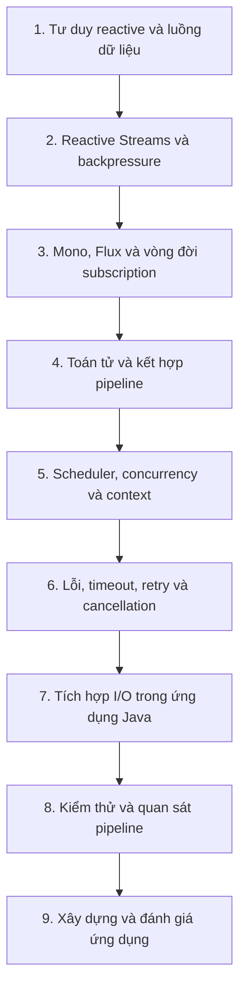

# Phạm vi kiến thức và thứ tự học từ mô hình đến ứng dụng

Reactive Programming trong Java là cách tổ chức xử lý quanh các luồng dữ liệu và sự kiện có thể đến theo thời gian. Người học cần hiểu cách một nguồn phát dữ liệu, cách consumer đăng ký nhận dữ liệu, cách điều tiết tốc độ và cách pipeline kết thúc khi hoàn tất, gặp lỗi hoặc bị hủy. Trên nền tảng đó, Reactor cung cấp `Mono` và `Flux` để kết hợp các bước bất đồng bộ; các framework và thư viện Java giúp đưa pipeline vào ứng dụng thực tế.

Phạm vi học tập của module này đi từ mô hình đến ứng dụng: nắm tư duy reactive và hợp đồng Reactive Streams, làm việc với kiểu dữ liệu và toán tử Reactor, điều khiển thực thi, thiết kế chính sách lỗi, tích hợp I/O, rồi kiểm thử và đánh giá một pipeline hoàn chỉnh. Thứ tự này có chủ đích. Nếu bắt đầu bằng cách ghép toán tử mà chưa hiểu subscription, demand hoặc tín hiệu kết thúc, người học dễ tạo ra mã chạy được trong ví dụ nhỏ nhưng khó kiểm soát khi tải tăng hoặc một dịch vụ phụ thuộc gặp sự cố.

## 1. Mục tiêu và ranh giới kiến thức

Sau khi hoàn thành lộ trình, người học có thể:

- Giải thích khi nào mô hình reactive có ích, chi phí đi kèm và trường hợp mô hình imperative đơn giản hơn là lựa chọn phù hợp.
- Phân biệt luồng dữ liệu, sự kiện nghiệp vụ và tín hiệu của Reactive Streams.
- Mô tả vai trò của `Publisher`, `Subscriber`, `Subscription`, demand, backpressure, cancellation, `onComplete` và `onError`.
- Chọn `Mono` hoặc `Flux` theo số lượng phần tử và compose pipeline mà không chặn luồng thực thi một cách tùy tiện.
- Dùng các toán tử biến đổi, lọc, kết hợp, tuần tự hóa, điều tiết và xử lý lỗi theo ngữ nghĩa nghiệp vụ.
- Chọn scheduler và ranh giới chuyển thread phù hợp; nhận diện và cô lập lời gọi blocking.
- Tích hợp publisher với các thành phần I/O reactive trong hệ sinh thái Java, đồng thời nhận biết ranh giới blocking trong hệ thống.
- Kiểm thử giá trị, thứ tự, thời gian, lỗi, cancellation và demand; đánh giá pipeline bằng số liệu vận hành.

Module tập trung vào tư duy reactive, Reactive Streams và thực hành Reactor trong ứng dụng Java. Các kiến thức nền về Java, lập trình hướng đối tượng, generic, lambda, exception, HTTP và concurrency vẫn cần thiết. Những chủ đề như thiết kế toàn bộ kiến trúc event-driven phân tán, vận hành sâu một message broker, thuật toán phân tán hay tối ưu JVM chuyên sâu có thể hỗ trợ khi triển khai hệ thống, nhưng không thay thế các mục tiêu cốt lõi của module.

## 2. Bản đồ học tập

Lộ trình được chia thành các chặng có quan hệ phụ thuộc. Mỗi chặng trả lời một câu hỏi và tạo ra nền tảng cho chặng tiếp theo.



Thứ tự trên là đường học đề xuất. Khi thực hành một dự án cụ thể, có thể quay lại một chặng trước để điều chỉnh mô hình, demand hoặc chính sách lỗi. Không nên xem việc hoàn thành một ví dụ cú pháp là đã nắm được toàn bộ chặng đó; mỗi phần cần được kiểm tra bằng một tình huống có hành vi quan sát được.

## 3. Chặng 1 — Hiểu vấn đề và tư duy reactive

Trước tiên, hãy so sánh cách xử lý đồng bộ với cách xử lý bất đồng bộ. Trong mã imperative thông thường, caller gọi hàm và nhận kết quả trước khi đi tiếp. Khi thao tác phải chờ mạng hoặc cơ sở dữ liệu, thread có thể bị giữ trong thời gian chờ. Mô hình bất đồng bộ cho phép đăng ký công việc và xử lý kết quả khi nó sẵn sàng; mô hình reactive bổ sung cách biểu diễn luồng tín hiệu, compose các bước và điều tiết lượng dữ liệu tiêu thụ.

Ở chặng này cần học:

- Vì sao I/O đồng thời và dữ liệu đến liên tục có thể tạo áp lực lên thread, bộ nhớ và hàng đợi.
- Khác biệt giữa bất đồng bộ, non-blocking và reactive.
- Khái niệm luồng dữ liệu hữu hạn/liên tục, sự kiện nghiệp vụ và tín hiệu giao thức.
- Lợi ích, chi phí và những trường hợp không phù hợp với reactive.

Ví dụ thực tế: một API tổng hợp thông tin khách hàng từ hồ sơ và đơn hàng. Hai lời gọi HTTP có thể chờ độc lập; một pipeline reactive có thể phối hợp chúng mà không giữ một thread riêng để chờ từng phản hồi. Tuy nhiên, lợi ích chỉ xuất hiện nếu client HTTP và các thành phần I/O quan trọng hỗ trợ non-blocking. Nếu bên trong vẫn gọi JDBC blocking trên event-loop, thiết kế cần được xem lại.

**Kết quả cần đạt:** có thể mô tả vấn đề mà reactive đang giải quyết, xác định phần nào chủ yếu chờ I/O, phần nào tính toán CPU, và giải thích vì sao chọn hoặc không chọn reactive cho một luồng xử lý.

## 4. Chặng 2 — Nắm hợp đồng Reactive Streams

Sau khi hiểu lý do cần mô hình reactive, hãy học giao thức nền tảng trước khi đi sâu vào Reactor. Reactive Streams chuẩn hóa cách publisher và subscriber trao đổi dữ liệu, đặc biệt là cách subscriber công bố nhu cầu nhận dữ liệu.

Các thành phần cần nắm:

| Thành phần hoặc tín hiệu | Vai trò |
| --- | --- |
| `Publisher<T>` | Nguồn phát không hoặc nhiều phần tử kiểu `T` |
| `Subscriber<T>` | Bên đăng ký để nhận tín hiệu và xử lý phần tử |
| `Subscription` | Liên kết cho phép subscriber gọi `request(n)` và `cancel()` |
| `onSubscribe` | Trao subscription cho subscriber sau khi đăng ký |
| `request(n)` | Công bố demand, tức số phần tử subscriber sẵn sàng nhận thêm |
| `onNext(value)` | Phát một phần tử dữ liệu |
| `onComplete()` | Kết thúc luồng bình thường |
| `onError(error)` | Kết thúc luồng do lỗi |
| `cancel()` | Yêu cầu dừng nhận dữ liệu qua subscription |

Backpressure là phần quan trọng của hợp đồng này. Khi consumer xử lý chậm, demand giúp điều tiết số phần tử được chuyển giao. Nhưng không phải nguồn nào cũng có thể bị làm chậm: callback hoặc thiết bị bên ngoài có thể không hỗ trợ demand. Adapter khi đó phải có chính sách rõ ràng như buffer giới hạn, bỏ phần tử, giữ giá trị mới nhất hoặc báo quá tải.

Người học cũng cần phân biệt tín hiệu terminal với dữ liệu nghiệp vụ. `onComplete` và `onError` kết thúc subscription; chúng không phải các phần tử được phát qua `onNext`. Sau chặng này, có thể đọc một sơ đồ vòng đời publisher–subscriber và giải thích điều gì xảy ra khi subscriber yêu cầu thêm dữ liệu hoặc hủy subscription.

**Kết quả cần đạt:** mô tả đúng thứ tự đăng ký, demand, phát dữ liệu, hoàn tất, lỗi và cancellation; nêu được rủi ro khi consumer chậm hơn producer.

## 5. Chặng 3 — Làm quen với Mono, Flux và subscription

Reactor cung cấp hai kiểu publisher thường dùng:

| Kiểu | Số phần tử | Ví dụ |
| --- | --- | --- |
| `Mono<T>` | Không hoặc một | Tìm một tài khoản, lấy cấu hình, lưu một đơn hàng |
| `Flux<T>` | Không, một hoặc nhiều | Đọc danh sách, xử lý chuỗi sự kiện, phát dữ liệu theo từng phần |

Học cách tạo publisher từ giá trị, collection, range, callable, nguồn rỗng và lỗi. Đồng thời, phân biệt ba thời điểm: khai báo pipeline, đăng ký subscription và phát tín hiệu. Nhiều pipeline Reactor có tính lazy: tạo `Mono` hoặc `Flux` chưa đồng nghĩa với việc lời gọi I/O đã chạy. Subscription kích hoạt quá trình phát dữ liệu.

Các khái niệm cold và hot cũng thuộc chặng này. Cold publisher thường tạo luồng riêng cho mỗi subscriber; hot publisher chia sẻ luồng đang diễn ra và subscriber đến muộn có thể bỏ lỡ dữ liệu đã phát nếu nguồn không replay. Khi dùng `share`, `publish`, `replay` hoặc `Sinks`, cần hiểu số subscriber, thời điểm bắt đầu, buffer và vòng đời nguồn.

Ví dụ về các kết quả khác nhau:

```java
Mono<String> found = Mono.just("account-42");
Mono<String> missing = Mono.empty();
Mono<String> failed = Mono.error(new IllegalStateException("Repository unavailable"));

Flux<Integer> finite = Flux.range(1, 3);
Flux<Integer> empty = Flux.empty();
```

`Mono.empty()` là hoàn tất bình thường không có giá trị; `Mono.error` kết thúc bằng lỗi. Reactive Streams không cho phép phát `null` qua `onNext`, vì vậy cần dùng publisher rỗng hoặc một kiểu dữ liệu thể hiện rõ sự vắng mặt.

**Kết quả cần đạt:** chọn đúng `Mono` hoặc `Flux`, giải thích được lazy subscription, phân biệt empty với error và dự đoán hành vi cơ bản của cold/hot publisher.

## 6. Chặng 4 — Compose pipeline bằng toán tử

Khi đã hiểu kiểu publisher và vòng đời subscription, hãy học cách nối các bước xử lý. Mỗi toán tử tạo một publisher mới từ publisher upstream và cung cấp kết quả cho downstream.

| Nhóm | Toán tử tiêu biểu | Câu hỏi cần trả lời |
| --- | --- | --- |
| Biến đổi và lọc | `map`, `filter`, `handle` | Giá trị nào được biến đổi hoặc giữ lại? |
| Chuyển publisher | `flatMap`, `concatMap`, `flatMapSequential` | Các tác vụ con chạy đồng thời hay tuần tự? Có giữ thứ tự không? |
| Kết hợp nguồn | `zip`, `merge`, `concat`, `when` | Các nguồn được ghép theo cặp, xen kẽ hay theo thứ tự? |
| Gom và chia dữ liệu | `collectList`, `buffer`, `window`, `groupBy` | Có cần giữ dữ liệu trong bộ nhớ hoặc tạo nhóm không? |
| Giới hạn luồng | `take`, `limitRate`, `onBackpressureBuffer` | Khi nào dừng nhận, giới hạn demand hoặc xử lý quá tải? |
| Quan sát | `doOnNext`, `doOnError`, `doFinally` | Cần ghi nhận tín hiệu nào để debug và đo lường? |

Ví dụ, hai lời gọi độc lập có thể được kết hợp bằng `Mono.zip`:

```java
Mono<User> user = userClient.findById(userId);
Mono<List<Order>> orders = orderClient.findByUserId(userId).collectList();

Mono<UserOverview> overview = Mono.zip(user, orders)
    .map(tuple -> new UserOverview(tuple.getT1(), tuple.getT2()));
```

Đoạn mã mô tả hai nguồn cần có giá trị để tạo `UserOverview`. Trong dự án thật, cần xác định hành vi khi một nguồn rỗng, lỗi hoặc chậm hơn thời hạn của request. `flatMap` hữu ích khi một giá trị dẫn đến publisher khác; `concatMap` phù hợp khi các publisher con phải được xử lý tuần tự và giữ thứ tự theo nguồn. Không chọn toán tử chỉ vì cú pháp ngắn: hãy bắt đầu từ yêu cầu về thứ tự, concurrency và bộ nhớ.

**Kết quả cần đạt:** tự xây được pipeline gồm nguồn, biến đổi, lọc và kết hợp; giải thích được thứ tự phát, concurrency và hệ quả của các thao tác gom dữ liệu.

## 7. Chặng 5 — Scheduler, concurrency và context

Reactive không tự động tạo một thread cho mỗi toán tử. Nhiều bước chạy trên thread đang phát tín hiệu cho đến khi pipeline đi qua ranh giới scheduler. Vì vậy, người học cần biết công việc nào đang chạy ở đâu và khi nào cần chuyển thread.

Các scheduler thường gặp trong Reactor:

| Scheduler | Mục đích thường gặp | Lưu ý |
| --- | --- | --- |
| `Schedulers.parallel()` | Công việc CPU-bound có thể chạy song song | Không dùng để chờ I/O blocking |
| `Schedulers.boundedElastic()` | Cô lập lời gọi blocking khó loại bỏ | Có giới hạn tài nguyên; cần quan sát tải và hàng đợi |
| `Schedulers.single()` | Công việc cần thực thi tuần tự trên một luồng | Có thể trở thành nút thắt |
| `Schedulers.immediate()` | Thực thi trên thread hiện tại | Không tạo ranh giới chuyển thread |

`subscribeOn` ảnh hưởng đến nơi subscription bắt đầu và quá trình upstream được khởi động. `publishOn` chuyển việc thực thi các toán tử downstream kể từ vị trí đặt nó. Dùng scheduler cần có lý do cụ thể; chuyển thread quá nhiều có thể tạo overhead, còn chạy blocking trên event-loop có thể làm nghẽn nhiều request.

Khi chưa thể thay thư viện blocking, có thể cô lập lời gọi đó:

```java
Mono<LegacyResult> result = Mono.fromCallable(() -> legacyClient.fetch(key))
    .subscribeOn(Schedulers.boundedElastic());
```

Đây là biện pháp cô lập; lời gọi `legacyClient.fetch` vẫn blocking. Song song với scheduler, cần hiểu cách truyền context như correlation ID, tracing, bảo mật và transaction qua các ranh giới bất đồng bộ. Không mặc định rằng `ThreadLocal` luôn có mặt trên mọi thread.

**Kết quả cần đạt:** phân biệt CPU-bound, I/O non-blocking và I/O blocking; giải thích vị trí tác dụng của `publishOn` và `subscribeOn`; tránh chặn event-loop và biết cách quan sát context.

## 8. Chặng 6 — Lỗi, timeout, retry và cancellation

Trong Reactive Streams, `onError` là tín hiệu terminal. Nếu cần phục hồi, pipeline phải chuyển lỗi thành một publisher khác hoặc một giá trị thay thế bằng chính sách rõ ràng. Reactor cung cấp các toán tử như `onErrorMap`, `onErrorResume`, `onErrorReturn`, `retryWhen`, `timeout` và `doFinally`.

Học cách phân biệt:

- Lỗi nghiệp vụ không nên retry, chẳng hạn dữ liệu đầu vào không hợp lệ.
- Lỗi hạ tầng có thể tạm thời, có thể retry có giới hạn nếu thao tác an toàn.
- Timeout là giới hạn thời gian chờ; timeout không chứng minh rằng hệ thống đích chưa thực hiện tác vụ.
- Cancellation là yêu cầu ngừng tiêu thụ; khả năng dừng công việc thực tế phụ thuộc publisher và adapter.

Retry một thao tác có side effect có thể tạo kết quả trùng nếu lần đầu đã thành công ở phía server nhưng phản hồi bị mất. Do đó, cần xem xét idempotency, loại lỗi, số lần thử, backoff, jitter, timeout tổng và giới hạn tải. `onErrorResume` quá rộng có thể biến lỗi nghiêm trọng thành kết quả có vẻ hợp lệ; mọi fallback cần phản ánh đúng ngữ nghĩa nghiệp vụ.

**Kết quả cần đạt:** xây dựng được chính sách lỗi có giới hạn, giải thích rủi ro retry, đặt timeout phù hợp và xử lý cancellation khi client không còn cần kết quả.

## 9. Chặng 7 — Tích hợp I/O trong hệ sinh thái Java

Sau khi nắm được publisher, toán tử, scheduler và lỗi, hãy đưa pipeline vào ranh giới ứng dụng. Một ứng dụng reactive thường kết hợp nhiều thành phần: HTTP server, HTTP client, kho dữ liệu, message broker, cache và các dịch vụ nội bộ.

Các điểm tích hợp cần tìm hiểu:

1. **Web endpoint:** Spring WebFlux có thể nhận và trả kiểu reactive như `Mono<T>` hoặc `Flux<T>`. Cần hiểu cách framework quản lý subscription và cancellation gắn với vòng đời request.
2. **HTTP client:** WebClient cung cấp API reactive để gọi dịch vụ bên ngoài, chuyển body thành `Mono` hoặc `Flux`, đặt timeout và chuyển lỗi HTTP thành lỗi ứng dụng.
3. **Cơ sở dữ liệu:** R2DBC cung cấp API truy cập quan hệ theo hướng reactive khi driver tương ứng hỗ trợ. JDBC/JPA là blocking; trả `Mono` bao quanh một truy vấn JDBC không biến truy vấn đó thành non-blocking.
4. **Message broker và nguồn callback:** adapter có thể chuyển message hoặc callback thành publisher. Cần kiểm tra semantics của acknowledgement, redelivery, ordering, demand và buffer của từng công nghệ.
5. **Transaction và context:** transaction reactive cần được quản lý theo context reactive của framework tương ứng. Không giả định transaction gắn với một thread như cách làm imperative truyền thống.

Ví dụ một service tổng hợp kết quả từ hai nguồn WebClient:

```java
public Mono<CustomerSummary> getSummary(String customerId) {
    Mono<Customer> customer = customerClient.get()
        .uri("/customers/{id}", customerId)
        .retrieve()
        .bodyToMono(Customer.class);

    Mono<List<Order>> orders = orderClient.get()
        .uri("/customers/{id}/orders", customerId)
        .retrieve()
        .bodyToFlux(Order.class)
        .collectList();

    return Mono.zip(customer, orders)
        .map(tuple -> new CustomerSummary(tuple.getT1(), tuple.getT2()))
        .timeout(Duration.ofSeconds(3));
}
```

Đây là ví dụ minh họa; các client, kiểu miền và import cần được khai báo trong ứng dụng. Service trả publisher để caller hoặc framework quản lý subscription. Cần bổ sung chính sách ánh xạ lỗi, fallback nếu phù hợp và quan sát timeout. Tránh gọi `block()` giữa pipeline hoặc `subscribe()` tùy tiện trong service vì chúng có thể làm mất quyền kiểm soát lifecycle, lỗi và cancellation của caller.

**Kết quả cần đạt:** xây được một luồng request reactive từ endpoint qua client và service, nhận diện được phụ thuộc blocking, và giải thích ranh giới chịu trách nhiệm quản lý subscription.

## 10. Chặng 8 — Kiểm thử và quan sát pipeline

Kiểm thử reactive cần xác minh các tín hiệu theo thời gian, không chỉ kiểm tra giá trị cuối cùng. Reactor Test cung cấp `StepVerifier` để đăng ký publisher và kiểm tra các phần tử, lỗi, hoàn tất, demand và cancellation. Với pipeline dùng delay hoặc timer, `withVirtualTime` giúp kiểm thử thời gian mà không phải chờ thật lâu.

Ví dụ kiểm thử một publisher:

```java
StepVerifier.create(Flux.just("created", "paid"))
    .expectNext("created")
    .expectNext("paid")
    .verifyComplete();

StepVerifier.create(Mono.error(new NotFoundException()))
    .expectError(NotFoundException.class)
    .verify();
```

Ngoài giá trị và lỗi, cần kiểm tra thứ tự, giới hạn concurrency, retry, timeout, cancellation và backpressure theo yêu cầu của pipeline. Không nên dùng `Thread.sleep` để đồng bộ test nếu có thể kiểm tra tín hiệu bằng `StepVerifier` hoặc virtual time.

Quan sát ở môi trường chạy cần kết hợp log có cấu trúc, correlation ID, distributed tracing và metric. Các số liệu hữu ích gồm thông lượng, độ trễ p95/p99, số kết nối, số thread, CPU, heap, kích thước buffer/hàng đợi, timeout, retry và tỷ lệ lỗi. Khi có scheduler riêng hoặc adapter nguồn, cần quan sát mức sử dụng và tình trạng quá tải của chúng.

**Kết quả cần đạt:** viết test xác minh cả success và failure, kiểm thử timer bằng virtual time khi phù hợp, và chọn được số liệu giúp phát hiện nghẽn hoặc tăng hàng đợi.

## 11. Chặng 9 — Hoàn thiện một ứng dụng reactive

Chặng cuối kết hợp các kiến thức trước thành một lát cắt ứng dụng có thể chạy và đánh giá. Có thể chọn bài toán tổng hợp dữ liệu khách hàng, API theo dõi trạng thái đơn hàng hoặc luồng thông báo trực tiếp. Phạm vi bài thực hành nên đủ nhỏ để quan sát từng quyết định, nhưng có cả I/O, lỗi và nhu cầu tiêu thụ.

Một quy trình triển khai gợi ý:

1. **Xác định yêu cầu:** dữ liệu nào được phát, nguồn nào tạo dữ liệu, số request đồng thời, thứ tự nghiệp vụ và độ trễ mục tiêu.
2. **Chọn mô hình:** quyết định chỗ dùng `Mono`, chỗ dùng `Flux`, và xác định phụ thuộc nào có API non-blocking.
3. **Thiết kế pipeline:** nối nguồn, toán tử và các nhánh kết hợp; quy định concurrency, thứ tự và giới hạn buffer.
4. **Thiết kế vòng đời:** xác định ai đăng ký, ai sở hữu subscription, khi nào hoàn tất, xử lý lỗi và hủy công việc ra sao.
5. **Thiết kế thực thi:** đặt scheduler tại ranh giới cần thiết; cô lập lời gọi blocking và truyền context.
6. **Thiết kế lỗi:** đặt timeout, retry có giới hạn và fallback phù hợp với idempotency cũng như yêu cầu nghiệp vụ.
7. **Kiểm thử:** xác minh dữ liệu, thứ tự, terminal signal, demand, cancellation và hành vi khi phụ thuộc chậm hoặc lỗi.
8. **Đo lường:** chạy tải đại diện, theo dõi latency, throughput, CPU, heap, thread, connection pool và hàng đợi.

Một ứng dụng được xem là hoàn thành phần thực hành khi có thể giải thích đường đi của dữ liệu từ nguồn đến consumer, chứng minh các giới hạn tài nguyên, kiểm thử được các nhánh quan trọng và chỉ ra cách phát hiện sự cố trong lúc vận hành. Việc chỉ trả về `Mono` từ controller chưa chứng minh toàn bộ đường đi đã non-blocking hoặc chịu tải tốt.

## 12. Cách học và thực hành theo từng chặng

Mỗi chặng nên được học theo chu trình: đọc mô hình, dự đoán hành vi, viết ví dụ nhỏ, quan sát tín hiệu, rồi thay đổi một điều kiện để xem kết quả. Ví dụ, khi học demand, hãy thay số phần tử được yêu cầu; khi học `flatMap`, hãy tạo publisher con có thời gian hoàn tất khác nhau; khi học timeout, mô phỏng một nguồn phản hồi chậm; khi học cancellation, hủy subscription trước khi nguồn hoàn tất.

Không cần đưa mọi toán tử Reactor vào bộ nhớ. Quan trọng hơn là biết tra cứu toán tử theo ngữ nghĩa, hiểu tác động đến thứ tự và demand, rồi kiểm chứng bằng test. Khi gặp một pipeline khó đọc, hãy chia nó thành các bước có tên, xác định upstream/downstream, đánh dấu ranh giới scheduler và tìm nơi subscription được sở hữu.

| Dấu hiệu đã nắm chặng | Cách tự xác minh |
| --- | --- |
| Hiểu mô hình | Giải thích được lý do chọn reactive cho một tải cụ thể và nêu được trường hợp không nên chọn |
| Hiểu Reactive Streams | Vẽ được vòng đời subscription và giải thích demand, terminal signal, cancellation |
| Dùng Mono/Flux | Phân biệt empty/error, cold/hot và assembly/subscription |
| Compose toán tử | Dự đoán được thứ tự, concurrency, kết quả zip và tác động của thao tác gom dữ liệu |
| Điều khiển thực thi | Chỉ ra thread/scheduler phù hợp và cô lập được lời gọi blocking |
| Xử lý lỗi | Thiết kế timeout, retry có giới hạn và fallback không làm sai ngữ nghĩa |
| Tích hợp ứng dụng | Theo dõi được publisher qua endpoint, client và kho dữ liệu |
| Kiểm thử/vận hành | Có test tín hiệu và metric giúp phát hiện quá tải, timeout, lỗi |

## 13. Những lỗi học tập và thiết kế cần tránh

- Học toán tử trước khi hiểu publisher, subscriber và subscription, dẫn đến việc không biết ai kích hoạt hoặc sở hữu công việc.
- Cho rằng mọi API trả `Mono`/`Flux` đều non-blocking, dù bên trong vẫn gọi thư viện blocking.
- Dùng `block()` để lấy kết quả giữa pipeline hoặc tự `subscribe()` trong service mà không có chủ sở hữu lifecycle rõ ràng.
- Dùng `flatMap` khi nghiệp vụ yêu cầu thứ tự tuần tự, hoặc tăng concurrency mà không có giới hạn.
- Gom toàn bộ luồng vào bộ nhớ bằng `collectList` hoặc buffer không giới hạn khi nguồn có thể rất lớn.
- Retry mọi lỗi mà không xét idempotency, backoff, timeout và tải của dịch vụ đích.
- Bỏ qua cancellation, khiến công việc tiếp tục chạy dù client không còn cần kết quả.
- Chỉ kiểm thử đường đi thành công, không kiểm tra lỗi, timeout, demand và hành vi khi nguồn chậm.
- Đánh giá hiệu năng bằng một benchmark đơn giản mà không quan sát độ trễ, heap, thread, connection pool và hàng đợi dưới tải thực tế.

## 14. Tiêu chí hoàn thành module

Người học hoàn thành module khi có thể giải thích mô hình Reactive Streams bằng ngôn ngữ của mình, xây dựng pipeline `Mono`/`Flux` cho một bài toán thực tế, kết hợp toán tử theo yêu cầu thứ tự và concurrency, chọn scheduler đúng chỗ, thiết kế xử lý lỗi có giới hạn, tích hợp I/O reactive, và viết test kiểm tra tín hiệu quan trọng. Người học cũng cần chỉ ra được nơi nào còn blocking, demand được xử lý thế nào, cancellation có tác dụng ra sao và metric nào giúp đánh giá hệ thống.

Trình tự từ mô hình đến ứng dụng giúp mỗi kỹ thuật có chỗ đứng rõ ràng: hợp đồng giải thích cách dữ liệu được trao đổi; `Mono` và `Flux` biểu diễn publisher; toán tử mô tả biến đổi và phối hợp; scheduler xác định nơi thực thi; chính sách lỗi và cancellation quản lý vòng đời; tích hợp, kiểm thử và quan sát chứng minh pipeline hoạt động trong ứng dụng Java. Đây là nền tảng để tiếp tục học các chủ đề reactive nâng cao mà vẫn giữ được khả năng giải thích và kiểm soát hành vi của hệ thống.
