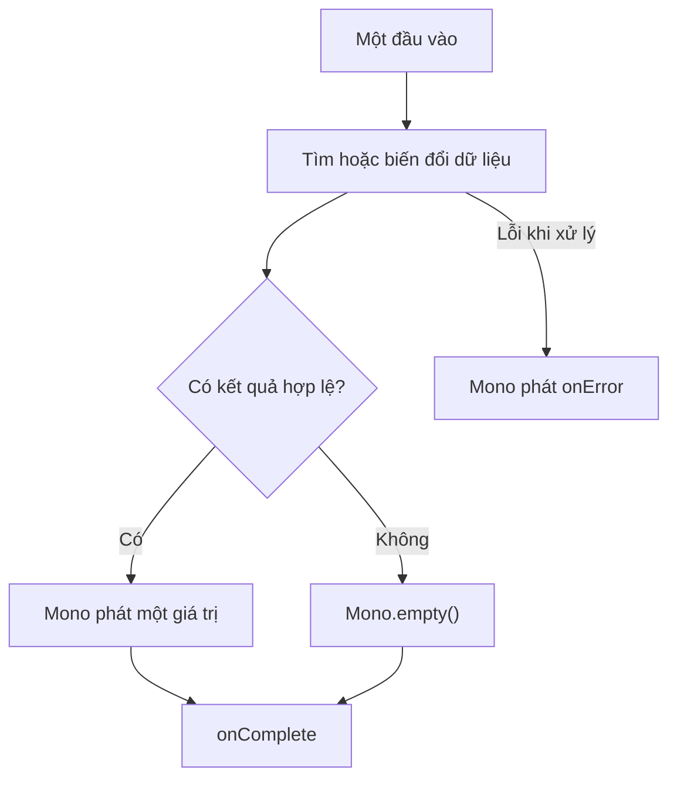

# Xử lý có điều kiện khi một đầu vào tạo không hoặc một đầu ra

Trong chương **Biến đổi dữ liệu**, bài học này tập trung vào tình huống một đầu vào có thể tạo ra đúng một kết quả hoặc không tạo ra kết quả nào. Đây là dạng xử lý rất thường gặp trong ứng dụng: tìm một người dùng có thể không tồn tại, kiểm tra đơn hàng có đủ điều kiện áp dụng ưu đãi, lọc bản ghi theo quyền truy cập hoặc chuyển một giá trị tùy chọn thành dữ liệu reactive.

Bài học thuộc module **REACTIVE_PROGRAMMING**. Module hướng dẫn: “Học tư duy reactive qua các luồng sự kiện bất đồng bộ, hợp đồng Publisher–Subscriber và cơ chế backpressure của Reactive Streams. Thực hành Mono, Flux, kết hợp toán tử, kiểm soát scheduler, xử lý lỗi và kiểm thử pipeline trong hệ sinh thái Java.” Trong phạm vi bài này, ta dùng các phép biến đổi của Reactor để giữ rõ ba khả năng: phát một giá trị, hoàn tất mà không phát giá trị, hoặc kết thúc bằng lỗi.

## 1. Mô hình không hoặc một kết quả với Mono

`Mono<T>` biểu diễn một publisher có thể phát tối đa một phần tử kiểu `T`. Khi xử lý một đầu vào, kết quả có thể có ba dạng:

| Kết quả nghiệp vụ | Tín hiệu của Mono |
|---|---|
| Có kết quả | `onNext(value)`, sau đó `onComplete()` |
| Không có kết quả | `onComplete()` mà không có `onNext` |
| Xử lý thất bại | `onError(error)` |

Sơ đồ dưới đây minh họa luồng quyết định cho một đầu vào:



Không có kết quả và có lỗi là hai trạng thái khác nhau. Ví dụ, không tìm thấy người dùng có thể là một trường hợp bình thường được biểu diễn bằng `Mono.empty()`. Cơ sở dữ liệu không truy cập được lại là lỗi, cần được truyền bằng `onError` hoặc xử lý bằng các toán tử phục hồi lỗi.

Khi thiết kế pipeline, hãy xác định rõ trường hợp “không có dữ liệu” có phải là kết quả nghiệp vụ hợp lệ hay phải chuyển thành lỗi. Quyết định đó ảnh hưởng đến cách dùng `filter`, `flatMap`, `switchIfEmpty` và các toán tử xử lý lỗi.

## 2. Dùng filter để giữ hoặc loại một giá trị

`filter(predicate)` kiểm tra phần tử phát ra từ upstream. Nếu điều kiện trả về `true`, phần tử được chuyển tiếp. Nếu điều kiện trả về `false`, `Mono` hoàn tất mà không phát phần tử.

```java
Mono<Order> eligibleOrder =
    orderRepository.findById(orderId)
        .filter(Order::isPaid);
```

Nếu repository tìm thấy đơn hàng đã thanh toán, `eligibleOrder` phát đơn hàng đó. Nếu không tìm thấy đơn hàng hoặc đơn hàng chưa thanh toán, publisher hoàn tất rỗng.

Một ví dụ khác là chỉ phát thông tin người dùng đang hoạt động:

```java
Mono<UserProfile> activeProfile =
    userRepository.findById(userId)
        .filter(User::isActive)
        .map(UserProfile::from);
```

Pipeline có thể không phát giá trị ở hai trường hợp: repository không tìm thấy người dùng, hoặc người dùng tồn tại nhưng không hoạt động. Nếu cần phân biệt hai nguyên nhân, hãy kiểm tra trạng thái trước khi gộp chúng vào cùng một nhánh empty.

`filter` phù hợp khi ta chỉ cần quyết định giữ hay bỏ chính giá trị hiện tại. Predicate nên là phép kiểm tra đồng bộ, nhanh và không tạo tác dụng phụ. Nếu điều kiện cần gọi dịch vụ bất đồng bộ, không nên gọi `block()` bên trong predicate; hãy dùng `filterWhen` hoặc `flatMap`.

## 3. Dùng flatMap khi phép biến đổi có thể không tạo kết quả

`map` biến một giá trị thành một giá trị khác. Trong khi đó, `flatMap` biến một giá trị thành một publisher mới rồi nối kết quả của publisher đó vào pipeline. Với `Mono.flatMap`, publisher được trả về có thể phát một giá trị, hoàn tất rỗng hoặc phát lỗi.

Ví dụ, một mã khuyến mại chỉ tạo ra mức giảm giá khi đơn hàng đạt điều kiện:

```java
Mono<Discount> discountFor(Order order) {
    if (order.total().compareTo(new BigDecimal("500000")) >= 0) {
        return Mono.just(new Discount(new BigDecimal("50000")));
    }

    return Mono.empty();
}

Mono<Discount> discount =
    orderRepository.findById(orderId)
        .flatMap(this::discountFor);
```

Nếu không tìm thấy đơn hàng, upstream đã rỗng nên hàm `discountFor` không được gọi. Nếu tìm thấy đơn hàng nhưng tổng tiền thấp hơn ngưỡng, `discountFor` trả về `Mono.empty()`; toàn pipeline cũng hoàn tất rỗng. Nếu đủ điều kiện, pipeline phát một `Discount`.

`flatMap` đặc biệt hữu ích khi phép biến đổi tiếp theo vốn đã trả về `Mono`, chẳng hạn tra cứu quyền, kiểm tra trạng thái từ dịch vụ khác hoặc truy vấn dữ liệu liên quan:

```java
Mono<UserView> visibleUser =
    userRepository.findById(userId)
        .flatMap(user ->
            permissionService.canRead(user)
                .filter(Boolean::booleanValue)
                .map(allowed -> UserView.from(user))
        );
```

Trong ví dụ này, kết quả kiểm tra quyền là một `Mono<Boolean>`. Nếu người dùng không có quyền, `filter` làm publisher quyền hoàn tất rỗng, và `flatMap` cũng không phát `UserView`. Nếu được phép, pipeline tạo đúng một view.

Không dùng `map` rồi tạo ra `Mono<Mono<T>>` khi ý định là nối publisher con. Ví dụ:

```java
// Kiểu kết quả là Mono<Mono<Discount>>
Mono<Mono<Discount>> nested =
    orderRepository.findById(orderId)
        .map(this::discountFor);

// flatMap nối publisher con thành Mono<Discount>
Mono<Discount> flattened =
    orderRepository.findById(orderId)
        .flatMap(this::discountFor);
```

Chọn `map` khi hàm ánh xạ trả về một giá trị thông thường. Chọn `flatMap` khi hàm ánh xạ trả về một publisher và kết quả có thể bất đồng bộ hoặc rỗng.

## 4. Dùng filterWhen cho điều kiện bất đồng bộ

Có những điều kiện không thể kiểm tra ngay trong bộ nhớ. Ví dụ, quyền đọc một hồ sơ cần được xác minh qua dịch vụ phân quyền. `filterWhen` nhận một hàm trả về publisher Boolean, chờ kết quả kiểm tra rồi quyết định có chuyển tiếp phần tử ban đầu hay không.

```java
Mono<Document> readableDocument =
    documentRepository.findById(documentId)
        .filterWhen(document ->
            accessService.canRead(currentUserId, document.getId())
        );
```

Nếu `canRead` phát `true`, document được chuyển tiếp. Nếu phát `false` hoặc publisher kiểm tra hoàn tất mà không phát Boolean, document bị loại và kết quả là Mono rỗng. Nếu việc kiểm tra quyền phát lỗi, lỗi được truyền xuống downstream.

Với `Mono`, đầu vào chỉ có tối đa một phần tử nên việc kiểm tra bất đồng bộ diễn ra cho tối đa một giá trị. Toán tử này giúp pipeline giữ được tính reactive mà không phải chặn luồng để chờ kết quả kiểm tra.

Hãy để dịch vụ kiểm tra quyền trả về `Mono<Boolean>` hoặc một kiểu publisher tương thích. Không gọi `block()` bên trong predicate:

```java
// Tránh: chặn luồng đang thực thi pipeline
.filter(document ->
    accessService.canRead(document).block()
)
```

Cách chặn này làm mất lợi ích của xử lý bất đồng bộ, có thể gây nghẽn scheduler và đặc biệt nguy hiểm nếu được gọi trên event-loop.

## 5. Dùng handle khi cần quyết định phát hoặc bỏ trong cùng một bước

`handle` cho phép viết một bước xử lý có điều kiện: nhận một phần tử và quyết định gọi `sink.next(value)`, không phát gì, hoặc phát lỗi. Đây là cách kết hợp kiểm tra và biến đổi khi logic có nhiều nhánh.

```java
Mono<NormalizedCode> normalizedCode =
    Mono.justOrEmpty(rawCode)
        .handle((code, sink) -> {
            String normalized = code.trim().toUpperCase(Locale.ROOT);

            if (normalized.matches("[A-Z]{2}-[0-9]{4}")) {
                sink.next(new NormalizedCode(normalized));
            }
        });
```

Nếu mã hợp lệ, `handle` phát một `NormalizedCode`. Nếu mã không hợp lệ, hàm không gọi `sink.next`, vì vậy publisher hoàn tất rỗng. Nếu cần biểu diễn dữ liệu không hợp lệ như lỗi, có thể gọi `sink.error(new InvalidCodeException(...))`.

Ở đây `Mono.justOrEmpty(rawCode)` cũng xử lý trường hợp đầu vào `null`: nguồn hoàn tất rỗng và callback `handle` không được gọi.

Với nguồn là `Mono`, mỗi lần xử lý chỉ có tối đa một đầu vào và `handle` chỉ nên phát tối đa một đầu ra. Không gọi `sink.next` nhiều lần cho cùng một phần tử trong pipeline Mono. Nếu cần phát nhiều phần tử, hãy dùng `Flux` và thiết kế phép biến đổi theo đúng số lượng đầu ra mong muốn.

`handle` phù hợp với logic đồng bộ. Nếu quyết định phát hay bỏ phụ thuộc một thao tác bất đồng bộ, hãy dùng `flatMap` hoặc `filterWhen` thay vì cố thực hiện tác vụ bất đồng bộ bên trong callback của `handle`.

## 6. Chuyển nhánh empty thành giá trị mặc định hoặc publisher thay thế

Sau `filter` hoặc `flatMap`, publisher có thể hoàn tất rỗng. Nếu nghiệp vụ yêu cầu một kết quả mặc định, Reactor cung cấp hai toán tử thường dùng.

### defaultIfEmpty: thay bằng một giá trị cụ thể

`defaultIfEmpty(value)` phát giá trị mặc định khi upstream hoàn tất mà không phát phần tử nào:

```java
Mono<String> displayName =
    userRepository.findById(userId)
        .flatMap(user -> Mono.justOrEmpty(user.getDisplayName()))
        .defaultIfEmpty("Khách");
```

Nếu có tên hiển thị, pipeline phát tên đó. Nếu không có người dùng hoặc tên hiển thị là `null`, pipeline phát `"Khách"`. `flatMap` kết hợp với `Mono.justOrEmpty` chuyển giá trị nullable thành một nhánh có thể rỗng mà không vi phạm quy tắc cấm phát `null`.

Giá trị mặc định phải là một giá trị hợp lệ và khác `null`. `defaultIfEmpty` không chạy khi upstream phát lỗi; lỗi vẫn đi theo nhánh `onError`.

### switchIfEmpty: chuyển sang một publisher khác

`switchIfEmpty(alternate)` đăng ký publisher thay thế nếu upstream hoàn tất rỗng:

```java
Mono<Product> product =
    productRepository.findBySku(sku)
        .switchIfEmpty(
            catalogClient.findInExternalCatalog(sku)
        );
```

Nếu repository nội bộ tìm thấy sản phẩm, publisher thay thế không được đăng ký. Nếu không có sản phẩm, pipeline chuyển sang tìm trong catalog bên ngoài. Publisher thay thế cũng có thể rỗng hoặc phát lỗi; các tín hiệu đó tiếp tục được chuyển xuống downstream.

Nếu việc tạo publisher thay thế có chi phí hoặc phải được trì hoãn đến lúc nhánh empty thực sự xảy ra, dùng `defer`:

```java
Mono<Product> product =
    productRepository.findBySku(sku)
        .switchIfEmpty(
            Mono.defer(() -> catalogClient.findInExternalCatalog(sku))
        );
```

Đối số truyền cho `switchIfEmpty` được đánh giá khi assembly như mọi đối số Java. `Mono.defer` trì hoãn việc gọi hàm tạo publisher thay thế cho đến khi cần chuyển nhánh. Điều này quan trọng nếu hàm tạo publisher có tác dụng phụ hoặc thực hiện công việc ngay khi được gọi.

### Chọn nhánh thay thế hay giữ kết quả rỗng?

| Yêu cầu | Toán tử |
|---|---|
| Không có kết quả thì phát một giá trị hằng | `defaultIfEmpty(value)` |
| Không có kết quả thì chạy một publisher khác | `switchIfEmpty(alternate)` |
| Không có kết quả là trạng thái hợp lệ, downstream tự quyết định | Giữ `Mono.empty()` |
| Không có kết quả phải trở thành lỗi nghiệp vụ | `switchIfEmpty(Mono.error(...))` |

Ví dụ, nếu không tìm thấy tài khoản thì nghiệp vụ yêu cầu trả lỗi:

```java
Mono<Account> requiredAccount =
    accountRepository.findById(accountId)
        .switchIfEmpty(
            Mono.error(new AccountNotFoundException(accountId))
        );
```

Không nên dùng `onErrorResume` để xử lý trường hợp empty. Empty là tín hiệu hoàn tất không có phần tử, không phải lỗi.

## 7. Phân biệt empty, giá trị mặc định và lỗi

Ba trường hợp dưới đây có ý nghĩa khác nhau và nên được giữ rõ trong thiết kế:

```java
Mono<User> found =
    userRepository.findById(userId);

Mono<User> withFallback =
    found.switchIfEmpty(Mono.just(guestUser));

Mono<User> asError =
    found.switchIfEmpty(
        Mono.error(new UserNotFoundException(userId))
    );
```

- `found` giữ nguyên kết quả từ repository: có người dùng thì phát một giá trị, không có thì hoàn tất rỗng.
- `withFallback` chuyển trường hợp rỗng thành một người dùng khách.
- `asError` chuyển trường hợp rỗng thành lỗi nghiệp vụ.

Nếu repository gặp lỗi kết nối, cả ba pipeline đều nhận lỗi đó. `switchIfEmpty` không thay thế nhánh lỗi. Muốn phục hồi lỗi, dùng các toán tử như `onErrorResume` theo đúng chính sách xử lý lỗi:

```java
Mono<User> user =
    userRepository.findById(userId)
        .onErrorResume(DatabaseUnavailableException.class,
            error -> cacheRepository.findById(userId));
```

Ví dụ này chỉ chuyển sang cache khi upstream phát đúng loại lỗi được chỉ định. Nếu repository hoàn tất rỗng, nhánh `onErrorResume` không chạy. Nếu muốn fallback cả khi không tìm thấy lẫn khi gặp lỗi, cần kết hợp hai nhánh một cách chủ động và cân nhắc ý nghĩa nghiệp vụ của từng trường hợp.

## 8. Xây dựng pipeline hoàn chỉnh cho một đầu vào

Giả sử hệ thống nhận một mã đơn hàng. Yêu cầu là tìm đơn hàng, chỉ giữ đơn đã thanh toán, kiểm tra quyền xem bất đồng bộ, rồi chuyển thành DTO. Nếu không có đơn hàng phù hợp, hệ thống trả một DTO trạng thái “không khả dụng”.

```java
Mono<OrderView> getOrderView(String orderId, String userId) {
    return orderRepository.findById(orderId)
        .filter(Order::isPaid)
        .filterWhen(order ->
            permissionService.canRead(userId, order.getId())
        )
        .map(OrderView::from)
        .switchIfEmpty(
            Mono.just(OrderView.unavailable(orderId))
        );
}
```

Luồng xử lý:

1. Repository phát một đơn hàng hoặc hoàn tất rỗng.
2. `filter` loại đơn hàng chưa thanh toán.
3. `filterWhen` kiểm tra quyền truy cập bất đồng bộ.
4. `map` chuyển đơn hàng hợp lệ thành `OrderView`.
5. `switchIfEmpty` phát DTO mặc định nếu bất kỳ bước lọc nào làm luồng trở thành empty.

Cần cân nhắc một điểm nghiệp vụ: pipeline trên gom nhiều lý do vào cùng một nhánh thay thế. Không tìm thấy đơn hàng, đơn chưa thanh toán và người dùng không có quyền đều dẫn đến cùng một DTO. Nếu API cần trả mã trạng thái khác nhau cho từng lý do, hãy mô hình hóa các kết quả đó thành kiểu dữ liệu rõ ràng hoặc phân nhánh trước khi gộp chúng.

Nếu lỗi truy vấn hoặc lỗi kiểm tra quyền xảy ra, pipeline phát `onError`; `switchIfEmpty` không biến lỗi đó thành DTO “không khả dụng”. Đây là hành vi thường mong muốn vì lỗi hạ tầng không nên bị che giấu như một kết quả nghiệp vụ bình thường.

## 9. Kiểm thử các nhánh có và không có kết quả

Với `StepVerifier`, hãy kiểm tra cả trường hợp có phần tử, không có phần tử và lỗi. Ví dụ:

```java
StepVerifier.create(
        Mono.just(10).filter(value -> value > 5)
    )
    .expectNext(10)
    .verifyComplete();

StepVerifier.create(
        Mono.just(3).filter(value -> value > 5)
    )
    .verifyComplete();

StepVerifier.create(
        Mono.<Integer>empty()
            .defaultIfEmpty(0)
    )
    .expectNext(0)
    .verifyComplete();

StepVerifier.create(
        Mono.just("invalid")
            .flatMap(value -> Mono.empty())
    )
    .verifyComplete();
```

Kiểm thử đầu tiên xác nhận giá trị thỏa điều kiện được giữ lại. Kiểm thử thứ hai xác nhận predicate sai tạo luồng rỗng. Kiểm thử thứ ba xác nhận giá trị mặc định được phát khi nguồn empty. Kiểm thử thứ tư xác nhận `flatMap` có thể chuyển một đầu vào thành không đầu ra.

Có thể kiểm tra nhánh lỗi riêng:

```java
StepVerifier.create(
        Mono.<String>empty()
            .switchIfEmpty(
                Mono.error(new IllegalStateException("missing"))
            )
    )
    .expectErrorMessage("missing")
    .verify();
```

Với `filterWhen`, nên kiểm thử ít nhất ba trường hợp: publisher điều kiện phát `true`, phát `false`, và phát lỗi. Điều này xác nhận kết quả bất đồng bộ được phản ánh đúng thành đầu ra, empty hoặc error.

## 10. Những lỗi thường gặp khi xử lý có điều kiện

- **Dùng `map` cho một phép biến đổi có thể không có kết quả.** Nếu mapper cần trả về publisher, dùng `flatMap`; nếu chỉ cần bỏ phần tử theo điều kiện, dùng `filter`.
- **Trả về `null` từ mapper.** Reactive Streams không cho phép phát `null`. Hãy biểu diễn trường hợp không có kết quả bằng `Mono.empty()`, `Mono.justOrEmpty(...)` hoặc một nhánh `flatMap` phù hợp.
- **Chặn để kiểm tra điều kiện bất đồng bộ.** Không gọi `block()` bên trong `filter`; dùng `filterWhen` hoặc `flatMap`.
- **Nhầm empty với error.** `switchIfEmpty` chỉ xử lý completion không có phần tử; `onErrorResume` xử lý tín hiệu lỗi.
- **Tạo fallback quá sớm.** Nếu việc tạo publisher thay thế cần trì hoãn, bọc trong `Mono.defer`.
- **Gộp nhiều lý do empty khi API cần phân biệt.** Hãy giữ thông tin về lý do loại dữ liệu nếu nghiệp vụ cần trả kết quả khác nhau.
- **Dùng `subscribe()` bên trong một phép biến đổi.** Điều này tách một nhánh xử lý khỏi pipeline, khiến lỗi và vòng đời khó được điều phối. Hãy trả về publisher từ `flatMap` để Reactor quản lý toàn bộ chuỗi tín hiệu.

## 11. Bài tập vận dụng

Một API nhận `customerId` và cần trả thông tin khách hàng có thể xem được. Repository trả về `Mono<Customer>`, còn dịch vụ phân quyền trả về `Mono<Boolean>`.

Hãy viết pipeline đáp ứng các yêu cầu sau:

1. Tìm khách hàng theo mã; nếu không tồn tại, kết quả phải hoàn tất rỗng.
2. Chỉ giữ khách hàng có trạng thái hoạt động.
3. Kiểm tra quyền đọc bằng publisher bất đồng bộ.
4. Nếu khách hàng hợp lệ và có quyền, ánh xạ thành `CustomerView`.
5. Nếu không có kết quả, chọn một trong hai chính sách: phát `CustomerView.unavailable()` hoặc chuyển thành `CustomerNotAvailableException`.
6. Nếu dịch vụ phân quyền gặp lỗi, giữ lỗi đó để tầng xử lý lỗi quyết định cách phản hồi.

Sau khi viết, hãy dùng `StepVerifier` để kiểm tra khách hàng hoạt động và được phép, khách hàng không hoạt động, khách hàng không tồn tại, người dùng không có quyền và lỗi từ dịch vụ phân quyền. Giải thích vì sao `switchIfEmpty` xử lý các trường hợp không có kết quả nhưng không xử lý lỗi từ dịch vụ.

Khi một đầu vào có thể tạo không hoặc một đầu ra, hãy chọn toán tử theo ý nghĩa của từng bước: `filter` để giữ hoặc loại giá trị, `flatMap` để nối một phép biến đổi reactive, `filterWhen` để kiểm tra bất đồng bộ, `handle` để phát hoặc bỏ trong logic đồng bộ, và `switchIfEmpty` để quyết định điều gì xảy ra khi không có kết quả.
