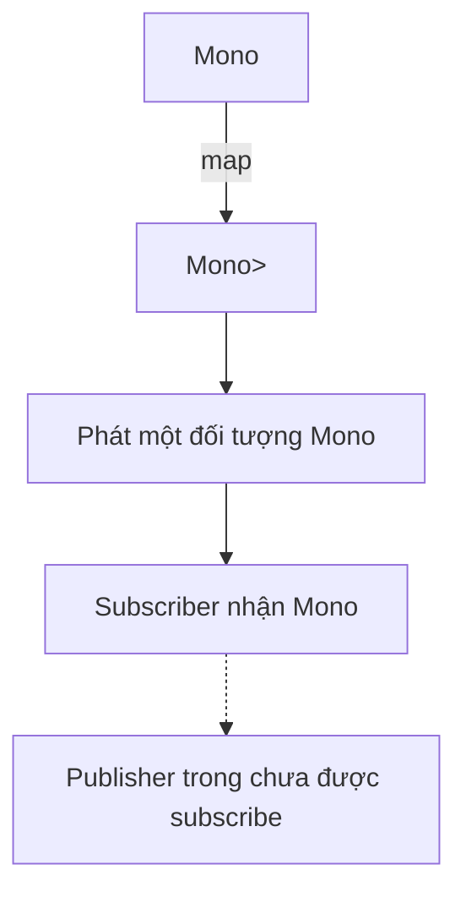
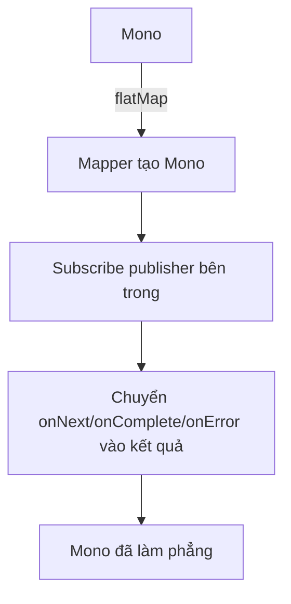

# Làm phẳng luồng lồng nhau và ý nghĩa của phép ánh xạ bất đồng bộ

Trong một pipeline reactive, một bước xử lý thường cần gọi một thao tác khác cũng trả về publisher. Ví dụ, từ một đơn hàng cần tải thông tin giao hàng; từ mỗi người dùng cần tải danh sách đơn hàng; hoặc từ một sự kiện cần gọi dịch vụ bên ngoài để lấy kết quả. Khi mapper trả về `Mono` hay `Flux`, phép ánh xạ thông thường có thể tạo ra publisher lồng nhau. Muốn nối kết quả của thao tác bên trong vào luồng bên ngoài, cần làm phẳng cấu trúc đó.

Reactor cung cấp `flatMap`, `concatMap` và `flatMapSequential` cho những cách phối hợp khác nhau. Chúng đều nhận một phần tử đầu vào, tạo publisher bên trong và đưa phần tử từ publisher đó vào luồng kết quả. Điểm khác nhau nằm ở cách đăng ký các publisher bên trong, mức độ chạy đồng thời, thứ tự phát kết quả và lượng dữ liệu cần giữ trong bộ đệm. Hiểu các khác biệt này giúp thiết kế pipeline Java reactive đúng với hợp đồng dữ liệu và yêu cầu nghiệp vụ.

## 1. map biến đổi giá trị; flatMap nối publisher

`map` nhận một giá trị và trả về một giá trị mới. Nếu hàm mapper trả về một publisher, publisher đó trở thành chính payload của luồng ngoài:

```java
Mono<Order> order = orderRepository.findById(orderId);

Mono<Mono<Delivery>> nested = order.map(
    value -> deliveryClient.findForOrder(value.getId())
);
```

Kiểu của `nested` là `Mono<Mono<Delivery>>`: publisher ngoài phát ra một đối tượng publisher bên trong. Subscriber của publisher ngoài chỉ nhận được đối tượng `Mono<Delivery>`; thao tác tìm delivery chưa tự động được nối vào chuỗi tín hiệu bên ngoài.

Nếu dùng `flatMap`, mapper vẫn trả publisher nhưng Reactor đăng ký publisher bên trong và đưa tín hiệu của nó vào kết quả đã làm phẳng:

```java
Mono<Delivery> delivery = order.flatMap(
    value -> deliveryClient.findForOrder(value.getId())
);
```

Kiểu kết quả là `Mono<Delivery>`. Publisher bên trong có thể phát một delivery, hoàn tất rỗng hoặc phát lỗi; những tín hiệu đó được chuyển vào publisher kết quả.

| Toán tử | Kiểu hàm mapper | Kiểu kết quả điển hình | Ý nghĩa |
| --- | --- | --- | --- |
| `map` | `T -> R` | `Mono<R>` hoặc `Flux<R>` | Biến đổi đồng bộ một giá trị |
| `flatMap` | `T -> Publisher<R>` | `Mono<R>` hoặc `Flux<R>` | Đăng ký publisher bên trong và làm phẳng tín hiệu |
| `concatMap` | `T -> Publisher<R>` | `Flux<R>` | Làm phẳng tuần tự theo thứ tự nguồn ngoài |
| `flatMapSequential` | `T -> Publisher<R>` | `Flux<R>` | Chạy các publisher bên trong đồng thời nhưng phát kết quả theo thứ tự nguồn ngoài |

Một cách nhớ hữu ích là: `map` biến đổi payload; `flatMap` biến đổi payload thành một công việc reactive khác rồi nối kết quả công việc đó vào luồng.

## 2. Vì sao publisher lồng nhau không tự chạy?

Các publisher cold phổ biến trong Reactor mô tả công việc sẽ thực hiện khi có subscription. Khi mapper của `map` tạo ra `Mono<Delivery>`, pipeline ngoài chỉ phát đối tượng `Mono` đó như một giá trị. Nó không tự subscribe vào publisher được trả về:



Với `flatMap`, Reactor đăng ký publisher bên trong sau khi nhận phần tử ngoài:



Điều này đặc biệt quan trọng khi làm việc với API trả `Mono` hoặc `Flux`. Nếu viết `map` thay cho `flatMap`, ứng dụng có thể vô tình trả `Mono<Mono<T>>`, khiến tầng gọi phải tự subscribe lần nữa hoặc không bao giờ thực thi công việc bên trong. Tránh gọi `subscribe()` trong mapper để xử lý cấu trúc lồng; hãy chọn toán tử làm phẳng phù hợp.

## 3. Làm phẳng một nguồn đơn với flatMap

`Mono.flatMap` phù hợp khi một kết quả đơn lẻ quyết định publisher tiếp theo. Ví dụ tải đơn hàng rồi tải địa chỉ giao hàng:

```java
Mono<DeliveryAddress> address = orderRepository.findById(orderId)
    .flatMap(order -> addressRepository.findById(order.getAddressId()));
```

Nếu `findById` đầu tiên hoàn tất rỗng, mapper không được gọi và publisher kết quả cũng hoàn tất rỗng. Nếu đơn hàng tồn tại nhưng địa chỉ không tồn tại, publisher bên trong rỗng nên kết quả cuối cũng rỗng. Nếu một bước phát lỗi, lỗi được chuyển tiếp xuống subscriber.

`flatMap` cũng cho phép kết hợp nhiều thao tác phụ thuộc:

```java
Mono<OrderView> view = orderRepository.findById(orderId)
    .flatMap(order -> customerRepository.findById(order.getCustomerId())
        .map(customer -> OrderView.from(order, customer)));
```

Ở đây, cần có đơn hàng trước để biết mã khách hàng. Khi có customer, `map` tạo view đồng bộ. Vì mapper bên trong trả về `Mono<OrderView>`, `flatMap` ngoài nối publisher đó vào kết quả. Nếu bước bên trong chỉ biến đổi giá trị đồng bộ, `map` bên trong là lựa chọn phù hợp.

Nếu thao tác bên trong chỉ cần hoàn tất rồi trả lại giá trị đã có, có thể dùng `thenReturn`:

```java
Mono<Order> authorizedOrder = orderRepository.findById(orderId)
    .flatMap(order -> paymentClient.authorize(order)
        .thenReturn(order));
```

`thenReturn(order)` bỏ qua payload của publisher thanh toán, chờ publisher đó hoàn tất rồi phát lại `order`. Nếu thanh toán lỗi, lỗi vẫn đi xuống; nếu thanh toán hoàn tất rỗng bình thường, `thenReturn` vẫn phát order sau khi hoàn tất.

## 4. Làm phẳng nhiều phần tử với flatMap

Với `Flux<T>`, mapper có thể tạo một publisher cho từng phần tử nguồn. `flatMap` đăng ký các publisher bên trong và hợp nhất tín hiệu của chúng thành một `Flux`:

```java
Flux<Order> orders = orderRepository.findRecentOrders();

Flux<LineItem> items = orders.flatMap(
    order -> lineItemRepository.findByOrderId(order.getId())
);
```

Mỗi order mở ra một `Flux<LineItem>`. Kết quả là một `Flux<LineItem>` duy nhất chứa các item từ các publisher con. Nếu một order không có item, publisher con của order đó hoàn tất rỗng và không đóng góp phần tử nào vào kết quả.

Sơ đồ minh họa các publisher con phát xen kẽ:

```text
Nguồn orders:       ----●O1------●O2------●O3----|
Inner của O1:          --●a1----●a2--|
Inner của O2:                    -●b1----|
Inner của O3:                              --●c1--|
flatMap:            ------●a1-●b1-●a2----●c1----|
```

Đây là một lịch phát minh họa. Với `flatMap`, các publisher con có thể được subscribe đồng thời và các phần tử có thể xen kẽ theo thời điểm chúng sẵn sàng. Thứ tự phát của luồng kết quả không nhất thiết giữ thứ tự phần tử nguồn ngoài. Nếu mapper trả `Mono<R>` thì mỗi inner chỉ phát tối đa một phần tử; thứ tự hoàn tất của các inner vẫn có thể khác thứ tự đầu vào.

## 5. flatMap không tự động tạo thêm thread

Tên `flatMap` thường khiến người học nghĩ rằng mỗi inner publisher luôn chạy trên một thread riêng. Điều đó không đúng. `flatMap` điều phối subscription và hợp nhất tín hiệu; việc thực thi ở thread nào phụ thuộc nguồn, scheduler và toán tử chuyển scheduler trong pipeline.

Ví dụ `Mono.just(value)` phát đồng bộ ngay trên thread đang subscribe. `Mono.fromCallable(...)` cũng thực thi trên thread subscribe nếu không có scheduler chuyển luồng. Muốn cô lập một lời gọi blocking, cần đặt scheduler phù hợp:

```java
Flux<UserView> views = userIds.flatMap(userId ->
    Mono.fromCallable(() -> legacyUserClient.findBlocking(userId))
        .subscribeOn(Schedulers.boundedElastic())
        .map(userMapper::toView)
);
```

`subscribeOn` đặt việc thực thi nguồn callable trên `boundedElastic`. `flatMap` cho phép nhiều inner publisher tiến triển đồng thời, nhưng mức đồng thời nên được giới hạn theo năng lực dịch vụ và pool luồng. Nếu API client đã reactive và non-blocking, không cần bọc nó trong `fromCallable` hay chuyển sang `boundedElastic` một cách máy móc.

Một mapper trả `Mono` không đồng nghĩa với thao tác bất đồng bộ theo nghĩa chạy trên thread khác. Publisher có thể hoàn tất ngay lập tức, phát đồng bộ hoặc chờ I/O. Hãy xác định rõ đặc tính của nguồn thay vì dựa vào tên toán tử.

## 6. Giới hạn concurrency và prefetch

`flatMap` có overload nhận `concurrency` và `prefetch`:

```java
Flux<Result> results = requests.flatMap(
    request -> remoteService.execute(request),
    8,   // concurrency tối đa cho các inner đang hoạt động
    16   // prefetch cho mỗi inner publisher dạng nhiều phần tử
);
```

`concurrency` giới hạn số inner publisher được subscribe đồng thời. Khi một inner hoàn tất, toán tử có thể subscribe thêm inner tiếp theo. Giới hạn này giúp tránh gửi quá nhiều yêu cầu tới dịch vụ ngoài hoặc tạo quá nhiều tác vụ cùng lúc.

`prefetch` điều khiển số phần tử được yêu cầu trước từ mỗi inner publisher trong các toán tử hỗ trợ prefetch. Nó ảnh hưởng đến lượng dữ liệu có thể nằm trong hàng đợi và độ trễ giữa producer với consumer. `prefetch` không phải số thread và cũng không phải giới hạn tổng số phần tử của toàn pipeline.

Khi chọn concurrency, cân nhắc giới hạn kết nối HTTP, giới hạn truy vấn database, quota của dịch vụ ngoài và khả năng xử lý downstream. Giá trị quá cao có thể gây quá tải hoặc tăng lượng dữ liệu chờ trong bộ nhớ. Giá trị quá thấp có thể làm giảm throughput khi các inner thường xuyên chờ I/O.

## 7. So sánh flatMap, concatMap và flatMapSequential

Ba toán tử đều làm phẳng publisher lồng nhau nhưng cung cấp các bảo đảm khác nhau:

| Toán tử | Cách subscribe inner | Thứ tự kết quả | Đặc điểm |
| --- | --- | --- | --- |
| `flatMap` | Có thể subscribe nhiều inner đồng thời | Có thể xen kẽ và khác thứ tự nguồn | Tối ưu độ linh hoạt/concurrency khi không cần giữ thứ tự |
| `concatMap` | Xử lý inner tuần tự; inner sau được nối khi inner trước hoàn tất | Giữ thứ tự nguồn | Dễ dự đoán, phù hợp khi thứ tự quan trọng hoặc cần giới hạn một inner tại một thời điểm |
| `flatMapSequential` | Có thể subscribe nhiều inner đồng thời | Phát kết quả theo thứ tự nguồn | Tăng concurrency nhưng có thể phải buffer kết quả của inner hoàn tất sớm |

Ví dụ ba cách xử lý cùng một nguồn:

```java
Flux<String> unordered = userIds.flatMap(userService::loadName);

Flux<String> orderedOneAtATime = userIds.concatMap(userService::loadName);

Flux<String> orderedConcurrent = userIds.flatMapSequential(
    userService::loadName,
    8
);
```

Giả sử user đầu tiên mất nhiều thời gian, còn user thứ hai hoàn tất nhanh:

```text
Nguồn:                 ----●U1----●U2----|
Inner U1:                 ----------------●A|
Inner U2:                          --●B|

flatMap:                 ----------------●B--●A|
concatMap:               ----------------●A--●B|
flatMapSequential:       ----------------●A--●B|
```

`flatMap` có thể phát `B` trước `A`. `concatMap` chưa bắt đầu xử lý U2 cho tới khi inner U1 hoàn tất. `flatMapSequential` có thể bắt đầu cả hai inner, nhưng giữ `B` trong bộ đệm cho tới khi kết quả U1 được phát xong, sau đó mới phát `B`.

Giữ thứ tự có thể tăng bộ nhớ và độ trễ. Nếu inner đầu tiên chậm, các inner sau dù đã hoàn tất cũng phải chờ trong `flatMapSequential`. `concatMap` tránh nhiều inner hoạt động cùng lúc nhưng throughput có thể thấp hơn khi các tác vụ chủ yếu chờ I/O. Hãy chọn theo yêu cầu thứ tự và tải, không chỉ theo tên toán tử.

## 8. Lỗi từ inner publisher được truyền như thế nào?

Theo mặc định, nếu một inner publisher phát `onError`, pipeline làm phẳng kết thúc bằng lỗi và các inner đang hoạt động có thể bị hủy. Những phần tử đã được phát trước lỗi vẫn đã tới downstream; lỗi không thu hồi chúng.

```java
Flux<UserView> views = userIds.flatMap(userId ->
    userService.load(userId)
        .map(userMapper::toView)
);
```

Nếu một lần tải user lỗi, `views` mặc định kết thúc bằng lỗi. Khi nghiệp vụ cho phép bỏ qua một user lỗi và tiếp tục các user khác, đặt xử lý lỗi bên trong mapper để mỗi inner tự phục hồi:

```java
Flux<UserView> views = userIds.flatMap(userId ->
    userService.load(userId)
        .map(userMapper::toView)
        .onErrorResume(error -> {
            log.warn("Bỏ qua user {} do lỗi tải dữ liệu", userId, error);
            return Mono.empty();
        })
);
```

Ở đây, lỗi của một inner được chuyển thành hoàn tất rỗng cho inner đó; các inner khác vẫn có thể tiếp tục. Nếu đặt `onErrorResume` sau `flatMap`, nó xử lý lỗi của toàn bộ luồng đã hợp nhất và có thể thay cả pipeline bằng một publisher dự phòng. Hai vị trí này có phạm vi tác động khác nhau.

Một số toán tử có biến thể delay-error, cho phép thu thập lỗi và trì hoãn phát terminal error cho tới khi các inner khác kết thúc. Chỉ dùng khi hợp đồng nghiệp vụ yêu cầu; delay-error không có nghĩa lỗi biến mất và có thể giữ tài nguyên lâu hơn trong lúc chờ các inner.

## 9. Cancellation lan tới các inner đang hoạt động

Khi downstream hủy subscription của pipeline làm phẳng, Reactor truyền cancellation tới các inner publisher đang được quản lý. Các nguồn hỗ trợ cancellation có thể dừng việc phát và giải phóng tài nguyên. Với thao tác blocking hoặc thư viện không hỗ trợ hủy, công việc bên dưới có thể vẫn tiếp tục dù subscriber không còn nhận kết quả.

Giới hạn concurrency giúp giới hạn số inner đang hoạt động tại một thời điểm, nhưng không thay thế timeout cho từng lời gọi. Nếu một inner không bao giờ hoàn tất, nó có thể giữ một slot concurrency và làm chậm việc xử lý các phần tử tiếp theo. Hãy đặt timeout ở đúng ranh giới thao tác và xác định liệu timeout sẽ làm lỗi toàn pipeline hay được phục hồi riêng cho inner đó.

## 10. Kết hợp publisher một phần tử và nhiều phần tử

Mapper của `Flux.flatMap` có thể trả `Mono<R>` hoặc `Flux<R>`. Với `Mono<R>`, mỗi phần tử ngoài tạo tối đa một kết quả; với `Flux<R>`, mỗi phần tử ngoài có thể tạo nhiều kết quả:

```java
// Mỗi mã người dùng tạo tối đa một hồ sơ.
Flux<User> users = userIds.flatMap(userRepository::findById);

// Mỗi mã tài khoản có thể tạo nhiều giao dịch.
Flux<Transaction> transactions = accountIds.flatMap(
    transactionRepository::findByAccountId
);
```

Nếu cần chuyển một `Mono<T>` thành `Flux<R>` sau khi hoàn tất một thao tác bất đồng bộ, có thể dùng `flatMapMany`:

```java
Flux<LineItem> items = orderRepository.findById(orderId)
    .flatMapMany(order -> lineItemRepository.findByOrderId(order.getId()));
```

`flatMapMany` làm rõ rằng nguồn ngoài có tối đa một order nhưng publisher kết quả có thể phát nhiều item. Nếu order không tồn tại, mapper không chạy và kết quả là `Flux` rỗng.

## 11. Kiểm thử thứ tự và concurrency bằng StepVerifier

`StepVerifier` giúp xác minh các phần tử downstream thực sự quan sát được. Với nguồn đồng bộ, có thể kiểm tra trực tiếp kết quả làm phẳng:

```java
StepVerifier.create(
        Flux.just(1, 2, 3)
            .flatMap(value -> Flux.just(value, value * 10))
    )
    .expectNextCount(6)
    .verifyComplete();
```

Khi kiểm thử thứ tự, dùng publisher có thời gian hoàn tất được điều khiển để tránh phụ thuộc vào lịch chạy ngẫu nhiên. Ví dụ, `concatMap` phải giữ thứ tự nguồn dù inner sau có thể hoàn tất nhanh hơn; `flatMapSequential` cũng giữ thứ tự đầu ra trong khi cho phép inner chạy đồng thời. Với `flatMap`, chỉ khẳng định thứ tự nếu nguồn và các inner thực sự bảo đảm thứ tự đó.

Có thể dùng `StepVerifier.withVirtualTime` cho publisher dựa trên scheduler thời gian ảo, hoặc tạo publisher test có `Sinks.One`/`TestPublisher` để chủ động hoàn tất inner theo thứ tự mong muốn. Khi kiểm tra concurrency, đo số inner đồng thời cực đại và xác minh nó không vượt quá giới hạn đã cấu hình. Không nên dùng `Thread.sleep` tùy ý để ép thứ tự vì test sẽ dễ chập chờn.

## 12. Chọn toán tử theo hợp đồng của nghiệp vụ

Dùng `map` khi một phần tử được biến đổi thành một giá trị mới ngay trong hàm mapper. Dùng `flatMap` khi một phần tử mở ra publisher khác và kết quả của publisher đó cần được nối vào luồng. Nếu thứ tự nguồn phải được giữ và chỉ nên xử lý một inner tại một thời điểm, chọn `concatMap`. Nếu muốn xử lý nhiều inner đồng thời nhưng vẫn phát theo thứ tự nguồn, chọn `flatMapSequential` và chấp nhận khả năng buffer.

Đừng xem `flatMap` là cách tự động tạo thread. Hãy cấu hình scheduler tại nguồn hoặc thao tác cần chuyển luồng; đặt giới hạn concurrency theo khả năng dịch vụ; xác định chính sách lỗi cho từng inner; và kiểm tra cancellation cùng timeout. Khi hiểu cấu trúc kiểu dữ liệu và vòng đời của inner publisher, việc làm phẳng luồng lồng nhau sẽ trở thành cách compose rõ ràng, có kiểm soát trong ứng dụng Java reactive.
