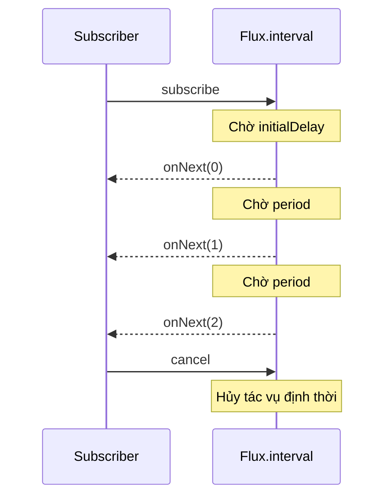

# Nguồn phát theo khoảng thời gian và bộ định thời

Trong module `REACTIVE_PROGRAMMING`, ta học cách tổ chức luồng sự kiện bất đồng bộ theo hợp đồng Publisher–Subscriber và backpressure của Reactive Streams, đồng thời thực hành `Mono`, `Flux`, toán tử, scheduler, xử lý lỗi và kiểm thử pipeline trong hệ sinh thái Java. Một nguồn reactive có thể phát dữ liệu theo nhịp thời gian thay vì chờ một nguồn bên ngoài gửi từng phần tử. Reactor cung cấp `Flux.interval` để tạo chuỗi tick định kỳ và `Mono.delay` để phát một tín hiệu sau một khoảng chờ.

Các nguồn định thời hữu ích cho polling, nhịp làm mới trạng thái, heartbeat, trì hoãn một bước xử lý và kiểm thử hành vi phụ thuộc thời gian. Khi dùng chúng, cần hiểu thời điểm phát tick đầu tiên, scheduler thực thi, cách cancellation dừng bộ định thời và điều gì xảy ra nếu downstream xử lý chậm hơn nhịp phát.

## 1. `Flux.interval`: phát tick định kỳ

`Flux.interval(Duration period)` tạo một Publisher phát các giá trị kiểu `Long` theo chu kỳ. Giá trị đầu tiên là `0L`, tiếp theo là `1L`, `2L` và tăng dần. Với overload chỉ nhận `period`, tick đầu tiên được lên lịch sau một khoảng bằng chu kỳ đó.

```java
Flux<Long> ticks = Flux.interval(Duration.ofSeconds(1));

ticks.take(5).subscribe(tick ->
    log.info("Heartbeat {}", tick)
);
```

Đoạn mã phát năm tick với chỉ số từ `0` đến `4`, sau đó `take(5)` hoàn tất luồng và hủy subscription upstream. Việc tạo biến `ticks` chỉ lắp ráp Publisher; bộ định thời bắt đầu cho từng subscription.

Có thể chỉ định thời gian chờ ban đầu và chu kỳ riêng biệt:

```java
Flux<Long> ticks = Flux.interval(
    Duration.ofSeconds(3),  // chờ 3 giây trước tick đầu tiên
    Duration.ofSeconds(10)  // sau đó phát mỗi 10 giây
);
```

Overload này hữu ích khi muốn trì hoãn lần thực thi đầu tiên nhưng vẫn duy trì một nhịp định kỳ khác. Nếu cần một tick đầu tiên được lên lịch ngay, có thể dùng thời gian chờ ban đầu bằng `Duration.ZERO`; việc thực thi vẫn tuân theo scheduler, không có nghĩa callback chạy đồng bộ ngay trong câu lệnh lắp ráp.



## 2. `Mono.delay`: bộ định thời một lần

`Mono.delay(Duration delay)` tạo một Mono phát duy nhất giá trị `0L` sau khoảng chờ rồi gửi `onComplete`.

```java
Mono<Long> timer = Mono.delay(Duration.ofSeconds(5));

timer.subscribe(ignored -> log.info("Đã hết thời gian chờ"));
```

`Mono.delay` phù hợp với một lần trì hoãn hoặc làm tín hiệu kích hoạt một bước xử lý. Ví dụ, có thể chờ một khoảng ngắn trước khi thực hiện thao tác tiếp theo:

```java
Mono<Config> config = Mono.delay(Duration.ofMillis(500))
    .then(configRepository.load());
```

Trong ví dụ, `then` đăng ký vào Publisher `configRepository.load()` sau khi Mono định thời hoàn tất. Nếu `load()` trả về `Mono<Config>`, kết quả của nó được phát xuống downstream. Cần nhớ rằng biểu thức `configRepository.load()` được gọi khi pipeline được lắp ráp; nếu chính việc gọi phương thức đó có side effect cần trì hoãn, hãy bọc nó bằng `Mono.defer`:

```java
Mono<Config> config = Mono.delay(Duration.ofMillis(500))
    .then(Mono.defer(configRepository::load));
```

`Mono.delay` không truyền giá trị thời gian đã trôi qua; nó phát một tín hiệu `0L` để báo bộ định thời đã kết thúc. Nếu cần tính thời gian thực tế, hãy đo bằng `Instant` hoặc `System.nanoTime()` tại các điểm phù hợp, thay vì diễn giải chỉ số của tick như đồng hồ chính xác.

## 3. Phân biệt nguồn định kỳ và các toán tử trì hoãn

Reactor có nhiều API liên quan đến thời gian nhưng chúng biểu diễn các hành vi khác nhau:

| API | Ý nghĩa | Khi nào dùng |
|---|---|---|
| `Flux.interval(period)` | Tạo tick mới theo chu kỳ | Heartbeat, polling, nhịp định kỳ |
| `Mono.delay(duration)` | Phát một tín hiệu sau một khoảng chờ | Timer một lần, trì hoãn bước tiếp theo |
| `delayElements(duration)` | Trì hoãn việc phát từng phần tử của một nguồn hiện có | Làm chậm nhịp phát của dữ liệu đã có |
| `delaySubscription(duration)` | Trì hoãn thời điểm đăng ký vào nguồn upstream | Chỉ bắt đầu công việc nguồn sau một khoảng chờ |
| `timeout(duration)` | Phát lỗi nếu nguồn không phát tín hiệu cần thiết trong thời hạn | Đặt giới hạn thời gian chờ |

Ví dụ, `delayElements` không tạo thêm tick độc lập. Nó trì hoãn từng phần tử đã có:

```java
Flux<String> messages = Flux.just("A", "B", "C")
    .delayElements(Duration.ofSeconds(1));
```

Ngược lại, `Flux.interval` tạo các tick dựa trên đồng hồ của scheduler, dù không có phần tử đầu vào nào. `delaySubscription` trì hoãn việc bắt đầu nguồn:

```java
Mono<Data> data = remoteClient.fetch()
    .delaySubscription(Duration.ofSeconds(2));
```

Trong đoạn trên, lời gọi `remoteClient.fetch()` vẫn được thực hiện khi biểu thức được lắp ráp. Nếu cần trì hoãn cả việc gọi phương thức tạo Publisher, dùng:

```java
Mono<Data> data = Mono.defer(remoteClient::fetch)
    .delaySubscription(Duration.ofSeconds(2));
```

## 4. Scheduler của bộ định thời

Các nguồn `Flux.interval` và `Mono.delay` mặc định sử dụng scheduler định thời của Reactor (mặc định là `Schedulers.parallel()`). Có thể truyền một scheduler riêng khi cần kiểm soát môi trường thực thi:

```java
Scheduler timerScheduler = Schedulers.newSingle("heartbeat-timer");

Flux<Long> ticks = Flux.interval(
    Duration.ofSeconds(1),
    timerScheduler
);
```

Một scheduler do ứng dụng tạo cần được quản lý vòng đời và dispose khi không còn sử dụng:

```java
timerScheduler.dispose();
```

Trong ứng dụng lâu dài, nên quản lý scheduler ở cấp thành phần hoặc cấu hình ứng dụng, tránh tạo một scheduler mới cho từng request rồi bỏ quên việc giải phóng.

Scheduler định thời đưa ra thời điểm mục tiêu cho tick, không phải cam kết thời gian thực cứng. Khi thread bị bận, máy chịu tải cao hoặc callback chặn thread, việc thực thi có thể trễ so với chu kỳ cấu hình. Không dùng `interval` làm đồng hồ chính xác cho deadline hoặc điều khiển thiết bị đòi hỏi độ chính xác thời gian thực.

Scheduler được truyền vào `interval` quyết định nơi tác vụ timer phát tick. Nếu callback downstream thực hiện công việc blocking, không nên để callback đó chiếm thread định thời. Có thể chuyển phần xử lý phía sau sang scheduler phù hợp bằng `publishOn`:

```java
Flux.interval(Duration.ofSeconds(1))
    .publishOn(Schedulers.boundedElastic())
    .concatMap(tick -> blockingService.refreshStatus(tick))
    .subscribe();
```

`publishOn` chuyển các tín hiệu phía sau nó sang scheduler được chọn. `concatMap` xử lý tuần tự từng Publisher trả về từ `refreshStatus`, tránh chạy đồng thời nhiều lần refresh. Nếu một lần refresh lâu hơn chu kỳ phát, tick có thể tích lũy trong hàng đợi nội bộ hoặc khiến nguồn định kỳ vượt khả năng demand; cần kiểm soát tốc độ và chính sách quá tải. `boundedElastic` thích hợp cho tác vụ blocking có giới hạn, còn tác vụ CPU-bound nên dùng scheduler phù hợp với tính chất xử lý.

## 5. Backpressure với nguồn định thời

`Flux.interval` tạo tick theo thời gian thực. Nó không thể tự dời một tick đã đến chỉ vì downstream đang bận. Nếu một tick đến khi subscription không có đủ demand để nhận nó, nguồn interval có thể kết thúc bằng lỗi overflow. Đây là điểm khác với một nguồn có thể chờ demand trước khi tạo phần tử.

Giả sử timer phát mỗi 100 ms nhưng downstream mất 500 ms để xử lý một tick. Sau một khoảng thời gian, tốc độ phát sẽ vượt tốc độ tiêu thụ. Cần chọn một chính sách phù hợp với ý nghĩa của tick:

**Bỏ tick khi downstream bận:**

```java
Flux.interval(Duration.ofMillis(100))
    .onBackpressureDrop(tick ->
        log.debug("Bỏ tick {} vì downstream chưa sẵn sàng", tick)
    )
    .concatMap(this::processTick)
    .subscribe();
```

**Chỉ giữ tick mới nhất đang chờ:**

```java
Flux.interval(Duration.ofMillis(100))
    .onBackpressureLatest()
    .concatMap(this::processTick)
    .subscribe();
```

Với heartbeat hoặc refresh trạng thái, bỏ các tick trung gian có thể chấp nhận được vì mục tiêu là thực hiện một lần cập nhật gần nhất. Với tác vụ định kỳ mà mỗi lần đều phải chạy, drop/latest có thể làm mất lần thực thi nghiệp vụ; khi đó cần một cơ chế lập lịch có hàng đợi bền vững hoặc điều phối riêng.

Có thể dùng buffer có giới hạn nếu muốn hấp thụ một burst ngắn:

```java
Flux.interval(Duration.ofMillis(100))
    .onBackpressureBuffer(32)
    .concatMap(this::processTick)
    .subscribe();
```

Khi vượt giới hạn 32 phần tử, chính sách mặc định của overload này là kết thúc bằng lỗi overflow. Buffer chỉ hấp thụ chênh lệch trong một khoảng thời gian; nó không làm timer phát chậm lại. Cần đo số tick bị bỏ, lỗi overflow và thời gian xử lý để chọn chu kỳ phù hợp.

## 6. Cancellation và vòng đời bộ định thời

Mỗi subscription vào `Flux.interval` hoặc `Mono.delay` có một tác vụ định thời riêng. Khi downstream hủy subscription, Reactor hủy tác vụ định thời tương ứng để ngừng phát tín hiệu cho subscription đó.

Ví dụ, `take(3)` tự động hủy nguồn sau khi nhận ba tick:

```java
Flux<Long> firstThreeTicks = Flux.interval(Duration.ofSeconds(1))
    .take(3);
```

Nếu một ứng dụng giữ `Disposable` từ `subscribe()`, có thể hủy thủ công:

```java
Disposable subscription = Flux.interval(Duration.ofSeconds(1))
    .subscribe(this::handleTick);

// Khi thành phần không còn cần heartbeat:
subscription.dispose();
```

Hủy subscription dừng bộ định thời thuộc subscription đó. Nó không dispose một scheduler dùng chung của ứng dụng. Scheduler dùng chung chỉ nên được dispose khi thành phần sở hữu nó kết thúc vòng đời và không còn subscription nào cần sử dụng.

## 7. Kiểm thử thời gian bằng virtual time

Kiểm thử nguồn định thời bằng `Thread.sleep` làm bài test chậm và dễ dao động theo tải máy. Reactor Test cung cấp `StepVerifier.withVirtualTime` để tiến đồng hồ giả lập mà không phải chờ thời gian thực.

```java
StepVerifier.withVirtualTime(
        () -> Flux.interval(Duration.ofSeconds(1)).take(3)
    )
    .thenAwait(Duration.ofSeconds(3))
    .expectNext(0L, 1L, 2L)
    .verifyComplete();
```

`withVirtualTime` thiết lập scheduler giả lập trước khi supplier tạo Publisher. Vì vậy, hãy tạo nguồn định thời bên trong supplier, không tạo sẵn ở bên ngoài rồi truyền vào. `thenAwait` tiến đồng hồ giả lập ba giây; bài kiểm thử nhận ba tick và xác nhận nguồn hoàn tất.

Kiểm thử timer một lần:

```java
StepVerifier.withVirtualTime(
        () -> Mono.delay(Duration.ofSeconds(5))
    )
    .thenAwait(Duration.ofSeconds(5))
    .expectNext(0L)
    .verifyComplete();
```

Có thể kiểm tra rằng timer chưa phát trước thời hạn:

```java
StepVerifier.withVirtualTime(
        () -> Mono.delay(Duration.ofSeconds(5))
    )
    .expectSubscription()
    .thenAwait(Duration.ofSeconds(4))
    .expectNoEvent(Duration.ofMillis(500))
    .thenAwait(Duration.ofMillis(500))
    .expectNext(0L)
    .verifyComplete();
```

Virtual time chỉ điều khiển các scheduler tương thích với cơ chế giả lập. Nếu code tự tạo scheduler riêng không được virtual-time thay thế hoặc gọi API đồng hồ hệ thống trực tiếp, phần đó có thể vẫn chạy theo thời gian thực. Hãy thiết kế thành phần định thời để có thể truyền scheduler vào khi cần kiểm thử.

## 8. Ví dụ thực tế: polling có giới hạn

Một dịch vụ có thể cần kiểm tra trạng thái của một tác vụ cho đến khi tác vụ hoàn tất hoặc hết thời gian chờ. Dùng `Flux.interval` để tạo nhịp kiểm tra, `take` để giới hạn số lần và `takeUntil` để dừng khi điều kiện hoàn tất:

```java
Mono<JobStatus> pollUntilFinished(String jobId) {
    return Flux.interval(
            Duration.ZERO,
            Duration.ofSeconds(2)
        )
        .onBackpressureDrop()
        .concatMap(tick -> jobClient.getStatus(jobId), 1)
        .takeUntil(JobStatus::isFinished)
        .last();
}
```

`Duration.ZERO` yêu cầu lần kiểm tra đầu tiên được lên lịch ngay, sau đó các lần tiếp theo cách nhau hai giây. `onBackpressureDrop` bỏ tick đến trong lúc lần kiểm tra trước chưa hoàn tất; `concatMap` với prefetch bằng một giữ việc gọi client tuần tự. `takeUntil` giữ lại trạng thái đầu tiên thỏa điều kiện rồi hủy nguồn interval. `last()` chuyển Flux kết quả thành Mono chứa trạng thái cuối cùng. Chính sách bỏ tick này phù hợp khi không cần chạy bù mọi nhịp polling đã trôi qua.

Ví dụ này giả định `getStatus` luôn phát một `JobStatus` và có thể hoàn tất. Trong hệ thống thật, cần thêm timeout tổng thể hoặc số lần thử tối đa để tránh polling vô hạn:

```java
Mono<JobStatus> pollUntilFinished(String jobId) {
    return Flux.interval(Duration.ZERO, Duration.ofSeconds(2))
        .onBackpressureDrop()
        .concatMap(tick -> jobClient.getStatus(jobId), 1)
        .takeUntil(JobStatus::isFinished)
        .last()
        .timeout(Duration.ofMinutes(2));
}
```

`timeout` ở đây giới hạn tổng thời gian chờ của Mono kết quả. Nếu không có trạng thái cuối cùng trong thời hạn, downstream nhận tín hiệu lỗi timeout. Nếu cần giới hạn thời gian riêng cho từng request trạng thái, đặt timeout bên trong Publisher được tạo cho mỗi lần polling.

## 9. Những lỗi thường gặp khi làm việc với timer

| Sai lầm | Hệ quả | Cách xử lý |
|---|---|---|
| Nghĩ `interval` phát tick đầu tiên ngay lập tức | Lần phát đầu mặc định đến sau một chu kỳ | Dùng overload có `initialDelay` rõ ràng |
| Dùng `interval` cho công việc blocking | Thread định thời bị chiếm, tick có thể trễ hoặc overflow | Chuyển xử lý downstream sang scheduler phù hợp |
| Giả định timer chờ demand | Tick đến khi thiếu demand có thể gây overflow | Chọn drop/latest/buffer có giới hạn hoặc điều chỉnh thiết kế |
| Dùng buffer không giới hạn để giữ mọi tick | Hàng đợi và độ trễ có thể tăng liên tục | Đặt giới hạn và chính sách đầy |
| Tạo scheduler riêng nhưng không dispose | Giữ tài nguyên thread sau khi thành phần kết thúc | Quản lý scheduler theo vòng đời thành phần |
| Kiểm thử bằng `Thread.sleep` | Test chậm và không ổn định | Dùng `StepVerifier.withVirtualTime` |
| Polling không có điểm dừng | Subscription và timer có thể chạy vô hạn | Dùng điều kiện kết thúc, `take` hoặc `timeout` |

## 10. Quy trình lựa chọn

Khi cần thêm yếu tố thời gian vào pipeline, hãy xác định:

1. **Cần một lần chờ hay nhịp định kỳ?** Dùng `Mono.delay` cho timer một lần và `Flux.interval` cho chuỗi tick.
2. **Tick đầu tiên xuất hiện khi nào?** Chọn overload có `initialDelay` để thể hiện rõ thời gian chờ ban đầu.
3. **Công việc phía sau có blocking không?** Chọn scheduler cho timer và chuyển xử lý blocking sang scheduler thích hợp.
4. **Điều gì xảy ra khi downstream chậm?** Chọn chính sách drop, latest hoặc buffer có giới hạn theo ý nghĩa của tick.
5. **Khi nào phải dừng?** Dùng `take`, điều kiện kết thúc, timeout hoặc cancellation từ chủ sở hữu subscription.
6. **Có thể kiểm thử mà không chờ đồng hồ thật không?** Dùng `StepVerifier.withVirtualTime` và tạo Publisher bên trong supplier.

`Flux.interval` và `Mono.delay` đưa thời gian vào mô hình Publisher–Subscriber bằng các tín hiệu có thể kết hợp với toán tử Reactor. Khi xác định rõ scheduler, backpressure, cancellation và thời hạn, bộ định thời trở thành một phần có thể kiểm soát và kiểm thử của pipeline reactive.
