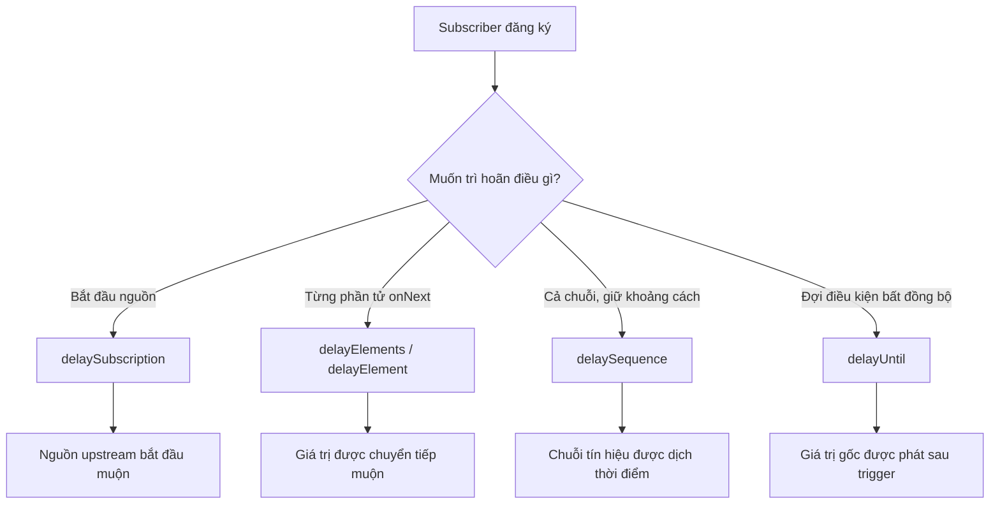

# Trì hoãn đăng ký, trì hoãn phần tử và trì hoãn tín hiệu

Trong chương **Thời gian**, bài học này giúp kiểm soát thời điểm một pipeline reactive bắt đầu lấy dữ liệu và thời điểm các tín hiệu được chuyển đến subscriber. Ta thường cần chờ một khoảng thời gian trước khi gọi nguồn, giãn cách các phần tử khi phát, hoặc đợi một điều kiện bất đồng bộ hoàn tất rồi mới chuyển tiếp kết quả.

Bài học thuộc module **REACTIVE_PROGRAMMING**. Module hướng dẫn: “Học tư duy reactive qua các luồng sự kiện bất đồng bộ, hợp đồng Publisher–Subscriber và cơ chế backpressure của Reactive Streams. Thực hành Mono, Flux, kết hợp toán tử, kiểm soát scheduler, xử lý lỗi và kiểm thử pipeline trong hệ sinh thái Java.” Các toán tử thời gian của Reactor cho phép mô tả những khoảng chờ này ngay trong pipeline, đồng thời giữ nguyên hợp đồng tín hiệu của Reactive Streams.

## 1. Ba thời điểm cần phân biệt

Khi thêm độ trễ vào pipeline, trước hết hãy xác định ta muốn trì hoãn điều gì:

1. **Trì hoãn đăng ký nguồn:** downstream đăng ký với publisher hiện tại, nhưng publisher upstream chỉ được subscribe sau một khoảng thời gian hoặc sau khi một publisher tín hiệu cho phép.
2. **Trì hoãn phần tử:** nguồn được subscribe và xử lý, nhưng mỗi giá trị `onNext` chỉ được chuyển tiếp sau một khoảng thời gian.
3. **Trì hoãn cả chuỗi tín hiệu hoặc chờ điều kiện:** dịch chuyển thời điểm phát của chuỗi mà vẫn giữ khoảng cách giữa các tín hiệu, hoặc giữ một giá trị cho đến khi một publisher khác hoàn tất.

Các trường hợp này không tương đương. Nếu cần trì hoãn một lệnh gọi HTTP đến upstream, `delaySubscription` thường đúng mục tiêu. Nếu đã có luồng dữ liệu và chỉ muốn giãn cách các phần tử, hãy xem `delayElements`. Nếu cần đợi một điều kiện bất đồng bộ gắn với giá trị, `delayUntil` diễn tả ý định rõ hơn việc chèn một khoảng ngủ cố định.



## 2. Trì hoãn đăng ký nguồn với delaySubscription

`delaySubscription(Duration)` trì hoãn việc subscribe vào publisher upstream trong khoảng thời gian chỉ định. Subscriber downstream có thể đăng ký ngay, nhưng nguồn thực sự chỉ được khởi động sau khi bộ định thời kết thúc.

```java
Flux<String> source = Flux.defer(() -> {
    System.out.println("Bắt đầu đọc nguồn");
    return Flux.just("A", "B", "C");
});

Flux<String> delayed = source
    .delaySubscription(Duration.ofSeconds(2));

delayed.subscribe(System.out::println);
```

Khi gọi `subscribe()`, Reactor thiết lập quá trình chờ hai giây. Sau đó publisher mới subscribe vào `source`; callback bên trong `defer` được gọi và các phần tử bắt đầu được phát. Nếu nguồn đại diện cho việc đọc file, truy vấn repository hoặc gọi dịch vụ từ xa, thao tác đó được khởi động muộn theo thời điểm subscription upstream.

Có thể truyền một publisher làm điều kiện trì hoãn thay vì chỉ định khoảng thời gian:

```java
Mono<Void> permissionReady = startupCoordinator.ready();

Mono<Configuration> configuration =
    configurationRepository.load()
        .delaySubscription(permissionReady);
```

Publisher nguồn chỉ được subscribe sau khi `permissionReady` phát tín hiệu hoặc hoàn tất. Nếu publisher điều kiện phát lỗi, lỗi đó được chuyển xuống và nguồn `configurationRepository.load()` không được subscribe. Cách này hữu ích khi việc bắt đầu một pipeline phụ thuộc vào trạng thái sẵn sàng của thành phần khác.

### Hủy trước khi hết thời gian chờ

Nếu downstream hủy subscription trong lúc `delaySubscription` vẫn đang chờ, tác vụ chờ được hủy và nguồn upstream không được subscribe. Điều này quan trọng với các nguồn tốn tài nguyên: một yêu cầu đã bị người dùng hủy không nên khởi động truy vấn hoặc cuộc gọi mạng sau đó.

```java
Disposable subscription =
    source.delaySubscription(Duration.ofSeconds(10))
        .subscribe();

subscription.dispose();
```

Trong ví dụ này, nếu `dispose()` xảy ra trước khi hết mười giây, Reactor không khởi động subscription vào `source`.

Dùng `delaySubscription` khi cần trì hoãn thời điểm bắt đầu nguồn. Nó không có nghĩa là mọi thao tác trong pipeline được chạy trên một luồng riêng, và cũng không biến một lời gọi blocking thành non-blocking.

## 3. Trì hoãn từng phần tử với delayElements và delayElement

Với `Flux`, `delayElements(Duration)` trì hoãn từng tín hiệu `onNext` theo khoảng thời gian chỉ định. Các phần tử vẫn được phát theo thứ tự của nguồn.

```java
Flux<Integer> pacedNumbers =
    Flux.range(1, 4)
        .delayElements(Duration.ofMillis(500));

pacedNumbers.subscribe(System.out::println);
```

Nguồn có bốn số nguyên. Mỗi phần tử được chuyển tiếp sau khoảng trễ 500 mili giây; subscriber nhận lần lượt 1, 2, 3 và 4. Toán tử này hữu ích khi muốn quan sát hoặc xử lý một luồng với nhịp chậm hơn.

Với `Mono`, dùng `delayElement(Duration)` để trì hoãn giá trị duy nhất:

```java
Mono<String> delayedGreeting =
    Mono.just("Xin chào")
        .delayElement(Duration.ofSeconds(1));
```

Nếu Mono phát một giá trị, `onNext` được trì hoãn một giây. Nếu Mono hoàn tất rỗng hoặc phát lỗi, các tín hiệu đó không bị trì hoãn như một giá trị `onNext`. Vì thế, đừng dùng `delayElement` để giả định rằng mọi kết thúc của Mono đều được dời cùng một khoảng thời gian.

Có thể chỉ định scheduler làm bộ định thời:

```java
Flux<String> messages =
    Flux.just("đã nhận", "đang xử lý", "hoàn tất")
        .delayElements(
            Duration.ofSeconds(1),
            Schedulers.parallel()
        );
```

Khi không truyền scheduler, Reactor sử dụng scheduler mặc định dành cho bộ định thời của toán tử. Overload nhận scheduler cho phép chỉ định nơi quản lý tác vụ thời gian. Nếu tự tạo scheduler riêng, ứng dụng cần quản lý vòng đời và dispose scheduler khi không còn dùng.

### Độ trễ không phải là thời gian xử lý của phần tử

Giả sử upstream tạo ra một phần tử mỗi 100 mili giây, còn `delayElements` được đặt thành một giây. Các tín hiệu được đưa qua cơ chế hẹn giờ và subscriber quan sát nhịp phát chậm hơn. Độ trễ này không làm cho phép tính upstream tốn ít thời gian hơn và cũng không phải một cơ chế giới hạn tốc độ toàn diện.

Nếu mục tiêu là giới hạn số request trong một khoảng thời gian, hãy dùng chiến lược rate limiting phù hợp với yêu cầu nghiệp vụ. Nếu mục tiêu là tránh làm nghẽn event-loop bởi thao tác blocking, hãy bố trí công việc trên scheduler phù hợp, chẳng hạn `subscribeOn(Schedulers.boundedElastic())` cho nguồn blocking. Chèn `delayElements` không thay thế được hai thiết kế đó.

## 4. Trì hoãn cả chuỗi với delaySequence

`delaySequence(Duration)` dịch thời điểm phát của cả chuỗi về phía sau một khoảng thời gian, đồng thời giữ nguyên khoảng cách tương đối giữa các tín hiệu trong chuỗi.

```java
Flux<Long> shiftedTicks =
    Flux.interval(Duration.ofMillis(300))
        .take(3)
        .delaySequence(Duration.ofSeconds(2));
```

Nguồn interval tạo ba tín hiệu cách nhau khoảng 300 mili giây. `delaySequence` thêm độ trễ hai giây cho chuỗi; khoảng cách giữa các tín hiệu vẫn theo nhịp của nguồn. Toán tử này phù hợp khi cần dời toàn bộ một chuỗi sự kiện đến thời điểm muộn hơn mà không muốn áp một khoảng trễ mới cho từng phần tử.

So sánh:

| Toán tử | Tác động chính |
|---|---|
| `delaySubscription(d)` | Trì hoãn lúc subscribe vào nguồn upstream |
| `delayElements(d)` | Trì hoãn từng tín hiệu `onNext` của Flux |
| `delayElement(d)` | Trì hoãn giá trị `onNext` của Mono |
| `delaySequence(d)` | Dời cả chuỗi về sau, giữ khoảng cách tương đối giữa các tín hiệu |

Nếu yêu cầu là “đợi hai giây rồi mới bắt đầu gọi nguồn”, hãy dùng `delaySubscription`. Nếu yêu cầu là “nguồn vẫn tạo chuỗi theo nhịp của nó nhưng người nhận quan sát cả chuỗi muộn hơn”, `delaySequence` phù hợp hơn.

## 5. Đợi một điều kiện gắn với giá trị bằng delayUntil

Không phải mọi độ trễ đều là một khoảng thời gian cố định. Trong ứng dụng, ta thường cần giữ một giá trị cho đến khi một công việc bất đồng bộ liên quan hoàn tất. `Mono.delayUntil(triggerProvider)` nhận giá trị từ upstream, tạo một publisher trigger dựa trên giá trị đó, chờ trigger hoàn tất rồi mới phát lại giá trị ban đầu.

```java
Mono<Order> confirmedOrder =
    orderRepository.findById(orderId)
        .delayUntil(order ->
            paymentService.waitForConfirmation(order.id())
        );
```

Quá trình diễn ra như sau:

1. Repository phát một đơn hàng.
2. Reactor gọi `waitForConfirmation` với mã đơn hàng đó.
3. Giá trị đơn hàng được giữ lại trong lúc publisher trigger đang chạy.
4. Khi trigger hoàn tất, đơn hàng ban đầu được phát xuống downstream.

Các phần tử mà publisher trigger phát ra không thay thế giá trị gốc. Trigger chỉ điều khiển thời điểm giá trị gốc được chuyển tiếp. Nếu trigger phát lỗi, pipeline kết thúc bằng lỗi và giá trị gốc không được phát tiếp.

Có thể nối thêm phép biến đổi sau khi điều kiện hoàn tất:

```java
Mono<OrderView> orderView =
    orderRepository.findById(orderId)
        .delayUntil(order ->
            inventoryService.waitUntilReserved(order.id())
        )
        .map(OrderView::from);
```

Ở đây `OrderView` chỉ được tạo sau khi việc giữ hàng hoàn tất. Cách viết này biểu đạt rõ mối quan hệ phụ thuộc giữa dữ liệu và tác vụ bất đồng bộ.

Dùng `delayUntil` khi điều kiện có thể thay đổi theo từng giá trị. Nếu chỉ cần chờ một khoảng thời gian cố định, `delayElement` hoặc `delaySubscription` thường đơn giản và dễ hiểu hơn.

## 6. Tạo timer với Mono.delay

`Mono.delay(Duration)` là một publisher timer: nó chờ hết khoảng thời gian rồi phát một giá trị kiểu `Long` (giá trị thường là `0L`) và hoàn tất. Đây là nguồn thời gian, không phải toán tử tự động trì hoãn một publisher có sẵn.

```java
Mono<Long> timer =
    Mono.delay(Duration.ofSeconds(3));

timer.subscribe(tick -> System.out.println("Đã chờ: " + tick));
```

Có thể kết hợp timer với `then` hoặc `thenReturn` để tạo một bước chờ trong pipeline:

```java
Mono<String> ready =
    Mono.delay(Duration.ofSeconds(2))
        .thenReturn("ready");
```

Sau hai giây, publisher phát chuỗi `"ready"`. Nếu muốn chờ xong rồi mới subscribe một nguồn khác, có thể dùng `delaySubscription` hoặc kết hợp publisher timer như một tín hiệu điều kiện:

```java
Mono<Data> data =
    dataRepository.load()
        .delaySubscription(Mono.delay(Duration.ofSeconds(2)));
```

Trong trường hợp này, timer hoàn tất sau hai giây và lúc đó nguồn dữ liệu mới được subscribe.

## 7. Tín hiệu hoàn tất, lỗi và hủy subscription

Các toán tử thời gian cần được hiểu cùng ba loại tín hiệu trong Reactive Streams:

- **onNext:** mang dữ liệu. Các toán tử trì hoãn phần tử có thể giữ tín hiệu này để phát vào thời điểm sau.
- **onComplete:** cho biết nguồn đã kết thúc bình thường. Cách xử lý phụ thuộc toán tử: `delaySequence` dịch chuỗi tín hiệu, trong khi `delayElement` tập trung vào giá trị của Mono.
- **onError:** cho biết nguồn hoặc tác vụ trigger thất bại. Lỗi được chuyển xuống downstream theo hợp đồng của toán tử; đừng mặc định rằng lỗi sẽ được chờ cùng độ trễ của một phần tử.

Nếu downstream hủy subscription, các tác vụ timer liên quan được hủy khi có thể và không tiếp tục chuyển dữ liệu đến subscriber đã hủy. Với `delaySubscription`, việc hủy trước thời điểm kết nối ngăn nguồn upstream bắt đầu. Với `delayElements`, việc hủy dừng việc chuyển tiếp các phần tử đang chờ.

Khi dùng timer trong pipeline nghiệp vụ, hãy nghĩ đến timeout và cancellation ở cấp ứng dụng. Một độ trễ cố định không tự đặt thời hạn tối đa cho một dịch vụ từ xa. Nếu cần giới hạn thời gian chờ một publisher, hãy cân nhắc `timeout(Duration)` và quyết định rõ cách xử lý lỗi timeout.

## 8. Chọn toán tử cho tình huống thực tế

| Tình huống | Lựa chọn | Lý do |
|---|---|---|
| Chờ hệ thống khởi động xong rồi mới truy vấn dữ liệu | `delaySubscription(readyPublisher)` | Nguồn chưa được subscribe cho đến khi tín hiệu sẵn sàng |
| Chờ một khoảng thời gian rồi mới gọi nguồn | `delaySubscription(Duration)` | Trì hoãn bắt đầu nguồn |
| Giãn nhịp phát các sự kiện của Flux | `delayElements(Duration)` | Trì hoãn từng giá trị |
| Phát một kết quả Mono muộn hơn | `delayElement(Duration)` | Trì hoãn giá trị duy nhất |
| Dời cả chuỗi sự kiện nhưng giữ nhịp tương đối | `delaySequence(Duration)` | Dịch chuyển thời điểm của chuỗi |
| Giữ đơn hàng đến khi thanh toán xác nhận | `delayUntil(...)` | Đợi publisher điều kiện gắn với giá trị |
| Tạo một tín hiệu timer để kết hợp với pipeline | `Mono.delay(Duration)` | Nguồn timer phát sau khoảng chờ |

Một ví dụ kết hợp nhiều toán tử:

```java
Flux<OrderEvent> scheduledEvents =
    orderEventSource()
        .delaySubscription(startupCoordinator.ready())
        .filter(OrderEvent::isRelevant)
        .delayElements(Duration.ofMillis(250));
```

Pipeline chỉ bắt đầu subscribe vào nguồn sự kiện khi hệ thống sẵn sàng. Sau đó nó lọc sự kiện cần thiết và giãn cách các giá trị được chuyển tiếp. Mỗi toán tử có một nhiệm vụ riêng, vì vậy có thể đọc pipeline từ trái sang phải để hiểu thứ tự các điều kiện thời gian.

## 9. Kiểm thử độ trễ bằng thời gian ảo

Không nên dùng `Thread.sleep` trong unit test để chờ toán tử thời gian. Cách đó làm test chậm, dễ không ổn định và phụ thuộc thời gian thực của máy chạy. Reactor Test cung cấp `StepVerifier.withVirtualTime` để tiến đồng hồ ảo mà không phải chờ thật.

Ví dụ kiểm tra `delayElement`:

```java
StepVerifier.withVirtualTime(() ->
        Mono.just("ready")
            .delayElement(Duration.ofSeconds(5))
    )
    .thenAwait(Duration.ofSeconds(5))
    .expectNext("ready")
    .verifyComplete();
```

Kiểm tra `delaySubscription`:

```java
StepVerifier.withVirtualTime(() ->
        Mono.defer(() -> Mono.just("loaded"))
            .delaySubscription(Duration.ofSeconds(3))
    )
    .thenAwait(Duration.ofSeconds(3))
    .expectNext("loaded")
    .verifyComplete();
```

Kiểm tra timer:

```java
StepVerifier.withVirtualTime(() ->
        Mono.delay(Duration.ofSeconds(2))
    )
    .thenAwait(Duration.ofSeconds(2))
    .expectNext(0L)
    .verifyComplete();
```

Supplier truyền cho `withVirtualTime` phải tạo publisher sau khi đồng hồ ảo được cài đặt. Vì vậy, hãy đặt việc tạo pipeline bên trong lambda như các ví dụ trên. Nếu tạo publisher trước rồi mới truyền vào verifier, toán tử có thể đã giữ scheduler thời gian thực và test không còn được điều khiển như mong muốn.

Với `delayUntil`, có thể kiểm thử bằng trigger publisher cũng được điều khiển bởi thời gian ảo:

```java
StepVerifier.withVirtualTime(() ->
        Mono.just("order-1")
            .delayUntil(order ->
                Mono.delay(Duration.ofSeconds(4))
            )
    )
    .thenAwait(Duration.ofSeconds(4))
    .expectNext("order-1")
    .verifyComplete();
```

Test này xác nhận giá trị gốc chỉ được phát sau khi timer trigger hoàn tất.

## 10. Những lỗi thường gặp

- **Dùng nhầm delaySubscription và delayElements.** Một toán tử trì hoãn lúc bắt đầu nguồn, toán tử còn lại trì hoãn từng giá trị. Chọn theo thời điểm muốn kiểm soát.
- **Nghĩ rằng Mono.delay trì hoãn publisher có sẵn.** `Mono.delay` tạo một publisher timer mới; dùng `then`, `delaySubscription` hoặc toán tử thích hợp để kết hợp với nguồn.
- **Dùng delayElement để trì hoãn cả lỗi và completion.** Toán tử này tập trung vào giá trị `onNext` của Mono; hãy kiểm tra đúng ngữ nghĩa tín hiệu cần dời.
- **Dùng Thread.sleep trong pipeline.** Cách này chặn thread và làm giảm khả năng điều phối bất đồng bộ. Hãy dùng toán tử thời gian của Reactor.
- **Dùng độ trễ để thay thế timeout.** `delay` làm một việc xảy ra muộn hơn; `timeout` giới hạn thời gian chờ và có thể phát lỗi timeout.
- **Không tính đến cancellation.** Một yêu cầu đã bị hủy không nên tiếp tục khởi động công việc upstream sau thời gian chờ.
- **Quên quản lý scheduler tùy chỉnh.** Nếu truyền scheduler do ứng dụng tạo, cần quản lý vòng đời và dispose đúng lúc.
- **Dùng delayElements như một bộ giới hạn tốc độ hoàn chỉnh.** Độ trễ giữa các giá trị không thay thế cơ chế rate limiting có kiểm soát quota và cửa sổ thời gian.

## 11. Bài tập vận dụng

Một dịch vụ xử lý đơn hàng có ba yêu cầu:

1. Chỉ bắt đầu đọc sự kiện khi thành phần khởi tạo phát tín hiệu sẵn sàng.
2. Sau khi bắt đầu, mỗi sự kiện được chuyển đến subscriber cách nhau ít nhất 200 mili giây.
3. Khi một đơn hàng được nhận, chỉ phát thông tin đơn hàng xuống bước tiếp theo sau khi dịch vụ thanh toán xác nhận hoàn tất.

Hãy xây dựng pipeline bằng `delaySubscription`, `delayElements` và `delayUntil`. Giải thích thứ tự đăng ký nguồn, thời điểm mỗi phần tử được phát và hành vi nếu publisher xác nhận thanh toán phát lỗi.

Tiếp theo, dùng `StepVerifier.withVirtualTime` để kiểm thử một publisher trì hoãn năm giây, một publisher trì hoãn subscription ba giây và một trigger hoàn tất sau bốn giây. Không dùng `Thread.sleep`.

Cuối cùng, hãy tự trả lời: nếu muốn trì hoãn truy vấn upstream thì chọn toán tử nào; nếu muốn dời từng giá trị thì chọn toán tử nào; nếu muốn giữ nguyên nhịp của cả chuỗi nhưng dời thời điểm bắt đầu phát thì chọn toán tử nào; và vì sao `Mono.delay` không giống `delaySubscription`?

Việc chọn đúng toán tử thời gian giúp pipeline thể hiện rõ thời điểm bắt đầu, nhịp phát dữ liệu và điều kiện để chuyển tiếp tín hiệu, đồng thời giữ được khả năng hủy và xử lý lỗi của Reactive Streams.
