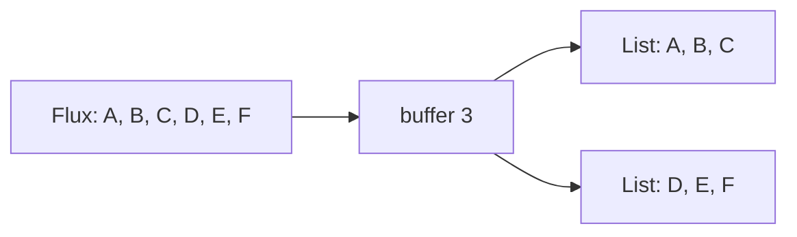
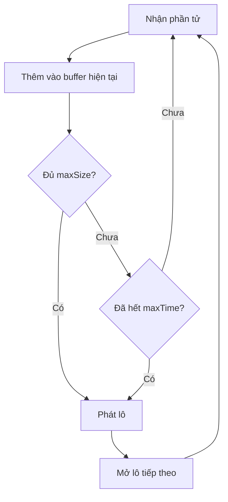

# `buffer`: gom phần tử thành lô theo số lượng hoặc thời gian

Trong module `REACTIVE_PROGRAMMING`, ta học cách tổ chức các luồng sự kiện bất đồng bộ theo hợp đồng Publisher–Subscriber và cơ chế backpressure của Reactive Streams, đồng thời thực hành `Mono`, `Flux`, kết hợp toán tử, kiểm soát scheduler, xử lý lỗi và kiểm thử pipeline trong hệ sinh thái Java. Khi xử lý nhiều sự kiện, đôi khi ta không muốn xử lý từng phần tử riêng lẻ. Ta có thể gom nhiều phần tử thành một lô rồi gửi lô đó đến bước lưu trữ, tính toán hoặc gọi dịch vụ tiếp theo.

Reactor cung cấp các toán tử `buffer` để biến một `Flux<T>` thành một `Flux<List<T>>`. Mỗi phần tử đầu ra là một nhóm phần tử đầu vào. Có thể đóng lô khi đạt số lượng tối đa, khi hết một khoảng thời gian, hoặc khi một trong hai điều kiện đến trước. Việc chọn cách gom ảnh hưởng đến độ trễ, throughput, bộ nhớ và cách downstream nhận demand.

## 1. `buffer` thay đổi hình dạng dữ liệu như thế nào?

Giả sử nguồn phát các sự kiện `A`, `B`, `C`, `D`, `E`, `F`. Khi dùng `buffer(3)`, Reactor gom ba phần tử liên tiếp thành một danh sách:

```java
Flux<List<String>> batches = Flux.just("A", "B", "C", "D", "E", "F")
    .buffer(3);
```

Luồng đầu ra có dạng:

```text
[A, B, C]
[D, E, F]
```

Kiểu dữ liệu thay đổi từ `Flux<String>` thành `Flux<List<String>>`. Downstream nhận một danh sách cho mỗi lô, thay vì nhận từng chuỗi riêng lẻ.



`buffer` gom dữ liệu vào collection; nó không xử lý các phần tử thay cho downstream. Các bước tiếp theo cần nhận một lô, xử lý danh sách đó rồi phát kết quả hoặc hoàn tất.

## 2. Gom theo số lượng với `buffer(maxSize)`

`buffer(int maxSize)` mở một lô và thêm phần tử vào lô đó cho đến khi đủ `maxSize`. Khi đủ số lượng, lô được phát xuống downstream và một lô mới bắt đầu.

```java
Flux<List<Integer>> batches = Flux.range(1, 8)
    .buffer(3);
```

Kết quả:

```text
[1, 2, 3]
[4, 5, 6]
[7, 8]
```

Khi nguồn hoàn tất mà lô cuối chưa đủ số lượng, Reactor vẫn phát lô cuối chứa các phần tử còn lại. Đây là điểm quan trọng khi xử lý batch: lô cuối có thể nhỏ hơn `maxSize`.

Có thể dùng cách gom theo số lượng khi downstream hoặc dịch vụ lưu trữ có giới hạn kích thước batch, ví dụ ghi tối đa 500 bản ghi trong một câu lệnh bulk insert hoặc gửi tối đa 100 sự kiện trong một request.

```java
Flux<Receipt> receipts = incomingOrders
    .buffer(100)
    .concatMap(batch -> orderService.processBatch(batch));
```

Mỗi lần `processBatch` nhận một danh sách tối đa 100 đơn hàng. `concatMap` xử lý từng lô theo thứ tự và đợi lô hiện tại hoàn tất trước khi chuyển sang lô tiếp theo. Nếu muốn xử lý nhiều lô đồng thời, có thể dùng `flatMap` với concurrency được giới hạn rõ ràng; cần tính đến thứ tự kết quả và tải của dịch vụ phía sau.

## 3. Gom theo thời gian với `buffer(Duration)`

Khi dữ liệu đến không đều, chờ đủ số lượng có thể làm một lô nhỏ phải chờ rất lâu. `buffer(Duration timespan)` gom các phần tử đến trong một khoảng thời gian rồi phát danh sách khi khoảng đó kết thúc.

```java
Flux<List<Event>> batches = eventSource
    .buffer(Duration.ofSeconds(1));
```

Với cấu hình trên, mỗi khoảng một giây là một chu kỳ gom. Nếu có nhiều sự kiện trong khoảng đó, chúng được đưa vào cùng một danh sách. Nếu chỉ có một vài sự kiện, danh sách phát ra cũng nhỏ tương ứng. Khi nguồn hoàn tất trước khi hết khoảng gom hiện tại, các phần tử đang chờ được phát trong lô cuối.

Gom theo thời gian phù hợp với telemetry, log, sự kiện giao diện hoặc dữ liệu cần gửi định kỳ. Ví dụ, dashboard có thể cập nhật một lần mỗi giây thay vì xử lý một request cho mỗi mẫu đo.

```java
Flux<List<Metric>> metricBatches = metrics
    .buffer(Duration.ofMillis(500));
```

Một giới hạn quan trọng: chỉ đặt thời gian không đặt giới hạn số phần tử trong lô. Nếu nguồn phát hàng trăm nghìn sự kiện trong một khoảng thời gian ngắn, danh sách của khoảng đó vẫn có thể rất lớn. Khi cần giới hạn cả độ trễ lẫn kích thước, dùng `bufferTimeout`.

## 4. Gom theo số lượng hoặc thời gian với `bufferTimeout`

`bufferTimeout(int maxSize, Duration maxTime)` đóng lô khi đạt một trong hai điều kiện:

- Lô có đủ `maxSize` phần tử.
- Khoảng thời gian `maxTime` của lô đã hết.

Điều kiện nào xảy ra trước sẽ kích hoạt việc phát lô. Sau đó, một lô mới được bắt đầu.

```java
Flux<List<Event>> batches = eventSource
    .bufferTimeout(100, Duration.ofMillis(500));
```

Với cấu hình này, mỗi lô chứa tối đa 100 sự kiện và được phát khi đủ 100 phần tử hoặc khi đã gom trong 500 ms. Khi nguồn hoàn tất, lô cuối còn dữ liệu được phát ngay cả khi chưa đủ số lượng và chưa hết thời gian.

Đây thường là lựa chọn thực tế cho hệ thống nhận sự kiện liên tục:

- Khi tải cao, lô nhanh chóng đạt 100 phần tử, giúp tận dụng bulk operation.
- Khi tải thấp, bộ định thời phát lô sau tối đa khoảng chờ đã cấu hình, tránh giữ một vài sự kiện quá lâu.



`maxSize` giới hạn số phần tử trong từng lô. `maxTime` giới hạn thời gian gom của lô trong điều kiện scheduler hoạt động bình thường; đây không phải cam kết thời gian thực cứng. Khi thread định thời bị quá tải, thời điểm phát thực tế có thể trễ.

## 5. Chọn giữa ba cách gom

| Toán tử | Điều kiện phát lô | Ưu điểm | Hạn chế |
|---|---|---|---|
| `buffer(maxSize)` | Đủ số phần tử hoặc nguồn hoàn tất | Kích thước lô dễ dự đoán | Lô ít dữ liệu có thể phải chờ lâu |
| `buffer(timespan)` | Hết khoảng thời gian hoặc nguồn hoàn tất | Giới hạn thời gian chờ theo nhịp | Số phần tử trong lô không có giới hạn theo số lượng |
| `bufferTimeout(maxSize, maxTime)` | Đủ số lượng, hết thời gian hoặc nguồn hoàn tất | Cân bằng kích thước lô và độ trễ | Cần chọn cả hai tham số và theo dõi tải |

Có thể áp dụng quy tắc lựa chọn sau:

- Chọn `buffer(maxSize)` nếu yêu cầu bulk operation quan trọng và nguồn đủ dữ liệu đều đặn.
- Chọn `buffer(timespan)` nếu nhịp phát theo thời gian quan trọng hơn kích thước lô và tốc độ nguồn đã được kiểm soát.
- Chọn `bufferTimeout(maxSize, maxTime)` nếu cần cả giới hạn số phần tử lẫn thời gian chờ.

## 6. Scheduler và thời điểm phát lô

Các toán tử gom theo thời gian cần một scheduler để theo dõi thời hạn. Reactor dùng scheduler mặc định cho các thao tác định thời; một số overload cho phép truyền scheduler riêng khi ứng dụng cần kiểm soát nơi bộ định thời chạy.

```java
Scheduler timerScheduler = Schedulers.newSingle("batch-timer");

Flux<List<Event>> batches = eventSource
    .bufferTimeout(
        100,
        Duration.ofMillis(500),
        timerScheduler
    );
```

Scheduler do ứng dụng tạo phải được quản lý vòng đời và dispose khi thành phần sở hữu kết thúc. Không tạo một scheduler mới cho mỗi batch. Nếu chỉ dùng scheduler mặc định, không cần tự dispose scheduler toàn cục của Reactor.

Scheduler quyết định việc lên lịch phát lô theo thời gian, còn công việc xử lý lô có thể chạy ở scheduler khác. Nếu downstream thực hiện blocking I/O, có thể chuyển bước xử lý sang `boundedElastic`:

```java
Flux<Receipt> receipts = eventSource
    .bufferTimeout(100, Duration.ofMillis(500))
    .publishOn(Schedulers.boundedElastic())
    .concatMap(batch -> blockingRepository.saveBatch(batch));
```

`publishOn` chuyển tín hiệu đầu ra của buffer sang scheduler được chọn. Nó không làm thay đổi điều kiện đóng lô. Nếu xử lý batch lâu hơn tốc độ tạo batch, cần giới hạn lượng công việc đang chờ và đo độ trễ, thay vì cho rằng việc đổi scheduler sẽ tự giải quyết quá tải.

## 7. Xử lý lô tuần tự, đồng thời và lỗi

Sau khi gom, downstream nhận `List<T>`. Có thể chọn cách xử lý lô theo yêu cầu:

```java
// Tuần tự: lô sau đợi lô trước hoàn tất.
Flux<SaveResult> sequential = source
    .bufferTimeout(200, Duration.ofSeconds(1))
    .concatMap(repository::saveBatch);

// Tối đa 4 lô đang được xử lý đồng thời.
Flux<SaveResult> concurrent = source
    .bufferTimeout(200, Duration.ofSeconds(1))
    .flatMap(repository::saveBatch, 4);
```

`concatMap` phù hợp khi cần giữ thứ tự xử lý giữa các lô hoặc khi hệ thống đích chỉ nên nhận một batch tại một thời điểm. `flatMap` tăng throughput khi dịch vụ đích hỗ trợ xử lý song song; kết quả có thể phát theo thứ tự hoàn tất, không nhất thiết theo thứ tự batch ban đầu.

Nếu một batch lỗi, tín hiệu lỗi mặc định kết thúc subscription và các batch sau không tiếp tục được xử lý. Nếu muốn cách ly lỗi theo từng batch, đặt xử lý phục hồi bên trong hàm ánh xạ:

```java
Flux<BatchOutcome> outcomes = source
    .bufferTimeout(200, Duration.ofSeconds(1))
    .concatMap(batch -> repository.saveBatch(batch)
        .thenReturn(BatchOutcome.success(batch.size()))
        .onErrorResume(error -> auditFailedBatch(batch, error)
            .thenReturn(BatchOutcome.failure(batch.size(), error))));
```

Ví dụ giả định `saveBatch` trả về `Mono<?>` và `auditFailedBatch` trả về `Mono<Void>`. Lỗi của một batch được ghi nhận rồi chuyển thành `BatchOutcome`, do đó pipeline có thể tiếp tục với batch kế tiếp. Chỉ nên phục hồi theo cách này nếu nghiệp vụ cho phép xử lý tiếp sau khi một batch thất bại; với lỗi toàn hệ thống hoặc lỗi cần rollback, nên để tín hiệu lỗi kết thúc luồng và xử lý ở ranh giới phù hợp.

## 8. Backpressure và giới hạn bộ nhớ

Khi dùng `buffer`, demand của downstream được tính theo phần tử đầu ra là các lô. Một request cho một phần tử đầu ra có nghĩa là yêu cầu một batch, không phải một phần tử đơn lẻ của nguồn. Toán tử phải nhận đủ dữ liệu upstream để tạo batch đó và có thể giữ các phần tử trong bộ nhớ trong lúc chờ điều kiện phát.

Điều này có một số hệ quả:

1. `buffer(maxSize)` đặt giới hạn số phần tử trong mỗi batch, nhưng vẫn cần tính đến các batch đã phát đang chờ downstream xử lý.
2. `buffer(timespan)` giới hạn thời gian gom, nhưng không giới hạn số phần tử trong một khoảng thời gian có burst lớn.
3. `bufferTimeout(maxSize, maxTime)` giới hạn kích thước từng batch và thời gian gom, nhưng không tự tạo giới hạn bộ nhớ tổng thể cho mọi queue trong pipeline.
4. Nếu nguồn không thể tuân thủ backpressure hoặc tiếp tục phát nhanh, cần thêm chính sách overflow, giới hạn concurrency hoặc cơ chế lưu trữ bền vững phù hợp.

Ví dụ, nếu mỗi batch tối đa 500 phần tử nhưng downstream cho phép 20 batch đang chờ, số phần tử được giữ có thể lớn hơn 500 rất nhiều. Cần tính cả kích thước phần tử, số batch đang chờ, concurrency và các queue ở scheduler hoặc client.

Không nên chọn `maxSize` và `maxTime` chỉ dựa trên throughput trung bình. Hãy đo burst, độ trễ xử lý batch, kích thước payload và ngân sách bộ nhớ. Nếu mất dữ liệu không được phép, cần chọn chiến lược bảo toàn dữ liệu và xử lý overflow rõ ràng.

## 9. Phân biệt `buffer` và `window`

`buffer` và `window` đều nhóm phần tử theo số lượng hoặc thời gian, nhưng kiểu dữ liệu đầu ra khác nhau:

| Toán tử | Kiểu đầu ra | Cách downstream tiêu thụ |
|---|---|---|
| `buffer(...)` | `Flux<List<T>>` | Nhận một collection đã gom đủ hoặc đã đóng |
| `window(...)` | `Flux<Flux<T>>` | Nhận một Publisher con rồi có thể xử lý phần tử trong window đó |

Ví dụ với buffer:

```java
Flux<List<Event>> batches = events.buffer(100);
```

Ví dụ với window:

```java
Flux<Flux<Event>> windows = events.window(100);
```

Với `buffer`, downstream nhận danh sách sau khi lô đóng. Với `window`, downstream nhận một Flux con biểu diễn nhóm phần tử; nó có thể đăng ký và xử lý các phần tử trong nhóm theo kiểu reactive. Chọn `buffer` khi API đích cần collection, chẳng hạn `saveAll(List<T>)`. Chọn `window` khi muốn giữ thao tác ở dạng Publisher và xử lý theo luồng thay vì tạo collection trước.

## 10. Kiểm thử gom theo số lượng và thời gian

### Kiểm thử theo số lượng

Với nguồn hữu hạn, có thể xác nhận cả các lô đủ kích thước và lô cuối còn dư:

```java
StepVerifier.create(Flux.range(1, 8).buffer(3))
    .expectNext(List.of(1, 2, 3))
    .expectNext(List.of(4, 5, 6))
    .expectNext(List.of(7, 8))
    .verifyComplete();
```

### Kiểm thử theo thời gian với virtual time

Không nên dùng `Thread.sleep` để kiểm thử timer vì test sẽ chậm và phụ thuộc tải máy. Dùng `StepVerifier.withVirtualTime` để tiến đồng hồ giả lập:

```java
TestPublisher<Integer> source = TestPublisher.create();

StepVerifier.withVirtualTime(() ->
        source.flux().bufferTimeout(10, Duration.ofSeconds(1))
    )
    .then(() -> source.next(1, 2, 3))
    .thenAwait(Duration.ofSeconds(1))
    .expectNext(List.of(1, 2, 3))
    .then(source::complete)
    .verifyComplete();
```

Trong ví dụ, `maxSize` là 10 nên ba phần tử chưa đủ đóng lô theo số lượng. `thenAwait` tiến đồng hồ giả lập một giây để xác nhận buffer được phát do hết thời gian. Sau đó nguồn hoàn tất. `TestPublisher` cho phép chủ động phát dữ liệu trong test, còn supplier truyền cho `withVirtualTime` tạo toán tử định thời sau khi scheduler giả lập đã được cài đặt.

Nên bổ sung kiểm thử cho nguồn rỗng, nguồn hoàn tất giữa lô, nguồn lỗi khi đang gom, batch đạt đúng `maxSize`, và trường hợp downstream hủy subscription. Với xử lý song song, cần kiểm tra giới hạn concurrency và thứ tự kết quả theo yêu cầu.

## 11. Những lỗi thường gặp

| Sai lầm | Hậu quả | Cách xử lý |
|---|---|---|
| Chỉ dùng `buffer(maxSize)` cho nguồn ít dữ liệu | Lô cuối có thể phải đợi rất lâu mới đủ phần tử | Dùng `bufferTimeout` để có thời hạn phát |
| Chỉ dùng `buffer(Duration)` cho nguồn có burst lớn | Một lô có thể chứa quá nhiều phần tử | Dùng `bufferTimeout` để đặt giới hạn kích thước |
| Cho rằng `maxSize` giới hạn tổng bộ nhớ pipeline | Nhiều batch có thể đang chờ hoặc được xử lý đồng thời | Giới hạn concurrency và giám sát queue |
| Dùng `flatMap` không giới hạn để lưu batch | Quá nhiều request đồng thời gây quá tải dịch vụ đích | Đặt concurrency rõ ràng hoặc dùng `concatMap` |
| Nhầm `buffer` với `window` | Chọn sai kiểu dữ liệu cho bước xử lý tiếp theo | Dùng buffer cho collection, window cho Publisher con |
| Không xử lý lô cuối chưa đủ kích thước | Có thể hiểu sai dữ liệu còn lại khi nguồn hoàn tất | Kiểm thử và thiết kế xử lý partial batch |
| Dùng `Thread.sleep` trong kiểm thử | Test chậm và dễ dao động | Dùng `StepVerifier.withVirtualTime` |

## 12. Quy trình lựa chọn

Khi cần gom dữ liệu thành lô, hãy xác định:

1. **Kích thước lô tối đa là bao nhiêu?** Chọn theo giới hạn API đích, chi phí bulk operation và ngân sách bộ nhớ.
2. **Lô có thể chờ tối đa bao lâu?** Nếu cần giới hạn độ trễ, dùng `bufferTimeout` hoặc buffer theo thời gian.
3. **Nguồn có thể phát burst không?** Nếu có, cần giới hạn kích thước từng batch và kiểm soát queue tổng thể.
4. **Các batch cần xử lý tuần tự hay đồng thời?** Dùng `concatMap` cho tuần tự, `flatMap` có concurrency giới hạn cho song song.
5. **Một batch lỗi thì sao?** Quyết định dừng toàn pipeline hay ghi nhận lỗi theo batch rồi tiếp tục.
6. **Downstream cần collection hay stream con?** Chọn `buffer` cho collection hoặc `window` cho Publisher con.
7. **Có thể kiểm thử điều kiện thời gian không?** Dùng virtual time để xác nhận batch phát do timeout và batch cuối khi nguồn hoàn tất.

`buffer` giúp biến luồng phần tử thành các lô phù hợp với thao tác bulk. Gom theo số lượng tối ưu kích thước lô, gom theo thời gian kiểm soát độ trễ, còn `bufferTimeout` kết hợp cả hai. Khi ghép với chính sách backpressure, concurrency và xử lý lỗi rõ ràng, pipeline có thể tăng hiệu quả xử lý mà vẫn kiểm soát được bộ nhớ và hành vi khi tải thay đổi.
