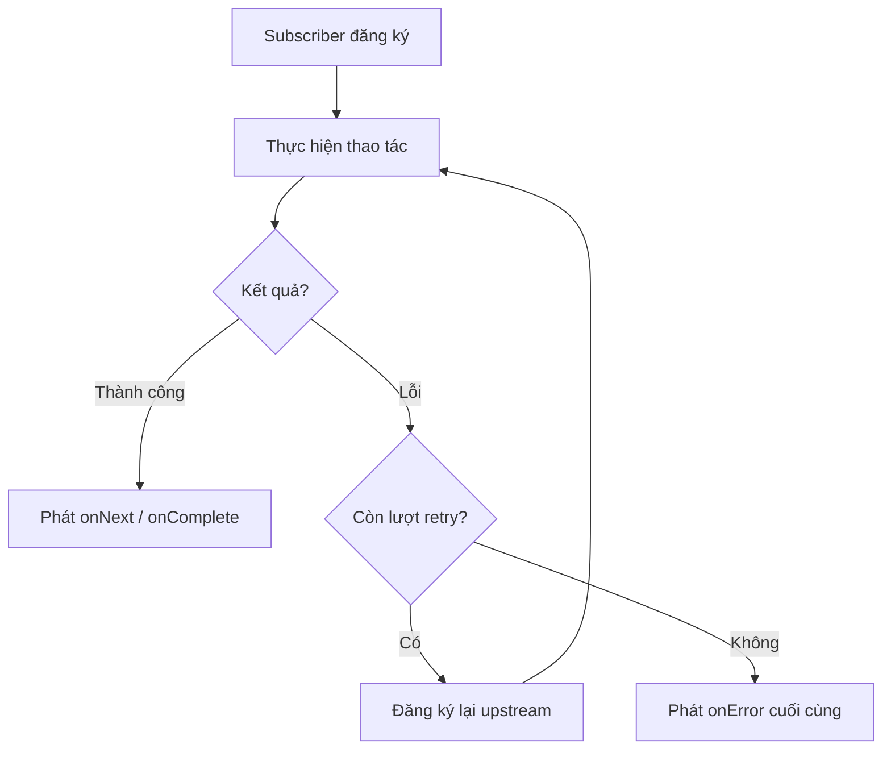
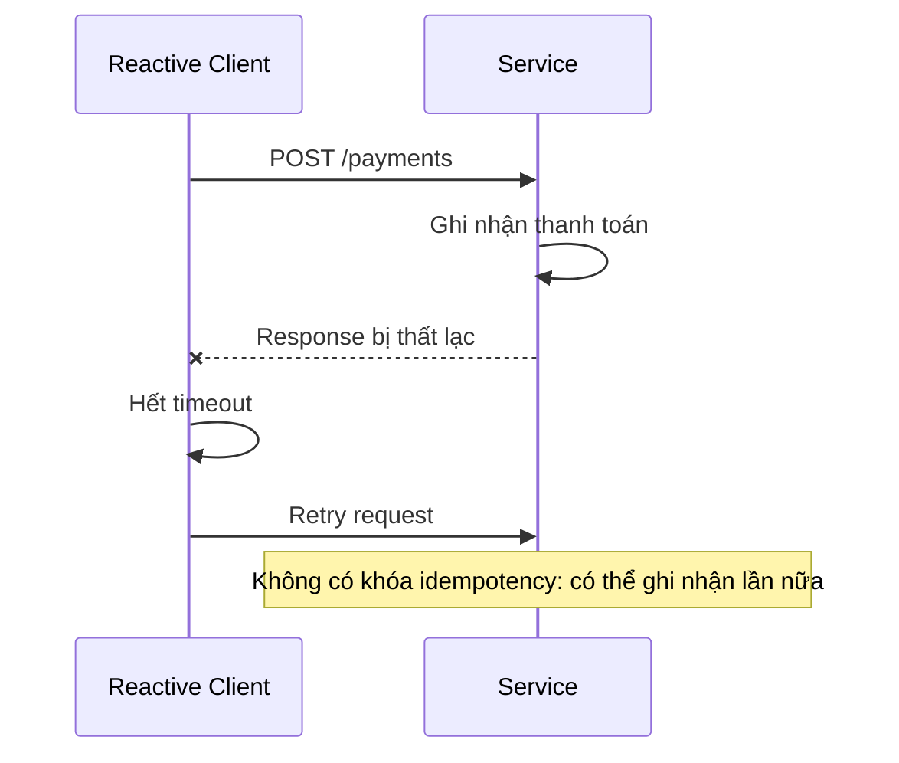
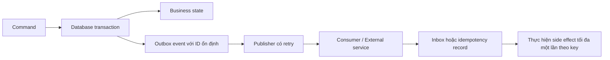

# Thử lại tác vụ có tác dụng phụ và yêu cầu tính lũy đẳng

Trong module `REACTIVE_PROGRAMMING`, ta xây dựng pipeline bất đồng bộ theo hợp đồng Publisher–Subscriber và backpressure của Reactive Streams, đồng thời thực hành `Mono`, `Flux`, kết hợp toán tử, scheduler, xử lý lỗi và kiểm thử trong hệ sinh thái Java. Một pipeline có thể cần thử lại khi request gặp lỗi mạng tạm thời, dịch vụ quá tải hoặc kết nối cơ sở dữ liệu bị gián đoạn. Tuy nhiên, thử lại một tác vụ có tác dụng phụ có thể khiến hành động được thực hiện nhiều lần.

Ví dụ, client gửi yêu cầu trừ tiền. Máy chủ đã trừ tiền thành công nhưng phản hồi bị thất lạc. Client nhận timeout và gửi lại yêu cầu. Nếu máy chủ thực hiện lệnh lần nữa, tài khoản có thể bị trừ hai lần. Muốn retry an toàn, hệ thống phải xác định các lần gửi lại thuộc cùng một thao tác nghiệp vụ và bảo đảm thao tác đó không tạo thêm tác dụng phụ ngoài ý muốn. Thuộc tính cần có là **tính lũy đẳng** (*idempotency*).

## 1. Retry thực sự làm gì?

Trong Reactor, `retry` và `retryWhen` phản ứng với tín hiệu lỗi bằng cách đăng ký lại vào Publisher upstream. Chúng không tiếp tục tại đúng câu lệnh đã thất bại và cũng không tự khôi phục trạng thái của hệ thống bên ngoài.

```java
Mono<String> response = remoteClient.fetch()
    .retry(2);
```

`retry(2)` cho phép tối đa hai lần đăng ký lại sau lần thử ban đầu. Nếu cả ba lần đều thất bại, lỗi cuối cùng được truyền xuống downstream. Mỗi lần đăng ký lại chạy lại phần upstream của pipeline. Nếu phần đó chứa thao tác ghi dữ liệu, gửi thông báo hoặc gọi một API có tác dụng phụ, thao tác có thể được thực hiện lại.



Điều cần nhớ là một lần retry là một lần thực thi mới của phần nguồn được đăng ký lại. Nếu nguồn được tạo sẵn và giữ một Future đã chạy, đăng ký lại có thể chỉ quan sát cùng kết quả Future đó. Nếu muốn tạo một request mới cho mỗi lần thử, thường cần đặt lời gọi tạo Publisher bên trong `Mono.defer`.

## 2. Phân biệt thao tác an toàn, lũy đẳng và không lũy đẳng

Một thao tác **an toàn** (*safe*) không làm thay đổi trạng thái nghiệp vụ của máy chủ, ví dụ đọc thông tin. Một thao tác **lũy đẳng** có thể được thực hiện nhiều lần với cùng đầu vào mà trạng thái cuối cùng tương đương với thực hiện một lần. Một thao tác **không lũy đẳng** có thể tạo thêm tác dụng phụ mỗi lần thực thi.

| Thao tác | Đặc tính thường gặp | Rủi ro khi retry |
|---|---|---|
| Đọc thông tin tài khoản | Thường an toàn | Có thể tăng tải hoặc đọc dữ liệu ở thời điểm khác |
| Đặt trạng thái đơn hàng thành `CANCELLED` | Có thể lũy đẳng nếu cập nhật theo trạng thái đích | Cần xem xét side effect đi kèm như hoàn tiền hoặc gửi email |
| Tăng số dư thêm 100 | Không lũy đẳng | Có thể cộng thêm 100 ở mỗi lần thử |
| Tạo đơn hàng mới | Thường không lũy đẳng nếu mỗi lần tạo ID mới | Có thể sinh nhiều đơn hàng |
| Gửi email xác nhận | Thường không lũy đẳng | Người nhận có thể nhận nhiều email |
| Ghi một bản ghi với khóa duy nhất cố định | Có thể lũy đẳng | Cần xử lý xung đột và nội dung ghi khác nhau |

HTTP method cũng chỉ là một gợi ý về ngữ nghĩa, không thay thế hợp đồng của API. `PUT` thường được thiết kế lũy đẳng vì đặt tài nguyên về một trạng thái xác định; `POST` thường tạo tài nguyên hoặc kích hoạt hành động và không mặc nhiên lũy đẳng. Một API `POST` vẫn có thể hỗ trợ retry an toàn nếu có hợp đồng idempotency key rõ ràng.

## 3. Vì sao timeout tạo ra kết quả không chắc chắn?

Khi client nhận timeout, client chỉ biết rằng chưa nhận được phản hồi trong thời hạn. Nó không biết chắc máy chủ đã thực hiện thao tác hay chưa.

Có ít nhất ba khả năng:

1. Request chưa đến máy chủ, nên chưa có tác dụng phụ.
2. Máy chủ nhận request nhưng thất bại trước khi ghi nhận tác dụng phụ.
3. Máy chủ đã thực hiện tác dụng phụ, nhưng phản hồi bị mất hoặc đến quá muộn.

Trường hợp thứ ba tạo ra kết quả không chắc chắn (*ambiguous outcome*). Retry mù quáng có thể lặp lại hành động đã thành công. Vì vậy, không thể suy luận rằng timeout đồng nghĩa thao tác chưa xảy ra.



Một chính sách retry đúng cần xử lý được cả lỗi trước khi tác vụ chạy lẫn lỗi xảy ra sau khi tác vụ đã hoàn tất nhưng phản hồi chưa đến client.

## 4. Dùng idempotency key ổn định cho một thao tác nghiệp vụ

**Idempotency key** là mã định danh duy nhất cho một thao tác logic. Client gửi cùng key trong mọi lần thử lại của thao tác đó. Máy chủ dùng key để nhận diện request trùng và trả lại kết quả đã lưu thay vì thực hiện tác dụng phụ lần nữa.

Ví dụ, một lệnh thanh toán có thể chứa:

```java
record PaymentCommand(
    UUID idempotencyKey,
    String accountId,
    BigDecimal amount,
    String currency
) {}
```

Key phải được tạo một lần cho thao tác logic và được giữ nguyên qua các lần retry:

```java
PaymentCommand command = new PaymentCommand(
    UUID.randomUUID(),
    accountId,
    amount,
    "VND"
);

Mono<PaymentReceipt> payment = paymentService.execute(command);
```

Không tạo key mới bên trong `defer` hoặc trong hàm được retry. Nếu mỗi lần thử có key khác nhau, máy chủ sẽ xem đó là các thao tác mới và cơ chế khử trùng lặp không còn tác dụng.

Máy chủ nên lưu key cùng dấu vân tay payload (*request fingerprint*). Khi nhận lại cùng key:

- Nếu payload tương đương và thao tác đã hoàn tất, trả lại kết quả đã lưu.
- Nếu key đang được xử lý, áp dụng chính sách chờ, trả trạng thái đang xử lý hoặc cho phép client truy vấn trạng thái.
- Nếu key được dùng với payload khác, từ chối request vì cùng một key không được đại diện cho hai thao tác nghiệp vụ khác nhau.

Thời hạn lưu key phải dài hơn khoảng thời gian client, gateway hoặc message broker có thể gửi lại request. Nếu xóa key quá sớm, một request cũ có thể bị thực hiện lại.

## 5. Lưu dấu idempotency cùng tác dụng phụ trong một transaction

Với tác dụng phụ nằm trong cùng cơ sở dữ liệu, có thể lưu bản ghi idempotency, cập nhật dữ liệu nghiệp vụ và lưu kết quả trong cùng một transaction. Một unique constraint trên key giúp ngăn hai request đồng thời cùng chiếm quyền xử lý một thao tác.

Ví dụ cấu trúc dữ liệu minh họa:

```sql
CREATE TABLE idempotency_record (
    idempotency_key UUID PRIMARY KEY,
    request_hash VARCHAR(128) NOT NULL,
    status VARCHAR(20) NOT NULL,
    response_json TEXT,
    created_at TIMESTAMP NOT NULL
);
```

Quy trình xử lý trong transaction:

1. Thử tạo bản ghi với `idempotency_key` và `request_hash`.
2. Nếu key đã tồn tại, so sánh hash. Nếu hash khác, trả lỗi xung đột. Nếu đã hoàn tất, trả kết quả đã lưu.
3. Nếu request mới chiếm được key, thực hiện cập nhật nghiệp vụ.
4. Lưu kết quả trả về và đánh dấu bản ghi `COMPLETED`.
5. Commit transaction để bản ghi idempotency và thay đổi nghiệp vụ cùng có hiệu lực.

Nếu transaction rollback, cả thay đổi nghiệp vụ lẫn bản ghi claim mới đều rollback. Nếu hai request cùng key đến đồng thời, unique constraint hoặc cơ chế khóa phải chọn một request thắng. Request còn lại cần đọc lại trạng thái sau khi transaction của request thắng hoàn tất; không được tự thực hiện side effect thêm lần nữa.

Đây là mô hình khái niệm. Khi triển khai với R2DBC hoặc Spring reactive transaction, mọi thao tác trong transaction phải tham gia cùng reactive transaction context. Không đưa một lời gọi blocking hoặc một transaction JDBC độc lập vào giữa chuỗi rồi giả định nó được rollback cùng transaction reactive.

## 6. Đặt retry ở đúng ranh giới trong Reactor

Khi dùng API reactive, đặt lời gọi tạo Publisher bên trong `Mono.defer` để mỗi lần đăng ký lại có thể tạo một lần thử mới. Đồng thời, truyền cùng idempotency key cho mọi lần thử:

```java
Mono<PaymentReceipt> execute(PaymentCommand command) {
    return Mono.defer(() ->
            paymentGateway.charge(
                command.accountId(),
                command.amount(),
                command.currency(),
                command.idempotencyKey().toString()
            )
        )
        .retryWhen(Retry.backoff(3, Duration.ofMillis(200))
            .maxBackoff(Duration.ofSeconds(3))
            .jitter(0.5)
            .filter(this::isTransientFailure)
            .onRetryExhaustedThrow((spec, signal) -> signal.failure())
        );
}
```

Trong ví dụ:

- `Mono.defer` gọi `paymentGateway.charge` khi có subscription và gọi lại phương thức này cho mỗi lần retry.
- `command.idempotencyKey()` không thay đổi giữa các lần thử.
- `Retry.backoff(3, ...)` cho phép tối đa ba lần retry sau lần đầu, với khoảng chờ tăng dần.
- `jitter(0.5)` thêm độ ngẫu nhiên vào khoảng chờ để nhiều client không đồng loạt retry cùng thời điểm.
- `filter` chỉ cho retry các lỗi được xác định là tạm thời.
- Khi hết lượt retry, lỗi cuối cùng được truyền xuống downstream.

Đoạn code chỉ an toàn với tác dụng phụ nếu API thanh toán thực sự thực thi hợp đồng idempotency key và giữ kết quả đủ lâu. Gửi một header hoặc tham số tên `Idempotency-Key` mà máy chủ bỏ qua không tạo ra tính lũy đẳng.

### Phân loại lỗi trước khi retry

Không phải lỗi nào cũng có thể tự hết khi thử lại. Một chính sách retry nên phân biệt:

| Loại lỗi | Ví dụ | Hành động thường phù hợp |
|---|---|---|
| Tạm thời | Timeout, kết nối bị reset, HTTP 503 | Retry có giới hạn nếu thao tác an toàn hoặc có idempotency key |
| Quá tải có thời hạn | HTTP 429, giới hạn tốc độ | Tôn trọng `Retry-After` nếu có; backoff và giới hạn tải |
| Dữ liệu không hợp lệ | HTTP 400, lỗi validation | Không retry cùng payload |
| Không được phép | HTTP 401/403 | Làm mới thông tin xác thực hoặc trả lỗi; tránh retry mù quáng |
| Xung đột nghiệp vụ | Số dư không đủ, trạng thái không cho phép | Không retry nếu trạng thái nghiệp vụ chưa đổi |
| Lỗi lập trình | Null không mong đợi, vi phạm invariant | Sửa lỗi; retry thường chỉ lặp lại thất bại |

Hàm `isTransientFailure` phải phản ánh hợp đồng của client và dịch vụ. Không nên dùng bộ lọc quá rộng như “mọi `RuntimeException` đều retry”.

## 7. Side effect nằm trước và sau toán tử retry

Vị trí đặt toán tử ảnh hưởng đến phần nào được chạy lại. `retryWhen` đăng ký lại Publisher upstream của nó. Vì vậy, các thao tác có tác dụng phụ nằm phía upstream có thể chạy lại mỗi lần thử.

```java
Mono<Result> result = Mono.defer(this::performOperation)
    .doOnNext(this::recordUpstreamResult)
    .flatMap(value -> followUpService.confirm(value).thenReturn(value))
    .doOnError(this::recordAttemptFailure)
    .retryWhen(retryPolicy);
```

Trong ví dụ, nếu `followUpService.confirm` thất bại, `retryWhen` đăng ký lại toàn bộ phần upstream của nó. `performOperation` và `recordUpstreamResult` vì vậy có thể chạy lại, dù bước đầu đã phát ra giá trị. `recordAttemptFailure` quan sát lỗi của từng lần thử vì nó nằm trước `retryWhen`. Nếu chuyển `doOnError` xuống sau `retryWhen`, nó quan sát lỗi cuối cùng sau khi chính sách retry đã kết thúc thay vì mọi lỗi trung gian.

Không đặt side effect nghiệp vụ không lũy đẳng vào `doOnNext` phía upstream với giả định nó chỉ chạy một lần. Ví dụ, gửi email trong `doOnNext` trước `retryWhen` có thể gửi email lại khi một bước upstream khác thất bại và kích hoạt retry. Dùng `doOn...` chủ yếu cho quan sát như log hoặc metric; với side effect nghiệp vụ, hãy thiết kế một bước có hợp đồng idempotency rõ ràng.

## 8. Tác dụng phụ nằm ở dịch vụ ngoài cơ sở dữ liệu

Một transaction cơ sở dữ liệu không thể tự động rollback một request HTTP đã được dịch vụ khác thực hiện. Ví dụ, ứng dụng ghi đơn hàng vào database rồi gọi dịch vụ gửi email. Nếu email đã được gửi nhưng kết nối bị ngắt trước khi nhận phản hồi, transaction database không thể thu hồi email.

Với các side effect phân tán, có thể dùng **Transactional Outbox**:

1. Trong một transaction database, ghi thay đổi nghiệp vụ và một outbox event có ID ổn định.
2. Một publisher đọc các event chưa gửi và chuyển chúng đến hệ thống đích.
3. Publisher có thể gửi lại event nếu không xác nhận được kết quả.
4. Consumer lưu event ID đã xử lý bằng unique constraint hoặc inbox table để loại trùng.
5. Nếu hệ thống đích hỗ trợ idempotency key, truyền event ID làm key cho thao tác.



Outbox thường cung cấp khả năng giao ít nhất một lần (*at-least-once delivery*). Consumer vẫn cần idempotency hoặc deduplication vì cùng event có thể được giao nhiều lần. Nếu dịch vụ đích không hỗ trợ khóa idempotency và không có cách truy vấn hoặc đối soát trạng thái, không thể khẳng định retry sẽ tạo ra hiệu ứng đúng một lần trong mọi tình huống lỗi mạng.

## 9. Kiểm thử retry và tính lũy đẳng

Kiểm thử cần xác nhận cả số lần thử lẫn việc các lần thử dùng cùng key. Ví dụ với Mockito:

```java
UUID key = UUID.randomUUID();
PaymentCommand command = new PaymentCommand(
    key, "account-42", new BigDecimal("100.00"), "VND"
);

when(paymentGateway.charge(anyString(), any(), anyString(), eq(key.toString())))
    .thenReturn(Mono.error(new IOException("connection reset")))
    .thenReturn(Mono.error(new IOException("temporary timeout")))
    .thenReturn(Mono.just(new PaymentReceipt("payment-9001")));

StepVerifier.withVirtualTime(() -> execute(command))
    .thenAwait(Duration.ofSeconds(2))
    .expectNextMatches(receipt -> receipt.id().equals("payment-9001"))
    .verifyComplete();

verify(paymentGateway, times(3)).charge(
    anyString(), any(), anyString(), eq(key.toString())
);
```

Ví dụ giả định `execute` dùng `Retry.backoff` như phần trước và gateway trả về cùng kết quả khi nhận lại một key đã xử lý. Trong test thực tế, có thể dùng `verify` để xác nhận cùng key được truyền ba lần và kiểm tra request payload không đổi. Nếu dùng virtual time, tạo pipeline bên trong supplier của `withVirtualTime` để scheduler giả lập được cài đặt trước khi retry policy lên lịch backoff.

Một kiểm thử ở mức repository hoặc tích hợp nên gửi cùng command hai lần và xác nhận:

- Chỉ có một thay đổi nghiệp vụ được ghi nhận.
- Hai lần gọi nhận cùng kết quả nghiệp vụ đã lưu.
- Cùng key nhưng payload khác bị từ chối.
- Hai request đồng thời cùng key không tạo hai side effect.
- Nếu response bị làm mất sau khi commit, lần retry trả kết quả đã lưu thay vì thực hiện lại.

Kiểm thử chỉ xác nhận số lần gọi mock chưa chứng minh cơ chế idempotency ở server. Cần kiểm thử tích hợp với unique constraint, transaction và hành vi xử lý request trùng.

## 10. Giới hạn retry và bảo vệ hệ thống

Ngay cả khi thao tác lũy đẳng, retry vô hạn vẫn có thể làm hệ thống quá tải. Khi dịch vụ đang suy giảm, nhiều client cùng retry nhanh có thể tạo thành retry storm và làm tình trạng xấu hơn.

Một chính sách thực tế thường cần:

- Số lần retry tối đa.
- Exponential backoff để tăng dần khoảng chờ.
- Jitter để phân tán thời điểm retry của nhiều client.
- Timeout cho từng request và deadline tổng thể cho thao tác.
- Bộ lọc lỗi tạm thời, tránh retry lỗi nghiệp vụ hoặc lỗi cấu hình.
- Circuit breaker hoặc rate limit khi dịch vụ liên tục thất bại.
- Metric về số lần retry, loại lỗi, thời gian chờ và tỷ lệ retry thành công.

Không nên xếp chồng nhiều tầng retry mà không tính tổng số lần thử. Nếu client retry ba lần và gateway retry ba lần cho mỗi request, dịch vụ đích có thể nhận tới chín lần gọi. Hãy xác định rõ tầng nào sở hữu retry và giới hạn tổng deadline của thao tác.

## 11. Checklist trước khi retry một tác vụ có tác dụng phụ

Trước khi bật retry, hãy trả lời các câu hỏi sau:

1. **Thao tác có thể được thực hiện nhiều lần không?** Nếu không, cần idempotency key hoặc cơ chế deduplication trước khi retry.
2. **Key có ổn định qua mọi lần thử không?** Tạo key một lần cho thao tác logic, không tạo lại bên trong nguồn được đăng ký lại.
3. **Máy chủ có lưu kết quả theo key không?** Kiểm tra payload fingerprint, unique constraint, xử lý request đồng thời và thời hạn lưu key.
4. **Timeout có thể xảy ra sau khi side effect hoàn tất không?** Thiết kế để request trùng trả lại kết quả cũ.
5. **Lỗi nào thực sự tạm thời?** Chỉ retry lỗi có khả năng phục hồi và tuân thủ chính sách của dịch vụ.
6. **Side effect nằm ở đâu trong pipeline?** Nhớ rằng phần upstream của `retryWhen` được thực thi lại.
7. **Có tác vụ phân tán không?** Dùng outbox/inbox hoặc idempotency ở dịch vụ nhận; không dựa vào rollback của database để hoàn tác HTTP request.
8. **Retry có giới hạn và quan sát được không?** Đặt backoff, jitter, timeout, giới hạn số lần thử và metric.

Retry giúp phục hồi lỗi tạm thời, nhưng không làm cho một thao tác có tác dụng phụ tự nhiên trở nên an toàn khi lặp lại. Tính lũy đẳng phải được thiết kế trong hợp đồng nghiệp vụ và lưu trữ trạng thái. Khi mỗi lần thử dùng cùng một định danh thao tác, máy chủ nhận diện request trùng và trả lại kết quả đã ghi nhận, pipeline reactive mới có thể thử lại mà không tạo thêm tác dụng phụ ngoài dự kiến.
