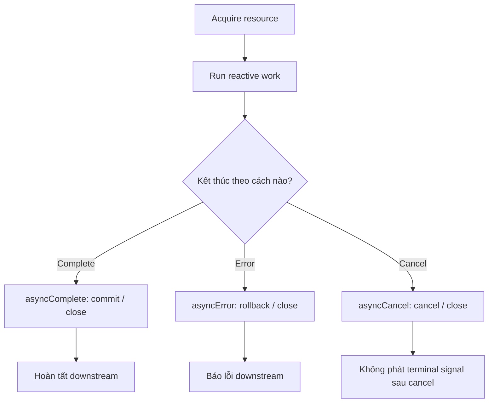

# Dọn dẹp đồng bộ và dọn dẹp bất đồng bộ

Một pipeline reactive thường sử dụng tài nguyên có vòng đời hữu hạn: file, socket, session, connection, cursor, transaction hoặc handle do thư viện bên ngoài cấp. Khi công việc hoàn tất, phát sinh lỗi hoặc bị hủy, tài nguyên cần được giải phóng đúng cách. Trong Java đồng bộ, ta thường dùng `try-with-resources` hoặc `finally`. Trong Reactor, vòng đời của công việc gắn với subscription nên việc dọn dẹp cũng phải gắn với các tín hiệu kết thúc của publisher.

Có hai kiểu dọn dẹp chính. **Dọn dẹp đồng bộ** thực hiện thao tác giải phóng ngay bằng một lời gọi thông thường, ví dụ `close()` hoặc `dispose()`. **Dọn dẹp bất đồng bộ** trả về một publisher để mô tả việc đóng tài nguyên, rollback transaction hoặc gửi lệnh giải phóng qua I/O. Reactor cung cấp `using` cho resource cleanup đồng bộ, `usingWhen` cho cleanup bất đồng bộ, cùng các hook như `doFinally` để quan sát vòng đời tín hiệu.

## 1. Vòng đời tài nguyên phải gắn với subscription

Với một nguồn cold, mỗi subscriber có thể tạo một lần thực thi riêng. Vì vậy, nếu một pipeline cần mở tài nguyên riêng cho mỗi lần thực thi, hãy tạo tài nguyên trong resource supplier thay vì mở sẵn khi lắp ráp pipeline:

```java
Mono<Result> result = Mono.defer(() -> {
    Session session = Session.open();
    return Mono.fromCallable(session::query)
        .doFinally(signal -> session.close());
});
```

Đoạn mã minh họa rằng tài nguyên được mở khi subscribe, nhưng nó vẫn phải tự quản lý các nhánh lỗi trong lúc mở và đóng. Nếu `query()` lỗi, `doFinally` vẫn được gọi; nếu subscriber cancel, hook cũng được gọi. Đây chỉ là minh họa cho việc hook quan sát được cancellation: `doFinally` chạy sau khi terminal signal đã được chuyển xuống downstream và không compose lỗi cleanup vào kết quả. Khi cần bảo đảm resource được đóng trước khi caller nhận kết quả kết thúc, hãy dùng `using` hoặc `usingWhen`.

Một nguyên tắc quan trọng là không mở tài nguyên ở ngoài pipeline rồi dùng chung cho nhiều subscription nếu tài nguyên đó không được thiết kế để chia sẻ. Nếu tạo `Session` ngay lúc gọi phương thức service, publisher có thể không bao giờ được subscribe nhưng tài nguyên đã mở và không có nơi đóng. Nếu nhiều subscriber cùng dùng một session không thread-safe, dữ liệu và vòng đời có thể bị tranh chấp.

## 2. Dọn dẹp đồng bộ với using

`Mono.using` và `Flux.using` quản lý một tài nguyên đồng bộ theo vòng đời của publisher sử dụng tài nguyên đó. API nhận ba thành phần:

1. Resource supplier tạo tài nguyên.
2. Source supplier nhận tài nguyên và trả publisher làm việc.
3. Resource cleanup thực hiện thao tác giải phóng đồng bộ.

Ví dụ với một session có `close()` đồng bộ:

```java
Mono<Result> result = Mono.using(
    Session::open,
    session -> Mono.fromCallable(session::query)
        .subscribeOn(Schedulers.boundedElastic()),
    Session::close
);
```

Khi có subscription, Reactor gọi `Session.open()`, truyền session cho hàm tạo publisher, rồi đăng ký publisher đó. Khi publisher kết thúc bằng complete, error hoặc bị cancel, hàm cleanup được gọi để đóng session. Resource supplier chỉ được gọi khi subscription bắt đầu; nếu tạo resource thất bại thì không có resource hợp lệ để cleanup.

`using` phù hợp với tài nguyên có thao tác giải phóng đồng bộ và nhanh, ví dụ đóng một handle nhẹ hoặc dispose một đối tượng cục bộ. Cleanup đồng bộ chạy trên luồng đang xử lý đường kết thúc hoặc hủy. Nếu `close()` có thể chặn lâu, nó có thể làm chậm thread đang phát tín hiệu hoặc thread thực hiện cancellation. Khi cleanup có I/O blocking, hãy cô lập nó trên scheduler phù hợp hoặc dùng API cleanup bất đồng bộ nếu thư viện cung cấp.

`using` cũng có overload cho phép chọn cleanup eager. Eager cleanup thực hiện cleanup trước khi chuyển terminal signal của nguồn xuống downstream; non-eager cleanup thực hiện sau khi terminal signal được chuyển tiếp. Khi thứ tự quan sát terminal signal và giải phóng tài nguyên có ý nghĩa, hãy chọn chế độ rõ ràng và kiểm tra với API Reactor đang dùng. Với phần lớn trường hợp, overload mặc định là đủ.

## 3. doFinally và doOnCancel dùng để quan sát vòng đời

`doFinally` nhận một callback với `SignalType`, được gọi khi subscription kết thúc bằng complete, error hoặc cancel:

```java
Flux<Event> events = eventSource()
    .doFinally(signal -> {
        metrics.recordTermination(signal);
        log.debug("Event stream kết thúc: {}", signal);
    });
```

Các giá trị thường gặp là `ON_COMPLETE`, `ON_ERROR` và `CANCEL`. Hook này hữu ích để ghi nhận thời gian sống của subscription, tăng metric, log trạng thái hoặc cập nhật bộ đếm. Nó không nhận một publisher cleanup nên không thể chờ một thao tác giải phóng bất đồng bộ hoàn tất.

`doOnCancel` chỉ chạy khi subscription bị hủy:

```java
Mono<Data> data = client.fetch()
    .doOnCancel(() -> log.info("Caller đã hủy yêu cầu đọc dữ liệu"));
```

`doOnTerminate` quan sát complete hoặc error nhưng không bao gồm cancellation. Do đó, nếu cần theo dõi đủ ba đường kết thúc, `doFinally` thường phù hợp hơn.

Không nên dùng `doFinally` thay cho `using` khi cần bảo đảm một tài nguyên được đóng. Callback `doFinally` là nơi thực hiện một hành động đồng bộ; nếu cần dọn dẹp bất đồng bộ, hãy dùng `usingWhen` để publisher cleanup nằm trong cùng vòng đời reactive.

## 4. Dọn dẹp bất đồng bộ với usingWhen

Một số tài nguyên cần được giải phóng qua I/O bất đồng bộ. Ví dụ đóng một session qua client mạng, commit hoặc rollback transaction qua database reactive, hoặc gửi lệnh unregister tới một dịch vụ khác. Trong các trường hợp này, cleanup không thể chỉ là một `Consumer<R>` đồng bộ; nó cần trả về publisher.

`usingWhen` nhận resource publisher, hàm tạo publisher sử dụng resource, và các hàm cleanup riêng cho ba đường kết thúc:

- `asyncComplete`: cleanup khi nguồn hoàn tất bình thường.
- `asyncError`: cleanup khi nguồn kết thúc bằng lỗi; hàm nhận cả resource và lỗi gốc.
- `asyncCancel`: cleanup khi subscriber hủy subscription.

Ví dụ với một session có các phương thức cleanup trả `Mono<Void>`:

```java
Mono<Result> result = Mono.usingWhen(
    Mono.fromCallable(Session::open)
        .subscribeOn(Schedulers.boundedElastic()),
    Session::query,
    Session::closeAsync,
    (session, error) -> session.rollbackAndCloseAsync(error),
    Session::closeAsync
);
```

Ở đây, mở session là lời gọi đồng bộ nên được cô lập trên `boundedElastic`. `Session.query()` trả publisher reactive. Khi query hoàn tất thành công, `closeAsync()` được chạy. Khi query lỗi, nhánh `rollbackAndCloseAsync(error)` nhận lỗi để rollback rồi đóng session. Khi subscriber cancel, `closeAsync()` được dùng cho nhánh hủy. Trong một hệ thống thực, nhánh cancel có thể cần một thao tác riêng, ví dụ hủy request đang chạy rồi giải phóng session.

`usingWhen` kết hợp cleanup publisher vào vòng đời của nguồn. Với luồng hoàn tất hoặc lỗi, terminal signal downstream được trì hoãn cho tới khi cleanup tương ứng hoàn tất; nhờ đó caller không nhận kết quả thành công trước khi thao tác cleanup đã được thực hiện. Nếu cleanup cũng lỗi, lỗi cleanup có thể ảnh hưởng kết quả cuối cùng và che lấp lỗi nguồn ban đầu tùy nhánh. Hãy xác định rõ cách ghi log, giữ nguyên nguyên nhân gốc hoặc tổng hợp lỗi khi cả công việc và cleanup đều thất bại.

## 5. So sánh using và usingWhen

| Khía cạnh | `using` | `usingWhen` |
| --- | --- | --- |
| Kiểu cleanup | Hàm đồng bộ nhận resource | Hàm trả publisher cleanup |
| Complete | Gọi cleanup đồng bộ | Chạy `asyncComplete` |
| Error | Gọi cleanup đồng bộ | Chạy `asyncError` với lỗi gốc |
| Cancel | Gọi cleanup đồng bộ | Chạy `asyncCancel` |
| Chờ cleanup | Cleanup chạy trực tiếp trên đường kết thúc | Cleanup publisher được phối hợp trong vòng đời reactive |
| Phù hợp | `close()`/`dispose()` nhanh và đồng bộ | Đóng session, commit/rollback hoặc giải phóng qua I/O bất đồng bộ |

Không nên chọn `usingWhen` chỉ vì toàn bộ pipeline là reactive. Nếu `close()` là một lời gọi đồng bộ nhanh và an toàn, `using` đơn giản hơn. Ngược lại, nếu cleanup trả về `Mono<Void>` hoặc `Publisher<?>`, không gọi `subscribe()` riêng bên trong callback; hãy trả publisher đó cho `usingWhen` để Reactor quản lý thứ tự và lỗi.

## 6. Cleanup phải xử lý đủ complete, error và cancel

Ba đường kết thúc có ý nghĩa nghiệp vụ khác nhau. Khi query hoàn tất bình thường, có thể commit hoặc đóng tài nguyên. Khi query lỗi, có thể rollback rồi đóng. Khi subscriber cancel, không nên giả định công việc đã thành công hay thất bại; cancellation có thể xảy ra vì client ngắt kết nối hoặc vì một operator chuyển sang publisher mới.



Nếu chỉ khai báo cleanup cho complete mà không có chính sách cho error/cancel, ứng dụng có thể để lại transaction hoặc connection chưa được giải phóng. Với `usingWhen`, hãy cung cấp đầy đủ các nhánh khi dùng overload năm tham số. Nếu ba nhánh dùng chung một hành động, có thể trỏ về cùng một hàm, nhưng vẫn nên suy nghĩ riêng về ý nghĩa của từng trạng thái.

Cancellation không phải một terminal signal do publisher phát tới subscriber; đó là yêu cầu từ subscriber để ngừng nhận dữ liệu. Tuy vậy, cancellation vẫn phải kích hoạt quá trình giải phóng tài nguyên. Cleanup ở nhánh cancel cần đủ tin cậy để đóng resource kể cả khi downstream không còn chờ kết quả.

## 7. Lỗi trong quá trình cleanup

Cleanup cũng là công việc có thể thất bại. Đóng socket có thể lỗi, rollback có thể không kết nối được database, hoặc lệnh giải phóng session có thể timeout. Cần quyết định lỗi cleanup có được truyền tới caller, được ghi log rồi bỏ qua, hay được gửi tới cơ chế giám sát riêng.

Với cleanup đồng bộ trong `using`, exception từ hàm cleanup có thể ảnh hưởng đến kết quả kết thúc. Không nên nuốt mọi exception bằng một `catch` rỗng. Nếu API `close()` ném exception checked, hãy chuyển nó thành lỗi runtime có ngữ cảnh hoặc dùng một adapter có hợp đồng cleanup rõ ràng.

Với `usingWhen`, cleanup publisher có thể phát `onError`. Nếu công việc chính đã thành công nhưng cleanup thất bại, downstream cần biết thao tác kết thúc không hoàn toàn thành công. Nếu công việc chính đã lỗi và cleanup cũng lỗi, hãy giữ cả hai nguyên nhân trong log hoặc một exception tổng hợp. Trong nhánh cancel, downstream đã hủy nên không thể nhận lỗi theo đường terminal thông thường; cần cấu hình logging/metrics hoặc xử lý lỗi cleanup trong chính publisher cleanup.

Một cách viết minh họa để ghi nhận lỗi cleanup mà vẫn cho phép đóng tài nguyên tiếp theo là:

```java
Mono<Void> rollbackAndClose(Session session, Throwable cause) {
    return session.rollbackAsync()
        .onErrorResume(rollbackError -> {
            log.error("Rollback thất bại", rollbackError);
            return Mono.empty();
        })
        .then(session.closeAsync());
}
```

Đoạn mã này ưu tiên cố gắng đóng session kể cả khi rollback lỗi. Nó ghi log và chuyển lỗi rollback thành hoàn tất để `closeAsync()` được chạy. Nếu nghiệp vụ yêu cầu rollback thất bại phải làm kết quả cuối cùng thất bại, cần lưu lại lỗi đó và phát lại sau khi đã cố gắng đóng tài nguyên. Chính sách phải phù hợp với mức độ an toàn dữ liệu của ứng dụng.

## 8. Không chặn để chờ cleanup bất đồng bộ

Một lỗi thiết kế phổ biến là gọi `.block()` bên trong cleanup callback:

```java
// Không nên: chặn thread reactive để đợi I/O cleanup.
resource -> resource.closeAsync().block();
```

Cách này phá vỡ chuỗi bất đồng bộ, có thể chặn event loop và gây deadlock nếu cleanup cần chính scheduler đang bị chặn. Hãy trả trực tiếp publisher cleanup:

```java
resource -> resource.closeAsync()
```

Tương tự, tránh gọi `subscribe()` bên trong cleanup callback rồi trả về ngay. Khi tự subscribe, `usingWhen` không còn biết cleanup đã hoàn tất hay lỗi; terminal signal của nguồn có thể được phát trước khi tài nguyên thực sự được đóng. Hãy compose cleanup bằng `then`, `onErrorResume`, `doOnError` hoặc các toán tử thích hợp và trả publisher kết quả.

Nếu thư viện chỉ cung cấp API close blocking, có thể bọc bằng `Mono.fromRunnable(resource::close).subscribeOn(Schedulers.boundedElastic())` để cleanup được thực hiện trên scheduler dành cho công việc blocking. Tuy nhiên, nếu thư viện cung cấp `closeAsync()` thực sự reactive, hãy ưu tiên API đó.

## 9. Cancellation và thời gian cleanup

Khi downstream cancel, Reactor truyền yêu cầu hủy ngược về nguồn. `using` gọi cleanup đồng bộ trên đường hủy; `usingWhen` khởi chạy publisher cleanup dành cho cancel. Vì subscriber đã hủy, ứng dụng không nên dựa vào việc gửi một giá trị xác nhận đóng resource tới subscriber. Hãy theo dõi cleanup bằng log, metric hoặc callback của thành phần quản lý tài nguyên.

Cleanup bất đồng bộ cũng cần có giới hạn thời gian. Nếu `closeAsync()` không bao giờ hoàn tất, tài nguyên có thể bị giữ lâu và lifecycle của pipeline không kết thúc đúng như mong đợi. Có thể đặt timeout cho publisher cleanup, nhưng cần cân nhắc việc timeout cleanup có thể khiến tài nguyên chưa được giải phóng thực sự. Một timeout không thay thế cơ chế đóng cưỡng bức hoặc chính sách phục hồi ở tầng client.

Không phải mọi thao tác đang chạy đều có thể dừng ngay khi cancel. Nếu nguồn đang gọi thư viện blocking không hỗ trợ interrupt, cancellation chỉ ngăn subscriber tiếp tục nhận dữ liệu; công việc nền có thể vẫn chạy. Cleanup cần phối hợp với khả năng hủy thật sự của thư viện đó.

## 10. Dùng transaction manager khi tài nguyên thuộc framework

Trong ứng dụng dùng R2DBC hoặc Spring reactive transaction, thường nên để transaction manager quản lý connection và transaction thay vì tự mở connection rồi tự commit/rollback trong từng service. Ví dụ:

```java
Mono<Order> createOrder(CreateOrder command) {
    Mono<Order> work = orderRepository.save(Order.from(command))
        .flatMap(order -> auditRepository.save(AuditEntry.created(order))
            .thenReturn(order));

    return transactionalOperator.transactional(work);
}
```

`TransactionalOperator` gắn transaction với subscription của pipeline. Framework quản lý việc bắt đầu, commit, rollback và giải phóng tài nguyên theo transaction context. Cách này giúp các repository tham gia cùng transaction nếu chúng dùng đúng reactive transaction manager và cùng context. Không tạo một subscription mới bên trong service vì subscription tách rời có thể nằm ngoài transaction context của caller.

`usingWhen` vẫn hữu ích khi tích hợp một resource reactive không được transaction manager quản lý hoặc khi cần adapter riêng. Hãy tránh tự quản lý những tài nguyên mà framework đã có lifecycle chuyên biệt nếu không có lý do rõ ràng.

## 11. Kiểm thử cleanup trên cả ba đường kết thúc

Một kiểm thử tài nguyên nên xác minh cả kết quả của pipeline lẫn việc cleanup được gọi đúng số lần. Có thể dùng bộ đếm trong test:

```java
AtomicInteger closed = new AtomicInteger();

Mono<String> source = Mono.using(
    () -> new TestSession(),
    session -> Mono.just("ok"),
    session -> closed.incrementAndGet()
);

StepVerifier.create(source)
    .expectNext("ok")
    .verifyComplete();

assertEquals(1, closed.get());
```

Sau đó tạo các test riêng cho publisher phát lỗi và subscriber cancel. Với cancellation, có thể dùng `StepVerifier` để cancel sau khi subscription bắt đầu và xác minh cleanup đã chạy. Với `usingWhen`, dùng các publisher cleanup giả lập để xác minh đúng nhánh complete/error/cancel và xác minh downstream chỉ nhận terminal result sau khi cleanup tương ứng hoàn tất.

Ví dụ test cleanup bất đồng bộ thành công:

```java
AtomicBoolean cleanupFinished = new AtomicBoolean();

Mono<String> source = Mono.usingWhen(
    Mono.just(new TestSession()),
    session -> Mono.just("done"),
    session -> Mono.fromRunnable(() -> cleanupFinished.set(true)),
    (session, error) -> Mono.fromRunnable(() -> cleanupFinished.set(true)),
    session -> Mono.fromRunnable(() -> cleanupFinished.set(true))
);

StepVerifier.create(source)
    .expectNext("done")
    .verifyComplete();

assertTrue(cleanupFinished.get());
```

Nên bổ sung test khi cleanup publisher phát lỗi, khi source lỗi trước cleanup, khi cancel trong lúc source đang chạy và khi cleanup không hoàn tất trong giới hạn thời gian. Những test này giúp phát hiện rò rỉ connection/session và lỗi bị che khuất.

## 12. Chọn cơ chế cleanup theo loại tài nguyên

Hãy chọn cơ chế dựa trên hợp đồng của thao tác giải phóng:

| Loại tài nguyên | Cơ chế thường phù hợp | Lưu ý |
| --- | --- | --- |
| Handle có `close()` nhanh và đồng bộ | `using` | Cleanup chạy trên đường kết thúc/cancel |
| Tài nguyên có `dispose()` đồng bộ | `using` hoặc hook quản lý vòng đời | Không gọi dispose trước khi pipeline dùng xong |
| Session/socket cần đóng qua I/O bất đồng bộ | `usingWhen` | Trả publisher cleanup và xử lý lỗi cleanup |
| Transaction reactive | `TransactionalOperator` hoặc transaction manager tương ứng | Giữ các bước trong cùng subscription/context |
| Metric/log khi subscription kết thúc | `doFinally` | Quan sát complete/error/cancel; không thay cleanup bất đồng bộ |

Đừng chỉ kiểm tra nhánh thành công. Một resource cần được đóng cả khi nguồn lỗi và khi subscriber hủy. Với cleanup bất đồng bộ, không `block()` hoặc tự `subscribe()` để chờ; hãy trả publisher cho `usingWhen`. Khi đã xác định rõ ai tạo resource, ai sở hữu subscription và hành động cleanup tương ứng với complete/error/cancel, pipeline reactive sẽ giải phóng tài nguyên có kiểm soát và tránh rò rỉ trong ứng dụng Java.
