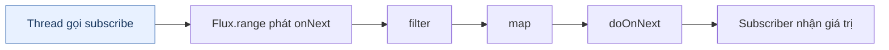

# Chuỗi xử lý chạy trên luồng nào khi chưa đổi bộ lập lịch

Trong chương **Luồng thực thi**, bài học này giải thích luồng thực thi mặc định của một pipeline Reactor khi ứng dụng chưa dùng toán tử đổi scheduler. Câu hỏi “đoạn `map` chạy trên thread nào?” không thể trả lời chỉ bằng cách nhìn vào toán tử. Cần biết nguồn phát tín hiệu như thế nào và subscription bắt đầu ở đâu.

Bài học thuộc module **REACTIVE_PROGRAMMING**. Module hướng dẫn: “Học tư duy reactive qua các luồng sự kiện bất đồng bộ, hợp đồng Publisher–Subscriber và cơ chế backpressure của Reactive Streams. Thực hành Mono, Flux, kết hợp toán tử, kiểm soát scheduler, xử lý lỗi và kiểm thử pipeline trong hệ sinh thái Java.” Trong Reactor, các toán tử thông thường không tự tạo thread riêng. Chúng xử lý tín hiệu trên thread đang chuyển tín hiệu đến chúng, trừ khi nguồn hoặc một ranh giới thực thi có hành vi bất đồng bộ.

## 1. Assembly và subscription là hai thời điểm khác nhau

Một pipeline Reactor thường trải qua hai giai đoạn:

- **Assembly:** ứng dụng gọi các phương thức như `Flux.range`, `map`, `filter` để mô tả chuỗi xử lý. Các lời gọi này thường tạo và kết hợp publisher; chúng chưa có nghĩa là dữ liệu đã được tiêu thụ.
- **Subscription:** một subscriber đăng ký vào publisher. Nguồn bắt đầu phát tín hiệu theo cách triển khai của nó và theo demand mà subscriber gửi.

Ví dụ:

```java
Flux<Integer> numbers =
    Flux.range(1, 3)
        .map(value -> value * 10);

System.out.println("Pipeline đã được lắp ráp");

numbers.subscribe(System.out::println);
```

Lệnh `map` được gọi trong giai đoạn assembly để tạo pipeline. Hàm bên trong `map` chỉ được gọi khi nguồn phát phần tử trong quá trình subscription. Với nguồn đồng bộ như `Flux.range`, các phần tử được phát ngay trong luồng gọi subscription, vì vậy phép biến đổi cũng chạy trên luồng đó.

Cần phân biệt việc gọi phương thức lắp ráp pipeline với việc thực thi callback xử lý từng phần tử. Đây là cơ sở để hiểu tại sao cùng một chuỗi `map` có thể chạy trên thread khác nhau khi nguồn thay đổi.

## 2. Nguồn đồng bộ thường phát trên thread gọi subscribe

Các nguồn như `Flux.just`, `Flux.range` và `Mono.just` có thể phát tín hiệu đồng bộ khi subscriber đăng ký và yêu cầu dữ liệu. Nếu không có nguồn bất đồng bộ hoặc toán tử đổi scheduler, thread gọi `subscribe()` thường là thread thực hiện quá trình phát và xử lý các tín hiệu đó.

```java
static void log(String stage) {
    System.out.printf("%s | %s%n",
        stage,
        Thread.currentThread().getName());
}

public static void main(String[] args) {
    log("Trước subscribe");

    Flux.range(1, 3)
        .doOnSubscribe(subscription -> log("doOnSubscribe"))
        .map(value -> {
            log("map " + value);
            return value * 10;
        })
        .doOnNext(value -> log("doOnNext " + value))
        .subscribe(value -> log("subscriber " + value));

    log("Sau subscribe");
}
```

Với nguồn đồng bộ này, log thường có dạng:

```text
Trước subscribe | main
doOnSubscribe | main
map 1 | main
doOnNext 10 | main
subscriber 10 | main
map 2 | main
doOnNext 20 | main
subscriber 20 | main
map 3 | main
doOnNext 30 | main
subscriber 30 | main
Sau subscribe | main
```

Tên thread cụ thể phụ thuộc môi trường chạy; điểm cần quan sát là các callback xử lý phần tử diễn ra trên cùng thread gọi `subscribe()`. Nguồn đồng bộ phát dữ liệu ngay trong quá trình subscription, nên lời gọi `subscribe()` có thể chưa trả về cho đến khi nguồn hữu hạn phát xong.

Điều này không có nghĩa Reactor luôn dùng thread `main`. Nếu subscription được thực hiện từ một thread khác, nguồn đồng bộ thường phát trên thread đó.

## 3. Các toán tử thông thường không tự chuyển thread

Những toán tử như `map`, `filter`, `doOnNext`, `take` và `handle` xử lý tín hiệu khi tín hiệu đi qua chúng. Bản thân chúng không tự tạo một scheduler mới.

```java
Flux.range(1, 4)
    .filter(value -> {
        log("filter " + value);
        return value % 2 == 0;
    })
    .map(value -> {
        log("map " + value);
        return "Số chẵn: " + value;
    })
    .doOnNext(value -> log("doOnNext"))
    .subscribe(value -> log("subscriber"));
```

Nếu nguồn vẫn là `Flux.range` đồng bộ và pipeline không có ranh giới bất đồng bộ, các callback trên tiếp tục chạy trong luồng đang phát tín hiệu. Khi một phần tử bị `filter` loại bỏ, downstream không nhận `onNext` tương ứng, nhưng điều đó không làm thread tự thay đổi.

Có thể hình dung luồng thực thi như sau:



Các toán tử tạo pipeline có thể được kết hợp thành nhiều bước, nhưng không có quy tắc “mỗi operator là một thread”. Việc thêm nhiều `map` hoặc `filter` không tự làm công việc chạy song song.

## 4. Nguồn quyết định thread phát tín hiệu

Quy tắc “thread gọi subscribe” đúng với nhiều nguồn đồng bộ, nhưng không áp dụng cho mọi publisher. Một nguồn bất đồng bộ có thể phát tín hiệu từ thread hoặc scheduler mà chính nguồn đó sử dụng.

Ví dụ, `Flux.interval` phát tick theo bộ định thời của Reactor:

```java
Flux.interval(Duration.ofMillis(500))
    .take(3)
    .map(tick -> {
        log("map tick " + tick);
        return tick;
    })
    .subscribe(tick -> log("subscriber tick " + tick));
```

Nguồn interval lên lịch các tick trên scheduler dành cho tác vụ thời gian. Vì vậy, callback `map` và subscriber thường chạy trên thread phát tick, không phải thread đã gọi `subscribe()`.

Tương tự, client mạng reactive có thể phát tín hiệu trên event-loop của thư viện mạng. Nếu pipeline tiếp tục bằng `map` và `filter` mà không có ranh giới chuyển thread, các callback downstream thường tiếp tục chạy trên thread phát tín hiệu từ client.

| Loại nguồn | Thread thường phát tín hiệu |
|---|---|
| `Flux.range`, `Flux.just` | Thread thực hiện subscription và yêu cầu dữ liệu |
| `Mono.just` | Thread thực hiện subscription; giá trị đã được giữ từ assembly |
| `Mono.fromCallable` | Thread thực hiện subscription, nếu chưa chuyển scheduler |
| `Flux.interval`, `Mono.delay` | Scheduler thời gian mà nguồn sử dụng |
| Client mạng reactive | Thường là event-loop hoặc scheduler do client quản lý |
| Publisher tự triển khai | Theo cách publisher phát tín hiệu |

Vì thế, khi muốn biết một callback chạy trên thread nào, hãy lần ngược đến nguồn đang phát tín hiệu và tìm xem pipeline có ranh giới chuyển scheduler hay không.

## 5. Giá trị được tính ở assembly hay subscription?

Thread thực thi còn phụ thuộc thời điểm một phép tính được gọi. So sánh `Mono.just` với `Mono.fromCallable`:

```java
Mono<String> eager =
    Mono.just(loadConfiguration());

Mono<String> lazy =
    Mono.fromCallable(() -> loadConfiguration());
```

Với `Mono.just(loadConfiguration())`, Java gọi `loadConfiguration()` ngay khi đánh giá đối số để tạo publisher. Phép tính diễn ra ở assembly, trên thread đang lắp ráp pipeline. `Mono.just` giữ lại giá trị đó để phát cho subscriber sau này.

Với `Mono.fromCallable(...)`, callable được gọi khi có subscription. Nếu chưa dùng scheduler để chuyển việc thực thi, callable chạy trên thread đang thực hiện subscription và yêu cầu dữ liệu. Publisher có thể được subscribe nhiều lần; callable được gọi lại cho mỗi subscription.

Có thể quan sát sự khác biệt:

```java
static String loadConfiguration() {
    log("Đang tải cấu hình");
    return "loaded";
}

log("Bắt đầu assembly");

Mono<String> eager =
    Mono.just(loadConfiguration());

Mono<String> lazy =
    Mono.fromCallable(MyService::loadConfiguration);

log("Đã assembly");

eager.subscribe(value -> log("eager: " + value));
lazy.subscribe(value -> log("lazy: " + value));
```

Dòng log của `loadConfiguration()` trong publisher eager xuất hiện trước dòng “Đã assembly”. Với publisher lazy, nó xuất hiện trong quá trình subscription.

Điểm này đặc biệt quan trọng khi hàm tạo giá trị có chi phí cao hoặc thực hiện I/O. Việc trì hoãn đến subscription không đồng nghĩa với việc tự chuyển sang thread nền; nếu chưa có scheduler phù hợp, tác vụ vẫn có thể chạy trên thread gọi subscription.

## 6. Subscriber callback cũng chạy theo thread phát tín hiệu

Với subscriber viết bằng các lambda của `subscribe`, callback nhận dữ liệu thường được gọi trực tiếp khi publisher chuyển `onNext`. Nếu nguồn đồng bộ phát trên thread gọi subscription, callback subscriber chạy trên thread đó. Nếu nguồn bất đồng bộ phát trên scheduler hoặc event-loop, callback thường chạy trên thread phát tín hiệu đó.

```java
Flux.range(1, 2)
    .map(value -> {
        log("map");
        return value;
    })
    .subscribe(
        value -> log("onNext"),
        error -> log("onError"),
        () -> log("onComplete")
    );
```

Với nguồn đồng bộ, cả ba callback trên được thực hiện trong quá trình gọi `subscribe()`. Callback `onComplete` được gọi sau khi các phần tử đã phát xong. Nếu nguồn phát lỗi, callback `onError` được gọi theo cùng nguyên tắc truyền tín hiệu.

Nếu subscriber thực hiện công việc nặng hoặc blocking ngay trong callback, thread phát tín hiệu sẽ bị giữ lại trong thời gian đó. Điều này đặc biệt nguy hiểm nếu thread đó là event-loop dùng chung cho nhiều kết nối.

Với client reactive, callback downstream có thể chạy trên event-loop của client. Không nên gọi `block()`, `Thread.sleep()` hoặc thực hiện I/O blocking trong callback đó. Công việc blocking cần được bố trí trên scheduler phù hợp ở ranh giới được thiết kế rõ ràng.

## 7. Thread thực thi và backpressure có quan hệ với nhau

Reactive Streams cho phép subscriber yêu cầu số lượng phần tử bằng demand. Với nguồn đồng bộ như `Flux.range`, việc phát phần tử có thể diễn ra ngay trong luồng thực hiện subscription hoặc yêu cầu dữ liệu. Nguồn phát theo demand, còn các toán tử đồng bộ xử lý tín hiệu trên đường truyền đó.

Ví dụ, subscriber có thể yêu cầu từng phần tử:

```java
Flux.range(1, 5)
    .subscribe(new BaseSubscriber<Integer>() {
        @Override
        protected void hookOnSubscribe(Subscription subscription) {
            log("Đã subscribe");
            request(1);
        }

        @Override
        protected void hookOnNext(Integer value) {
            log("Nhận " + value);
            request(1);
        }
    });
```

Trong ví dụ này, subscriber yêu cầu một phần tử ở mỗi lần nhận. Với nguồn đồng bộ, việc xử lý và yêu cầu tiếp theo có thể diễn ra trên cùng thread thực hiện chuỗi tín hiệu. Backpressure điều khiển số lượng phần tử được phép phát; nó không tự tạo thread mới hoặc làm pipeline chạy song song.

Khi nguồn là bất đồng bộ, việc điều phối demand và phát tín hiệu có thể diễn ra qua scheduler hoặc cơ chế nội bộ của nguồn. Dù vậy, backpressure vẫn là hợp đồng về nhu cầu dữ liệu, còn scheduler quyết định nơi và cách tác vụ được thực thi. Hai khái niệm có liên quan nhưng giải quyết hai vấn đề khác nhau.

## 8. Khi nào thread có thể thay đổi dù không thấy subscribeOn?

Không phải chỉ `subscribeOn` hoặc `publishOn` mới có thể khiến callback chạy trên thread khác với thread gọi subscription. Một số nguồn và toán tử có bộ định thời hoặc tích hợp bất đồng bộ riêng, ví dụ:

- `Flux.interval` và `Mono.delay` phát tín hiệu theo scheduler thời gian.
- `delayElements` sử dụng scheduler để lên lịch chuyển tiếp phần tử.
- Publisher từ client mạng có thể nhận dữ liệu trên event-loop.
- Publisher tự triển khai có thể phát tín hiệu từ một executor hoặc thread riêng.

Vì vậy, “chưa đổi scheduler tường minh” chỉ có nghĩa là pipeline chưa thêm một ranh giới scheduler do ứng dụng chỉ định. Nó không bảo đảm mọi nguồn đều chạy trên thread gọi `subscribe()`.

Ngược lại, với nguồn đồng bộ và chuỗi toán tử đồng bộ, thread thực thi thường không đổi. Hãy đọc hợp đồng và cách tạo nguồn để biết publisher thuộc trường hợp nào.

## 9. Quan sát thread trong pipeline

Trong quá trình học và gỡ lỗi, có thể ghi tên thread tại các điểm quan trọng bằng `Thread.currentThread().getName()`:

```java
Flux.range(1, 3)
    .doOnSubscribe(s -> log("subscribe"))
    .doOnNext(value -> log("upstream " + value))
    .map(value -> {
        log("map " + value);
        return value * 2;
    })
    .doOnNext(value -> log("downstream " + value))
    .subscribe(value -> log("consumer " + value));
```

Với nguồn đồng bộ, các dòng log thường có cùng tên thread. Khi thay nguồn bằng `Flux.interval`, có thể quan sát tên thread của scheduler thời gian. Đây là cách kiểm tra trực tiếp hành vi thực thi thay vì suy luận từ tên toán tử.

Khi log trong ứng dụng thực tế, nên ghi thêm request ID hoặc correlation ID để liên kết các dòng thuộc cùng một pipeline. Tên thread hữu ích để chẩn đoán, nhưng không nên dùng nó làm định danh nghiệp vụ hoặc giả định một tên thread cụ thể luôn tồn tại trong mọi môi trường.

## 10. Những hiểu nhầm thường gặp

- **Cho rằng mỗi operator chạy trên một thread riêng.** `map`, `filter` và `doOnNext` thường chạy trên thread đang phát tín hiệu đến chúng.
- **Cho rằng mọi pipeline chạy trên thread gọi subscribe.** Điều này thường đúng với nguồn đồng bộ, nhưng nguồn bất đồng bộ có thể phát từ scheduler hoặc event-loop riêng.
- **Nhầm assembly với subscription.** `Mono.just(load())` gọi hàm tải dữ liệu ở assembly; `Mono.fromCallable(...)` gọi khi subscribe.
- **Nghĩ rằng reactive đồng nghĩa với chạy nền.** Một pipeline reactive có thể chạy đồng bộ trên thread gọi subscription.
- **Nghĩ rằng backpressure tự tạo thread.** Demand điều khiển lượng dữ liệu được yêu cầu; scheduler điều khiển việc thực thi.
- **Chặn event-loop trong callback.** Blocking có thể giữ thread phát tín hiệu và làm chậm các công việc khác đang dùng chung event-loop.
- **Dựa vào tên thread để quyết định logic nghiệp vụ.** Thread name là thông tin chẩn đoán, không phải hợp đồng ứng dụng.

## 11. Bài tập vận dụng

Hãy viết hai pipeline:

1. Pipeline thứ nhất dùng `Flux.range(1, 3)`, sau đó lần lượt gọi `doOnNext`, `map` và subscriber callback. Ghi tên thread ở từng bước và giải thích vì sao chúng thường cùng chạy trên thread gọi `subscribe()`.
2. Pipeline thứ hai dùng `Flux.interval(Duration.ofMillis(300)).take(3)` rồi thêm `map` và subscriber callback. Ghi tên thread và giải thích vì sao thread phát tín hiệu có thể khác thread gọi subscription.

Tiếp theo, so sánh `Mono.just(load())` với `Mono.fromCallable(this::load)`. Xác định chính xác lúc hàm `load` được gọi và thread nào thực hiện nó khi chưa có toán tử chuyển scheduler.

Cuối cùng, giải thích vì sao một pipeline reactive không mặc nhiên chạy trên thread nền, vì sao một toán tử `map` không tự tạo thread, và điều gì có thể xảy ra nếu callback downstream thực hiện thao tác blocking trên event-loop.

Khi chưa có ranh giới chuyển scheduler, hãy lần theo nguồn phát tín hiệu để xác định thread thực thi. Đây là cách hiểu đúng hành vi mặc định trước khi học cách chủ động điều khiển scheduler bằng `subscribeOn` và `publishOn`.
