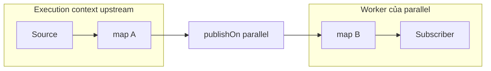

# Bộ lập lịch và ranh giới thực thi của từng đoạn chuỗi

Trong module `REACTIVE_PROGRAMMING`, ta học cách tổ chức các luồng sự kiện bất đồng bộ theo hợp đồng Publisher–Subscriber và cơ chế backpressure của Reactive Streams, đồng thời thực hành `Mono`, `Flux`, kết hợp toán tử, kiểm soát scheduler, xử lý lỗi và kiểm thử pipeline trong hệ sinh thái Java. Khi lắp ráp một pipeline Reactor, các toán tử được nối thành một chuỗi xử lý. Nhưng việc chúng nằm cạnh nhau trong mã nguồn không có nghĩa mọi toán tử chạy trên cùng một thread, cũng không có nghĩa Reactor tự tạo một thread cho mỗi toán tử.

**Scheduler** quyết định nơi một phần công việc reactive được thực thi. Hai toán tử quan trọng nhất để thiết lập ranh giới thực thi là `subscribeOn` và `publishOn`. `subscribeOn` điều khiển nơi quá trình subscribe vào upstream bắt đầu; `publishOn` chuyển việc phát tín hiệu đến các toán tử downstream sang scheduler được chọn. Hiểu vị trí của hai toán tử này giúp tách I/O blocking khỏi xử lý CPU, tránh chặn event loop và dự đoán được thread thực thi của từng đoạn pipeline.

## 1. Assembly và execution là hai thời điểm khác nhau

Khi gọi các phương thức như `map`, `filter`, `flatMap`, `publishOn` hoặc `subscribeOn`, ta đang lắp ráp một mô tả pipeline. Phần lớn callback bên trong toán tử chỉ chạy khi có subscription và tín hiệu đi qua chúng.

```java
Mono<String> name = Mono.fromSupplier(() -> {
    System.out.println("Tạo giá trị: " + Thread.currentThread().getName());
    return "An";
}).map(value -> value.toUpperCase());

System.out.println("Đã lắp ráp pipeline");
name.subscribe(value -> System.out.println("Nhận: " + value));
```

Lời gọi `fromSupplier` và `map` tạo Publisher mà chưa gọi supplier hoặc hàm chuyển đổi. Khi `subscribe` bắt đầu, supplier mới được gọi, rồi kết quả đi qua `map` và tới subscriber.

Tuy nhiên, không phải biểu thức Java nào xuất hiện khi lắp ráp cũng được trì hoãn. Java đánh giá đối số trước khi gọi phương thức:

```java
Mono<String> eager = Mono.just(loadFromDatabase());
Mono<String> lazy = Mono.fromCallable(this::loadFromDatabase);
```

`loadFromDatabase()` trong `Mono.just(...)` chạy ngay tại thời điểm tạo Publisher. `fromCallable` trì hoãn lời gọi đến lúc subscription tiêu thụ nguồn. Nếu muốn trì hoãn cả việc tạo một Publisher khác, dùng `defer`:

```java
Mono<String> lazyPublisher = Mono.defer(this::loadReactiveValue);
```

Scheduler điều khiển thread thực thi khi pipeline chạy; nó không thay đổi việc một biểu thức Java đã được đánh giá ngay trong lúc lắp ráp.

## 2. Scheduler là gì?

Trong Reactor, `Scheduler` là abstraction quản lý việc lên lịch và thực thi tác vụ. Nó cung cấp worker để các nguồn và toán tử có thể chuyển công việc sang một execution context khác. Một scheduler có thể dùng một thread, một nhóm thread hoặc cơ chế thực thi khác tùy loại.

Các scheduler thường dùng:

| Scheduler | Đặc điểm | Công việc phù hợp |
|---|---|---|
| `Schedulers.immediate()` | Thực thi tác vụ ngay trên thread gọi | Trường hợp không cần chuyển thread |
| `Schedulers.single()` | Dùng một thread chia sẻ cho các tác vụ tuần tự | Tác vụ nhẹ cần một execution lane tuần tự |
| `Schedulers.parallel()` | Nhóm worker tối ưu cho tác vụ CPU-bound không blocking | Tính toán, biến đổi dữ liệu tốn CPU |
| `Schedulers.boundedElastic()` | Pool có giới hạn phù hợp cho tác vụ blocking | JDBC, thư viện đồng bộ, file hoặc API blocking |
| `Schedulers.fromExecutor(...)` | Bọc một Executor do ứng dụng quản lý | Tích hợp với hạ tầng thực thi hiện có |

Không nên chọn scheduler chỉ dựa trên tên. Hãy xét loại công việc, khả năng blocking, yêu cầu tuần tự, số tác vụ đồng thời và vòng đời tài nguyên. Đưa công việc blocking lên `parallel()` có thể làm chiếm worker dành cho CPU và ảnh hưởng các pipeline khác. Dùng `boundedElastic()` cho phép cô lập phần chờ blocking, nhưng vẫn cần giới hạn tải và thời gian chờ.

Các scheduler chia sẻ do `Schedulers` cung cấp được Reactor quản lý. Nếu tự tạo scheduler riêng bằng `Schedulers.newSingle(...)` hoặc `Schedulers.newParallel(...)`, thành phần tạo ra nó chịu trách nhiệm gọi `dispose()` khi không còn sử dụng.

## 3. `subscribeOn`: chuyển nơi subscribe vào upstream

`subscribeOn(scheduler)` sắp lịch quá trình đăng ký vào phần upstream trên scheduler được chọn. Với nguồn đồng bộ như `fromCallable`, điều này cũng quyết định thread gọi tác vụ nguồn. Các toán tử upstream phát tín hiệu trên thread đó cho đến khi gặp một ranh giới chuyển thread khác.

```java
Mono<Account> account = Mono.fromCallable(
        () -> repository.loadAccount(accountId)
    )
    .subscribeOn(Schedulers.boundedElastic());
```

Nếu `repository.loadAccount` dùng JDBC đồng bộ và chặn thread trong lúc chờ database, `boundedElastic()` đưa thao tác đó ra khỏi thread gọi subscriber. Khi callable trả về, tín hiệu tiếp tục đi xuống pipeline.

Vị trí của `subscribeOn` thường ít nhạy cảm hơn `publishOn`: nó tác động đến subscription vào upstream của chính nó. Ví dụ:

```java
Flux<Integer> values = Flux.range(1, 3)
    .map(this::transform)
    .subscribeOn(Schedulers.single());
```

Nguồn `range` và phép `transform` đồng bộ upstream được thực thi trên worker mà `subscribeOn` chọn. Đặt `subscribeOn` sau `map` vẫn chuyển quá trình subscribe đến upstream, nên `map` ở phía trên nguồn cũng nhận tín hiệu trên execution context đó.

Thông thường, một `subscribeOn` gần nguồn là đủ để điều khiển nơi nguồn được đăng ký. Thêm nhiều `subscribeOn` không có nghĩa tạo một thread mới cho mỗi đoạn `map`; mỗi toán tử vẫn chỉ thêm hành vi lập lịch cho quá trình subscribe ở ranh giới của nó. Khi pipeline có nhiều bước cần chuyển thread theo từng đoạn, dùng `publishOn` tại các điểm chuyển tiếp.

## 4. `publishOn`: chuyển tín hiệu từ vị trí đặt toán tử trở xuống

`publishOn(scheduler)` tạo một ranh giới bất đồng bộ cho các tín hiệu đi tới những toán tử downstream. Các toán tử trước `publishOn` tiếp tục chạy theo thread của upstream; các toán tử sau nó xử lý tín hiệu trên worker do scheduler được chọn cung cấp, cho đến khi có ranh giới khác.

```java
Flux<Integer> values = Flux.range(1, 3)
    .map(value -> trace("map-A", value))
    .publishOn(Schedulers.parallel())
    .map(value -> trace("map-B", value));
```

Trong ví dụ, `map-A` chạy cùng execution context phát dữ liệu của `range`. `map-B` chạy trên worker được `publishOn` chọn. `publishOn` không làm cho `map-A` chuyển sang scheduler phía sau nó, bởi tín hiệu đã đi qua `map-A` trước khi tới ranh giới.

Có thể hình dung một pipeline có hai đoạn thực thi:



`publishOn` thường cần một hàng đợi để chuyển tín hiệu từ thread upstream sang worker downstream. Vì vậy, nó tạo thêm chi phí điều phối và ảnh hưởng đến demand/backpressure thông qua cơ chế prefetch của toán tử. Không nên thêm `publishOn` sau mọi toán tử; chỉ đặt ở ranh giới thực thi có ý nghĩa.

## 5. Kết hợp `subscribeOn` và `publishOn`

Trong ứng dụng, một pipeline thường cần chạy nguồn blocking ở `boundedElastic`, rồi chuyển dữ liệu sang `parallel` để tính toán. Có thể biểu diễn rõ hai ranh giới như sau:

```java
Mono<Report> report = Mono.fromCallable(
        () -> blockingRepository.loadReport(reportId)
    )
    .subscribeOn(Schedulers.boundedElastic())
    .publishOn(Schedulers.parallel())
    .map(this::calculateStatistics)
    .map(this::buildReport);
```

Diễn tiến:

1. Subscriber đăng ký vào pipeline.
2. `subscribeOn(boundedElastic)` sắp lịch subscription vào nguồn callable trên worker dành cho blocking.
3. `blockingRepository.loadReport` chạy trên worker đó.
4. Khi nguồn phát kết quả, `publishOn(parallel)` chuyển tín hiệu sang worker của scheduler `parallel`.
5. `calculateStatistics` và `buildReport` chạy trên worker downstream đã chọn.

Đặt `publishOn` trước bước CPU-bound là điều quan trọng. Nếu đặt nó sau `calculateStatistics`, phép tính vẫn chạy trên thread upstream và chỉ các bước phía sau mới được chuyển scheduler.

Nếu pipeline có nhiều loại công việc, có thể tạo nhiều ranh giới:

```java
Mono<Result> result = Mono.fromCallable(this::readBlockingInput)
    .subscribeOn(Schedulers.boundedElastic())
    .publishOn(Schedulers.parallel())
    .map(this::performCpuCalculation)
    .publishOn(Schedulers.boundedElastic())
    .flatMap(this::writeBlockingOutput);
```

Ví dụ này đưa đọc và ghi blocking sang `boundedElastic`, còn phép tính nằm trên `parallel`. Việc chuyển qua lại có chi phí và tạo hàng đợi. Chỉ dùng nhiều ranh giới khi chúng giải quyết một yêu cầu thực tế về loại công việc hoặc tài nguyên.

## 6. Nhiều `publishOn` tạo nhiều đoạn thực thi

Mỗi `publishOn` tác động đến phần downstream sau vị trí đặt nó. Vì vậy, một pipeline có thể có nhiều execution context:

```java
Flux<Result> pipeline = source
    .map(this::decode)                         // context của source
    .publishOn(Schedulers.parallel())
    .map(this::calculate)                      // parallel worker
    .publishOn(Schedulers.single())
    .map(this::formatForOutput);               // single worker
```

Trong pipeline này:

- `decode` chạy theo thread phát tín hiệu của `source`.
- `calculate` chạy trên worker do `parallel` cấp.
- `formatForOutput` chạy trên worker do `single` cấp.

Scheduler `single()` chia sẻ một worker cho các subscription dùng scheduler đó, vì vậy có thể tạo điểm tuần tự hóa giữa các luồng công việc. Điều đó không tự động bảo đảm toàn bộ ứng dụng chỉ có một thread; chỉ những tác vụ được gửi qua scheduler chia sẻ đó mới đi qua execution lane của nó.

Nếu cần giữ một đoạn xử lý trên cùng một thread trong suốt vòng đời của nó, hãy dùng scheduler và cách ghép toán tử phù hợp, đồng thời nhớ rằng một worker không có nghĩa thread là tài nguyên dành riêng cho riêng một subscription.

## 7. `publishOn` không tự tạo xử lý song song

Một nhầm lẫn phổ biến là nghĩ `publishOn(Schedulers.parallel())` khiến mỗi phần tử được xử lý đồng thời trên nhiều core. Thực tế, một `publishOn` thông thường chuyển tín hiệu downstream sang một worker; các tín hiệu trên đoạn đó được xử lý tuần tự theo thứ tự của subscription.

```java
Flux<Integer> sequentialOnWorker = Flux.range(1, 100)
    .publishOn(Schedulers.parallel())
    .map(this::cpuHeavyCalculation);
```

Đoạn mã trên chuyển phép tính sang một worker `parallel`, nhưng không chia 100 phần tử thành các nhánh song song. Nếu cần xử lý song song các phần tử, Reactor có mô hình `ParallelFlux`:

```java
Flux<Result> results = Flux.range(1, 100)
    .parallel(4)
    .runOn(Schedulers.parallel())
    .map(this::cpuHeavyCalculation)
    .sequential();
```

`parallel(4)` chia luồng thành bốn rail; `runOn` chọn scheduler để các rail thực thi; `sequential()` ghép kết quả trở lại thành một `Flux`. Xử lý song song có thể làm thay đổi thứ tự phát kết quả và có chi phí phân phối/ghép dữ liệu. Chỉ dùng khi phép tính đủ độc lập và lợi ích song song lớn hơn chi phí điều phối.

## 8. Quan sát thread thực thi

Khi cần xác nhận ranh giới thực thi, có thể ghi tên thread trong callback. Ví dụ:

```java
static <T> T trace(String stage, T value) {
    System.out.printf(
        "%-18s thread=%s value=%s%n",
        stage,
        Thread.currentThread().getName(),
        value
    );
    return value;
}

Flux.range(1, 3)
    .map(value -> trace("before-publishOn", value))
    .publishOn(Schedulers.parallel())
    .map(value -> trace("after-publishOn", value))
    .subscribe();
```

Tên thread thực tế phụ thuộc scheduler, cấu hình Reactor và môi trường chạy. Không nên viết logic nghiệp vụ dựa trên chuỗi tên thread hoặc giả định một tên cụ thể. Hãy dùng log và tracing để quan sát ranh giới, còn việc chọn scheduler nên dựa trên loại công việc.

## 9. Backpressure tại ranh giới `publishOn`

`publishOn` tạo một hàng đợi giữa upstream và downstream. Nó không bỏ qua hợp đồng backpressure; thay vào đó, nó quản lý demand và prefetch để nhận trước một lượng dữ liệu rồi chuyển dần sang worker downstream.

Điều này giúp tách tốc độ thực thi của hai đoạn pipeline, nhưng cũng có một số hệ quả:

- Có thể có phần tử đang chờ trong queue của `publishOn` khi downstream xử lý chậm.
- Prefetch làm upstream có thể được yêu cầu phát trước khi downstream tiêu thụ hết phần tử hiện tại.
- Thêm nhiều ranh giới `publishOn` có thể tăng số queue và lượng dữ liệu đang chờ.
- Hủy subscription truyền ngược lên upstream, nhưng công việc đã bắt đầu trong callback blocking không nhất thiết dừng ngay tức thì.

Với nguồn có tốc độ cao, cần cân nhắc prefetch, số ranh giới chuyển scheduler, giới hạn concurrency và dung lượng bộ nhớ. Chuyển thread không tự làm hệ thống nhanh hơn; nếu downstream là nút thắt, queue chỉ trì hoãn thời điểm nhìn thấy quá tải.

## 10. Lỗi và tín hiệu kết thúc qua ranh giới thực thi

`onError` và `onComplete` cũng đi qua ranh giới `publishOn`. Nếu một lỗi xảy ra ở upstream, các toán tử downstream sau `publishOn` sẽ quan sát tín hiệu lỗi theo execution context mà ranh giới đó thiết lập. Tương tự, `doOnError` đặt ở hai phía có thể chạy trên các thread khác nhau:

```java
Mono<Data> data = source
    .doOnError(error -> log.error("Lỗi upstream", error))
    .publishOn(Schedulers.parallel())
    .doOnError(error -> log.error("Lỗi downstream", error))
    .onErrorResume(this::fallback);
```

`doOnError` phía trước `publishOn` quan sát lỗi ở phía upstream. `doOnError` phía sau ranh giới quan sát tín hiệu lỗi khi nó được chuyển đến downstream. `onErrorResume` cũng chạy ở phía downstream và có thể tạo Publisher thay thế.

Đừng dùng scheduler như một cơ chế xử lý lỗi. Việc chuyển thread không phục hồi lỗi, không biến `onError` thành dữ liệu và không làm subscription tiếp tục sau tín hiệu kết thúc. Hãy dùng các toán tử như `onErrorResume`, `onErrorMap` hoặc `retryWhen` theo đúng mục đích nghiệp vụ.

## 11. Kiểm thử và xác minh ranh giới

Không nên kiểm thử bằng cách yêu cầu một tên thread cố định, vì scheduler có thể cấp worker khác nhau giữa các lần chạy. Thay vào đó, có thể thu thập tên thread để xác nhận hai đoạn pipeline không chạy trên cùng execution context:

```java
AtomicReference<String> upstreamThread = new AtomicReference<>();
AtomicReference<String> downstreamThread = new AtomicReference<>();
Scheduler downstreamScheduler = Schedulers.newSingle("test-downstream");

try {
    StepVerifier.create(
            Flux.range(1, 3)
                .doOnNext(value -> upstreamThread.set(
                    Thread.currentThread().getName()
                ))
                .publishOn(downstreamScheduler)
                .doOnNext(value -> downstreamThread.set(
                    Thread.currentThread().getName()
                ))
        )
        .expectNext(1, 2, 3)
        .verifyComplete();

    assertNotEquals(upstreamThread.get(), downstreamThread.get());
} finally {
    downstreamScheduler.dispose();
}
```

Trong test hoàn chỉnh, scheduler riêng cần được dispose sau khi xác minh. Có thể tạo scheduler trước test, dùng `try/finally` để giải phóng hoặc quản lý bằng lifecycle của test fixture. Tránh để scheduler riêng còn sống sau khi test kết thúc.

Đối với logic phụ thuộc thời gian, dùng virtual time; đối với logic phụ thuộc thread, kiểm tra ranh giới và hành vi đồng bộ hóa cần thiết thay vì dựa vào timing ngẫu nhiên. Một pipeline tốt không nên yêu cầu callback chạy trên đúng một tên thread cụ thể nếu hợp đồng không quy định điều đó.

## 12. Những lỗi thường gặp khi chọn ranh giới thực thi

| Sai lầm | Hệ quả | Cách điều chỉnh |
|---|---|---|
| Dùng `publishOn` sau phép tính blocking | Phép tính vẫn chạy trên thread upstream | Đặt `publishOn` trước bước cần chuyển context hoặc dùng `subscribeOn` cho nguồn blocking |
| Nghĩ `subscribeOn` chỉ ảnh hưởng toán tử đứng ngay sau nó | Hiểu sai thread của nguồn và các toán tử upstream | Nhớ rằng nó chuyển quá trình subscribe vào upstream |
| Dùng `parallel()` cho I/O blocking | Worker CPU bị chiếm trong lúc chờ | Dùng `boundedElastic()` hoặc API non-blocking |
| Nghĩ một `publishOn(parallel())` tự chia phần tử chạy song song | Một worker xử lý tuần tự tín hiệu downstream | Dùng `parallel().runOn(...).sequential()` khi thật sự cần chia rail |
| Thêm `publishOn` sau mọi toán tử | Tăng queue, context switch và chi phí điều phối | Chỉ tạo ranh giới ở nơi cần thiết |
| Không dispose scheduler tự tạo | Giữ thread và tài nguyên sau khi thành phần kết thúc | Quản lý vòng đời scheduler |
| Dùng tên thread để quyết định nghiệp vụ | Logic phụ thuộc chi tiết triển khai scheduler | Dùng scheduler theo loại công việc, không theo tên thread |

## 13. Quy trình thiết kế pipeline theo đoạn thực thi

Khi xây dựng một pipeline có nhiều loại công việc, hãy làm theo thứ tự:

1. **Xác định nguồn thực thi ở đâu.** Nếu nguồn là tác vụ đồng bộ blocking, đặt nó trong `fromCallable` hoặc `defer` và dùng `subscribeOn(boundedElastic)`.
2. **Phân loại từng đoạn xử lý.** Tách I/O blocking, phép tính CPU-bound và thao tác tuần tự cần cùng execution lane.
3. **Đặt `publishOn` trước đoạn cần chuyển context.** Các toán tử phía trước tiếp tục chạy theo upstream; các toán tử phía sau dùng scheduler mới.
4. **Chỉ dùng parallel khi có thể xử lý độc lập.** Một `publishOn(parallel())` không thay thế mô hình `ParallelFlux`.
5. **Đánh giá queue và backpressure.** Mỗi ranh giới bất đồng bộ có chi phí lưu đệm và điều phối demand.
6. **Xác định vòng đời scheduler.** Scheduler chia sẻ do Reactor quản lý; scheduler tự tạo phải được dispose.
7. **Quan sát và kiểm thử.** Dùng log/tracing để xác nhận ranh giới, kiểm thử hành vi và tránh phụ thuộc vào tên thread cố định.

`subscribeOn` và `publishOn` giải quyết hai phần khác nhau của việc điều khiển thực thi: một toán tử chuyển quá trình đăng ký vào upstream, toán tử còn lại chuyển tín hiệu từ vị trí đặt nó xuống downstream. Khi đặt chúng theo ranh giới công việc, ta có thể cô lập I/O blocking, phân bổ phép tính CPU và giữ cho pipeline `Mono`/`Flux` dễ dự đoán, kiểm thử và vận hành.
