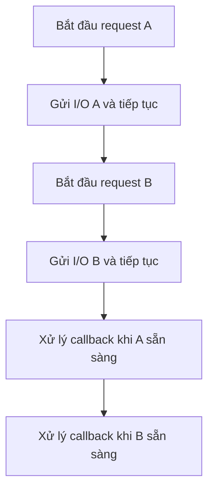
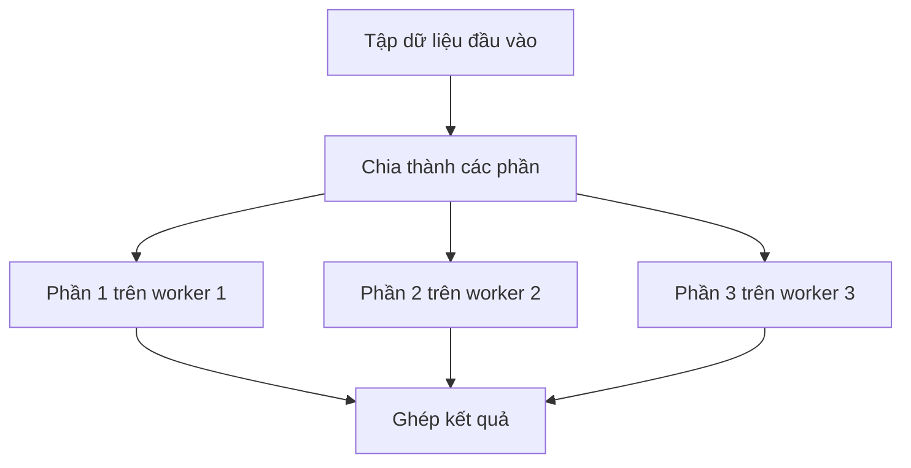

# Xử lý đồng thời khác với chia dữ liệu để chạy song song

## Hai khái niệm thường bị gọi nhầm tên

Trong ứng dụng Java, một pipeline có thể xử lý nhiều công việc đang chờ cùng lúc mà không thực hiện các phép tính trên nhiều CPU core cùng một thời điểm. Ngược lại, một phép tính có thể được chia thành nhiều phần và chạy thật sự đồng thời trên nhiều core. Hai cách tổ chức này giải quyết các vấn đề khác nhau:

- **Xử lý đồng thời (concurrency)** là tổ chức nhiều công việc có khoảng thời gian thực thi chồng lấn. Hệ thống có thể chuyển qua lại giữa các công việc, hoặc để nhiều công việc tiến triển độc lập. Chúng không bắt buộc chạy cùng một thời điểm.
- **Xử lý song song (parallelism)** là thực thi nhiều phần công việc tại cùng một thời điểm, thường trên nhiều core hoặc bộ xử lý. Muốn có parallelism thực sự, hệ thống cần có tài nguyên thực thi đồng thời và công việc phải được phân chia phù hợp.

Concurrency nói về cách quản lý nhiều công việc đang hoạt động; parallelism nói về việc nhiều công việc có thực sự chạy cùng lúc hay không. Một hệ thống có thể hỗ trợ concurrency cao trên một event loop duy nhất nhờ I/O không chặn. Một phép tính CPU có thể được chia thành nhiều phần để tận dụng nhiều core, nhưng việc chia nhỏ cũng có chi phí điều phối và kết hợp kết quả.

Trong Reactive Programming với Java, cần phân biệt hai khái niệm này khi sử dụng `flatMap`, `ParallelFlux`, `Schedulers.parallel()`, `publishOn` và `subscribeOn`. Các toán tử có thể tạo nhiều tác vụ đang chờ, đổi luồng thực thi hoặc chia dữ liệu thành nhiều rail; những hành vi đó không tương đương nhau.

## Concurrency: nhiều công việc cùng tiến triển

Giả sử một API cần tải thông tin từ ba dịch vụ: hồ sơ, địa chỉ và lịch sử đơn hàng. Mỗi lời gọi chủ yếu chờ phản hồi mạng. Nếu thực hiện tuần tự, lời gọi thứ hai chỉ bắt đầu sau khi lời gọi thứ nhất hoàn tất, rồi mới đến lời gọi thứ ba. Nếu các client hỗ trợ I/O bất đồng bộ, có thể khởi chạy cả ba và chờ chúng hoàn tất:

```java
import java.util.List;
import reactor.core.publisher.Mono;

Mono<Profile> profile = profileClient.findById(userId);
Mono<Address> address = addressClient.findByUserId(userId);
Mono<List<Order>> orders = orderClient.findRecentByUserId(userId).collectList();

Mono<UserOverview> overview = Mono.zip(profile, address, orders)
    .map(tuple -> new UserOverview(tuple.getT1(), tuple.getT2(), tuple.getT3()));
```

Ba publisher có thể cùng có request đang chờ. Trong thời gian một request đợi mạng, runtime có thể xử lý tín hiệu hoặc công việc khác. Điều này làm giảm thời gian chờ tổng so với cách gọi tuần tự, nhưng không có nghĩa ba phép tính CPU đang chạy song song trên ba core. Phần lớn thời gian của ví dụ là chờ I/O.

Concurrency đặc biệt hữu ích cho I/O-bound work: gọi HTTP, truy vấn reactive database, nhận message hoặc chờ sự kiện. Trong một client non-blocking, nhiều request có thể cùng đang in-flight mà không cần một thread riêng bị giữ cho từng request. Event loop có thể xử lý callback khi dữ liệu sẵn sàng.

### Concurrency không bắt buộc có nhiều thread

Một event loop duy nhất có thể luân phiên xử lý callback của hàng nghìn kết nối. Tại một thời điểm, event loop chỉ chạy một đoạn mã trên một thread, nhưng nhiều thao tác I/O vẫn đang chờ bên ngoài và có thể hoàn tất độc lập. Đây là concurrency mà không cần parallelism trên CPU.

Mô hình thời gian khái quát:



Các bước xử lý callback được thực hiện trên event loop theo từng đoạn ngắn; trong khi đó, thao tác I/O của A và B có thể cùng chờ bên ngoài. Khi một callback hoàn tất, event loop quay lại xử lý công việc tiếp theo. Vì vậy, không nên đánh giá concurrency chỉ bằng số thread.

## Parallelism: chia công việc để chạy trên nhiều core

Parallelism phù hợp khi công việc chủ yếu tiêu thụ CPU và có thể chia thành các phần tương đối độc lập: tính toán thống kê trên tập dữ liệu lớn, biến đổi ảnh, tính điểm nhiều đối tượng hoặc xử lý từng bản ghi với hàm CPU-bound.

Nếu chạy một phép tính nặng trên một thread, core đó thực hiện các bước tính lần lượt. Khi chia dữ liệu thành nhiều phần và chạy các phần trên nhiều worker, nhiều core có thể thực thi cùng lúc. Kết quả cuối thường cần được ghép lại sau khi các phần hoàn tất.



Chia dữ liệu không tự bảo đảm tốc độ tăng tuyến tính. Nếu các phần quá nhỏ, chi phí lập lịch và ghép kết quả có thể lớn hơn lợi ích. Nếu các phần chia sẻ trạng thái mutable, cần đồng bộ hóa hoặc thiết kế lại để tránh race condition. Nếu một phần mất nhiều thời gian hơn phần khác, các worker còn lại có thể phải chờ phần chậm nhất trước khi có kết quả cuối.

## Phân biệt bằng tình huống thực tế

| Tình huống | Nhu cầu chính | Lý do |
|---|---|---|
| Gửi đồng thời nhiều request HTTP non-blocking | Concurrency | Nhiều request đang chờ và hoàn tất độc lập |
| Nhận sự kiện từ nhiều kết nối trên event loop | Concurrency | Một thread điều phối nhiều nguồn I/O |
| Tính checksum cho các khối file độc lập | Parallelism | Có thể chia phép tính CPU thành nhiều phần |
| Tính tổng dữ liệu lớn bằng nhiều worker | Parallelism | Nhiều phần dữ liệu được xử lý cùng lúc rồi ghép kết quả |
| Gọi một API blocking trên `boundedElastic` | Concurrency được cô lập bằng pool thread | Thread bị giữ khi chờ, pool cho phép các tác vụ khác tiến triển trên worker khác |
| Dùng `flatMap` để gọi nhiều dịch vụ reactive | Concurrency | Nhiều publisher con có thể đang hoạt động cùng lúc |
| Dùng `ParallelFlux.runOn` để biến đổi phần tử CPU-bound | Parallelism | Dữ liệu được chia thành các rail và chạy trên nhiều worker |

Một ứng dụng thực tế thường cần cả hai. Ví dụ, hệ thống có thể nhận nhiều request đồng thời, rồi với mỗi request lại chia một phép tính CPU lớn thành nhiều phần chạy song song. Cần giới hạn cả số request in-flight lẫn số tác vụ CPU đang chạy để tránh quá tải.

## flatMap tạo concurrency, không tự động chia CPU

`flatMap` nhận mỗi phần tử từ nguồn chính, tạo một publisher con và hợp nhất tín hiệu từ các publisher con đó. Có thể giới hạn số publisher con hoạt động đồng thời bằng tham số `concurrency`:

```java
import reactor.core.publisher.Flux;
import reactor.core.publisher.Mono;

Flux<Profile> profiles = userIds.flatMap(
    userId -> profileClient.findById(userId),
    32
);
```

Với `concurrency = 32`, Reactor cho phép tối đa 32 publisher con được subscribe đồng thời theo cơ chế của toán tử. Nếu `profileClient` là client reactive non-blocking, nhiều request có thể cùng chờ phản hồi. Đây là concurrency hữu ích cho I/O-bound work. Thứ tự kết quả có thể khác thứ tự `userIds`, vì kết quả được phát khi các publisher con hoàn tất.

`flatMap` không tự động chuyển mỗi hàm ánh xạ sang một core khác. Nếu publisher con thực hiện phép tính đồng bộ trên thread hiện tại, việc tăng `concurrency` không đồng nghĩa phép tính đó chạy song song. Ví dụ:

```java
Flux<Integer> calculated = Flux.range(1, 100)
    .flatMap(number -> Mono.just(expensiveCpuCalculation(number)), 8);
```

`Mono.just(...)` nhận đối số đã được Java tính ngay khi biểu thức được đánh giá. Phép tính `expensiveCpuCalculation` vì thế chạy đồng bộ trong luồng đang phát phần tử; chỉ thêm `flatMap(..., 8)` không chuyển phép tính đó sang tám worker. Đây là lỗi phổ biến khi nhầm concurrency của publisher con với parallelism của phép tính.

Nếu mỗi publisher con đại diện cho một thao tác I/O non-blocking, `flatMap` có thể giúp các thao tác cùng tiến triển. Nếu mỗi phần tử cần một phép tính CPU độc lập, hãy dùng cơ chế chia rail hoặc chuyển phép tính sang scheduler CPU phù hợp.

### Giới hạn concurrency là giới hạn tải, không phải số core

Tham số concurrency của `flatMap` thường dùng để giới hạn số publisher con đang hoạt động. Nó có thể lớn hơn hoặc nhỏ hơn số CPU core. Với dịch vụ HTTP, giới hạn nên dựa vào connection pool, rate limit, khả năng của dịch vụ đích và bộ nhớ. Với công việc CPU-bound, tăng số publisher con mà không có scheduler song song không tạo thêm năng lực CPU.

Ví dụ, nếu một dịch vụ chỉ cho phép tối đa 20 request đồng thời, `flatMap(..., 20)` giúp giới hạn số nhánh gọi dịch vụ. Nếu tăng lên 200, ứng dụng có thể tạo thêm hàng đợi và tải lên dịch vụ đích mà không cải thiện thông lượng thực tế.

## flatMap, flatMapSequential và concatMap

Ba toán tử thường được dùng để kết hợp publisher con, nhưng khác nhau về concurrency và thứ tự:

| Toán tử | Xử lý publisher con | Thứ tự đầu ra | Khi phù hợp |
|---|---|---|---|
| `flatMap` | Có thể subscribe nhiều publisher con cùng lúc | Theo thời điểm phát kết quả | Các tác vụ độc lập, ưu tiên thông lượng |
| `flatMapSequential` | Có thể subscribe đồng thời nhưng giữ thứ tự nguồn khi phát | Theo thứ tự đầu vào | Cần concurrency nhưng đầu ra phải có thứ tự |
| `concatMap` | Xử lý publisher con tuần tự | Theo thứ tự đầu vào | Tác vụ phụ thuộc thứ tự hoặc cần giới hạn một nhánh tại một thời điểm |

Ví dụ dùng `flatMapSequential` để tải nhiều hồ sơ đồng thời nhưng giữ thứ tự ID đầu vào:

```java
Flux<Profile> orderedProfiles = userIds.flatMapSequential(
    userId -> profileClient.findById(userId),
    16,
    1
);
```

Publisher con có thể hoàn tất không theo thứ tự, nhưng kết quả được phát theo thứ tự của `userIds`. Điều này có thể cần bộ đệm nếu một publisher con đầu luồng chậm hơn các publisher phía sau. Giữ thứ tự thường đánh đổi thêm bộ nhớ và độ trễ.

Nếu chỉ cần một request phụ hoạt động tại một thời điểm, `concatMap` diễn đạt rõ hơn:

```java
Flux<Receipt> receipts = paymentCommands.concatMap(
    command -> paymentClient.submit(command)
);
```

Trong ví dụ, lệnh thanh toán tiếp theo chỉ được xử lý sau khi publisher của lệnh hiện tại hoàn tất. Điều này giúp giới hạn concurrency xuống một ở nhánh đó; nó không phải cách tận dụng parallelism.

## ParallelFlux: chia dữ liệu thành các rail

Reactor cung cấp `parallel()` để chia một `Flux` thành nhiều rail (nhánh xử lý song song). Tuy nhiên, gọi `parallel()` đơn thuần mới tạo cấu trúc phân chia; cần gọi `runOn(scheduler)` để chỉ định nơi các rail thực thi.

```java
import reactor.core.publisher.Flux;
import reactor.core.scheduler.Schedulers;

Flux<Integer> results = Flux.range(1, 1_000)
    .parallel(4)
    .runOn(Schedulers.parallel())
    .map(this::expensiveCpuCalculation)
    .sequential();
```

`parallel(4)` chia nguồn thành bốn rail. `runOn(Schedulers.parallel())` sắp lịch xử lý các rail trên scheduler dành cho công việc CPU. `map` chạy trong các rail đó; `sequential()` hợp nhất kết quả trở lại thành một `Flux` để các toán tử downstream tiếp tục xử lý theo một luồng tín hiệu.

`sequential()` không khôi phục thứ tự ban đầu của nguồn. Các rail có thể xử lý và phát kết quả theo tiến độ khác nhau; khi hợp nhất, thứ tự tổng thể có thể khác thứ tự đầu vào. Nếu nghiệp vụ yêu cầu thứ tự, cần gắn chỉ số rồi sắp xếp sau khi hoàn tất, hoặc chọn chiến lược khác có giữ thứ tự. Việc sắp xếp toàn bộ lại cần giữ dữ liệu trong bộ nhớ và có chi phí riêng.

### parallelism và số rail

Không nhất thiết phải chọn số rail bằng số CPU core trong mọi trường hợp. `Schedulers.parallel()` được thiết kế cho tác vụ tính toán ngắn và có số worker mặc định dựa trên số processor có thể sử dụng. Số rail quyết định mức phân chia dữ liệu; số worker và khả năng scheduler quyết định mức thực thi thực tế. Nếu tạo nhiều rail hơn worker, một số rail phải chờ được lập lịch.

Nên bắt đầu với parallelism gần số core khả dụng cho phép tính CPU-bound, sau đó đo throughput, độ trễ, CPU utilization và chi phí bộ nhớ. Không tăng số rail chỉ để làm con số concurrency lớn hơn.

## publishOn không đồng nghĩa với parallel

`publishOn(scheduler)` chuyển việc xử lý các tín hiệu ở phía downstream sang worker của scheduler. Với một subscription thông thường, các tín hiệu downstream được xử lý tuần tự trên worker đó. `publishOn` tạo ranh giới thực thi và có thể dùng hàng đợi prefetch, nhưng không tự chia một phần tử thành nhiều phần hoặc chạy toán tử downstream trên nhiều core cùng lúc.

```java
import reactor.core.publisher.Flux;
import reactor.core.scheduler.Schedulers;

Flux<Integer> values = Flux.range(1, 10)
    .map(number -> number + 1)
    .publishOn(Schedulers.parallel())
    .map(this::expensiveCpuCalculation);
```

Trong ví dụ này, bước đầu có thể chạy trên thread thực hiện subscription; các bước sau `publishOn` chạy trên worker được chọn. Tuy tên scheduler là `parallel`, một pipeline đơn với một `publishOn` vẫn chỉ chuyển tín hiệu của subscription đó qua một worker tại một thời điểm. Nó không tự chia mười phần tử thành nhiều rail.

Để chạy các phần tử trên nhiều rail, dùng `parallel().runOn(...)`. Để chỉ chuyển một đoạn pipeline sang worker khác, dùng `publishOn`. Hai công cụ giải quyết hai nhu cầu khác nhau.

## subscribeOn và vị trí thực thi nguồn

`subscribeOn(scheduler)` điều phối quá trình subscription và việc thực thi nguồn upstream trên scheduler được chỉ định. Nó thường được dùng khi nguồn bắt đầu bằng một lời gọi đồng bộ hoặc blocking cần chạy khỏi thread gọi:

```java
import reactor.core.publisher.Mono;
import reactor.core.scheduler.Schedulers;

Mono<Record> record = Mono.fromCallable(() -> legacyRepository.load(recordId))
    .subscribeOn(Schedulers.boundedElastic());
```

`fromCallable` trì hoãn lời gọi `legacyRepository.load` đến lúc có subscription. `subscribeOn(boundedElastic())` chuyển việc thực thi lời gọi đó sang scheduler phù hợp để cô lập tác vụ blocking. Nó không làm API repository trở thành non-blocking; thread worker vẫn bị giữ trong khi phương thức chờ I/O.

Nếu nguồn đã là client reactive non-blocking, không cần đưa nó sang `boundedElastic` chỉ vì nó thực hiện I/O. Hãy để client sử dụng cơ chế event loop hoặc scheduler mà thư viện thiết kế. Dùng `boundedElastic` cho blocking API là một biện pháp cô lập khi chưa thể dùng driver non-blocking.

## Chọn scheduler theo loại công việc

Reactor có các scheduler phục vụ các mô hình thực thi khác nhau:

| Scheduler | Mục đích thường dùng | Điều cần tránh |
|---|---|---|
| `Schedulers.parallel()` | Công việc CPU-bound ngắn, không chặn | I/O blocking hoặc tác vụ chờ lâu trên worker |
| `Schedulers.boundedElastic()` | Cô lập tác vụ blocking, như API JDBC hoặc thư viện legacy | Dùng thay thế cho client reactive non-blocking; tạo quá nhiều tác vụ không giới hạn |
| `Schedulers.single()` | Công việc cần thực thi tuần tự trên một worker | Đặt tác vụ blocking dài làm nghẽn mọi công việc dùng scheduler đó |
| `Schedulers.immediate()` | Thực thi ngay trên thread hiện tại | Mong đợi chuyển thread hoặc tạo concurrency |

Scheduler quyết định nơi tác vụ được thực thi; nó không tự quyết định dữ liệu được chia thành bao nhiêu phần. `parallel` là pool worker dành cho CPU, nhưng một pipeline dùng `publishOn(parallel())` vẫn không tự động thành nhiều rail. `boundedElastic` có thể chạy nhiều tác vụ blocking trên các worker khác nhau, tạo concurrency, nhưng không phải lựa chọn tối ưu để chia một phép tính CPU thành nhiều phần.

## I/O-bound và CPU-bound cần chiến lược khác nhau

**I/O-bound** là công việc thường dành phần lớn thời gian chờ hệ thống bên ngoài: mạng, đĩa, cơ sở dữ liệu hoặc message broker. Mục tiêu thường là có nhiều request đang hoạt động mà không giữ một thread cho mỗi lần chờ. Ưu tiên API reactive non-blocking và điều chỉnh concurrency theo giới hạn dịch vụ, connection pool và backpressure.

**CPU-bound** là công việc dành phần lớn thời gian tính toán: mã hóa, nén, biến đổi ảnh, tính thống kê hoặc thuật toán. Mục tiêu là sử dụng hiệu quả số core khả dụng. Chia dữ liệu thành rail với `ParallelFlux` hoặc dùng một cơ chế executor song song có giới hạn có thể phù hợp.

| Đặc điểm | I/O-bound | CPU-bound |
|---|---|---|
| Nút thắt | Thời gian chờ mạng, đĩa hoặc dịch vụ | Năng lực tính toán của CPU |
| Cách tăng khả năng phục vụ | Nhiều thao tác non-blocking in-flight | Chia công việc trên nhiều core |
| Công cụ Reactor thường dùng | Client reactive, `flatMap` với concurrency giới hạn | `parallel().runOn(Schedulers.parallel())` |
| Cấu hình quan trọng | Timeout, connection pool, concurrency, demand | Số rail, số worker, kích thước phần việc |
| Rủi ro | Quá tải dịch vụ đích, hàng đợi request tăng | Oversubscription, contention, chi phí ghép kết quả |

Một pipeline có thể gồm cả hai loại. Ví dụ, tải tài liệu qua HTTP là I/O-bound; giải nén và tính checksum sau khi tải là CPU-bound. Có thể dùng client non-blocking cho bước tải, sau đó chuyển dữ liệu sang một đoạn xử lý CPU có giới hạn. Cần kiểm soát số tài liệu tải cùng lúc để không tạo một lượng lớn tác vụ CPU chờ phía sau.

## Ví dụ kết hợp concurrency và parallelism

Giả sử ứng dụng cần tải nhiều tệp và tính checksum cho mỗi tệp. Tải tệp là I/O-bound, còn checksum là CPU-bound. Có thể giới hạn số request tải đồng thời và đưa phần tính toán sang scheduler CPU:

```java
import reactor.core.publisher.Flux;
import reactor.core.publisher.Mono;
import reactor.core.scheduler.Schedulers;

Flux<ChecksumResult> checksums = fileIds.flatMap(
    fileId -> fileClient.download(fileId)
        .publishOn(Schedulers.parallel())
        .map(content -> checksumCalculator.calculate(fileId, content)),
    12
);
```

`flatMap(..., 12)` giới hạn tối đa 12 nhánh tải/xử lý đang hoạt động theo publisher con. `fileClient.download` được giả định là client reactive non-blocking. `publishOn(Schedulers.parallel())` chuyển phần xử lý phía sau sang worker CPU; tuy nhiên, trong ví dụ này mỗi nhánh publisher con vẫn xử lý tuần tự trên worker được cấp, chứ không chia nội dung của một tệp thành nhiều rail. Nhiều nhánh có thể được thực thi trên các worker khác nhau, nhưng giới hạn concurrency và scheduler vẫn cần được đo lường.

Nếu checksum của từng tệp đủ lớn và có thể chia thành các khối độc lập, có thể thiết kế thêm một tầng chia dữ liệu song song riêng. Không nên áp dụng `parallel()` chỉ vì muốn chạy nhiều request HTTP; request non-blocking thường cần concurrency, còn parallelism nên dành cho phần tính toán thực sự.

## Những đánh đổi khi tăng concurrency hoặc parallelism

Tăng concurrency có thể tăng số request in-flight và giúp che thời gian chờ I/O. Nhưng nếu tăng quá cao, ứng dụng có thể giữ nhiều buffer, tạo nhiều request hơn giới hạn của dịch vụ, tăng áp lực lên connection pool hoặc làm tăng độ trễ do hàng đợi.

Tăng parallelism có thể tận dụng nhiều core cho công việc CPU-bound. Nhưng nếu tạo quá nhiều worker hoặc rail, các thread sẽ cạnh tranh CPU, context switching tăng và hiệu suất có thể giảm. Với công việc nhỏ, chi phí chia dữ liệu, lập lịch và ghép kết quả có thể lớn hơn lợi ích.

Khi tối ưu, hãy đo ít nhất:

- Số tác vụ I/O đang in-flight và số publisher con đang hoạt động.
- Độ trễ trung bình, percentile cao và thời gian chờ ở hàng đợi.
- CPU utilization, số worker bận và thời gian chờ lập lịch.
- Kích thước buffer, số phần tử prefetch và lượng dữ liệu giữ trong bộ nhớ.
- Tỷ lệ lỗi, timeout, cancellation và giới hạn tốc độ từ dịch vụ đích.

Không nên chọn concurrency và parallelism chỉ từ một con số cấu hình mặc định. Hãy bắt đầu với giới hạn bảo thủ, đo trong điều kiện tải gần thực tế và điều chỉnh theo nút thắt quan sát được.

## Các ngộ nhận thường gặp

- **Concurrency đồng nghĩa với parallelism:** nhiều công việc cùng tiến triển không có nghĩa chúng chạy cùng một thời điểm trên nhiều core.
- **`flatMap` tự chia công việc CPU trên nhiều thread:** `flatMap` kết hợp publisher con; nó không tự đưa hàm đồng bộ sang scheduler song song.
- **`Schedulers.parallel()` làm toàn bộ pipeline chạy song song:** scheduler cung cấp worker; `publishOn` chuyển một subscription sang worker, còn `parallel().runOn(...)` mới chia dữ liệu thành các rail.
- **Tăng `flatMap` concurrency là tăng số core:** concurrency giới hạn số publisher con hoạt động, có thể lớn hơn số core khi các nhánh chủ yếu chờ I/O.
- **`boundedElastic` biến blocking thành non-blocking:** nó cô lập thread bị chặn trong pool có giới hạn; bản chất API vẫn blocking.
- **Parallelism luôn nhanh hơn:** chi phí lập lịch, contention, đồng bộ và ghép kết quả có thể làm chậm công việc nhỏ hoặc khó chia đều.
- **`sequential()` khôi phục thứ tự đầu vào:** nó hợp nhất các rail thành một `Flux`, nhưng không bảo đảm thứ tự ban đầu.

## Quy trình lựa chọn mô hình thực thi

Khi thiết kế một pipeline Reactor, hãy xác định trước công việc chủ yếu chờ I/O hay tiêu thụ CPU. Với I/O non-blocking, dùng publisher reactive và giới hạn số nhánh `flatMap` theo khả năng của hệ thống đích. Với API blocking chưa thể thay thế, cô lập nó bằng `fromCallable` kết hợp `subscribeOn(Schedulers.boundedElastic())` và đặt timeout phù hợp.

Với phép tính CPU có thể chia độc lập, cân nhắc `parallel().runOn(Schedulers.parallel())`, chọn số rail hợp lý và quyết định cách hợp nhất kết quả. Dùng `publishOn` khi chỉ cần đổi worker cho phần downstream; không xem nó là cơ chế chia dữ liệu. Cuối cùng, kiểm tra thứ tự, demand, prefetch, cancellation và lượng dữ liệu chờ để bảo đảm mô hình thực thi phù hợp với yêu cầu nghiệp vụ.

Concurrency giúp nhiều công việc cùng tiến triển và tận dụng thời gian chờ; parallelism chia công việc để nhiều bộ xử lý thực thi thật sự cùng lúc. Phân biệt đúng hai mục tiêu này giúp chọn toán tử và scheduler phù hợp, tránh tạo thread không cần thiết và kiểm soát được tải của pipeline reactive trong ứng dụng Java.
