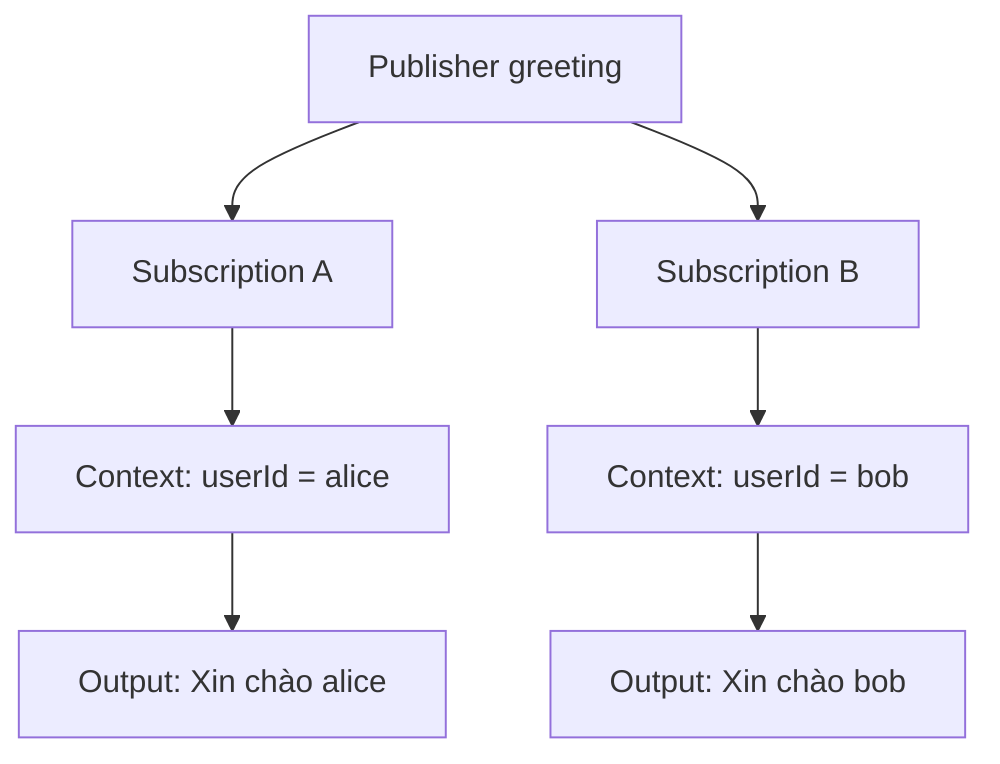
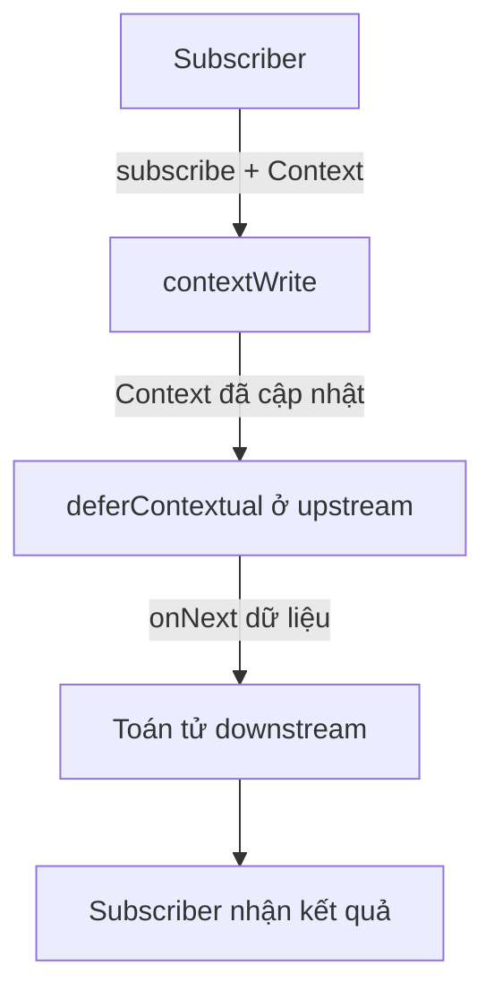

# Ngữ cảnh yêu cầu và dữ liệu đi kèm vòng đời đăng ký

Trong module `REACTIVE_PROGRAMMING`, ta học cách tổ chức các luồng sự kiện bất đồng bộ theo hợp đồng Publisher–Subscriber và cơ chế backpressure của Reactive Streams, đồng thời thực hành `Mono`, `Flux`, toán tử, scheduler, xử lý lỗi và kiểm thử pipeline trong hệ sinh thái Java. Khi một request đi qua nhiều bước xử lý, các bước đó thường cần dùng chung một số metadata như mã tương quan, tenant, người dùng hiện tại, locale hoặc deadline. Nếu truyền tất cả metadata như tham số của mọi hàm, chữ ký phương thức sẽ phình to và các toán tử trung gian phải biết những thông tin không thuộc trách nhiệm của chúng.

Reactor cung cấp **Context** để gắn metadata với một subscription. Context đi cùng vòng đời đăng ký của subscriber và có thể được đọc ở các nguồn hoặc toán tử nằm upstream. Nhờ đó, các thành phần trong pipeline có thể truy cập thông tin của request mà không cần đưa metadata vào từng phần tử `onNext`.

Context có vai trò khác với dữ liệu nghiệp vụ. `Order`, `Payment` hoặc `TemperatureReading` là dữ liệu được phát qua stream; `traceId`, `tenantId` hoặc thông tin xác thực là metadata mô tả ngữ cảnh xử lý của subscription. Phân biệt hai nhóm này giúp pipeline rõ ràng, dễ kiểm thử và tránh làm rò rỉ metadata vào payload không cần thiết.

## 1. Context gắn với subscription

Trong Reactive Streams, một Publisher có thể được nhiều subscriber đăng ký. Mỗi subscriber tạo một subscription riêng và có vòng đời riêng. Reactor Context được gắn với subscriber đó, vì vậy cùng một Publisher có thể được tiêu thụ trong các ngữ cảnh khác nhau.

Ví dụ, một Publisher tạo lời chào dựa trên người dùng hiện tại:

```java
static final String USER_ID = "userId";

Mono<String> greeting = Mono.deferContextual(context ->
    Mono.just("Xin chào " + context.get(USER_ID))
);
```

Publisher `greeting` không cố định một người dùng khi được lắp ráp. Mỗi subscription cung cấp Context riêng:

```java
Mono<String> forAlice = greeting
    .contextWrite(Context.of(USER_ID, "alice"));

Mono<String> forBob = greeting
    .contextWrite(Context.of(USER_ID, "bob"));
```

Hai subscription có thể nhận hai kết quả khác nhau dù cùng bắt đầu từ một mô tả Publisher. Context không phải một biến toàn cục dùng chung cho mọi request; nó là dữ liệu gắn với subscriber đang thực hiện subscription.



Context không tạo thêm `onNext` để truyền metadata. Nó là một phần của execution context mà Reactor cung cấp cho các toán tử trong quá trình đăng ký và xử lý tín hiệu.

## 2. `Context` và `ContextView`

Reactor có hai kiểu thường gặp:

- `Context` là cấu trúc dữ liệu bất biến dùng để xây dựng hoặc cập nhật context.
- `ContextView` là giao diện chỉ đọc, thường được cung cấp cho callback cần truy cập metadata.

Có thể tạo Context ban đầu bằng `Context.of`:

```java
Context requestContext = Context.of(
    "traceId", "trace-7f31",
    "tenantId", "tenant-acme"
);
```

`Context` bất biến: các thao tác như `put` trả về một Context mới, không sửa instance ban đầu. Điều này giúp mỗi subscription có thể tạo một phiên bản context riêng mà không vô tình thay đổi metadata của subscription khác.

```java
Context base = Context.of("traceId", "trace-7f31");
Context withTenant = base.put("tenantId", "tenant-acme");
```

Sau lệnh trên, `base` vẫn chỉ chứa `traceId`; `withTenant` chứa cả hai key. Không được đưa `null` vào Context. Nếu một metadata chưa có, hãy bỏ key đó hoặc dùng một kiểu giá trị biểu diễn trạng thái vắng mặt rõ ràng.

Khi đọc Context, dùng `ContextView`:

```java
Mono<String> trace = Mono.deferContextual(context ->
    Mono.just(context.getOrDefault("traceId", "no-trace"))
);
```

`get(key)` yêu cầu key phải tồn tại và sẽ báo lỗi nếu không có. `getOrDefault(key, defaultValue)` phù hợp khi metadata là tùy chọn. Nếu thiếu key là vi phạm hợp đồng của request, dùng `get` để lỗi xuất hiện rõ ràng thay vì âm thầm thay bằng giá trị mặc định.

## 3. Đưa metadata vào pipeline bằng `contextWrite`

`contextWrite` bổ sung hoặc cập nhật Context mà các toán tử upstream có thể đọc trong quá trình subscription. Ví dụ:

```java
static final String TRACE_ID = "traceId";

Mono<String> loadProfile() {
    return Mono.deferContextual(context -> {
        String traceId = context.get(TRACE_ID);
        return profileClient.fetch(traceId);
    });
}

Mono<Profile> profile = loadProfile()
    .contextWrite(context -> context.put(TRACE_ID, "trace-42"));
```

`contextWrite` nằm phía downstream của `deferContextual` trong cách viết pipeline, nhưng Context được truyền ngược trong quá trình subscribe. Vì vậy, `deferContextual` ở upstream nhìn thấy `traceId` đã được thêm.

Có thể cung cấp nhiều metadata cùng lúc:

```java
Mono<Profile> profile = loadProfile()
    .contextWrite(Context.of(
        TRACE_ID, "trace-42",
        "tenantId", "tenant-acme",
        "locale", Locale.forLanguageTag("vi-VN")
    ));
```

Nếu cần bổ sung một key mà vẫn giữ các key do subscriber cung cấp, dùng dạng function:

```java
Mono<Result> result = source
    .contextWrite(context -> context.put("component", "profile-service"));
```

Dạng function nhận Context hiện có và trả về Context mới. Đây là cách thích hợp khi một tầng chỉ muốn thêm metadata thuộc trách nhiệm của nó mà không thay toàn bộ context của request.

### Hướng truyền của Context

Context đi theo hướng ngược với tín hiệu dữ liệu. Khi subscribe, subscriber ở cuối pipeline cung cấp Context; các toán tử `contextWrite` sửa Context trước khi đăng ký vào upstream. Khi dữ liệu phát ra, `onNext` lại đi từ upstream xuống downstream.



Vì hướng truyền khác nhau, vị trí `contextWrite` rất quan trọng. Đặt nó sau một nguồn trong chuỗi biểu thức có thể làm Context sẵn có cho nguồn đó; đặt nó ở một nhánh không thuộc subscription đang đọc Context sẽ không tự động cung cấp metadata cho nhánh khác.

## 4. Đọc Context bằng `deferContextual`

`deferContextual` tạo Publisher theo Context của subscription hiện tại. Nó hữu ích khi cần đọc metadata rồi mới chọn nguồn hoặc tạo lời gọi tiếp theo.

Ví dụ, truy vấn repository theo tenant:

```java
static final String TENANT_ID = "tenantId";

Mono<Order> findOrder(String orderId) {
    return Mono.deferContextual(context -> {
        String tenantId = context.get(TENANT_ID);
        return orderRepository.findByTenantAndId(tenantId, orderId);
    });
}

Mono<Order> order = findOrder("order-100")
    .contextWrite(Context.of(TENANT_ID, "tenant-acme"));
```

Ở đây, `tenantId` là metadata của request và được dùng để xác định phạm vi truy vấn. Nếu tenant là một phần của dữ liệu nghiệp vụ hoặc cần được xác thực độc lập tại repository, vẫn nên truyền nó qua API nghiệp vụ phù hợp; Context không thay thế kiểm tra quyền truy cập hay ràng buộc dữ liệu.

Một pipeline có thể đọc Context ở nhiều điểm:

```java
Mono<Receipt> createOrder(CreateOrder command) {
    return Mono.deferContextual(context -> {
        String tenantId = context.get(TENANT_ID);
        String traceId = context.getOrDefault(TRACE_ID, "no-trace");

        return orderService.create(tenantId, command)
            .flatMap(order -> receiptService.create(order, traceId));
    });
}
```

Callback chỉ đọc những key cần thiết. Nên định nghĩa key tập trung dưới dạng hằng số hoặc kiểu key riêng để tránh lỗi chính tả và xung đột tên giữa các thư viện.

## 5. Context đi qua `flatMap` và các Publisher con

Khi một toán tử như `flatMap` tạo Publisher con, Reactor truyền Context của subscriber đến subscription của nhánh con theo cơ chế của pipeline. Vì vậy, `deferContextual` trong Publisher con có thể đọc metadata của request:

```java
Flux<Receipt> receipts = orderIds
    .flatMap(orderId -> Mono.deferContextual(context -> {
        String tenantId = context.get(TENANT_ID);
        return receiptRepository.findByTenantAndOrderId(
            tenantId, orderId
        );
    }), 8)
    .contextWrite(Context.of(TENANT_ID, "tenant-acme"));
```

Tất cả Publisher con được tạo trong subscription này đều có thể truy cập `tenantId`. Tham số concurrency `8` giới hạn số nhánh đang hoạt động đồng thời; Context không thay đổi quy tắc demand hoặc giới hạn concurrency của `flatMap`.

Nếu mỗi phần tử cần metadata khác nhau, metadata đó thường là dữ liệu của phần tử và nên được truyền qua payload hoặc tham số của hàm ánh xạ. Context phù hợp với thông tin chung cho toàn subscription, chẳng hạn tenant, trace ID hoặc deadline. Không nên ghi đè Context chung trong mỗi nhánh chỉ để mang dữ liệu riêng của phần tử vì các nhánh có thể chạy đồng thời.

## 6. Context và chuyển thread bằng Scheduler

Context gắn với subscription chứ không gắn với một thread cụ thể. Vì vậy, `publishOn` hoặc `subscribeOn` có thể chuyển callback sang thread khác mà Context vẫn có thể được đọc qua API Reactor.

```java
Mono<String> result = Mono.deferContextual(context ->
        Mono.just(context.get(TRACE_ID))
    )
    .publishOn(Schedulers.parallel())
    .map(traceId -> "processed-" + traceId)
    .contextWrite(Context.of(TRACE_ID, "trace-99"));
```

`deferContextual` đọc Context của subscription. `publishOn` chuyển các tín hiệu downstream sang worker của scheduler `parallel`; việc chuyển thread không làm mất Context trong pipeline Reactor. Các toán tử downstream cũng có thể truy cập Context bằng `deferContextual` hoặc callback cung cấp `Signal` có ContextView.

Điều này khác với `ThreadLocal`. `ThreadLocal` lưu dữ liệu theo thread hiện tại; khi pipeline chuyển thread, callback có thể nhìn thấy một giá trị khác hoặc không có giá trị. Reactor Context lưu metadata theo subscription nên không phụ thuộc vào việc thread có giữ nguyên hay không.

Nếu thư viện cũ chỉ đọc `ThreadLocal`, không nên giả định Reactor Context tự động đồng bộ giá trị vào đó trong mọi cấu hình. Cần dùng cơ chế tích hợp context propagation phù hợp với phiên bản Reactor và thư viện đang sử dụng, đồng thời cấu hình accessor/hook theo tài liệu của stack. Khi có thể, ưu tiên API nhận metadata tường minh hoặc đọc Reactor Context trực tiếp.

## 7. Ghi log và tracing từ Context

Trace ID là một ví dụ điển hình của metadata cần đi cùng toàn bộ request. Có thể đọc nó ở một bước reactive và đưa vào log:

```java
Mono<Order> order = orderService.find(orderId)
    .doOnEach(signal -> {
        if (signal.isOnNext()) {
            String traceId = signal.getContextView()
                .getOrDefault(TRACE_ID, "no-trace");
            log.info("trace={} order={}", traceId, signal.get());
        }
    })
    .contextWrite(Context.of(TRACE_ID, incomingTraceId));
```

`doOnEach` nhận một `Signal<T>` của Reactor; `getContextView()` cho phép đọc Context gắn với tín hiệu. Trong ví dụ, chỉ log khi có `onNext`, nên `signal.get()` có giá trị. Nếu log cả `onError` hoặc `onComplete`, phải kiểm tra loại tín hiệu trước khi truy cập payload.

Context có thể chứa trace ID, nhưng việc tạo span, kết thúc span và truyền trace qua HTTP hoặc message broker vẫn cần instrumentation phù hợp. Chỉ đặt một chuỗi `traceId` vào Context không tự tạo distributed trace hoặc tự thêm header vào request mạng.

## 8. Context trong nguồn dùng chung và nhiều subscriber

Với Publisher lạnh, mỗi subscription thường có thể có Context riêng và thực thi nguồn riêng. Nhưng khi chia sẻ một nguồn bằng `share`, `publish`, `replay` hoặc một cơ chế multicast, nhiều subscriber có thể cùng tiêu thụ một subscription upstream. Một subscription upstream chỉ có một Context tại một thời điểm; nó không thể đồng thời đại diện cho tenant hoặc trace riêng của nhiều subscriber.

Ví dụ, nếu đặt việc đọc `tenantId` ở phía upstream của một ranh giới multicast, cần xác định subscription nào sở hữu Context được dùng để thực thi nguồn. Không nên giả định mỗi subscriber downstream sẽ làm nguồn upstream chạy với Context riêng.

Khi cần chia sẻ dữ liệu đã tải, có thể tách phần tải dùng chung khỏi phần xử lý phụ thuộc subscriber:

```java
Flux<Product> sharedProducts = productRepository.findAll()
    .cache();

Flux<ProductView> views = sharedProducts
    .flatMap(product -> Mono.deferContextual(context -> {
        String locale = context.getOrDefault("locale", "vi-VN");
        return productViewService.toView(product, locale);
    }));
```

Ở đây, dữ liệu sản phẩm được chia sẻ. Việc tạo `ProductView` diễn ra downstream theo Context của từng subscriber. Cách này phù hợp khi phần dữ liệu dùng chung không phụ thuộc tenant hoặc quyền của từng người dùng. Nếu truy vấn gốc phải lọc theo tenant hoặc authorization, không được cache chung giữa các tenant; hãy phân vùng cache theo key an toàn hoặc tạo nguồn riêng theo từng Context.

## 9. Context không thay thế payload hoặc cơ chế bảo mật

Context phù hợp cho metadata xuyên suốt một subscription, nhưng không phải nơi chứa mọi dữ liệu. Hãy dùng payload hoặc tham số thông thường khi giá trị:

- Là một phần của sự kiện hoặc kết quả nghiệp vụ.
- Khác nhau giữa từng phần tử trong cùng một Flux.
- Cần được lưu trữ, serialize hoặc gửi sang hệ thống khác như dữ liệu chính thức.
- Cần được nhìn thấy rõ trong chữ ký API để thể hiện phụ thuộc nghiệp vụ.

Không dùng Context làm bằng chứng rằng request đã được xác thực. Nếu lưu principal hoặc thông tin quyền trong Context, giá trị đó phải được tạo từ ranh giới xác thực đáng tin cậy và downstream vẫn phải kiểm tra quyền phù hợp. Tránh lưu secret không cần thiết, tránh log token và không cho phép dữ liệu do client tự gửi trực tiếp quyết định tenant hoặc quyền truy cập.

Context cũng không phải kho lưu trữ bền vững. Nó tồn tại theo subscription và không tự được ghi vào database, truyền qua process khác hoặc khôi phục sau khi ứng dụng khởi động lại.

## 10. Kiểm thử Context theo từng subscription

Có thể dùng `StepVerifierOptions.withInitialContext` để tạo Context ban đầu cho một subscriber:

```java
Mono<String> greeting = Mono.deferContextual(context ->
    Mono.just("hello-" + context.get(USER_ID))
);

StepVerifier.create(
        greeting,
        StepVerifierOptions.create()
            .withInitialContext(Context.of(USER_ID, "alice"))
    )
    .expectNext("hello-alice")
    .verifyComplete();

StepVerifier.create(
        greeting,
        StepVerifierOptions.create()
            .withInitialContext(Context.of(USER_ID, "bob"))
    )
    .expectNext("hello-bob")
    .verifyComplete();
```

Hai lần kiểm thử đăng ký cùng Publisher với Context khác nhau và nhận kết quả tương ứng. Điều này xác nhận metadata gắn với subscription, không bị lưu cố định trong biến toàn cục của Publisher.

Có thể kiểm tra một Context được bổ sung qua `contextWrite`:

```java
Mono<String> trace = Mono.deferContextual(context ->
    Mono.just(context.get(TRACE_ID))
).contextWrite(context -> context.put(TRACE_ID, "trace-test"));

StepVerifier.create(trace)
    .expectNext("trace-test")
    .verifyComplete();
```

Ngoài kết quả dữ liệu, `StepVerifier` còn hỗ trợ kiểm tra Context có thể truy cập ở subscription:

```java
StepVerifier.create(
        greeting,
        StepVerifierOptions.create()
            .withInitialContext(Context.of(USER_ID, "alice"))
    )
    .expectAccessibleContext()
    .contains(USER_ID, "alice")
    .then()
    .expectNext("hello-alice")
    .verifyComplete();
```

Trong ví dụ cuối, cần cung cấp Context `alice` cho subscriber, chẳng hạn bằng `StepVerifierOptions` như ví dụ đầu. `expectAccessibleContext()` kiểm tra hợp đồng Context của subscription; `then()` chuyển lại phần xác minh tín hiệu dữ liệu.

## 11. Những lỗi thường gặp

| Sai lầm | Hệ quả | Cách xử lý |
|---|---|---|
| Đọc Context như thể nó đi theo `onNext` | Nhầm metadata của subscription với dữ liệu phần tử | Dùng `deferContextual` hoặc `Signal.getContextView()` |
| Đặt `contextWrite` sai phía của ranh giới | Toán tử cần metadata không nhìn thấy key | Nhớ Context truyền ngược trong quá trình subscribe |
| Dùng `ThreadLocal` làm nguồn sự thật | Metadata có thể mất khi chuyển scheduler | Dùng Reactor Context hoặc tích hợp propagation có cấu hình |
| Lưu dữ liệu riêng từng phần tử trong Context | Các nhánh đồng thời có thể dùng nhầm metadata | Đưa dữ liệu theo từng phần tử vào payload |
| Chia sẻ nguồn có lọc tenant nhưng cache chung | Có nguy cơ lộ dữ liệu giữa tenant | Phân vùng nguồn/cache theo phạm vi bảo mật |
| Giả định multicast có Context riêng cho từng subscriber upstream | Một subscription upstream chỉ có một Context | Đặt xử lý phụ thuộc subscriber ở downstream của ranh giới chia sẻ |
| Lưu secret rồi ghi toàn bộ Context vào log | Rò rỉ thông tin nhạy cảm | Chỉ đọc và log các key được phép |

## 12. Quy trình thiết kế Context cho request

Khi đưa metadata vào một pipeline reactive, hãy xác định:

1. **Metadata nào thuộc toàn request?** Ví dụ trace ID, tenant ID, locale, principal đã xác thực hoặc deadline.
2. **Metadata nào thuộc từng phần tử?** Nếu giá trị thay đổi giữa các phần tử, hãy đưa nó vào payload hoặc tham số hàm.
3. **Ai tạo Context?** Tạo ở ranh giới đáng tin cậy như WebFilter, controller adapter hoặc message listener sau khi xác thực và kiểm tra request.
4. **Toán tử nào cần đọc Context?** Dùng `deferContextual` cho nguồn trì hoãn hoặc `Signal.getContextView()` cho callback quan sát tín hiệu.
5. **Context được bổ sung ở đâu?** Dùng `contextWrite` tại ranh giới subscriber sao cho các toán tử upstream cần metadata có thể đọc được.
6. **Pipeline có chia sẻ upstream không?** Xem xét `share`, `cache`, multicast và tránh dùng một Context upstream cho nhiều subscriber có metadata riêng.
7. **Có chuyển scheduler không?** Reactor Context vẫn gắn với subscription; kiểm tra riêng các tích hợp `ThreadLocal` nếu dùng thư viện cũ.
8. **Có kiểm thử nhiều subscriber không?** Dùng `StepVerifierOptions.withInitialContext` để xác nhận Context không bị rò giữa các subscription.

Reactor Context giúp metadata đi cùng vòng đời đăng ký mà không biến nó thành payload của mọi phần tử. Khi hiểu Context là dữ liệu gắn với subscriber, biết cách bổ sung bằng `contextWrite`, đọc bằng `deferContextual` và đặt ranh giới chia sẻ đúng chỗ, ta có thể truyền trace, tenant và thông tin request qua pipeline `Mono`/`Flux` một cách rõ ràng. Context vẫn cần được tạo từ nguồn đáng tin cậy, giới hạn đúng phạm vi và kiểm thử theo từng subscription để tránh rò dữ liệu giữa các request.
